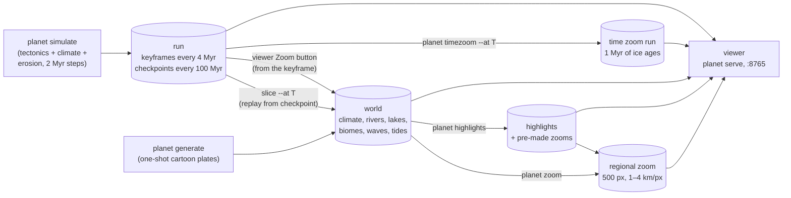
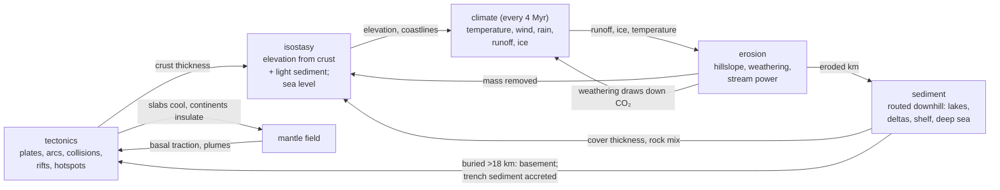
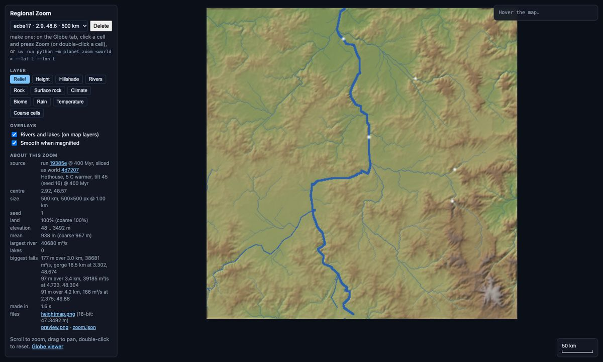

# procgen_world: overview

*Written 2026-10-14 from the code at a3ed559. Where older docs disagree, the code wins.*

## What it is

procgen_world builds planets by simulating them, not by painting noise.

- **Run:** it starts with one supercontinent, and plate tectonics plays out for 0.5–2 billion years in 2 Myr steps. Meanwhile a climate model, rivers and erosion wear the land down and pile up sediment.
- **World:** any moment of a run can become one. A world is a snapshot with climate, rivers, lakes, biomes, waves and tides on ~41,000 cells of ~110 km.
- **From a world**, you can make:
  - a **regional zoom**: a 500×500 px landscape at 1–4 km/px, with valleys, lakes, deltas and waterfalls;
  - a **glacial time zoom**: 1 Myr of ice ages in 500-year steps.

A three.js browser viewer shows all of these. The physics is "toy but physical": each process is a cheap version of a named real-world mechanism, tuned against Earth. Runs are deterministic given seed and settings.

## 1. The grid

The planet is an **icosphere**: an icosahedron whose triangles are split into four, `level` times. Each vertex becomes a cell, so the cells are hexagons plus exactly 12 pentagons (Euler's formula; see `planet/grid.py`). There are 10·4^L + 2 cells:

| Level | Cells | Cell size |
|---|---|---|
| 5 | 10k | ~220 km |
| 6 (default) | 41k | ~110 km |
| 7 | 164k | ~55 km |
| 8 | 655k | ~28 km |

Every field is a flat NumPy array, one value per cell. Neighbour lists are CSR arrays that the numba kernels loop over. The cells of a coarser level are a prefix of the finer level's, so the ocean model can run at level 5 inside a level-6 world.

**World frame vs plate frame** is the key data-structure idea:
- Each plate keeps its crust (age, thickness, rock, sediment) on its **own private copy of the whole grid**, plus a rotation saying where that copy currently sits.
- Moving a plate only changes the rotation. Crust is never resampled, so plate interiors never blur.
- Each step, every world cell looks up which plate cell lies under it. The physics runs on these gathered world arrays, and the results are scattered back.
- Climate, the mantle and sea level live only in the world frame.

## 2. Tectonics (`planet/tectonics/`)

**Who owns a cell.** After the plates rotate, `plate_kernels.resolve` looks at each world cell:
- **Several plates overlap it:**
  - Continental crust beats oceanic, and between two oceans the younger floor wins. The loser's crust there is deleted: that deletion *is* **subduction**.
  - Continent against continent is a **collision**: the loser's thickness is stacked onto the winner, which becomes mountain-belt (orogen) rock.
- **No plate covers it:** the cell becomes new 7 km ocean floor of age 0, i.e. a **mid-ocean ridge**.

**Motion from forces.** Velocities are solved each step from a force balance (`motion.py`):
- **Forces:**
  - **slab pull**, the strongest: a sinking slab drags its plate toward the trench, and old, dense slabs pull harder;
  - **ridge push**, away from spreading ridges;
  - **collision drag**;
  - **basal traction** from the mantle;
  - a small random wander.
- **Solving:** the forces become torques. A drag matrix turns them into each plate's angular velocity (its Euler pole). Continental keels feel 2.5× the drag.
- **Inertia and cap:** velocities relax toward the solution over 15 Myr, which acts like inertia, and are capped at 18 cm/yr.

**The mantle (B′, `mantle.py`).** A smooth world-frame temperature anomaly: spherical harmonics of degree 1–8 with a 2500 km smoothing scale and a 200 Myr memory.
- **Cooling:** trenches cool it ("slab graveyards").
- **Warming:** continents insulate it. A continent parked for ~100 Myr warms the mantle under it.
- **Effect on plates:** they are dragged toward cold mantle, and a random eddy field stands in for smaller convection.
- **Hotspots:** new plumes favour warm mantle, especially its edges.

**The supercontinent cycle** emerges; no rule makes it happen:
1. Continents gather over the cold slab graveyards.
2. Where they collide and stall for ~30 Myr they **suture** into one plate.
3. The assembled continent warms the mantle under itself until the traction stretches it apart.
4. **Rifting** (`events.py`):
   - It tries 12 cuts across each big plate and solves each half's motion.
   - A plate splits if the halves separate fast enough, scaled up for big plates and down by the rock's strength along the cut.
   - Weak lines are young sutures, thinned crust and plume swells. Old cratons resist.
   - Pieces with 0.3–3% of the surface as continent are forbidden, so breakup gives a few big blocks.
5. Ocean floor ages until an old passive margin starts to subduct, breaking off a ~6000 km basin.

On four seeds the largest landmass passed 25% of the surface every 400–870 Myr. That is not guaranteed.

*World ffb5bd (run 6d9dcf at 940 Myr), mid-assembly. The largest landmass is 24% of the surface. Numbered rings are highlights.*

*Run 01b0f7 at 976 Myr, plates layer. Bright colours are continental crust and dark colours oceanic. Red edges converge and cyan edges diverge. Arrows near the poles look exaggerated on the flat map.*

**Crust and elevation:**
- **Building crust:**
  - Subduction grows **volcanic arcs**.
  - Collisions stack crust, and over-thick crust **flows** outward, widening plateaus.
  - Rifts thin continents.
  - Hotspots build islands and flood basalts under a ~1 km swell.
- **Crust budget:** a "thermostat" steers arc growth and subduction erosion toward the target continental fraction (40%).
- **Elevation is isostasy:** crust floats on the mantle like wood on water (Airy isostasy).
  - Continents stand 250 m plus 150 m per km of crust beyond 35 km.
  - Ocean floor sinks as it cools: 2600 + 345·√age m, the half-space cooling law.
- **Sediment** is lighter than crust: 2.1 g/cm³, compacting to 2.6. Filling deep water takes ~3× its depth in sediment, as on Earth. Below 18 km it becomes basement.
- **Sea level** follows mean ocean depth relative to its 300 Myr average, plus land ice. Young, shallow oceans raise it.
- **Global temperature** combines a slow drift, CO₂ (sources: new sea floor and arcs; sink: weathering) and ice-albedo.

**One step** (`Simulation.step`, 2 Myr):
1. Move the plates.
2. Resolve ownership.
3. Find the boundaries.
4. Update the mantle.
5. Physics: crust, arcs, hotspots, collisions, stretching, crust flow, temperature, climate every 4 Myr, erosion, sediment.
6. Solve the forces for the next step.
7. Events: sutures, slivers absorbed, at most one rift.

Together these form a loop:
- Erosion strips mountains, and isostasy partly lifts them back.
- Sediment loads basins and builds shelves.
- Climate decides where erosion happens.
- Weathering draws down CO₂.

## 3. Surface: erosion, sediment, rocks (`surface.py`, `earth.py`)

**Rocks.** Each cell has a basement rock and, on top of it, a **sediment cover** whose mix of ingredients is tracked.
- **Basement:** ocean crust, hotspot basalt, arc, sediment-born continent, orogen, craton.
- **Cover:** limestone (reefs), sandstone, shale, evaporite (salt from hot closed lakes and flats), coal (warm swamps).
- **Erodibility** runs from 0.3 (craton) to 3.0 (evaporite).

**Erosion** runs every step and is scaled by rain:
- **hillslope diffusion** smooths relief;
- **weathering** lowers land toward a base level;
- **stream-power incision** cuts valleys at a rate ∝ √(drainage area) × slope. It uses Braun & Willett's implicit scheme, which stays stable at 2 Myr steps.

**Deposition.** Eroded material follows the drainage (§5):
- pits, lakes and floodplains keep a share;
- deltas fill to +2 m and shelves to −60 m;
- the rest spreads over the deep sea floor or is trapped in trenches, where part is scraped onto the overriding plate.

## 4. Climate (`climate.py`, `ocean.py`)

`climate.compute` is a **diagnostic, steady-state** model: a chain of physically motivated maps and relaxations, not a general circulation model with time steps. It takes ~0.65 s at level 6. The year has two halves, and monthly values are rebuilt as sinusoids.

- **Temperature:**
  - It starts from latitude, on an energy-balance curve with polar amplification.
  - Air cools 6.5 °C/km with height (the **lapse rate**).
  - Seasons scale with the axial tilt.
  - **Continentality** comes from carrying air temperatures along the seasonal winds, so interiors swing and windward coasts stay mild.
  - Ice is 10 °C colder (albedo).
- **Winds:**
  - The three-cell pattern (**Hadley/Ferrel/polar**: trades, westerlies, polar easterlies), shifted with the season.
  - **Monsoon** winds from land–sea pressure contrasts.
  - Ground above 1.5 km turns the wind along its slope.
- **Jet stream:** from the **thermal wind** relation, so it is fastest where the north–south temperature gradient is sharpest. Storm tracks are carried along it and drive frontal rain and waves.
- **Ocean gyres:**
  - A wind-driven **Stommel** streamfunction, solved by over-relaxation, gives closed gyres and fast **western boundary currents**.
  - Unbroken latitude bands get a **circumpolar current**.
  - Sea-surface temperature (SST) is carried along the currents, with **coastal and equatorial upwelling**.
- **Overturning** (`ocean.py`, run on the level-5 grid):
  - Salinity comes from evaporation minus rain, rivers, sea-ice export and meltwater.
  - Density comes from temperature and salinity.
  - Deep water sinks where the winter sea is densest, poleward of 50° (Stommel's flow law).
  - The replacement inflow follows the currents, like the **AMOC**'s North Atlantic Drift, and warms Norway.
- **Rain:**
  - Moisture evaporates from the sea (Clausius–Clapeyron) and is carried by the winds.
  - It rains out three ways: as **orographic rain**, which gives wet windward slopes and **rain shadows**; as **convection**; and along storm tracks.
  - The **ITCZ** is wet and the subtropics are dry. Land recycles part of its rain.
- **Classification:** **Köppen** classes (Peel 2007 rules) from monthly temperature and rain. **Biomes** from a Whittaker-style lookup.
- **Water balance:**
  - potential evaporation from sunshine and temperature (**Oudin**);
  - actual evaporation from the **Budyko** curve (Fu's form);
  - runoff = rain − actual evaporation.

*World 7c5adf (Earth-like A, 976 Myr), Köppen classes.*

*The model's temperature and currents on real Earth terrain (world 2f38e3). Gyres, the Gulf Stream, the Kuroshio and the Antarctic Circumpolar Current emerge.*

*Overturning on Earth (from `docs/review/ocean/`). Top: sinking in the Nordic and Labrador seas and off Antarctica, and the inflow riding the Gulf Stream. Bottom: the warming it adds.*

## 5. Rivers and lakes (`hydrology.py`)

**Routing:**
- Water drains by **priority-flood** (Barnes 2014): from the sea, cells are visited lowest first. Every cell gets one downstream neighbour, and every pit fills to its spill level.
- **Flow accumulation** sums runoff downstream.

**Lakes** are **fill-and-spill** with evaporation:
1. Water rises in all basins at once, and basins merge as they meet.
2. A basin grows only while its inflow beats the evaporation off its surface.
3. How it ends:
   - It reaches its spill point: an **open, fresh lake**, and the river flows on.
   - It stops first: a **closed salt lake** (the Caspian, Great Salt Lake).
   - It is a dry pit: a **salt pan** (playa).

On Earth's terrain this closes the Caspian, Aral, Tarim and Altiplano basins, and ~21% of land drains inland (Earth: ~18%).

## 6. Coasts: waves, tides, deltas (`coast.py`)

- **Wave power** (kW per m of coast):
  - 16 rays are traced upwind from each sea cell.
  - Walking back in, the sea grows with **fetch** (open water under the wind) and storm duration (**JONSWAP**), up to a fully developed **Pierson–Moskowitz** sea.
  - It then travels on as swell, which decays slowly and loses energy over shelves. Land and sea ice stop it.
- **Tide range** is a three-factor proxy:
  - connection to the open ocean, which shallow straits choke;
  - **shelf resonance**, strongest at about a quarter tidal wavelength;
  - **funnelling** into narrowing bays.
- **Delta type** (Galloway's triangle) compares three fluxes at big river mouths:
  - the river's sediment (**BQART**);
  - wave-driven longshore transport (**CERC**);
  - the **tidal prism**.

  Their shares give river, wave and tide weights, and the zoom shapes the delta from them.

*Wave power on 7c5adf: the westerly storm belts and their swell, with calm water in their lee.*

## 7. Runs, keyframes, checkpoints, worlds (`timeline.py`, `store.py`, `world.py`)

**`planet simulate`** writes `runs/<id>/`:
- **Keyframes** every 4 Myr: ~20 layers as small integers, one `.bin` per layer holding every frame. The viewer fetches only what it draws.
- **Checkpoints** of the full state every 100 Myr (~23 MB at level 6).
- **Metadata:** `run.json` (settings, events, stats), a readable `run.txt`, and the code version (git commit plus a hash of `planet/**/*.py`).

**`planet slice <run> --at T`** turns a moment into a **world**:
1. Replay from the nearest checkpoint.
2. Check the result against the keyframe, and refuse to save on a mismatch (the code changed since the run).
3. `world.finish`:
   - add sub-cell texture;
   - climate, then 12 erosion passes, then climate again;
   - rivers and lakes;
   - biomes;
   - waves and tides.

The viewer's Zoom button instead builds the world straight from the keyframe in seconds. Worlds are `worlds/<id>.json` plus a `.txt` summary.

Two other ways to get a world:
- `tools/earth_world.py` runs real Earth terrain through the same pipeline and keeps observed climate alongside.
- `planet generate` makes a quick, unsimulated world.

## 8. The regional zoom (`zoom.py`)

A zoom turns ~110 km cells into a 500×500 px landscape: 1000 km at 2 km by default, or 500 km at 1 km. It adds detail while keeping each coarse cell's mean. The passes:

1. **Coastline:** coarse fields are interpolated onto the pixels, and a warped-noise coastline is drawn.
2. **Relief:** noise is added, scaled by rock ruggedness (cratons smooth, orogens rough), then corrected back to each cell's coarse mean.
3. **Deltas** form at mouths above 1500 m³/s, shaped continuously by the Galloway weights:
   - **river:** levee-bound fingers (a bird's foot);
   - **wave:** a smooth arc with barrier, lagoon and beach ridges;
   - **tide:** funnel estuaries, creeks and flats.
   Below the apex, **distributaries** split the flow.
4. **Rivers and lakes:**
   - Coarse rivers become meandering, carved valleys, and rivers entering at the edge bring their discharge.
   - Lakes take the world's level and kind. Open lakes pass their water on; closed ones keep it.
5. **Landscape pass:** 15 iterations of steady-state stream power (slope ∝ discharge^−0.5). These **grade** rivers into smooth concave profiles.
6. **Knickpoint waterfalls:**
   - Grading would erase falls. So where the coarse river drops steeply (≥ 50 m of extra drop, ≥ 100 m³/s), the zoom keeps a **knickpoint**: a resistant lip, a plunge pool, and a gorge retreated upstream.
   - Heights are scaled so the plateau above never rises over the coarse ground. Big rivers get ~50–150 m falls.
   - `stats.waterfalls` in `zoom.json` lists the biggest.

Each zoom writes a 16-bit `heightmap.png`, a `preview.png`, its layers and its stats.

*Delta types in three 600 km zooms of world 0f7abd: a bird's foot into a calm sea; a smooth wave-built coast; tidal funnels with 6.6 m tides.*

*Zoom ecbe17 (500 km at 1 km). White dots are falls; the biggest is 177 m at 38,700 m³/s, below an 18.5 km gorge.*

## 9. The glacial time zoom (`timezoom.py`)

A separate, view-only simulation. Geology is frozen at one moment of a run (or at today's Earth), and ice sheets evolve for 1 Myr in 500-year steps (100 or 300 kyr from the viewer).

- **Forcing:** **Milankovitch** cycles of obliquity, precession and eccentricity.
- **Ice:** snow minus **positive-degree-day** melt. Flow uses the **shallow-ice approximation**.
- **Bed and sea:** the bed sinks under the ice, marine ice calves, and sea level follows ice volume.
- **Climate:** fully recomputed every 10 kyr and perturbed in between, with CO₂ feedback. Meltwater reaches the overturning.

The result is a run in kyr. The viewer shows it with an ice-thickness layer and a sea-level curve.

## 10. Highlights (`highlights.py`)

Twenty-four detectors look for places worth a visit:

- **Land:** peaks, ranges, plateaus, canyons, rifts, volcanic arcs, hotspot islands.
- **Water and coast:** the biggest rivers, waterfalls, deltas with their type, fjords, coral coasts, salt lakes and pans.
- **Climate:** "wine country", rain shadows, climate records.
- **Variety:** the most varied 1000 km square.

Each scores as kind priority × quality. Results are cached in `worlds/highlights/`. `planet highlights <run> --zoom N` pre-makes zooms of the top N.

## 11. Viewer, server, CLI

- **CLI** (`uv run python -m planet <cmd>`): `simulate`, `slice`, `generate`, `zoom`, `timezoom`, `highlights`, `report`, `list`, `delete`, `show`, `serve`.
- **Server** (`planet serve`, port 8765):
  - `server.py` serves the viewer and the data folders.
  - `api.py` adds `POST /api/zoom`, `POST /api/timezoom`, `GET /api/jobs/<id>` and `GET /api/highlights`.
  - Jobs run one at a time, because the numba kernels aren't thread-safe.
- **Globe** (`viewer/index.html`):
  - three.js, one triangle fan per cell, with exaggerated relief on a globe or a flat map.
  - Runs play as animations with events and plate arrows.
  - Worlds add climate, biome, wave and tide layers.
  - Clicking a cell offers "Zoom".
  - The URL holds the state, e.g. `?world=7c5adf.json&layer=biome&mode=map`.
- **`viewer/zoom.html`** is a 2D canvas, also embedded as the "Regional zoom" tab.

*The viewer on world 7c5adf: biomes, with highlights listed and numbered.*

## 12. How good is it?

`tools/scorecard.py` appends a line per commit to `docs/scorecard.jsonl`. It scores our climate on real Earth terrain against observed Köppen classes, and two 1 Gyr worlds against plausible ranges. As of c8a06d2:

- **Earth's Köppen:** 70.7% agreement on main groups and 38% on exact classes. Log-rain correlation is 0.59. "Agreement" is always `tools/earth_data.koppen_agreement`: the share of land *area* outside Antarctica, where Kottek has a land class, whose model class matches (scorecard, earth_check and the 66% test floor all use it).
- **The two worlds:**
  - land 29–37%;
  - crust volume conserved within 2.4%;
  - mean ocean age 70–111 Myr;
  - plates move 3.6–5.7 cm/yr.

Other checks:
- `tools/earth_check.py`: temperature, rain and river discharge.
- `tools/coast_check.py`: waves and tides.
- `pytest`: invariants, envelopes and golden hashes.

*Model minus observed temperature on Earth (2f38e3). East Antarctica and NE Canada come out too warm.*

**Main weak spots:**
- **Climate:** regional errors (monsoons, the Sahel, continental winters) and weak Southern Ocean waves.
- **Tectonics:**
  - plate counts that sometimes dip to 2–3;
  - slightly high land;
  - fast sea-level swings after reorganisations;
  - thinner continents at level 7.
- **Basins:** generated worlds lose their closed basins over time.
- **Ice:** time zooms glaciate generated worlds too hard.
- **Zoom:** falls are scaled down to fit under the coarse ground.

The full list is on the board: `uv run python issue-tracking/board.py list --open` (see `issue-tracking/README.md`).
