# procgen_world: overview

*Current state as of 2026-10-14 evening (code at 382b370, after the tectsea and zoompolish merges). Every number here was checked against the code; where another doc disagrees, this one and the code win. Open work lives on the board: `uv run python issue-tracking/board.py list --open`. Tickets are cited as PW-NNN.*

**Contents:** 1 What it is · 2 How each subsystem works (2.1 grid · 2.2 tectonics and mantle · 2.3 volcanoes · 2.4 crust, rock record and landforms · 2.5 erosion and sediment · 2.6 climate · 2.7 ocean · 2.8 ice and sea level · 2.9 hydrology · 2.10 coasts · 2.11 worlds · 2.12 highlights · 2.13 regional zoom · 2.14 glacial time zoom · 2.15 viewer and server · 2.16 store and data model · 2.17 tools · 2.18 vegetation · 2.19 satellite view · 2.20 coastal and shallow-sea life) · 3 Calibration · 4 Performance · 5 Outputs to look at · 6 Code map · 7 Glossary

---

## 1. What it is

procgen_world makes planets by **simulating** them, not by painting noise. Mountains are where plates collided, deserts are where the winds arrive dry, rivers follow the land that erosion carved, and every rock layer has a date. Because the whole history is simulated, any place on the planet can be looked at at any moment of its past. That suits games and tabletop campaigns where time matters: the same coast 50 million years earlier, an ice age in a region you know, a volcano chain growing.

The physics is "toy but physical". Each process is a cheap version of a named real-world mechanism and is tuned so Earth's own geography gives Earth-like answers. Earth is a test analogue, not a target: generated planets are meant to be plausible, not copies. Runs are deterministic given the seed and settings.

### The pipeline

| Step | Command | What you get | Scale and cost (level 7) |
|---|---|---|---|
| **Run** | `planet simulate` | 0.5–2 Gyr of plate tectonics, climate, rivers and erosion in 2 Myr steps. A keyframe every 4 Myr for the viewer, a full checkpoint every 100 Myr. | ~164k cells of ~55 km. ~20–25 min per Gyr. |
| **World** | `planet slice <run> --at T` (or the viewer's Zoom button) | One moment, finished: climate with seasons, rivers, lakes, vegetation (and biomes from it), ocean, clouds, waves and tides, landform classes, volcanoes. | Seconds to a few minutes. |
| **Regional zoom** | `planet zoom <world> --lat --lon` | A 500×500 px landscape (250–2000 km across, 0.5–4 km/px) with valleys, lakes, deltas, waterfalls, glaciers, volcanoes, landform-specific terrain and per-pixel vegetation. | ~10–15 s. |
| **Glacial time zoom** | `planet timezoom <run> --at T` | 1 Myr of ice ages in 500-year steps (geology frozen). | ~4 min per 1000 kyr at L6, ~30 min at L7. |
| **Finished world** | `planet finish <timezoom> --kyr N` (or `<run> --at T`) | A world at any kyr of a time zoom: its ice, sunken bed, sea level and climate on the run's geology. | Seconds (L6) to ~1 min (L7). |
| **Highlights** | `planet highlights <run> --at auto --zoom N` | The ~40–55 most interesting places, with pre-made zooms. | Seconds. |

All of these are browsed in a three.js viewer: `planet serve` (http://127.0.0.1:8765/viewer/).

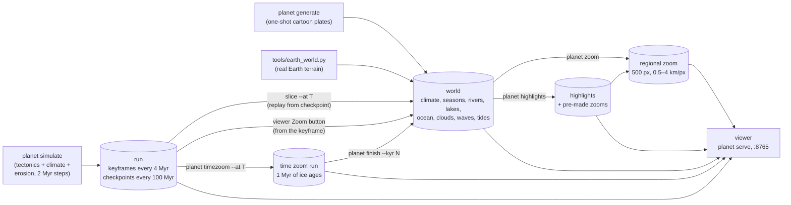

### What you can do with it

- Watch a planet's history as an animation: plates, supercontinents assembling and breaking, ice ages, sea level.
- Pick any moment and get a full world: temperature and rain for July and January, Köppen climates, 60 named vegetation types (from 19 plant types: tree cover, productivity, fire return, stand age), rivers with discharge in m³/s, lakes, salt flats, sea temperature and salinity, cloud and sunshine hours, wave power and tidal range, coral reefs, kelp, seagrass, mangroves and salt marsh (§2.20), and a true-colour satellite view by season (§2.19).
- Zoom into a region at a few hundred metres to a few km per pixel and get a 16-bit heightmap with named features: waterfalls with their heights, deltas with their type, volcanoes with their ages, and terrain shaped by its geology (escarpments, fold ridges, karst, dunes).
- Ask for highlights, including travel ones ("beach: July 28 °C, 10 h of sunshine, warm sea 25 °C, gentle surf").
- Run 1 Myr of ice ages from any moment and watch glaciers advance and the coastline move.

**Not yet built:** resources, settlements and a game export are on the roadmap (PW-184, PW-155, PW-100; `docs/plan_next.md`); vegetation (§2.18) has its world, run and zoom parts and its climate feedbacks, not yet the time zoom (PW-187 steps 7–9). There is no day-scale weather yet (PW-156).

---

## 2. How each subsystem works

Each subsection gives: what it does, the rule in plain language with its real-world analogue, the main parameters, the outputs, and the known limits with their open tickets.

### 2.1 The grid (`planet/grid.py`)

The planet is an **icosphere**: an icosahedron whose triangles are split into four, `level` times. Each vertex is a cell, so the cells are hexagons plus exactly 12 pentagons (Euler's formula forces 12; tick "Highlight the 12 pentagons" in the viewer).

| Level | Cells | Cell spacing | Used for |
|---|---|---|---|
| 5 | 10k | ~220 km | `planet generate` default, ocean overturning solver, tests |
| 6 | 41k | ~110 km | `simulate` default; quick large-scale tests |
| 7 | 164k | ~55 km | showcases (owner's default) |
| 8 | 655k | ~28 km | rare, hours per run |

Every field is a flat NumPy array, one value per cell. Neighbour lists are CSR arrays for the numba kernels. A coarser level's cells are a prefix of the finer level's, so the ocean overturning can run at level 5 inside a level-6 or 7 world.

**World frame vs plate frame**, the key data-structure idea:
- Each plate keeps its crust (age, thickness, rock, sediment, geological record) on its **own private copy of the whole grid**, plus a rotation saying where that copy sits now.
- Moving a plate only changes the rotation. Crust is never resampled, so plate interiors never blur.
- Each step, every world cell looks up which plate cell lies under it, the physics runs on these gathered arrays, and the results are scattered back.
- Climate, the mantle and sea level live only in the world frame.

### 2.2 Tectonics and the mantle (`planet/tectonics/`)

**What it does:** moves 10–30 rigid plates over the sphere, creates and destroys crust where they meet, welds and breaks them, and lets a slowly remembering mantle steer them into supercontinent cycles.

**Who owns a cell** (`plate_kernels.resolve`), after the plates rotate:
- **Several plates overlap it:**
  - Continent beats ocean floor, and between two ocean floors the younger wins. The loser's crust there is deleted: that deletion *is* **subduction**.
  - Continent against continent is a **collision**. The cell's previous owner wins; the loser's thickness is stacked and spread over a belt as mountain-belt (orogen) rock; the belt straddles the suture (stacking and crust flow cross the collision boundary, so no front cell piles up alone: PW-284). Cratons stay cratons. Continental crust that nearest-cell sampling left hidden under the overriding continent is stacked too, not deleted (`cleanup_ghosts`, PW-046).
- **No plate covers it:** it becomes new 7 km ocean floor of age 0, a **mid-ocean ridge**.

**Motion from forces** (`motion.py`). Each step every plate's velocity is solved from a force balance:
- **slab pull**, the strongest: a sinking slab drags its plate toward the trench, more for old, dense floor (× clip(age/80 Myr, 0.3, 1.5)), less the mantle's resistance to the slab sinking through it (`slab_drag` × convergence: Stokes drag), so an 80 Myr slab alone sinks at a terminal 10 cm/yr (PW-288: without it slab-attached plates spread ~8 cm/yr and made the ocean floor twice as fast as Earth's, mean ocean age ~37-41 Myr);
- **ridge push** away from spreading ridges;
- **collision drag**;
- **basal traction** from the mantle field (below);
- a small random wander (an Ornstein–Uhlenbeck process: a random walk pulled back toward zero, ~60 Myr memory).

The forces become torques, and a drag matrix turns them into each plate's rotation (its Euler pole). Continental keels feel 2.5× the drag. Velocities relax toward the solution over 15 Myr (a stand-in for inertia) and are capped at 18 cm/yr at the plate's fastest point. A hotter early mantle (`heat_start` > 1) speeds plates as √heat.

**The mantle (`mantle.py`, the "B′" design).** A smooth world-frame temperature anomaly built from spherical harmonics of degree 1–8 (~2500 km smoothing), with a 200 Myr memory.
- **Cooling:** sinking slabs cool it under trenches ("slab graveyards"), in proportion to convergence × slab age.
- **Warming:** continents insulate it. A continent parked for ~100 Myr warms the mantle under itself.
- **Effect on plates:** basal traction drags plates from warm toward cold mantle. Random eddies (degrees 3–8) stand in for smaller convection.
- **Plumes:** new hotspots favour warm mantle and its edges; 60% start under a ridge or rift.

**The supercontinent cycle emerges**; no rule forces it:
1. Continents gather over the cold slab graveyards.
2. Colliding plates **suture** into one plate after 30 Myr of contact once closing is below 2 cm/yr (or anyway after 150 Myr; never within 80 Myr of rifting from each other).
3. The assembled continent warms the mantle under itself.
4. **Rifting** (`events.py`): for each plate ≥ 5% of the surface, 12 straight cuts are tried and each half's motion is solved. The plate splits if the halves pull apart faster than `rift_stress` (2 cm/yr), scaled up for big plates (size^¼) and down by the rock's strength along the cut. Weak lines: young sutures, orogens, thinned crust, plume swells. Cratons resist (×1.6). **Warm mantle weakens a plate** (strength ÷ (1 + 0.7 × anomaly), the PW-024 nudge), so a big plate parked over a warm upwelling breaks more readily. The winning cut is redrawn as 4 wandering rift lines and the weakest wins. At most one split per step; none at 30+ plates; pieces with 0.3–3% of the surface as continent are forbidden, so breakup gives a few big blocks.
5. Ocean floor ages; when the oldest ~6000 km of a plate's passive margins passes 120 Myr, a new trench can start along that stretch, and the ocean beyond starts to close (PW-191: the hazard used to be read from the mean of all the plate's margins, young ones included, so old oceans rarely started closing).
6. Slivers (< 0.15% of cells) are absorbed by the plate around them.

On four L6 seeds over 2 Gyr the largest landmass passed 25% of the surface 2–4 times after the starting supercontinent, every 280–740 Myr. Plate counts: median 8–10, minimum 3–4 (PW-024). Not guaranteed for every seed.

**Design decisions** (owner, 2026-10-13/14; the three-option write-up is at `f45525c:docs/proposals/supercontinent_cycle.md`): chose the breakup fix (minimum continental piece, cuts along weak old sutures) plus the emergent mantle with traction-driven rifting (B′), hotspots tied to warm mantle, and lighter sediment (2.1 g/cm³ at the surface, compacting to 2.6). Rejected: an imposed rotating mantle flow (cycles guaranteed but metronomic, continents told where to go; kept as a fallback in PW-025) and breakup-rule changes alone (would fragment less but not reassemble). Accepted: cycles need not be regular or occur in every seed.

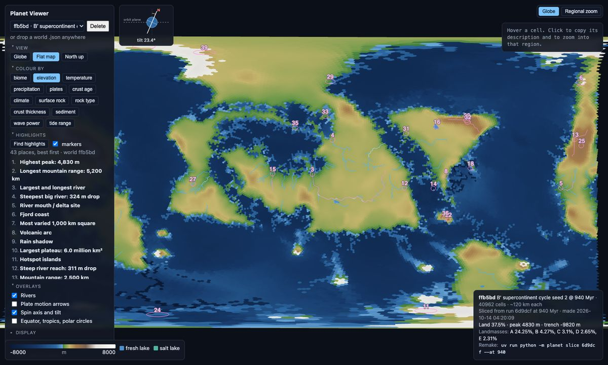
*World ffb5bd (run 6d9dcf at 940 Myr), mid-assembly. The largest landmass is 24% of the surface. Numbered rings are highlights.*

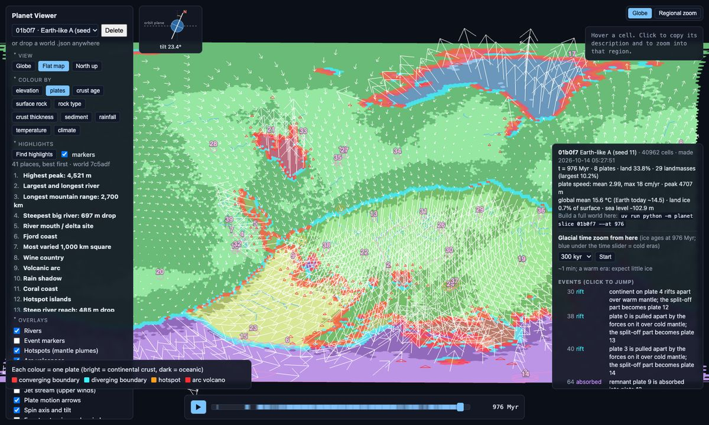
*Run 01b0f7 at 976 Myr, plates layer. Bright colours are continental crust, dark colours oceanic. Red edges converge, cyan edges diverge.*

**One step** (`Simulation.step`, 2 Myr):
1. Move the plates.
2. Resolve ownership (subduction, collision, new floor).
3. Find the boundaries.
4. Update the mantle.
5. Physics: crust budget, arcs, hotspots and vents, collisions, stretching, crust flow, global temperature, erosion and sediment, reefs, the ice record, crust-type coherence, back to the plates.
6. Solve the forces for the next step.
7. Events: sutures, slivers, at most one rift.
8. Volcanoes re-home, sink, erode and grow reefs.
9. Climate every 4 Myr (and on step 1), **on the ground the events left** (PW-109), so a keyframe's climate fits its ground. The next steps' erosion uses it.

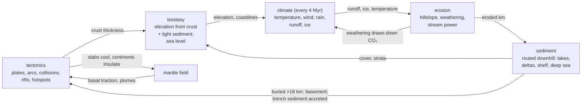

**Main parameters** (`planet/tectonics/params.py`; set with `simulate --set key=value`; all are stored in `run.json`):

| Parameter | Default | Meaning |
|---|---|---|
| `n_plates` | 12 | plates at the start |
| `start` | supercontinent | or `scattered` |
| `continental_fraction` | 0.4 | target share of the surface that is continent |
| `continental_start` | off | start with less continent and grow toward the target (water worlds) |
| `heat_start` | 1.0 | early mantle heat relative to the end state |
| `slab_pull` / `ridge_push` / `collision_drag` | 1.0 / 0.15 / 1.2 | force strengths |
| `slab_drag` | 0.1 per cm/yr | the mantle's resistance to a sinking slab (terminal speed slab_pull / slab_drag = 10 cm/yr) |
| `mantle_drag` | 0.6 | basal traction from the mantle field |
| `mantle_memory` / `mantle_scale_km` | 200 Myr / 2500 | mantle memory and smallest feature |
| `slab_cold` / `insulation` | 0.002 / 0.04 | cooling under trenches, warming under continents |
| `mantle_eddies` / `mantle_noise` | 0.3 / 0.2 | random convection, random drag |
| `velocity_timescale` / `max_speed` | 15 Myr / 18 cm/yr | inertia, speed cap |
| `arc_growth` / `crust_flow` | 0.03 / 0.0006 | new arc crust, sideways flow of thick crust |
| `continental_thickness` | 35 km | mean continental crust the volume thermostat aims for (PW-238) |
| `flexure` / `rift_sag` / `sag_time` | 0.15 / 2.2 km / 63 Myr | flexural moats beside mountain belts; thermal sag after rifting (PW-054, §2.4) |
| `suture_after` | 30 Myr | collision time before plates can weld |
| `rift_stress` / `rift_timescale` | 2 cm/yr / 130 Myr | how hard and how often plates break |
| `warm_rift` | 0.7 | how much warm mantle weakens a plate (PW-024) |
| `rift_min_piece` / `max_plates` | 0.03 / 30 | smallest continental piece a rift may cut, plate ceiling |
| `margin_age` | 120 Myr | margin age at which new subduction can start |
| `ridge_time` | 30 Myr | sea-level response time to the sea floor (PW-053) |
| `tilt` / `climate_offset` | 23.4° / 0 °C | axial tilt, warmer or colder history |

**Outputs:** per keyframe the `plate`, `crust`, `crust_age`, `plate_boundary`, `crust_thickness` layers and plate velocities; the event log (collisions, sutures, rifts) in `run.json`; hotspots and volcanoes.

**Known limits:**
- Plate counts can still dip for a few Myr near 4 (L7 seed 21, 1 Gyr: median 11, minimum 4, 1% of frames at ≤ 4; was median 10, minimum 3, 12% with an 84 Myr spell); a big plate rimmed by ongoing collisions is compressed across every cut and can't rift until they end (PW-191). The cycle's regularity is pinned (PW-025).
- Continents are resolution-consistent since PW-052 (the L7 start no longer has a shelf-low, craton-free interior). Since PW-238 (`continental_thickness` 37 → 35 km) and PW-054's subsidence, L6 seeds 1/2/21/3199 over 100–1000 Myr have ~34 km mean continental crust, crust on 40–41% of the surface, land on 31–32% and mean land ~970 m (was 41–42%, 32–33%, ~1065 m; Earth ~29% and ~840 m); scorecard seeds 1/2 at 1 Gyr: land 30.1/30.7%. Crust volume (PW-046, 2026-10-16): the continents now start at `continental_thickness` (setup's relief gave ~37 km, 6% above the thermostat's target, which runs shed over ~250 Myr while the integral term wound up and then held arcs back for ~700 Myr), collision belts straddle their suture (the MAX_KM cap had deleted the excess of single-cell front spikes) and hidden crust under a continent is stacked. Volume end/start over 500 Myr (8 L6 seeds) 0.87–0.92 → 0.94–0.99, scorecard 1 Gyr seeds 1/2 x0.905/0.873 → x0.977/0.981. What remains (~2–4% below target) is the thermostats' lag against real sinks: subduction erosion (steered by area) and sediment carried onto ocean floor (docs/review/audit/tectonics-night.md).
- Some cell churn remains along collision fronts (PW-170, PW-173, PW-174); pits in continents from old seams (PW-171); one-frame 11–18 km spikes (PW-048, PW-172). Plate motion and nearest-cell resampling re-cut closed hollows on rigid plate interiors every step (~75–90k km³ of lake-keeping hollow per L6 step, about what erosion fills; PW-359, a design question).
- Ragged ocean boundaries (PW-047); drainage switches outlet in one step when a rift opens (PW-056).
- `start=scattered`: setup puts each continent whole on one plate (the one holding most of it) with its near-coast ocean, as the supercontinent start does, so plate boundaries start in the ocean (PW-328; they used to cut the continents, 18-31% of the boundary length, a big continent on up to 10 plates, and the ocean hardly renewed: mean age 58-93 Myr at 100 Myr). 8 L6 seeds, 500 Myr: over 0-100 Myr ocean age 54 Myr and sea -25 m (supercontinent start 50 Myr, -15 m). Later the scattered runs stay dispersed (11-16 landmasses, largest 16-18%) with slower plates (3.7 vs 4.5 cm/yr) and an older ocean (300-500 Myr: 74 vs 50 Myr, sea -185 vs +43 m), though dispersed moments of supercontinent-start runs have a younger ocean (~51 Myr): an open question, not a start transient.

### 2.3 Volcanoes, island chains and atolls (`tectonics/volcanism.py`)

**What it does:** volcanoes are point objects that ride their plate, each with its own volume, height and age (PW-001).

- **Hotspot vents:** a plume is fixed in the mantle while the plate slides over it. It opens a new vent every 1.5 flexural wavelengths of plate motion (60–150 km; ~100 km on Hawaii-like 90 Myr floor, set by the plate's elastic thickness). A vent is fed while over the plume, then carried off, so a plume leaves a chain, youngest over it (Hawaii → Midway → Emperor seamounts). Each vent goes onto the grid as a 25 km Gaussian cone (separate islands at L7–8, a blur at L6). Height is limited by the plate's age (older, thicker plates carry taller volcanoes; at most Mauna Kea's 4.2 km, 3.5 km on a continent); the rest spreads as an apron below −2 km. A new plume's head floods ~300 km for 6 Myr (flood basalts).
- **Arc volcanoes:** one per ~120 km of active subduction arc, ~2000 km³ each, active ~8 Myr (Fuji, Rainier, the Andes).
- **Ageing:** a dead volcano sinks with its sea floor (and with the plume swell decaying behind it). Its part above the sea erodes (~10 Myr e-folding at 1500 mm/yr of rain, faster when wetter) until the waves plane it off. In water ≥ 23.5 °C (`reef_temp`) a reef keeps up with the sinking: **fringing reef → barrier reef → atoll** once the volcano is gone. Carried below 22 °C the reef drowns and the flat top sinks as a **guyot**.

**Status** (`zoom_volcanoes.status`, for the viewer and the highlights): **active** is the run's own flag (a vent over its plume now, an arc volcano within its ~8 Myr life); **dormant** is a hotspot vent the plate has carried off its plume but still within the plume's head (`PLUME_KM`, 150 km: over hot, partly molten mantle, so it can erupt again, as Hawaii's rejuvenated volcanoes and Haleakala, or Yellowstone's older calderas); the rest are **extinct**. The run has Myr steps and no eruptions, so it can't tell a volcano that erupted last year from one quiet for 50,000 years, and an arc volcano past its life is extinct (the arc's magma moved to a new centre). On a world of run a1d3b9 (L7, seed 3199) at 380 Myr: 737 active, 4 dormant, 1666 extinct (6 of the 364 hotspot vents active, 4 dormant).

**Outputs:** the full volcano table in `runs/<id>/volcanoes.json.gz`, in each checkpoint and in each world (`meta.volcanoes`, columns `meta.volcano_columns`); the viewer's Hotspots and Volcanoes overlays (active red / orange, dormant yellow, extinct islands small orange, atolls cyan; "extinct ones too" adds every other extinct one, and hovering a cell names the volcanoes in it with their status); drawn individually by the zoom (§2.13), whose markers and cards give each one's status.

**Known limits:** hotspot islands are sub-cell, so at L6 (and often L7) the globe shows a bank, not land (PW-117, needs a decision); a plume head's flood basalt is capped at a 3 km pile per cell on a continent (`isostasy.LAVA_MAX_KM`; Deccan ~2 km, Siberian Traps ~3.5; PW-133); the plateau's height is mostly its swell.

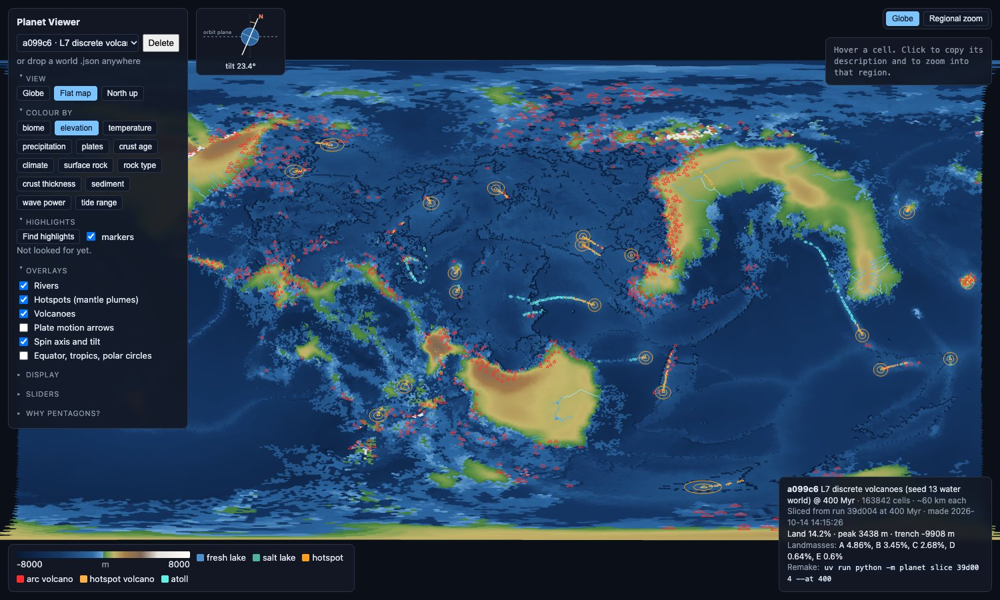
*World a099c6 (L7 water world, seed 13, 400 Myr): volcano overlay with hotspot chains (orange), arc volcanoes (red) and atolls (cyan).*

### 2.4 Crust, rock record and landform classes

**Crust** (`crust.py`, `isostasy.py`):
- **Building crust:** subduction grows **volcanic arcs**; collisions stack crust, and over-thick crust **flows** outward, widening plateaus (Tibet); rifts thin continents (down to 22 km), and the crust they lose floors the opening rift as a continuous belt of 12–18 km margin crust; hotspots build islands and flood basalts under a ~1 km swell.
- **Crust budget:** two "thermostats" steer arc growth on continents toward a target continental volume (40% of the surface × `continental_thickness`, 35 km since PW-238; 37 before) and subduction erosion toward the target area. Each answers the present error and, over ~100 Myr, a persisting one (an integral term), so area no longer settles ~12% above target. Island arcs on ocean floor grow at the nominal rate (steering them too turned a volume shortfall into new thin continent rather than thicker continents). Arcs leave a ~120 km forearc gap at the trench (the arc–trench gap), where subduction erosion grinds the edge; its rate is per km of trench, the same at every grid level (PW-046, PW-052). Rifted margins are laid from the pool of crust their plate lost to stretching, at up to 18 km (12 km when the pool runs short); what an unopened rift doesn't take up goes back into its stretched flanks over ~100 Myr (PW-287). Their thickness no longer follows the area error (PW-286): area is the subduction-erosion thermostat's alone.
- **Coherence** (PW-108): a one-cell inlet of ocean floor nearly ringed by its plate's continent becomes (thin) continent, with crust flowing in from around it; a thin (< 20 km) shred of continent nearly ringed by ocean becomes ocean floor. No welds at trenches (a notch there is subduction erosion at work; re-welding it every step made erosion thin continents instead of shrinking them). Without it, cells flipped between continent and deep sea every few Myr (`tools/churn.py` measures it).
- **Elevation is isostasy:** crust floats on the mantle like wood on water (Airy isostasy). Continents stand 250 m plus 150 m per km of crust beyond 35 km. Ocean floor sinks as it cools: 2600 + 345·√age m (the half-space cooling law), at most 6400 m deep. A hotspot pile is held up by its plate's flexure (350 m per km) only for its first 20 km beyond normal ocean crust, then floats like other crust (PW-172); sediment on it floats like any sea-floor sediment (PW-285). Sediment is light (2.1 g/cm³, compacting to 2.6 with depth), so filling deep water takes ~3× its depth in sediment, as on Earth. Cover buried below 18 km becomes basement.
- **Tectonic subsidence** (PW-054, `isostasy.subsidence`, added to the elevation through `sim.datum()` with the plume swell): Airy isostasy is local, so on its own nothing made basins sink as they filled. Two terms beyond it:
  - **Flexural moats:** the root of each cell of thickened continent (850 m per km of crust beyond 35 km) is spread over ~150 km (`isostasy.FLEX_KM`, the same lithosphere as the ice load's); continent where the spread root reaches deeper than its own sinks by `flexure` (0.15) × the difference, smoothly capped at 2.5 km. That makes foreland basins beside mountain belts (Ganges, Po, Persian Gulf) and intermontane basins between them (Tarim, Fergana). Only the moat is applied: the belts keep their Airy height. The 0.15 share is calibrated, not derived (PW-284): the sound form (both halves, share 1, the width from an elastic thickness: alpha ~66 km for Te 30 km) is unstable on cells as wide as alpha, because every one-cell load (a stacked cell, a sediment-filled moat) is then held up by most of its root (L6 test: 27 km peaks by 140 Myr).
  - **Thermal sag after rifting** (McKenzie 1978): stretched lithosphere starts hot and buoyant and sinks as it cools: `rift_sag` (2.2 km, air-loaded) × (β/π) sin(π/β) of uplift, β = e^`rift_strain` from the record, decaying over `sag_time` (63 Myr). Airy gives the thinned crust's final height; this adds the hot start, so rifts and young margins keep sinking for ~100 Myr (North Sea, Paris, Michigan; passive margins' sediment wedges). A rift stretched by β = 1.5 starts ~0.8 km up. Crust a collision is stacking up that step isn't stretched or dated as rifting (PW-172: belt cells between a collision and an opening edge piled up β 6-9 on 80 km crust and stood ~2 km above their belt, the L7 runs' one-frame 10.6 km peaks).
  Together they keep closed basins alive against their sediment: see §2.5.
- **Glacial isostasy** (PW-189, `isostasy.ice_load`): land ice presses the bed down by ρ_ice/ρ_mantle ≈ 0.28 of its thickness, spread by the lithosphere's flexure over ~150 km (a 3 km sheet: ~830 m; a one-cell cap much less). In the run it settles at once (`sim.ice_sink`, from the ice at each climate update): the keyframes' `elevation` is the pressed-down bed (it can lie below sea level under a big sheet, as Greenland's and Antarctica's do), the ice surface stands lower and warmer, and land the load pushes under the sea without ice on it is sea. The run's land (`sim.land()`, its stats' `land_pct`) is exactly the keyframe's: `sim.bed()` is the frame's elevation, the trench on oceanic crust included (PW-309). Erosion, sediment, reefs and volcanoes work on the crust's own height (`w_elev`), since the dip is gone ~10 kyr after its ice. The run's climate update still sees grounded ice on a bed below sea level through `isostasy.land_view` (bed floored at 1 m, ice thinned to keep the surface); worlds store the true bed (§2.11). The time zoom relaxes the bed toward the same dip over a few kyr (§2.14).

**Rocks** (`surface.py`). Each cell has a basement rock and a sediment cover:

| Kind | Rocks (erodibility) |
|---|---|
| Basement | ocean crust (1.0), hotspot basalt (1.6), arc (0.8), sediment-born continent (1.5), orogen (0.6), craton (0.3), **granite** (0.5: an arc exhumed 4 km after it went quiet, like the Sierra Nevada) |
| Cover | limestone (1.0, reefs and shelves), sandstone (1.2), shale (1.6), evaporite (3.0: salt from hot closed lakes and sabkhas), coal (1.6: warm vegetated swamps), flood basalt (1.0), tuff (0.9: 10% of a continental arc's new crust erupts as ash) |
| Strata only | dolomite (0.7: limestone under ≥ 1 km of strata), quartzite (0.4: sandstone folded in crust > 45 km thick) |

**Surface rock** (`surface_rock`, what the viewer and zoom show) is the exposed stratum from the record: veneers under 20 m are looked through, and where less than 50 m of cover is left the basement shows. Erosion still uses the well-mixed cover's erodibility (letting caprock protect soft rock in the run is PW-136 option C).

**The geological record** (`tectonics/record.py`, PW-006/007/008) rides with the crust on the plates, so a margin carried across an ocean still knows when it rifted:
- **Strata:** the cover's top 3 layers in order, each a rock, a thickness and when it last grew. They always add up to the cover. Net deposits go on top (sandstone on land, shale at sea, plus limestone, evaporite, coal, flood basalt, tuff); erosion takes the top, burial the bottom. A new rock or a 20 Myr pause starts a new layer (a still-growing top under 50 m merges into the next deposit instead); a folding closes the top layer; a full stack merges its bottom two.
- **History:** when the crust was last rifted and how much it was stretched (ln β), when it was last folded and how hard, how much cover was folded, how far it has been exhumed, and when it was last under ice. Refolding within 50 Myr continues the same episode. A stratum is folded if it last grew before the last folding; younger ones lie flat on the unconformity.
- Only checkpoints keep the full record; keyframes keep the landform layers below.

**Landform classes** (`landform.py`, PW-009) are read from the record and the setting at every keyframe. A cell takes the first rule that holds, in this order; then one majority-filter pass smooths the areal classes:

| id | Class | Rule (Earth analogue) | `landform_age` |
|---|---|---|---|
| 11 | volcanic arc | land within a cell of an arc volcano active or dead ≤ 20 Myr (Cascades) | youngest volcano's age |
| 12 | hotspot | oceanic land with a vent above the sea, or hotspot rock ≤ 100 Myr old (Hawaii) | vent's age |
| 4 | fault-block rift | continent stretched (ln β ≥ 0.2) in the last 20 Myr (East Africa, Basin and Range) | since rifting |
| 5 | great escarpment | rifted 8–400 Myr ago, ≥ 300 m high, at the distance the scarp has retreated to from a passive rifted coast: ~200 km × (1 − e^(−age/150 Myr)) (Drakensberg, Western Ghats) | since rifting |
| 3 | fold-and-thrust belt | ≥ 0.2 km of cover folded at the last folding (Zagros, Appalachian Valley and Ridge) | since folding |
| 7 | lava plateau | ≥ 0.2 km of flood basalt on top (Deccan) | since eruption |
| 9 | dune field | sand still piling up (top grew ≤ 20 Myr ago, or a sand-rich cover), hyper-arid: aridity index P/PET < 0.12 (Rub' al Khali) | top stratum |
| 8 | karst | ≥ 0.4 km of limestone/dolomite on top, > 700 mm/yr, mean above 0 °C (Guilin, Yucatán) | top stratum |
| 6 | caprock plateau / cuestas | flat, exposed hard rock 0.03–1.5 km thick over soft (Colorado Plateau, Niagara) | top stratum |
| 10 | coastal plain | < 300 m, young (≤ 30 Myr) flat sandstone/shale, ≤ 400 km from the coast (US Gulf coast) | top stratum |
| 2 | shield | old (≥ 500 Myr) craton or granite with no stratum > 20 m left, not folded for 300 Myr nor rifted for 100 (Canadian Shield) | basement age |
| 1 | hills | any other land (the zoom's graded hills and mountains) | — |

With each class come the zoom's parameters: the exposed stratum and its thickness, the rock under it (hard over soft makes scarps and falls), the dip (folded: 8–60° by how hard the belt was squeezed), the fold wavelength (1.5 × the folded pile + 2 km, 3–30 km), the stretching of the last rifting (`rift_strain`) and the time since the cell was last under ice (`glaciated_myr`).

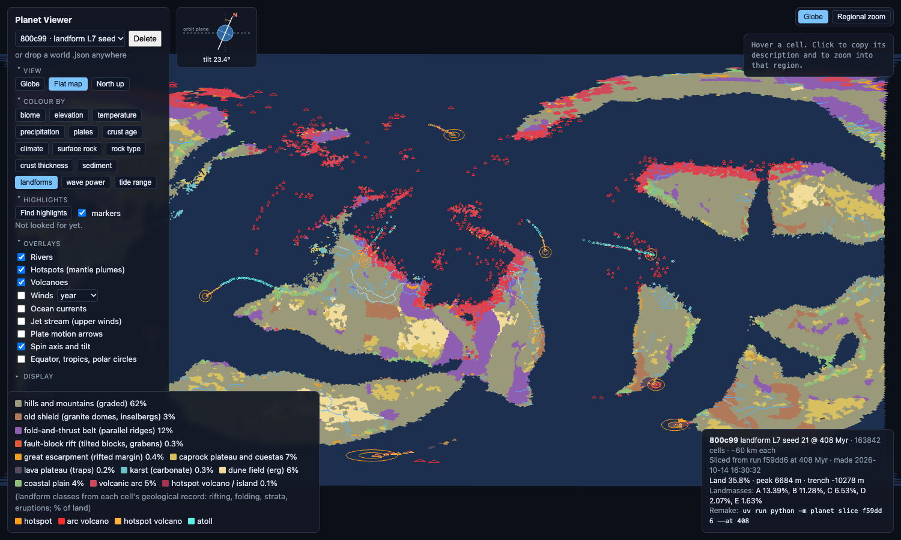
*World 800c99 (L7, 408 Myr), landform layer with the share of land per class: hills 62%, fold belts 12%, caprock 7%, dunes 6%, arcs 5%, coastal plain 4%, shield 3%.*

**Outputs:** layers `rock`, `surface_rock`, `sediment_cover`, `crust_thickness`, and the landform layers `landform`, `landform_age`, `strata_top`, `strata_top_km`, `strata_next`, `strata_dip`, `fold_wavelength`, `rift_strain`, `glaciated_myr`.

**Known limits:** carbonates rarely reach the surface (karst 0.3–0.4% of land; Earth ~10%; PW-130); caprock is recorded near-flat, so the zoom rarely makes cuestas (PW-147, PW-175); fold strike is guessed, not recorded (PW-165); rifted margins have no flank uplift, so few escarpments stand high (PW-135); the record flickers frame to frame as the grid resamples plates (PW-134); compaction isn't remembered after uplift (PW-049); the Earth world has no record, so no landforms (PW-132).

### 2.5 Surface erosion and sediment (`surface.py`, `tectonics/earth.py`)

**What it does:** wears the land down every 2 Myr step and puts the material somewhere.

- **Hillslope wear** lowers ground in proportion to its mean downhill slope to its lower neighbours (Ahnert: denudation ∝ local relief, taken per km so it is the same at any grid level, PW-282). It only lowers ground; the material joins the rivers' load.
- **Weathering** lowers land toward a base level (200 m on continents), faster on high ground. The 200 m is a stand-in for "flat plains don't erode" (PW-279): weathering here doesn't depend on relief, so without a floor it would plane old continental plains toward the sea (a 0 m base removes 1.45× as much by weathering, L5 seed 1, 300 Myr); a normal 35 km continent floats at ~250 m anyway. The base level is counted from the sea *without* the ice's fall (`base_rise`, the run's land-ice sea-level drop): the height above it stands in for relief, and a glacial lowstand lifts every plain against the sea without steepening any interior slope (rivers' new reach to the shore is stream power's); counting it made cold eras' plains wear ~5× faster and the weathering sink rise as the planet cooled (PW-438). A relief-dependent rate with a 0 m base would be the process version, if the land fraction is retuned anyway.
- **Stream-power incision** cuts valleys at a rate ∝ √(water flow) × the drop to the next cell, where the flow is the runoff gathered from upstream. It uses Braun & Willett's implicit scheme, stable at 2 Myr steps. Its rain factor (below) is the larger of the cell's own and its catchment's mean rain, so a big river crossing a desert, or a polar-desert lake's outlet, still cuts (PW-055).
- Erosion is scaled by rain ((P/800 mm)^0.8, clipped 0.1–2.5), ×3 under temperate (wet-based) glaciers, ×0.3 under cold ice, and is up to 1.6× faster on bare wet ground than under the vegetation's ground cover (§2.18; before plants, or plant groups, appear, rivers are flashier).
- **Deposition** follows the drainage (§2.9): pits, lakes and floodplains keep a share (an open lake traps its rivers' load up to its whole room and spreads it over its floor, deepest most: PW-055; a closed basin keeps what reaches it up to its spill point, its lake's floor first, then the whole hollow, and the rest spills over the rim and runs on, into the next closed basin or the sea: PW-280; before, a full closed lake piled its whole load into a mound up to ~1–4 km above its surface); a river's floodplain share on a hollow's slopes is kept only up to the cell's room below the hollow's spill point, the rest running on to its floor (PW-299: 2.5% of all deposition used to land above the spill level, building rims up); deltas fill to +2 m and shelves to −60 m; the rest spreads over the deep sea floor (~1000 km) or is trapped in trenches, where half is scraped onto the overriding plate.
- **Chemical and biological deposits:** reefs (limestone, up to 200 m/Myr in warm shallow water), evaporites (closed lakes and pans above 10 °C, hot dry coasts), coal (warm wet vegetated lowlands). Desert winds sort loose cover into sand where rain is under 200 mm/yr.
- **Weathering draws down CO₂**, closing the loop with climate; the sink counts only what was eroded from ground bare of ice *during that erosion* (`sim.weathered`: ground the ice left in the update would otherwise count its glacial erosion, the 3× buzzsaw, as weathering; PW-438); roots and soil CO₂ speed it up by up to 1.75× in proportion to the vegetation's productivity (NPP, GEOCARB's biological weathering factor).

**Parameters:** `hillslope` 3.32 km/Myr (× slope in m/km = m/Myr), `erosion_timescale` 400 Myr, `incision` 0.0064, `glacial_erosion` 3, `alluvial` 3000 km, `fan_km` 1000 km, `accretion` 0.5, `metamorphic_depth` 18 km.

**Known limits:** closed basins (PW-054): sediment fills a closed hollow within ~10–20 Myr (two thirds of the loss; rims wearing down the rest), so only subsiding basins last (§2.4: flexural moats, thermal sag). A full basin spills (PW-280), and the hillslope term wears the same at every level (PW-282), so L7 now wears its hillslopes half as hard as before and L6 as before. Land draining inland (`tools/health.py`'s measure on run frames, 100–500 Myr, median per seed, then the mean): L6 eight seeds 7.9% (10.3% on main before PW-280/282/239, 9.2% after PW-280/282, the rest of the drop is the frames now routing on their own terrain, PW-239), L7 seeds 3199 and 21 16.3% (23.5%, 18.1%); Earth ~18% of land, roughly half its arid land. L7 still drains about twice L6's share (PW-243). Since then (health frames after 50 Myr, 500 Myr runs): L6 8 seeds 4.9% before PW-299's floodplain cap and 4.2% after, L7 seeds 3199/21/11 8.8% and 6.0% (lakes 1.29% and 0.52% of land, L6 0.60% and 0.43%), so L7 now drains ~1.4× L6's share (docs/review/audit/basins-lakes.md). Back-arc and pull-apart basins and dynamic topography over cold mantle are not modelled (inbox).

### 2.6 Climate (`climate.py`)

**What it does:** given terrain, ice, tilt and a global temperature offset, produces a steady-state climate per half-year (April–September, October–March), from which monthly values are rebuilt as sinusoids. It is a **diagnostic** model, a chain of physically motivated maps and relaxations, not a general circulation model. It runs every 4 Myr in a run and once (twice with erosion) per world, in about a second at L6.

| Piece | Rule (real-world analogue) |
|---|---|
| **Temperature** | An energy-balance curve by latitude with polar amplification (equator 27.8 + 0.5·dT, pole −10.4 + 1.5·dT °C); air cools 6.5 °C/km with height (the **lapse rate**); seasons scale with tilt. **Continentality** comes from carrying air temperature along the seasonal winds, so interiors swing and windward coasts stay mild. Land ice has its own surface climate (§2.8, PW-277): ~2 °C colder all year, its summer damped while snow lies; a big polar sheet's own cold air is carried along the winds onto its margins, shelves and the land beside (katabatic outflow, PW-336). Over a frozen sea the summer air is the sea's summer surface held at or above freezing (melting ice: the Arctic Ocean's July air ~0 °C, PW-335), and the winter air's surface inversion over the ice levels off near 15 °C (annual; ~26 °C in winter), so deep icehouses' sea-ice air bottoms out near −45..−60 °C instead of −114 (PW-337). Summers are up to 1.5 °C cooler where the ground evaporates near its potential and hotter where it is dry (by the summer's actual / potential evaporation), and the vegetation's albedo nudges each half-year by up to ±2 °C (§2.18). |
| **Winds** | The three-cell pattern (**Hadley / Ferrel / polar**: trade winds, westerlies, polar easterlies), shifted with the season; **monsoons** from land–sea pressure contrasts; ground above 1.5 km turns the wind along its slope. |
| **Jet stream** | From the **thermal-wind** relation: fastest where the north–south temperature gradient is sharpest. Storm tracks follow it and drive frontal rain and waves. |
| **Rain** | Moisture evaporates from the sea (Clausius–Clapeyron: warm air holds more) and is carried by the winds (less the polar cell's shallow equatorward drift, which runs under the polar inversion while the vapour rides above it: the vapour reaches polar coasts and ice sheets with the storms, PW-332; ice sheets lift the air by their surface, not their bed). It rains out as **orographic** rain (wet windward slopes, **rain shadows** behind), as **convection** (the **ITCZ**, monsoon summers) and along storm tracks; land gives back to the air what its water balance evaporates (Budyko AET, per half-year with the soil's carry-over, on the first-pass temperatures; more under forest, §2.18), and the air takes up nothing through sea ice, so the sea's fresh-water books close by themselves to ~1 cm/yr on realistic planets (PW-266; the rain transport's own small leak; `ocean.freshwater` still takes the mean off and warns above 2 cm/yr). Before, the kernel recycled a flat ~41% of land rain against Budyko's ~60% and the gap (−2 to −5 cm/yr) was silently taken off; closing it made land wetter (L6 planets +13–16% land rain, earth_check: land 840 → 1008 mm against GPCC's 791, dry interiors ~1.5–2× wetter, Köppen-B share of land 29 → 20% against 30%, exact agreement 39 → 33%; a needs-decision follow-up). The global mean is renormalised to 1000 mm/yr × e^(0.03·dT), so absolute wetness is set by that, not by the physics. |
| **Water balance** | Potential evaporation from sunshine and temperature (**Oudin**); actual evaporation from the **Budyko** curve (Fu's form; its w from the vegetation); runoff = rain − actual evaporation (~40% of the rain on Earth's land). Lakes evaporate by **Penman**'s open-water equation (`climate.open_water_evap`, PW-358): net radiation at the ground (Ångström from the cloud cover, FAO-56 long-wave) plus the air's drying power from the half-year's humidity, 2 m/s wind; none in months below 0 °C. Earth L6: Amazon floodplain ~1400 mm, Lake Victoria ~1400, Lake Chad ~2000, Lake Nasser ~1900 (Oudin × 1.2 before: ~2000, 1900, 1800, 1600). The run, worlds (`lake_evap` layer) and zooms all use it. |
| **Humidity** | Dew point and relative humidity per half-year from the rain model's vapour; dry air keeps a background of vapour mixed in from around it, so Delhi's and the Sahara's January air holds ~30–45% (PW-151). |
| **Clouds and sunshine** | Four cloud kinds overlapping at random: deep cloud where it rains hard; layer cloud along the storm tracks; low sea cloud, more over cold water, with **stratocumulus decks** where sinking air meets cool upwelling water (California, Peru, Namibia); land cloud from humidity and fair-weather cumulus, cleared under the subtropical highs (deserts). **Sunshine** (h/day) = day length × the clear share, with showers costing less sunshine than layer cloud. Clouds are diagnostic: they don't feed back on temperature (decided, PW-163). |
| **Classification** | **Köppen** classes (Peel 2007 rules) from monthly temperature and rain. In worlds, **biomes** are a coarse grouping of the vegetation's named types (§2.18); the zoom still uses a Whittaker-style temperature–rain lookup per pixel. |
| **Months** | `climate.months` (PW-194) rebuilds the twelve months once for everyone who needs them: temperature (a sine between the coldest and warmest month), rain (a cosine through the two half-years, each half's sum exact), Oudin PET (the water balance's), light at the ground (top-of-atmosphere sunshine × Ångström–Prescott transmission from the cloud), snowpack and snowmelt (degree-days), and degree-days above 5 °C. Köppen reads its driest months and months above 10 °C from them (PW-200); the water balance uses the same PET but stays per half-year (its Budyko curve and soil carry-over are calibrated that way); the land ice's mass balance (run, zoom and time zoom: `icemass`) keeps its own sine year (the same temperatures; the time zoom adds orbital forcing per month, the run and zoom average over the orbits). |

**Parameters:** per run `tilt` (23.4°), `climate_offset` (0 °C), `climate_drift` (3 °C over 40 Myr), `co2_sensitivity` (3 °C), `ice_albedo` (1.5 °C per 3% of the planet iced, levelling off toward `ice_albedo_max` = 3 °C), `climate_every` (4 Myr). The land ice's surface mass balance is `icemass.py`'s (§2.8). The run's global temperature reaches a world as `dT` = global mean − 14.5 °C. Internal knobs (rain normalisation, seasonal swing, monsoon, upwelling, ~20 cloud parameters) are in `climate.TUNE`, not exposed on the CLI.

**Global temperature over a run** (`earth.py`) combines a slow random drift, CO₂ (sources: new sea floor and arcs; sink: weathering of eroded rock, faster when warm, ~9%/°C, GEOCARB's activation energy (its runoff part is already in the erosion rate, PW-278), and none under land ice: the **weathering thermostat**, PW-235) and ice-albedo, counted from Earth's present ice (~3% of the surface, so an ice-free planet is ~1.4 °C warmer than dT = 0 and Earth's ice is neutral). The source and sink are each smoothed over ~10 Myr and compared with their slow baselines (learning over ≤ 1 Gyr, `REF_MYR`; until then about their mean since the start), and rates and baselines start at the first real erosion (nothing has eroded in the first step). Weathering also grows with CO₂ itself (GEOCARB's f(CO₂) ~ pCO₂^0.4, `WEATHER_CO2`), so CO₂ settles at ln(source/sink) / 0.4: a weathering deficit raises it 2.5× further than the bare ratio, which gives cold eras room to end (Earth's snowball recoveries took ~100× today's CO₂). The forcing clips the index at ±`CO2_MAX` = 3 (was ±1.5; ~20× / 0.05× today's) (PW-438), so a lasting change in degassing or weathering keeps its warming or cooling over most of a run, as a CO₂ stock would (PW-264; with the old ≤ 200 Myr baselines it faded within ~200 Myr and only transients counted).

**Outputs (worlds):** `temperature`, `precipitation` and their `_jul`/`_jan` versions, `climate` (Köppen), `biome`, `warm_month`, `cold_month`, `runoff`, `evaporation`, `pet`, `dewpoint_jul/jan`, `humidity_jul/jan`, `cloud_jul/jan`, `sunshine_jul/jan`, `wind_e/n` (annual, July, January) and `jet_e/n` (annual, July, January: `jet_jul_e/n`, `jet_jan_e/n`). "July" is the warm half in the north and the cold half in the south. Runs store annual temperature, rain, climate, wind and jet per keyframe, and July / January temperature and rain (the half-year rain as a one-byte log scale, ~4% steps; PW-138).

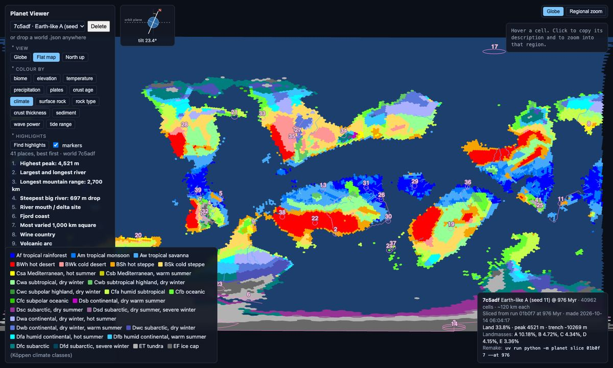
*World 7c5adf (Earth-like A, 976 Myr), Köppen classes.*

**Grid numerics (PW-211):** the icosphere's cells are up to ~9% larger or smaller along the seams of the icosahedron it is built from, and wide blurs run on a coarser level. Three things keep those out of the fields' gradients (the winds follow pressure gradients, and the rain follows the winds): wide blurs finish their last half coarse cell on the fine grid and interpolate back with a smooth bell (`climate.smooth`); the blur's neighbour weights are tilted so a straight slope stays straight and spread the same km² everywhere; gradients are least-squares fits with each edge's own length; and the rain's transport divides each cell's inflow by what a uniform wind would bring it (`inflow_weights`), so seams neither gather nor thin the vapour. The transport's shares use the wind at each edge's face (the mean of its two cells'), and the trades' east component is rounded off within 3° of where the two hemispheres' trades meet: before (PW-227), the row of cells where they met head-on got twice the convergence and a dip in wind speed, and a one-cell line of rain ran along the rain belt. Latitude-band means (`climate.zonal_mean`: the sea temperature's band-mean anomaly, the monsoon's warmth, the overturning's warmth) are interpolated between the bands' centres; as 3° steps they left east-west stripes in the sea temperatures that the sea's rain and clouds followed. Before this, rain maps had diagonal lattices and straight lines that the biomes and vegetation inherited.

**Known limits:** moisture transport between basins and across land (PW-013 epic, PW-014, PW-015); winter maritime air doesn't reach far enough inland (PW-026); the East Antarctic plateau's summers ~10 °C too warm (its inversion, PW-039); the Southern Ocean's air 4–8 °C too warm at 60–80S, over the seasonal pack ice above all; high-latitude seas (50–70°) and Antarctica's margins get about half of GPCP's rain, the storm tracks' moisture supply (polar-bundle write-up); the jet is broad and zonal (PW-042); clouds: wet tropics too gloomy, winter trade-wind seas too cloudy (PW-162). No day-scale weather (PW-156).

### 2.7 Ocean: currents, SST, salinity, overturning (`climate.py`, `ocean.py`)

- **Wind-driven gyres:** a **Stommel** streamfunction per basin, solved by over-relaxation, gives closed gyres and fast **western boundary currents** (Gulf Stream, Kuroshio). Unbroken latitude bands get a **circumpolar current**.
- **Sea-surface temperature (SST)** is carried along the currents, with **coastal and equatorial upwelling** of cold water.
- **Overturning** (`ocean.py`, solved on the level-5 grid):
  - **Salinity** from evaporation minus rain, river mouths, sea-ice brine and meltwater.
  - **Density** from temperature and salinity.
  - Deep water **sinks** where the winter sea is densest, poleward of 50° (Stommel's flow law).
  - The replacement inflow follows the surface currents, like the **AMOC**'s North Atlantic Drift, and warms the coasts it passes (a milder Norway). Its heat stays within its latitude band (the band's mean change is taken off, `moc_zonal` = 1, PW-265): the inflow's longitudes warm and the rest of the band cools a little, because the latitude curve the sea starts from was fitted to Earth's sea, overturning included. (Before, it added +0.2 °C to Earth's sea and +0.5 °C to a generated world's, about +1 °C poleward of 45°.)
  - There is no deep ocean: the deep return flow the viewer draws is a **schematic** route: the cheapest way through deep sea to a circumpolar channel in the other hemisphere (else the equator), preferring western boundaries (up to 7× cheaper per step) and crossing sills and shelves only at a cost (3× below 1500 m, 10× below 400 m), so every site gets one.

**Outputs (worlds):** `sst`, `sst_jul`, `sst_jan` (°C), `salinity` (psu, annual), `sinking` (Sv per cell), `upwelling` (°C of cooling where it wells up, §2.20), `current_e/n` (annual); `meta.overturning` with the total, north and south strength in Sv, the sinking sites and the schematic paths. On Earth (world dc3732): 13.7 Sv, sinking in the Nordic (7.0 Sv) and Labrador (4.1) seas and the Ross (1.9) and Weddell (0.6) seas; none in the North Pacific. (2026-10-16 code: 16.9 Sv, 14.9 of it in the north; with the Antarctic shelves as sea, PW-354, 12.6 Sv: north 10.0, Weddell 1.6, Ross 1.0. The shelf seas' brine-heavy water joins the densest 10% of the polar sea that sets the one deep water a connected ocean shares (its reference 1028.02 -> 1028.14 kg/m3), and the Nordic seas settle on the weaker of two steady states (with the reference held from the start both geographies give 15 Sv north; no normalisation is involved). Decided A + C, PW-360: the solver now iterates past the spin-up to a steady state (`moc_tol`), north 10.0 -> 11.3 Sv, south 2.5.) Generated worlds often show ~30 Sv (showcase a08983: 32.8 Sv).

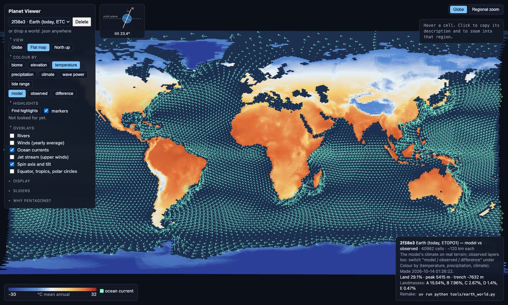
*The model's currents and sea temperature on real Earth terrain (an earlier Earth world). Gyres, the Gulf Stream, the Kuroshio and the Antarctic Circumpolar Current emerge.*

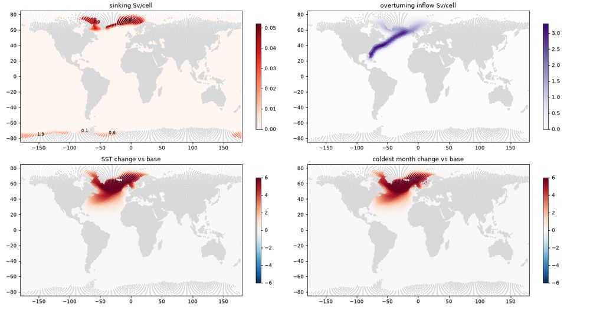
*Overturning on Earth (`docs/review/ocean/`). Top: sinking in the Nordic and Labrador seas and off Antarctica, the inflow riding the Gulf Stream. Bottom: the warming it adds.*

**Design decisions** (owner, 2026-10-13/14; original spec at `81e1d6b:docs/proposals/ocean_overturning.md`): done physically (density from SST and salinity; salinity from E-P, river runoff, sea-ice brine, ice-sheet meltwater, and in the time zoom meltwater pulses that can weaken the overturning); the ocean's warmth is added to the 50-70N band because the Koppen score preferred it (70.69% vs 70.50%); the +0.17 s per climate step (~35%) was accepted; the owner's plan is to fix moisture transport first, then remove the spin-up rule (PW-013), with Earth a test analogue and never a parity target. The rest of W Europe's winter cold error is the air model's (PW-026), not the ocean's.

**Known limits:** a spin-up rule still decides the Atlantic-on / Pacific-off state (PW-016); Antarctic sinking too weak (PW-017); NE Canada and Labrador too warm (PW-038); the Gulf Stream separates too far north (PW-041); Mediterranean too fresh (PW-152); ocean layers aren't in run keyframes (PW-153).

### 2.8 Ice and sea level (`tectonics/earth.py`)

**Surface mass balance** (`icemass.py`, PW-190, PW-159): one rule for the run's ice, the time zoom's and the regional zoom's glaciers. Twelve months on a sine between the bare ground's coldest and warmest month, on the ice's surface (its thickness higher: the lapse rate); snow falls below ~0 °C and lies; positive degree-days (days scattered ±5 °C) melt the lying snow (3 mm per degree-day, 60% refreezes), then ice (8 mm).
- **Snow lying is bright:** while the year's snow lies, the summer's warmth above the annual mean is damped and a positive temperature halved (a melting surface holds the air near 0 °C). Once it has melted the surface is bare (ground, or bare ice keeping 30% of the effect). So a sheet's margin, where the snow is gone by early summer, melts in the full summer (Greenland's ablation zone on the model's climate: ~−1 m/yr per cell, −230 Gt/yr), and the snowline depends on the snowfall: with 300 mm/yr a new cap needs bare summers below ~−6 °C (averaged over the orbits), with 1200 mm ~+2.5 °C.
- **The damping is a sheet's own air mass, carried along the winds** (PW-336): the climate damps the summer warmth of the air over land ice by 0.6 × the share of the surface within ~1000 km under ice, away from the tropics (`icemass.air_mass`), and the summer winds carry that air on (katabatic outflow): Antarctica's coast, shelves and WAIS get the sheet's cold summers (Halley −1.6 °C, McMurdo −2.9, Mawson +1.2; observed −4, −3, 0), not the bare ground's +13 °C. The ice surface itself adds only its own bright share, 0.6 × 0.3 (`sheet_cover`, LOCAL), in the run, the zoom and the time zoom (whose full climate passes its ice as `ice_air`). Greenland's summit −13.8 °C (obs −12); the East Antarctic plateau stays ~10 °C too warm (PW-039). Before PW-336 the air mass was a local damping of each ice cell, and the air reaching the margins came off the bare ground. Thick ice is also 2 °C colder all year. Bare ground's lying seasonal snow gets no damping, in the run's new-cap test, the time zoom and the zoom alike (PW-275): its brightness is already in the climate's snow albedo. (Before PW-275 the time zoom damped every lying snowpack by at least 0.3 × 0.6, so a time zoom glaciated bare ground more readily than its run.)
- **One ice-surface climate** (PW-277): the temperatures shown on land ice (the run's keyframes, worlds, the zoom's glaciers; `climate.ice_surface`) are this year's own (`icemass.surface`, at the mean orbit), the same rule that sets where the ice is and that the time zoom's frames report. Before PW-277 they were the bare ground's minus 10 °C × the ice's local cover all year with the summer halved, ~8 °C colder in winter on a big sheet than the rule the ice follows. A zoom gets the bare ground under a world's ice back by inverting it (`icemass.ground_from_surface`).

**Ice sheets in the main run** (`earth.ice_sheets`, PW-190): the run's ice is the extent the flowing sheets settle to under that mass balance, **averaged over the ice-age cycle's orbits** (precession at four phases × obliquity ±0.85°, eccentricity 0.03; a warm summer melts more than a cold one saves), in balance with the current mountains (real ice answers its climate in ~10 kyr, far inside a 4 Myr step).
- **Accumulation:** where the year's snow outlasts the summer: on bare ground (a new cap), and on ice (the old ice's own thickness; at a margin, old ice next to bare land or a new one, the sheet's edge's ~400 m, as the time zoom's margins, PW-366) connected to such a start or to old ice. The ice's height keeps it colder (the full lapse rate), so a big sheet outlasts the climate that made it; a cap follows its range as it moves or wears down.
- **Ablation zone:** each sheet then spreads ring by ring onto the land around it, the least-melting cells first, while its snow surplus pays for their melt (and calving, ~0.7 m/yr on a coastal cell); cold polar desert costs nothing to cover (PW-032).
- The surface is a steady **Nye profile** rising from the bed at the sheet's margin (PW-276; the least over its margins, since the ice drains toward the one that keeps it lowest) with a 75 kPa yield stress (PW-366: on Antarctica's real extent and bed 50 kPa held 20 Mkm³ against ETOPO1's 25; real sheets fit ~70-100 kPa), each cell holding the profile's mean over it: ~800 m on a margin cell at L6, ~2 km 300 km in; the ice is that surface less the cell's own bed (at least a margin's, at most 4 km), so it is thinner over high ground inside a sheet (the ice drains off it) and thicker over a basin; a little lower for warm (soft) or dry ice. (Before PW-276 the profile stood on each cell's own bed, so caps on high ranges reached 9-10 km surfaces.)
- The ice presses its bed down (glacial isostasy, §2.2, PW-189): the sheet's surface stands ~0.28 × its thickness lower and warmer. Its whiteness cools the planet (`ice_albedo`), levelling off toward 3 °C.
- A time zoom started from a run's moment is then close to its own balance at the mean orbit, and swings around it (§2.14).
- **Settled within the step** (PW-364): one pass of this rule (accumulation zone, ablation rings, Nye surface) moves a sheet's margin about a cell, so the run repeats it under the step's climate until the iced cells repeat, each pass on the bed its ice presses down (glacial isostasy) with the bare ground warmer or colder by the lapse rate. The carried air, the albedo and the rain follow at the next climate update. A big sheet still keeps itself cold (two states: the L5 envelope world's ice at dT +1.6 settles at −163 m from its sheets, −32 m from bare ground), but it no longer lags its climate by ~20 updates (~80 Myr), as it did with one pass per update. Cost: +7% (L5 run) to +23% (an L6 run with a big icehouse).
- The cycle's orbital response over bright ice is mixed as the time zoom's (`orbit_k`, PW-114/PW-365): the sea around counts at its own share, not as land.

**Sea level** is the sum of:
- **the ocean basins:** young, shallow ocean floor displaces water and raises the sea. The basins' depth follows the sea floor over `ridge_time` = 30 Myr, compared with a fixed reference, the starting floor's mean depth; the sea rises by (ρm − ρw)/ρm ≈ 0.69 of the floor's shallowing (the added water loads the floor down by the rest) and levels off smoothly toward ±400 m, wide enough not to shape ordinary highstands (+250 m passes at +222; PW-053, PW-288: a baseline that relearned the floor over 300 Myr hid a persistently young ocean; PW-293: ±250 before). The starting ocean has the ages of a steadily spreading one, so the first breakup doesn't flood the planet, at the model's own steady mean depth (oldest floor 144 Myr, mean age 48; measured: the model's ocean after 50 Myr averages −4800 m, mean age 49–52 Myr), so sea level 0 is the model's mean and excursions are breakups and assemblies (PW-293: the old 60 Myr start set 0 ~200 m of floor too deep, and the sea sat at a median +148 m). Health --quick (8 L6 seeds × 500 Myr) after 50 Myr: median +15 m, p5–p95 −155..+191; the first breakup's young ocean gives a +100..+200 m highstand around 50–100 Myr;
- **land ice:** −0.9 × ice volume / ocean area;
- **mantle heat:** only when `heat_start` ≠ 1.

PW-053 brought the sea-level spread on L6 seeds from ~126–195 m down to ~89–130 m (sd) and removed the clamp hits.

**Known limits:** oceans age when plates are few (PW-051, PW-191). Cold eras' ice follows dT and the geography (docs/review/audit/icehouse-depth.md, PW-364): on continents over both poles (the L5 envelope world, polar land ~1.1 km high) the rule's fixed point at dT −4 is −576 m over 16% of the surface, mostly through the carried sheet air (−223 m without it), against Earth's −67 m at dT −6 (−168 m once the sea answers; Earth's NH hardly glaciates, PW-033). Earth's probe (`tools/ice_probe.py`, 2026-10-16 code): 2.53% of the surface held at dT 0 (Antarctica 824 L6 cells, Greenland 164), −58 m at dT −6, −66 at −9, −149 at −12. Health --quick: deepest ice −219 m (seed 11, 4.6 °C), no frame below −250 m, every seed's deepest ice in an era below 10.7 °C. The depth of the cold dips is set by the climate drift (sd 3 °C; inbox draft). The sheets' 50 kPa profile is ~20% thinner than Earth's (PW-366).

### 2.9 Hydrology: rivers, lakes, deltas (`hydrology.py`, `kernels.py`)

**Routing:** water drains by **priority-flood** (Barnes 2014): from the sea, cells are visited lowest first, every cell gets one downstream neighbour, and every pit fills to its spill level. A coastal cell drains to its deepest sea neighbour; cells of equal height (a lake's surface, a flat lowland) are taken first come first, so across a flat the water takes the fewest steps to where it leaves (PW-344). That order is strict, so only the outlets on the coast (and closed lakes' shores) are queued, not the open sea's inner cells. **Flow accumulation** sums runoff downstream; `flow` × cell area gives discharge in m³/s.

**Lakes** are **fill-and-spill with evaporation**:
1. Hollows under 20 m deep are filled first (at ~55–110 km a cell's height is a mean, and channels too small to see drain them). A wide hollow must also fall at least 0.1 m per km from rim to middle, or it is a plain that rivers cross (`MIN_SLOPE`; 1 million km² needs ~56 m).
2. Water rises in all basins at once, merging as they meet; a basin grows only while its inflow beats the evaporation off its surface. A lake that spills next to a lower closed basin sends its river on into it; that basin then gets the river too and may fill and spill in turn (the Nile into the Nubian hollow, PW-122).
3. It ends as an **open, fresh lake** (reaches its spill point, the river flows on), a **closed salt lake** (stops first: Caspian, Great Salt Lake), or a **salt pan** (playa).
4. **Outlets cut down** (PW-055): a river leaving a basin runs in a valley cut below its cells' mean height, `CHANNEL_K` × Q^`CHANNEL_B` = 0.1 × (m³/s)^0.7 deep (~12 m for 1000 m³/s, ~60 m for 10,000, ~300 m for 100,000), never below the next cell downstream. The lakes are worked out again on that cut terrain (twice, as drained lake floors become river courses), so a lake a big river flows out of drains down to its outlet valley; closed basins have no outflowing river and keep their water. Earth's Amazon, Congo and Orinoco lowlands and West Siberia drain; the Great Lakes, Victoria and Ontario stay. Giant open lakes that lasted tens of Myr were mostly polar- or hot-desert basins whose outlets barely cut (the run's incision used the outlet's own rain) and lakes left by deep sea-level lowstands (−250 to −330 m, PW-190); with the catchment-rain incision and whole-lake sediment trapping (§2.5), open lakes over 1 million km² on L6 seeds 11/12/13 (600 Myr) fell from 15 frames to 3 and frames with one over 0.5 million km² from 46 to 22, lakes cover 0.51% of land instead of 0.57%, and land draining inland fell from ~15.5% to ~13.6% (PW-054's shortfall grows a little). On generated worlds (L6, seeds 11 and 12, after 100 Myr) lakes cover 0.7–1.0% of land instead of 1.4%, the biggest lake averages 0.4–0.7 million km² instead of ~1, and since big through-flowing lakes no longer trap sediment, hollows survive: land draining inland doubled (4–5% to 8.5–10.6%).

   **Outlets outlast their rivers** (PW-300, runs): the run remembers how deep each cell's valley is cut by rivers that reach base level (`isostasy.EXTRA` column `valley`, m, carried with the rock like the crust; stored as the keyframe layer `valley`, and a run's worlds pass it to their lakes too). Where such a river runs the valley is graded to it (`lakes`' `incised` now: a shrunken river silts up a valley too big for it); where none runs any more the old one fills in from its slopes with an e-folding of `hydrology.VALLEY_MYR` = 20 Myr (abandoned spillways and wind gaps). `lakes(valley=)` cuts the valleys at least that deep, closed basins' included, so a basin that stopped spilling keeps the gap it cut: its lake rises no higher than that and spills again through it while its inflow beats the evaporation off a lake that size. Without it the lake model was bistable: a basin that closed lost its outlet valley and filled its whole uncut hollow (seed 11 L6 at 200–224 Myr: a 0.1–1.2 Mkm² open lake became 4.6–6.9 Mkm² closed, land draining inland 2.5% → 36–40%). A dry pit only these remembered valleys make (one a river moved off) is no closed basin. Health --quick (8 L6 seeds, 500 Myr, after 50 Myr): frames with a lake over 1 Mkm² 9.1% → 4.3% (over 2 Mkm²: 36 → 10 frames), inland p90 10.0 → 7.9% (no frame over 30%), lakes 0.43 → 0.34% of land, inland median 3.8 → 3.4% (docs/review/health-pw300-after/).

On Earth's terrain this closes the Caspian, Aral, Tarim, Eyre, Makgadikgadi and Altiplano basins. The Earth world's lakes went from 6.1 to 2.4 million km² (PW-201).

5. **River heights from data (Earth only, PW-236):** a cell's mean stands as a dam where a river crosses it in a gorge narrower than the cell (the Lena below Yakutia, the Amur, the Danube's Iron Gates, the Yangtze's Three Gorges, the Columbia). The Earth world and `earth_check` give `lakes` an optional `outlet`: each cell's river height where it enters the cell, from HydroSHEDS' 30″ conditioned flow directions and DEM (`earth_data.earth_outlets`: the cell's main stem, its height the lowest ground along it up to its source), and the valleys are cut down to it as well (closed basins' too). None inside the closed basins below. ETOPO1 can't give it, even at its full 1′: filled, it dams the Iron Gates at 250 m (the Danube runs at ~65 m), the Three Gorges at 620 m. Generated worlds pass none (their rivers cut their own valleys) and are unchanged. **Closed basins from data** too: `rivers_and_lakes`' optional `closed` (`earth_data.earth_closed`) gives each cell HydroSHEDS drains mostly inland (and whose main river ends inland too) the closed basin (sink) most of it ends in; no river crosses a basin's edge (`walled`), and its lake rises no higher than its lowest pass out (a wetter climate than the data's spills over the divide). On the L6 Earth world (climate of 2026-10-16): land draining inland 7.2% → 20.4% (excl. Antarctica; HydroSHEDS ~22%); lakes 2.55 → 0.81 million km² (lakes over ~10,000 km², the size L6 resolves, are ~0.7 on Earth without the Caspian, sea here), salt pans 0.09 → 1.5; Yakutia, the Amur, Pannonia, Sichuan, the Columbia and Fraser drain; Victoria, Huron, Ontario stay (Superior is sea at L6, Michigan and Erie's cells drain); the Aral, Chad, Tarim, Great Basin, Altiplano and Makgadikgadi have closed lakes, Eyre pans; Hulun drains to the Argun (as in HydroSHEDS). In `earth_check` inland drainage 9% → 21%, the Yangtze reaches the sea (18,900 m³/s, was 7,900), as does the Orinoco (no longer captured by the Amazon). A closed cell needs its main river to end inland too: the lower Murray crosses the Mallee, whose ground drains to sinks.

**Seasonal flow** (PW-028, worlds): each cell's runoff is spread over the months by what reaches its ground (rain, and snowmelt: a cold country's winter of snow comes off in a spring flood), half of it through the ground (spread over the unfrozen months; 5% where the ground is frozen six months or more), then gathered down the rivers; a lake flattens the flood at its outlet in proportion to its size for its catchment. Stored as `flood_ratio` (the peak month's flow over the mean month's: ~1.3–1.7 for the Amazon, Congo, Mississippi; 3–4 for the Ob, Mackenzie, Yukon, Volga, Ganges), `flood_month` and `river_frozen` (months a year the cell's rivers are frozen). Floodplains are sized by the flood, not the mean flow (`vegetation.floodplain`: the mean × ratio / 2, so a typical river is unchanged; in the zoom the flood also reaches higher above the river, stage ~ Q^0.4): on an L6 world, cells with a ratio above 4 are 22.6% flooded instead of 18.9%, steady rivers (< 1.5) 12.9% instead of 14.7%. The viewer has a "river floods" layer and names a river's discharge, peak month, ratio and frozen months on hover. Deltas don't use it: a flood pulse on the river's term in Galloway's triangle (sediment ~Q^1.5, so ×√(ratio/2)) turned the Ganges–Brahmaputra from tide- to river-dominated on Earth and moved nothing else much, so it was left out (BQART's loads already include each river's floods).

**Deltas:** big river mouths (≥ 1500 m³/s) get a delta type from Galloway's triangle (§2.10), drawn by the zoom.

**Outputs:** `flow`, `downstream`, `lake`, `lake_level` (lake surface; `lake_level − elevation` is depth), `lake_kind` (0 none, 1 fresh, 2 salt, 3 pan), `flood_ratio`, `flood_month`, `river_frozen` (worlds). Runs store `lake_depth` instead of `lake_level`.

**Known limits:** run and world lakes still disagree. Finishing now keeps most of the keyframe's lakes (Jaccard overlap of lake cells with those of the keyframe under the same climate, L6, five runs: 0.31–0.89 since PW-057, 0.05–0.77 before; land draining inland now matches the keyframe's), and a run frame's rivers and lakes (`flow`, `downstream`, `lake_kind`, `lake_depth`) are worked out on the frame's own final terrain with the run's last climate, as a world's are (PW-239; before, they were the erosion step's, on the terrain before it eroded, deposited and moved, so many rivers ended in hollows the frame no longer had: land draining inland by the stored `downstream` was 2–3× the frame's real hollows). Run lakes still turn over within a frame or two. Closed basins on generated worlds rest on tectonic subsidence and are fewer at L6 than at L7 (PW-054, §2.5). Giant frame lakes (over 1 million km², in ~4% of L6 frames since PW-300, ~9% before) are closed lakes on broad, flat-floored continental hollows 30–150 m below their rims; their water balance holds (inflow = evaporation off the lake), but most sit just short of spilling: with 15% less open-water evaporation 5 of 8 checked turn open and drain to their outlet valleys. Since PW-358 lakes evaporate by Penman (clouds and humidity; humid lakes less, desert and cold ones more): on the giant frames of a main sweep, replayed on the same terrain, the biggest lake shrank ~30% (sum 80 → 56 Mkm²) but 17 of 21 stayed over 1 Mkm², since most sit in arid or cold basins; a basin that turned closed under the higher evaporation used to lose its outlet valley and fill its whole hollow; it keeps it now (PW-300, item 4). What giant lakes remain (~4% of L6 frames) are mostly in hollows that never spilled, made in a step or two on flat interiors, and ice-dammed lakes of deep ice ages (inbox). The hollows themselves are mostly made each step by plates moving and being resampled to the grid and filled again by erosion within a few Myr (inbox; docs/review/audit/basins-lakes.md).

### 2.10 Coasts: waves, tides, delta types (`coast.py`)

- **Wave power** (kW per m of coast): rays go out in 24 directions from each sea cell (each cell's fan turned by its own fraction of a step, so islands' shadows don't line up into streaks), up to 6000 km or the first land. Walking back in, the sea grows under the wind along each stretch with **fetch** and storm duration (**JONSWAP**), up to a fully developed **Pierson–Moskowitz** sea, then travels on as slowly decaying **swell** that loses energy over shelves. The wind's speeds spread about its mean as a Weibull (k = 2) distribution: the sea is grown under four speeds of the spread and the powers averaged, so each regime gets its own moment (fully developed ~U⁵: 6.1× a steady wind's power; fetch-limited 1.43×; duration-limited storm seas 1.91×; PW-270). Wind blowing off land is 30% slower and recovers over ~50 km of sea (the marine internal boundary layer; PW-272), so enclosed seas are limited by their fetch only. **Sea ice** stops the waves like land; each cell's open water is a window round the same warm peak (a sine through its warmest and coldest months), so the windows nest, and a half-year's power is integrated over the moments the coast is open, each with the sea open at that moment (PW-230): an Arctic coast open three months gets its open season's waves.
- **Tide range** (m) is a three-factor proxy: connection to the open ocean (shallow straits choke it; only deep basins at least 6000 km across raise the full tide, while smaller deep basins behind sills, such as the Arctic Ocean, raise a small one of their own), **shelf resonance** (the standing wave on a shelf sloping down to its break, J0(2ωW/√(g h_break)) after Lamb: strongest at J0's first zero, 1.08 × a quarter wavelength on the shelf's mean depth, and still ~2× past it, where the tide shoals into the shallowing water; PW-273, PW-297), and **funnelling** into narrowing bays.
- **Delta type** (Galloway's triangle) compares three fluxes at big mouths: the river's sediment (**BQART**), wave-driven longshore transport (**CERC**) and the **tidal prism**. Their shares are the river, wave and tide weights; a weight ≥ 0.5 names the type, else "mixed". The prism floods the delta plain, whose radius grows as 70 km × (Q / 1000 m³/s)^0.35 × (0.8 + 0.6 × offshore sediment factor), capped at 350 km (Nile ~110–140 km, Mississippi ~210–265, Ganges–Brahmaputra ~275–350; PW-269): with real inputs the Ganges–Brahmaputra, Mekong and Fly come out tide-dominated, the Mississippi river- and the São Francisco wave-dominated.

`tools/coast_check.py` on today's Earth (L6, 2026-10-16, after the coast batch, docs/review/audit/coast-batch.md): waves in range at 5 and within 2× at 25 of 32 coasts (U_TRADE = U_STORM = 7 m/s, refitted on the 18 open-ocean coasts: rms log error 0.53, bias ~0), but the enclosed seas (Baltic, Black Sea, Mediterranean, North Sea) 3–6× too strong; tides in range at 16 and within 2× at 24 of 25 (12 / 22 with the flat-shelf response; L7 15 / 26 of 26), with Patagonia (3.7 m against 6–11) and the Yellow Sea (2.2 against 4–9) still low.

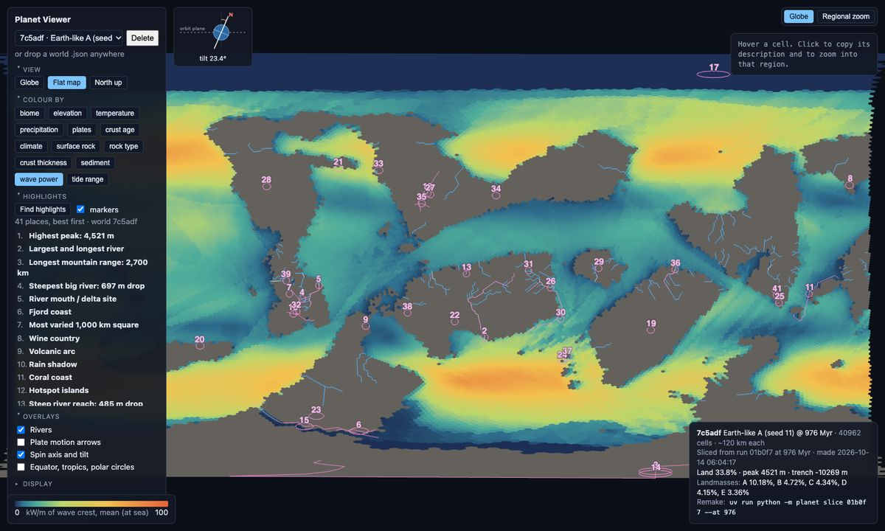
*Wave power on 7c5adf: the westerly storm belts and their swell, with calm water in their lee.*

**Known limits:** Southern Hemisphere westerly coasts too weak and the North Atlantic too strong (PW-074, PW-075); enclosed seas' waves 3–6× too strong: the wave-driving wind there is 1.6–2× the observed (storms keep their open-ocean strength behind land, needs a decision in the climate or here); the Laptev and Kara coasts get no waves because the climate never thaws them (their warmest month ~−2 to −3 °C over the sea); Fundy too small, no amphidromic points (PW-076); no SW-monsoon swell on India's west coast (the climate's July wind there is weak); no spits, cliffs vs beaches yet (PW-077, PW-097); coastal life is §2.20.

### 2.11 Worlds: slicing and finishing (`timeline.py`, `world.py`)

A **world** is one moment, finished. Four ways to get one:
- **`planet slice <run> --at T`** (or `--at auto`: the keyframe after 300 Myr whose land %, largest landmass and landmass count are jointly nearest the run's medians). It replays the simulation from the nearest checkpoint, checks the result against the stored keyframe and refuses to save on a mismatch (the code changed since the run) unless `--force`.
- **The viewer's Zoom button** builds the world straight from the keyframe nearest that time (`timeline.world_from_frame`, seconds, exactly what the viewer shows), reusing a world already made at that time.
- **`planet finish <timezoom> --kyr N`** (PW-091, `finish.py`; the viewer's "Finish world here" on a time zoom frame): a world at any stored frame (every 2 kyr) of a glacial time zoom. Geology (plates, crust, rock, landforms, volcanoes) is the source keyframe's; bed, ice, sea level and global temperature are the frame's, and the frame's orbit (obliquity, precession, eccentricity) is the time zoom's monthly temperature anomaly passed to `climate.compute` (`orbit_dt`, with Earth's start anchor; PW-198); then the usual finishing below, so lakes form against the ice and on the pressed-down bed, and lowered seas join land. Grounded ice on a bed below sea level (pressed down by its load, or a marine sheet) is stored as it is, the true bed under the ice (PW-197); it is land by its ice (see **Land** below; meta `ice_bed_below_sea_cells`). The Earth world's data (`earth_data`) stores ETOPO1's true bed as well (PW-354). The time zoom's glacial imprint up to the frame comes along (PW-037): the bed is the carved one, so lakes fill the overdeepened basins and the hollows behind till; layers `glacial_erosion`, `glacial_till`, `ice_max`; the sediment cover loses what the ice stripped and gains the till (a scoured shield shows its basement); the sub-cell texture's bumps are planed (exp(−erosion / 180 m) of them stay; the mountains' ridges stay); `glaciated_myr` = 0 wherever the ice reached. Time zooms made before PW-037 can't be finished (re-run them). Meta: `source_run`, `t_myr`, `timezoom`, `timezoom_kyr`, the frame's sea-level change and orbit. **Storage choice:** no re-run; each time-zoom frame already stores the surface and the grounded ice (to 1 m since PW-091), so bed = surface − ice. `planet finish <run> --at T` (or "Finish world here" on a run) is the keyframe world, as the Zoom button. An Earth time zoom finishes like `tools/earth_world.py` (real terrain, no rock record, so no regional zooms).
- **`planet generate`** makes an unsimulated world from cartoon plates (no texture, ice, record or landforms; it can't be zoomed). **`tools/earth_world.py`** runs real Earth terrain through the same finishing, with observed climate alongside.

**Finishing** (run-based worlds first get sub-cell texture, `timeline.texture`: ±180 m of noise plus ridges on high ground, scaled by the ground's slope, so steep country (≥ 1.25 m/km between cells) gets all of it and plains and plateaus 15%: PW-057):
1. climate, then 12 erosion passes (`hydrology.erode`, strength 0.3 for slice and Zoom worlds, 1.0 for generate: stream-power cutting with rivers routed as in the run, through open lakes and ending in closed ones, and a creep that only lowers ground, toward its lower neighbours, so it doesn't fill hollows), then climate again. Finishing sharpens and lowers the keyframe's terrain without depositing what it removes (L5 run ends, strength 0.3: land 38–56 m lower on average, p99 270–425 m): it stands for sub-cell valleys the keyframe's cell means can't show, not for more erosion, and the keyframe has already put its sediment where it belongs. Routing the removed rock as the run does (PW-281 B, tried) filled the keyframe's hollows and built deltas: lake Jaccard against the keyframe 0.60/0.27/0.81 → 0.37/0.00/0.55 on three L5 seeds, inland drainage down, 2% more land; so it stays a display pass (PW-281 A);
2. rivers and lakes;
3. waves and tides;
4. July / January temperature and rain (`world.seasons`);
5. the sea (SST, salinity, sinking, upwelling; the overturning in the meta), humidity, clouds and sunshine;
6. coastal and shallow-sea life (§2.20);
7. soils' mineral pass (§2.21), vegetation on it (§2.18; mangrove forest and salt marsh named from step 6; biomes grouped from its named types), soils' organic pass and classification.

**Land** (PW-307): a world's `elevation` is the true bed, and land is ground above sea level *or under grounded ice* (`geo.is_land` / `geo.world_land`, as the run's `sim.land()`), so a bed pressed below the sea by its ice, or a marine sheet's, is land for every consumer: the climate (`climate.compute`'s land/sea, Köppen, biomes), the rivers and lakes (they run over the ice surface and on to the real coast: the bed under the ice is no outlet; the finishing's erosion, `hydrology.erode`, routes over the ice surface under all ice as well, PW-355, and cuts the bed beneath), waves, tides, the sea's layers, currents, coastal life, the satellite view, the summary, highlights and the viewer. Ice whose surface doesn't stand above the sea is afloat and left out (`isostasy.grounded`): that cell is sea. The regional zoom builds its terrain on the land view (`zoom.land_world`: such a bed at 1 m, the ice thinned to keep the surface), as its passes take land as ground above the sea, then sinks the bed under its glaciers to the world's (§2.13, PW-356). Measured on seed 11 L6 at 236 Myr (sea level −236 m; 298 of 3304 ice cells on a sub-sea bed): land, lakes and the five largest rivers' mouths unchanged (one river's longest course 51 → 63 cells), changes confined to the ice and its margins (bed under the ice: −58 m mean instead of ~4 m, ice 60 m thicker; ±0.03 °C and ≤1 mm of rain beyond two cells off the ice, waves ±0.1 kW/m); on a finished world of L7 seed 3199's time zoom 080df3 at 950 kyr (2564 of 13251 ice cells, bed −349 m mean, down to −1502 m) also a few proglacial lakes 4–8 cells from the marine bed drain (lake cells 177 → 146) as the erosion's routing past the ice changes, and land 31.9 → 32.0% (the floored bed eroded to 0 m used to read as sea); a world without ice is bit-identical.

**One rule for the world's water** (PW-355): until PW-355 `hydrology.erode` routed the water along the bed under the ice (over the ice surface only where the bed is below the sea), the rivers and lakes over the ice surface. It now routes over the ice surface under all ice, as `rivers_and_lakes` does (under a sheet the subglacial water's head is dominated by the ice surface's slope); the bed beneath is still what is cut. Measured on keyframe worlds (strength 0.3): L7 seed 11 (run 738c73) at 652 Myr (4895 ice cells, none on a sub-sea bed): 2016 beds under the ice change (p1/p99 −124/+133 m, extremes −417/+381), 493 of 758 within two cells of the ice (p1/p99 −182/+211), beyond eight cells p1/p99 ±3 m; lakes within eight cells of the ice 24 → 17 cells (open lakes 140 → 132), the rest 644 → 643; the five largest rivers' mouths and flows unchanged (the longest course 90 → 91 cells); climate beyond two cells of the ice within 0.4 °C and 12 mm at the 99th percentile. L7 time zoom 080df3 at 950 kyr (13251 ice cells, 2564 on a sub-sea bed): 9756 beds under the ice change (p1/p99 −219/+232 m), within two cells p1/p99 −320/+173; lakes within eight cells of the ice 88 → 73 (open 95 → 81), beyond 58 → 60; four of the five largest mouths unchanged, the fourth moves one cell (flow 308 → 346); beyond two cells of the ice 0.2 °C and 61 mm at the 99th percentile. A world without ice (738c73 at 8 Myr) is bit-identical.

**Outputs:** `worlds/<id>.json` (all layers inline; 5 MB at L6, 30–45 MB at L7) plus a readable `.txt` summary with ASCII maps. A tectonic world has ~119 layers (§2.16; 32 of them vegetation, 7 coastal life with turbidity and upwelling, 10 soils, 3 the satellite view); its meta records the source run and time, global temperature, sea level, hotspots, volcanoes, the overturning and the code version.

### 2.12 Highlights (`highlights.py`)

**What it does:** 43 detectors find 53 kinds of place worth a visit, in six categories (the viewer filters and colours by category):

| Category | Kinds |
|---|---|
| landscape | highest peak (and highest ice-free peak), mountain range, plateau, canyon, fjords, rain shadow, most varied 1000 km square, continent, island, archipelago |
| water | largest and longest river, delta (with its type), waterfall (a steep reach at cell scale), lake, inland sea, salt lake, salt pan, salt flats, inland basin, coral coast (the largest reef tracts of §2.20's reef layer; "great reef" from 10,000 km²), barrier reef, carbonate bank |
| climate | desert, rainforest (the evergreen tropical forest types), ice sheet, Mediterranean "wine country" (Köppen Cs, with its vegetation), hottest, coldest, wettest, driest |
| travel | beach destination, ski country, winter-sun retreat (mild winter, ≥ 5 h of sunshine a day), year-round resort (beach and skiing within 400 km) |
| geology | volcanic arc, hotspot island chain (from the volcano table: islands, atolls and guyots in a row), atoll group, supervolcano, highest active volcano, great shield volcano, volcanic field, flood basalts, rift, deepest trench, fastest plate (at its leading edge: collision or subduction) |
| vegetation | great forests (largest closed forests of different kinds), great savanna, wetlands, maquis coast, treeline (alpine and polar), mangrove coast (§2.20) |

Each scores as kind priority × quality (0.3–1). Travel picks use each hemisphere's own summer and winter and say why: "July 28 °C, 10 h of sunshine a day, 38 mm of rain, warm sea 25 °C, gentle surf". Results are cached in `worlds/highlights/<id>.json`; `--zoom N` pre-makes zooms of the top N at a suggested size.

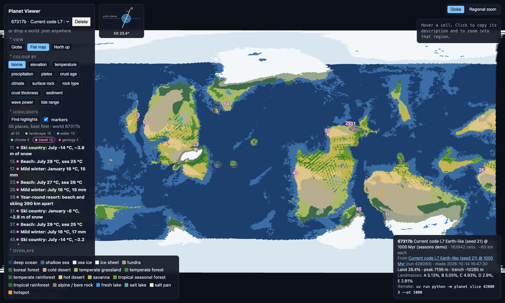
*World 67317b, highlights filtered to the travel category.*

**Volcano and reef kinds** (from the volcano table with its status, §2.3, and §2.20's reef layer; simple rules, nothing placed by hand):

| Kind | Rule | Zoom |
|---|---|---|
| supervolcano | a plume's caldera track on a continent (Yellowstone: hotspot vents on land, drawn by the zoom as calderas on a lava plain, PW-118), linked as the island chains are, with a caldera still active or dormant; by number of calderas; two at most | the live calderas, 250–500 km |
| highest active volcano | the active arc stratovolcano with the highest summit above the sea, then the tallest above its ground (the run caps active summits at 3.5 / 4.2 km, so ties are common) | 250 km |
| great shield volcano | the oceanic hotspot volcano standing most above its sea floor and reaching above the sea, any status (Mauna Kea: ~10 km) | 250 km |
| volcanic field | the place with the most edifice types (stratovolcano, shield, caldera) above the sea within 250 km, at least two; ties to more states, then more volcanoes | 500 km |
| flood basalts | land of flood basalt at the surface or the lava-plateau landform, ≥ 100,000 km² (Columbia River ~210,000, Deccan ~500,000) | its span, ≤ 1000 km |
| atoll group | atolls and reef-fringed islands of the table linked within 300 km into a scatter, cut into archipelagos at most 1,500 km across (`ARCHIPELAGO_KM`: the Tuamotus ~1,500, the Marshalls ~1,300; the member with the most atolls within 750 km takes them, then the rest, PW-382); the one with the most atolls, saying how many more its scatter has beyond; not one already shown as an island chain | the densest 350 km, + 100 km |
| carbonate bank | a connected warm (annual sea ≥ `reef_temp` − 1.5 °C) shallow (≤ 200 m) sea with reefs, detached: the land it touches no bigger than itself and at most half its cells on a shore (the Bahamas); a platform with two or more of the table's atolls is left to the atoll group; by area; two at most | its span |
| barrier reef | reef cells (≥ 1%) off the coast of a landmass ≥ 100,000 km², on the outer half of its shelf (no more cell links from deeper sea than from the shore), ≥ 300 km long (the Great Barrier Reef; not reefs in the middle of a shelf sea like the Java Sea) | its middle, ≤ 1000 km |

The coral coast leaves a tract holding a shown barrier reef or bank to them, and is only "great reef" when it is the world's biggest tract. Found (2026-10-16, worlds not kept): run a1d3b9 (L7, seed 3199) at 380 Myr: a supervolcano with 1 active and 10 extinct calderas over 1,400 km, and a second (1 active, 1 dormant) beside a 340,000 km² flood-basalt province from a new plume; the highest active volcano 3,500 m, 2,800 m above its ground; a 6.2 km great shield; a field of 22 stratovolcanoes, 2 shields and 2 calderas; a 3,600 km barrier reef; banks of 25,000 and 19,000 km². Run 738c73 (L7, seed 11) at 676 Myr: a supervolcano with 1 active and 6 extinct calderas over 730 km; the highest active volcano 3,500 m; a 6.4 km shield; 620,000 km² of flood basalt 14 Myr old; a field of shields and calderas (no arc in it); a 580 km barrier reef; two small banks (9,300 and 6,200 km², one dropping to ~2,400 m all round). Run c32ec0 (L7, seed 21) at 892 Myr: supervolcanoes with 1 active and 14 extinct calderas over 1,700 km and 1 active and 7 extinct; the highest active volcano 3,500 m; a 7.2 km dormant shield (off its plume, still over its head); a field of 8 stratovolcanoes, a shield and 4 calderas; 140,000 km² of 436 Myr old flood basalt; no barrier reef; a 6,200 km² bank. Dormant volcanoes: 3-5 per world (all hotspot vents). Earth (`tools/earth_world.py`, no volcano table, so no volcano kinds): at L7 the barrier reef is the Great Barrier Reef (690 km off Queensland, ~160 km out) and the banks are the Cuyo–Calamian platform off Palawan and the Bahamas (53,000 km² each; the Bahamas has fewer reefs, its model sea 21–26 °C, a degree or two cool); at L6 the barrier reef is the southern GBR (340 km) and there is no bank (the Bahamas' cells touch Cuba's at 110 km).

The most varied square counts named vegetation types (biomes on worlds without vegetation). A world's highlights take ~1.5 s at L6 and ~4 s at L7.

**Known limits:** canyons are weak at cell scale (PW-079); Earth has no volcano table, so no volcano kinds; dormant is hotspot-only (arc volcanoes: active or extinct, inbox draft).

### 2.13 Regional zoom (`zoom.py`, `zoom_landforms.py`, `zoom_volcanoes.py`, `zoom_terrain.py`, `zoom_vegetation.py`, `zoom_kernels.py`)

**What it does:** turns coarse cells into a 500×500 px landscape. The CLI default is 1000 km at 2 km/px; the viewer offers 250, 500, 1000 and 2000 km (0.5–4 km/px). Every coarse cell's mean height is kept (the detail's correction in 12 smooth passes, so a one-cell trench keeps its depth; the coarse valleys are cut mass-neutrally and what creep takes off goes back on the hillslopes, PW-268, PW-298: on the 8 showcase zooms of 592f2a and a glaciated high plateau the land cells away from the coast keep their means to a bias of −3 to +2 m, RMS 8–55 m (mean of zoom seeds 1–5; the two river-mouth zooms were −25 m while their delta plains flattened interior cells up to 800 m high, PW-349); trench cells +50 to +310 m shallow, against 2–4 km before on 592f2a; stats `inland_cell_mean_bias_m`, `inland_cell_mean_rms_error_m`), and all noise is sampled at 3D planet positions, so overlapping zooms of one world agree. The terrain (passes 1–11 below) is built on the region plus a halo of half a coarse cell round it, cropped off before the climate (PW-321): the drainage goes on past the region's edge, so there's no rim of short, steep catchments along it (3×3 relief within 8 px of the edge was ~2× the inside's on 1 km zooms of 592f2a; now the same as 8–40 px in). It costs ~+5% on 4 km zooms, +10% at 2 km, +25% at 1 km, +33% at 0.5 km. A zoom needs a world with rock and climate layers (sliced from a run). It takes ~10–15 s at L7 (about 4–5 s of it the vegetation).

**The passes, in order:**
1. **Interpolate** the coarse fields onto pixels (height, temperature, rain, runoff, ice, ruggedness).
2. **Delta plains** at mouths ≥ 1500 m³/s, shaped continuously by the Galloway weights: *river* → levee-bound fingers (a bird's foot); *wave* → a smooth arc with barrier, lagoon and beach ridges; *tide* → funnel estuaries, creeks and flats. Distributaries split the flow below the apex, each along a smooth curve rasterised onto the pixels (bowed and wiggling, less on a river-dominated delta; D8's greedy steps had drawn ruler-straight channels in eight directions), and a bird's foot's branches run out along its fingers, which bend away from the fan's middle, wander and narrow to their tips; no finger is built along a direction that runs on over land (its branch had crossed the plain to a coast 100+ km off) (PW-061). A finger the split tree's branches don't reach gets a branch of its own from the delta's nearest channel; none is drawn where the tide's funnels take the branches instead; a delta whose river hasn't found its mouth yet when the branches are laid (a third of the way through the landscape pass) is tried again on the next iterations. The distributaries aren't held above the land beside them (a coarse river's valley floor, or a falls reach's foot, had kept some 30-90 m above the plain), the coarse rivers' floors stand no higher than the plain on it, and no branch crosses a young volcano's cone (PW-363). The plain lies only on low coarse ground (full up to 30 m, none above 250 m: a plain on higher ground is a lowland the world doesn't have), and what it takes off an inland cell's mean goes back on that cell's land beyond it (PW-349).
3. **Coastline** from warped noise, with barriers, lagoons and coastal-plain barrier islands.
4. **Relief noise** scaled by rock ruggedness (cratons smooth, orogens rough), then corrected back to each cell's mean. A land cell whose fine coast leaves part of it sea first puts what its mean lacks into that sea (`SEA_SHARE_PASSES`, PW-362): the floor round its island rises towards the shore, a shelf, fading out into the sea cells beyond; before, its sea pixels took the depth of those cells (a forearc's trench) and the correction lifted its land as much as its sea, so a lone +194 m forearc cell on world fac2af stood as a 1,900 km² mesa flat at ~1,600 m (land p10/50/90 403 / 1,334 / 1,631 m, its sea -1,604 m; now 186 / 607 / 902 m, sea -628 m: `docs/review/zoom-polish/pw362_sea_share.png`). On world 592f2a's 8 highlight zooms (seeds 1-5) drops ≥ 100 m stay 10.2 a seed and inland bias / RMS move by at most 0.3 / 0.6 m.
5. **Volcanoes** (`zoom_volcanoes.py`): each volcano in the world's table is its own edifice: a Gaussian shield with rift-zone lobes (and a caldera while active) for hotspots at sea, a steep concave stratocone for arcs. The run keeps one arc volcano per 120 km of active arc (its coarseness); the zoom adds cones between neighbouring active ones along the chain (each one's nearest within 220 km and the nearest on its other side), one every ~60 km, a few km off the line, 0.6-0.95 of the lower one's height (`zoom_volcanoes.arc_infill`, PW-116; listed with `minor: true`), so a volcanic front has a volcano every ~50-70 km, as Java's and the Aleutians' do. Having no volume in the coarse cells, they sit on the ground, what they stand above it comes off their cells' other land, and the landscape pass cuts their drainage (held smooth like the run's young cones, they made 500-1000 m cliffs at their feet). A hotspot vent on a continent (PW-118) is an oval caldera (the vent's radius, up to 1.9:1; Yellowstone ~45 x 85 km) with a rim, a sunk floor and a low resurgent dome, in a flat lava plain twice as wide holding the shield's volume (a quarter of its height), laid on the smooth coarse ground so it fills the hollows and hills stand through it; a younger caldera sinks into an older vent's plain. Around oceanic hotspot vents the ground is lowered to the vents' sea floor by the cones' own share of each coarse cell's mean, so the sea between them is sea while the cells keep their means; where the cells stand higher (a ridge the vents built, an ice-capped hotspot plateau) the rest stays ground (PW-310: no round sea holes). Older ones stand at the run's summit height and get radial valleys; planed ones are flat-topped guyots; a living reef makes a fringing or barrier reef, or an atoll ring with islets round a lagoon.
6. **Landform targets** for each class (below).
7. **Rivers:** coarse rivers become valleys, rivers entering at the edge bring their discharge, and **knickpoint waterfalls** are designed where the coarse river drops steeply (≥ 50 m of extra drop, ≥ 100 m³/s): a resistant lip, a plunge pool and a gorge retreated upstream. The lip's rock comes from the strata: a thick top stratum holds it, a thin one needs harder rock under it, and soft rock beneath lets the gorge retreat faster (Niagara).
8. **Glaciers, first outline; coarse lakes** take the world's level and kind. An open lake passes on what reaches it less its open-water evaporation, and at least the world's outflow of that lake (at the outlet of its fragment nearest the coarse exit; less what its other fragments pass on): the zoom sees only the part of a big lake's catchment inside it (a 150,000 km² lake of 592f2a, wholly inside a 1000 km zoom, passed on 0 of the world's 3,180 m³/s; PW-060). Below an open lake's outlet the river steps down in rapids as fast as the coarse outflow descends (its steepest mean drop from the lake's level over the next ~2 cells, at least 2 m/km; `stats.largest_lakes[].outflow_grad_m_km`, PW-123): a lake on a plain spills gently, a mountain lake's outflow cascades down its valley instead of standing above it on a 2 m/km causeway (a 2,600 m glacial-world lake: 21 m/km, rapids held at most 360 m above the graded land instead of 820 m).
9. **Landscape pass:** 15 iterations of steady-state stream power that **grade** rivers into smooth concave profiles. The slope factor C (uplift over erodibility) is a smooth field at the coarse cells' scale, refitted each iteration so each cell keeps its mean: a Newton step per cell on the relief its own slopes make, above where each pixel's profile enters the cell or a held point (a river's floor, an outlet, a capped summit) (PW-298; a per-pixel fit wound up next to held river courses and made tributaries end in 400–1000 m walls, and settled 100–200 m off the means). Streams carry the world's **runoff** (PW-180), so a hyper-arid zoom has no river it doesn't get from outside; the landscape's shape follows rain-weighted drainage area, since desert wadis are cut by rare floods.
10. **Glaciers** (PW-127, PW-159) from each pixel's own climate by the run's surface mass balance (`icemass`, §2.8), lapse-corrected to the pixel's height: accumulation where the snow outlasts the summer on bare ground (so a wet, maritime snowline sits at bare summers of ~5 °C, a dry one near 0 °C) or under the coarse sheet's ice where connected to such a start or to its interior (the coarse ice's height only on the sheet itself, not on an iced cell's warm valley floors); the surplus is routed down the valleys as tongues (~0.8 km wide at 0.1 km³/yr, at most 3 km³/yr and 100 km long) that melt on the way down. A coarse ice sheet stays one sheet with outlet tongues. Where the ice ends on land it thins to its edge along Nye's plastic profile, H = √(2τx/ρg) with τ ~100 kPa (~150 m 1 km back, ~330 m 5 km back; a pixel holds the profile's mean over its length), so a tongue no longer ends in a 360–570 m ice cliff (PW-350; ~210 m on a 3 km snout pixel); calving fronts in water keep their height. **Bed below the sea under grounded ice** (PW-356): the terrain is built on the world's land view (a sub-sea bed under grounded ice at 1 m, its ice thinned to keep the surface, `zoom.land_world`); after the climate the bed under the zoom's glaciers sinks to the world's by each coarse cell's depth below that view (interpolated, then each cell's iced pixels corrected to the true bed's mean), the ice thickened by as much, so the ice surface and the coastline stay (on a marine sheet of world 85922d, time zoom 080df3 @ 950 kyr: bed under the ice 15 m → −452 m against the cells' −476 m, inland cell bias +14 / RMS 17 m → −1.5 / 12 m against the true bed). A tongue's 100 km run is counted below the zone: from the last pixel its accumulation zone drains into, so a tongue fed along the zone's margin (its excess lost there, at the 3 km³/yr cap) runs until its melt has used up its flux instead of being cut at the cap still carrying ~2.8 km³/yr (PW-357).
11. **Creep**, then the **landform remap** (relief, shape, strata), sill cuts, gorges below landform falls. Creep is a diffusivity: above 2 km/px its per-pixel step falls as (2 km / res)², so a hill rounds alike on 2 and 4 km pixels (PW-125: a 4 km zoom's mean |Laplacian| now matches 1 km zooms of its area averaged to 4 km, 295 vs 300 m on a mountain range, where it was 145; finer zooms keep the 2 km step per pixel). What creep or the remap takes off a cell's mean goes back on its hillslopes, never on a stream's bed. (The landscape pass's summit taper is integrated along each link, so it doesn't depend on the pixel size either.)
11b. **Glacial landforms** (`zoom_glacial.py`, PW-092, PW-497; a `Synth` of its own in `zoom_landforms`, read from the finished world's imprint `glacial_erosion`, `glacial_till`, `ice_max`, not from a coarse landform class; no imprint, no class): the cell-mean erosion is gathered into **troughs** along the drainage's trunks (>= 25 m^3/s; floor lowered 8 x the cell-mean erosion, more under bigger trunks, along-valley noise leaves rock bars and **overdeepened basins**; the walls a power-law U round a flat floor; side valleys stay high: **hanging valleys**, falls in the final drainage) and **cirques** (planet-fixed bowls on the high slopes); where a trough's floor ends below the sea and joins it the sea floods it (**fjords**, `Landforms.drown`, before the landscape pass's coast clamp); **moraine ridges** along the margin (the smooth share of iced cells at 0.5 and 0.85, as high as the till says, lobed); **outwash plains** down the proglacial rivers from the margin (up to 45 m, thinning over 90 km, the valley floor lifted and flattened) and **loess** downwind (the world's wind, <= 12 m, softens the ground); after the final drainage **drumlins** (mounds streaked along the ice's flow, `ice_flow()`: the slope of bed + `ice_max`) on till plains and **kettle** pits (ponds where they reach the water table). Every coarse cell keeps its mean. Layers `glacial_form` (1 trough .. 8 lake) and `loess`; stats `glacial`. Showcase (Earth at the 420 kyr interglacial of time zoom e9d59c, world 577526; seed 1, 1000 km at 2 km/px): Norway 66c45e (14 fjords, mean 361 / max 835 m deep, 80 trough lakes, floor lowered 244 m at p90), Baltic margin 21703a (4 moraine belts, 6,000 km2 of outwash, 23,000 km2 of loess), Ungava 4f65aa (14 fjords to 201 m, 33 lakes); the Alps b03a2b (parent erosion ~1 m) and Patagonia bf3c88 (4 m) get next to nothing, as their parent says. Limits: the ice's flow is the surface slope of the thickest ice, not the flow (PW-499), moraine-dammed lakes do not form yet, Earth finished worlds carry a rough rock map (`finish.earth_rock`).
12. **Closed basins by water balance** (PW-167): runoff in against open-water evaporation, upstream first; a full lake spills into the next, else a closed lake or a dry flat.
12b. **Shoreface** (PW-327, `zoom_coastal.shoreface`): off sandy and muddy shores the sea floor shoals to the coast along Dean's profile h = 0.1 x^(2/3) (10 m at 1 km, 21 m at 3 km) down to the closure depth (6.75 x the waves' mean significant height, 3–25 m), then an inner shelf at 1.5 m/km fading into the coarse floor over 6 km; not on rocky coasts (land rising fast or hard rock along the shore) nor round the volcanoes; each cell's mean kept by the floor further out (the coral-coast zoom of 592f2a: 15 m median depth within 1.5 km of the shore, 39 m before).
13. **Falls listed**, landform overlays (dunes, dolines, towers, springs), climate on the fine terrain (the bare ground's, lapse-corrected; the ice surface's on the zoom's own glaciers, PW-160), July / January temperature and rain (PW-139), a coastal plain's marshes.
14. **Terrain indices** (`zoom_terrain.py`, PW-196) on the finished surface: a **radiation index** per month (the day's sun on the slope's plane over flat ground's at the pixel's latitude: a 30° poleward slope at 45° gets ~0.3 of flat in winter, ~0.8 in summer), the **topographic wetness index** ln(a / tan β) from `drainage_area`, and the distances to the nearest river (≥ 1 m³/s) and the sea.
15. **Vegetation** (`zoom_vegetation.py`, PW-214; proposal §3.7): the world's model (§2.18) run per pixel on the zoom's own terrain, warm-started from the world's cover fractions (so history keeps forest or savanna; read with a wider kernel, 0.6 of a cell, at a planet-fixed rough offset of ~0.4 cell, because the world's cover is mostly forest or open cell by cell and the pixels' bistable competition otherwise kept the cells' edges as straight lines and rectangles along their rows, PW-374). The seasons are the cells' July and January interpolated (not the warmest and coldest month, which swap at the equator and put a step of the whole swing on the pixel row at 0); the months run on the seasons the pixel has (July is summer where it is the warmer). The pixel adds: its lapse-corrected temperature (treelines, alpine belts); its slope's light and potential evaporation by month, and ±2.5 °C for sunny or shaded slopes (an equatorward slope's treeline sits ~100–200 m higher); the water its soil holds and the soil's fertility factor (16) and groundwater in hollows (TWI); a river's water in a strip along its banks (0.15 km wide at 1 m³/s, +0.4 km per tenfold), a habitat of its own inside the pixel: the competition runs on the dry ground and in the strip, and the pixel's cover mixes them by the strip's share (PW-221), so gallery forest runs through savanna and an oasis woodland along a desert river is named even at 4 km/px where it is the pixel's only woodland; the world's flooded share given to each cell's wettest pixels (high TWI, big rivers' floodplains, patchy noise for mires) plus lake shores and coastal marshes. After the competition, each type's mean over a cell's pixels is pulled 60% of the way back to the world's by a smooth field (not where the pixel stands > 800 m off the coarse surface), and a **fire mosaic** draws each pixel's stand age from the exponential distribution of its fire interval with planet-fixed noise (~25 km patches; young stands fewer trees, more herbs and birch, lower canopy; the mean kept). `biome` becomes the named types' grouping, as on the globe.
16. **Soils** (`soils.zoom_mineral`, PW-331; §2.21): the world's two soil passes per bare land pixel, either side of the vegetation: the mineral pass on the pixel's own slope, rock (`surface_rock`, the zoom's volcanoes and reefs included), floodplains and river strips (alluvium), hollows (colluvium), glacier forefields and climate, with the cell's landform, landform age, last glaciation, salt lakes and interpolated loess; the organic pass on the pixel's vegetation and flooded share. Layers `soil` … `loess` as on the globe.

**Landform synthesis** (PW-010/011/012): each class has hooks (`target`, `relief`, `shape`, `strata`, `basins`, `lakes`, `overlay`, `sinks`), blended by smooth class weights so there are no cell seams. Bench levels come from the class's whole connected zone on the coarse grid (PW-148), dipping caprock dips along one direction per zone (the downhill of a plane fitted to the zone's cells, PW-179: its beds are a plane, not contorted by a regional downhill that turns), and structure strikes from planet-fixed patches, so overlapping zooms agree.

| Class | What the zoom draws |
|---|---|
| great escarpment | a lowland, one crenulated scarp ~0.8 × the zone's height (200–1500 m), the plateau above; rivers take their main fall at the scarp |
| caprock | stepped benches and cliffs of hard beds over soft, mesas and buttes; cuestas where the beds dip |
| lava plateau | flat top over stair-stepped, deep valley sides (Deccan traps) |
| fold-and-thrust belt | parallel folds a fold wavelength apart: whaleback anticlines when young (Zagros), hogbacks of the hard beds closing round plunging noses when old (Valley and Ridge); trellised drainage, water gaps |
| fault-block rift | tilted blocks ~10–30 km wide: a steep fault scarp, a gentle back-tilt, a sediment-filled half-graben, lakes where the water balance fills them; throw from the stretching and age |
| shield | a flattened plain with granite domes and inselbergs (whole and round-topped: a dome a stream would cross is left out, flow paths pond against the others and go round, and the summits' cap doesn't flatten them, PW-168); recently glaciated shields have ground-down domes and rock-basin lakes |
| karst | small streams sink underground and resurge at springs; temperate: dolines and poljes on a plateau; wet tropics: towers 60–250 m high (Guilin) |
| dune field | dunes by the seasons' sand drift (Fryberger): transverse and barchan dunes with one wind, linear with two crossing winds, star dunes where winds reverse; 1–3 km apart |
| coastal plain | a smoothed plain sloping to the sea, low inland-facing cuestas, barrier islands with lagoons on wave-dominated coasts, marshes |

**Falls:** `stats.falls` in `zoom.json` lists every fall ≥ 30 m on a stream ≥ 20 m³/s (kind `lip`, `scarp`, `bench`, `lake outlet` or `drop`, with gorge, cascades and plunge pool); an undesigned one must be 3× as steep as the river above it and 3× as steep as the river below it (a mountain stream reaching a flat valley floor isn't a fall, a hanging valley's step is; within 3 px of a designed lip only the designed river itself is exempt, not a tributary joining it); `stats.waterfalls` keeps the 5 biggest by power. A lip's or a cliff's plunge pool lies at the fall's foot, where its drop ends (PW-341: on falls over 3–4 px it sat on the pixel below the top, with nearly all of the drop below it). The viewer draws them as the Waterfalls overlay.

**Outputs:** `zooms/<id>/zoom.json` (metadata, stats, legend, projection), `heightmap.png` (16-bit), `preview.png` (the satellite view in each hemisphere's summer, hill-shaded, with rivers), `satellite.png` / `satellite_jul.png` / `satellite_jan.png` (unshaded true colour, §2.19), `coarse.png`, and layers `elevation`, `water` (land/sea/lake), `lake_depth`, `lake_kind` (1 fresh, 2 salt, 3 pan), `discharge`, `drainage_area`, `receiver` (each pixel's D8 receiver as the landscape pass routed the water: slot 0-7 NW N NE W E SW S SE, 255 none; PW-373), `precipitation`, `temperature`, `temperature_jul`/`_jan`, `precipitation_jul`/`_jan`, `ice`, `tide_range`, `wave_power`, `rock`, `surface_rock`, `climate`, `biome`, `landform`, `wetland` (1 a coastal plain's marsh, 2 the vegetation's wetlands), `vegetation` (named type), `tree_cover`, `plant_cover`, `lai`, `canopy_height`, `npp`, `fire_return` (decision 9A: the summary layers; `zoom_vegetation.fractions(<zoom>)` recomputes each PFT's cover in ~5 s, the same numbers), `radiation_index`, `twi`, `river_dist`, `coast_dist`, `cloud_jul`/`_jan` (the world's cloud cover, interpolated: the satellite view's clouds), `coastal_life` (§2.20: 1 reef, 2 kelp, 3 seagrass, 4 mangrove, 5 salt marsh). Layers with an encoding in `zoom.LAYER_DOC` are stored as small integers with a scale (read them with `zoom.load(id, decode=True)`). Stats include land and elevation checks against the coarse cells, rivers, lakes, deltas, falls, volcanoes, the landform shares, basins and overlays, and the vegetation's shares by type.

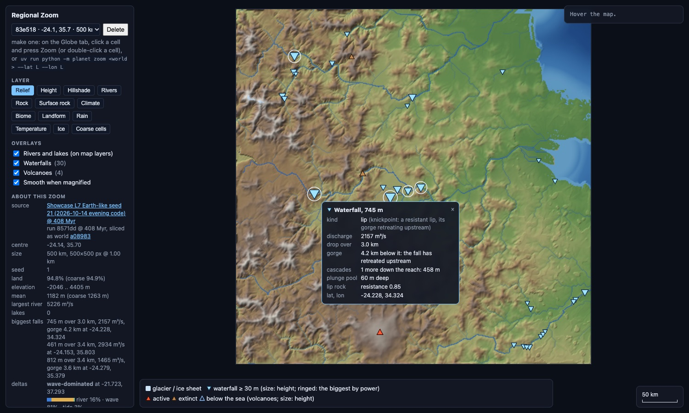
*Zoom 83e518 (500 km at 1 km, showcase world a08983): Waterfalls and Volcanoes overlays; the card shows a 745 m lip fall with a 4.2 km gorge.*

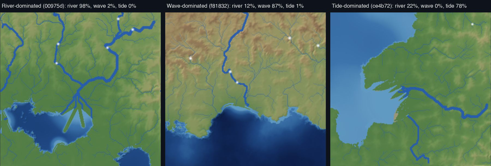
*Delta types in three 600 km zooms of world 0f7abd: a bird's foot into a calm sea; a smooth wave-built coast; tidal funnels with 6.6 m tides.*

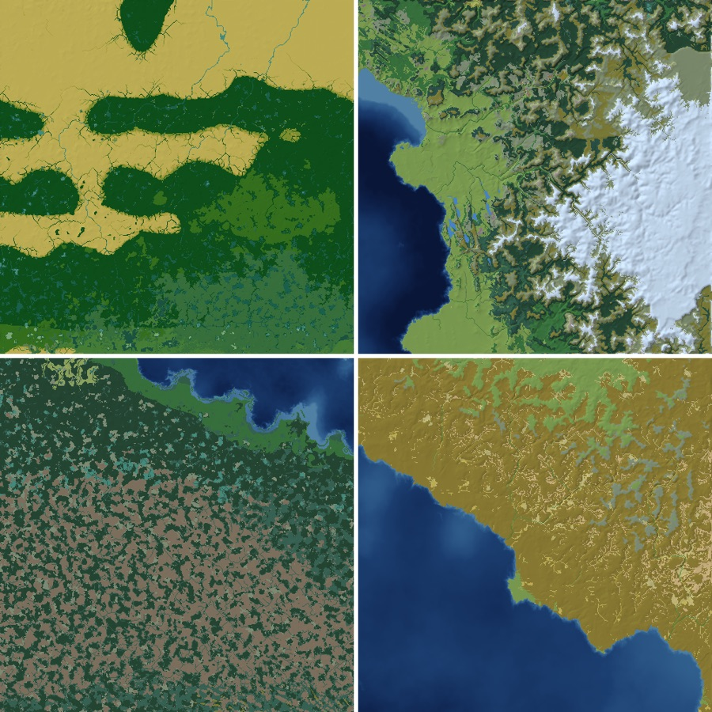
*Per-pixel vegetation (PW-214) in four zooms of world 351f32 (L7, run 732abb @ 1000 Myr): a rainforest–savanna edge with gallery forest along the rivers (64f0b6, 1000 km); a mountain treeline under an ice cap, higher on sunny slopes (3a5252, 500 km; at 1800–2000 m equatorward slopes hold 38% trees, poleward 20%; below 1400 m, where water limits, poleward slopes hold more); boreal taiga with palsa mires and swamp forest (3373be, 1000 km); a Mediterranean coast of maquis with woodland on the hills and along the streams (58c0ac, 500 km).*

More zoom images, one per landform class: `docs/review/landforms/` and `docs/review/zoom/`.

**Known limits:** a small coarse land cell among sea cells (a forearc cell on a shelf beside a trench) stands as a flat-topped mesa with ~1.5 km cliffs, its mean kept while its sea pixels take the trench's depth (PW-362; the arc's cones themselves are clean); no zoom below ~0.5 km/px or nested zooms (PW-071, PW-129); no microclimate (PW-101); some perched rivers (~39 river pixels per seed on those zooms, 30 of them on the arc zoom; mostly side tributaries graded to the foot of a reach's falls, PW-124); ~10 undesigned drops ≥ 100 m left on the 8 showcase zooms of 592f2a (mean of 5 seeds, 6–14 by seed; ~39 before PW-298, docs/review/zoom-polish/pw298.md, batch4.md, batch5.md, batch6.md); side-by-side zooms don't join (seams ~10× the normal pixel step, docs/review/zoom-polish/pw125.md); dune seams (PW-177); the zoom's forest–savanna edges follow the coarse rain's blobs and streaks (PW-211, PW-019), sharper than the world's but no more extensive; no meanders, terraces or fans yet (PW-094).

### 2.14 Glacial time zoom (`planet/timezoom/`, `planet/orbit.py`)

**Code layout:** `planet/timezoom/` is a package: `params` (knobs), `sources`, `geometry`, `forcing` (orbit anomaly, CO2 and ice-albedo feedbacks: the one place per-step forcing is assembled), `fields` (full climates and their blending), `plants` (the vegetation grown on each full climate and its feedbacks, PW-450), `ice` (shelves, calving), `kernels` (numba), `sim` (the stepping loop as named steps), `events`, `output` (save, report), `run` (CLI entry). Orbit and insolation maths live in `planet/orbit.py`, shared with `icemass`.

**What it does:** a separate simulation. Geology is frozen at one moment of a run (or today's Earth), and ice sheets evolve for 1 Myr (CLI default; the viewer offers 100, 300 or 1000 kyr, default 300) in 500-year steps, keeping a frame every 2 kyr. It never feeds back into the run, but any frame can be made into a finished world (§2.11, `planet finish`).

- **Orbit (Milankovitch):** obliquity ±1.2° around the planet's tilt (41 kyr), precession (23 kyr) and eccentricity (100 and 405 kyr) set each latitude's monthly sunshine (Berger 1978), turned into a temperature anomaly: 0.25 °C per W/m² on bare land, 0.3 of that over the sea; bright snow and ice absorb a fifth of it but the air over them brings the response of the land, sea and ice within ~600 km, each at its own share (`orbit_k`, PW-114: Greenland ~0.35 of the land's, Antarctica ~0.23).
- **Ice:** the run's surface mass balance (`icemass.py`, §2.8): monthly snow minus **positive-degree-day** melt; lying snow is bright and damps the summer (by the sheet's own air mass), bare ice feels the full summer. A margin cell (ice next to bare land) gets its edge's balance (~400 m of ice, as the run's margins), not its mean thickness's (~1 km: the grid's cliff-like margin). Flow by the **shallow-ice approximation**; on the ice and the rings around it the balance acts within the flow's sub-steps (PW-366), so a margin's melt and the flow feeding it act together, and the bare land beside a sheet takes a new edge's balance (bright, `edge_h` high, as the run tests a new margin), so the ice the flow pushes onto it melts or stays as the sheet's edge would, instead of lying a step as a film that hid the front from the margin rule (PW-422).
- **Start:** a run's ice is the run's mass balance's extent already (no correction); Earth's ice surface gets a cooling where the climate model's summer on the ice is warmer than observed (`anchor=obs`: mostly Antarctica's coast, −2.3 °C on average since PW-336, PW-039), so the real sheets keep their real margins (Greenland's ablation zone stays). It corrects the climate over ice, so it applies only where ice lies and leaves with it (PW-035; before, it cooled the cell for the whole zoom).
- **Bed and sea:** glacial isostasy (PW-189) as an ELRA model: the bed relaxes with a 3 kyr e-folding time (`iso_tau`) toward the run's settled dip, 0.28 × the ice thickness spread by flexure over ~150 km (`iso_ratio`, `flex_km`; `isostasy.ice_load`), and rebounds after the ice is gone; the start is settled (a run's keyframe bed is already pressed down by its ice); **ice shelves** (PW-367): ice the flow carries past the grounding line, thinner than flotation, floats as a shelf (no load on the bed, no sea level; not in the frames' `ice` layer). It spreads under its own weight (Weertman 1957, thinning at A (ρ_i g (1 − ρ_i/ρ_w) h / 4)³ h, slowed by its confinement × (1 − `buttress`)³: ~550 m thick where fed 1 m/yr, ~950 m at 10 m/yr), the spread ice calving at the shelf's own front; it melts from below at `melt_k` = 10 m/yr per °C of the sea's winter water above freezing (Holland et al. 2008, Jenkins et al. 2018); and it breaks up where the air's annual mean over the sea is above −5 °C (in full: below −10 °C; Morris & Vaughan 2003's limit of shelf viability, past which the Antarctic Peninsula's shelves went; the air rather than `ocean.open_share`, which comes in whole months and is never 0 beside today's Antarctica at L6, 2–6 months open, as the real Ross and Amundsen seas are 2–4 months while their shelves stand). A grounded marine front calves at 1 m/yr per m of water depth only where it faces open water; where a shelf (≥ `shelf_h` = 100 m, less counts for less) covers it, it doesn't calve, and the shelf holds back `buttress` = 0.8 of its flow across the grounding line (Fürst et al. 2016: Antarctica's shelves carry most of the resistance there, only ~13% of their area is passive; Larsen B's tributaries sped up 2–8× once it broke up, Rignot et al. 2004); grounded ice in water deeper than 3 km calves too (`calve_depth`, PW-199: unresolved deep basins; deeper than Earth's deepest grounded beds, ~2.5 km, so West Antarctica's true bed, PW-354, doesn't calve in place: PW-361); sea level falls by the sea water the ice holds / ocean area: 0.89 × the ice above flotation plus the room the sunken bed made below sea level (Goelzer et al. 2020; PW-031: ice filling a deep marine basin no longer counts in full), so coastlines and land bridges move.
- **Glacial carving** (PW-037, `docs/proposals/glacial_carving.md`): where the bed is thawed (Robin's steady column: 65 mW/m² of geothermal heat plus the flow's own heat at its bed, τ_b·u, against the cold the accumulating snow carries down; slow cold domes stay frozen to their beds, fast outlets thaw) the ice slides (half its speed, at a basal shear stress of at most the bed's yield stress, `tau_y` 100 kPa: the shallow-ice speed goes as τ³H, and the grid's cliff-like margins or a sheet far from balance ask more, so their speed is scaled by (τ_y/τ)³) and abrades the bed at 4e-6 × the rock's erodibility (`surface.ROCK_K`: the cover and old till first, then the basement; Earth has no rock record: 1) × the sliding speed (Hallet's law). A basin stops deepening where its bed rises toward the ice's way out more steeply than 1.5 × the surface falls (supercooling, Alley et al. 2003). The rock rides in the ice (advected in `sia_flow`) and is dropped as till where the ice melts (within the flow's sub-steps), floats off or calves (till belts at long-lived margins, fans off marine fronts); the lithosphere answers the rock moved (0.82 of it, flexure, at each full climate); the ice flows on the carved bed; sea level counts only the ice. Earth L6, 600 kyr on the glacial index, per Myr under ice that has been there: 43 m mean, 15 median, 128 at the 90th percentile, 300 at the 99th, max 490 (Laurentide region 26 mean / 63 p90 / 250 max, Fennoscandia 33 / 84 / 142, Norway's coast 77 / 142 / 219, Greenland 78 / 169 / 390, Antarctica 72 / 219 / 490; Alps and Patagonia ~2-8, their glaciers unresolved at L6); till thickest in the outer, briefly iced belt (North America: 25 m where iced 15-35% of the time, 9 m under the interiors) and off marine fronts. Four drifting run moments (PW-492): 35-64 mean, p99 380-590, max 730-850 m/Myr. +4.5% run time. `carving=false` turns it off (bit-identical to before).
- **Climate:** fully recomputed every 10 kyr, blended and shifted in between; the global temperature is the glacial index's (below) plus the plants'; meltwater reaches the overturning. Vegetation (PW-450, `veg`): the run's model (cheap variant) is grown on each full climate, warm-started from the last and in balance with the start's climate at the start. It feeds back as in the run (Budyko w, and its albedo with snow hidden under forest, the albedo part applied to the climate it grew on at once), plus a global term: the change in the planet's albedo since the start, at the current snow, on the start's land (`veg_toa` 0.4 x `veg_lambda` 0.8 C per W/m2, lagged 2 kyr). Earth's 600-kyr zoom: -42.8 -> -45.1 m, backstops 1 -> 0, with the term ~0 at its deepest (-0.02 C global; 45-90 N -0.07..-0.12 W/m2, cancelled by greener tropics). At a prescribed -6 C it is -0.32 W/m2 against Earth's LGM -1.1 (Köhler et al. 2010), and the tropics have the wrong sign (`docs/review/audit/PW-450-vegetation.md`).
- **Ice-age cycle: the glacial index** (PW-471, `cycle.py`; a v1 kludge while the emergent cycle is parked, PW-470). As ice-sheet modellers do when they can't simulate what drives the cycles (Greve 1997, Marshall et al. 2002), the zoom scripts how cold it is and its ice physics works out where the ice goes. An index I(t) from 0 (interglacial: the run's own climate, so the run's ice) to 1 (glacial maximum) comes from a small conceptual model on the planet's own orbit (Paillard 1998's three states, Huybers 2011's falling bar): *between* ice ages I is 0 for at least `ig_kyr` (10 kyr), then a glacial *builds* once the summer sun at the cycling latitude falls below the 40th percentile of its own 800-kyr series; I approaches 1 with an e-folding time of 36 kyr, faster in weak summers and slower in strong ones (`build_orb`); an *ending* starts once I ≥ 0.85 and the summer sun beats a bar falling from its 95th to its 60th percentile over the glacial's first 100 kyr, and takes I back to 0 in 8 kyr (backstop: a glacial older than 200 kyr ends at the next peak above the median; counted). The cycling latitude is the mean latitude of the land poleward of the planet's snowline (ice-free land whose annual mean, brought to sea level, is below 0 °C) in the hemisphere with more of it (Earth: 65 N). The zoom's global temperature is −I × the glacial cooling, polar-amplified as any global change (0.5× tropics .. 1.5× poles). The cooling is planet-relative: `glacial_cool` 6.5 °C at Earth's share of the planet in such land (3.5% at L6), in proportion elsewhere, at most 1.6×; `glacial_dt` sets it by hand. 6.5 °C is above the LGM's 4.5–6 °C: the model's sheets answer a cooling weakly (PW-435), and 6 °C gave Earth maxima of −75..−90 m. The index stands for the cycle's CO₂ and ice-albedo feedbacks, so the zoom has none of its own (the CO₂ share `co2_share`, half, only sets the plants' CO₂). Diagnostics in meta `ice_age_cycle` and `run.txt`: the endings, cycle lengths, cooling and a sea-level target (2 km of ice over the snowline land: Earth 87 m). Measured (L6; `docs/review/audit/PW-471-handoff.md`): Earth 600 kyr cycles of 98–109 kyr, glacial maxima −86..−104 m, endings giving back 57–76 m in 15 kyr, interglacial ice 9.1–12.2% of land, the Laurentide sheet reaching 42.5 N (0.7 Mkm² south of 50 N). Run moments: their ice at I = 0 is not the zoom's balance on most cold moments (PW-436: the run has no calving), so 8 of 10 L6 cold moments still drift 15–200 m off their start (less than on main for 9 of 10; needs-decision draft); see the handoff.

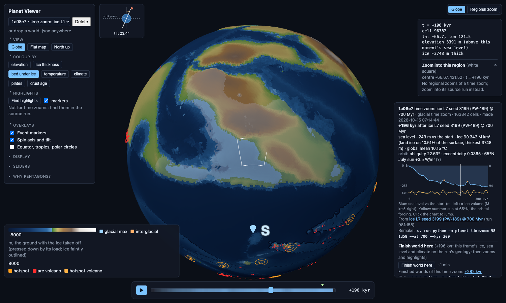
*Time zoom 1a08e7 (L7 run 981d58, seed 3199 @ 700 Myr) at its 196 kyr glacial maximum, "bed under ice" layer: under ~3.7 km of ice the bed is pressed ~1 km down, much of it below sea level (blue), as in Antarctica.*

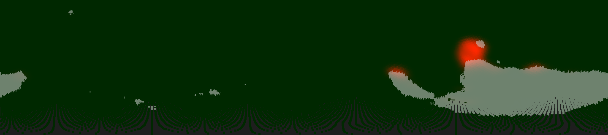
*The same time zoom, bed uplift from the glacial maximum (196 kyr) to the next interglacial (222 kyr), southern hemisphere, equirectangular: red = rising, up to 2.4 cm/yr, 0.9 cm/yr on average where the ice left (Hudson Bay today: ~1 cm/yr); grey = still under ice.*

**Parameters:** `--set` any `TZParams` field: `insol_k` (0.25 °C per W/m²), `obliquity_amp`, `glacial_dt` / `glacial_cool`, `index=off`, `ddf_snow/ice`, `iso_ratio`, `calving`, `buttress`, `shelf_h`, `shelf_warm/cold`, `melt_k`, `phases=zero`; `baseline=obs` for Earth.

**Outputs:** a run (`kind: timezoom`, time in kyr) with layers `elevation`, `ice`, `temperature`, `climate`, `glacial_erosion`, `glacial_till` (the imprint so far); frame stats (sea level, ice %, overturning, orbit, summer insolation at 65°N and at the latitude of the cycling ice: meta `ice_cycle`, `cycling_ice_sun`); events (glacial maxima, interglacials). The viewer shows ice thickness and a sea-level / ice-volume curve with the summer sun where the ice comes and goes (65°N July dashed).

**Design decisions** (owner, 2026-10-13; full original spec at `db11d33:docs/proposals/glacial_timezoom.md`): whole planet, not regional; never feeds back into the run itself (it does feed finished worlds, PW-091, §2.11); driven by orbital cycles. Early Earth did have ice ages (Pongola ~2.9 Ga, Huronian ~2.4-2.1 Ga, Snowball ~720-635 Ma): the young Sun was dim, so a hotter interior is not a hotter surface. Hence no arbitrary entry point: the user picks any moment, and greenhouse eras simply show little ice. Wanted but not built: proglacial lakes, outwash and loess, permafrost (PW-037, PW-030); glacial erosion since PW-037.

**Known limits:** a time zoom from a run's moment now starts near its own balance (PW-366: the run's sheets are 75 kPa profiles with each cell's mean rise and edge-balance margins, the time zoom's balance acts within its flow's sub-steps and gives the bare land beside a sheet a new edge's balance): unforced (no orbit: I stays 0), L5 seed 1 @ 300 Myr 4 °C colder −2 m in 20 kyr, −5 m in 50 kyr (was −43 m in 20 kyr); an L6 seed-2 run's own moment @ 580 Myr +7 m in 20 kyr, +13 m in 50 kyr (the old code's run: −231 / −191 m); what is left is the run's cycle-averaged balance against the unforced mean orbit. With the orbit on, that L6 moment (sea level −593 m) loses ice over 150 kyr (+41 m at 20 kyr, up to +141 m); an Earth time zoom at a fixed orbit keeps 136 of West Antarctica's 149 marine cells for 20 kyr (91%; 54 before PW-367), losing the thinnest at the Ross grounding zone in the first 2 kyr, while its shelves form (Earth's data and a run's keyframes store none); Antarctica holds 25.2 Mkm³ and grounds on only 10 shelf cells; the sea still falls 7 m in 20 kyr unforced (before PW-367 ~0, by West Antarctica's loss cancelling the growth): Greenland's region −4 m (its model summer is ~4 °C colder than observed) and the Arctic's marine margins (Arctic Canada, Svalbard, Siberia) −6 m, now buttressed in their cold seas; a +4 °C start (dT, Eemian orbit) warms the air over Antarctica's seas to ~0 °C, its shelves break up and West Antarctica retreats: 91/149 marine cells at 20 kyr, 53 at 50 kyr (the Amundsen sector 24 and 13 of 35); the sub-shelf melt hardly acts there, as the model's ocean has no warm deep water and Antarctica's winter water stays at freezing even at +6 °C (draft on ocean heat under shelves); Earth's deepest glacial is −37 m in 150 kyr (at 108 kyr; −33 before PW-030's ice-albedo rule; PW-366: before, the films that hid fronts let the sheets advance, −76 m at 150 kyr on the same code otherwise) and −64 m in 1 Myr (before PW-366) (−18 and −24 before PW-367: the buttressed marine margins of the northern sheets grow further; observed LGM ~−120 m, PW-033); Earth's glaciation is weak (PW-033: too much ice in Siberia and Alaska, too little in Fennoscandia; since PW-275 gives bare ground's lying snow no summer damping it fell 38 m in 150 kyr, before 100 m; now 18 m, see below); an Eemian-like Earth start peaks at +6.5 m at ~6 kyr, nearly all Greenland (85% of it gone at 6 kyr, back past its start size by 50–100 kyr); West Antarctica keeps 124–131 of its 149 marine cells (before PW-367: +9 m at 8 kyr, Antarctica +4 m, most of it the unforced marine retreat) (PW-114: real ~2 m and ~3–5 m; before PW-114's fix the sea around Greenland counted as fully absorbing land and Greenland was gone in 2 kyr, then again at most precession maxima; draft on marine margins); the 100-kyr sawtooth is scripted by the glacial index (PW-471), not emergent (PW-470; PW-030: `docs/review/audit/PW-030-handoff.md`: a run's moment drifts to one of two feedback branches, warm or cold, and heartbeats there; proglacial-lake calving and glacial dust were tried and moved nothing; PW-440's cycle gives ~100-kyr pacing on a cold moment but slow, partial endings, and run moments still drift far from their start, PW-436, `docs/review/audit/PW-440-handoff.md`); no salinity memory, so no abrupt events (PW-018); one-cell ablation zones (PW-115); the glacial imprint is coarse (basins, till belts, stripped cover at the cell scale; U-valleys, fjords, drumlins are the zoom's to make, PW-092) and one time zoom deep; embedded ice ages in the main run are planned (PW-104).

### 2.15 Viewer, server and CLI (`viewer/`, `server.py`, `api.py`, `__main__.py`)

**CLI** (`uv run python -m planet <cmd>`): `make` (seed to finished world in one command: simulate, representative moment, ice-age time zoom, finished world, highlights, zooms; `--preset`, `--set`, `--dry-run` prints the plan and the time estimate; also `POST /api/make`; PW-248), `simulate`, `slice`, `generate`, `zoom`, `timezoom`, `finish` (a world at a time zoom's kyr, or a run's time), `highlights`, `satellite` (add or redo the satellite view of a saved world or zoom, in place; §2.19), `report` (re-render run.txt), `list`, `delete` (by id; `--orphans` clears zooms and caches of deleted worlds and unfinished runs), `show` (ASCII map of a world file), `serve`.

**Server** (`planet serve`, port 8765): serves the viewer and the data folders, handles `DELETE` of runs, worlds and zooms, and adds `POST /api/zoom`, `POST /api/timezoom`, `POST /api/finish` (`{timezoom, kyr}` or `{run, t}` → a job whose result is `world`), `GET /api/jobs/<id>`, `GET /api/highlights` and `GET /api/cell?world=<id>&i=<cell>` (a world cell's 12 monthly temperatures and rain totals from `climate.months` on its stored climate, PW-315: only that cell is computed; a world's inputs are read once, ~1 s at L7, and kept for the last 4 worlds). Data files over 256 kB (`.bin` run layers, world, grid and run JSON) go gzipped when the browser accepts it (`Content-Encoding: gzip`, level 1, PW-317): compressed while the first request is sent, then cached under `<data root>/.gzcache/` (named by the file's size and mtime, so a regenerated file gets a new copy; copies of deleted or changed files are pruned). Zoom, time-zoom and finish jobs run `--jobs` at a time (default 4), each in a worker process (`planet/parallel.py`), and highlights not cached yet are computed in two worker processes of their own (`api.highlights_job`); within one process one computation runs at a time (`api.COMPUTE`, needed under numba's workqueue layer, whose parallel kernels abort the process if two threads launch them at once). What two processes could build at once (a slice of one run moment, a zoom, a time zoom, a finished world, a world's highlights, the indexes) takes a file lock (`store.lock`), and every metadata file is written to a temporary name and renamed into place (`store.write_atomic`). Job state is saved in `.jobs/<port>.json`: after a restart finished jobs still answer and cut-off ones run again (once); the viewer keeps polling through a restart. `DELETE /api/jobs/<id>` cancels a queued or running job (cooperative, PW-480: a flag file in `.jobs/<port>.d/` makes the worker's next progress report raise `api.Cancelled`; the simulation removes its half-written run, finished stages stay); a make job records its finished stages there too, and a cut-off one queued again after a restart reuses its run, time zoom and world instead of simulating again (a restart *during* the simulation still starts it over). `POST /api/highlight-zooms {world, n}` is a job making `planet highlights --zoom N`'s zooms.

**Globe** (`viewer/index.html`, three.js): one triangle fan per cell, with exaggerated relief, on a globe or a flat map.
- **Runs** play as animations with an event list, plate arrows, and a time slider tinted blue in cold eras (where a time zoom will show ice ages). Layers: elevation, plates, crust age, surface rock, rock type, crust thickness, sediment, rainfall and temperature (year / July / January; a season's layer downloads when it is picked), climate, landforms, vegetation, tree cover, NPP, and **bed under ice** (the ground with the ice taken off, pressed down by its load, PW-189; time zooms have it too). A run's (and a world's) elevation under grounded ice is shown floored at 1 m, so it reads as land; the hover card gives the ice and its bed, and worlds with ice have the **bed under ice** layer too. With a vegetation layer on, green ticks and labels above the slider mark when each plant group appeared.
- **Worlds** add **satellite** (true colour, §2.19; with the season picker and a **Clouds** overlay), biome, precipitation, vegetation (named types, legend grouped), tree cover, plant cover, canopy height, leaf area (year / July / January), NPP, biomass, fire return, stand age, plant type (a picker for any one PFT's cover, `?layer=plant%20type&pft=BoNS`), wave power, tide range, sea temperature, salinity, humidity, dew point, cloud and sunshine. The info box names the vegetation, tree cover and NPP; its detail panel adds the main plant types, canopy, fire return and stand age. Temperature, rain, SST, humidity, cloud and sunshine have a year / July / January picker (`?season=jul`). On the flat map the satellite layer is hill-shaded from the relief (the globe has its light).
- **Overlays:** rivers (ribbons of triangles 1.5 px wide, the biggest 0.5% 2.5 px: three's fat lines), plate outlines, pentagons, plate arrows, events, hotspots, volcanoes, winds (year / July / January), ocean currents as streamlines (brighter = faster), the overturning (sinking sites, surface inflow, schematic deep return), spin axis, tropics and polar circles. No jet stream overlay: the stored jet layers are half-year means, and a jet worth drawing is a day's meandering core, which waits for the weather generator (PW-156; owner, 2026-10-16).
- **Lakes** are drawn on the elevation and biome layers: fresh lakes cyan, salt lakes pink, salt pans white, darker where deep. The hover card names the lake on any layer (for runs its depth needs the elevation layer), to 0.1 m below 10 m.
- **Earth world:** temperature, precipitation, climate and sunshine have a model / observed / difference switch (`?obs=diff`).
- **Start screen** (PW-472, `viewer/start.js`): with no `?run=`, `?world=` or `?tab=` in the address the viewer opens a gallery of *planets* (`planet/family.py`: a run and everything made from it, grouped by the provenance the store already records; thumbnails from `planet/thumbs.py`, cached in `<data>/.thumbs/`) with Open, a family list and delete, and a **New planet** form (`#new`): preset (the showcase recipes), seed, level, length, the optional stages, and the tectonics settings the code honours (`make.SETTINGS`; the form lists what is not configurable yet). It posts `/api/make` (`planet/make.py`, the same chain as `planet make`) and follows the job; the job id is kept in localStorage so a reload keeps showing it.
- **2D map** (PW-477, `viewer/projmap.js`, the Map projection section of the controls): draws what the globe shows (the chosen layer, season, replay frame) into equirect, Equal Earth, Mollweide, Lambert azimuthal equal-area, azimuthal equidistant, orthographic or stereographic, centred on a point (click the map to move the centre; `?map2d=laea&center=48,-2&extent=2000` opens one), whole projection or a square of N km, optional graticule, hover info as on the globe, **Download PNG** (2048 px wide). It is client-side: `projmap.js` ports the formulas of `planet/projection.py` (tests/test_projection_js.py checks both agree) and looks up each pixel's nearest cell in the viewer's own hash; the colours are `cellColors`, so every layer works and a change redraws at once, with no server round trip. No overlays (rivers, markers, outlines) or relief shading yet.
- **World navigator** (PW-473, `viewer/navigator.js`): a bar over the globe and the Regional zoom tab shows the chain of what is on screen (run, time zoom, finished world, zoom, fine zoom; each with its thumbnail, click to jump, ancestors open at the moment their child came from) and a **Family** drop-down with the planet's whole tree and "make from here" buttons (time zoom from this moment, finish this frame, find highlights) that use `/api/timezoom` and `/api/finish`, plus (PW-482) a time zoom length choice, "Zoom a region" (latitude, longitude and size typed or taken from the picked cell, on any world), "Zoom the top N highlights" (`/api/highlight-zooms`) and, on every zoom, "Fine zoom" at a point (default its centre); a Cancel button stops the running job. Zooms already made of the world on screen are outlined on the globe (blue squares with their id); clicking an outline's edge opens that zoom.
- **Highlights** panel with category filters (`?hlcat=`, `&hl=N`).
- **Provenance** (PW-128): a world shows the run and time it came from, linked, and its zooms; a run lists what was made from it and ticks their times above the slider.
- **Pipeline** (PW-193): on a run frame, "Glacial time zoom from here" and "Finish world here"; on a time zoom frame, "Finish world here" (job progress in the panel, then the world opens). A finished world shows run @ Myr → time zoom + kyr (both linked); the run's tree nests finished worlds under their time zoom, and a time zoom's slider ticks them in green.
- `?view=lat,lon` turns the globe there at once without picking a cell (for screenshots).
- Clicking a cell copies a description (for pointing at a place); double-click or "Zoom" makes a regional zoom. The URL holds the state, e.g. `?world=a08983.json&layer=biome&mode=map`.
- **Info box and detail panel:** the box at the top right shows the cell's essentials with bold labels (`cellInfo` marks which rows are essential); **More detail** opens a panel with every row by group (place, climate, water, plants, rock and landforms, plates, observed), worlds' evaporation, PET, runoff, plant cover, biomass and last glaciation, and, for worlds, a climograph of the cell's twelve months (rain bars in mm a month, temperature line in °C, from `/api/cell`; the year, warmest, coldest, wettest and driest months below it; the older January / year / July chart shows until the months come, or without the server). Runs have no chart (their keyframes don't carry what the months are built from). Dotted labels and the layer buttons have hover hints saying what the term is and its units (NPP, LAI, psu, Sv, Köppen, ...). The summary at the bottom right folds to its title bar (remembered in localStorage); the info box and summary share one right-hand column, so neither covers the other. The legend and the time slider sit right of the control panel's column, so the panel's last sections are never under them (PW-409). The run / world picker, like the zoom picker, has a filter box above it: type part of an id or name to narrow the list, Enter opens the single match, Esc clears (`viewer/pickfilter.js`, PW-407).
- **3D relief** (`viewer/relief.js`; the **3D relief** box under View, `&relief3d=1&ex=50&sun=135,60&sea=0`): the ground stands at its surface, land ice and lake surfaces included (a run's or world's elevation is the bed: the ice goes on top; a time zoom's is already the ice surface), the sea floor sinks to its depth under a translucent sea surface with a sun glint (corners between land and sea stay at sea level, so the coast runs along the cells' edges instead of drowning the coastal cells), with a height × slider (5–200×, default 50×). A low sun at an angle to the view (sun from: where it shines from on screen; sun low: 0 from behind the camera, 90 grazing) replaces the head-on light, so ranges, rifts, trenches, fracture zones and ice sheets read in relief. On the globe the still view is smooth-shaded (a normal per cell centre and per corner, `sphereNormals`, ~20 ms at L7); during a replay it is flat-shaded on the GPU, so a replay keeps its speed: on run a1d3b9 (L7, headless Chrome on the RTX PRO 6000) 24.3 keyframes/s with the relief and 24.5 without (~41 ms a keyframe; a still keyframe with smooth normals ~78 ms), and a frame with nothing repainted 0.22 ms either way. The flat map becomes a relief model you can tilt (drag; `&tilt=55` from the south, `&dist=` the camera's distance), lit by the same sun, its positions written every frame (~24 keyframes/s, against ~38 for the plain map). Rivers, outlines and every other overlay sit on the relief: volcano and atoll marks, hotspot circles, event markers, the zoom box, highlight marks and labels, ocean streamlines and the tropics take the surface of the cell nearest each point (`llPos`, a hash of the cells' unit vectors; on the map, its relief's height), lifted a little, as the sliders' relief does too (PW-372; before, at fixed radii of 1.01–1.016, on world bd9a7a at 50× 163 of 1,880 volcano marks were buried under high ground and ice and 1,086 floated over 1 km above their ground; on the map they lay under the raised land). A time zoom's ice sheets grow and shrink in 3D as it plays. `planetViewer.bench()` in the console times keyframes and still frames. Vertex colours are uploaded as 16-bit (normals 8-bit), which also took the plain replay from ~20 to ~25 keyframes/s.
- **Depth precision (PW-408):** the camera's near and far planes follow the view (`fitClip`: near = half the camera's height over the highest thing drawn, at least 0.01), about 100x the depth precision of the fixed near = 0.01 at the default distance. With 0.01, a 16-bit depth buffer steps ~0.014 globe radii there, more than the rivers' lift over the 3D relief (~0.002–0.003) and about the marks' (~0.012), so on the owner's screen rivers, and less often volcano and hotspot marks, z-fought the relief and shimmered (worst on the relief map). Headless, near 256x smaller (24 → 16 bits) lost 20% of the river pixels on the relief globe and ~50% on the relief map, changing as the camera moved; with `fitClip` the same 256x loss changes nothing.
- **Replay speed (L7):** a keyframe costs ~25–30 ms of script (from ~130–170 ms) and the replay reaches ~23–28 keyframes/s on the "very fast" setting (from ~5–6). The mesh has its own vertices per cell (centre plus a copy of each corner, indexed: ~1.15 M vertices instead of ~2.95 M), lit with `flatShading` (no normals to compute or upload), positions skipped on the flat map, the bounding sphere set from the highest point; a frame decodes only the layers it reads (`frameLayers`); the hovered cell isn't re-raycast each frame; overlay line materials are shared (no shader relinks); the river threshold uses quickselect. The server isn't involved during replay: a run's layer files hold every keyframe and are fetched whole when first needed.
- **Run downloads and memory (PW-317, L7 run a1d3b9, headless Chrome, local server):** the default elevation view is ~336 MB of layer files, ~96 MB on the wire gzipped (int8 and mostly-zero layers shrink 5–50x; the int16 elevation only 78 → 67 MB). A layer nothing draws any more (colour layer or overlay switched off) is dropped and fetched again when picked again, so clicking through all 15 colour layers leaves ~0.5 GB of buffers instead of ~1.5 GB, and moves ~285 MB on the wire instead of ~1060 MB. First frame: 0.9 s raw, 1.3 s gzipped from the cache (the browser's gunzip; quicker than raw over any real network), 2.3 s the first time a run is opened (compressed while sent).

**Zoom viewer** (`viewer/zoom.html`, also the "Regional zoom" tab): a 2D canvas with layers **satellite** (true colour by season, §2.19, hill-shaded, with a **Clouds** overlay, `?clouds=1`; the default), **relief** (hypsometric map: height tinted green to tan by the year's rain, sea by depth, hill-shaded, with marshes, lakes, tidal flats and glaciers; `zoom.tint`'s ramps, as `coarse.png`), height, hillshade, rivers, rock, surface rock, climate, biome, landform, vegetation (legend by share of the land), tree cover, canopy height, NPP, fire return, leaf area, rain and temperature (year / July / January picker, `?season=`), ice, sun on slopes, wetness index and coarse cells (`?rivers=0`, `?falls=0`, `?volc=0` turn overlays off); the hover shows the pixel's vegetation, seasons and terrain indices; glaciers tinted on the relief layers. Overlays: rivers and lakes, **Waterfalls** (▼ sized by height, biggest ringed) and **Volcanoes** (▲ active, extinct, or hollow below the sea), each with a hover card; `?mark=fall:0` opens one.

**Zoom 3D view** (`viewer/zoom3d.js`, PW-072; the **3D** button next to the zoom picker, **2D** to go back): a three.js heightmap of the zoom's 500×500 heights, lit by a sun (direction and height sliders, shadows), coloured by the layer picked on the left (drawn unshaded, as on flat ground; satellite by default). A vertical exaggeration slider (default 3×), mesh detail (full, half or quarter; the colours keep full detail; a software renderer starts at a quarter without shadows), orbit / pan / zoom (drag, right-drag or arrow keys, wheel; double-click centres on a point). Water: the sea a plane at 0; lakes at their level, the shore where the ground rises through it (a pool never stands above its lowest dry neighbour; the lake pixels are painted in the land's colour in the texture, so only the mesh shows water, with no pixel staircase; fresh lakes blue, closed (salt) lakes pink and salt pans white-ish land, from the zoom's `lake_kind` layer: 1 fresh, 2 salt (a closed coarse lake or landform basin), 3 pan (a closed landform basin's dry floor); a zoom from before it shows all fresh); rivers ≥ 10 m³/s, along the zoom's own `receiver` layer (PW-373; before, the view guessed each pixel's receiver from the water surface, and 2.4% of 226c95's river pixels went another way, splitting its rivers into 143 lines instead of 79; a zoom made before it has no rivers in 3D: make it again), painted into the colours as smoothed lines widened by discharge (log scale, 0.2–1.4 px, small streams exaggerated; a width slider). The mesh splits each quad along a river crossing it diagonally (elsewhere along the diagonal the ground changes least), and the river lines are held on the valley floor where smoothing would cut a corner up its side (`zoom3d_mesh.js`, PW-375). Before, a narrow valley's walls took the diagonal and drew a ridge across the river, so it jutted up just below most falls (the stored water surface always descends): below 17 of 226c95's 17 falls and 25–97 of 38–107 on the showcase zooms the painted river climbed > 5 m, up to 700–1100 m; now none climbs more than ~3 m at full detail. At half and quarter detail the mesh keeps the blocks of 2×2 or 4×4 pixels that hold a drawn river at full detail, and a coarse block next to one is a fan round its centre pixel through the pixels of the sides they share, so they meet without cracks (`coarseMesh`, PW-376; the ground under the camera, pins and ribbons follows the drawn mesh, `meshAt`): the river in a gorge narrower than a block no longer rides the walls between the coarse corners. Painted river climbing > 5 m below the falls at quarter detail: 226c95 17/17 → 0, e33c3d 25/26 → 0, 02734d 27/49 → 0 (max 854–1578 m → ≤ 3 m), for 78k–136k triangles at a quarter (was 31k; full 498k) and 151k–189k at a half (was 124k) (before | after at full detail: `docs/review/zoom-polish/fall_jut_3d.png`, `fall_jut_profile.png`); each listed fall a white-water ribbon down its reach (through its plunge pool) with a pin and label (the 12 highest labelled, dimmed when the ground hides them). The Volcanoes checkbox pins the zoom's volcanoes the same way (active orange-red, extinct brown, below the sea light blue; the 8 highest labelled with their summit; hover shows the 2D card, click flies to the flank). The panel lists the falls highest first; clicking one flies the camera to a three-quarter view up its drop and opens its card. Hovering the ground fills the info panel as in 2D; the 3D panel and the info card share one right-hand column, each scrolling in its share, so the card never covers the falls list (PW-409). The URL keeps the view (`?view=3d&exag=3&cam=x,y,z,tx,ty,tz` in km; `&fall=N` flies to fall N, the order of `?mark=fall:N`; `&detail=2`, `&shadows=0`). It draws only when something moves; `zoom3d.bench()` in the console times frames. On the RTX PRO 6000 (headless Chrome, 1920×1080, full detail with shadows): ~0.5 ms a frame, ~1500 fps unthrottled; Chrome's software renderer (no GPU) manages 4 fps at full detail and 25 at a quarter with shadows (41 without), so any laptop GPU is comfortable. Default height × by the tile the camera looks at (`defaultExag`): 3× at 0.5 km/px and coarser, falling with the square root of the resolution (1.5× at 100 m, 1× at 50 m and finer), capped so the relief stands at most 15% of the tile's width; moving the slider (or `&exag=`) fixes it.

**Fine zooms in 3D and 2D** (PW-129, PW-393; `docs/proposals/nested_fine_zoom.md`): a zoom's fine zooms (`zooms/index.json` children, and theirs, any depth) are drawn as more `Tile`s over it. Each is placed by reprojection (its pixels → lat/lon → the opened zoom's frame, fitted as one affine map, `zoom3d_place.js`; within 0.5 m for 97b3e7 in 170672, rotated 0.18°), shares the one height scale, cuts a hole in the coarser tiles' ground, sea, lakes and shadows (shader discard plus dropped triangles; their falls and pins under it give way to its own), blends its outer 8 pixels into the coarser ground (seam mismatch 0.4 m mean, 6 m max on 3e74b0 in 97b3e7) with a short wall in its edge colours under it, and has its own colour, data and flow textures, lakes, sea, falls and volcano pins. Hovering a fine tile shows its own zoom's info. The panel's **Fine zooms** list shows them (checkbox: drawn in 3D; ↗: fly there; "show in 3D" off draws none) and links to each and to the parent; by default each level shows the coarsest children that don't overlap, so 170672 opens with 97b3e7 and 3e74b0. `&fine=b3c260` shows that one (and the tiles between) and flies to it; `&fine=0` none. On tiles of 100 m/px or finer, forest stands up by its `canopy_height` × tree cover (smoothstep 10–60%), ±30% per pixel, not on rivers, water or ice (**canopy** checkbox, PW-388): it roughens the forest and gives it an edge and a skyline, but from a low camera at 25 m it reads as a lumpy carpet, not trees. **Fine zoom here** (2D panel; then click the map or the 3D ground, or shift-double-click the 3D ground) posts `POST /api/zoom {zoom, lat, lon[, size_km, res_km]}` (default, 50 km @ 100 m, 25 km @ 50 m or 25 km @ 25 m; sizes the server would refuse are greyed out, and a pick too close to the edge shows red), follows the job and adds the new zoom to the list, the map and the 3D view. The 2D map outlines the children (labelled) and grandchildren (dashed). River flights pass through fine tiles at their resolution (`groundY` asks the finest tile), on the parent's course. Cost: 170672 + 97b3e7 + 3e74b0 at full detail, 1.37 M triangles, 0.76 ms a frame (RTX PRO 6000, headless, 1600×1000, shadows). Screenshots: `docs/review/fine-zoom-3d/`.
**Fine-zoom forms** (PW-392, `planet/zoom_fine_forms.py`; each reuses the regional zoom's code and keeps the parent's say): a fine zoom redraws, at its own pixel size, (1) **glaciers** (`zoom.glaciers` on the fine ground and its drainage, the parent's ice as the "coarse ice": new ice only within a parent pixel of the parent's, the parent's inner ice kept with its surface as the least the fine ice reaches, so volumes agree: iceage 7580bf in 225c65 424 vs 422 km³ [was 409], cf5cdf in 39cf84 630 vs 634 [605]; on a small valley glacier de7be6 in e33c3d the outline now follows the fine crests, 244 vs the parent's 174 km² [171 before], IoU 0.71 [0.91]); (2) the **karst and dune overlays** (`Landforms.finish` with the lineage's first zoom's seed, `params.root_seed`, so every level draws the same tower and dune; only the part below the parent's pixels, each parent pixel's mean taken off again: dff894's tropical karst in 7b0911 gets 435 towers and 38 dolines the 2 km parent couldn't draw, land high-frequency rms 1.5 -> 15 m, 3x3-block mean rms error 0.4 -> 1.7 m; bdeca9's dunes in db513c up to 52 m, rms 4.9 -> 7.6 m, means kept); (3) the **volcanoes' reefs** (`zoom_volcanoes.fields` on the fine pixels: atoll rims with their islets, fringing flats, same seed) and the **coastal life** (`zoom_coastal.place` on the fine shore and sea floor, each habitat kept to the parent's at >= 25% bilinear; reef flats raised, lagoons deepened to keep each parent pixel's mean). The 1 km parent's reef blobs (a0097b in 3ac681: 75 components, blocky squares of parent pixels) become 94 smooth patches, bands and an atoll ring with a lagoon, at 327 km² of the parent's 535 (485 before: the fine rules' shelf bands and the 6 km patches cover less than the parent's blocks; the 50 m zoom 652295 in it keeps 181 vs its parent's 180). A delta's distributaries were already all carried (no parent river below the 25-pixel threshold lies on a delta plain in five parents checked); its plain, coast and barriers are still the parent's, interpolated.

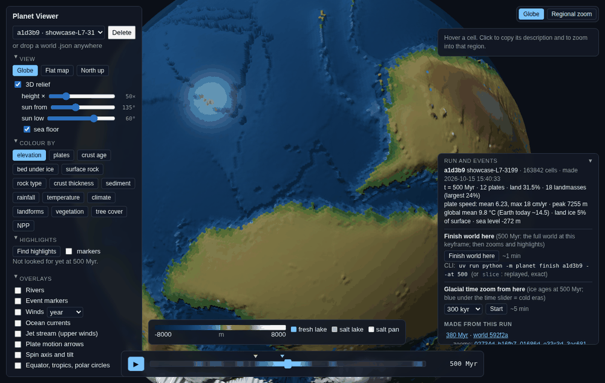
*Run a1d3b9 at 500 Myr with the 3D relief (50×): fracture zones and a trench under the translucent sea, the coast's shelves, the ice cap's dome.*

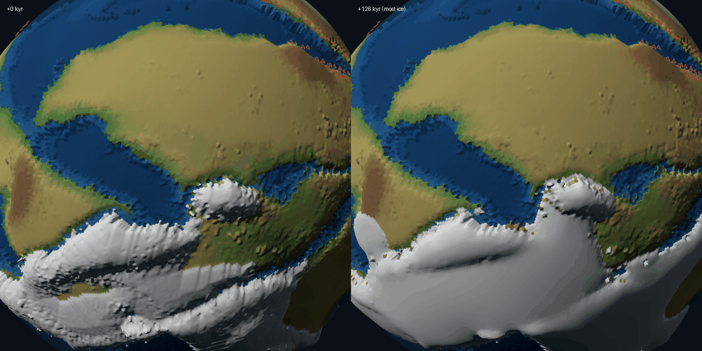
*Time zoom 080df3 (L7, from a1d3b9 at 480 Myr) in 3D relief, at the start and at its ice maximum 126 kyr later: the southern sheet spreads over the lowlands and thickens to 6.5 km.*

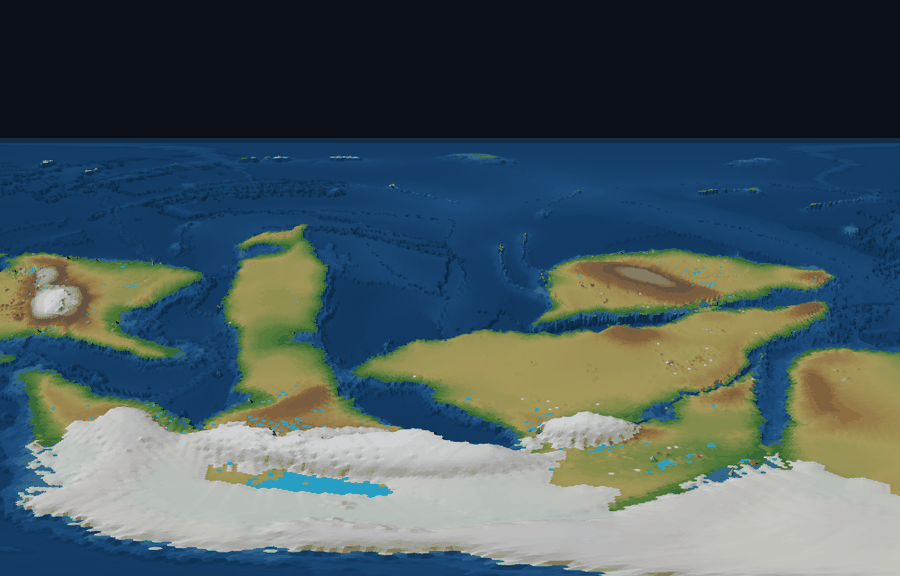
*The flat map as a tilted relief model (`&mode=map&relief3d=1&tilt=55`).*

**Zoom 3D surfaces and river flights** (`viewer/zoom3d_look.js`, `viewer/zoom3d_fly.js`): a half-float data texture of the zoom's ground, ice (smoothed over a few pixels, so outlines don't show the pixels' steps), sea mask and lake depths feeds the shaders. **Glaciers** (the "ice and water" box): white to blue with thickness on the natural layers (satellite, relief, height, hillshade; elsewhere only shaded, so categorical colours stay), a sheen, crevasse bands across the flow where the ice surface steepens (spaced to the pixels, faded where finer than the screen), steep ice bluer, and grey debris on the snouts (where the ice thins downhill, not along its sides). **Sea:** tinted by depth (turquoise shelves to navy deeps, clearer in the shallows), glints off a rippled surface, foam bands moving in along the shoreline (the sea mask's edge), and drawn only where the sea is (no longer over land below sea level away from it). **Lakes:** their kind's colour, lighter in the shallows, rippled glints. **Rivers** shimmer downstream: a flow texture with the same strokes as the painted rivers, each segment coloured by its direction, advects noise along it (a two-phase flow map). "moving" animates foam and shimmer at ~30 fps while the view is still (off: it draws only when something moves). **Sky:** a dome from a pale horizon to a deeper zenith, and "haze" fades the distance to the horizon's colour. **Fly along a river:** the zoom's 12 biggest rivers (main stems traced up from where they end: the sea or the zoom's edge; listed with length, discharge and falls) can be flown head to mouth at low altitude (500 + 500 m per km/px above the water, never under a lip just ahead; looking 8 px ahead), slowing to a third within 4 km of a fall; the panel shows km flown and the next fall; dragging the view or Stop ends it (`&river=N&at=0.4&hold=1` for screenshots). Cost on the RTX PRO 6000 (headless Chrome, 1920×1080, e33c3d full detail with shadows): 0.65 ms a frame with the effects, 0.49 without (~1500 / ~2050 fps unthrottled).

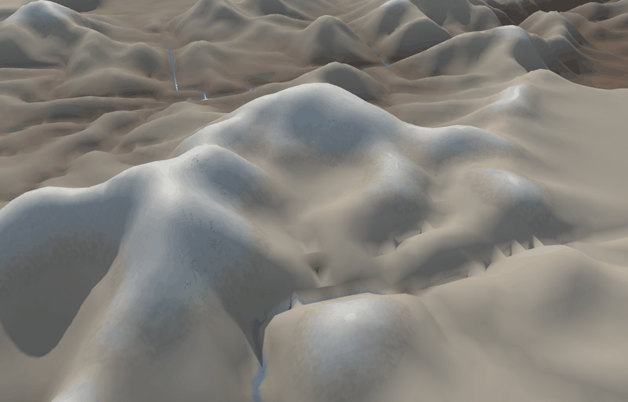
*Zoom e33c3d (1 km/px, relief layer) in 3D: glaciers on the high summits as ice, blue with sheen and faint crevasses, against the rock.*

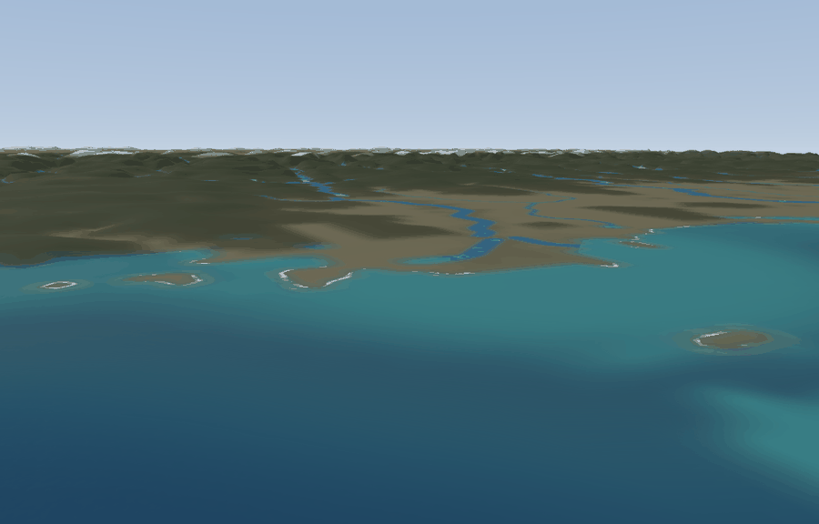
*Zoom 02734d (4 km/px, satellite): the sea tinted by depth, foam along the shore, the haze toward the horizon.*

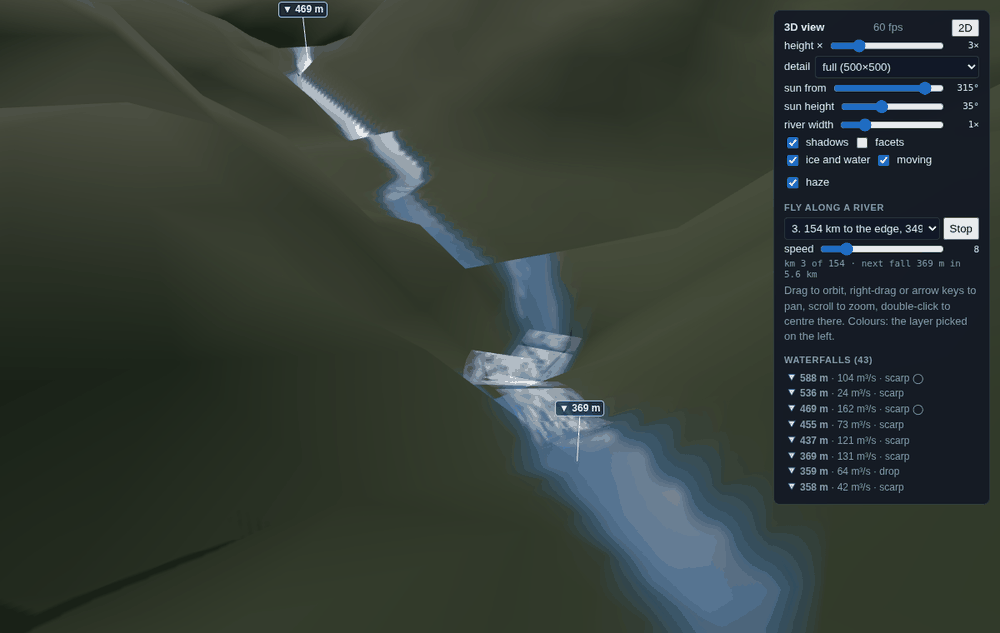
*Flying down river 3 of zoom e33c3d (154 km, 3 falls): the 369 m and 469 m falls ahead.*

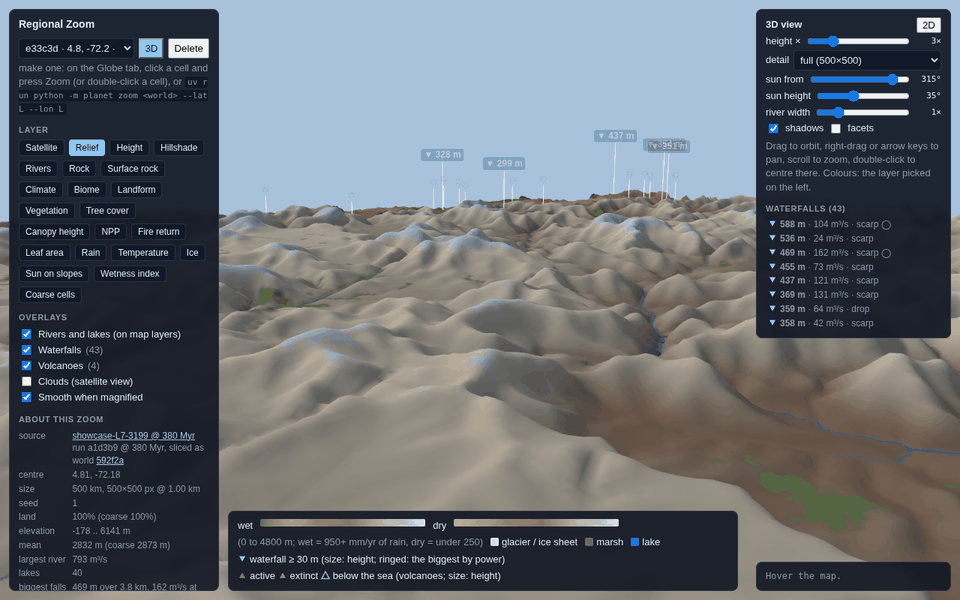
*Zoom e33c3d (500 km at 1 km/px, relief layer, 3×) in 3D, the highest falls labelled.*

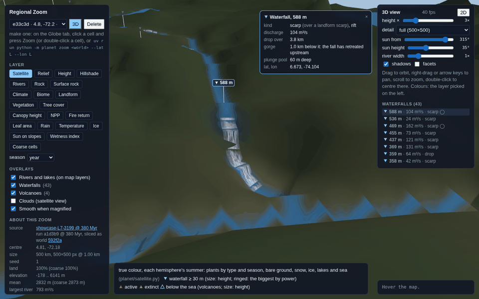
*The same zoom after clicking its highest fall in the list: 588 m over 3.8 km down a rift scarp, 104 m³/s, white water down the reach.*

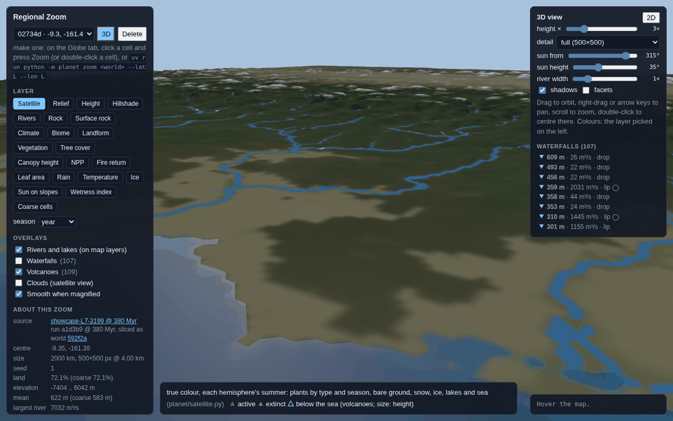
*Zoom 02734d (2000 km at 4 km/px, satellite): a coast of inlets and islands below a mountain range.*

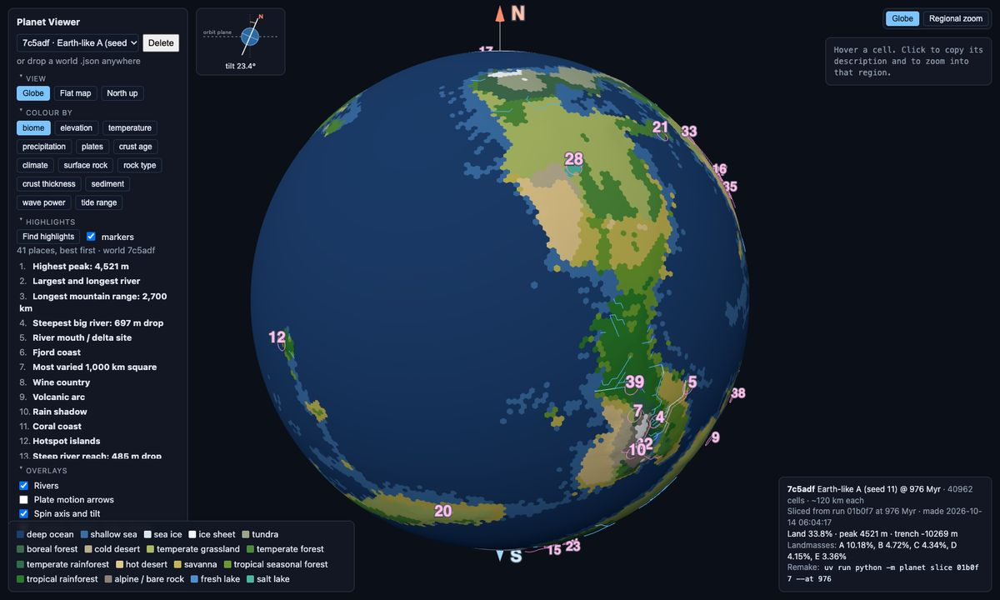
*The viewer on world 7c5adf: biomes, with highlights numbered (an earlier version of the panel, before categories).*

**Known limits:** run keyframes keep only the annual-mean winds, so the winds' season picker works only on worlds (PW-107); in the zoom 3D view a fall at 1–4 km/px is a steep chute over a few pixels rather than a cliff (finer: PW-129); with shadows on, ANGLE's Vulkan backend on NVIDIA lost the GPU process in headless tests (Chrome's default GL / D3D backends are fine; `&shadows=0`).

### 2.16 Store and data model (`store.py`, `timeline.py`, `provenance.py`)

Outputs go under the data root (the repository, or `$PLANET_DATA`). All are generated, git-ignored and reproducible.

| Path | Contents |
|---|---|
| `runs/<id>/run.json` | settings, per-keyframe stats, plate velocities, the event log, layer specs, code version (git commit, dirty flag, hash of `planet/**/*.py`) |
| `runs/<id>/layers/<name>.bin` | one file per layer, all keyframes (raw little-endian, frames × cells, small integers with scale/offset). The viewer fetches only what it draws. 35 layers per keyframe. |
| `runs/<id>/state/<t>.ckpt` | full simulation state (with the geological record) every 100 Myr, where `slice` starts replaying |
| `runs/<id>/volcanoes.json.gz` | every volcano ever |
| `runs/<id>/run.txt` | readable report: events, stats over time, ASCII maps, plate table |
| `worlds/<id>.json` / `.txt` | a world, layers inline; names its grid file (`../grids/L7.json`) |
| `worlds/highlights/<id>.json` | highlight cache |
| `zooms/<id>/` | `zoom.json`, `layers/*.bin`, PNGs |
| `grids/L<n>.json` | grid geometry shared by all items at that level |
| `worlds/index.json`, ... | indexes the viewer reads (with `source_run`, `t_myr` for provenance) |

**Layer vocabulary** (`store.LAYERS`, shared by runs and worlds): elevation, plate, crust, crust age and thickness, plate boundary, rock, surface rock, sediment cover, temperature, precipitation, climate, ice, flow, downstream, lakes, winds, currents, jet, the seasonal, sea and air layers of §2.6–2.10, the nine landform layers of §2.4, and the vegetation layers of §2.18, the coastal-life layers of §2.20, the soil layers of §2.21, and the satellite view's `sat`, `sat_jul`, `sat_jan` (§2.19). Run keyframes carry 35 of them; a tectonic world ~119.

**Replay and code changes:** a slice replays from the nearest checkpoint; if the model changed since the run, the replay is a different planet and `slice` refuses to save it. There is no backward compatibility: old outputs are deleted when a change breaks them (`planet delete`, `tools/cleanup_outputs.py`).

**Known limits:** checkpoints are large (PW-088; ~12 MB at L6 after PW-131's zeroed crust and PW-306's cell map stored as its residual from `grid.locate`); replay falls back to t = 0 after code changes (PW-089); game export is `planet export` (`export.py`, README: 16-bit height tiles, splat and class maps, GeoJSON features, manifest.json; PW-100; human-use class maps and feature kinds, 2.22).

### 2.17 Tools (`tools/`, run with `PYTHONPATH=. uv run python tools/X.py`)

| Tool | What it does |
|---|---|
| `health.py` | Multi-seed health sweep (PW-246): 8 L6 + 3 L7 seeds x 1 Gyr at once (`parallel.simulate_many`), every keyframe measured against Earth-ish envelopes (land, crust, plates, ocean age, sea level and ice, temperature, CO2, aridity, inland drainage, lakes, peaks, trees, NPP, landmasses), outliers by seed and time window, a determinism re-run, thumbnails; writes `docs/review/health/<date>/`. `--quick`: L6 only, 500 Myr. ~51 min on the Threadripper (11 workers x 2 threads). |
| `scorecard.py` | Slow calibration scores, not pass/fail: the climate on Earth's terrain (Köppen agreement, rain correlation) and two L6 1-Gyr simulations (land, crust, landmasses, dryness, ice, speed, ocean age, crust volume). Appends a line per commit to `docs/scorecard.jsonl`. ~11 min. |
| `earth_check.py` | The climate on real Earth vs observations: Köppen (Kottek), rain (GPCC/GPCP), temperature (NCEP), river discharge at big mouths, clouds (ICOADS), sunshine (CRU), dry-winter humidity. Prints a report; `--png`, `--json`. |
| `earth_world.py` | Builds the "Earth (today, ETOPO1) — model vs observed" world for the viewer, with observed layers alongside; its rivers run at HydroSHEDS' heights through gorges narrower than a cell (§2.9, PW-236). Re-make after climate changes. |
| `earth_data.py` | Downloads (~25 MB, once, plus ~390 MB of HydroSHEDS for the river heights) and maps the Earth datasets onto the grid; holds the single Köppen score `koppen_agreement`. Stores ETOPO1's true bed under Greenland's and Antarctica's ice (PW-354; land is `land_of`, ground above the sea or under ice: 435 of 1136 ice cells at L6 have their bed below the sea, West Antarctica down to −1670 m) and takes the floating shelves (ice whose surface stands no higher than flotation's freeboard, 10.8% of ice surface − bedrock: Ross, Ronne-Filchner, Amery, ~1.15 million km² at L6) as sea of the floor's depth, not land. On the L6 Earth (2026-10-16): the true bed alone moves the climate by ~0.1 °C on Antarctica; the shelves as sea: Antarctica's land 2.67 → 2.44% of the surface (band means 1–2 °C colder, the shelves' warm low cells gone), the overturning 16.9 → 12.6 Sv (§2.7), Köppen 70.99 → 71.06%, points 28 → 29 exact, waves in range 4 → 5 of 33 (Norway W 52 → 41 kW/m), tides unchanged, coastal life within 1% (kelp 710k → 702k km²); in `earth_check` the Yenisei 1,900 → 27,800 m³/s (obs 19,600: not an improvement, the gauge's river now ends in the Ob's gulf and counts the Ob's basin too; on the flat West Siberian divide the routing through its filled hollows flips with ±0.3 mm/yr of runoff, the beds there unchanged) and the Lena 12,700 → 14,700, other rivers within ~10%. |
| `coast_check.py` | Waves and tides at named real coasts, and Galloway weights of real deltas. |
| `coastal_check.py` | Coastal life on Earth (§2.20): each habitat's area and latitude limits against the literature, presence at 55 named places; `--png` map. ~20 s. |
| `churn.py <run>` | How often continental cells flip and flip back within a few keyframes (PW-108). |
| `sealevel.py` | Sea level and its parts (ice, basins, ocean age) per step; counts fast land drops. Runs a simulation (or reads `--run <id>`). |
| `supercontinent.py` | Tracks the largest landmass, landmass count, mantle and rifts over 2 Gyr; reports assembly spells. Runs a simulation. |
| `cleanup_outputs.py` | Lists (or `--yes` deletes) outputs no open ticket needs, keeping anything < 12 h old, the Earth world and the parents of kept items. |
| `veg_check.py` | The vegetation on Earth's terrain, on the model's climate and on the observed one: land NPP, vegetation carbon, burned area, biome areas, agreement with potential natural vegetation (Ramankutty & Foley 1999, downloaded by `earth_data.earth_potveg`), NPP by latitude, Mediterranean regions, C3/C4 crossover, treeline, savanna–forest rain. `--png` maps, `--json`. ~5 s. |
| `zoom_soil_check.py` | Zoom soils against their world cells (PW-331): builds zooms in memory and reports the pixel-to-cell slope ratio and erosion, the share of each cell's pixels in its soil group (uniform, steep and coastal cells), the soil mix on steep ground, flats and big rivers' plains, and the seconds; `--png` the cells' soils beside the pixels'. ~5 s per 400 km zoom. |

### 2.18 Vegetation (`vegetation.py`; design: `docs/proposals/vegetation.md`, PW-187)

**What it does:** gives every land cell the cover of 19 **plant functional types** (PFTs: groups of plants that behave alike, from tropical broadleaf evergreen trees to C4 grasses, succulents and peat moss), and from the mix one of **60 named vegetation types** ("boreal larch taiga", "moist savanna woodland", "raised bog"). Worlds get the full model; a run computes a cheap version at every climate update, and it slows erosion and speeds weathering.

**How a cell's mix is found** (equilibrium, `vegetation.model`):
1. **Site:** `climate.months` gives the twelve months; from them the envelope indices (coldest month, an absolute-minimum estimate after BIOME4, degree-days above 5 °C, warmest month, rain), the moisture index P/PET, and the fire-weather season (the expected share of the year the litter is dry: months whose rain and snowmelt bring under 20–100% of the evaporative demand, above 5 °C and snow-free).
2. **Productivity** per PFT as if it grew alone (**light-use efficiency**, as CASA and MODIS MOD17): each month GPP = efficiency × light × the share the leaves catch (1 − e^(−LAI/2)) × a temperature hump × water stress, but no more than the water transpired allows (water-use efficiency 3 g C/mm for C3, 4 for C4 and CAM, less in dry air). Water comes from a **two-layer soil bucket** (in worlds and zooms from the soils, §2.21: topsoil 0–0.3 m and subsoil to 1.5 m, Earth's land means 50 / 137.5 mm; in the run fixed at 50 / 150 mm, thinner on steep ground) that each type draws from by its root shares, so grasses live on the topsoil and trees on both (Walter's explanation of savannas). NPP = 75% of what's left after maintenance respiration (Q10 = 2). The **leaf area** is the one that maximises NPP net of leaf and fine-root turnover (a golden-section search, as BIOME4).
3. **Competition** (TRIFFID, the Met Office's model): cover fractions follow Lotka–Volterra equations in which taller types shade shorter ones, types of one height share space (similar ones coexist), pioneers (birch, aspen, larch) are crowded out by shade-tolerant trees unless disturbed, each spreads at its net NPP over the carbon a square metre of it costs (less for stunted stands), and dies back at a background rate. The C3 and C4 grasses are one grass layer whose C4 share is the share of its growth in months where C4 grows better (Still et al. 2003, after Collatz et al. 1998: summer-rain grasslands are C4 even where winters are cool); C3 grass's efficiency follows its quantum yield, (Ci − Γ*)/(Ci + 2Γ*) (photorespiration rising with temperature, falling with CO₂; Γ* from Bernacchi et al. 2001), equal to C4 grass's at a 22 °C month today (PW-231). In dry climates the tree canopy can't close (a cap from P/PET, after Sankaran et al. 2005). 180 implicit steps cover ~1500 years.
4. **Fire** (GlobFIRM-like): the burned share per year rises steeply with the fire season, if there is fine fuel (≥ 250 g C/m², mostly grass) and lightning (warm, showery summers). Grass and leaf litter are ready every year; shrubs keep their fine litter as dead fuel in the crown, decaying at half the litter's rate (fine woody debris), so a burned shrubland needs years to rebuild its fuel: the fire interval is those years plus the wait for a fire year (`fire_rate`, a renewal process; PW-234). Mediterranean scrub burns every ~15–80 years (Earth median 26). Sclerophyll shrubs are a summer-drought plant: they need at most half the rain to fall in the warm half-year, so summer-rain lands are grass, savanna or forest, not scrub. Each type loses the burned share × (1 − its resistance): grass, savanna trees and sclerophyll shrubs resprout (0.9–0.95 survive), rainforest trees and spruce don't. Grass fuels fire and closed forest doesn't burn, so **forest and savanna are both stable over a wide band of rain and history decides**: worlds start from the run's state (sliced worlds from the simulation's fractions, Zoom-button worlds from the keyframe's tree cover); a world without history (Earth, `generate`) starts from young woodland over grass.
5. **Grazing placeholder** (decision 8, to be replaced by fauna in PW-103): open grassland (grass cover²) adds tree and shrub mortality in climates that aren't wet all year, which keeps prairies and steppes open.
6. **Wetlands:** the flooded share of a cell (floodplains of big rivers, flat ground with more rain than evaporation, flat permafrost, lake shores; up to 75%) is a habitat of its own for reeds and sedges, peat moss and flood-tolerant trees.
7. **Named types:** ordered rules on the mix, structure and site (BIOME4- and IGBP-like): non-vegetated (ice, lake, < 5% cover), wetland, forest (trees ≥ 60%), woodland and savanna (10–60%), sparse, shrubland, grassland; "alpine" where a cell is cold because it is high. The Mediterranean types need Köppen's summer drought (driest summer month < 40 mm and < ⅓ of the wettest winter month); sclerophyll scrub elsewhere is dry sclerophyll scrub (mallee, mulga), shrub steppe or thicket. Heath needs a moist climate (HthS: P/PET ≥ 0.5; heathland ≥ 0.7), boreal-named woodland a subarctic one (coldest month < −2 °C, warmest < 16 °C or GDD5 < 1000), and a forest in a tropical climate whose biggest share is tropical trees is tropical forest (PW-220, PW-222). `biome` is a coarse grouping of them. Mangrove forest and salt marsh are named where coastal life (§2.20) covers ≥ 30% of a cell (rule 2, after ice and lakes; PW-209). (Oasis woodland needs river water: only the zoom draws it, §2.13.)

**Plant groups through a run** (decision 3): six groups appear one after another (pioneer mosses and crusts; marsh plants; conifers and other non-flowering trees; flowering trees and shrubs; grasses; C4 grasses and succulents), each from 0.6× to 1.3× its Earth fraction of the span from `plants_from` to a deadline (the run's end − max(16 Myr, 5%)), with a chance per climate update proportional to its **niche** (the share of land where its types would grow faster than what is there) and a ramp to certainty at its window's end (seeded draws; `run.json` meta `plant_groups`). Before a group exists its niche is filled by a **stand-in** with widened limits and 70% efficiency: conifer forest in the tropics before flowering trees, moss and crust carpets where grass would be.

**In the run** (`tectonics/earth.update_vegetation`, every climate update): the same model, warm-started from the last update (fractions and LAI), a local LAI step instead of the search and 25 × 10-year steps; ~0.09 s at L6. Its **ground cover** (canopy and herbs 1 − e^(−0.7·LAI), plus moss and crust) replaces the old `veg` term in erosion and the coal-swamp rule, and its **NPP** sets the weathering factor. The CO₂ index nudges C3 efficiency (±~15%; C3 grass through its quantum yield) and the C4 grasses' warmth threshold (lower CO₂, cooler C4; Ehleringer 1997). Its fractions and LAI from the last update feed the next climate update (`earth.veg_feedback`; bare land before land plants).

**Feedbacks on the climate** (step 6, PW-203; `vegetation.feedback` → `climate.compute(veg=...)`, `climate.vegetation_feedbacks`, `albedo_warming`), all nudges calibrated so Earth's climate stays where it was on the whole:
- **Budyko w** = 2.6 + (woody cover + 0.3 × deep-rooted evergreen tree cover − 0.41): forests give more rain back to the air, bare ground and grass shed more to rivers (Zhang et al. 2001).
- **Evaporative cooling** follows the summer's actual / potential evaporation (so through w the plants), not the summer rain alone.
- **Albedo:** each month's sunshine at the ground × (reference − the cell's albedo) × 0.03 °C per W/m², per half-year, capped at ±2 °C. Snow is bright on open ground (0.75) but mostly hidden under conifers (Bonan 1992); references 0.21 snow-free and 0.59 with snow, Earth's land means.
- **Rain recycling:** the rain kernel gives the air back what the water balance evaporates (PW-266), so plants recycle through w. (Before PW-266 a separate per-cell share `et` = 0.5 × (1 + 0.5 × (LAI / 2.3 − 1)) did this, on top of w.)
Worlds get them from a first cheap vegetation on the first climate, then the climate again (`world.finish`; tools use `vegetation.coupled_climate`); the run from the last update's vegetation. Iterating the loop on fixed terrain converges within a few updates, and the feedback is slightly stabilising (tree cover settles ~1 point lower than without it, also at doubled gains): no forest–rain runaway. On Earth the four together move little (Köppen exact 38 → 39%, group 72%; the AET/PET cooling puts NE Canada's treeline 7 deg further south, onto the observed one); they matter for planets unlike Earth (bare continents before land plants, a forested or a desert supercontinent).

**Outputs:** worlds: `vegetation` (named type; legend `vegetation`), `tree_cover`, `plant_cover`, `lai`, `lai_jul`, `lai_jan`, `canopy_height`, `npp`, `biomass`, `fire_return`, `stand_age`, `pft_dominant`, `flooded`, and `veg_<PFT>` (% cover) for each of the 19 PFTs; meta `vegetation` (CO₂ index, the PFTs present, the groups' times). Runs: `vegetation`, `tree_cover`, `npp` per keyframe.

**Earth** (`tools/veg_check.py`, Earth world at L6, on the soils (§2.21), on observed climate / on the model's climate; vegetation batch 2026-10-16 with its follow-up, `docs/review/vegetation/batch-2026-10-16.md`): potential-vegetation agreement 62.1% / 40.5% (7 groups, area-weighted; for scale, Köppen main groups score 71%); land NPP 61.0 / 47.7 Pg C/yr (Earth ~56); burned area 5.7 / 4.9 Mkm²/yr, 91 / 95% in savanna and grassland (GFED4s ~4–5, ~70–80%); forest (trees ≥ 60%) 47 / 42 Mkm² (potential ~55–60); boreal 17.1 / 15.0 Mkm² (~12–17); savanna and tropical grassland 22.2 / 30.2 (~20); Mediterranean vegetation in all five regions (127 cells; Mediterranean types burn every ~24 yr, median); the C4 share of grasses falls below half at 35° N / 40° S (observed ~30–35°); the northern treeline within ~0–4° of potential vegetation's in most sectors; boreal forest burns every ~380 yr (median; observed ~50–200). Before tuning (literature starting values) the observed-climate run gave 49% agreement, 78 Pg C/yr, 1055 Pg C and 0.3 Mkm²/yr burned. The model-climate run inherits the climate's errors (a dry Amazon, a wet Sahel, NE Canada too warm). The southern Amazon fringe is savanna in ~40% of potential vegetation's forest there: a world without history starts from young woodland (kept, owner decision), and both states are stable.

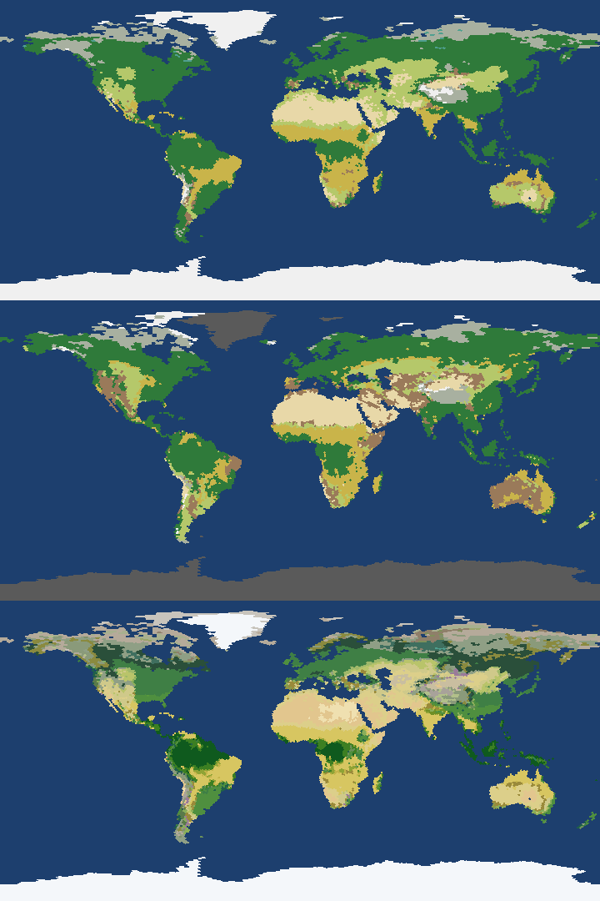
*`tools/veg_check.py --png` on the observed climate: the model's groups (top), potential natural vegetation (Ramankutty & Foley 1999; middle), the model's named types (bottom).*

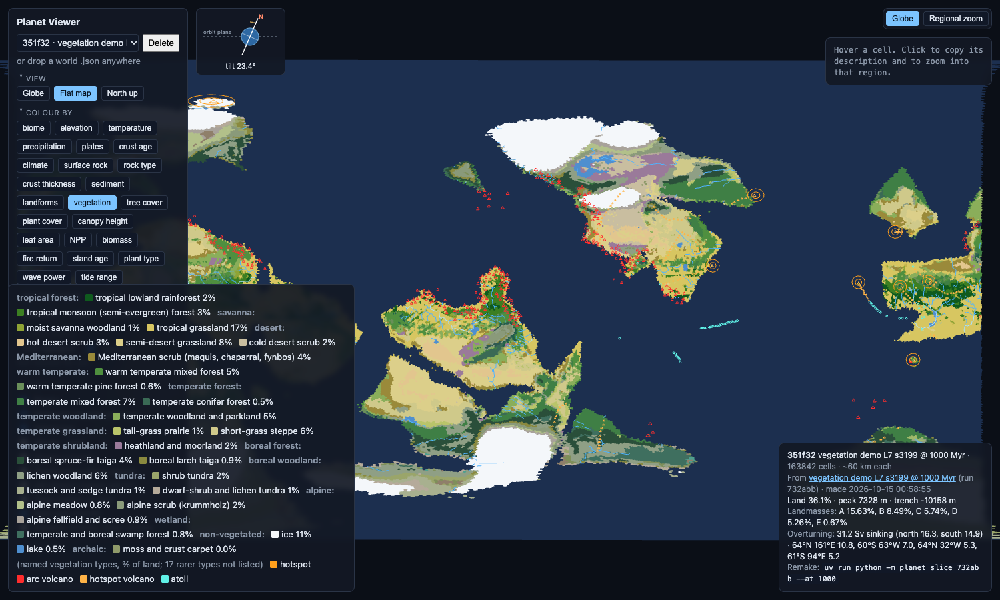
*World 351f32 (run 732abb, L7, seed 3199, at 1000 Myr): named vegetation types.*

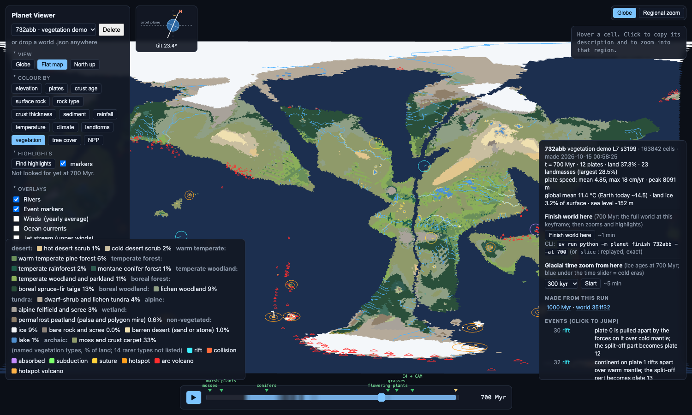
*Run 732abb at 700 Myr, before flowering plants: conifer forests, moss and crust carpets; green ticks above the slider mark when each plant group appeared.*

**Known limits:** no migration or refugia in the time zoom (step 7); the Earth world's L6 hydrology floods ~6 Mkm² of flat basins as lakes (vegetation is computed on them in `veg_check`).

### 2.19 Satellite view (`satellite.py`, PW-083)

**What it does:** a true-colour picture of a world or zoom in July, January, or each hemisphere's summer ("year": July north of 10° N, January south of 10° S, blended between; what a cloud-free mosaic like Blue Marble shows). One colour function serves the globe and the zoom, mixed in linear light:
1. **Bare ground** from the climate (dark brown humid soils, grey-brown cold ones, red semi-arid soils and yellow sand in hot deserts, grey cold deserts), tinted by the exposed rock where known (basalt dark, limestone and evaporites pale, sandstone red, an old shield laterite-red in hot dry country), sand on dune fields, grey rock above ~2500 m.
2. **Plants:** each plant type's share × its colour, leaf-on or leaf-off that month by vegetation.py's leaf habits (summergreen: the month warmer than its threshold; raingreen: a moist soil, the month's and the two before's water against the potential evaporation; grasses: both, dormant grass straw when dry, brown when cold), over `plant_cover` of the ground. Wetlands (the flooded share) darker and olive.
3. **Snow** from the month's snowpack (`climate.months`), cover 1 − e^(−SWE/15 mm), partly hidden by trees (evergreen crowns most: the dark winter taiga); **land ice** white, greyer-blue where it melts that month.
4. **Water:** lakes by depth (shallow ones greenish), salt lakes turquoise, salt pans white, frozen lakes white; the sea by depth, turquoise over warm shallow (carbonate) shelves, sea ice where the month is below freezing.
5. **Coastal life** (§2.20): reefs pale turquoise and seagrass dark through shallow water, kelp's olive-brown canopy, mangroves dark green, salt marsh green or straw by season.

Hill shading and clouds are drawn by the viewer: the globe is lit, the flat map and the zoom shade from the relief; the **Clouds** overlay thresholds made-up fractal noise at each place's cloud share for the season (`cloud_jul`/`_jan`), so the cover is the climate's and the shapes are not.

**Where the colours are computed (decision):** in Python, baked into the outputs: worlds store `sat`, `sat_jul`, `sat_jan` (0xRRGGBB per cell; +3.8 MB on a 58 MB L7 world, ~0.4 s to compute), zooms `satellite*.png` (~0.3 MB each) and the `preview.png` (summer, shaded, rivers). One implementation keeps globe and zoom alike, the zoom's per-pixel plant fractions exist only at build time, and the snow needs the month-by-month climate. `planet satellite <world|zoom>` adds or redoes them in place (a zoom recomputes its fractions, ~10 s).

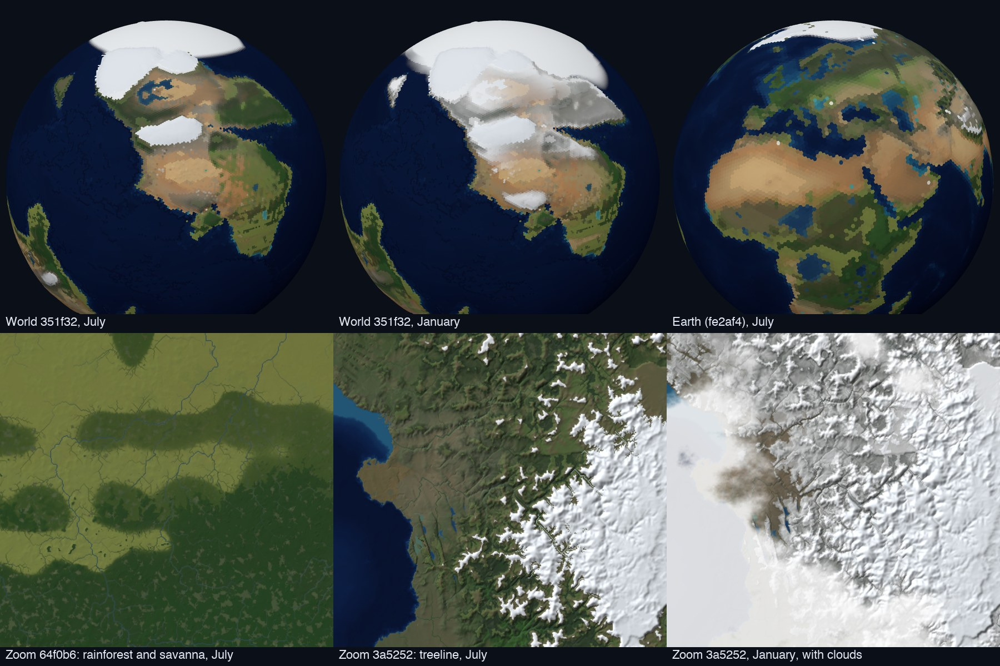
*World 351f32 (L7) in July and January (snow and leaf-fall across the northern continent), the Earth world fe2af4 in July (Sahara, the green Sahel in the rains, the Congo), and zooms 64f0b6 (rainforest–savanna edge) and 3a5252 (a treeline under an ice cap in July, and in January with clouds).*

**Known limits:** colours are tuned by eye, not to reflectance data; cell-scale colours on the globe show the cells (and the rain field's streaks, PW-019); clouds are a fixed pattern per world and season, not weather (PW-156); no sun glint, haze or night side.

### 2.20 Coastal and shallow-sea life (`coastal.py`, `zoom_coastal.py`, PW-188)

**What it does:** five habitats as world layers (% of each cell): **coral reef**, **kelp forest** and **seagrass meadow** on the shallow sea floor, **mangrove** and **salt marsh** on the land between the tides (owner decision 7B: all coastal life lives here, not in the vegetation model's PFTs). Each is a suitability from the water and the coast (0–1) times the share of the cell at the right height. A fun-tool approximation with literature limits, cited in the code; none is tuned to Earth's map.

**Two new fields:**
- **Turbidity** (`turbidity`, mg/L): each river mouth's BQART load (`coast.bqart`, as the deltas use) spreads over the sea (e-folding ~150 km) and settles at a net ~10⁻⁵ m/s (waves and tides resuspend mud many times before it stays), over 0.5 mg/L of clear water. Plus the bed's own mud stirred up by tides and waves (PW-323): the bed stress of the tidal current (from continuity, u = a ω x / h at most a progressive wave's a √(g/h)) and the waves' orbital velocity at the bed (Soulsby 1997), above loose mud's 0.2 Pa threshold, holds part of 0.5 kg/m² of mobile mud (the fluff layer) through the water column, where the floor is muddy: river mud, or soft fine sediment (not hard or carbonate rock, not sandstone). Wadden Sea ~100 mg/L, Yellow Sea 30–60, Gulf of Thailand ~65, open and carbonate coasts unchanged. Light falls off as e^(−Kd z), Kd = 0.06 + 0.07 × SSC per m (Kirk 2011).
- **Upwelling** (`upwelling`, °C): how much coastal and equatorial upwelling cools the sea surface, the climate's own source term (`climate.upwelling_cooling`, now also returned by `climate.compute`): the nutrients kelp needs in warmer water.

**Geometry (sub-cell):** a coastal sea cell's floor ramps from the shore to twice its mean depth (an offshore bank spreads ±50% around it); a coastal land cell's heights are exponentially distributed about its mean (much low ground, a few hills), so the share between the tides is 1 − e^(−h/elevation), h = half the tidal range + 0.3 m of set-up.

| Habitat | Rule (environment × geometry) |
|---|---|
| coral reef | annual SST from the run's `reef_temp` − 1.5 to `reef_temp` (23.5 °C: where the run's reefs and volcanic atolls start and drown, so limestone, atolls and the layer agree), coldest month ≥ ~18 °C, warmest ≤ ~34 °C, 25–42 psu (Kleypas et al. 1999), SSC < ~10 mg/L (Rogers 1990); 25% of the floor above 10% of the surface light (a reef tract is mostly sand, rubble and seagrass between reefs), plus the living reefs of the world's volcano table (a 1 km ring round each island's shore) |
| mangrove | coastal land between the tides; shelter halving at 8 kW/m of waves (~1.5 m), muddier (river SSC) better; frost-free: BIOME4's absolute minimum above ~−4 °C (Osland et al. 2017) and a winter sea above ~14–18 °C (Duke et al. 1998); sparser on arid coasts; once flowering trees exist (plant group 4) |
| salt marsh | the same intertidal habitat where it is too cold for mangroves, with a growing season (warmest month above ~5 °C); once grasses exist (group 5) |
| kelp | warmest-month SST under ~20 °C (Steneck et al. 2002), nutrients (water under ~15 °C, or upwelling ≥ 0.5–3 °C), > ~15 psu, little year-round sea ice, rocky shores (high or rugged coast, hard surface rock or fresh glacial scour, not a coastal plain, not muddy), down to 1% of the light (Lüning 1990) |
| seagrass | > ~5 psu, a summer sea above ~4 °C, no year-round ice, sheltered (halving at 10 kW/m), soft bottoms, down to Duarte's (1991) Zc = 1.82 Kd^−1.07; flowering plants (group 4) |

A sea cell's shares are taken reef first, then kelp, then seagrass. **Vegetation (PW-209):** a land cell with ≥ 30% mangrove or salt marsh is named "mangrove forest" or "salt marsh" (rule 2 of the proposal's classification, after ice and lakes). **Highlights:** the coral coast is now the largest tracts of the reef layer ("Great reef" when ≥ 10,000 km²), and a new **mangrove coast** kind (vegetation category) is the largest mangrove stretch.

**Zoom** (`zoom_coastal.py`): the water's and the climate's parts are interpolated from the cells; the pixel adds its own depth (light depths as above; the zoom's sea floor shoals along a shoreface to the shore, §2.13, PW-327), a rocky shore (land rising 30–150 m within 3 km, or hard rock at the shore) and, for mangroves and marsh, its share between the tides within 30 km of the sea. Each pixel is one habitat or none (layer `coastal_life`: 1 reef, 2 kelp, 3 seagrass, 4 mangrove, 5 salt marsh), as planet-fixed noise patches with the suitability as their probability; volcanic reef pixels (zoom_volcanoes) are reef. **Reefs are terrain** (PW-326): a fringing reef along the shore of a shelf narrower than 15 km, a barrier reef along the outer edge of a wider one (its lagoon behind), each ~1 km wide with passes, and patch reefs in between (fewer by the share the bands take, so the world's share holds); every reef pixel's floor rises to a reef flat 1–3 m below the sea, each cell's mean kept by deepening the rest of its shelf (stats `reef_forms`, km² of fringing, barrier and patch flats; docs/review/zoom-polish/pw326.md). Mangrove and salt-marsh pixels name the vegetation. Stats: `coastal_life` km² per habitat.

**Satellite view:** reefs pale turquoise, seagrass dark, kelp's canopy olive-brown at the surface, mangroves dark green, salt marsh green in the growing season and straw-brown in winter (by share on the globe, per pixel in the zoom).

**Viewer:** globe layers "coastal life" (each cell in its biggest habitat's colour, legend with each habitat's total km²), "turbidity" and "upwelling"; hovering a cell lists its habitats' shares, mud and upwelling. Zoom layer "Coastal life" with km² per habitat; the pixel's habitat on hover.

**Earth** (`tools/coastal_check.py`, L6 Earth world on the model's climate, 2026-10-16, after PW-297 and PW-323):

| | model | observed |
|---|---|---|
| coral reef | 130,000 km², to 29.8° N / 30.8° S | ~250,000–285,000 km² (Spalding et al. 2001), to ~32° |
| mangrove | 60,000 km², to 31.7° N / 24.0° S | ~138,000 km² (Giri et al. 2011), to ~32° N / 39° S |
| salt marsh | 44,000 km², to 70.3° N / 40.8° S | ~55,000 km² mapped, likely 2–4× more (Mcowen et al. 2017) |
| kelp | 600,000 km² | ~1.5–2 million km² of suitable rocky coast (Jayathilake & Costello 2020) |
| seagrass | 320,000 km² | 160,000 km² mapped, ~270,000–600,000 likely (McKenzie et al. 2020); habitat models ~1.6 million |

39 of 55 named places as observed (present = ≥ 1% of a cell within 250 km): mangroves 13/14 (Sundarbans, Niger delta, Pará, Mekong, Gulf of Papua…; none in the Mediterranean, Chile, Namibia, the North Sea), seagrass 6/8 (the Wadden Sea's flats now muddy: 0.5%), salt marsh 6/9, reefs 7/13 (a small false reef off the Ganges mouth), kelp 7/11. Most misses are the model's climate and ocean, not these rules: no Benguela upwelling at the Cape (sea 23 °C in summer: no kelp), a brackish Baltic that is ocean-salty in the model (kelp there), and oceanic atolls (Maldives) that are sub-cell on ETOPO's cells, with no volcano table for Earth. Reefs are now scarce on Earth because its terrain-only rock map makes every shelf shale, so warm carbonate shelves come out muddy (GBR, Arafura, Indonesia; with carbonate on the warm shelves by the run's own reef rule, 404,000 km²; inbox draft); mangroves scarce (the cells' intertidal share is crude, and the model's coasts are dry in West Africa and Bengal). No Earth cell reaches 30% mangrove, so the named type appears in zooms, not on Earth's globe.

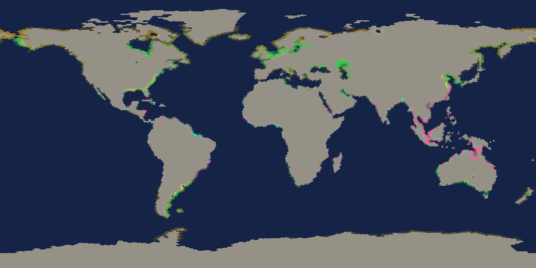
*Earth (L6, the model's climate): reefs (pink), mangroves (teal), salt marsh (yellow), seagrass (green), kelp (brown), each cell by its share.*

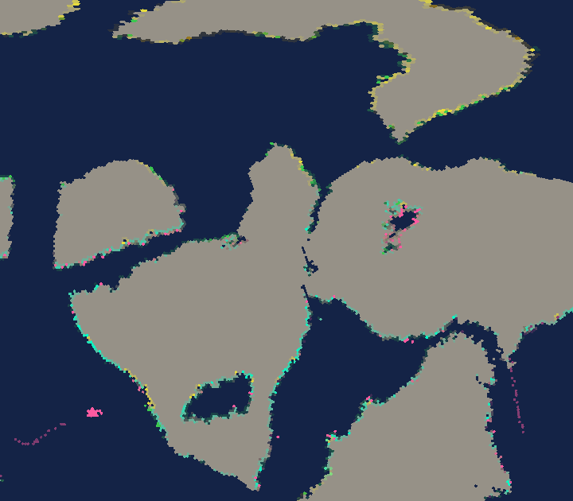
*World 350721 (L7, `planet finish a1d3b9 --at 900`, after flowering plants and grasses; not kept): mangroves on the tropical coasts, salt marsh in the north, reefs in a warm inland sea and along atoll chains (the volcano table's living reefs). Its highlights: "Great reef: 22,000 km² of reef" and "Mangrove coast: 11,000 km²".*

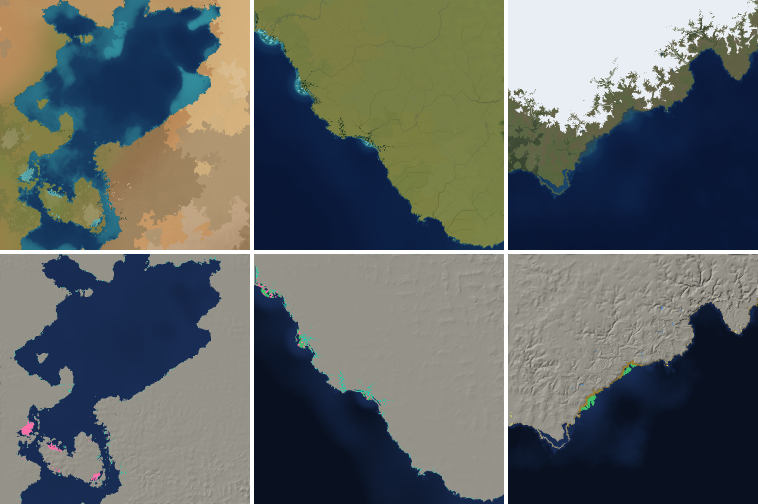
*Zooms of world 350721 (not kept), satellite view (top) and `coastal_life` (bottom): the warm inland sea's reefs (3e362a, 1000 km; pink), a mangrove coast with its deltas (70bead, 500 km; teal), and a cold rocky coast with kelp (brown), seagrass (green) and salt marsh (yellow) (f45ba3, 500 km). The zoom's sea floor then dropped to the coarse cell's depth within a pixel of the shore, so it had few shallows for seagrass and reefs; since PW-327 it shoals along a shoreface.*

**Known limits:** resuspension uses the annual-mean waves and one mobile-mud inventory everywhere (no storms, no supply-limited budget); Earth's shelves are all shale (inbox draft); no coast type layer (rocky / sandy / muddy) of its own, the rocky-shore rule is internal (PW-097 would share it); salt marsh and mangroves appear only once their plant groups exist, so an early world's tidal flats are bare.

### 2.21 Soils (`soils.py`; design and owner decisions: `docs/proposals/soils.md`, PW-185)

**What it does:** gives every land cell of a world a **soil**: one of **19 named types** (WRB groups, a few merged, named for a player: "black earth", "leached red tropical soil", "ash-grey podzol"; WRB and USDA names in the legend and hover card) and continuous fields. Worlds and regional zooms (per pixel, below); no run cost, no state between worlds. Coal from peat in the run (step 7) is not built yet; the run's vegetation still uses the fixed buckets.

**Two passes around the vegetation** (`world.finish`; one-way, decision 5A):
1. **Mineral** (`soils.mineral`, geology and climate only): the **parent material** per cell, the exposed stratum's rock (`strata_top`) with a texture, water per metre and base richness, overridden by **alluvium** (big rivers' floodplains, aggrading coastal plains), **loess** (≥ 1 m) and **till** (ground glaciated ≤ 2 Myr ago on soft lowlands; ice scours crystalline rock bare). **Erosion** E from the cell's slope (to its steepest neighbour, the sea counted at sea level so a coastal lowland isn't steep for the shelf beside it; rising with its square: Montgomery & Brandon) and the run's rain factor, plus wind deflation on bare dry ground (decision 2A): shields ~0.001 mm/yr, hill country ~0.03, steep wet ranges ~1–2. **Soil production** P₀e^(−h/0.5 m) (Heimsath et al. 1997; P₀ ~0.15 mm/yr, faster warm, slower dry) against E gives the depth (≤ 3 m) and the soil's **age** h/E, capped by the last glaciation, the eruption age of lava plains and hotspot islands, and the age of a live arc volcano (its ash keeps renewing the ground). Loose parents (unconsolidated sediment, ash, dune sand, desert sand the wind has winnowed) are rootable ≥ 1 m. The **weathering stage** W = log₁₀(water draining through the soil (Fu's Budyko curve) × e^(0.07(T−15)) × age) orders the humid soils (young brown → brown forest → red clay → leached red tropical) and sets **fertility** (base richness × leaching, + loess, alluvium and ash, − salt). **Permafrost** from the ground temperature: the air's mean + up to 4 °C under the winter snowpack (Smith & Riseborough's nival offset); classes below 0 / −2 / −5 °C. **Water capacity**: available water per metre × depth into the vegetation's two buckets (0–0.3, 0.3–1.5 m), with 40 mm/m of fissured rock below a thin soil (rock moisture), renormalised once so Earth's land means stay at the old fixed 50 / 137.5 mm.
2. **Vegetation** reads the buckets, a mild fertility factor on each stand's NPP ((0.85 + 0.25 × fertility) / 0.967, decision 6A; on NPP rather than light-use efficiency, which respiration would amplify) and the permafrost class (for its flooded share, replacing `temp < −2`).
3. **Organic** (`soils.organic`): **soil carbon** = litter (NPP; grass puts more into the soil, fire burns some) / a decay rate (0.04/yr at 10 °C, Q₁₀ = 2 over the unfrozen months, slower when dry); **peat** on the flooded share where the rain exceeds evaporation, but not on the active floodplain (input × (1 − alluvial share): each flood's silt buries the litter, so floodplains are alluvium and peat forms beyond them), towards Clymo's equilibrium (input escaping decay / α, α = 5·10⁻⁴/yr at 10 °C, growing from the last glaciation); then the **classification**: ordered rules, the first that holds (no soil, peat, frozen, thin, salt, alluvium, gley, ash, sand, gypsum desert, caliche, cracking clay, chestnut, black earth, podzol, limestone, red tropical, red clay, brown forest, young brown). Lime and gypsum need ≥ 20 kyr and a lime source; mollic soils need ≥ 30% grass, carbon ≥ 10.5 (7.5 dry) kg C/m² and bases (not deeply leached, or a cool sub-humid climate); podzols need sand, or acid rock or till under conifers and heath.

**Loess** (decision 4C, `soils.loess`): silt from bare dry ground (salt pans and dune fields most; deserts at a quarter the strength of glacier margins, which grind more of it) and from outwash beside today's ice and ground glaciated ≤ 2 Myr ago, carried downwind along the July and January winds one cell per sweep, settling over ~500 km / the ground's plant cover (none on bare ground: it is blown on), for 1 Myr of deposition. PW-037's glacial imprint replaces the glacial source later.

**Climate memory** (decision 3B, `soils.climate_memory`, `timeline.soil_memory`): worlds from a run average the keyframes' temperature and rain over each soil's age (linear between keyframes), read where the cell's plate carried it from (stepped back along today's motion), as anomalies on the world's climate; it moves W only. Soil ages are mostly under ~3 Myr (h/E), so on the showcase world (run a1d3b9 at 380 Myr) it changes W by 0.01 on average (±0.03): relic soils need ages the depth cap doesn't give. Lime and salt follow the present climate (they wash out within ~10⁴–10⁵ yr). Earth and `generate` worlds use the present climate.

**Outputs:** world layers `soil` (legend `soils`), `soil_depth`, `soil_texture`, `soil_water`, `soil_fertility`, `soil_drainage`, `soil_carbon`, `peat_depth`, `permafrost`, `loess`; the viewer's Soils, soil depth, soil water, fertility, soil carbon, peat, permafrost and loess layers and a Soil row on the hover card ("Black earth (Chernozem / Phaeozem / Mollisol (udoll)) on loess 6 m · 1.4 m deep · fertility 0.8 · holds 210 mm · 18 kg C/m² · well drained"). Cost: ~0.8 s at L7 (mineral pass 0.75 s, most of it the loess sweeps; climate memory 0.35 s; organic 0.03 s), +5.6 MB on an L7 world JSON (62 → 68 MB).

**Earth** (`tools/soil_check.py`, Earth world at L6, GLiM rock, LGM ice for glaciation, no landform record; tuned on the observed climate, the model climate reported only): agreement with SoilGrids 2.0 WRB in 10 groups, area-weighted, **45% observed / 34% model climate** (target ≥ 50%: not reached; the misses are mostly SoilGrids' Cambisols and Regosols, 22% of land, which the model spreads over thin, frozen, desert and brown forest soils, desert-margin soils called caliche, and the model climate's dry steppe belt and wet Amazon); soil carbon 1730 / 1430 Pg C (~1500); peatland 5.0 / 6.4 Mkm², 490 / 455 Pg C (~4 Mkm², ~500 Pg C), boreal and tropical; permafrost region 20.3 / 22.6 Mkm² (~20), southern limit 50–66° N; Ferralsols in the Amazon (66% of its land) and Congo (48%), black earth from Ukraine to Kazakhstan (47%) and on the Great Plains (36%), podzols in boreal Canada (53%) and Scandinavia (31%), Vertisols on the Deccan (48%) but not in Sudan (its parent is unconsolidated sediment to GLiM), ash soils only where GLiM has pyroclastics (Earth has no volcano landforms); loess south of the LGM ice (Mississippi 4–14 m, central Europe to 14 m), in Alaska, Patagonia and the Sahel, but only ~2–4 m on the Loess Plateau (~100 m on Earth). **Vegetation on the soils** (`tools/veg_check.py`): potential-vegetation agreement 62.4 → 60.6% (observed climate), 42.4 → 40.3% (model; 62.1 / 40.5% after the vegetation batch of 2026-10-16, §2.18); land NPP 62.7 → 57.6 / 46.9 → 42.7 Pg C/yr (Earth ~56): thin and sandy soils hold less where water limits growth, and the fertility factor favours young soils over old tropical ones (left so, as nearer Earth's ~56, rather than renormalised past decision 6A's range).

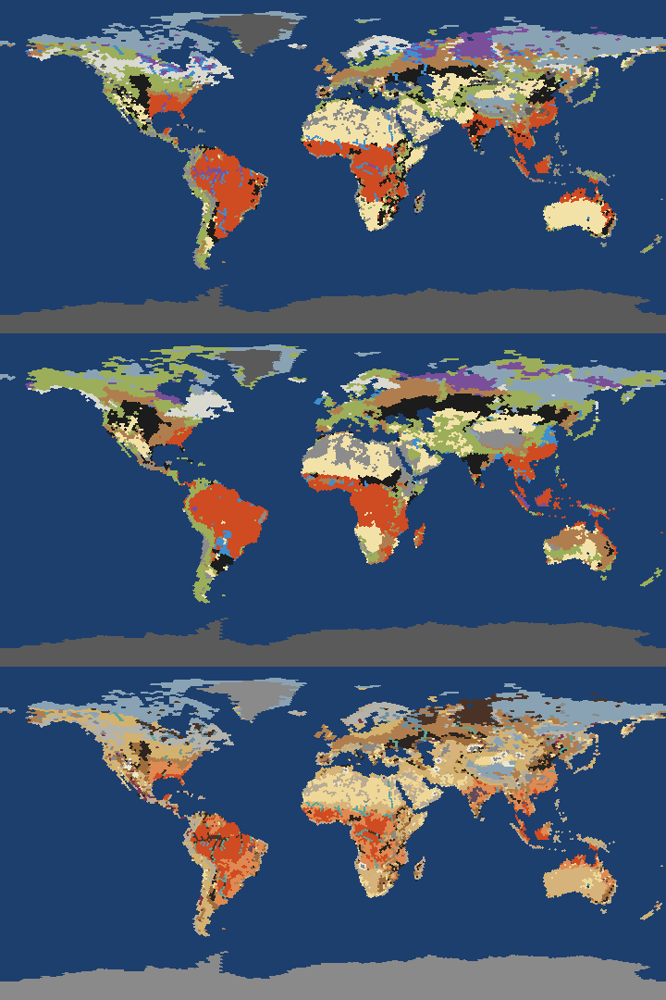
*`tools/soil_check.py --png` on the observed climate: the model's groups (top), SoilGrids' (middle), the model's 19 types (bottom).*

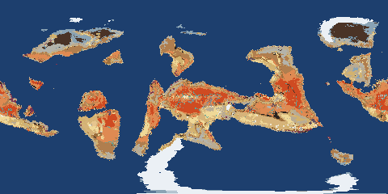 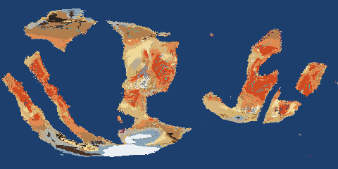 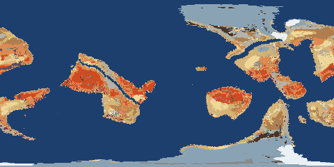
*Soil types on three L7 worlds from keyframes (showcase run a1d3b9 at 1000 Myr, health seeds 11 at 700 Myr and 21 at 600 Myr; the worlds were not kept): red tropical soils in the warm wet cores, frozen soils, peat and podzols towards the poles, sand and caliche in the dry interiors, thin soils on mountains.*

**Zoom pixels** (step 6, PW-331; `soils.zoom_mineral`, called from `zoom_vegetation`): the same two passes on each bare land pixel of a regional zoom, around the zoom's vegetation, which reads the pixel's buckets and fertility factor (replacing its old fixed buckets thinned on slopes and deepened in hollows). The pixel brings its own **slope** (converted to the cells' measure, m per km to the steepest neighbour: tan × 1000 / 10 at 2 km, finer pixels steeper by (2 km / res)^0.6, coarser ones less steep by (2 km / res)^0.3, since creep makes a 4 km pixel the mean of finer terrain, PW-125; measured on seven 2 km zooms of two L7 worlds, a pixel's RMS slope is 4–22× its cell's: the zoom's own roughness, kept, PW-345; on seven 400 km zooms of an L7 world at 4, 2, 1 and 0.5 km, each region's pixel-to-cell erosion ratio at 1 and 0.5 km is 0.75–1.6× its 2 km one (median 1.1), at 4 km 0.7–1.4× (median 1.0; 1.1–2.1×, median 1.4, with the 0.6 exponent)), **rock** (the zoom's `surface_rock`, with its volcanoes' rock and reefs' limestone), **alluvium** (the vegetation's big-river floodplain share / 0.5, or the share of a smaller river's strip), **colluvium** (up to 1 m in the wettest hollows, from the TWI), **glacier forefields** (within 4 km of a zoom glacier: deglaciated 5 kyr ago) and lapse- and slope-corrected **climate**; from its coarse cell, the landform class and age, the last glaciation, salt lakes nearby and the **loess** (interpolated; it slides off slopes over 2× the steep threshold). Its thinnest soil is 6 cm (thin stony, not bare rock). The world's climate memory is left out (it moves W by ~0.01). Nothing pulls the pixels back to their cell, so mountains split into thin stony slopes, frozen summits and brown or red valley soils, a big river's plain into alluvium, and a flat cell's catena into older soils on flats and younger on slopes. On uniform cells (gentle, inland) 34–90% of the pixels fall in the cell's soil group (median ~60%; `tools/zoom_soil_check.py`, the ten groups of `soil_check`, six 400 km zooms), on steep cells 50–74%. Where they differ, the zoom's ground differs from the cell's measure: a cell beside a hill reads steep (its slope is the drop to the steepest neighbour), and on one dissected plateau (cells 6–8 m/km) the zoom's terrain is smoother than that (pixel slopes ~4× the cell's, not ~10×), so its pixels carry older red clay where the cells have young brown soil. Cost: 0.03–0.04 s for a 400 km zoom at 2 km, 0.3 s of a 500 × 500 px zoom (12 s in all at 2 km, 10 s at 0.5 km, L7 keyframe world of health seed 21 at 600 Myr); +10 layers, 3 MB per 500 × 500 px zoom.

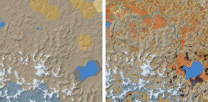 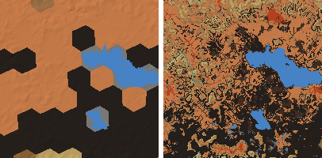 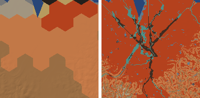
*400 km zooms at 2 km of an L7 world (showcase run a1d3b9 at 1000 Myr, from the keyframe; not kept), each the coarse cells' soils (left) beside the pixels' (right) (`tools/zoom_soil_check.py --png`): a wet mountain range where the cells are all thin stony soil and the pixels keep it on the slopes, frozen soil on the summits and red clay and brown forest soils in the valleys; a black-earth plain whose pixels mix black earth with red clay on its flattest, oldest ground and peat in hollows; a tropical river lowland of leached red soils with alluvium along the rivers.*

**Known limits:** at the cell scale soils are a mean (hollows and ridges average out; the zoom separates them); the soil age is the residence time of a ≤ 3 m soil, not of a deep weathering profile, so relic laterites hardly survive a climate change; Earth lacks dune fields and young-volcano landforms; loess is crude (PW-037).

### 2.22 Human-use layers (`humanuse.py`, PW-099)

**What it does:** five class-map views of what people can do with a place, derived from fields the simulation already has (no new physics; each rule is a crude, written-down approximation). They are stored with every finished world (`world.finish`) and every regional zoom (`zoom.build`), exported as class maps plus the feature kinds `navigable_river`, `harbour`, `pass`, `spring`, `fertile_land` (worlds) in `features.geojson` (`legend.json` has each map's ids, the manifest's `human_use` key says so), and recomputed by the export for older worlds and zooms that lack them. One implementation runs on a graph (`Net`: a world's cells with `grid.edges`, or a zoom's 8-connected pixels with its D8 receivers), so the rules are shared and only the resolution differs.
- **`river_nav`** (0 no, 1 small boats, 2 barges, 3 sea-going): mean-flow depth from discharge (0.27 Q^0.3 m; Leopold-Maddock style) against a skiff (0.6 m), a laden barge (1.8) and a sea-going ship (3.5), and the gradient over the next ~8 km (zooms; a world's own reach) against rapids limits of 4, 1 and 0.3 m/km; frozen 9 or more months, a zoom's waterfall pixel, and a non-land node close a reach. Features are runs of one class with discharge range, gradient, open months and whether navigable water leads to the sea.
- **`harbour`** (0 none, 1 anchorage, 2 harbour, 3 fine harbour): at sea next to land (a world: neighbouring cells; a zoom: within 6 km), the **effective fetch** (mean over 16 bearings of the open-water distance, reach 6 cells in a world, 50 km in a zoom) gives shelter = 1 − fetch/reach (a straight coast scores 0.5; classes from 0.6, 0.72, 0.85); a river mouth over 300 m³/s adds 0.2 (an estuary shelters itself); needs 6 m of water (a zoom: within 6 km, its shoreface shoals to the beach); sea ice 6+ months drops a class, 10+ removes it.
- **`pass`** (1 open most of the year, 2 seasonal, 3 snow-bound; `pass_height` m): drainage basins from the receivers; for each pair of touching basins (one big, the other not tiny) the lowest crossing, kept if it stands 300 m (zoom 150 m) above the valley floors on both sides, then thinned to the lowest of each neighbourhood. Snow-bound months: below −3 °C on the monthly sine, if the pass gets rain.
- **`fertile`** (0 not arable .. 4 prime) and `fertile_score`: geometric mean of soil fertility (0.35), water (0.30: actual / potential evaporation, or rain / Holdridge PET in a zoom; a river over 100 m³/s irrigates its cell), growing season (0.25: months over 5 °C, full at 6) and soil depth (0.10), × a slope factor (none beyond 25°), × permafrost, peat and flooding penalties; ice and sea score 0.
- **`fresh_water`** (3 on site, 2 close, 1 a day or two, 0 none; `fresh_km`, `spring`): sources are land shedding ≥ 100 mm/yr (perennial streams), a river over 20 m³/s through a dry cell, fresh lakes, wetlands, and **springs** where dry ground lies at the foot of ground 800 m (zoom 400 m) higher with a wetter catchment. Reach classes: a world cell and its neighbour / two cells; a zoom 3 / 10 / 30 km.

**Known limits:** a 120 km world cell cannot see a fjord, a rapid, a Pyrenean saddle or a spring: the world layers are a map of regions, the zoom's are the usable ones (PW-099 follow-ups in `issue-tracking/`); depths are cell means; the pass rule needs a drainage divide, so a pass between two basins of the same outlet is missed; navigability uses the mean discharge, not the low-water month; thresholds are physical or conventional, not fitted to Earth.

---

## 3. Calibration and validation

**Tests** (`uv run pytest -q`, 180 tests): invariants (determinism, the crust budget closing, sane values, storage that doesn't clip, the sim → world → zoom chain), envelopes (plausible ranges: land 22–42%, dry climates 12–45% of land, continental crust 33–50%, plate speeds 2–9 cm/yr, 5–30 plates, ocean age 25–120 Myr, churn), and golden hashes of a short L4 run and one climate computation, so refactors can be shown not to change results.

**Glacial time zoom depth** (PW-031, 2026-10-14; lowest sea level vs the start, max ice):

| Source | Before | After |
|---|---|---|
| world bcc894 (run e0e21e @ 688 Myr, L7, dT −3.3), 300 kyr | −171 m, 5.1 km | **−132 m**, 5.1 km |
| run e0e21e @ 592 Myr (L7, dT −0.7, Earth-like), 300 kyr | — | −95 m |
| world 8e71fd (run ee65aa @ 632 Myr, L6, dT −5.8), 200–1000 kyr | −272 m, 11.8 km | −258 m, 11.8 km (cold era: see the PW-031 follow-up draft) |
| Earth (L6), 200 kyr | −54 m | −53 m |

**Earth checks** (the model on Earth's real terrain, `tools/earth_check.py`):

| Check | Result |
|---|---|
| Köppen main-group agreement | **70.7%** (area-weighted, land outside Antarctica; test floor 66%) |
| Köppen exact-class agreement | 38.4% |
| Log-rain correlation | 0.59; mean land rain 842 mm/yr |
| Model Köppen shares | A 19%, B 31%, C 18%, D 25%, E 7% |
| Inland drainage | ~22% of land (Earth ~18%) |
| Clouds (vs ICOADS, CRU) | Sahara 17%, Southern Ocean 82%, stratocumulus decks 64–70%, ITCZ 66–69% (observed ~70–80%); sea RMS 12 points, land sunshine RMS 16 |
| Dry winter humidity | Delhi 45%, Timbuktu 33%, Kashgar 49% (January) |
| Overturning | 13.7 Sv: Nordic 7.0, Labrador 4.1, Ross 1.9, Weddell 0.6; none in the North Pacific |
| Waves / tides (`coast_check.py`) | within 2× at 28 of 32 coasts / 24 of 25 |
| Vegetation (`veg_check.py`) | potential-vegetation agreement 62.1% on observed climate, 40.5% on the model's; land NPP 61.0 / 47.7 Pg C/yr; burned area 5.7 / 4.9 Mkm²/yr (§2.18) |

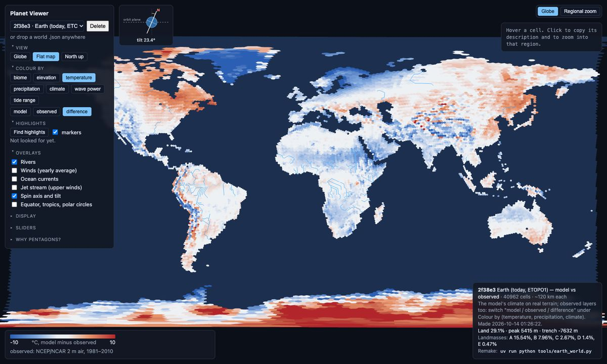
*Model minus observed annual temperature on Earth (an earlier Earth world). East Antarctica and NE Canada come out too warm.*

**Scorecard** (`docs/scorecard.jsonl`, latest row 0fd35e5, two L6 seeds over 1 Gyr):

| Metric | Seed 1 | Seed 2 |
|---|---|---|
| Land at 1 Gyr (range over the run) | 33.7% (30.6–34.3) | 33.1% (31.9–35.8) |
| Continental crust area | 47.7% | 46.9% |
| Crust volume (end / start) | ×1.006 | ×1.006 |
| Mean ocean age | 95 Myr | 63 Myr |
| Plate speed | 4.0 cm/yr | 4.45 cm/yr |
| Largest landmass now / max | 16% / 31% | 12% / 34% |
| Dry (B) share of land | 39% | 33% |

Plate counts (from run frames, not the scorecard): L6 median ~10, minimum 4–6; L7 seed 21 median 11, minimum 4; seed 3199 median 13, minimum 7 (foundation round, PW-191).

**Main weak spots:** moisture transport and regional rain (PW-013), polar temperatures (PW-039; the Southern Ocean's air), the time zoom's glaciation (PW-031, PW-033), closed basins on generated worlds (PW-054), land ice depth (PW-190).

---

## 4. Performance and costs per level

Laptop timings (4P + 4E cores, often shared with other jobs; wall times from `meta.generated_in_s`).

| Level | `simulate` time | Memory | Disk per 1 Gyr run | World build | World size |
|---|---|---|---|---|---|
| 5 | fastest; used by `generate` and tests (no recent run timing) | small | — | seconds | ~1 MB |
| 6 | ~6–8 min per Gyr | well under L7's (not measured) | ~0.5–0.65 GB (layers ~0.3, checkpoints 10 × ~12 MB) | 1.5–5 s after replay | ~5 MB |
| 7 | ~20–25 min per Gyr (up to ~35 under load) | ~0.9 GB RSS + ~0.45 GB for the geological record | ~2.5–2.9 GB (layers ~1.5 GB, checkpoints 10 × ~45 MB) | 13–28 s after replay | 30–45 MB |
| 8 | ~3–4 h per Gyr | ~3.5 GB | ~17 MB per keyframe, so use `--every 10` | world + 5 highlight zooms ~8.5 min | — |

- **Vegetation:** in the run ~0.09 s per climate update at L6 (~25 s per Gyr, ~8% of a run; L6 1 Gyr took 4.6 min, L7 23 min with other jobs running); in a world 0.2 s at L6. It adds ~3 MB to an L6 world (9 → 12 MB) and ~13 MB at L7 (~58 MB), and three layers (vegetation, tree cover, NPP) to run keyframes.
- **Soils:** worlds only, ~0.8 s at L7 (mineral pass ~0.7 s, mostly the loess sweeps; climate memory from the keyframes ~0.35 s; organic pass 0.03 s); +5.6 MB on an L7 world JSON (62 → 68 MB); L7 worlds from keyframes took 25-31 s with them (under load).
- **Lakes and river routing** (`hydrology.lakes` + `route`, PW-255; Threadripper, 8 numba threads, load ~12-18, seed 3199, 100 Myr): L6 ~6.1 -> ~3.4 s of a ~33.5 -> ~31 s run (medians of 3 interleaved pairs); L7 37.2 -> 23.6 s of a 180 -> 166 s run (one pair). Bit-identical (radix sort of the land cells, lake order reused across `_settle`'s tries, a filled-only flood for `_bed`, Floyd's heap pop). Then PW-344 (outputs change): `priority_flood_to` takes tied cells first come first, a strict order, so it queues only the coastal outlets, not the open sea: the flood 3.5 -> 1.9 ms at L6 and 23 -> 9.5 ms at L7 (~2.4x; the ~3.6x of a coast-only queue without the tie order isn't sound: its ties followed the heap's layout). Whole 100 Myr runs (8 threads, load 21-33): L6 36.2 -> 34.1 s (medians of 3 interleaved pairs); at L7 the expected ~6-7 s (~435 route floods per 100 Myr) is below the load noise (base 166-203 s, new 164-196 s over 4 pairs).
- **Slicing** replays up to 100 Myr from a checkpoint: well under a minute at L6, a few minutes at L7. The Zoom button skips the replay.
- **Zooms:** 1–7 s each; ~11–12 MB each for 500×500 px.
- **Time zoom:** ~4 min per 1000 kyr at L6.
- **Scorecard:** ~11 min. `pytest`: ~30 s to a minute (`-m "not slow"` skips 11 envelope tests).
- `NUMBA_NUM_THREADS=4` is often faster under load.
- **Viewer replay** (L7, headless Chrome on the RTX PRO 6000 machine): ~25–30 ms of script per keyframe, ~23–28 keyframes/s; opening an L7 run downloads its layer files whole (~336 MB for the elevation view, ~96 MB gzipped on the wire), and layers no longer drawn are dropped (~0.5 GB of buffers after visiting every layer, was ~1.5 GB).

---

## 5. Current outputs to look at

Start the viewer (`uv run python -m planet serve`) and pick these from the dropdowns. Ids come from `uv run python -m planet list`.

**Showcase (2026-10-14 evening code, before the tectsea sea-level and plate-count change):** run **8571dd** (L7, seed 21, 1000 Myr), world **a08983** @ 408 Myr with highlights and zooms.
- Landform demo zooms on a08983: f9b027 (rift), a42a15 (fold belt), 8beebd (shield), 2d06f8 (escarpment), 9b19a0 (caprock), d3b1c8 (lava plateau), 68e925 (tower karst), 2e6433 (lowland karst, poljes), e14044 (linear and star dunes), 2d1537 (transverse dunes), ee587f (cold barchans), 8373c5 (barrier islands, lagoons), dccb9c (coastal plain); 83e518 (waterfalls), 130acd (volcano), 2d60af (2000 km overview).
- Earth world **dc3732** (clouds, ocean, seasons, model vs observed); **fe2af4** is the same with vegetation (PW-187).
- Vegetation demo (PW-187): run **732abb** (L7, seed 3199, 1000 Myr; plant groups at 2, 48, 232, 724, 760 and 824 Myr), world **351f32** at 1000 Myr. Try `?world=351f32.json&layer=vegetation`, `&layer=plant%20type&pft=BoNS`, and `?run=732abb&layer=vegetation` for the group ticks.
- Ocean and clouds demo world **2085dc**; seasons and travel demo **67317b**.
- Discrete volcanoes: run 39d004, world a099c6.
- Supercontinent cycle: run 6d9dcf (seed 2, 2 Gyr), worlds ffb5bd (assembled) and 779b14 (dispersed).
- Delta types: zooms 00975d, f81832, ce4b72 on world 0f7abd.
- The older L6 showcase set (Earth-like A/B, water world, land-heavy, cold, hothouse) is in `docs/coordination.md` "Showcase recipes".

### Demo runs (seed 3199)

Two runs on the final 2026-10-14 code, random seed 3199, default (Earth-like) parameters. Worlds were taken with `--at auto` (a representative moment) and have highlights plus 6 highlight zooms each. Same seed at two levels: the geography differs, since the run is chaotic.

| Level | Run | Myr | World | Zooms | Notes |
|---|---|---|---|---|---|
| L6 | ee65aa (5 min) | 1000 | 8e71fd @ 632 Myr | b5da31 largest river mouth, 23437e highest peak, b15424 steepest river, b4cdbc fjords, 12e3dc most varied, 53479b delta site | ends with 12 plates, 31.7% land |
| L7 | e0e21e (20 min) | 1000 | bcc894 @ 688 Myr | 40edef highest peak 5,533 m, a800d7 largest river mouth, 05fdf3 steepest river (830 m drop), 8bc6d8 longest range (6,900 km), 860228 fjords, 29e060 most varied | ends with 6 plates, 36.8% land |

Glacial time zooms and finished worlds (PW-091): time zoom **37ad6f** (300 kyr from bcc894's moment, L7) with finished worlds **bcb4b6** (+262 kyr, its glacial maximum, sea −132 m; zoom ed4e18) and **626fbb** (+100 kyr); time zoom **1eb8d4** (300 kyr from 8e71fd's, L6) with finished world **c73271** (+120 kyr, −258 m).

Open them at `http://127.0.0.1:8765/viewer/?world=bcc894.json` (or `?run=e0e21e`), and zooms at `zoom.html?id=<id>`. Try the landforms, cloud, sea temperature and salinity layers, the overturning overlay, and the travel highlights.

---

## 6. Where things live

| Path | Contents |
|---|---|
| `planet/__main__.py` | the CLI |
| `planet/grid.py`, `geo.py`, `noise.py` | icosphere grid, sphere geometry, 3D Perlin noise |
| `planet/tectonics/simulation.py` | the `Simulation`: state, the step, the world view |
| `planet/tectonics/plates.py`, `plate_kernels.py` | rigid plates, rotations; pull/resolve kernels (subduction, collision, ridges) |
| `planet/tectonics/motion.py` | boundaries and the force balance |
| `planet/tectonics/mantle.py` | the B′ mantle field |
| `planet/tectonics/events.py` | sutures, slivers, rifts, new subduction |
| `planet/tectonics/crust.py` | crust budget, arcs, collisions, stretching, flow, coherence |
| `planet/tectonics/isostasy.py` | crust → elevation, per-cell columns |
| `planet/tectonics/volcanism.py` | plumes, hotspot vents, arc volcanoes, reefs |
| `planet/tectonics/record.py` | strata and history per cell |
| `planet/tectonics/earth.py` | global temperature, CO₂, sea level, ice sheets, erosion driver |
| `planet/tectonics/setup.py`, `params.py`, `output.py` | the starting planet; parameters; snapshots and stats |
| `planet/surface.py` | rocks, erosion, sediment routing, surface rock |
| `planet/landform.py` | the 12 landform classes |
| `planet/climate.py` | temperature, winds, jet, gyres, SST, rain, water balance, humidity, clouds, Köppen, biomes, the shared months |
| `planet/vegetation.py` | plant functional types, productivity, cover competition, fire, wetlands, named types, plant groups |
| `planet/ocean.py` | salinity and the overturning |
| `planet/hydrology.py`, `kernels.py` | rivers, lakes, erosion kernels |
| `planet/coast.py` | waves, tides, Galloway delta weights, BQART sediment loads |
| `planet/coastal.py`, `zoom_coastal.py` | coastal and shallow-sea life: reefs, kelp, seagrass, mangroves, salt marsh; river turbidity; their zoom placement |
| `planet/world.py` | world finishing and file I/O |
| `planet/timeline.py` | simulate, keyframes, report, replay, slice, `world_from_frame` |
| `planet/generators.py` | one-shot cartoon plates (`generate`) |
| `planet/highlights.py` | the 36 detectors, representative time |
| `planet/zoom.py`, `zoom_kernels.py` | regional zoom and its raster kernels |
| `planet/zoom_landforms.py`, `zoom_volcanoes.py` | landform synthesis; volcano edifices |
| `planet/zoom_terrain.py`, `zoom_vegetation.py` | zoom terrain indices (sun on slopes, wetness, river distance); per-pixel vegetation |
| `planet/satellite.py` | the true-colour satellite view of worlds and zooms |
| `planet/timezoom/` (params, sources, geometry, forcing, fields, ice, kernels, sim, events, output, run), `planet/orbit.py` | glacial time zoom; orbit and insolation (shared with `icemass`) |
| `planet/store.py`, `provenance.py`, `images.py` | paths, ids, layers, checkpoints; code version; PNG writer |
| `planet/server.py`, `api.py` | viewer server and job API |
| `planet/parallel.py` | worker-process pools with thread caps (highlights zooms, server jobs, scorecard, multi-seed runs); thread defaults and numba's threading layer |
| `viewer/index.html`, `viewer/zoom.html` | globe viewer, zoom viewer |
| `tools/` | calibration and diagnostics (§2.17) |
| `tests/` | invariants, envelopes, goldens, per-subsystem tests |
| `issue-tracking/` | the board: tickets, inbox, `board.py` |
| `docs/` | this overview, `plan_next.md` (roadmap), `coordination.md` (worktrees, costs, recipes), `proposals/`, `review/` (investigations and images), `scorecard.jsonl` |

---

## 7. Glossary

**Geology**

| Term | Meaning |
|---|---|
| Airy isostasy | Crust floats on the denser mantle; thicker crust stands higher, like a thicker block of wood in water. |
| Arc (volcanic arc) | A line of volcanoes above a subducting plate (Andes, Japan). |
| Atoll / fringing / barrier reef | A reef hugging an island's shore; separated from it by a lagoon; a ring of reef left after the island has sunk away. |
| Basement / cover | The crystalline crust; the sedimentary layers on top of it. |
| Caprock | A hard layer protecting softer rock below; makes mesas, cliffs and waterfall lips. |
| Craton / shield | The old, stable core of a continent; a shield is where it is exposed at the surface. |
| Cuesta / hogback | A ridge with one steep and one gentle side from gently dipping hard beds; steeply dipping, a hogback. |
| Dolomite, quartzite, tuff, evaporite | Altered limestone; recrystallised sandstone; volcanic ash rock; salt and gypsum left by evaporation. |
| Doline / polje | A sinkhole in karst; a large flat-floored karst basin. |
| Escarpment (great) | A long steep step from plateau to lowland along an old rifted continental margin. |
| Exhumation | Rock brought to the surface as the rock above it erodes. |
| Flexural wavelength | How far a plate bends around a load; sets volcano spacing along hotspot chains. |
| Flood basalt / traps / lava plateau | Huge outpourings of lava when a plume head reaches a continent (Deccan, Siberia). |
| Fold-and-thrust belt | Strata squeezed into parallel folds beside a mountain range. |
| Guyot | A flat-topped seamount: an island planed by waves, then sunk. |
| Half-graben | A basin dropped down along one tilted fault block in a rift. |
| Hotspot / mantle plume | A column of hot mantle fixed under moving plates; leaves a chain of volcanoes (Hawaii). |
| Inselberg | A lone rock hill rising from a plain (Uluru). |
| Karst | Landscape dissolved out of limestone: sinkholes, caves, springs, towers. |
| Knickpoint | A sharp step in a river's profile; a waterfall that retreats upstream. |
| ln β | Stretching factor of rifted crust (β = original / stretched thickness). |
| Orogen | A mountain belt made by collision. |
| Passive margin | A continent's edge that is not a plate boundary (the Atlantic coasts). |
| Ridge (mid-ocean) | Where plates pull apart and new ocean floor forms. |
| Rift | Where a continent is being stretched and may split (East Africa). |
| Slab pull / ridge push | The pull of a sinking plate edge; the push away from a ridge. |
| Strata, unconformity | Rock layers in order; a gap where younger flat layers lie on older folded ones. |
| Stream power | River erosion rate ∝ water flow × slope. |
| Subduction | One plate sinking under another at a trench. |
| Supercontinent cycle | Continents gathering into one (Pangaea) and breaking apart, every few hundred Myr. |
| Suture | Where two colliding continents weld into one. |

**Climate and ocean**

| Term | Meaning |
|---|---|
| AMOC / overturning | The ocean's deep circulation: dense water sinks near the poles, warm surface water flows in to replace it. |
| Aridity index | Rain / potential evaporation (P/PET); below 0.05–0.2 is hyper-arid to arid. |
| Budyko curve | How much of the rain evaporates, given the rain and the evaporative demand. |
| Continentality | Interiors far from the sea have hotter summers and colder winters. |
| Gyre, western boundary current | A basin-wide ocean loop; its fast narrow western edge (Gulf Stream). |
| Hadley / Ferrel / polar cells | The three bands of overturning air in each hemisphere that give trade winds, westerlies and polar easterlies. |
| ITCZ | The rainy band near the equator where the trade winds meet. |
| Jet stream, thermal wind | Fast high-altitude winds where temperature changes sharply with latitude. |
| Köppen | A climate classification from monthly temperature and rain (A tropical, B dry, C temperate, D continental, E polar). |
| Lapse rate | How fast air cools with height (~6.5 °C per km). |
| Milankovitch cycles | Slow changes in Earth's orbit and tilt that pace ice ages (23, 41, 100, 405 kyr). |
| Monsoon | A seasonal wind reversal bringing summer rain off the sea. |
| Nye profile | The steady shape of an ice sheet: thickness grows with the square root of distance from the edge. |
| PDD (positive degree days) | Sum of temperatures above 0 °C; measures how much snow and ice melt. |
| PET | Potential evapotranspiration: how much water the air could evaporate. |
| psu | Practical salinity units (≈ grams of salt per kg of seawater; ocean ~35). |
| Rain shadow | The dry side of a mountain range, downwind of the wet side. |
| Shallow-ice approximation | A cheap model of ice flowing downhill under its own weight. |
| SST | Sea-surface temperature. |
| Stratocumulus deck | Low cloud sheets over cool sea under sinking air (off California, Peru). |
| Sv (sverdrup) | One million m³ of water per second. |
| Tidal prism / amphidromic point | Water a bay exchanges each tide; a point where the tide range is zero. |
| Upwelling | Cold deep water rising to the surface along coasts and the equator. |

**Coasts and deserts**

| Term | Meaning |
|---|---|
| Barchan / transverse / linear / star dune | Crescent dunes with scarce sand and one wind; ridges across one wind; ridges along two crossing winds; pyramids where winds reverse. |
| BQART, CERC | Empirical formulas for river sediment load; for sand moved along the shore by waves. |
| Erg | A sand sea. |
| Fetch | The open-water distance the wind blows over, which sets wave size. |
| Galloway triangle | Classifies deltas as river-, wave- or tide-dominated. |
| Playa / salt pan | A dry lake bed crusted with salt. |

**Vegetation**

| Term | Meaning |
|---|---|
| PFT (plant functional type) | A group of plants that behave alike (leaf habit, height, climate limits, drought strategy): "boreal needleleaf evergreen tree", "C4 grass". |
| GPP / NPP | Gross / net primary productivity: the carbon photosynthesis fixes, and what is left after the plants' own respiration (g C/m²/yr; Earth's land NPP ~56 Pg C/yr). |
| LAI | Leaf area index: m² of leaf per m² of ground (desert ~0.2, forest 4–7). |
| Light-use efficiency (LUE) | GPP as efficiency × the light the leaves absorb, cut by cold, heat and drought (CASA, MODIS MOD17). |
| C3 / C4 / CAM | Three kinds of photosynthesis: the ancestral one (trees, cool grasses); a CO₂-concentrating one that wins in hot, bright, seasonally dry places (savanna grasses); a water-saving night-time one (cacti). |
| Evergreen / summergreen / raingreen | Leaves all year / in the warm season / in the wet season. |
| TRIFFID | The UK Met Office's vegetation dynamics: cover fractions competing by height and growth (Lotka–Volterra). |
| GlobFIRM | LPJ's fire module: burned area from the length of the fire season, fuel and ignition. |
| Stand age | Years since the last stand-replacing disturbance (here fire); with a steady fire rate, exponentially distributed. |
| Treeline | Where trees stop with cold: latitude (arctic) or height (alpine). |

**Procgen and this code**

| Term | Meaning |
|---|---|
| Icosphere / Goldberg grid | The sphere tiled with hexagons and 12 pentagons. |
| Level | How many times the icosahedron was subdivided (L7 = 164k cells). |
| Run, keyframe, checkpoint | A simulation; a saved snapshot for the viewer (every 4 Myr); the full state for replay (every 100 Myr). |
| World, slice | One finished moment; making one from a run. |
| Zoom, time zoom | A fine regional landscape; 1 Myr of ice ages from one moment. |
| World frame / plate frame | Fixed planet coordinates / each plate's own copy of the grid that rotates with it. |
| Priority-flood | Drainage algorithm that fills pits so every cell drains to the sea or a lake. |
| D8 | Raster flow routing: each pixel drains to its steepest of 8 neighbours. |
| Diagnostic model | Computes a steady state from the current inputs, rather than stepping weather through time. |
| Envelope / golden test | A plausible-range check / a hash check that output didn't change. |
| Churn | Cells flipping state for a frame or two and back: an artefact. |
| Representative time (`--at auto`) | The keyframe after 300 Myr closest to the run's typical land and landmass counts. |
| Ma / Myr / kyr / Gyr | Millions of years (ago / duration), thousands of years, billions of years. |
