# procgen_world: overview

*Current state as of 2026-10-14 evening (code at 382b370, after the tectsea and zoompolish merges). Every number here was checked against the code; where another doc disagrees, this one and the code win. Open work lives on the board: `uv run python issue-tracking/board.py list --open`. Tickets are cited as PW-NNN.*

**Contents:** 1 What it is · 2 How each subsystem works (2.1 grid · 2.2 tectonics and mantle · 2.3 volcanoes · 2.4 crust, rock record and landforms · 2.5 erosion and sediment · 2.6 climate · 2.7 ocean · 2.8 ice and sea level · 2.9 hydrology · 2.10 coasts · 2.11 worlds · 2.12 highlights · 2.13 regional zoom · 2.14 glacial time zoom · 2.15 viewer and server · 2.16 store and data model · 2.17 tools · 2.18 vegetation · 2.19 satellite view) · 3 Calibration · 4 Performance · 5 Outputs to look at · 6 Code map · 7 Glossary

---

## 1. What it is

procgen_world makes planets by **simulating** them, not by painting noise. Mountains are where plates collided, deserts are where the winds arrive dry, rivers follow the land that erosion carved, and every rock layer has a date. Because the whole history is simulated, any place on the planet can be looked at at any moment of its past. That suits games and tabletop campaigns where time matters: the same coast 50 million years earlier, an ice age in a region you know, a volcano chain growing.

The physics is "toy but physical". Each process is a cheap version of a named real-world mechanism and is tuned so Earth's own geography gives Earth-like answers. Earth is a test analogue, not a target: generated planets are meant to be plausible, not copies. Runs are deterministic given the seed and settings.

### The pipeline

| Step | Command | What you get | Scale and cost (level 7) |
|---|---|---|---|
| **Run** | `planet simulate` | 0.5–2 Gyr of plate tectonics, climate, rivers and erosion in 2 Myr steps. A keyframe every 4 Myr for the viewer, a full checkpoint every 100 Myr. | ~164k cells of ~55 km. ~20–25 min per Gyr. |
| **World** | `planet slice <run> --at T` (or the viewer's Zoom button) | One moment, finished: climate with seasons, rivers, lakes, vegetation (and biomes from it), ocean, clouds, waves and tides, landform classes, volcanoes. | Seconds to a few minutes. |
| **Regional zoom** | `planet zoom <world> --lat --lon` | A 500×500 px landscape (250–2000 km across, 0.5–4 km/px) with valleys, lakes, deltas, waterfalls, glaciers, volcanoes, landform-specific terrain and per-pixel vegetation. | ~10–15 s. |
| **Glacial time zoom** | `planet timezoom <run> --at T` | 1 Myr of ice ages in 500-year steps (geology frozen). | ~4 min per 1000 kyr at L6, ~30 min at L7. |
| **Finished world** | `planet finish <timezoom> --kyr N` (or `<run> --at T`) | A world at any kyr of a time zoom: its ice, sunken bed, sea level and climate on the run's geology. | Seconds (L6) to ~1 min (L7). |
| **Highlights** | `planet highlights <run> --at auto --zoom N` | The ~40–55 most interesting places, with pre-made zooms. | Seconds. |

All of these are browsed in a three.js viewer: `planet serve` (http://127.0.0.1:8765/viewer/).

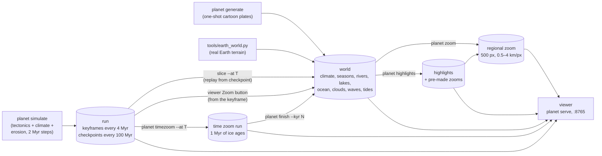

### What you can do with it

- Watch a planet's history as an animation: plates, supercontinents assembling and breaking, ice ages, sea level.
- Pick any moment and get a full world: temperature and rain for July and January, Köppen climates, 60 named vegetation types (from 19 plant types: tree cover, productivity, fire return, stand age), rivers with discharge in m³/s, lakes, salt flats, sea temperature and salinity, cloud and sunshine hours, wave power and tidal range, and a true-colour satellite view by season (§2.19).
- Zoom into a region at a few hundred metres to a few km per pixel and get a 16-bit heightmap with named features: waterfalls with their heights, deltas with their type, volcanoes with their ages, and terrain shaped by its geology (escarpments, fold ridges, karst, dunes).
- Ask for highlights, including travel ones ("beach: July 28 °C, 10 h of sunshine, warm sea 25 °C, gentle surf").
- Run 1 Myr of ice ages from any moment and watch glaciers advance and the coastline move.

**Not yet built:** soils, coastal life, resources, settlements and a game export are on the roadmap (PW-184, PW-185, PW-188, PW-155, PW-100; `docs/plan_next.md`); vegetation (§2.18) has its world, run and zoom parts and its climate feedbacks, not yet the time zoom (PW-187 steps 7–9). There is no day-scale weather yet (PW-156).

---

## 2. How each subsystem works

Each subsection gives: what it does, the rule in plain language with its real-world analogue, the main parameters, the outputs, and the known limits with their open tickets.

### 2.1 The grid (`planet/grid.py`)

The planet is an **icosphere**: an icosahedron whose triangles are split into four, `level` times. Each vertex is a cell, so the cells are hexagons plus exactly 12 pentagons (Euler's formula forces 12; tick "Highlight the 12 pentagons" in the viewer).

| Level | Cells | Cell spacing | Used for |
|---|---|---|---|
| 5 | 10k | ~220 km | `planet generate` default, ocean overturning solver, tests |
| 6 | 41k | ~110 km | `simulate` default; quick large-scale tests |
| 7 | 164k | ~55 km | showcases (owner's default) |
| 8 | 655k | ~28 km | rare, hours per run |

Every field is a flat NumPy array, one value per cell. Neighbour lists are CSR arrays for the numba kernels. A coarser level's cells are a prefix of the finer level's, so the ocean overturning can run at level 5 inside a level-6 or 7 world.

**World frame vs plate frame**, the key data-structure idea:
- Each plate keeps its crust (age, thickness, rock, sediment, geological record) on its **own private copy of the whole grid**, plus a rotation saying where that copy sits now.
- Moving a plate only changes the rotation. Crust is never resampled, so plate interiors never blur.
- Each step, every world cell looks up which plate cell lies under it, the physics runs on these gathered arrays, and the results are scattered back.
- Climate, the mantle and sea level live only in the world frame.

### 2.2 Tectonics and the mantle (`planet/tectonics/`)

**What it does:** moves 10–30 rigid plates over the sphere, creates and destroys crust where they meet, welds and breaks them, and lets a slowly remembering mantle steer them into supercontinent cycles.

**Who owns a cell** (`plate_kernels.resolve`), after the plates rotate:
- **Several plates overlap it:**
  - Continent beats ocean floor, and between two ocean floors the younger wins. The loser's crust there is deleted: that deletion *is* **subduction**.
  - Continent against continent is a **collision**. The cell's previous owner wins; the loser's thickness is stacked and spread over a belt as mountain-belt (orogen) rock. Cratons stay cratons.
- **No plate covers it:** it becomes new 7 km ocean floor of age 0, a **mid-ocean ridge**.

**Motion from forces** (`motion.py`). Each step every plate's velocity is solved from a force balance:
- **slab pull**, the strongest: a sinking slab drags its plate toward the trench, more for old, dense floor (× clip(age/80 Myr, 0.3, 1.5));
- **ridge push** away from spreading ridges;
- **collision drag**;
- **basal traction** from the mantle field (below);
- a small random wander (an Ornstein–Uhlenbeck process: a random walk pulled back toward zero, ~60 Myr memory).

The forces become torques, and a drag matrix turns them into each plate's rotation (its Euler pole). Continental keels feel 2.5× the drag. Velocities relax toward the solution over 15 Myr (a stand-in for inertia) and are capped at 18 cm/yr at the plate's fastest point. A hotter early mantle (`heat_start` > 1) speeds plates as √heat.

**The mantle (`mantle.py`, the "B′" design).** A smooth world-frame temperature anomaly built from spherical harmonics of degree 1–8 (~2500 km smoothing), with a 200 Myr memory.
- **Cooling:** sinking slabs cool it under trenches ("slab graveyards"), in proportion to convergence × slab age.
- **Warming:** continents insulate it. A continent parked for ~100 Myr warms the mantle under itself.
- **Effect on plates:** basal traction drags plates from warm toward cold mantle. Random eddies (degrees 3–8) stand in for smaller convection.
- **Plumes:** new hotspots favour warm mantle and its edges; 60% start under a ridge or rift.

**The supercontinent cycle emerges**; no rule forces it:
1. Continents gather over the cold slab graveyards.
2. Colliding plates **suture** into one plate after 30 Myr of contact once closing is below 2 cm/yr (or anyway after 150 Myr; never within 80 Myr of rifting from each other).
3. The assembled continent warms the mantle under itself.
4. **Rifting** (`events.py`): for each plate ≥ 5% of the surface, 12 straight cuts are tried and each half's motion is solved. The plate splits if the halves pull apart faster than `rift_stress` (2 cm/yr), scaled up for big plates (size^¼) and down by the rock's strength along the cut. Weak lines: young sutures, orogens, thinned crust, plume swells. Cratons resist (×1.6). **Warm mantle weakens a plate** (strength ÷ (1 + 0.7 × anomaly), the PW-024 nudge), so a big plate parked over a warm upwelling breaks more readily. The winning cut is redrawn as 4 wandering rift lines and the weakest wins. At most one split per step; none at 30+ plates; pieces with 0.3–3% of the surface as continent are forbidden, so breakup gives a few big blocks.
5. Ocean floor ages; when the oldest ~6000 km of a plate's passive margins passes 120 Myr, a new trench can start along that stretch, and the ocean beyond starts to close (PW-191: the hazard used to be read from the mean of all the plate's margins, young ones included, so old oceans rarely started closing).
6. Slivers (< 0.15% of cells) are absorbed by the plate around them.

On four L6 seeds over 2 Gyr the largest landmass passed 25% of the surface 2–4 times after the starting supercontinent, every 280–740 Myr. Plate counts: median 8–10, minimum 3–4 (PW-024). Not guaranteed for every seed.

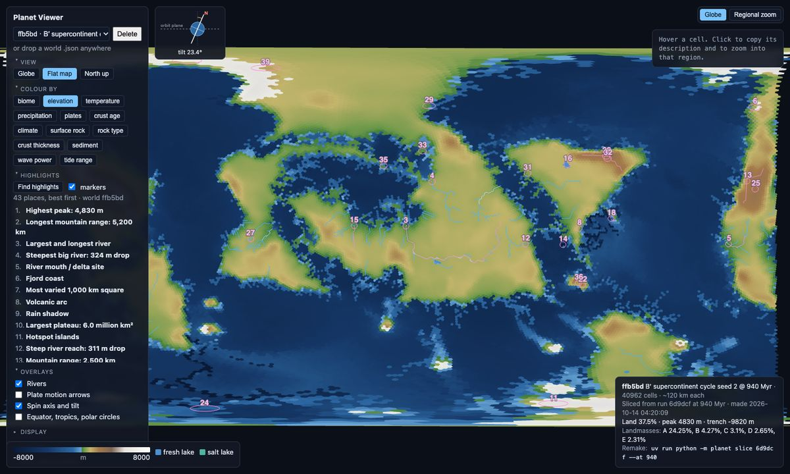
*World ffb5bd (run 6d9dcf at 940 Myr), mid-assembly. The largest landmass is 24% of the surface. Numbered rings are highlights.*

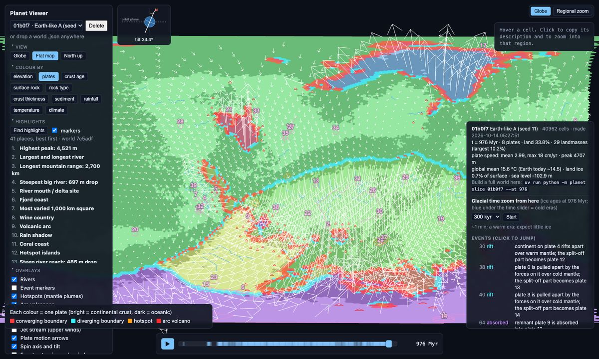
*Run 01b0f7 at 976 Myr, plates layer. Bright colours are continental crust, dark colours oceanic. Red edges converge, cyan edges diverge.*

**One step** (`Simulation.step`, 2 Myr):
1. Move the plates.
2. Resolve ownership (subduction, collision, new floor).
3. Find the boundaries.
4. Update the mantle.
5. Physics: crust budget, arcs, hotspots and vents, collisions, stretching, crust flow, global temperature, erosion and sediment, reefs, the ice record, crust-type coherence, back to the plates.
6. Solve the forces for the next step.
7. Events: sutures, slivers, at most one rift.
8. Volcanoes re-home, sink, erode and grow reefs.
9. Climate every 4 Myr (and on step 1), **on the ground the events left** (PW-109), so a keyframe's climate fits its ground. The next steps' erosion uses it.

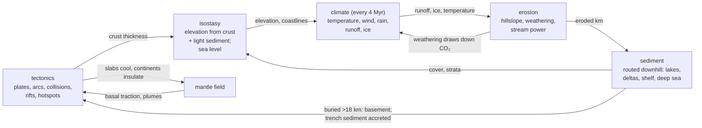

**Main parameters** (`planet/tectonics/params.py`; set with `simulate --set key=value`; all are stored in `run.json`):

| Parameter | Default | Meaning |
|---|---|---|
| `n_plates` | 12 | plates at the start |
| `start` | supercontinent | or `scattered` |
| `continental_fraction` | 0.4 | target share of the surface that is continent |
| `continental_start` | off | start with less continent and grow toward the target (water worlds) |
| `heat_start` | 1.0 | early mantle heat relative to the end state |
| `slab_pull` / `ridge_push` / `collision_drag` | 1.0 / 0.15 / 1.2 | force strengths |
| `mantle_drag` | 0.6 | basal traction from the mantle field |
| `mantle_memory` / `mantle_scale_km` | 200 Myr / 2500 | mantle memory and smallest feature |
| `slab_cold` / `insulation` | 0.002 / 0.04 | cooling under trenches, warming under continents |
| `mantle_eddies` / `mantle_noise` | 0.3 / 0.2 | random convection, random drag |
| `velocity_timescale` / `max_speed` | 15 Myr / 18 cm/yr | inertia, speed cap |
| `arc_growth` / `crust_flow` | 0.03 / 0.0006 | new arc crust, sideways flow of thick crust |
| `suture_after` | 30 Myr | collision time before plates can weld |
| `rift_stress` / `rift_timescale` | 2 cm/yr / 130 Myr | how hard and how often plates break |
| `warm_rift` | 0.7 | how much warm mantle weakens a plate (PW-024) |
| `rift_min_piece` / `max_plates` | 0.03 / 30 | smallest continental piece a rift may cut, plate ceiling |
| `margin_age` | 120 Myr | margin age at which new subduction can start |
| `ridge_time` | 30 Myr | sea-level response time to the sea floor (PW-053) |
| `tilt` / `climate_offset` | 23.4° / 0 °C | axial tilt, warmer or colder history |

**Outputs:** per keyframe the `plate`, `crust`, `crust_age`, `plate_boundary`, `crust_thickness` layers and plate velocities; the event log (collisions, sutures, rifts) in `run.json`; hotspots and volcanoes.

**Known limits:**
- Plate counts can still dip for a few Myr near 4 (L7 seed 21, 1 Gyr: median 11, minimum 4, 1% of frames at ≤ 4; was median 10, minimum 3, 12% with an 84 Myr spell); a big plate rimmed by ongoing collisions is compressed across every cut and can't rift until they end (PW-191). The cycle's regularity is pinned (PW-025).
- Continents are resolution-consistent since PW-052 (the L7 start no longer has a shelf-low, craton-free interior): L6 and L7 seeds 21/3199 at 1 Gyr have 34–36 km mean continental crust (median 36–37), crust on 40–42% of the surface and land on 31–33%. They still thin by ~1–2 km over a Gyr (the last 300 Myr: ~34 km, crust 42–43%), and mean land stands ~1150 m at L6, ~1300 m at L7 (Earth ~840 m; needs a decision, see the inbox).
- Some cell churn remains along collision fronts (PW-170, PW-173, PW-174); pits in continents from old seams (PW-171); one-frame 11–18 km spikes (PW-048, PW-172).
- Ragged ocean boundaries (PW-047); drainage switches outlet in one step when a rift opens (PW-056).

### 2.3 Volcanoes, island chains and atolls (`tectonics/volcanism.py`)

**What it does:** volcanoes are point objects that ride their plate, each with its own volume, height and age (PW-001).

- **Hotspot vents:** a plume is fixed in the mantle while the plate slides over it. It opens a new vent every 1.5 flexural wavelengths of plate motion (60–150 km; ~100 km on Hawaii-like 90 Myr floor, set by the plate's elastic thickness). A vent is fed while over the plume, then carried off, so a plume leaves a chain, youngest over it (Hawaii → Midway → Emperor seamounts). Each vent goes onto the grid as a 25 km Gaussian cone (separate islands at L7–8, a blur at L6). Height is limited by the plate's age (older, thicker plates carry taller volcanoes; at most Mauna Kea's 4.2 km, 3.5 km on a continent); the rest spreads as an apron below −2 km. A new plume's head floods ~300 km for 6 Myr (flood basalts).
- **Arc volcanoes:** one per ~120 km of active subduction arc, ~2000 km³ each, active ~8 Myr (Fuji, Rainier, the Andes).
- **Ageing:** a dead volcano sinks with its sea floor (and with the plume swell decaying behind it). Its part above the sea erodes (~10 Myr e-folding at 1500 mm/yr of rain, faster when wetter) until the waves plane it off. In water ≥ 23.5 °C (`reef_temp`) a reef keeps up with the sinking: **fringing reef → barrier reef → atoll** once the volcano is gone. Carried below 22 °C the reef drowns and the flat top sinks as a **guyot**.

**Outputs:** the full volcano table in `runs/<id>/volcanoes.json.gz`, in each checkpoint and in each world (`meta.volcanoes`, columns `meta.volcano_columns`); the viewer's Hotspots and Volcanoes overlays; drawn individually by the zoom (§2.13).

**Known limits:** hotspot islands are sub-cell, so at L6 (and often L7) the globe shows a bank, not land (PW-117, needs a decision); continental plume heads pile 7–16 km of flood basalt (Deccan ~2 km; PW-133).

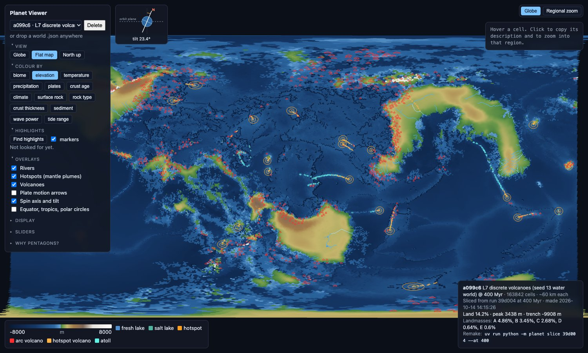
*World a099c6 (L7 water world, seed 13, 400 Myr): volcano overlay with hotspot chains (orange), arc volcanoes (red) and atolls (cyan).*

### 2.4 Crust, rock record and landform classes

**Crust** (`crust.py`, `isostasy.py`):
- **Building crust:** subduction grows **volcanic arcs**; collisions stack crust, and over-thick crust **flows** outward, widening plateaus (Tibet); rifts thin continents (down to 22 km), and the crust they lose floors the opening rift as a continuous belt of 12–18 km margin crust; hotspots build islands and flood basalts under a ~1 km swell.
- **Crust budget:** two "thermostats" steer arc growth on continents toward a target continental volume (40% of the surface × 37 km) and subduction erosion toward the target area. Each answers the present error and, over ~100 Myr, a persisting one (an integral term), so area no longer settles ~12% above target. Island arcs on ocean floor grow at the nominal rate (steering them too turned a volume shortfall into new thin continent rather than thicker continents). Arcs leave a ~120 km forearc gap at the trench (the arc–trench gap), where subduction erosion grinds the edge; its rate is per km of trench, the same at every grid level (PW-046, PW-052).
- **Coherence** (PW-108): a one-cell inlet of ocean floor nearly ringed by its plate's continent becomes (thin) continent, with crust flowing in from around it; a thin (< 20 km) shred of continent nearly ringed by ocean becomes ocean floor. No welds at trenches (a notch there is subduction erosion at work; re-welding it every step made erosion thin continents instead of shrinking them). Without it, cells flipped between continent and deep sea every few Myr (`tools/churn.py` measures it).
- **Elevation is isostasy:** crust floats on the mantle like wood on water (Airy isostasy). Continents stand 250 m plus 150 m per km of crust beyond 35 km. Ocean floor sinks as it cools: 2600 + 345·√age m (the half-space cooling law), at most 6400 m deep. Sediment is light (2.1 g/cm³, compacting to 2.6 with depth), so filling deep water takes ~3× its depth in sediment, as on Earth. Cover buried below 18 km becomes basement.
- **Glacial isostasy** (PW-189, `isostasy.ice_load`): land ice presses the bed down by ρ_ice/ρ_mantle ≈ 0.28 of its thickness, spread by the lithosphere's flexure over ~150 km (a 3 km sheet: ~830 m; a one-cell cap much less). In the run it settles at once (`sim.ice_sink`, from the ice at each climate update): the keyframes' `elevation` is the pressed-down bed (it can lie below sea level under a big sheet, as Greenland's and Antarctica's do), the ice surface stands lower and warmer, and land the load pushes under the sea without ice on it is sea. Erosion, sediment, reefs and volcanoes work on the crust's own height (`w_elev`), since the dip is gone ~10 kyr after its ice. Anything that takes land as elevation > 0 sees grounded ice on a bed below sea level through `isostasy.land_view` (bed floored at 1 m, ice thinned to keep the surface). The time zoom relaxes the bed toward the same dip over a few kyr (§2.14).

**Rocks** (`surface.py`). Each cell has a basement rock and a sediment cover:

| Kind | Rocks (erodibility) |
|---|---|
| Basement | ocean crust (1.0), hotspot basalt (1.6), arc (0.8), sediment-born continent (1.5), orogen (0.6), craton (0.3), **granite** (0.5: an arc exhumed 4 km after it went quiet, like the Sierra Nevada) |
| Cover | limestone (1.0, reefs and shelves), sandstone (1.2), shale (1.6), evaporite (3.0: salt from hot closed lakes and sabkhas), coal (1.6: warm vegetated swamps), flood basalt (1.0), tuff (0.9: 10% of a continental arc's new crust erupts as ash) |
| Strata only | dolomite (0.7: limestone under ≥ 1 km of strata), quartzite (0.4: sandstone folded in crust > 45 km thick) |

**Surface rock** (`surface_rock`, what the viewer and zoom show) is the exposed stratum from the record: veneers under 20 m are looked through, and where less than 50 m of cover is left the basement shows. Erosion still uses the well-mixed cover's erodibility (letting caprock protect soft rock in the run is PW-136 option C).

**The geological record** (`tectonics/record.py`, PW-006/007/008) rides with the crust on the plates, so a margin carried across an ocean still knows when it rifted:
- **Strata:** the cover's top 3 layers in order, each a rock, a thickness and when it last grew. They always add up to the cover. Net deposits go on top (sandstone on land, shale at sea, plus limestone, evaporite, coal, flood basalt, tuff); erosion takes the top, burial the bottom. A new rock or a 20 Myr pause starts a new layer (a still-growing top under 50 m merges into the next deposit instead); a folding closes the top layer; a full stack merges its bottom two.
- **History:** when the crust was last rifted and how much it was stretched (ln β), when it was last folded and how hard, how much cover was folded, how far it has been exhumed, and when it was last under ice. Refolding within 50 Myr continues the same episode. A stratum is folded if it last grew before the last folding; younger ones lie flat on the unconformity.
- Only checkpoints keep the full record; keyframes keep the landform layers below.

**Landform classes** (`landform.py`, PW-009) are read from the record and the setting at every keyframe. A cell takes the first rule that holds, in this order; then one majority-filter pass smooths the areal classes:

| id | Class | Rule (Earth analogue) | `landform_age` |
|---|---|---|---|
| 11 | volcanic arc | land within a cell of an arc volcano active or dead ≤ 20 Myr (Cascades) | youngest volcano's age |
| 12 | hotspot | oceanic land with a vent above the sea, or hotspot rock ≤ 100 Myr old (Hawaii) | vent's age |
| 4 | fault-block rift | continent stretched (ln β ≥ 0.2) in the last 20 Myr (East Africa, Basin and Range) | since rifting |
| 5 | great escarpment | rifted 8–400 Myr ago, ≥ 300 m high, at the distance the scarp has retreated to from a passive rifted coast: ~200 km × (1 − e^(−age/150 Myr)) (Drakensberg, Western Ghats) | since rifting |
| 3 | fold-and-thrust belt | ≥ 0.2 km of cover folded at the last folding (Zagros, Appalachian Valley and Ridge) | since folding |
| 7 | lava plateau | ≥ 0.2 km of flood basalt on top (Deccan) | since eruption |
| 9 | dune field | sand still piling up (top grew ≤ 20 Myr ago, or a sand-rich cover), hyper-arid: aridity index P/PET < 0.12 (Rub' al Khali) | top stratum |
| 8 | karst | ≥ 0.4 km of limestone/dolomite on top, > 700 mm/yr, mean above 0 °C (Guilin, Yucatán) | top stratum |
| 6 | caprock plateau / cuestas | flat, exposed hard rock 0.03–1.5 km thick over soft (Colorado Plateau, Niagara) | top stratum |
| 10 | coastal plain | < 300 m, young (≤ 30 Myr) flat sandstone/shale, ≤ 400 km from the coast (US Gulf coast) | top stratum |
| 2 | shield | old (≥ 500 Myr) craton or granite with no stratum > 20 m left, not folded for 300 Myr nor rifted for 100 (Canadian Shield) | basement age |
| 1 | hills | any other land (the zoom's graded hills and mountains) | — |

With each class come the zoom's parameters: the exposed stratum and its thickness, the rock under it (hard over soft makes scarps and falls), the dip (folded: 8–60° by how hard the belt was squeezed), the fold wavelength (1.5 × the folded pile + 2 km, 3–30 km), the stretching of the last rifting (`rift_strain`) and the time since the cell was last under ice (`glaciated_myr`).

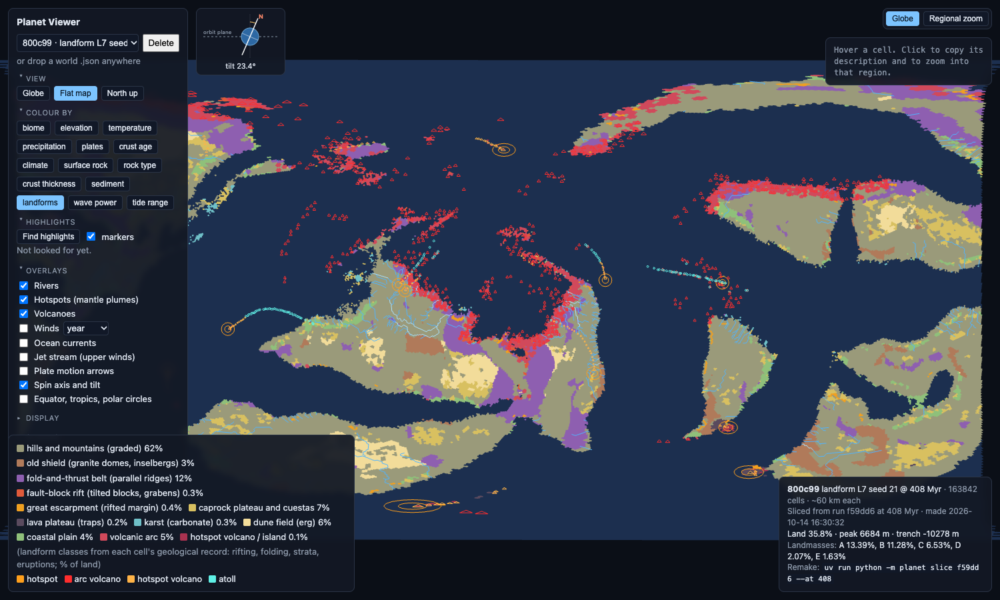
*World 800c99 (L7, 408 Myr), landform layer with the share of land per class: hills 62%, fold belts 12%, caprock 7%, dunes 6%, arcs 5%, coastal plain 4%, shield 3%.*

**Outputs:** layers `rock`, `surface_rock`, `sediment_cover`, `crust_thickness`, and the landform layers `landform`, `landform_age`, `strata_top`, `strata_top_km`, `strata_next`, `strata_dip`, `fold_wavelength`, `rift_strain`, `glaciated_myr`.

**Known limits:** carbonates rarely reach the surface (karst 0.3–0.4% of land; Earth ~10%; PW-130); caprock is recorded near-flat, so the zoom rarely makes cuestas (PW-147, PW-175); fold strike is guessed, not recorded (PW-165); rifted margins have no flank uplift, so few escarpments stand high (PW-135); the record flickers frame to frame as the grid resamples plates (PW-134); compaction isn't remembered after uplift (PW-049); the Earth world has no record, so no landforms (PW-132).

### 2.5 Surface erosion and sediment (`surface.py`, `tectonics/earth.py`)

**What it does:** wears the land down every 2 Myr step and puts the material somewhere.

- **Hillslope diffusion** smooths relief (soil creep).
- **Weathering** lowers land toward a base level (200 m on continents), faster on high ground.
- **Stream-power incision** cuts valleys at a rate ∝ √(water flow) × the drop to the next cell, where the flow is the runoff gathered from upstream. It uses Braun & Willett's implicit scheme, stable at 2 Myr steps. Its rain factor (below) is the larger of the cell's own and its catchment's mean rain, so a big river crossing a desert, or a polar-desert lake's outlet, still cuts (PW-055).
- Erosion is scaled by rain ((P/800 mm)^0.8, clipped 0.1–2.5), ×3 under temperate (wet-based) glaciers, ×0.3 under cold ice, and is up to 1.6× faster on bare wet ground than under the vegetation's ground cover (§2.18; before plants, or plant groups, appear, rivers are flashier).
- **Deposition** follows the drainage (§2.9): pits, lakes and floodplains keep a share (an open lake traps its rivers' load up to its whole room and spreads it over its floor, deepest most, as a closed one does: PW-055); deltas fill to +2 m and shelves to −60 m; the rest spreads over the deep sea floor (~1000 km) or is trapped in trenches, where half is scraped onto the overriding plate.
- **Chemical and biological deposits:** reefs (limestone, up to 200 m/Myr in warm shallow water), evaporites (closed lakes and pans above 10 °C, hot dry coasts), coal (warm wet vegetated lowlands). Desert winds sort loose cover into sand where rain is under 200 mm/yr.
- **Weathering draws down CO₂**, closing the loop with climate; roots and soil CO₂ speed it up by up to 1.75× in proportion to the vegetation's productivity (NPP, GEOCARB's biological weathering factor).

**Parameters:** `hillslope` 100 km²/Myr, `erosion_timescale` 400 Myr, `incision` 0.0064, `glacial_erosion` 3, `alluvial` 3000 km, `fan_km` 1000 km, `accretion` 0.5, `metamorphic_depth` 18 km.

**Known limits:** generated worlds have too few closed basins (~9–11% of land drains inland at L6 vs ~18% on Earth; PW-054): sediment fills a closed hollow within ~10–20 Myr (two thirds of the loss; rims wearing down the rest), and nothing makes basins subside (no flexural foreland or sag basins).

### 2.6 Climate (`climate.py`)

**What it does:** given terrain, ice, tilt and a global temperature offset, produces a steady-state climate per half-year (April–September, October–March), from which monthly values are rebuilt as sinusoids. It is a **diagnostic** model, a chain of physically motivated maps and relaxations, not a general circulation model. It runs every 4 Myr in a run and once (twice with erosion) per world, in about a second at L6.

| Piece | Rule (real-world analogue) |
|---|---|
| **Temperature** | An energy-balance curve by latitude with polar amplification (equator 27.8 + 0.5·dT, pole −10.4 + 1.5·dT °C); air cools 6.5 °C/km with height (the **lapse rate**); seasons scale with tilt. **Continentality** comes from carrying air temperature along the seasonal winds, so interiors swing and windward coasts stay mild. Big polar ice sheets are up to 10 °C colder than bare ground (albedo, cold air pooling). Summers are up to 1.5 °C cooler where the ground evaporates near its potential and hotter where it is dry (by the summer's actual / potential evaporation), and the vegetation's albedo nudges each half-year by up to ±2 °C (§2.18). |
| **Winds** | The three-cell pattern (**Hadley / Ferrel / polar**: trade winds, westerlies, polar easterlies), shifted with the season; **monsoons** from land–sea pressure contrasts; ground above 1.5 km turns the wind along its slope. |
| **Jet stream** | From the **thermal-wind** relation: fastest where the north–south temperature gradient is sharpest. Storm tracks follow it and drive frontal rain and waves. |
| **Rain** | Moisture evaporates from the sea (Clausius–Clapeyron: warm air holds more) and is carried by the winds. It rains out as **orographic** rain (wet windward slopes, **rain shadows** behind), as **convection** (the **ITCZ**, monsoon summers) and along storm tracks; land recycles part of its rain, more under leafy forest (§2.18). The global mean is renormalised to 1000 mm/yr × e^(0.03·dT), so absolute wetness is set by that, not by the physics. |
| **Water balance** | Potential evaporation from sunshine and temperature (**Oudin**); actual evaporation from the **Budyko** curve (Fu's form; its w from the vegetation); runoff = rain − actual evaporation (~40% of the rain on Earth's land). |
| **Humidity** | Dew point and relative humidity per half-year from the rain model's vapour; dry air keeps a background of vapour mixed in from around it, so Delhi's and the Sahara's January air holds ~30–45% (PW-151). |
| **Clouds and sunshine** | Four cloud kinds overlapping at random: deep cloud where it rains hard; layer cloud along the storm tracks; low sea cloud, more over cold water, with **stratocumulus decks** where sinking air meets cool upwelling water (California, Peru, Namibia); land cloud from humidity and fair-weather cumulus, cleared under the subtropical highs (deserts). **Sunshine** (h/day) = day length × the clear share, with showers costing less sunshine than layer cloud. Clouds are diagnostic: they don't feed back on temperature (decided, PW-163). |
| **Classification** | **Köppen** classes (Peel 2007 rules) from monthly temperature and rain. In worlds, **biomes** are a coarse grouping of the vegetation's named types (§2.18); the zoom still uses a Whittaker-style temperature–rain lookup per pixel. |
| **Months** | `climate.months` (PW-194) rebuilds the twelve months once for everyone who needs them: temperature (a sine between the coldest and warmest month), rain (a cosine through the two half-years, each half's sum exact), Oudin PET (the water balance's), light at the ground (top-of-atmosphere sunshine × Ångström–Prescott transmission from the cloud), snowpack and snowmelt (degree-days), and degree-days above 5 °C. Köppen reads its driest months and months above 10 °C from them (PW-200); the water balance uses the same PET but stays per half-year (its Budyko curve and soil carry-over are calibrated that way); the run's ice and the zoom's and time zoom's glacier snow keep their own sine year (the same temperatures; the time zoom adds orbital forcing per month). |

**Parameters:** per run `tilt` (23.4°), `climate_offset` (0 °C), `climate_drift` (3 °C over 40 Myr), `co2_sensitivity` (3 °C), `ice_albedo` (1.5 °C per 3% of the planet iced, levelling off toward `ice_albedo_max` = 3 °C), `ice_summer_temp` (1 °C), `climate_every` (4 Myr). The run's global temperature reaches a world as `dT` = global mean − 14.5 °C. Internal knobs (rain normalisation, seasonal swing, monsoon, upwelling, ~20 cloud parameters) are in `climate.TUNE`, not exposed on the CLI.

**Global temperature over a run** (`earth.py`) combines a slow random drift, CO₂ (sources: new sea floor and arcs; sink: weathering, faster when warm and wet) and ice-albedo.

**Outputs (worlds):** `temperature`, `precipitation` and their `_jul`/`_jan` versions, `climate` (Köppen), `biome`, `warm_month`, `cold_month`, `runoff`, `evaporation`, `pet`, `dewpoint_jul/jan`, `humidity_jul/jan`, `cloud_jul/jan`, `sunshine_jul/jan`, `wind_e/n` (annual, July, January) and `jet_e/n`. "July" is the warm half in the north and the cold half in the south. Runs store annual temperature, rain, climate, wind and jet per keyframe, and July / January temperature and rain (the half-year rain as a one-byte log scale, ~4% steps; PW-138).

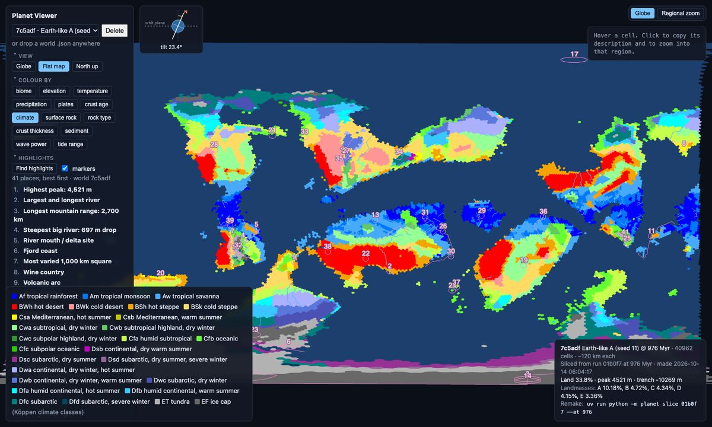
*World 7c5adf (Earth-like A, 976 Myr), Köppen classes.*

**Grid numerics (PW-211):** the icosphere's cells are up to ~9% larger or smaller along the seams of the icosahedron it is built from, and wide blurs run on a coarser level. Three things keep those out of the fields' gradients (the winds follow pressure gradients, and the rain follows the winds): wide blurs finish their last half coarse cell on the fine grid and interpolate back with a smooth bell (`climate.smooth`); the blur's neighbour weights are tilted so a straight slope stays straight and spread the same km² everywhere; gradients are least-squares fits with each edge's own length; and the rain's transport divides each cell's inflow by what a uniform wind would bring it (`inflow_weights`), so seams neither gather nor thin the vapour. The transport's shares use the wind at each edge's face (the mean of its two cells'), and the trades' east component is rounded off within 3° of where the two hemispheres' trades meet: before (PW-227), the row of cells where they met head-on got twice the convergence and a dip in wind speed, and a one-cell line of rain ran along the rain belt. Latitude-band means (`climate.zonal_mean`: the sea temperature's band-mean anomaly, the monsoon's warmth, the overturning's warmth) are interpolated between the bands' centres; as 3° steps they left east-west stripes in the sea temperatures that the sea's rain and clouds followed. Before this, rain maps had diagonal lattices and straight lines that the biomes and vegetation inherited.

**Known limits:** moisture transport between basins and across land (PW-013 epic, PW-014, PW-015); winter maritime air doesn't reach far enough inland (PW-026); East Antarctica ~10 °C too warm and bare polar lowland summers too warm (PW-039, PW-112); the jet is broad and zonal (PW-042); clouds: wet tropics too gloomy, winter trade-wind seas too cloudy (PW-162). No day-scale weather (PW-156).

### 2.7 Ocean: currents, SST, salinity, overturning (`climate.py`, `ocean.py`)

- **Wind-driven gyres:** a **Stommel** streamfunction per basin, solved by over-relaxation, gives closed gyres and fast **western boundary currents** (Gulf Stream, Kuroshio). Unbroken latitude bands get a **circumpolar current**.
- **Sea-surface temperature (SST)** is carried along the currents, with **coastal and equatorial upwelling** of cold water.
- **Overturning** (`ocean.py`, solved on the level-5 grid):
  - **Salinity** from evaporation minus rain, river mouths, sea-ice brine and meltwater.
  - **Density** from temperature and salinity.
  - Deep water **sinks** where the winter sea is densest, poleward of 50° (Stommel's flow law).
  - The replacement inflow follows the surface currents, like the **AMOC**'s North Atlantic Drift, and warms the coasts it passes (a milder Norway).
  - There is no deep ocean: the deep return flow the viewer draws is a **schematic** route: the cheapest way through deep sea to a circumpolar channel in the other hemisphere (else the equator), preferring western boundaries (up to 7× cheaper per step) and crossing sills and shelves only at a cost (3× below 1500 m, 10× below 400 m), so every site gets one.

**Outputs (worlds):** `sst`, `sst_jul`, `sst_jan` (°C), `salinity` (psu, annual), `sinking` (Sv per cell), `current_e/n` (annual); `meta.overturning` with the total, north and south strength in Sv, the sinking sites and the schematic paths. On Earth (world dc3732): 13.7 Sv, sinking in the Nordic (7.0 Sv) and Labrador (4.1) seas and the Ross (1.9) and Weddell (0.6) seas; none in the North Pacific. Generated worlds often show ~30 Sv (showcase a08983: 32.8 Sv).

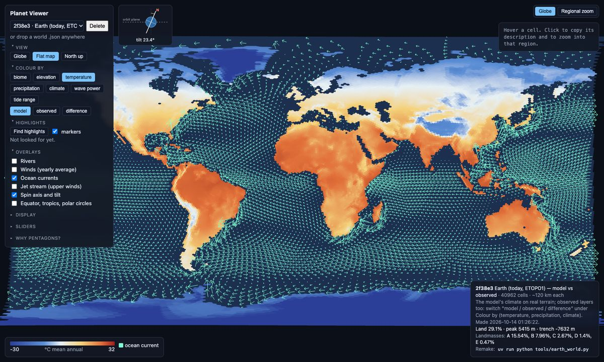
*The model's currents and sea temperature on real Earth terrain (an earlier Earth world). Gyres, the Gulf Stream, the Kuroshio and the Antarctic Circumpolar Current emerge.*

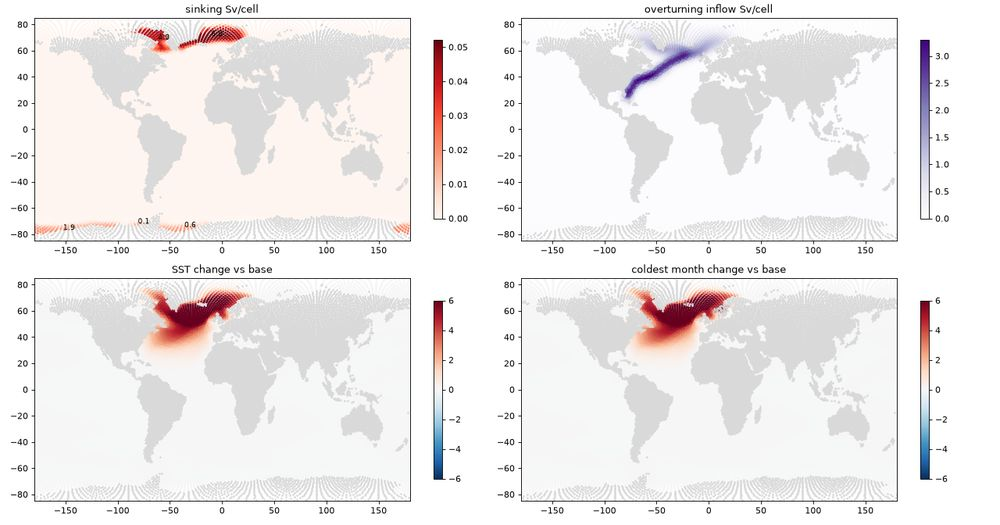
*Overturning on Earth (`docs/review/ocean/`). Top: sinking in the Nordic and Labrador seas and off Antarctica, the inflow riding the Gulf Stream. Bottom: the warming it adds.*

**Known limits:** a spin-up rule still decides the Atlantic-on / Pacific-off state (PW-016); Antarctic sinking too weak (PW-017); NE Canada and Labrador too warm (PW-038); the Gulf Stream separates too far north (PW-041); Mediterranean too fresh (PW-152); ocean layers aren't in run keyframes (PW-153).

### 2.8 Ice and sea level (`tectonics/earth.py`)

**Ice sheets in the main run** (PW-102 rule, `earth.ice_sheets`): the run's ice is the **average extent over the ice-age cycles**, in balance with the current mountains (real ice answers its climate in ~10 kyr, far inside a 4 Myr step).
- Ice holds where the summer on it stays below `ice_summer_temp` (1 °C) and snowfall beats the year's degree-day melt (~25 mm/yr suffices on a cold polar plateau, ~100 mm on a sheet's margin; a dry tropical plateau stays bare).
- Existing ice partly keeps itself (its own height and whiteness count three-quarters), so a cap outlives its climate a little but follows its range as it moves or wears down.
- Cold polar desert is covered by ice flowing in from a snowier part of the same cold region (PW-032).
- Thickness is a steady **Nye profile** from the edge: ~330 m at the margin, ~1.9 km 300 km in, at most 4 km; a little thinner for warm (soft) ice.
- The ice presses its bed down (glacial isostasy, §2.2, PW-189): the sheet's surface stands ~0.28 × its thickness lower and warmer, which weakens the ice-elevation feedback (worst sea level from ice on 4 L6 seeds × 1 Gyr: −115 to −289 m, in −5 to −10 °C eras). Its whiteness cools the planet (`ice_albedo`), levelling off toward 3 °C.

**Sea level** is the sum of:
- **the ocean basins:** young, shallow ocean floor displaces water and raises the sea. The basins' depth follows the sea floor over `ridge_time` = 30 Myr, compared with a slowly learning baseline, and levels off smoothly toward ±250 m (PW-053). The starting ocean has the ages of a steadily spreading one (mean 60 Myr), so the first breakup doesn't flood the planet;
- **land ice:** −0.9 × ice volume / ocean area;
- **mantle heat:** only when `heat_start` ≠ 1.

PW-053 brought the sea-level spread on L6 seeds from ~126–195 m down to ~89–130 m (sd) and removed the clamp hits.

**Known limits:** oceans age when plates are few (PW-051, PW-191). Land ice still lowers the sea by ~300 m in the coldest eras of some seeds (PW-190; those are −9 to −13 °C eras).

### 2.9 Hydrology: rivers, lakes, deltas (`hydrology.py`, `kernels.py`)

**Routing:** water drains by **priority-flood** (Barnes 2014): from the sea, cells are visited lowest first, every cell gets one downstream neighbour, and every pit fills to its spill level. **Flow accumulation** sums runoff downstream; `flow` × cell area gives discharge in m³/s.

**Lakes** are **fill-and-spill with evaporation**:
1. Hollows under 20 m deep are filled first (at ~55–110 km a cell's height is a mean, and channels too small to see drain them). A wide hollow must also fall at least 0.1 m per km from rim to middle, or it is a plain that rivers cross (`MIN_SLOPE`; 1 million km² needs ~56 m).
2. Water rises in all basins at once, merging as they meet; a basin grows only while its inflow beats the evaporation off its surface. A lake that spills next to a lower closed basin sends its river on into it; that basin then gets the river too and may fill and spill in turn (the Nile into the Nubian hollow, PW-122).
3. It ends as an **open, fresh lake** (reaches its spill point, the river flows on), a **closed salt lake** (stops first: Caspian, Great Salt Lake), or a **salt pan** (playa).
4. **Outlets cut down** (PW-055): a river leaving a basin runs in a valley cut below its cells' mean height, `CHANNEL_K` × Q^`CHANNEL_B` = 0.1 × (m³/s)^0.7 deep (~12 m for 1000 m³/s, ~60 m for 10,000, ~300 m for 100,000), never below the next cell downstream. The lakes are worked out again on that cut terrain (twice, as drained lake floors become river courses), so a lake a big river flows out of drains down to its outlet valley; closed basins have no outflowing river and keep their water. Earth's Amazon, Congo and Orinoco lowlands and West Siberia drain; the Great Lakes, Victoria and Ontario stay. Giant open lakes that lasted tens of Myr were mostly polar- or hot-desert basins whose outlets barely cut (the run's incision used the outlet's own rain) and lakes left by deep sea-level lowstands (−250 to −330 m, PW-190); with the catchment-rain incision and whole-lake sediment trapping (§2.5), open lakes over 1 million km² on L6 seeds 11/12/13 (600 Myr) fell from 15 frames to 3 and frames with one over 0.5 million km² from 46 to 22, lakes cover 0.51% of land instead of 0.57%, and land draining inland fell from ~15.5% to ~13.6% (PW-054's shortfall grows a little). On generated worlds (L6, seeds 11 and 12, after 100 Myr) lakes cover 0.7–1.0% of land instead of 1.4%, the biggest lake averages 0.4–0.7 million km² instead of ~1, and since big through-flowing lakes no longer trap sediment, hollows survive: land draining inland doubled (4–5% to 8.5–10.6%).

On Earth's terrain this closes the Caspian, Aral, Tarim, Eyre, Makgadikgadi and Altiplano basins, and ~18% of land drains inland (Earth ~18%). The Earth world's lakes went from 6.1 to 2.4 million km² (PW-201; left over: cell-mean hollows on small rivers in Yakutia and on the Amur).

**Seasonal flow** (PW-028, worlds): each cell's runoff is spread over the months by what reaches its ground (rain, and snowmelt: a cold country's winter of snow comes off in a spring flood), half of it through the ground (spread over the unfrozen months; 5% where the ground is frozen six months or more), then gathered down the rivers; a lake flattens the flood at its outlet in proportion to its size for its catchment. Stored as `flood_ratio` (the peak month's flow over the mean month's: ~1.3–1.7 for the Amazon, Congo, Mississippi; 3–4 for the Ob, Mackenzie, Yukon, Volga, Ganges), `flood_month` and `river_frozen` (months a year the cell's rivers are frozen). Floodplains are sized by the flood, not the mean flow (`vegetation.floodplain`: the mean × ratio / 2, so a typical river is unchanged; in the zoom the flood also reaches higher above the river, stage ~ Q^0.4): on an L6 world, cells with a ratio above 4 are 22.6% flooded instead of 18.9%, steady rivers (< 1.5) 12.9% instead of 14.7%. The viewer has a "river floods" layer and names a river's discharge, peak month, ratio and frozen months on hover. Deltas don't use it: a flood pulse on the river's term in Galloway's triangle (sediment ~Q^1.5, so ×√(ratio/2)) turned the Ganges–Brahmaputra from tide- to river-dominated on Earth and moved nothing else much, so it was left out (BQART's loads already include each river's floods).

**Deltas:** big river mouths (≥ 1500 m³/s) get a delta type from Galloway's triangle (§2.10), drawn by the zoom.

**Outputs:** `flow`, `downstream`, `lake`, `lake_level` (lake surface; `lake_level − elevation` is depth), `lake_kind` (0 none, 1 fresh, 2 salt, 3 pan), `flood_ratio`, `flood_month`, `river_frozen` (worlds). Runs store `lake_depth` instead of `lake_level`.

**Known limits:** run and world lakes still disagree. Finishing now keeps most of the keyframe's lakes (Jaccard overlap of lake cells with those of the keyframe under the same climate, L6, five runs: 0.31–0.89 since PW-057, 0.05–0.77 before; land draining inland now matches the keyframe's), but a run frame stores the lakes of the terrain before that step's erosion and sediment (which fills hollows to within 5 m of their spill level), and run lakes turn over within a frame or two, so a world agrees with the run frame's own lake layer on few cells (Jaccard ~0.0–0.1; see the draft on run-frame lakes). Generated worlds have too few closed basins (PW-054, §2.5).

### 2.10 Coasts: waves, tides, delta types (`coast.py`)

- **Wave power** (kW per m of coast): rays go out in 24 directions from each sea cell (each cell's fan turned by its own fraction of a step, so islands' shadows don't line up into streaks), up to 6000 km or the first land or sea ice. Walking back in, the sea grows under the wind along each stretch with **fetch** and storm duration (**JONSWAP**), up to a fully developed **Pierson–Moskowitz** sea, then travels on as slowly decaying **swell** that loses energy over shelves. Wind blowing off land is slowed and recovers over ~1200 km of sea, so enclosed seas (Mediterranean, Baltic, Black Sea) stay fetch- and wind-limited.
- **Tide range** (m) is a three-factor proxy: connection to the open ocean (shallow straits choke it; only deep basins at least 6000 km across raise the full tide, while smaller deep basins behind sills, such as the Arctic Ocean, raise a small one of their own), **shelf resonance** (strongest at about a quarter tidal wavelength), and **funnelling** into narrowing bays.
- **Delta type** (Galloway's triangle) compares three fluxes at big mouths: the river's sediment (**BQART**), wave-driven longshore transport (**CERC**) and the **tidal prism**. Their shares are the river, wave and tide weights; a weight ≥ 0.5 names the type, else "mixed".

`tools/coast_check.py` on today's Earth (L6, 2026-10-15): waves within 2× at 28 of 32 coasts, tides within 2× at 24 of 25 (Arctic coasts in range).

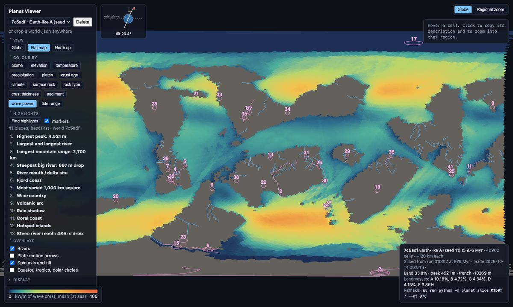
*Wave power on 7c5adf: the westerly storm belts and their swell, with calm water in their lee.*

**Known limits:** Southern Hemisphere westerly coasts too weak and the North Atlantic too strong (PW-074, PW-075); Fundy too small, no amphidromic points (PW-076); no SW-monsoon swell on India's west coast (the climate's July wind there is weak); no spits, mangroves, cliffs vs beaches yet (PW-077, PW-097).

### 2.11 Worlds: slicing and finishing (`timeline.py`, `world.py`)

A **world** is one moment, finished. Four ways to get one:
- **`planet slice <run> --at T`** (or `--at auto`: the keyframe after 300 Myr whose land %, largest landmass and landmass count are jointly nearest the run's medians). It replays the simulation from the nearest checkpoint, checks the result against the stored keyframe and refuses to save on a mismatch (the code changed since the run) unless `--force`.
- **The viewer's Zoom button** builds the world straight from the keyframe nearest that time (`timeline.world_from_frame`, seconds, exactly what the viewer shows), reusing a world already made at that time.
- **`planet finish <timezoom> --kyr N`** (PW-091, `finish.py`; the viewer's "Finish world here" on a time zoom frame): a world at any stored frame (every 2 kyr) of a glacial time zoom. Geology (plates, crust, rock, landforms, volcanoes) is the source keyframe's; bed, ice, sea level and global temperature are the frame's, the obliquity is the tilt; then the usual finishing below, so lakes form against the ice and on the pressed-down bed, and lowered seas join land. Grounded ice on a bed below sea level (pressed down by its load, or a marine sheet) is kept as land with its bed floored at 1 m and the ice thinned to keep the surface (`isostasy.land_view`, as for Antarctica in `earth_data`; all worlds, also those sliced from a run, since run keyframes store the pressed-down bed; meta `ice_bed_floored_cells`). Meta: `source_run`, `t_myr`, `timezoom`, `timezoom_kyr`, the frame's sea-level change and orbit. **Storage choice:** no re-run; each time-zoom frame already stores the surface and the grounded ice (to 1 m since PW-091), so bed = surface − ice. `planet finish <run> --at T` (or "Finish world here" on a run) is the keyframe world, as the Zoom button. An Earth time zoom finishes like `tools/earth_world.py` (real terrain, no rock record, so no regional zooms).
- **`planet generate`** makes an unsimulated world from cartoon plates (no texture, ice, record or landforms; it can't be zoomed). **`tools/earth_world.py`** runs real Earth terrain through the same finishing, with observed climate alongside.

**Finishing** (run-based worlds first get sub-cell texture, `timeline.texture`: ±180 m of noise plus ridges on high ground, scaled by the ground's slope, so steep country (≥ 1.25 m/km between cells) gets all of it and plains and plateaus 15%: PW-057):
1. climate, then 12 erosion passes (`hydrology.erode`, strength 0.3 for slice and Zoom worlds, 1.0 for generate: stream-power cutting with rivers routed as in the run, through open lakes and ending in closed ones, and a creep that only lowers ground, toward its lower neighbours, so it doesn't fill hollows), then climate again;
2. rivers and lakes;
3. vegetation (§2.18; biomes grouped from its named types);
4. waves and tides;
5. July / January temperature and rain (`world.seasons`);
6. the sea (SST, salinity, sinking; the overturning in the meta), humidity, clouds and sunshine.

**Outputs:** `worlds/<id>.json` (all layers inline; 5 MB at L6, 30–45 MB at L7) plus a readable `.txt` summary with ASCII maps. A tectonic world has ~99 layers (§2.16; 32 of them vegetation, 3 the satellite view); its meta records the source run and time, global temperature, sea level, hotspots, volcanoes, the overturning and the code version.

### 2.12 Highlights (`highlights.py`)

**What it does:** 35 detectors find 45 kinds of place worth a visit, in six categories (the viewer filters and colours by category):

| Category | Kinds |
|---|---|
| landscape | highest peak (and highest ice-free peak), mountain range, plateau, canyon, fjords, rain shadow, most varied 1000 km square, continent, island, archipelago |
| water | largest and longest river, delta (with its type), waterfall (a steep reach at cell scale), lake, inland sea, salt lake, salt pan, salt flats, inland basin, coral coast |
| climate | desert, rainforest (the evergreen tropical forest types), ice sheet, Mediterranean "wine country" (Köppen Cs, with its vegetation), hottest, coldest, wettest, driest |
| travel | beach destination, ski country, winter-sun retreat (mild winter, ≥ 5 h of sunshine a day), year-round resort (beach and skiing within 400 km) |
| geology | volcanic arc, hotspot island chain (from the volcano table: islands, atolls and guyots in a row), atoll group, rift, deepest trench, fastest plate (at its leading edge: collision or subduction) |
| vegetation | great forests (largest closed forests of different kinds), great savanna, wetlands, maquis coast, treeline (alpine and polar) |

Each scores as kind priority × quality (0.3–1). Travel picks use each hemisphere's own summer and winter and say why: "July 28 °C, 10 h of sunshine a day, 38 mm of rain, warm sea 25 °C, gentle surf". Results are cached in `worlds/highlights/<id>.json`; `--zoom N` pre-makes zooms of the top N at a suggested size.

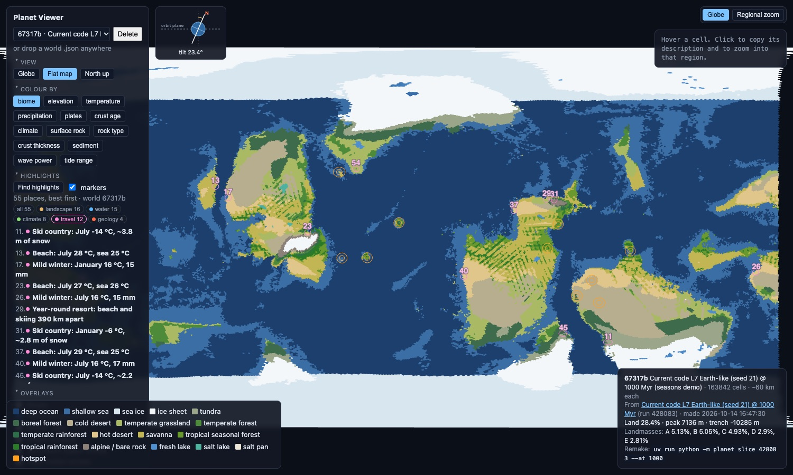
*World 67317b, highlights filtered to the travel category.*

The most varied square counts named vegetation types (biomes on worlds without vegetation). A world's highlights take ~1.5 s at L6 and ~4 s at L7.

**Known limits:** canyons are weak at cell scale (PW-079).

### 2.13 Regional zoom (`zoom.py`, `zoom_landforms.py`, `zoom_volcanoes.py`, `zoom_terrain.py`, `zoom_vegetation.py`, `zoom_kernels.py`)

**What it does:** turns coarse cells into a 500×500 px landscape. The CLI default is 1000 km at 2 km/px; the viewer offers 250, 500, 1000 and 2000 km (0.5–4 km/px). Every coarse cell's mean height is kept, and all noise is sampled at 3D planet positions, so overlapping zooms of one world agree. A zoom needs a world with rock and climate layers (sliced from a run). It takes ~10–15 s at L7 (about 4–5 s of it the vegetation).

**The passes, in order:**
1. **Interpolate** the coarse fields onto pixels (height, temperature, rain, runoff, ice, ruggedness).
2. **Delta plains** at mouths ≥ 1500 m³/s, shaped continuously by the Galloway weights: *river* → levee-bound fingers (a bird's foot); *wave* → a smooth arc with barrier, lagoon and beach ridges; *tide* → funnel estuaries, creeks and flats. Distributaries split the flow below the apex.
3. **Coastline** from warped noise, with barriers, lagoons and coastal-plain barrier islands.
4. **Relief noise** scaled by rock ruggedness (cratons smooth, orogens rough), then corrected back to each cell's mean.
5. **Volcanoes** (`zoom_volcanoes.py`): each volcano in the world's table is its own edifice: a Gaussian shield with rift-zone lobes (and a caldera while active) for hotspots, a steep concave stratocone for arcs. Older ones stand at the run's summit height and get radial valleys; planed ones are flat-topped guyots; a living reef makes a fringing or barrier reef, or an atoll ring with islets round a lagoon.
6. **Landform targets** for each class (below).
7. **Rivers:** coarse rivers become valleys, rivers entering at the edge bring their discharge, and **knickpoint waterfalls** are designed where the coarse river drops steeply (≥ 50 m of extra drop, ≥ 100 m³/s): a resistant lip, a plunge pool and a gorge retreated upstream. The lip's rock comes from the strata: a thick top stratum holds it, a thin one needs harder rock under it, and soft rock beneath lets the gorge retreat faster (Niagara).
8. **Glaciers, first outline; coarse lakes** take the world's level and kind.
9. **Landscape pass:** 15 iterations of steady-state stream power that **grade** rivers into smooth concave profiles. Streams carry the world's **runoff** (PW-180), so a hyper-arid zoom has no river it doesn't get from outside; the landscape's shape follows rain-weighted drainage area, since desert wadis are cut by rare floods.
10. **Glaciers** (PW-127) from each pixel's own climate by the main run's ice rule, lapse-corrected to the pixel's height; the surplus is routed down the valleys as tongues (~0.8 km wide at 0.1 km³/yr, at most 3 km³/yr and 100 km long) that melt on the way down. A coarse ice sheet stays one sheet with outlet tongues.
11. **Creep**, then the **landform remap** (relief, shape, strata), sill cuts, gorges below landform falls.
12. **Closed basins by water balance** (PW-167): runoff in against open-water evaporation, upstream first; a full lake spills into the next, else a closed lake or a dry flat.
13. **Falls listed**, landform overlays (dunes, dolines, towers, springs), climate on the fine terrain (the bare ground's, lapse-corrected; the ice surface's on the zoom's own glaciers, PW-160), July / January temperature and rain (PW-139), a coastal plain's marshes.
14. **Terrain indices** (`zoom_terrain.py`, PW-196) on the finished surface: a **radiation index** per month (the day's sun on the slope's plane over flat ground's at the pixel's latitude: a 30° poleward slope at 45° gets ~0.3 of flat in winter, ~0.8 in summer), the **topographic wetness index** ln(a / tan β) from `drainage_area`, and the distances to the nearest river (≥ 1 m³/s) and the sea.
15. **Vegetation** (`zoom_vegetation.py`, PW-214; proposal §3.7): the world's model (§2.18) run per pixel on the zoom's own terrain, warm-started from the world's cover fractions (so history keeps forest or savanna). The pixel adds: its lapse-corrected temperature (treelines, alpine belts); its slope's light and potential evaporation by month, and ±2.5 °C for sunny or shaded slopes (an equatorward slope's treeline sits ~100–200 m higher); thinner soil on steep slopes and groundwater in hollows (TWI); a river's water in a strip along its banks (0.15 km wide at 1 m³/s, +0.4 km per tenfold), a habitat of its own inside the pixel: the competition runs on the dry ground and in the strip, and the pixel's cover mixes them by the strip's share (PW-221), so gallery forest runs through savanna and an oasis woodland along a desert river is named even at 4 km/px where it is the pixel's only woodland; the world's flooded share given to each cell's wettest pixels (high TWI, big rivers' floodplains, patchy noise for mires) plus lake shores and coastal marshes. After the competition, each type's mean over a cell's pixels is pulled 60% of the way back to the world's by a smooth field (not where the pixel stands > 800 m off the coarse surface), and a **fire mosaic** draws each pixel's stand age from the exponential distribution of its fire interval with planet-fixed noise (~25 km patches; young stands fewer trees, more herbs and birch, lower canopy; the mean kept). `biome` becomes the named types' grouping, as on the globe.

**Landform synthesis** (PW-010/011/012): each class has hooks (`target`, `relief`, `shape`, `strata`, `basins`, `lakes`, `overlay`, `sinks`), blended by smooth class weights so there are no cell seams. Bench levels come from the class's whole connected zone on the coarse grid (PW-148), and structure strikes from planet-fixed patches, so overlapping zooms agree.

| Class | What the zoom draws |
|---|---|
| great escarpment | a lowland, one crenulated scarp ~0.8 × the zone's height (200–1500 m), the plateau above; rivers take their main fall at the scarp |
| caprock | stepped benches and cliffs of hard beds over soft, mesas and buttes; cuestas where the beds dip |
| lava plateau | flat top over stair-stepped, deep valley sides (Deccan traps) |
| fold-and-thrust belt | parallel folds a fold wavelength apart: whaleback anticlines when young (Zagros), hogbacks of the hard beds closing round plunging noses when old (Valley and Ridge); trellised drainage, water gaps |
| fault-block rift | tilted blocks ~10–30 km wide: a steep fault scarp, a gentle back-tilt, a sediment-filled half-graben, lakes where the water balance fills them; throw from the stretching and age |
| shield | a flattened plain with granite domes and inselbergs; recently glaciated shields have ground-down domes and rock-basin lakes |
| karst | small streams sink underground and resurge at springs; temperate: dolines and poljes on a plateau; wet tropics: towers 60–250 m high (Guilin) |
| dune field | dunes by the seasons' sand drift (Fryberger): transverse and barchan dunes with one wind, linear with two crossing winds, star dunes where winds reverse; 1–3 km apart |
| coastal plain | a smoothed plain sloping to the sea, low inland-facing cuestas, barrier islands with lagoons on wave-dominated coasts, marshes |

**Falls:** `stats.falls` in `zoom.json` lists every fall ≥ 30 m on a stream ≥ 20 m³/s (kind `lip`, `scarp`, `bench`, `lake outlet` or `drop`, with gorge, cascades and plunge pool); `stats.waterfalls` keeps the 5 biggest by power. The viewer draws them as the Waterfalls overlay.

**Outputs:** `zooms/<id>/zoom.json` (metadata, stats, legend, projection), `heightmap.png` (16-bit), `preview.png` (the satellite view in each hemisphere's summer, hill-shaded, with rivers), `satellite.png` / `satellite_jul.png` / `satellite_jan.png` (unshaded true colour, §2.19), `coarse.png`, and layers `elevation`, `water` (land/sea/lake), `lake_depth`, `discharge`, `drainage_area`, `precipitation`, `temperature`, `temperature_jul`/`_jan`, `precipitation_jul`/`_jan`, `ice`, `tide_range`, `wave_power`, `rock`, `surface_rock`, `climate`, `biome`, `landform`, `wetland` (1 a coastal plain's marsh, 2 the vegetation's wetlands), `vegetation` (named type), `tree_cover`, `plant_cover`, `lai`, `canopy_height`, `npp`, `fire_return` (decision 9A: the summary layers; `zoom_vegetation.fractions(<zoom>)` recomputes each PFT's cover in ~5 s, the same numbers), `radiation_index`, `twi`, `river_dist`, `coast_dist`, `cloud_jul`/`_jan` (the world's cloud cover, interpolated: the satellite view's clouds). Layers with an encoding in `zoom.LAYER_DOC` are stored as small integers with a scale (read them with `zoom.load(id, decode=True)`). Stats include land and elevation checks against the coarse cells, rivers, lakes, deltas, falls, volcanoes, the landform shares, basins and overlays, and the vegetation's shares by type.

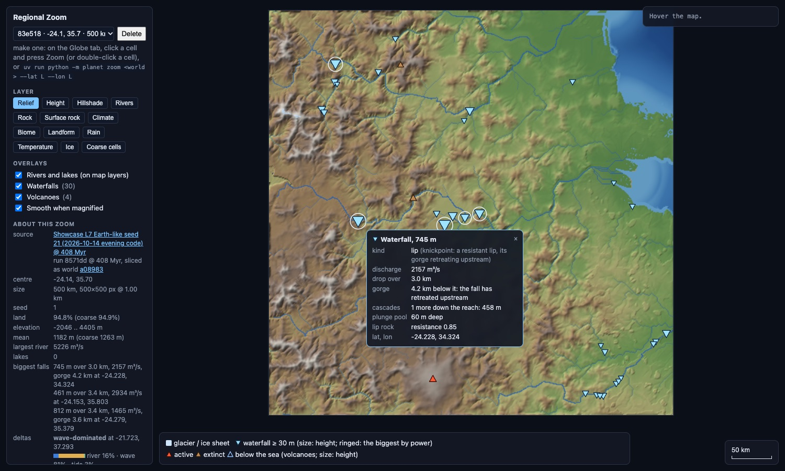
*Zoom 83e518 (500 km at 1 km, showcase world a08983): Waterfalls and Volcanoes overlays; the card shows a 745 m lip fall with a 4.2 km gorge.*

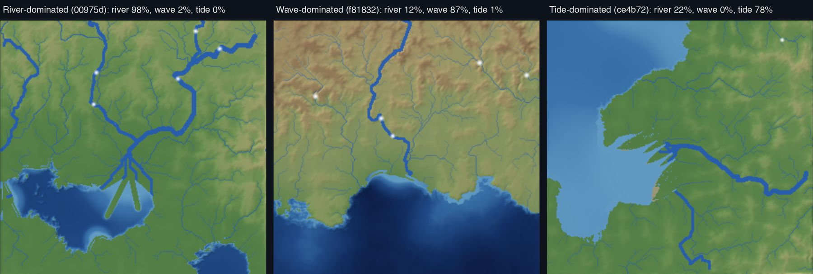
*Delta types in three 600 km zooms of world 0f7abd: a bird's foot into a calm sea; a smooth wave-built coast; tidal funnels with 6.6 m tides.*

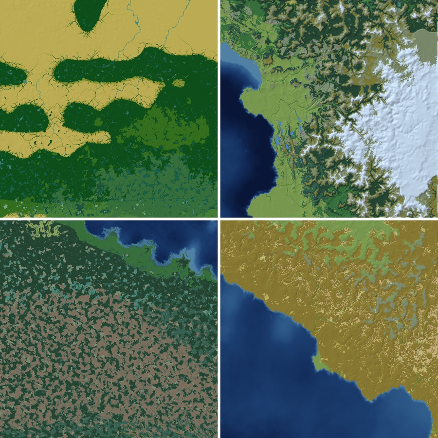
*Per-pixel vegetation (PW-214) in four zooms of world 351f32 (L7, run 732abb @ 1000 Myr): a rainforest–savanna edge with gallery forest along the rivers (64f0b6, 1000 km); a mountain treeline under an ice cap, higher on sunny slopes (3a5252, 500 km; at 1800–2000 m equatorward slopes hold 38% trees, poleward 20%; below 1400 m, where water limits, poleward slopes hold more); boreal taiga with palsa mires and swamp forest (3373be, 1000 km); a Mediterranean coast of maquis with woodland on the hills and along the streams (58c0ac, 500 km).*

More zoom images, one per landform class: `docs/review/landforms/` and `docs/review/zoom/`.

**Known limits:** deltas small and misplaced (PW-061); arcs are still blocky islands with few cones (PW-116); continental hotspots drawn as shields, not calderas (PW-118); no zoom below ~0.5 km/px or nested zooms (PW-071, PW-129); no 3D zoom view (PW-072); no microclimate (PW-101); some perched rivers, high lake-outlet ramps and undesigned drops (PW-123, PW-124, PW-125); snowline under coarse ice ~2–3 °C off (PW-159); dune seams (PW-177); no mangroves or salt marsh yet (PW-188); the zoom's forest–savanna edges follow the coarse rain's blobs and streaks (PW-211, PW-019), sharper than the world's but no more extensive; no meanders, terraces or fans yet (PW-094); the zoom sees only part of a big lake's catchment (PW-060).

### 2.14 Glacial time zoom (`timezoom.py`, `timezoom_kernels.py`)

**What it does:** a separate simulation. Geology is frozen at one moment of a run (or today's Earth), and ice sheets evolve for 1 Myr (CLI default; the viewer offers 100, 300 or 1000 kyr, default 300) in 500-year steps, keeping a frame every 2 kyr. It never feeds back into the run, but any frame can be made into a finished world (§2.11, `planet finish`).

- **Orbit (Milankovitch):** obliquity ±1.2° around the planet's tilt (41 kyr), precession (23 kyr) and eccentricity (100 and 405 kyr) set each latitude's monthly sunshine (Berger 1978), turned into a temperature anomaly.
- **Ice:** monthly snow minus **positive-degree-day** melt; bright perennial snow feels less of a summer, bare ice more. Flow by the **shallow-ice approximation**.
- **Bed and sea:** glacial isostasy (PW-189) as an ELRA model: the bed relaxes with a 3 kyr e-folding time (`iso_tau`) toward the run's settled dip, 0.28 × the ice thickness spread by flexure over ~150 km (`iso_ratio`, `flex_km`; `isostasy.ice_load`), and rebounds after the ice is gone; the start is settled (a run's keyframe bed is already pressed down by its ice); floating ice breaks off and marine fronts calve, as does grounded ice in water deeper than 1.5 km (`calve_depth`, PW-199); sea level falls by the sea water the ice holds / ocean area: 0.89 × the ice above flotation plus the room the sunken bed made below sea level (Goelzer et al. 2020; PW-031: ice filling a deep marine basin no longer counts in full), so coastlines and land bridges move.
- **Climate:** fully recomputed every 10 kyr, blended and shifted in between; CO₂ drops as ice grows (~−2.5 °C at an Earth-glacial-sized ice volume) plus a small ice-albedo term; meltwater reaches the overturning. `start` (PW-031): Earth starts in an interglacial with the full caps (−2.5 and −2 °C); a run's moment is the cycle average (its ice is the mean extent, its dT already has that ice's albedo), so only `average_room` = half of each cap is left.

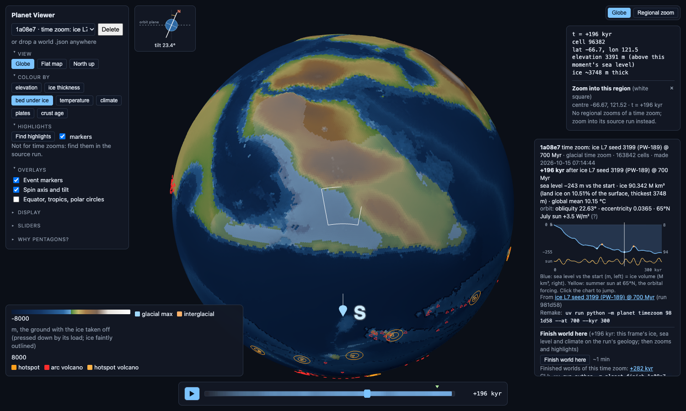
*Time zoom 1a08e7 (L7 run 981d58, seed 3199 @ 700 Myr) at its 196 kyr glacial maximum, "bed under ice" layer: under ~3.7 km of ice the bed is pressed ~1 km down, much of it below sea level (blue), as in Antarctica.*

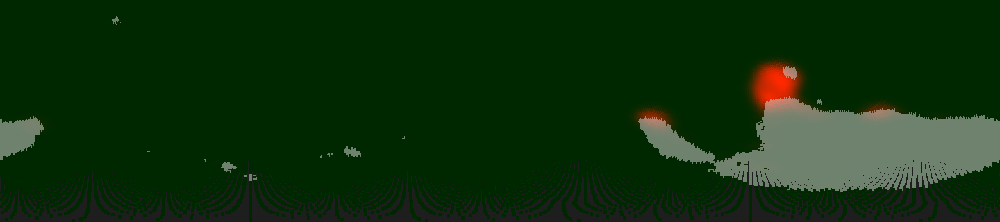
*The same time zoom, bed uplift from the glacial maximum (196 kyr) to the next interglacial (222 kyr), southern hemisphere, equirectangular: red = rising, up to 2.4 cm/yr, 0.9 cm/yr on average where the ice left (Hudson Bay today: ~1 cm/yr); grey = still under ice.*

**Parameters:** `--set` any `TZParams` field: `insol_k` (0.25 °C per W/m²), `obliquity_amp`, `co2_cool`, `ddf_snow/ice`, `iso_ratio`, `calving`, `phases=zero`; `baseline=obs` for Earth.

**Outputs:** a run (`kind: timezoom`, time in kyr) with layers `elevation`, `ice`, `temperature`, `climate`; frame stats (sea level, ice %, overturning, orbit); events (glacial maxima, interglacials). The viewer shows ice thickness and a sea-level / ice-volume curve with the 65°N summer sun.

**Known limits:** generated worlds glaciate hard: the run's ice (the climate rule of §2.8, no flow) has no ablation zone, so the time zoom's flowing sheets spread well beyond it (on 4 L6 seeds, a 150 kyr time zoom from a run's coldest moment falls a further 140–360 m, its ice growing from 5–11% of the surface to 11–18%). Making the run's rule flow-consistent with the time zoom's mass balance was tried and makes the run itself far icier (cold eras -330 to -630 m), because the time zoom's bright-snow margins accumulate on land with ~9 °C bare-ground summers; which of the two to change is open (inbox draft on run-ice consistency, PW-190); Earth glaciates too weakly (PW-033); no real 100-kyr sawtooth (PW-030); no salinity memory, so no abrupt events (PW-018); the start-anchor cooling lingers (PW-035); one-cell ablation zones (PW-115); no glacial imprint kept yet (PW-037, PW-092); embedded ice ages in the main run are planned (PW-104).

### 2.15 Viewer, server and CLI (`viewer/`, `server.py`, `api.py`, `__main__.py`)

**CLI** (`uv run python -m planet <cmd>`): `simulate`, `slice`, `generate`, `zoom`, `timezoom`, `finish` (a world at a time zoom's kyr, or a run's time), `highlights`, `satellite` (add or redo the satellite view of a saved world or zoom, in place; §2.19), `report` (re-render run.txt), `list`, `delete` (by id; `--orphans` clears zooms and caches of deleted worlds and unfinished runs), `show` (ASCII map of a world file), `serve`.

**Server** (`planet serve`, port 8765): serves the viewer and the data folders, handles `DELETE` of runs, worlds and zooms, and adds `POST /api/zoom`, `POST /api/timezoom`, `POST /api/finish` (`{timezoom, kyr}` or `{run, t}` → a job whose result is `world`), `GET /api/jobs/<id>` and `GET /api/highlights`. Zoom, time-zoom and finish jobs run one at a time, and one computation runs at a time (`api.COMPUTE`: numba's parallel kernels abort the process if two threads launch them at once), so a highlights request that must compute waits for a running job. Job state is saved in `.jobs/<port>.json`: after a restart finished jobs still answer and cut-off ones run again (once); the viewer keeps polling through a restart.

**Globe** (`viewer/index.html`, three.js): one triangle fan per cell, with exaggerated relief, on a globe or a flat map.
- **Runs** play as animations with an event list, plate arrows, and a time slider tinted blue in cold eras (where a time zoom will show ice ages). Layers: elevation, plates, crust age, surface rock, rock type, crust thickness, sediment, rainfall and temperature (year / July / January; a season's layer downloads when it is picked), climate, landforms, vegetation, tree cover, NPP, and **bed under ice** (the ground with the ice taken off, pressed down by its load, PW-189; time zooms have it too). A run's elevation under grounded ice is shown floored at 1 m, so it reads as land; the hover card gives the ice and its bed. With a vegetation layer on, green ticks and labels above the slider mark when each plant group appeared.
- **Worlds** add **satellite** (true colour, §2.19; with the season picker and a **Clouds** overlay), biome, precipitation, vegetation (named types, legend grouped), tree cover, plant cover, canopy height, leaf area (year / July / January), NPP, biomass, fire return, stand age, plant type (a picker for any one PFT's cover, `?layer=plant%20type&pft=BoNS`), wave power, tide range, sea temperature, salinity, humidity, dew point, cloud and sunshine. The hover card names the vegetation, its main plant types, canopy, tree cover, NPP, fire return and stand age. Temperature, rain, SST, humidity, cloud and sunshine have a year / July / January picker (`?season=jul`). On the flat map the satellite layer is hill-shaded from the relief (the globe has its light).
- **Overlays:** rivers, plate outlines, pentagons, plate arrows, events, hotspots, volcanoes, winds (year / July / January), ocean currents as streamlines (brighter = faster), the overturning (sinking sites, surface inflow, schematic deep return), jet stream, spin axis, tropics and polar circles.
- **Lakes** are drawn on the elevation and biome layers: fresh lakes cyan, salt lakes pink, salt pans white, darker where deep. The hover card names the lake on any layer (for runs its depth needs the elevation layer), to 0.1 m below 10 m.
- **Earth world:** temperature, precipitation, climate and sunshine have a model / observed / difference switch (`?obs=diff`).
- **Highlights** panel with category filters (`?hlcat=`, `&hl=N`).
- **Provenance** (PW-128): a world shows the run and time it came from, linked, and its zooms; a run lists what was made from it and ticks their times above the slider.
- **Pipeline** (PW-193): on a run frame, "Glacial time zoom from here" and "Finish world here"; on a time zoom frame, "Finish world here" (job progress in the panel, then the world opens). A finished world shows run @ Myr → time zoom + kyr (both linked); the run's tree nests finished worlds under their time zoom, and a time zoom's slider ticks them in green.
- `?view=lat,lon` turns the globe there at once without picking a cell (for screenshots).
- Clicking a cell copies a description (for pointing at a place); double-click or "Zoom" makes a regional zoom. The URL holds the state, e.g. `?world=a08983.json&layer=biome&mode=map`.

**Zoom viewer** (`viewer/zoom.html`, also the "Regional zoom" tab): a 2D canvas with layers **satellite** (true colour by season, §2.19, hill-shaded, with a **Clouds** overlay, `?clouds=1`; the default), **relief** (hypsometric map: height tinted green to tan by the year's rain, sea by depth, hill-shaded, with marshes, lakes, tidal flats and glaciers; `zoom.tint`'s ramps, as `coarse.png`), height, hillshade, rivers, rock, surface rock, climate, biome, landform, vegetation (legend by share of the land), tree cover, canopy height, NPP, fire return, leaf area, rain and temperature (year / July / January picker, `?season=`), ice, sun on slopes, wetness index and coarse cells (`?rivers=0`, `?falls=0`, `?volc=0` turn overlays off); the hover shows the pixel's vegetation, seasons and terrain indices; glaciers tinted on the relief layers. Overlays: rivers and lakes, **Waterfalls** (▼ sized by height, biggest ringed) and **Volcanoes** (▲ active, extinct, or hollow below the sea), each with a hover card; `?mark=fall:0` opens one.

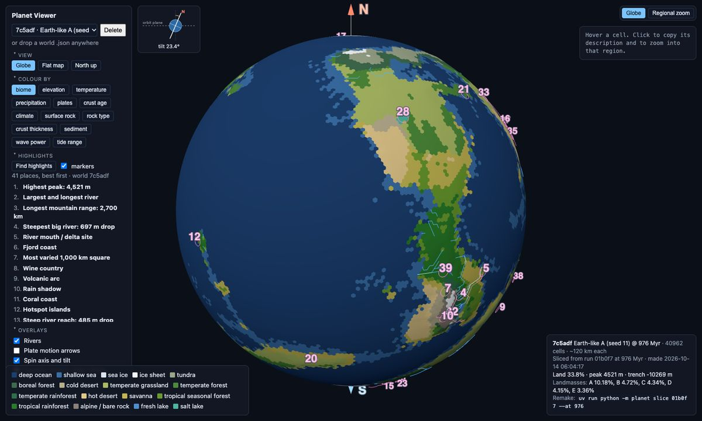
*The viewer on world 7c5adf: biomes, with highlights numbered (an earlier version of the panel, before categories).*

**Known limits:** run keyframes keep only the annual-mean winds, so the winds' season picker works only on worlds (PW-107).

### 2.16 Store and data model (`store.py`, `timeline.py`, `provenance.py`)

Outputs go under the data root (the repository, or `$PLANET_DATA`). All are generated, git-ignored and reproducible.

| Path | Contents |
|---|---|
| `runs/<id>/run.json` | settings, per-keyframe stats, plate velocities, the event log, layer specs, code version (git commit, dirty flag, hash of `planet/**/*.py`) |
| `runs/<id>/layers/<name>.bin` | one file per layer, all keyframes (raw little-endian, frames × cells, small integers with scale/offset). The viewer fetches only what it draws. 35 layers per keyframe. |
| `runs/<id>/state/<t>.ckpt` | full simulation state (with the geological record) every 100 Myr, where `slice` starts replaying |
| `runs/<id>/volcanoes.json.gz` | every volcano ever |
| `runs/<id>/run.txt` | readable report: events, stats over time, ASCII maps, plate table |
| `worlds/<id>.json` / `.txt` | a world, layers inline; names its grid file (`../grids/L7.json`) |
| `worlds/highlights/<id>.json` | highlight cache |
| `zooms/<id>/` | `zoom.json`, `layers/*.bin`, PNGs |
| `grids/L<n>.json` | grid geometry shared by all items at that level |
| `worlds/index.json`, ... | indexes the viewer reads (with `source_run`, `t_myr` for provenance) |

**Layer vocabulary** (`store.LAYERS`, shared by runs and worlds): elevation, plate, crust, crust age and thickness, plate boundary, rock, surface rock, sediment cover, temperature, precipitation, climate, ice, flow, downstream, lakes, winds, currents, jet, the seasonal, sea and air layers of §2.6–2.10, the nine landform layers of §2.4, and the vegetation layers of §2.18, and the satellite view's `sat`, `sat_jul`, `sat_jan` (§2.19). Run keyframes carry 35 of them; a tectonic world ~99.

**Replay and code changes:** a slice replays from the nearest checkpoint; if the model changed since the run, the replay is a different planet and `slice` refuses to save it. There is no backward compatibility: old outputs are deleted when a change breaks them (`planet delete`, `tools/cleanup_outputs.py`).

**Known limits:** checkpoints are large and carry stale crust (PW-088, PW-131); replay falls back to t = 0 after code changes (PW-089); no game export yet (PW-100).

### 2.17 Tools (`tools/`, run with `PYTHONPATH=. uv run python tools/X.py`)

| Tool | What it does |
|---|---|
| `scorecard.py` | Slow calibration scores, not pass/fail: the climate on Earth's terrain (Köppen agreement, rain correlation) and two L6 1-Gyr simulations (land, crust, landmasses, dryness, ice, speed, ocean age, crust volume). Appends a line per commit to `docs/scorecard.jsonl`. ~11 min. |
| `earth_check.py` | The climate on real Earth vs observations: Köppen (Kottek), rain (GPCC/GPCP), temperature (NCEP), river discharge at big mouths, clouds (ICOADS), sunshine (CRU), dry-winter humidity. Prints a report; `--png`, `--json`. |
| `earth_world.py` | Builds the "Earth (today, ETOPO1) — model vs observed" world for the viewer, with observed layers alongside. Re-make after climate changes. |
| `earth_data.py` | Downloads (~25 MB, once) and maps the Earth datasets onto the grid; holds the single Köppen score `koppen_agreement`. |
| `coast_check.py` | Waves and tides at named real coasts, and Galloway weights of real deltas. |
| `churn.py <run>` | How often continental cells flip and flip back within a few keyframes (PW-108). |
| `sealevel.py` | Sea level and its parts (ice, basins, ocean age) per step; counts fast land drops. Runs a simulation (or reads `--run <id>`). |
| `supercontinent.py` | Tracks the largest landmass, landmass count, mantle and rifts over 2 Gyr; reports assembly spells. Runs a simulation. |
| `cleanup_outputs.py` | Lists (or `--yes` deletes) outputs no open ticket needs, keeping anything < 12 h old, the Earth world and the parents of kept items. |
| `veg_check.py` | The vegetation on Earth's terrain, on the model's climate and on the observed one: land NPP, vegetation carbon, burned area, biome areas, agreement with potential natural vegetation (Ramankutty & Foley 1999, downloaded by `earth_data.earth_potveg`), NPP by latitude, Mediterranean regions, C3/C4 crossover, treeline, savanna–forest rain. `--png` maps, `--json`. ~5 s. |

### 2.18 Vegetation (`vegetation.py`; design: `docs/proposals/vegetation.md`, PW-187)

**What it does:** gives every land cell the cover of 19 **plant functional types** (PFTs: groups of plants that behave alike, from tropical broadleaf evergreen trees to C4 grasses, succulents and peat moss), and from the mix one of **60 named vegetation types** ("boreal larch taiga", "moist savanna woodland", "raised bog"). Worlds get the full model; a run computes a cheap version at every climate update, and it slows erosion and speeds weathering.

**How a cell's mix is found** (equilibrium, `vegetation.model`):
1. **Site:** `climate.months` gives the twelve months; from them the envelope indices (coldest month, an absolute-minimum estimate after BIOME4, degree-days above 5 °C, warmest month, rain), the moisture index P/PET, and the fire-weather season (the expected share of the year the litter is dry: months whose rain and snowmelt bring under 20–100% of the evaporative demand, above 5 °C and snow-free).
2. **Productivity** per PFT as if it grew alone (**light-use efficiency**, as CASA and MODIS MOD17): each month GPP = efficiency × light × the share the leaves catch (1 − e^(−LAI/2)) × a temperature hump × water stress, but no more than the water transpired allows (water-use efficiency 3 g C/mm for C3, 4 for C4 and CAM, less in dry air). Water comes from a **two-layer soil bucket** (topsoil 50 mm, subsoil 150 mm, thinner on steep ground) that each type draws from by its root shares, so grasses live on the topsoil and trees on both (Walter's explanation of savannas). NPP = 75% of what's left after maintenance respiration (Q10 = 2). The **leaf area** is the one that maximises NPP net of leaf and fine-root turnover (a golden-section search, as BIOME4).
3. **Competition** (TRIFFID, the Met Office's model): cover fractions follow Lotka–Volterra equations in which taller types shade shorter ones, types of one height share space (similar ones coexist), pioneers (birch, aspen, larch) are crowded out by shade-tolerant trees unless disturbed, each spreads at its net NPP over the carbon a square metre of it costs (less for stunted stands), and dies back at a background rate. In dry climates the tree canopy can't close (a cap from P/PET, after Sankaran et al. 2005). 180 implicit steps cover ~1500 years.
4. **Fire** (GlobFIRM-like): the burned share per year rises steeply with the fire season, if there is fine fuel (≥ 250 g C/m², mostly grass) and lightning (warm, showery summers). Each type loses the burned share × (1 − its resistance): grass resprouts, savanna trees mostly survive, rainforest trees and spruce don't. Grass fuels fire and closed forest doesn't burn, so **forest and savanna are both stable over a wide band of rain and history decides**: worlds start from the run's state (sliced worlds from the simulation's fractions, Zoom-button worlds from the keyframe's tree cover); a world without history (Earth, `generate`) starts from young woodland over grass.
5. **Grazing placeholder** (decision 8, to be replaced by fauna in PW-103): open grassland (grass cover²) adds tree and shrub mortality in climates that aren't wet all year, which keeps prairies and steppes open.
6. **Wetlands:** the flooded share of a cell (floodplains of big rivers, flat ground with more rain than evaporation, flat permafrost, lake shores; up to 75%) is a habitat of its own for reeds and sedges, peat moss and flood-tolerant trees.
7. **Named types:** ordered rules on the mix, structure and site (BIOME4- and IGBP-like): non-vegetated (ice, lake, < 5% cover), wetland, forest (trees ≥ 60%), woodland and savanna (10–60%), sparse, shrubland, grassland; "alpine" where a cell is cold because it is high. The Mediterranean types need Köppen's summer drought (driest summer month < 40 mm and < ⅓ of the wettest winter month); sclerophyll scrub elsewhere is dry sclerophyll scrub (mallee, mulga), shrub steppe or thicket. Heath needs a moist climate (HthS: P/PET ≥ 0.5; heathland ≥ 0.7), boreal-named woodland a subarctic one (coldest month < −2 °C, warmest < 16 °C or GDD5 < 1000), and a forest in a tropical climate whose biggest share is tropical trees is tropical forest (PW-220, PW-222). `biome` is a coarse grouping of them. (Mangrove forest and salt marsh will come from PW-188's coastal layers; oasis woodland needs river water: only the zoom draws it, §2.13.)

**Plant groups through a run** (decision 3): six groups appear one after another (pioneer mosses and crusts; marsh plants; conifers and other non-flowering trees; flowering trees and shrubs; grasses; C4 grasses and succulents), each from 0.6× to 1.3× its Earth fraction of the span from `plants_from` to a deadline (the run's end − max(16 Myr, 5%)), with a chance per climate update proportional to its **niche** (the share of land where its types would grow faster than what is there) and a ramp to certainty at its window's end (seeded draws; `run.json` meta `plant_groups`). Before a group exists its niche is filled by a **stand-in** with widened limits and 70% efficiency: conifer forest in the tropics before flowering trees, moss and crust carpets where grass would be.

**In the run** (`tectonics/earth.update_vegetation`, every climate update): the same model, warm-started from the last update (fractions and LAI), a local LAI step instead of the search and 25 × 10-year steps; ~0.09 s at L6. Its **ground cover** (canopy and herbs 1 − e^(−0.7·LAI), plus moss and crust) replaces the old `veg` term in erosion and the coal-swamp rule, and its **NPP** sets the weathering factor. The CO₂ index nudges C3 efficiency (±~15%) and the C4 grasses' warmth threshold (lower CO₂, cooler C4; Ehleringer 1997). Its fractions and LAI from the last update feed the next climate update (`earth.veg_feedback`; bare land before land plants).

**Feedbacks on the climate** (step 6, PW-203; `vegetation.feedback` → `climate.compute(veg=...)`, `climate.vegetation_feedbacks`, `albedo_warming`), all nudges calibrated so Earth's climate stays where it was on the whole:
- **Budyko w** = 2.6 + (woody cover + 0.3 × deep-rooted evergreen tree cover − 0.41): forests give more rain back to the air, bare ground and grass shed more to rivers (Zhang et al. 2001).
- **Evaporative cooling** follows the summer's actual / potential evaporation (so through w the plants), not the summer rain alone.
- **Albedo:** each month's sunshine at the ground × (reference − the cell's albedo) × 0.03 °C per W/m², per half-year, capped at ±2 °C. Snow is bright on open ground (0.75) but mostly hidden under conifers (Bonan 1992); references 0.21 snow-free and 0.59 with snow, Earth's land means.
- **Rain recycling:** the rain kernel's recycled share `et` is per cell, 0.5 × (1 + 0.5 × (LAI / 2.3 − 1)), within 0.4–0.6 (2.3: Earth's rain-weighted mean LAI).
Worlds get them from a first cheap vegetation on the first climate, then the climate again (`world.finish`; tools use `vegetation.coupled_climate`); the run from the last update's vegetation. Iterating the loop on fixed terrain converges within a few updates, and the feedback is slightly stabilising (tree cover settles ~1 point lower than without it, also at doubled gains): no forest–rain runaway. On Earth the four together move little (Köppen exact 38 → 39%, group 72%; the AET/PET cooling puts NE Canada's treeline 7 deg further south, onto the observed one); they matter for planets unlike Earth (bare continents before land plants, a forested or a desert supercontinent).

**Outputs:** worlds: `vegetation` (named type; legend `vegetation`), `tree_cover`, `plant_cover`, `lai`, `lai_jul`, `lai_jan`, `canopy_height`, `npp`, `biomass`, `fire_return`, `stand_age`, `pft_dominant`, `flooded`, and `veg_<PFT>` (% cover) for each of the 19 PFTs; meta `vegetation` (CO₂ index, the PFTs present, the groups' times). Runs: `vegetation`, `tree_cover`, `npp` per keyframe.

**Earth** (`tools/veg_check.py`, Earth world fe2af4 at L6, on observed climate / on the model's climate): potential-vegetation agreement 62% / 44% (7 groups, area-weighted; for scale, Köppen main groups score 71%); land NPP 63 / 50 Pg C/yr (Earth ~56); vegetation carbon 560 / 340 Pg C (~450–650); burned area 5.1 / 5.5 Mkm²/yr, >90% in savanna and grassland (GFED4s ~4–5, ~70–80%); forest (trees ≥ 60%) 49 / 36 Mkm² (potential ~55–60); boreal 20 / 22 Mkm² (~12–17); savanna and tropical grassland 21 / 27 (~20); desert and xeric shrubland 26 / 23 (~25–30); tundra and alpine 11 / 7 (~8–11); flooded share 6.4 Mkm² (wetlands ~5–9); Mediterranean vegetation in all five regions; median rain under forest / savanna in Africa 1610 / 960 mm; the C4 share of grasses falls below half at ~25° (observed ~30–35°); the northern treeline within ~0–4° of potential vegetation's in 10 of 12 sectors. Before tuning (literature starting values) the observed-climate run gave 49% agreement, 78 Pg C/yr, 1055 Pg C and 0.3 Mkm²/yr burned. The model-climate run inherits the climate's errors (a dry Amazon, a wet Sahel, NE Canada too warm).

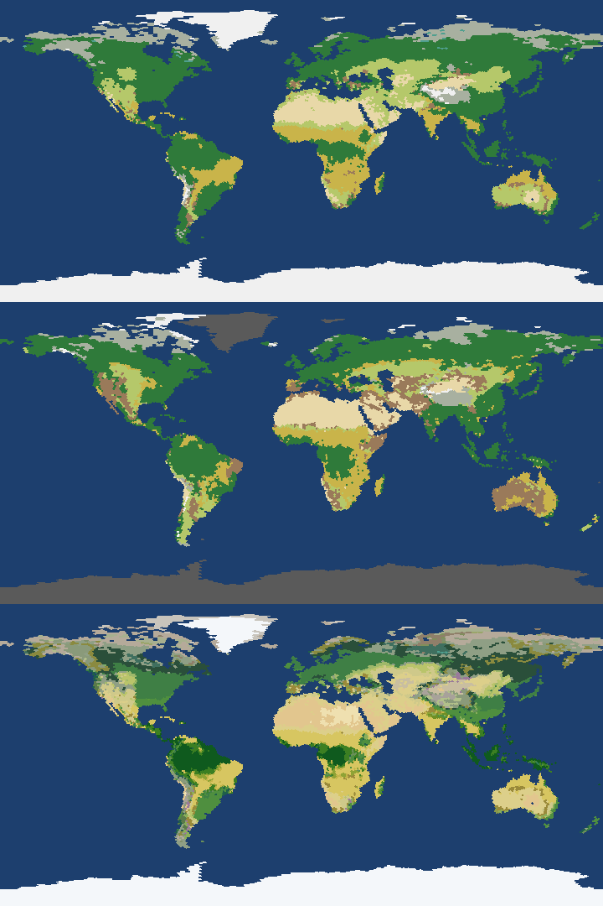
*`tools/veg_check.py --png` on the observed climate: the model's groups (top), potential natural vegetation (Ramankutty & Foley 1999; middle), the model's named types (bottom).*

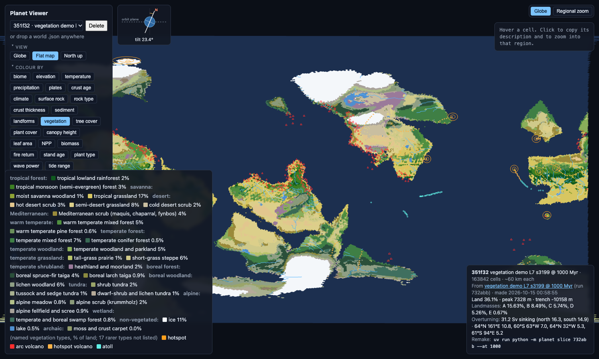
*World 351f32 (run 732abb, L7, seed 3199, at 1000 Myr): named vegetation types.*

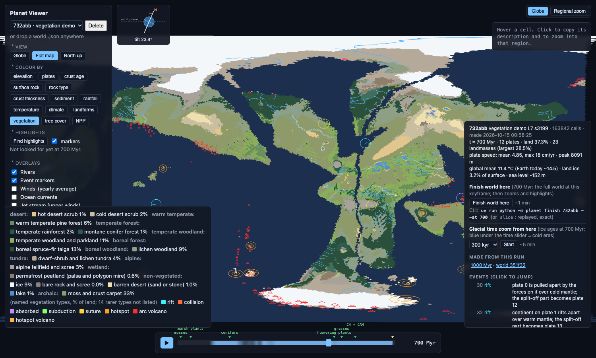
*Run 732abb at 700 Myr, before flowering plants: conifer forests, moss and crust carpets; green ticks above the slider mark when each plant group appeared.*

**Known limits:** no migration or refugia in the time zoom (step 7); the Earth world's L6 hydrology floods ~6 Mkm² of flat basins as lakes (vegetation is computed on them in `veg_check`).

### 2.19 Satellite view (`satellite.py`, PW-083)

**What it does:** a true-colour picture of a world or zoom in July, January, or each hemisphere's summer ("year": July north of 10° N, January south of 10° S, blended between; what a cloud-free mosaic like Blue Marble shows). One colour function serves the globe and the zoom, mixed in linear light:
1. **Bare ground** from the climate (dark brown humid soils, grey-brown cold ones, red semi-arid soils and yellow sand in hot deserts, grey cold deserts), tinted by the exposed rock where known (basalt dark, limestone and evaporites pale, sandstone red, an old shield laterite-red in hot dry country), sand on dune fields, grey rock above ~2500 m.
2. **Plants:** each plant type's share × its colour, leaf-on or leaf-off that month by vegetation.py's leaf habits (summergreen: the month warmer than its threshold; raingreen: a moist soil, the month's and the two before's water against the potential evaporation; grasses: both, dormant grass straw when dry, brown when cold), over `plant_cover` of the ground. Wetlands (the flooded share) darker and olive.
3. **Snow** from the month's snowpack (`climate.months`), cover 1 − e^(−SWE/15 mm), partly hidden by trees (evergreen crowns most: the dark winter taiga); **land ice** white, greyer-blue where it melts that month.
4. **Water:** lakes by depth (shallow ones greenish), salt lakes turquoise, salt pans white, frozen lakes white; the sea by depth, turquoise over warm shallow (carbonate) shelves, sea ice where the month is below freezing.

Hill shading and clouds are drawn by the viewer: the globe is lit, the flat map and the zoom shade from the relief; the **Clouds** overlay thresholds made-up fractal noise at each place's cloud share for the season (`cloud_jul`/`_jan`), so the cover is the climate's and the shapes are not.

**Where the colours are computed (decision):** in Python, baked into the outputs: worlds store `sat`, `sat_jul`, `sat_jan` (0xRRGGBB per cell; +3.8 MB on a 58 MB L7 world, ~0.4 s to compute), zooms `satellite*.png` (~0.3 MB each) and the `preview.png` (summer, shaded, rivers). One implementation keeps globe and zoom alike, the zoom's per-pixel plant fractions exist only at build time, and the snow needs the month-by-month climate. `planet satellite <world|zoom>` adds or redoes them in place (a zoom recomputes its fractions, ~10 s).

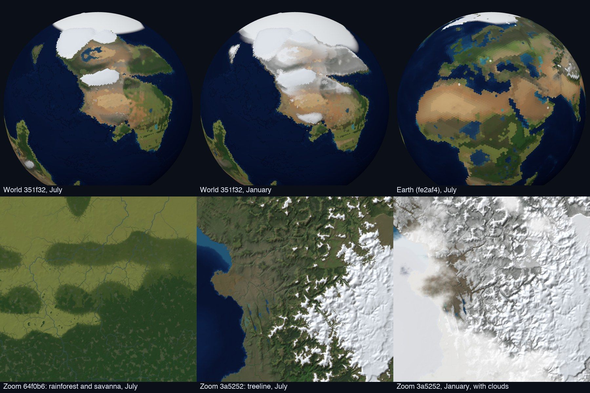
*World 351f32 (L7) in July and January (snow and leaf-fall across the northern continent), the Earth world fe2af4 in July (Sahara, the green Sahel in the rains, the Congo), and zooms 64f0b6 (rainforest–savanna edge) and 3a5252 (a treeline under an ice cap in July, and in January with clouds).*

**Known limits:** colours are tuned by eye, not to reflectance data; cell-scale colours on the globe show the cells (and the rain field's streaks, PW-019); clouds are a fixed pattern per world and season, not weather (PW-156); no sun glint, haze or night side.

---

## 3. Calibration and validation

**Tests** (`uv run pytest -q`, 180 tests): invariants (determinism, the crust budget closing, sane values, storage that doesn't clip, the sim → world → zoom chain), envelopes (plausible ranges: land 22–42%, dry climates 12–45% of land, continental crust 33–50%, plate speeds 2–9 cm/yr, 5–30 plates, ocean age 25–120 Myr, churn), and golden hashes of a short L4 run and one climate computation, so refactors can be shown not to change results.

**Glacial time zoom depth** (PW-031, 2026-10-14; lowest sea level vs the start, max ice):

| Source | Before | After |
|---|---|---|
| world bcc894 (run e0e21e @ 688 Myr, L7, dT −3.3), 300 kyr | −171 m, 5.1 km | **−132 m**, 5.1 km |
| run e0e21e @ 592 Myr (L7, dT −0.7, Earth-like), 300 kyr | — | −95 m |
| world 8e71fd (run ee65aa @ 632 Myr, L6, dT −5.8), 200–1000 kyr | −272 m, 11.8 km | −258 m, 11.8 km (cold era: see the PW-031 follow-up draft) |
| Earth (L6), 200 kyr | −54 m | −53 m |

**Earth checks** (the model on Earth's real terrain, `tools/earth_check.py`):

| Check | Result |
|---|---|
| Köppen main-group agreement | **70.7%** (area-weighted, land outside Antarctica; test floor 66%) |
| Köppen exact-class agreement | 38.4% |
| Log-rain correlation | 0.59; mean land rain 842 mm/yr |
| Model Köppen shares | A 19%, B 31%, C 18%, D 25%, E 7% |
| Inland drainage | ~22% of land (Earth ~18%) |
| Clouds (vs ICOADS, CRU) | Sahara 17%, Southern Ocean 82%, stratocumulus decks 64–70%, ITCZ 66–69% (observed ~70–80%); sea RMS 12 points, land sunshine RMS 16 |
| Dry winter humidity | Delhi 45%, Timbuktu 33%, Kashgar 49% (January) |
| Overturning | 13.7 Sv: Nordic 7.0, Labrador 4.1, Ross 1.9, Weddell 0.6; none in the North Pacific |
| Waves / tides (`coast_check.py`) | within 2× at 28 of 32 coasts / 24 of 25 |
| Vegetation (`veg_check.py`) | potential-vegetation agreement 62% on observed climate, 44% on the model's; land NPP 63 / 50 Pg C/yr; burned area 5.1 / 5.5 Mkm²/yr (§2.18) |

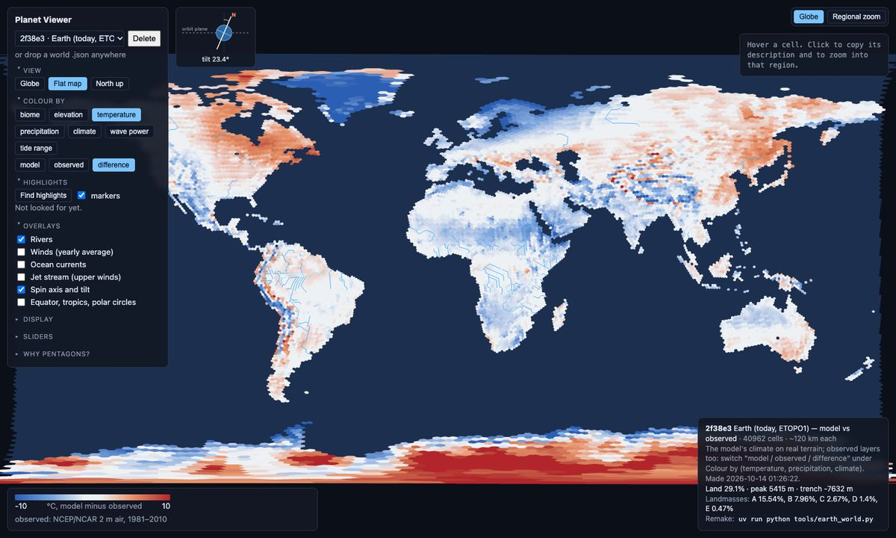
*Model minus observed annual temperature on Earth (an earlier Earth world). East Antarctica and NE Canada come out too warm.*

**Scorecard** (`docs/scorecard.jsonl`, latest row 0fd35e5, two L6 seeds over 1 Gyr):

| Metric | Seed 1 | Seed 2 |
|---|---|---|
| Land at 1 Gyr (range over the run) | 33.7% (30.6–34.3) | 33.1% (31.9–35.8) |
| Continental crust area | 47.7% | 46.9% |
| Crust volume (end / start) | ×1.006 | ×1.006 |
| Mean ocean age | 95 Myr | 63 Myr |
| Plate speed | 4.0 cm/yr | 4.45 cm/yr |
| Largest landmass now / max | 16% / 31% | 12% / 34% |
| Dry (B) share of land | 39% | 33% |

Plate counts (from run frames, not the scorecard): L6 median ~10, minimum 4–6; L7 seed 21 median 11, minimum 4; seed 3199 median 13, minimum 7 (foundation round, PW-191).

**Main weak spots:** moisture transport and regional rain (PW-013), polar temperatures (PW-039, PW-112), the time zoom's glaciation (PW-031, PW-033), closed basins on generated worlds (PW-054), land ice depth (PW-190).

---

## 4. Performance and costs per level

Laptop timings (4P + 4E cores, often shared with other jobs; wall times from `meta.generated_in_s`).

| Level | `simulate` time | Memory | Disk per 1 Gyr run | World build | World size |
|---|---|---|---|---|---|
| 5 | fastest; used by `generate` and tests (no recent run timing) | small | — | seconds | ~1 MB |
| 6 | ~6–8 min per Gyr | well under L7's (not measured) | ~0.5–0.65 GB (layers ~0.3, checkpoints 10 × 25–30 MB) | 1.5–5 s after replay | ~5 MB |
| 7 | ~20–25 min per Gyr (up to ~35 under load) | ~0.9 GB RSS + ~0.45 GB for the geological record | ~2.5–2.9 GB (layers ~1.5 GB, checkpoints 10 × 110–140 MB) | 13–28 s after replay | 30–45 MB |
| 8 | ~3–4 h per Gyr | ~3.5 GB | ~17 MB per keyframe, so use `--every 10` | world + 5 highlight zooms ~8.5 min | — |

- **Vegetation:** in the run ~0.09 s per climate update at L6 (~25 s per Gyr, ~8% of a run; L6 1 Gyr took 4.6 min, L7 23 min with other jobs running); in a world 0.2 s at L6. It adds ~3 MB to an L6 world (9 → 12 MB) and ~13 MB at L7 (~58 MB), and three layers (vegetation, tree cover, NPP) to run keyframes.
- **Slicing** replays up to 100 Myr from a checkpoint: well under a minute at L6, a few minutes at L7. The Zoom button skips the replay.
- **Zooms:** 1–7 s each; ~11–12 MB each for 500×500 px.
- **Time zoom:** ~4 min per 1000 kyr at L6.
- **Scorecard:** ~11 min. `pytest`: ~30 s to a minute (`-m "not slow"` skips 11 envelope tests).
- `NUMBA_NUM_THREADS=4` is often faster under load.

---

## 5. Current outputs to look at

Start the viewer (`uv run python -m planet serve`) and pick these from the dropdowns. Ids come from `uv run python -m planet list`.

**Showcase (2026-10-14 evening code, before the tectsea sea-level and plate-count change):** run **8571dd** (L7, seed 21, 1000 Myr), world **a08983** @ 408 Myr with highlights and zooms.
- Landform demo zooms on a08983: f9b027 (rift), a42a15 (fold belt), 8beebd (shield), 2d06f8 (escarpment), 9b19a0 (caprock), d3b1c8 (lava plateau), 68e925 (tower karst), 2e6433 (lowland karst, poljes), e14044 (linear and star dunes), 2d1537 (transverse dunes), ee587f (cold barchans), 8373c5 (barrier islands, lagoons), dccb9c (coastal plain); 83e518 (waterfalls), 130acd (volcano), 2d60af (2000 km overview).
- Earth world **dc3732** (clouds, ocean, seasons, model vs observed); **fe2af4** is the same with vegetation (PW-187).
- Vegetation demo (PW-187): run **732abb** (L7, seed 3199, 1000 Myr; plant groups at 2, 48, 232, 724, 760 and 824 Myr), world **351f32** at 1000 Myr. Try `?world=351f32.json&layer=vegetation`, `&layer=plant%20type&pft=BoNS`, and `?run=732abb&layer=vegetation` for the group ticks.
- Ocean and clouds demo world **2085dc**; seasons and travel demo **67317b**.
- Discrete volcanoes: run 39d004, world a099c6.
- Supercontinent cycle: run 6d9dcf (seed 2, 2 Gyr), worlds ffb5bd (assembled) and 779b14 (dispersed).
- Delta types: zooms 00975d, f81832, ce4b72 on world 0f7abd.
- The older L6 showcase set (Earth-like A/B, water world, land-heavy, cold, hothouse) is in `docs/coordination.md` "Showcase recipes".

### Demo runs (seed 3199)

Two runs on the final 2026-10-14 code, random seed 3199, default (Earth-like) parameters. Worlds were taken with `--at auto` (a representative moment) and have highlights plus 6 highlight zooms each. Same seed at two levels: the geography differs, since the run is chaotic.

| Level | Run | Myr | World | Zooms | Notes |
|---|---|---|---|---|---|
| L6 | ee65aa (5 min) | 1000 | 8e71fd @ 632 Myr | b5da31 largest river mouth, 23437e highest peak, b15424 steepest river, b4cdbc fjords, 12e3dc most varied, 53479b delta site | ends with 12 plates, 31.7% land |
| L7 | e0e21e (20 min) | 1000 | bcc894 @ 688 Myr | 40edef highest peak 5,533 m, a800d7 largest river mouth, 05fdf3 steepest river (830 m drop), 8bc6d8 longest range (6,900 km), 860228 fjords, 29e060 most varied | ends with 6 plates, 36.8% land |

Glacial time zooms and finished worlds (PW-091): time zoom **37ad6f** (300 kyr from bcc894's moment, L7) with finished worlds **bcb4b6** (+262 kyr, its glacial maximum, sea −132 m; zoom ed4e18) and **626fbb** (+100 kyr); time zoom **1eb8d4** (300 kyr from 8e71fd's, L6) with finished world **c73271** (+120 kyr, −258 m).

Open them at `http://127.0.0.1:8765/viewer/?world=bcc894.json` (or `?run=e0e21e`), and zooms at `zoom.html?id=<id>`. Try the landforms, cloud, sea temperature and salinity layers, the overturning overlay, and the travel highlights.

---

## 6. Where things live

| Path | Contents |
|---|---|
| `planet/__main__.py` | the CLI |
| `planet/grid.py`, `geo.py`, `noise.py` | icosphere grid, sphere geometry, 3D Perlin noise |
| `planet/tectonics/simulation.py` | the `Simulation`: state, the step, the world view |
| `planet/tectonics/plates.py`, `plate_kernels.py` | rigid plates, rotations; pull/resolve kernels (subduction, collision, ridges) |
| `planet/tectonics/motion.py` | boundaries and the force balance |
| `planet/tectonics/mantle.py` | the B′ mantle field |
| `planet/tectonics/events.py` | sutures, slivers, rifts, new subduction |
| `planet/tectonics/crust.py` | crust budget, arcs, collisions, stretching, flow, coherence |
| `planet/tectonics/isostasy.py` | crust → elevation, per-cell columns |
| `planet/tectonics/volcanism.py` | plumes, hotspot vents, arc volcanoes, reefs |
| `planet/tectonics/record.py` | strata and history per cell |
| `planet/tectonics/earth.py` | global temperature, CO₂, sea level, ice sheets, erosion driver |
| `planet/tectonics/setup.py`, `params.py`, `output.py` | the starting planet; parameters; snapshots and stats |
| `planet/surface.py` | rocks, erosion, sediment routing, surface rock |
| `planet/landform.py` | the 12 landform classes |
| `planet/climate.py` | temperature, winds, jet, gyres, SST, rain, water balance, humidity, clouds, Köppen, biomes, the shared months |
| `planet/vegetation.py` | plant functional types, productivity, cover competition, fire, wetlands, named types, plant groups |
| `planet/ocean.py` | salinity and the overturning |
| `planet/hydrology.py`, `kernels.py` | rivers, lakes, erosion kernels |
| `planet/coast.py` | waves, tides, Galloway delta weights |
| `planet/world.py` | world finishing and file I/O |
| `planet/timeline.py` | simulate, keyframes, report, replay, slice, `world_from_frame` |
| `planet/generators.py` | one-shot cartoon plates (`generate`) |
| `planet/highlights.py` | the 35 detectors, representative time |
| `planet/zoom.py`, `zoom_kernels.py` | regional zoom and its raster kernels |
| `planet/zoom_landforms.py`, `zoom_volcanoes.py` | landform synthesis; volcano edifices |
| `planet/zoom_terrain.py`, `zoom_vegetation.py` | zoom terrain indices (sun on slopes, wetness, river distance); per-pixel vegetation |
| `planet/satellite.py` | the true-colour satellite view of worlds and zooms |
| `planet/timezoom.py`, `timezoom_kernels.py` | glacial time zoom |
| `planet/store.py`, `provenance.py`, `images.py` | paths, ids, layers, checkpoints; code version; PNG writer |
| `planet/server.py`, `api.py` | viewer server and job API |
| `viewer/index.html`, `viewer/zoom.html` | globe viewer, zoom viewer |
| `tools/` | calibration and diagnostics (§2.17) |
| `tests/` | invariants, envelopes, goldens, per-subsystem tests |
| `issue-tracking/` | the board: tickets, inbox, `board.py` |
| `docs/` | this overview, `plan_next.md` (roadmap), `coordination.md` (worktrees, costs, recipes), `proposals/`, `review/` (investigations and images), `scorecard.jsonl` |

---

## 7. Glossary

**Geology**

| Term | Meaning |
|---|---|
| Airy isostasy | Crust floats on the denser mantle; thicker crust stands higher, like a thicker block of wood in water. |
| Arc (volcanic arc) | A line of volcanoes above a subducting plate (Andes, Japan). |
| Atoll / fringing / barrier reef | A reef hugging an island's shore; separated from it by a lagoon; a ring of reef left after the island has sunk away. |
| Basement / cover | The crystalline crust; the sedimentary layers on top of it. |
| Caprock | A hard layer protecting softer rock below; makes mesas, cliffs and waterfall lips. |
| Craton / shield | The old, stable core of a continent; a shield is where it is exposed at the surface. |
| Cuesta / hogback | A ridge with one steep and one gentle side from gently dipping hard beds; steeply dipping, a hogback. |
| Dolomite, quartzite, tuff, evaporite | Altered limestone; recrystallised sandstone; volcanic ash rock; salt and gypsum left by evaporation. |
| Doline / polje | A sinkhole in karst; a large flat-floored karst basin. |
| Escarpment (great) | A long steep step from plateau to lowland along an old rifted continental margin. |
| Exhumation | Rock brought to the surface as the rock above it erodes. |
| Flexural wavelength | How far a plate bends around a load; sets volcano spacing along hotspot chains. |
| Flood basalt / traps / lava plateau | Huge outpourings of lava when a plume head reaches a continent (Deccan, Siberia). |
| Fold-and-thrust belt | Strata squeezed into parallel folds beside a mountain range. |
| Guyot | A flat-topped seamount: an island planed by waves, then sunk. |
| Half-graben | A basin dropped down along one tilted fault block in a rift. |
| Hotspot / mantle plume | A column of hot mantle fixed under moving plates; leaves a chain of volcanoes (Hawaii). |
| Inselberg | A lone rock hill rising from a plain (Uluru). |
| Karst | Landscape dissolved out of limestone: sinkholes, caves, springs, towers. |
| Knickpoint | A sharp step in a river's profile; a waterfall that retreats upstream. |
| ln β | Stretching factor of rifted crust (β = original / stretched thickness). |
| Orogen | A mountain belt made by collision. |
| Passive margin | A continent's edge that is not a plate boundary (the Atlantic coasts). |
| Ridge (mid-ocean) | Where plates pull apart and new ocean floor forms. |
| Rift | Where a continent is being stretched and may split (East Africa). |
| Slab pull / ridge push | The pull of a sinking plate edge; the push away from a ridge. |
| Strata, unconformity | Rock layers in order; a gap where younger flat layers lie on older folded ones. |
| Stream power | River erosion rate ∝ water flow × slope. |
| Subduction | One plate sinking under another at a trench. |
| Supercontinent cycle | Continents gathering into one (Pangaea) and breaking apart, every few hundred Myr. |
| Suture | Where two colliding continents weld into one. |

**Climate and ocean**

| Term | Meaning |
|---|---|
| AMOC / overturning | The ocean's deep circulation: dense water sinks near the poles, warm surface water flows in to replace it. |
| Aridity index | Rain / potential evaporation (P/PET); below 0.05–0.2 is hyper-arid to arid. |
| Budyko curve | How much of the rain evaporates, given the rain and the evaporative demand. |
| Continentality | Interiors far from the sea have hotter summers and colder winters. |
| Gyre, western boundary current | A basin-wide ocean loop; its fast narrow western edge (Gulf Stream). |
| Hadley / Ferrel / polar cells | The three bands of overturning air in each hemisphere that give trade winds, westerlies and polar easterlies. |
| ITCZ | The rainy band near the equator where the trade winds meet. |
| Jet stream, thermal wind | Fast high-altitude winds where temperature changes sharply with latitude. |
| Köppen | A climate classification from monthly temperature and rain (A tropical, B dry, C temperate, D continental, E polar). |
| Lapse rate | How fast air cools with height (~6.5 °C per km). |
| Milankovitch cycles | Slow changes in Earth's orbit and tilt that pace ice ages (23, 41, 100, 405 kyr). |
| Monsoon | A seasonal wind reversal bringing summer rain off the sea. |
| Nye profile | The steady shape of an ice sheet: thickness grows with the square root of distance from the edge. |
| PDD (positive degree days) | Sum of temperatures above 0 °C; measures how much snow and ice melt. |
| PET | Potential evapotranspiration: how much water the air could evaporate. |
| psu | Practical salinity units (≈ grams of salt per kg of seawater; ocean ~35). |
| Rain shadow | The dry side of a mountain range, downwind of the wet side. |
| Shallow-ice approximation | A cheap model of ice flowing downhill under its own weight. |
| SST | Sea-surface temperature. |
| Stratocumulus deck | Low cloud sheets over cool sea under sinking air (off California, Peru). |
| Sv (sverdrup) | One million m³ of water per second. |
| Tidal prism / amphidromic point | Water a bay exchanges each tide; a point where the tide range is zero. |
| Upwelling | Cold deep water rising to the surface along coasts and the equator. |

**Coasts and deserts**

| Term | Meaning |
|---|---|
| Barchan / transverse / linear / star dune | Crescent dunes with scarce sand and one wind; ridges across one wind; ridges along two crossing winds; pyramids where winds reverse. |
| BQART, CERC | Empirical formulas for river sediment load; for sand moved along the shore by waves. |
| Erg | A sand sea. |
| Fetch | The open-water distance the wind blows over, which sets wave size. |
| Galloway triangle | Classifies deltas as river-, wave- or tide-dominated. |
| Playa / salt pan | A dry lake bed crusted with salt. |

**Vegetation**

| Term | Meaning |
|---|---|
| PFT (plant functional type) | A group of plants that behave alike (leaf habit, height, climate limits, drought strategy): "boreal needleleaf evergreen tree", "C4 grass". |
| GPP / NPP | Gross / net primary productivity: the carbon photosynthesis fixes, and what is left after the plants' own respiration (g C/m²/yr; Earth's land NPP ~56 Pg C/yr). |
| LAI | Leaf area index: m² of leaf per m² of ground (desert ~0.2, forest 4–7). |
| Light-use efficiency (LUE) | GPP as efficiency × the light the leaves absorb, cut by cold, heat and drought (CASA, MODIS MOD17). |
| C3 / C4 / CAM | Three kinds of photosynthesis: the ancestral one (trees, cool grasses); a CO₂-concentrating one that wins in hot, bright, seasonally dry places (savanna grasses); a water-saving night-time one (cacti). |
| Evergreen / summergreen / raingreen | Leaves all year / in the warm season / in the wet season. |
| TRIFFID | The UK Met Office's vegetation dynamics: cover fractions competing by height and growth (Lotka–Volterra). |
| GlobFIRM | LPJ's fire module: burned area from the length of the fire season, fuel and ignition. |
| Stand age | Years since the last stand-replacing disturbance (here fire); with a steady fire rate, exponentially distributed. |
| Treeline | Where trees stop with cold: latitude (arctic) or height (alpine). |

**Procgen and this code**

| Term | Meaning |
|---|---|
| Icosphere / Goldberg grid | The sphere tiled with hexagons and 12 pentagons. |
| Level | How many times the icosahedron was subdivided (L7 = 164k cells). |
| Run, keyframe, checkpoint | A simulation; a saved snapshot for the viewer (every 4 Myr); the full state for replay (every 100 Myr). |
| World, slice | One finished moment; making one from a run. |
| Zoom, time zoom | A fine regional landscape; 1 Myr of ice ages from one moment. |
| World frame / plate frame | Fixed planet coordinates / each plate's own copy of the grid that rotates with it. |
| Priority-flood | Drainage algorithm that fills pits so every cell drains to the sea or a lake. |
| D8 | Raster flow routing: each pixel drains to its steepest of 8 neighbours. |
| Diagnostic model | Computes a steady state from the current inputs, rather than stepping weather through time. |
| Envelope / golden test | A plausible-range check / a hash check that output didn't change. |
| Churn | Cells flipping state for a frame or two and back: an artefact. |
| Representative time (`--at auto`) | The keyframe after 300 Myr closest to the run's typical land and landmass counts. |
| Ma / Myr / kyr / Gyr | Millions of years (ago / duration), thousands of years, billions of years. |
