# Health sweep 2026-10-15 21:28

Commit 4e5f259. 11 runs (default params, `--every 4`) at 11 workers x 3 numba threads; simulations 42.2 min wall. Made by `tools/health.py` (PW-246).

## Runs

| seed | L | Myr | run | sim s | trees / flowering trees from | dT range C | peaks > 9.5 km | giant-lake frames % | crust volume end/start | ice SL < -150 m % | <= 4 plates % |
|---|---|---|---|---|---|---|---|---|---|---|---|
| 3199 | 7 | 1000 | 46c0b2 | 2516 | 252 / 744 | 10.2 | 0 | 11.3 | 0.929 | 0.0 | 0.0 |
| 21 | 7 | 1000 | c32ec0 | 2484 | 224 / 768 | 11.4 | 0 | 10.1 | 0.947 | 0.0 | 0.8 |
| 11 | 7 | 1000 | 738c73 | 2531 | 224 / 684 | 15.4 | 1 | 22.3 | 0.919 | 0.0 | 0.0 |
| 1 | 6 | 1000 | 6b140a | 572 | 208 / 740 | 12.1 | 0 | 8.4 | 0.909 | 0.0 | 0.0 |
| 2 | 6 | 1000 | fba1b1 | 573 | 228 / 732 | 20.7 | 0 | 2.5 | 0.916 | 0.0 | 0.4 |
| 11 | 6 | 1000 | 91dbeb | 569 | 224 / 684 | 14.7 | 0 | 12.6 | 0.911 | 0.0 | 0.0 |
| 21 | 6 | 1000 | cc3e57 | 569 | 224 / 768 | 12.7 | 0 | 6.7 | 0.934 | 0.0 | 0.0 |
| 3199 | 6 | 1000 | 9a5ca8 | 573 | 252 / 744 | 10.8 | 0 | 8.0 | 0.912 | 0.0 | 0.0 |
| 42 | 6 | 1000 | 158e4a | 564 | 212 / 812 | 12.2 | 0 | 5.5 | 0.93 | 0.0 | 0.0 |
| 77 | 6 | 1000 | bb660e | 570 | 240 / 788 | 14.6 | 0 | 4.2 | 0.903 | 0.0 | 0.0 |
| 505 | 6 | 1000 | d3343a | 561 | 248 / 764 | 9.4 | 0 | 3.8 | 0.891 | 0.0 | 0.0 |

## Medians by seed (after 50 Myr; tree cover after forests, NPP after flowering trees appear)

| seed | L | land_pct | cont_pct | cont_km | plates | ocean_age | speed | sea_level | sea_ice_m | ice_pct | temp | co2 | dry_pct | inland_pct | lake_pct | lake_max_mkm2 | max_elev_km | trees_pct | npp | landmasses | largest_pct |
|---|---|---|---|---|---|---|---|---|---|---|---|---|---|---|---|---|---|---|---|---|---|
| 3199 | 7 | 33.0 | 38.3 | 35.9 | 11.0 | 59.8 | 4.3 | 0.0 | -3.8 | 0.7 | 14.8 | -0.2 | 24.5 | 6.3 | 1.0 | 0.2 | 7.0 | 34.3 | 390.8 | 18.0 | 17.1 |
| 21 | 7 | 33.5 | 39.2 | 36.0 | 12.0 | 65.5 | 3.8 | 6.7 | -4.3 | 0.8 | 16.3 | -0.3 | 25.4 | 6.2 | 1.0 | 0.3 | 7.2 | 30.3 | 334.8 | 12.0 | 29.2 |
| 11 | 7 | 32.0 | 37.5 | 37.1 | 13.0 | 58.7 | 4.1 | 80.2 | -5.1 | 1.1 | 15.4 | -0.3 | 28.4 | 7.7 | 1.3 | 0.4 | 7.4 | 30.2 | 323.4 | 12.0 | 23.2 |
| 1 | 6 | 32.1 | 41.0 | 34.3 | 12.0 | 60.6 | 4.1 | 47.9 | -1.6 | 0.3 | 15.9 | -0.1 | 26.0 | 4.4 | 0.5 | 0.1 | 5.4 | 32.1 | 293.9 | 10.0 | 20.6 |
| 2 | 6 | 32.1 | 39.1 | 35.1 | 11.0 | 55.6 | 4.5 | 148.2 | -7.6 | 1.1 | 14.0 | -0.1 | 25.8 | 4.2 | 0.6 | 0.1 | 6.4 | 33.2 | 261.5 | 7.0 | 22.0 |
| 11 | 6 | 31.6 | 39.4 | 34.3 | 10.0 | 63.8 | 4.2 | 15.2 | -3.8 | 0.7 | 15.7 | -0.3 | 24.5 | 3.5 | 0.4 | 0.1 | 5.7 | 29.7 | 339.9 | 8.0 | 17.1 |
| 21 | 6 | 32.1 | 39.5 | 34.2 | 12.0 | 57.0 | 4.3 | 66.1 | -2.5 | 0.5 | 16.6 | -0.1 | 30.8 | 5.2 | 0.6 | 0.2 | 6.0 | 23.8 | 301.4 | 9.0 | 19.4 |
| 3199 | 6 | 32.4 | 39.7 | 34.3 | 11.0 | 57.5 | 4.1 | 16.1 | -1.3 | 0.2 | 15.6 | -0.0 | 29.2 | 5.1 | 0.4 | 0.1 | 5.6 | 30.9 | 322.4 | 9.0 | 22.9 |
| 42 | 6 | 31.8 | 39.0 | 34.6 | 10.0 | 61.2 | 4.0 | 115.1 | -5.3 | 0.8 | 14.9 | -0.2 | 27.7 | 5.0 | 0.5 | 0.1 | 6.4 | 26.8 | 326.9 | 7.0 | 20.8 |
| 77 | 6 | 31.5 | 39.7 | 34.3 | 10.0 | 57.3 | 4.1 | -31.4 | -5.8 | 1.1 | 14.2 | -0.2 | 25.2 | 4.1 | 0.5 | 0.1 | 6.8 | 30.9 | 329.0 | 10.0 | 21.9 |
| 505 | 6 | 31.4 | 40.0 | 34.5 | 10.0 | 67.4 | 3.9 | 71.7 | -3.3 | 0.6 | 14.9 | -0.3 | 24.4 | 4.2 | 0.5 | 0.1 | 6.4 | 29.3 | 373.8 | 9.0 | 15.8 |

Measured on the run's keyframes (no slicing). Caveats: a keyframe's lakes and `downstream` come from the terrain before that step's erosion and deposition (PW-239), so `inland_raw_pct` (every routed end on land, as highlights counts it) runs ~2-3x `inland_pct` (ends that are closed lakes, salt pans or real pits on the frame's own elevation); lake shares are the run's lakes during the step. Land ice and land shares use cells (near-equal area).

## Envelopes

| metric | low | high | Earth | source |
|---|---|---|---|---|
| land, % of surface (`land_pct`) | 22 | 42 | 29.20 | tests/test_envelopes.py (22-42%); Earth 29.2% |
| continental crust, % of surface (`cont_pct`) | 33 | 50 | 41 | tests/test_envelopes.py (33-50%); Earth ~41% with shelves (Cogley 1984) |
| mean continental crust thickness, km (`cont_km`) | 31 | 40 | 39 | target 35 km (PW-238, continental_thickness); Earth ~39 km (Christensen & Mooney 1995); known thinning to 32-33 km (PW-046) |
| plates (`plates`) | 5 | 30 | 15 | tests/test_envelopes.py (5-30; max_plates 30); Earth 7 major + ~8 minor; <= 4 is the PW-191 collapse |
| mean ocean-floor age, Myr (`ocean_age`) | 25 | 120 | 64 | tests/test_envelopes.py (25-120); Earth ~64 Myr (Mueller et al. 2008); PW-051 |
| mean plate speed, cm/yr (`speed`) | 2 | 9 | 4.50 | tests/test_envelopes.py (2-9 cm/yr); Earth ~4-5 |
| sea level, m (ice + ocean basins) (`sea_level`) | -250 | 300 | 0 | Phanerozoic ~-130 (LGM) .. +250 m (earth.py; Haq & Schutter 2008); -250: PW-240's hard goal |
| sea level from land ice, m (`sea_ice_m`) | -250 | - | 0 | Earth LGM ~-130 m; PW-240 goal -150 m typical / -250 m worst |
| land ice, % of surface (`ice_pct`) | - | 10 | 3.10 | Earth 3.1% now (earth.EARTH_ICE), ~7-8% at the LGM |
| global mean temperature, C (`temp`) | 8 | 30 | 14.50 | Earth 14.5 C; LGM ~8 C (Tierney et al. 2020); Phanerozoic hothouses to ~30 C (Scotese et al. 2021) |
| CO2 index (ln source/sink) (`co2`) | -1.5 | 1.5 | 0.00 | the forcing's clip in earth.py (+-1.5); Earth 0 |
| arid (Koppen B), % of land (`dry_pct`) | 12 | 45 | 30 | tests/test_envelopes.py (12-45%); Earth ~30% (Beck et al. 2018) |
| land draining inland, % of ice-free land (to a closed lake, salt pan or real pit) (`inland_pct`) | 8 | 30 | 18 | Earth ~18% (overview 2.9); L6 known ~9.5-11% (PW-054, PW-243). `inland_raw_pct` (not checked) follows the stored `downstream` to any end, as highlights does: stale by a step (PW-239) |
| lakes, % of land (`lake_pct`) | 0.2 | 3.0 | 1.80 | Earth ~1.8% of ice-free land (HydroLAKES, Messager et al. 2016); generated L6 worlds 0.5-1% |
| largest lake, million km2 (`lake_max_mkm2`) | - | 1.0 | 0.37 | Caspian 0.37 Mkm2; 1 Mkm2 = the overview's giant lake (2.9) |
| highest peak, km (`max_elev_km`) | - | 9.5 | 8.85 | Everest 8.85 km; PW-172 (spikes above ~9.5 km) |
| tree cover, % of ice-free land (after forests appear) (`trees_pct`) | 10 | 50 | 30 | Earth ~30% potential canopy (forest 55-60 of ~130 Mkm2, overview 2.18) |
| land NPP, g C/m2/yr (after flowering trees appear) (`npp`) | 200 | 700 | 430 | Earth ~56 Pg C/yr over ~130 Mkm2 = ~430; the model on Earth's terrain 50 Pg C/yr, ~385 (overview 2.18). Before flowering trees (plant group 4) stand-ins grow at 70%, so runs sit at ~150-280 |
| landmasses (>= 3 cells) (`landmasses`) | 3 | 80 | - | loose: a lone supercontinent or a shattered archipelago |
| largest landmass, % of surface (`largest_pct`) | 5 | 35 | 16.60 | Afro-Eurasia 16.6%; a Pangaea ~30% (scorecard largest_max) |
| global temperature range over the run, C (`dT_range`, per run) | - | 25 | 25 | Phanerozoic 11-36 C (Scotese et al. 2021) |
| keyframes with a peak above 9.5 km (`peak_frames`, per run) | - | 0 | 0 | PW-172 (L7 seed 3199: 3 of 251) |
| % of keyframes with a lake over 1 Mkm2 (`giant_lake_frames`, per run) | - | 5 | 0 | overview 2.9 (L6: 3 of ~150 frames) |
| continental crust volume, end / start (`volume_ratio`, per run) | 0.9 | 1.1 | 1.0 | scorecard volume_ratio (x1.006) |
| % of keyframes with ice sea level below -150 m (`sea_ice_below_150`, per run) | - | 10 | 0 | PW-240 |
| % of keyframes with <= 4 plates (`low_plates`, per run) | - | 2 | 0 | PW-191 (L7 seed 21: 1%) |

## Top outliers (of 327 spells; severity = excess / band width x (0.2 + share of the run))

| seed | L | metric | Myr | frames | worst | envelope | severity |
|---|---|---|---|---|---|---|---|
| 11 | 7 | giant_lake_frames | run | - | 22.30 | -..5 | 3.46 |
| 11 | 6 | giant_lake_frames | run | - | 12.60 | -..5 | 1.52 |
| 3199 | 7 | giant_lake_frames | run | - | 11.30 | -..5 | 1.26 |
| 11 | 6 | lake_max_mkm2 | 768-780 | 4 | 6.56 | -..1.0 | 1.201 |
| 11 | 6 | lake_max_mkm2 | 140-212 | 16 | 5.39 | -..1.0 | 1.158 |
| 21 | 7 | giant_lake_frames | run | - | 10.10 | -..5 | 1.02 |
| 11 | 6 | lake_max_mkm2 | 808-808 | 1 | 5.96 | -..1.0 | 1.013 |
| 11 | 7 | peak_frames | run | - | 1 | -..0 | 1.0 |
| 21 | 6 | lake_max_mkm2 | 980-1000 | 6 | 4.81 | -..1.0 | 0.852 |
| 42 | 6 | lake_max_mkm2 | 212-244 | 6 | 4.48 | -..1.0 | 0.78 |
| 1 | 6 | giant_lake_frames | run | - | 8.40 | -..5 | 0.68 |
| 3199 | 6 | lake_max_mkm2 | 856-868 | 4 | 3.98 | -..1.0 | 0.645 |
| 505 | 6 | lake_max_mkm2 | 152-160 | 2 | 3.92 | -..1.0 | 0.608 |
| 3199 | 6 | giant_lake_frames | run | - | 8.00 | -..5 | 0.6 |
| 21 | 7 | lake_max_mkm2 | 276-288 | 3 | 3.63 | -..1.0 | 0.558 |
| 42 | 6 | lake_max_mkm2 | 92-100 | 2 | 3.56 | -..1.0 | 0.533 |
| 3199 | 6 | lake_max_mkm2 | 784-788 | 2 | 3.51 | -..1.0 | 0.522 |
| 11 | 6 | lake_max_mkm2 | 232-252 | 4 | 3.25 | -..1.0 | 0.486 |
| 11 | 7 | lake_max_mkm2 | 60-68 | 3 | 3.19 | -..1.0 | 0.464 |
| 505 | 6 | lake_max_mkm2 | 936-936 | 1 | 3.24 | -..1.0 | 0.457 |
| 11 | 7 | lake_max_mkm2 | 788-812 | 7 | 2.90 | -..1.0 | 0.432 |
| 21 | 7 | lake_max_mkm2 | 988-988 | 1 | 3.04 | -..1.0 | 0.417 |
| 77 | 6 | lake_max_mkm2 | 136-136 | 1 | 2.98 | -..1.0 | 0.403 |
| 42 | 6 | lake_max_mkm2 | 628-628 | 1 | 2.91 | -..1.0 | 0.39 |
| 3199 | 6 | lake_max_mkm2 | 756-772 | 3 | 2.80 | -..1.0 | 0.382 |
| 3199 | 7 | lake_max_mkm2 | 216-216 | 1 | 2.69 | -..1.0 | 0.344 |
| 21 | 6 | lake_max_mkm2 | 448-448 | 1 | 2.67 | -..1.0 | 0.34 |
| 21 | 6 | giant_lake_frames | run | - | 6.70 | -..5 | 0.34 |
| 42 | 6 | lake_max_mkm2 | 572-572 | 1 | 2.59 | -..1.0 | 0.324 |
| 21 | 7 | lake_max_mkm2 | 372-372 | 1 | 2.49 | -..1.0 | 0.305 |

## Per seed: min / median / max after the 50 Myr spin-up, and spells outside the envelopes

### Seed 3199, L7 (run 46c0b2)

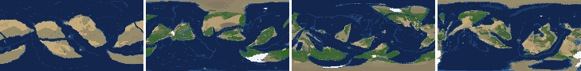

*At 100, 400, 700, 1000 Myr: sea by depth, land green by tree cover / tan where arid, shaded by height, ice white, lakes blue.*

| metric | min | median | max | outside (Myr: worst) |
|---|---|---|---|---|
| land_pct | 31.19 | 33.03 | 38.78 |  |
| cont_pct | 35.91 | 38.31 | 41.62 |  |
| cont_km | 34.21 | 35.94 | 39.44 |  |
| plates | 7.00 | 11.00 | 18.00 |  |
| ocean_age | 32.70 | 59.80 | 80.60 |  |
| speed | 2.96 | 4.29 | 7.42 |  |
| sea_level | -171.30 | 0.00 | 210.40 |  |
| sea_ice_m | -16.10 | -3.80 | -0.00 |  |
| ice_pct | 0.00 | 0.70 | 2.20 |  |
| temp | 10.80 | 14.75 | 21.00 |  |
| co2 | -1.10 | -0.25 | 0.27 |  |
| dry_pct | 11.00 | 24.50 | 50.36 | 52-60: 50.36; 112-120: 46.21; 628-652: 11.00 |
| inland_pct | 1.16 | 6.28 | 29.22 | 68-148: 1.54; 344-344: 7.98; 360-360: 6.98; 372-704: 1.16; +7 more |
| lake_pct | 0.16 | 0.99 | 3.73 | 108-120: 0.16; 160-160: 3.21; 216-216: 3.54; 240-244: 3.73; +2 more |
| lake_max_mkm2 | 0.02 | 0.22 | 2.69 | 52-52: 1.09; 136-168: 2.15; 216-216: 2.69; 232-232: 1.21; +8 more |
| max_elev_km | 2.34 | 7.02 | 8.68 |  |
| trees_pct | 20.31 | 34.27 | 45.56 |  |
| npp | 225.60 | 390.80 | 436.60 |  |
| landmasses | 3.00 | 18.00 | 41.00 |  |
| largest_pct | 7.00 | 17.15 | 33.70 |  |

### Seed 21, L7 (run c32ec0)

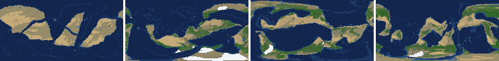

*At 100, 400, 700, 1000 Myr: sea by depth, land green by tree cover / tan where arid, shaded by height, ice white, lakes blue.*

| metric | min | median | max | outside (Myr: worst) |
|---|---|---|---|---|
| land_pct | 31.96 | 33.45 | 38.74 |  |
| cont_pct | 34.69 | 39.16 | 42.32 |  |
| cont_km | 33.36 | 36.00 | 40.18 | 236-268: 40.18 |
| plates | 4.00 | 12.00 | 21.00 | 712-716: 4 |
| ocean_age | 33.10 | 65.45 | 117.60 |  |
| speed | 1.52 | 3.81 | 7.26 | 648-648: 1.98; 664-688: 1.52; 704-716: 1.64 |
| sea_level | -237.40 | 6.65 | 221.00 |  |
| sea_ice_m | -12.10 | -4.30 | -0.00 |  |
| ice_pct | 0.00 | 0.80 | 2.10 |  |
| temp | 10.80 | 16.30 | 22.20 |  |
| co2 | -0.94 | -0.30 | 0.56 |  |
| dry_pct | 13.99 | 25.41 | 52.26 | 52-60: 52.26 |
| inland_pct | 1.05 | 6.25 | 31.06 | 88-148: 1.59; 164-168: 4.15; 276-276: 31.06; 344-344: 6.11; +4 more |
| lake_pct | 0.24 | 1.01 | 4.58 | 188-192: 4.30; 276-288: 4.58; 304-308: 3.11; 372-372: 3.01 |
| lake_max_mkm2 | 0.04 | 0.27 | 3.63 | 52-64: 1.92; 84-84: 1.25; 108-108: 1.10; 188-204: 1.36; +11 more |
| max_elev_km | 2.45 | 7.24 | 9.22 |  |
| trees_pct | 13.81 | 30.29 | 48.70 |  |
| npp | 210.50 | 334.80 | 385.60 |  |
| landmasses | 4.00 | 12.00 | 33.00 |  |
| largest_pct | 12.30 | 29.25 | 34.30 |  |

### Seed 11, L7 (run 738c73)

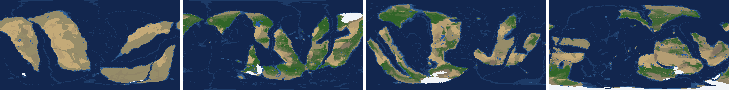

*At 100, 400, 700, 1000 Myr: sea by depth, land green by tree cover / tan where arid, shaded by height, ice white, lakes blue.*

| metric | min | median | max | outside (Myr: worst) |
|---|---|---|---|---|
| land_pct | 30.37 | 32.05 | 38.68 |  |
| cont_pct | 35.02 | 37.47 | 41.86 |  |
| cont_km | 35.28 | 37.08 | 38.29 |  |
| plates | 8.00 | 13.00 | 18.00 |  |
| ocean_age | 32.20 | 58.70 | 83.20 |  |
| speed | 2.22 | 4.11 | 7.02 |  |
| sea_level | -106.20 | 80.25 | 217.90 |  |
| sea_ice_m | -16.10 | -5.10 | -0.00 |  |
| ice_pct | 0.00 | 1.10 | 3.00 |  |
| temp | 5.50 | 15.40 | 20.90 | 176-196: 5.50 |
| co2 | -0.80 | -0.26 | 0.21 |  |
| dry_pct | 13.82 | 28.40 | 49.76 | 52-64: 49.76 |
| inland_pct | 1.64 | 7.75 | 31.97 | 52-52: 31.97; 76-144: 2.74; 160-188: 3.29; 216-216: 7.09; +6 more |
| lake_pct | 0.29 | 1.28 | 3.62 | 68-68: 3.46; 812-812: 3.07; 824-824: 3.62; 852-852: 3.23 |
| lake_max_mkm2 | 0.04 | 0.38 | 3.19 | 60-68: 3.19; 132-132: 1.74; 204-204: 1.03; 308-320: 1.55; +14 more |
| max_elev_km | 2.30 | 7.36 | 9.62 | 280-280: 9.62 |
| trees_pct | 19.82 | 30.24 | 52.08 | 668-672: 52.08 |
| npp | 244.10 | 323.40 | 370.60 |  |
| landmasses | 5.00 | 12.00 | 26.00 |  |
| largest_pct | 13.40 | 23.25 | 32.50 |  |

### Seed 1, L6 (run 6b140a)

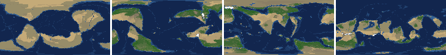

*At 100, 400, 700, 1000 Myr: sea by depth, land green by tree cover / tan where arid, shaded by height, ice white, lakes blue.*

| metric | min | median | max | outside (Myr: worst) |
|---|---|---|---|---|
| land_pct | 31.15 | 32.09 | 38.61 |  |
| cont_pct | 34.96 | 40.98 | 43.06 |  |
| cont_km | 31.68 | 34.35 | 39.22 |  |
| plates | 7.00 | 12.00 | 16.00 |  |
| ocean_age | 30.90 | 60.60 | 79.00 |  |
| speed | 2.27 | 4.06 | 8.50 |  |
| sea_level | -53.20 | 47.90 | 221.40 |  |
| sea_ice_m | -23.10 | -1.65 | -0.00 |  |
| ice_pct | 0.00 | 0.30 | 1.90 |  |
| temp | 9.10 | 15.95 | 21.20 |  |
| co2 | -1.19 | -0.15 | 0.44 |  |
| dry_pct | 12.21 | 25.98 | 51.10 | 216-240: 51.10 |
| inland_pct | 0.62 | 4.38 | 29.29 | 68-144: 1.69; 216-216: 7.28; 244-252: 4.40; 292-292: 6.70; +5 more |
| lake_pct | 0.09 | 0.48 | 4.16 | 64-64: 0.18; 88-92: 0.17; 104-120: 0.09; 180-180: 3.51; +8 more |
| lake_max_mkm2 | 0.01 | 0.12 | 2.35 | 128-128: 1.62; 180-184: 2.35; 240-248: 2.24; 260-268: 2.03; +4 more |
| max_elev_km | 2.17 | 5.42 | 8.16 |  |
| trees_pct | 15.14 | 32.14 | 43.01 |  |
| npp | 205.50 | 293.95 | 473.50 |  |
| landmasses | 2.00 | 10.00 | 25.00 | 52-52: 2; 192-192: 2; 208-208: 2 |
| largest_pct | 9.40 | 20.65 | 31.90 |  |

### Seed 2, L6 (run fba1b1)

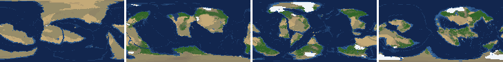

*At 100, 400, 700, 1000 Myr: sea by depth, land green by tree cover / tan where arid, shaded by height, ice white, lakes blue.*

| metric | min | median | max | outside (Myr: worst) |
|---|---|---|---|---|
| land_pct | 29.41 | 32.06 | 37.92 |  |
| cont_pct | 36.80 | 39.14 | 43.05 |  |
| cont_km | 33.25 | 35.11 | 37.40 |  |
| plates | 4.00 | 11.00 | 18.00 | 860-860: 4 |
| ocean_age | 31.50 | 55.60 | 97.80 |  |
| speed | 2.04 | 4.49 | 7.90 |  |
| sea_level | -216.40 | 148.20 | 237.40 |  |
| sea_ice_m | -48.10 | -7.60 | -0.00 |  |
| ice_pct | 0.00 | 1.10 | 4.90 |  |
| temp | 2.90 | 14.00 | 23.60 | 480-532: 2.90 |
| co2 | -1.12 | -0.10 | 0.57 |  |
| dry_pct | 16.68 | 25.76 | 51.90 | 52-60: 51.90; 80-84: 47.59; 232-240: 48.67 |
| inland_pct | 0.80 | 4.17 | 18.51 | 64-164: 1.44; 184-184: 6.19; 248-936: 0.80; 952-1000: 0.92 |
| lake_pct | 0.06 | 0.61 | 2.09 | 60-76: 0.06; 88-96: 0.09; 108-124: 0.10; 580-584: 0.17; +2 more |
| lake_max_mkm2 | 0.03 | 0.14 | 2.18 | 144-148: 1.36; 160-160: 1.31; 352-352: 1.41; 812-812: 2.18; +1 more |
| max_elev_km | 1.84 | 6.45 | 8.24 |  |
| trees_pct | 7.13 | 33.23 | 48.50 | 232-248: 8.20; 276-284: 7.13 |
| npp | 192.50 | 261.50 | 368.10 | 796-800: 192.50 |
| landmasses | 2.00 | 7.00 | 20.00 | 52-68: 2; 308-308: 2 |
| largest_pct | 8.00 | 22.00 | 34.30 |  |

### Seed 11, L6 (run 91dbeb)

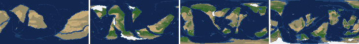

*At 100, 400, 700, 1000 Myr: sea by depth, land green by tree cover / tan where arid, shaded by height, ice white, lakes blue.*

| metric | min | median | max | outside (Myr: worst) |
|---|---|---|---|---|
| land_pct | 30.31 | 31.64 | 38.17 |  |
| cont_pct | 38.28 | 39.39 | 43.06 |  |
| cont_km | 31.87 | 34.34 | 36.81 |  |
| plates | 6.00 | 10.00 | 18.00 |  |
| ocean_age | 33.60 | 63.85 | 90.60 |  |
| speed | 2.51 | 4.15 | 7.11 |  |
| sea_level | -178.60 | 15.25 | 217.30 |  |
| sea_ice_m | -22.40 | -3.85 | -0.00 |  |
| ice_pct | 0.00 | 0.70 | 2.80 |  |
| temp | 5.60 | 15.70 | 20.30 | 176-188: 5.60 |
| co2 | -0.74 | -0.31 | 0.06 |  |
| dry_pct | 15.22 | 24.51 | 47.48 | 60-68: 47.48; 84-92: 46.31 |
| inland_pct | 0.91 | 3.52 | 14.57 | 68-128: 1.82; 144-144: 7.32; 164-164: 7.98; 180-288: 3.48; +2 more |
| lake_pct | 0.07 | 0.45 | 5.17 | 72-104: 0.07; 120-120: 0.13; 148-160: 3.08; 344-344: 0.20; +6 more |
| lake_max_mkm2 | 0.03 | 0.11 | 6.56 | 140-212: 5.39; 232-252: 3.25; 672-676: 1.27; 768-780: 6.56; +4 more |
| max_elev_km | 1.42 | 5.70 | 7.74 |  |
| trees_pct | 10.25 | 29.72 | 40.39 |  |
| npp | 227.40 | 339.90 | 414.80 |  |
| landmasses | 3.00 | 8.00 | 22.00 |  |
| largest_pct | 5.60 | 17.05 | 32.70 |  |

### Seed 21, L6 (run cc3e57)

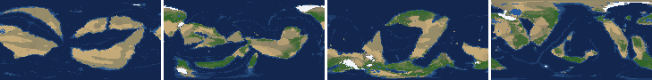

*At 100, 400, 700, 1000 Myr: sea by depth, land green by tree cover / tan where arid, shaded by height, ice white, lakes blue.*

| metric | min | median | max | outside (Myr: worst) |
|---|---|---|---|---|
| land_pct | 29.65 | 32.14 | 37.95 |  |
| cont_pct | 36.72 | 39.53 | 43.72 |  |
| cont_km | 32.62 | 34.16 | 36.07 |  |
| plates | 5.00 | 12.00 | 17.00 |  |
| ocean_age | 32.80 | 56.95 | 104.10 |  |
| speed | 1.62 | 4.34 | 7.03 | 724-724: 1.62 |
| sea_level | -228.80 | 66.10 | 212.00 |  |
| sea_ice_m | -21.40 | -2.55 | -0.00 |  |
| ice_pct | 0.00 | 0.50 | 2.90 |  |
| temp | 10.90 | 16.60 | 23.60 |  |
| co2 | -0.66 | -0.08 | 0.50 |  |
| dry_pct | 21.62 | 30.78 | 48.36 | 52-60: 47.82; 88-96: 47.78; 528-564: 48.36 |
| inland_pct | 0.35 | 5.23 | 21.47 | 68-148: 2.15; 160-184: 4.27; 204-212: 4.84; 224-496: 1.47; +2 more |
| lake_pct | 0.03 | 0.62 | 4.99 | 68-68: 0.10; 80-120: 0.03; 136-140: 0.17; 536-564: 0.05; +2 more |
| lake_max_mkm2 | 0.01 | 0.17 | 4.81 | 60-60: 1.69; 72-72: 1.38; 364-364: 1.31; 448-448: 2.67; +6 more |
| max_elev_km | 1.92 | 5.99 | 8.32 |  |
| trees_pct | 6.65 | 23.80 | 45.28 | 624-652: 6.65 |
| npp | 219.10 | 301.40 | 388.40 |  |
| landmasses | 2.00 | 9.00 | 18.00 | 64-64: 2 |
| largest_pct | 10.60 | 19.40 | 33.20 |  |

### Seed 3199, L6 (run 9a5ca8)

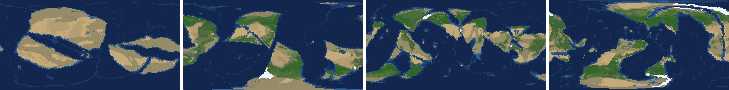

*At 100, 400, 700, 1000 Myr: sea by depth, land green by tree cover / tan where arid, shaded by height, ice white, lakes blue.*

| metric | min | median | max | outside (Myr: worst) |
|---|---|---|---|---|
| land_pct | 29.06 | 32.43 | 38.82 |  |
| cont_pct | 37.81 | 39.72 | 43.30 |  |
| cont_km | 32.51 | 34.26 | 37.50 |  |
| plates | 5.00 | 11.00 | 17.00 |  |
| ocean_age | 37.70 | 57.55 | 77.30 |  |
| speed | 2.59 | 4.13 | 7.29 |  |
| sea_level | -145.00 | 16.05 | 188.00 |  |
| sea_ice_m | -9.40 | -1.30 | -0.00 |  |
| ice_pct | 0.00 | 0.20 | 1.50 |  |
| temp | 11.10 | 15.60 | 21.90 |  |
| co2 | -0.69 | -0.03 | 0.46 |  |
| dry_pct | 16.56 | 29.22 | 59.18 | 52-80: 59.18; 872-880: 45.80 |
| inland_pct | 0.68 | 5.05 | 25.91 | 76-80: 4.81; 92-140: 0.68; 152-184: 3.41; 284-296: 5.29; +7 more |
| lake_pct | 0.06 | 0.44 | 3.24 | 64-68: 0.14; 88-92: 0.07; 104-136: 0.06; 364-364: 0.20; +8 more |
| lake_max_mkm2 | 0.01 | 0.12 | 3.98 | 72-72: 1.41; 272-276: 1.66; 304-304: 1.25; 528-548: 1.94; +5 more |
| max_elev_km | 1.62 | 5.58 | 8.24 |  |
| trees_pct | 18.73 | 30.88 | 45.07 |  |
| npp | 217.30 | 322.40 | 371.40 |  |
| landmasses | 2.00 | 9.00 | 19.00 | 52-60: 2 |
| largest_pct | 7.40 | 22.90 | 34.10 |  |

### Seed 42, L6 (run 158e4a)

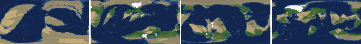

*At 100, 400, 700, 1000 Myr: sea by depth, land green by tree cover / tan where arid, shaded by height, ice white, lakes blue.*

| metric | min | median | max | outside (Myr: worst) |
|---|---|---|---|---|
| land_pct | 30.36 | 31.82 | 38.25 |  |
| cont_pct | 37.44 | 39.04 | 43.08 |  |
| cont_km | 32.56 | 34.59 | 37.36 |  |
| plates | 6.00 | 10.00 | 18.00 |  |
| ocean_age | 34.20 | 61.20 | 87.30 |  |
| speed | 2.38 | 4.04 | 7.45 |  |
| sea_level | -79.10 | 115.10 | 229.00 |  |
| sea_ice_m | -26.60 | -5.35 | -0.00 |  |
| ice_pct | 0.00 | 0.80 | 2.70 |  |
| temp | 8.50 | 14.95 | 20.70 |  |
| co2 | -0.71 | -0.24 | 0.27 |  |
| dry_pct | 15.55 | 27.69 | 54.69 | 184-280: 54.69 |
| inland_pct | 0.56 | 5.04 | 26.05 | 64-116: 1.68; 128-160: 3.73; 172-172: 4.41; 288-292: 6.23; +3 more |
| lake_pct | 0.10 | 0.51 | 3.46 | 64-76: 0.15; 96-104: 0.10; 116-128: 0.16; 168-168: 3.40; +4 more |
| lake_max_mkm2 | 0.03 | 0.12 | 4.48 | 92-100: 3.56; 164-168: 1.94; 212-244: 4.48; 308-308: 1.11; +2 more |
| max_elev_km | 1.73 | 6.37 | 8.57 |  |
| trees_pct | 11.54 | 26.80 | 39.07 |  |
| npp | 257.30 | 326.90 | 356.00 |  |
| landmasses | 3.00 | 7.00 | 17.00 |  |
| largest_pct | 11.30 | 20.80 | 33.90 |  |

### Seed 77, L6 (run bb660e)

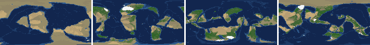

*At 100, 400, 700, 1000 Myr: sea by depth, land green by tree cover / tan where arid, shaded by height, ice white, lakes blue.*

| metric | min | median | max | outside (Myr: worst) |
|---|---|---|---|---|
| land_pct | 29.71 | 31.51 | 38.54 |  |
| cont_pct | 37.33 | 39.73 | 43.25 |  |
| cont_km | 31.17 | 34.29 | 37.42 |  |
| plates | 5.00 | 10.00 | 19.00 |  |
| ocean_age | 34.50 | 57.35 | 95.30 |  |
| speed | 2.44 | 4.12 | 7.73 |  |
| sea_level | -191.20 | -31.35 | 185.80 |  |
| sea_ice_m | -23.50 | -5.80 | -0.00 |  |
| ice_pct | 0.00 | 1.10 | 3.50 |  |
| temp | 6.00 | 14.20 | 20.60 | 136-152: 6.00 |
| co2 | -1.19 | -0.22 | 0.35 |  |
| dry_pct | 14.17 | 25.20 | 43.00 |  |
| inland_pct | 0.46 | 4.06 | 21.09 | 76-112: 3.16; 124-168: 2.35; 188-196: 7.22; 232-232: 7.80; +4 more |
| lake_pct | 0.08 | 0.52 | 3.43 | 56-56: 0.18; 80-80: 0.08; 96-104: 0.08; 172-172: 3.43; +1 more |
| lake_max_mkm2 | 0.03 | 0.11 | 2.98 | 64-72: 1.25; 88-88: 1.11; 136-136: 2.98; 172-172: 1.54; +2 more |
| max_elev_km | 1.91 | 6.83 | 8.46 |  |
| trees_pct | 17.91 | 30.89 | 44.05 |  |
| npp | 205.70 | 329.00 | 363.20 |  |
| landmasses | 2.00 | 10.00 | 19.00 | 52-64: 2 |
| largest_pct | 8.20 | 21.85 | 32.90 |  |

### Seed 505, L6 (run d3343a)

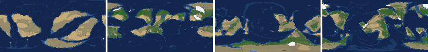

*At 100, 400, 700, 1000 Myr: sea by depth, land green by tree cover / tan where arid, shaded by height, ice white, lakes blue.*

| metric | min | median | max | outside (Myr: worst) |
|---|---|---|---|---|
| land_pct | 29.70 | 31.38 | 38.11 |  |
| cont_pct | 37.18 | 40.03 | 43.45 |  |
| cont_km | 31.69 | 34.51 | 37.96 |  |
| plates | 5.00 | 10.00 | 16.00 |  |
| ocean_age | 34.00 | 67.40 | 95.80 |  |
| speed | 1.63 | 3.87 | 7.69 | 244-244: 1.97; 592-596: 1.63 |
| sea_level | -179.70 | 71.65 | 231.50 |  |
| sea_ice_m | -18.00 | -3.30 | -0.00 |  |
| ice_pct | 0.00 | 0.60 | 3.30 |  |
| temp | 10.80 | 14.90 | 20.20 |  |
| co2 | -0.85 | -0.33 | 0.20 |  |
| dry_pct | 10.60 | 24.38 | 41.67 | 520-532: 10.60 |
| inland_pct | 0.66 | 4.24 | 23.23 | 52-52: 6.56; 64-168: 1.25; 196-208: 4.76; 220-220: 6.42; +5 more |
| lake_pct | 0.07 | 0.50 | 3.59 | 64-68: 0.09; 88-132: 0.07; 160-160: 3.43; 172-172: 3.59; +2 more |
| lake_max_mkm2 | 0.01 | 0.10 | 3.92 | 56-56: 1.99; 152-160: 3.92; 172-180: 2.15; 244-248: 1.16; +1 more |
| max_elev_km | 2.01 | 6.42 | 8.38 |  |
| trees_pct | 20.04 | 29.28 | 38.17 |  |
| npp | 287.40 | 373.80 | 447.10 |  |
| landmasses | 2.00 | 9.00 | 19.00 | 60-60: 2; 168-180: 2 |
| largest_pct | 9.30 | 15.80 | 34.30 |  |

## Determinism

Seed 1 L6 re-run to 100 Myr (run a46e44) against the sweep's run 6b140a: 26 keyframes x 43 layers, **bit-identical** (layer hashes and frame stats).
