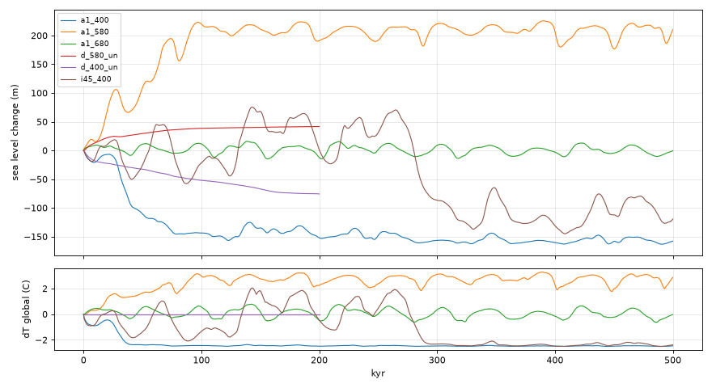
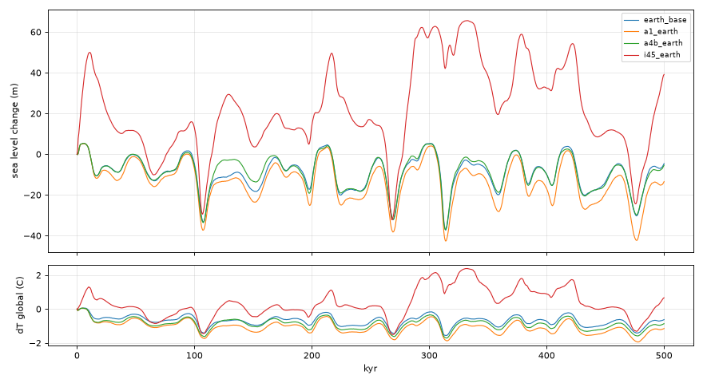

# PW-030 handoff: real ice-age cycles in the time zoom (2026-10-19, agent pw030)

**Outcome: target not met; blocker written up.** Five attempts. One small consistency change merged
(the time zoom's ice albedo is now the run's rule). Proglacial-lake calving and glacial dust were built,
measured, and left out because they changed nothing measurable (patch kept in `PW-030/`; the
numbers are below so nobody has to retry them blind).

## Setup
- Fresh L6 runs on cca815e (in a scratch data root, not the shared store): seed 11 (`82fc14`) and seed 2
  (`27ea70`), 700 Myr. Moments: **s400** = seed 11 @ 400 Myr (30 Mkm³, 10% of land iced: moderately
  cold), **s580** = seed 2 @ 580 Myr (92 Mkm³, 23% of land), **s680** = seed 11 @ 680 Myr (10 Mkm³, 6%).
  Plus Earth L6 (`source_earth(6)`, default params). 500 kyr each, in memory (~80-130 s at L6).
- Metrics: sea-level min/max/swing; cycles from alternating extremes with a 30 m hysteresis (build =
  highstand to lowstand, termination = lowstand to highstand); ice share of land at highstands
  (interglacial) and lowstands; FFT power share in 80-130 / 35-50 / 18-25 kyr bands.

## Baseline (cca815e)
| source | swing m | range m | IG ice % land | G ice % land | builds / terms kyr | 100-kyr power |
|---|---|---|---|---|---|---|
| Earth | 43 | -37 .. +5 | 8-9 | 17-18 | 101, 57, 13 / 106, 32, 104 (obliquity-paced) | 0.11 (41 kyr: 0.51) |
| s400 | 161 | -161 .. 0 | 10 then 20 | 24 | one 123 kyr build to a cold state it never leaves | 0.14 |
| s580 | 225 | 0 .. +225 | 3-4 after the drift | 12-13 | 10-30 / 15-36 heartbeat around +210 m | 0.01 |
| s680 | 30 | -15 .. +15 | 3.4 | 8-9 | heartbeat | 0.08 |

*a1_* = the merged code (identical to baseline within a few m); d_*_un = no orbit, CO2 or ice albedo;
i45_400 = diagnostic only (insol_k 0.45).*

## What the drift is (PW-436)
Factor separation, 150-200 kyr (sea-level change at 150 kyr):
| | s580 | s400 |
|---|---|---|
| unforced (no orbit, CO2, albedo) | +40 m | -67 m |
| feedbacks only (no orbit) | +104 | -147 |
| orbit only (no feedbacks) | +169 (eccentricity alone +142) | -20 |
| default | +210 | -128 |

1. **The run's moments are not at the time zoom's unforced balance** on these new runs (+29 / -33 m at
   50 kyr; PW-366's one tested moment was +13 m). Sign depends on the moment.
2. **The CO2 + ice-albedo loop amplifies any drift ~2.5x**, then saturates: the time zoom has two
   branches and goes to one (s580: warm, dT +2.5..3 C; s400: cold, dT -2.25 C, a flat line for 400 kyr:
   CO2 clipped at average_room x its cap after 60 m, ice area at the geography's limit, so no feedback
   is left and the cold branch is rigid).
3. **Orbit rectification loses ice**: melt at a precession peak takes ~10 kyr, regrowth is slower and
   the lost height doesn't come back, so a forced zoom's mean ice is below the run's orbit-averaged
   balance (s580: eccentricity alone +142 m). This is PW-436's "convexity" suspect, confirmed, but it is
   dynamic (fast melt, slow regrowth), not the static spread of cycle_dq's orbits.
So "swings around its start" needs the start to lie between the two branches and the cycle to visit both.

## Attempts
1. **Ice albedo = the run's rule** (`earth.py`: 1.5 C per 3% of the planet, levelling off toward 3 C,
   tanh) as the change from the start, replacing half the rule capped at 2 C x room. Merged. Earth:
   min -37 -> -43 m (500 kyr), deepest in 150 kyr -33 -> -37 m (at 108 kyr), at 150 kyr -18 -> -23 m, interglacials unchanged (8-9%); run moments within
   2-5 m of baseline (their area is saturated or small). The halving had no stated reason the run doesn't
   share (both have the ice surface's own local climate).
2. **Proglacial lakes** (Pollard 1983): a land margin calves at `lake_calving` m/yr per m of water where
   its bed lies below the lowest bare neighbour (the spill), above sea level. 0.25/yr: lakes took
   77-105 m of sea level in 500 kyr against 5,400-8,900 m of marine calving; no change to any metric
   (s400 cold branch still terminates never; Earth min -40). 1.0/yr: Earth -37, s400 -146 (the lake
   slows the build a little). At ~110 km cells the moat a sheet presses down is smoothed by the 150 km
   flexure, so margins rarely stand below their bare neighbours.
3. **Glacial dust from exposed shelves**: snow and ice darkened by 0.1 (0.2) of albedo when the falling
   sea bares as much shelf as Earth's LGM (3.5% of the surface): ice_absorb + dalpha, summer damping x
   (1 - dalpha / 0.6). No effect: s400's world has 0.4% of its surface within 120 m of sea level (Earth
   3.3%), and Earth only falls ~40 m.
4. **Dust from the glacial cooling** (dry, windy, bare: full at -4 C or -3 C): Earth unchanged (-37),
   s400 cold branch unchanged (-153..-160), 100-kyr power 0.14 -> 0.20-0.24. Dusty *snow* matters little
   because the cycling margins are bare ice in summer already (bright share 0.3).
5. **Diagnostic, not a candidate**: the orbital sensitivity `insol_k` 0.25 -> 0.35 / 0.45. At 0.45 s400
   cycles (swings 69-103 m, terminations 17-28 kyr, builds 8-66 kyr), Earth's swing is 98 m with 0.36 of
   its power at 100 kyr; but Earth's interglacials fall to 1-4% of land (+66 m: Antarctica goes), so a
   global forcing increase is wrong. At 0.35 s400 makes one clean cycle (build 100 kyr, termination
   19 kyr, swing 144 m) and then stays cold.

## Conclusion (blocker)
The cycles need a **state-dependent** sensitivity: big, low-latitude glacial sheets must become much more
sensitive to a summer-sun peak than Antarctica/Greenland-type interglacial sheets. The model's
ice-age dynamics are set by the global feedback branches and the rigid saturated cold branch, not by
margin processes: lakes and dust at physically plausible strengths move nothing; only a ~1.8x stronger
orbital response does, and that destroys the interglacial. Candidates, in the order I'd try them:
- **The cold branch's rigidity**: CO2 hard-clipped after 60 m (`average_room` 0.5 for a run's moment) and
  the albedo saturated by geography. A smooth CO2 saturation, or CO2 that also follows the (lagged)
  global/southern temperature instead of only the ice volume, keeps a feedback alive on the cold branch,
  so an insolation peak's melt is amplified. Needs-decision (draft).
- **The sheet's own carried air** (PW-336, `icemass.air_mass`: summer warmth damped by 0.6 x the iced
  share within ~1000 km) is the strongest stabiliser of big sheets' margins; calibrated on Antarctica's
  coasts, it may over-protect mid-latitude glacial margins in summer. Shared with the run, so a run-lane
  change. Draft.
- **Bed lag** (`iso_tau` 10 kyr) did nothing on s400 or s580.
- **Overturning/meltwater** (PW-018): not tried; with the 10 kyr full-climate refresh the overturning can't
  react within a termination anyway.

## Reproduce
Scripts in `PW-030/` (paths inside are this session's scratch folder; adjust): `tz_eval.py TAG SOURCE KYR k=v ...` (summary JSON + series),
`sweep.sh KYR "TAG:SRC:k=v ..."` (parallel), `plot.py`. The lake/dust patch:
`PW-030/lakes_dust_albedo.patch` (against cca815e; includes attempt 1).
