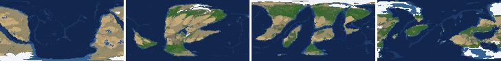
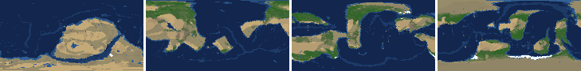
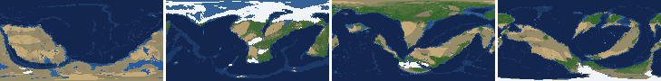
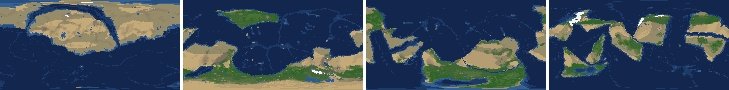
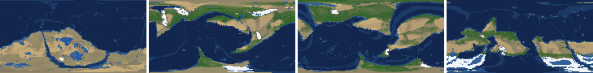
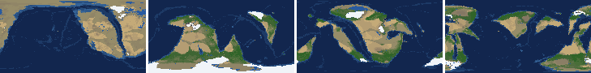
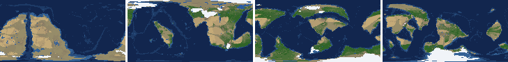
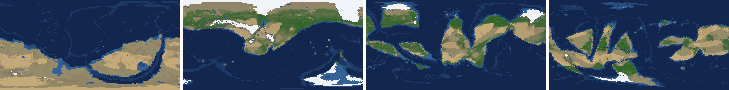

# Health sweep 2026-10-23 06:00

Commit 1d076ad. 8 runs (default params, `--every 4`) at 2 workers x 2 numba threads; simulations 35.0 min wall. Made by `tools/health.py` (PW-246).

## Runs

| seed | L | Myr | run | sim s | trees / flowering trees from | dT range C | peaks > 9.5 km | giant-lake frames % | crust volume end/start | ice SL < -150 m % | <= 4 plates % | ice bar old | ice bar new (ice-v2-criteria.md) | icehouse % |
|---|---|---|---|---|---|---|---|---|---|---|---|---|---|---|
| 1 | 6 | 500 | aee5a1 | 489 | 132 / 412 | 12.9 | 0 | 2.0 | 0.968 | 11.8 | 0.0 | ok | ok | 31.4 |
| 2 | 6 | 500 | 1377c8 | 460 | 140 / 396 | 8.8 | 0 | 11.8 | 0.968 | 0.0 | 0.0 | ok | F: icehouse 0% of the time, outside 5-70% | 0.0 |
| 11 | 6 | 500 | d6a78a | 610 | 128 / 372 | 6.6 | 0 | 3.9 | 0.956 | 0.0 | 0.0 | F | ok | 5.9 |
| 21 | 6 | 500 | dd1f33 | 456 | 136 / 404 | 7.3 | 0 | 15.7 | 0.959 | 0.0 | 0.0 | ok | F: icehouse 0% of the time, outside 5-70% | 0.0 |
| 3199 | 6 | 500 | 981b0c | 540 | 132 / 376 | 9.0 | 0 | 9.8 | 0.98 | 2.0 | 0.0 | ok | ok | 15.7 |
| 42 | 6 | 500 | ef5a4a | 550 | 116 / 404 | 7.1 | 0 | 17.6 | 0.971 | 0.0 | 0.0 | ok | ok | 29.4 |
| 77 | 6 | 500 | 6536e9 | 528 | 124 / 416 | 8.1 | 0 | 2.0 | 0.957 | 15.7 | 0.0 | ok | F: icehouse 82% of the time, outside 5-70% | 82.4 |
| 505 | 6 | 500 | 44129e | 466 | 132 / 416 | 7.2 | 0 | 2.0 | 0.972 | 0.0 | 0.0 | ok | ok | 19.6 |

## Medians by seed (after 300 Myr; tree cover after forests, NPP after flowering trees appear)

| seed | L | land_pct | cont_pct | cont_km | plates | ocean_age | speed | sea_level | sea_ice_m | sea_tect_m | ice_pct | temp | co2 | dry_pct | inland_pct | lake_pct | lake_max_mkm2 | max_elev_km | trees_pct | npp | landmasses | largest_pct |
|---|---|---|---|---|---|---|---|---|---|---|---|---|---|---|---|---|---|---|---|---|---|---|
| 1 | 6 | 32.6 | 40.1 | 33.9 | 10.0 | 62.6 | 4.6 | 13.0 | -11.0 | 34.9 | 1.2 | 16.5 | 0.4 | 21.2 | 4.6 | 0.5 | 0.1 | 6.8 | 37.0 | 361.0 | 6.0 | 24.3 |
| 2 | 6 | 35.3 | 40.7 | 33.5 | 6.0 | 73.7 | 4.3 | -134.0 | -4.8 | -130.0 | 0.3 | 17.0 | 1.0 | 22.7 | 4.6 | 0.6 | 0.1 | 4.6 | 36.5 | 319.6 | 7.0 | 26.7 |
| 11 | 6 | 31.8 | 40.7 | 33.2 | 12.0 | 46.5 | 4.0 | 156.8 | -11.4 | 167.9 | 1.0 | 16.7 | 0.2 | 22.8 | 4.3 | 0.5 | 0.1 | 6.5 | 28.2 | 351.3 | 9.0 | 17.6 |
| 21 | 6 | 33.4 | 41.0 | 33.1 | 12.0 | 51.1 | 4.4 | 107.5 | -0.8 | 113.1 | 0.1 | 17.4 | 0.2 | 27.8 | 5.2 | 0.3 | 0.1 | 5.2 | 27.7 | 346.4 | 8.0 | 15.8 |
| 3199 | 6 | 34.5 | 40.3 | 33.8 | 11.0 | 69.4 | 4.5 | -85.9 | -8.2 | -58.5 | 0.6 | 15.0 | 0.5 | 30.4 | 6.9 | 0.4 | 0.1 | 5.8 | 27.7 | 306.8 | 8.0 | 24.9 |
| 42 | 6 | 33.0 | 39.8 | 33.9 | 13.0 | 53.5 | 4.8 | 23.2 | -10.6 | 49.0 | 0.8 | 17.3 | 1.2 | 29.9 | 5.5 | 0.6 | 0.4 | 6.4 | 32.8 | 325.9 | 10.0 | 23.6 |
| 77 | 6 | 32.3 | 40.0 | 33.8 | 13.0 | 56.4 | 3.8 | 31.7 | -37.4 | 70.6 | 2.6 | 15.0 | -0.3 | 18.0 | 2.3 | 0.6 | 0.1 | 6.2 | 39.0 | 360.5 | 9.0 | 14.3 |
| 505 | 6 | 33.3 | 41.5 | 33.1 | 10.0 | 56.9 | 4.3 | 22.2 | -4.6 | 25.4 | 0.3 | 14.7 | -0.5 | 28.3 | 3.0 | 0.3 | 0.1 | 4.9 | 31.4 | 430.3 | 8.0 | 25.1 |

Measured on the run's keyframes (no slicing). A keyframe's rivers and lakes are routed on its own terrain (PW-239), so `inland_raw_pct` (every routed end on land, as highlights counts it) and `inland_pct` (ends that are closed lakes, salt pans or real pits) agree but for ends under land ice. Land ice and land shares use cells (near-equal area).

## Envelopes

| metric | low | high | Earth | source |
|---|---|---|---|---|
| land, % of surface (`land_pct`) | 22 | 42 | 29.20 | tests/test_envelopes.py (22-42%); Earth 29.2% |
| continental crust, % of surface (`cont_pct`) | 33 | 50 | 41 | tests/test_envelopes.py (33-50%); Earth ~41% with shelves (Cogley 1984) |
| mean continental crust thickness, km (`cont_km`) | 31 | 40 | 39 | target 35 km (PW-238, continental_thickness); Earth ~39 km (Christensen & Mooney 1995); known thinning to 32-33 km (PW-046) |
| plates (`plates`) | 5 | 30 | 15 | tests/test_envelopes.py (5-30; max_plates 30); Earth 7 major + ~8 minor; <= 4 is the PW-191 collapse |
| mean ocean-floor age, Myr (`ocean_age`) | 25 | 120 | 64 | tests/test_envelopes.py (25-120); Earth ~64 Myr (Mueller et al. 2008); PW-051 |
| mean plate speed, cm/yr (`speed`) | 2 | 9 | 4.50 | tests/test_envelopes.py (2-9 cm/yr); Earth ~4-5 |
| sea level, m (ice + ocean basins) (`sea_level`) | -250 | 300 | 0 | Phanerozoic ~-130 (LGM) .. +250 m (earth.py; Haq & Schutter 2008); -250: PW-240's hard goal |
| sea level from land ice, m (`sea_ice_m`) | -250 | - | 0 | Earth LGM ~-130 m; PW-240 goal -150 m typical / -250 m worst |
| sea level from the ocean basins, m (the other part of sea_level) (`sea_tect_m`) | -250 | 300 | 0 | PW-293/549: the floor's mean depth against the start's; Phanerozoic ~-100..+250 m without the ice (Haq & Schutter 2008; Mueller et al. 2008) |
| land ice, % of surface (`ice_pct`) | - | 10 | 3.10 | Earth 3.1% now (earth.EARTH_ICE), ~7-8% at the LGM |
| global mean temperature, C (`temp`) | 8 | 30 | 14.50 | Earth 14.5 C; LGM ~8 C (Tierney et al. 2020); Phanerozoic hothouses to ~30 C (Scotese et al. 2021) |
| CO2 index (ln of the CO2 stock against the reference balance) (`co2`) | -6.0 | 6.0 | 0.00 | where the forcing levels off in earth.py (+-CO2_MAX = 6 e-folds); Earth 0 |
| arid (Koppen B), % of land (`dry_pct`) | 12 | 45 | 30 | tests/test_envelopes.py (12-45%); Earth ~30% (Beck et al. 2018) |
| land draining inland, % of ice-free land (to a closed lake, salt pan or real pit) (`inland_pct`) | 8 | 30 | 18 | Earth ~18% (overview 2.9); L6 known ~9.5-11% (PW-054, PW-243). `inland_raw_pct` (not checked) follows the stored `downstream` to any end, as highlights does; since PW-239 the two agree but for ends under land ice |
| lakes, % of land (`lake_pct`) | 0.2 | 3.0 | 1.80 | Earth ~1.8% of ice-free land (HydroLAKES, Messager et al. 2016); generated L6 worlds 0.5-1% |
| largest lake, million km2 (`lake_max_mkm2`) | - | 1.0 | 0.37 | Caspian 0.37 Mkm2; 1 Mkm2 = the overview's giant lake (2.9) |
| highest peak, km (`max_elev_km`) | - | 9.5 | 8.85 | Everest 8.85 km; PW-172 (spikes above ~9.5 km) |
| tree cover, % of ice-free land (after forests appear) (`trees_pct`) | 10 | 50 | 30 | Earth ~30% potential canopy (forest 55-60 of ~130 Mkm2, overview 2.18) |
| land NPP, g C/m2/yr (after flowering trees appear) (`npp`) | 200 | 700 | 430 | Earth ~56 Pg C/yr over ~130 Mkm2 = ~430; the model on Earth's terrain 50 Pg C/yr, ~385 (overview 2.18). Before flowering trees (plant group 4) stand-ins grow at 70%, so runs sit at ~150-280 |
| landmasses (>= 3 cells) (`landmasses`) | 3 | 80 | - | loose: a lone supercontinent or a shattered archipelago |
| largest landmass, % of surface (`largest_pct`) | 5 | 35 | 16.60 | Afro-Eurasia 16.6%; a Pangaea ~30% (scorecard largest_max) |
| global temperature range over the run, C (`dT_range`, per run) | - | 25 | 25 | Phanerozoic 11-36 C (Scotese et al. 2021) |
| keyframes with a peak above 9.5 km (`peak_frames`, per run) | - | 0 | 0 | PW-172 (L7 seed 3199: 3 of 251) |
| % of keyframes with a lake over 1 Mkm2 (`giant_lake_frames`, per run) | - | 5 | 0 | overview 2.9 (L6: 3 of ~150 frames) |
| continental crust volume, end / start (`volume_ratio`, per run) | 0.9 | 1.1 | 1.0 | scorecard volume_ratio (x1.006) |
| % of keyframes with ice sea level below -150 m (`sea_ice_below_150`, per run) | - | 10 | 0 | PW-240 |
| % of keyframes with <= 4 plates (`low_plates`, per run) | - | 2 | 0 | PW-191 (L7 seed 21: 1%) |

## Top outliers (of 59 spells; severity = excess / band width x (0.2 + share of the run))

| seed | L | metric | Myr | frames | worst | envelope | severity |
|---|---|---|---|---|---|---|---|
| 42 | 6 | giant_lake_frames | run | - | 17.60 | -..5 | 2.52 |
| 21 | 6 | giant_lake_frames | run | - | 15.70 | -..5 | 2.14 |
| 2 | 6 | giant_lake_frames | run | - | 11.80 | -..5 | 1.36 |
| 21 | 6 | lake_max_mkm2 | 312-340 | 6 | 5.55 | -..1.0 | 1.128 |
| 2 | 6 | lake_max_mkm2 | 396-412 | 4 | 5.29 | -..1.0 | 0.995 |
| 3199 | 6 | giant_lake_frames | run | - | 9.80 | -..5 | 0.96 |
| 2 | 6 | lake_max_mkm2 | 376-376 | 1 | 5.40 | -..1.0 | 0.916 |
| 21 | 6 | lake_max_mkm2 | 356-356 | 1 | 4.98 | -..1.0 | 0.828 |
| 77 | 6 | sea_ice_below_150 | run | - | 15.70 | -..10 | 0.57 |
| 3199 | 6 | lake_max_mkm2 | 388-388 | 1 | 2.52 | -..1.0 | 0.315 |
| 3199 | 6 | lake_max_mkm2 | 496-500 | 2 | 2.27 | -..1.0 | 0.273 |
| 11 | 6 | lake_max_mkm2 | 300-304 | 2 | 2.18 | -..1.0 | 0.255 |
| 1 | 6 | lake_max_mkm2 | 432-432 | 1 | 1.97 | -..1.0 | 0.201 |
| 1 | 6 | inland_pct | 300-500 | 49 | 1.10 | 8..30 | 0.185 |
| 1 | 6 | sea_ice_below_150 | run | - | 11.80 | -..10 | 0.18 |
| 505 | 6 | inland_pct | 300-500 | 50 | 1.48 | 8..30 | 0.177 |
| 77 | 6 | inland_pct | 308-500 | 46 | 1.29 | 8..30 | 0.172 |
| 42 | 6 | lake_max_mkm2 | 344-376 | 8 | 1.57 | -..1.0 | 0.15 |
| 11 | 6 | inland_pct | 300-500 | 47 | 2.29 | 8..30 | 0.149 |
| 2 | 6 | lake_pct | 396-404 | 3 | 4.56 | 0.2..3.0 | 0.125 |
| 3199 | 6 | lake_max_mkm2 | 368-368 | 1 | 1.59 | -..1.0 | 0.124 |
| 21 | 6 | inland_pct | 348-500 | 36 | 2.51 | 8..30 | 0.121 |
| 42 | 6 | inland_pct | 360-500 | 34 | 2.52 | 8..30 | 0.117 |
| 2 | 6 | inland_pct | 408-500 | 22 | 1.49 | 8..30 | 0.111 |
| 3199 | 6 | inland_pct | 300-464 | 35 | 3.36 | 8..30 | 0.101 |
| 2 | 6 | inland_pct | 300-364 | 16 | 2.22 | 8..30 | 0.086 |
| 42 | 6 | lake_max_mkm2 | 300-300 | 1 | 1.38 | -..1.0 | 0.079 |
| 3199 | 6 | lake_max_mkm2 | 356-356 | 1 | 1.37 | -..1.0 | 0.077 |
| 2 | 6 | lake_pct | 376-376 | 1 | 3.85 | 0.2..3.0 | 0.063 |
| 2 | 6 | inland_pct | 380-396 | 5 | 2.64 | 8..30 | 0.058 |

## Per seed: min / median / max after the 300 Myr spin-up, and spells outside the envelopes

### Seed 1, L6 (run aee5a1)

*At 48, 200, 348, 500 Myr: sea by depth, land green by tree cover / tan where arid, shaded by height, ice white, lakes blue.*

| metric | min | median | max | outside (Myr: worst) |
|---|---|---|---|---|
| land_pct | 30.30 | 32.59 | 33.43 |  |
| cont_pct | 38.68 | 40.15 | 40.88 |  |
| cont_km | 33.10 | 33.94 | 35.00 |  |
| plates | 9.00 | 10.00 | 14.00 |  |
| ocean_age | 55.50 | 62.60 | 65.50 |  |
| speed | 3.32 | 4.62 | 5.02 |  |
| sea_level | -157.70 | 13.00 | 45.00 |  |
| sea_ice_m | -215.40 | -11.00 | -4.80 |  |
| sea_tect_m | -18.40 | 34.90 | 59.20 |  |
| ice_pct | 0.70 | 1.20 | 7.40 |  |
| temp | 8.10 | 16.50 | 21.00 |  |
| co2 | -0.08 | 0.37 | 1.05 |  |
| dry_pct | 17.72 | 21.19 | 24.22 |  |
| inland_pct | 1.10 | 4.62 | 8.96 | 300-500: 1.10 |
| lake_pct | 0.22 | 0.52 | 1.46 |  |
| lake_max_mkm2 | 0.03 | 0.09 | 1.97 | 432-432: 1.97 |
| max_elev_km | 5.36 | 6.76 | 8.04 |  |
| trees_pct | 28.72 | 36.99 | 48.64 |  |
| npp | 245.80 | 361.00 | 404.20 |  |
| landmasses | 4.00 | 6.00 | 16.00 |  |
| largest_pct | 13.10 | 24.30 | 30.00 |  |

### Seed 2, L6 (run 1377c8)

*At 48, 200, 348, 500 Myr: sea by depth, land green by tree cover / tan where arid, shaded by height, ice white, lakes blue.*

| metric | min | median | max | outside (Myr: worst) |
|---|---|---|---|---|
| land_pct | 34.13 | 35.29 | 36.10 |  |
| cont_pct | 38.67 | 40.73 | 41.88 |  |
| cont_km | 32.61 | 33.50 | 34.87 |  |
| plates | 5.00 | 6.00 | 8.00 |  |
| ocean_age | 69.80 | 73.70 | 89.30 |  |
| speed | 3.00 | 4.31 | 4.88 |  |
| sea_level | -220.70 | -134.00 | -75.30 |  |
| sea_ice_m | -16.20 | -4.80 | -1.50 |  |
| sea_tect_m | -204.50 | -130.00 | -72.30 |  |
| ice_pct | 0.10 | 0.30 | 0.90 |  |
| temp | 10.80 | 17.00 | 19.60 |  |
| co2 | -0.21 | 1.01 | 2.26 |  |
| dry_pct | 14.05 | 22.69 | 39.12 |  |
| inland_pct | 1.49 | 4.58 | 24.48 | 300-364: 2.22; 380-396: 2.64; 408-500: 1.49 |
| lake_pct | 0.17 | 0.57 | 4.56 | 316-316: 0.17; 376-376: 3.85; 396-404: 4.56 |
| lake_max_mkm2 | 0.04 | 0.14 | 5.40 | 304-304: 1.03; 376-376: 5.40; 396-412: 5.29 |
| max_elev_km | 3.64 | 4.61 | 6.17 |  |
| trees_pct | 20.31 | 36.54 | 51.14 | 416-420: 51.14 |
| npp | 218.00 | 319.60 | 338.50 |  |
| landmasses | 3.00 | 7.00 | 16.00 |  |
| largest_pct | 19.20 | 26.70 | 34.50 |  |

### Seed 11, L6 (run d6a78a)

*At 48, 200, 348, 500 Myr: sea by depth, land green by tree cover / tan where arid, shaded by height, ice white, lakes blue.*

| metric | min | median | max | outside (Myr: worst) |
|---|---|---|---|---|
| land_pct | 30.25 | 31.77 | 32.34 |  |
| cont_pct | 39.83 | 40.69 | 41.69 |  |
| cont_km | 32.63 | 33.18 | 34.21 |  |
| plates | 9.00 | 12.00 | 16.00 |  |
| ocean_age | 35.00 | 46.50 | 52.20 |  |
| speed | 3.42 | 4.02 | 5.71 |  |
| sea_level | 23.30 | 156.80 | 242.30 |  |
| sea_ice_m | -30.70 | -11.40 | -3.70 |  |
| sea_tect_m | 41.60 | 167.90 | 256.10 |  |
| ice_pct | 0.30 | 1.00 | 2.00 |  |
| temp | 13.80 | 16.70 | 20.40 |  |
| co2 | -0.99 | 0.23 | 1.45 |  |
| dry_pct | 19.36 | 22.78 | 32.45 |  |
| inland_pct | 2.29 | 4.31 | 9.91 | 300-500: 2.29 |
| lake_pct | 0.28 | 0.48 | 1.98 |  |
| lake_max_mkm2 | 0.03 | 0.07 | 2.18 | 300-304: 2.18 |
| max_elev_km | 4.25 | 6.52 | 8.33 |  |
| trees_pct | 17.10 | 28.25 | 47.42 |  |
| npp | 234.00 | 351.30 | 405.70 |  |
| landmasses | 5.00 | 9.00 | 14.00 |  |
| largest_pct | 13.50 | 17.60 | 30.10 |  |

### Seed 21, L6 (run dd1f33)

*At 48, 200, 348, 500 Myr: sea by depth, land green by tree cover / tan where arid, shaded by height, ice white, lakes blue.*

| metric | min | median | max | outside (Myr: worst) |
|---|---|---|---|---|
| land_pct | 32.54 | 33.40 | 34.45 |  |
| cont_pct | 39.48 | 41.00 | 41.53 |  |
| cont_km | 32.58 | 33.13 | 34.49 |  |
| plates | 10.00 | 12.00 | 14.00 |  |
| ocean_age | 45.70 | 51.10 | 56.70 |  |
| speed | 3.09 | 4.39 | 5.14 |  |
| sea_level | 36.50 | 107.50 | 151.40 |  |
| sea_ice_m | -7.90 | -0.80 | -0.00 |  |
| sea_tect_m | 36.50 | 113.10 | 152.70 |  |
| ice_pct | 0.00 | 0.10 | 0.70 |  |
| temp | 14.50 | 17.40 | 21.80 |  |
| co2 | -0.49 | 0.21 | 0.81 |  |
| dry_pct | 23.18 | 27.79 | 32.62 |  |
| inland_pct | 2.51 | 5.23 | 17.18 | 304-304: 7.24; 348-500: 2.51 |
| lake_pct | 0.14 | 0.30 | 3.44 | 332-336: 3.44; 356-356: 3.31; 384-396: 0.14; 408-408: 0.18; +2 more |
| lake_max_mkm2 | 0.03 | 0.07 | 5.55 | 300-300: 1.08; 312-340: 5.55; 356-356: 4.98 |
| max_elev_km | 3.74 | 5.23 | 7.83 |  |
| trees_pct | 20.09 | 27.69 | 37.13 |  |
| npp | 232.10 | 346.40 | 377.50 |  |
| landmasses | 3.00 | 8.00 | 14.00 |  |
| largest_pct | 12.00 | 15.80 | 22.00 |  |

### Seed 3199, L6 (run 981b0c)

*At 48, 200, 348, 500 Myr: sea by depth, land green by tree cover / tan where arid, shaded by height, ice white, lakes blue.*

| metric | min | median | max | outside (Myr: worst) |
|---|---|---|---|---|
| land_pct | 31.84 | 34.54 | 35.46 |  |
| cont_pct | 38.64 | 40.30 | 40.96 |  |
| cont_km | 33.00 | 33.77 | 34.94 |  |
| plates | 6.00 | 11.00 | 13.00 |  |
| ocean_age | 46.30 | 69.40 | 107.40 |  |
| speed | 2.05 | 4.46 | 6.35 |  |
| sea_level | -322.50 | -85.90 | 133.30 | 300-352: -311.80; 496-500: -322.50 |
| sea_ice_m | -175.20 | -8.20 | -2.80 |  |
| sea_tect_m | -303.40 | -58.50 | 142.40 | 300-348: -303.40 |
| ice_pct | 0.20 | 0.60 | 5.70 |  |
| temp | 9.80 | 15.00 | 18.80 |  |
| co2 | -0.41 | 0.52 | 1.42 |  |
| dry_pct | 25.76 | 30.45 | 38.04 |  |
| inland_pct | 3.36 | 6.94 | 14.73 | 300-464: 3.36; 488-488: 7.36 |
| lake_pct | 0.12 | 0.41 | 2.44 | 412-420: 0.12; 444-448: 0.14 |
| lake_max_mkm2 | 0.03 | 0.10 | 2.52 | 356-356: 1.37; 368-368: 1.59; 388-388: 2.52; 496-500: 2.27 |
| max_elev_km | 4.82 | 5.84 | 8.52 |  |
| trees_pct | 20.99 | 27.73 | 37.87 |  |
| npp | 237.90 | 306.80 | 354.90 |  |
| landmasses | 3.00 | 8.00 | 13.00 |  |
| largest_pct | 17.40 | 24.90 | 35.30 | 472-492: 35.30 |

### Seed 42, L6 (run ef5a4a)

*At 48, 200, 348, 500 Myr: sea by depth, land green by tree cover / tan where arid, shaded by height, ice white, lakes blue.*

| metric | min | median | max | outside (Myr: worst) |
|---|---|---|---|---|
| land_pct | 32.15 | 33.00 | 33.93 |  |
| cont_pct | 39.10 | 39.81 | 41.14 |  |
| cont_km | 33.27 | 33.92 | 34.34 |  |
| plates | 10.00 | 13.00 | 15.00 |  |
| ocean_age | 45.90 | 53.50 | 60.60 |  |
| speed | 3.56 | 4.81 | 5.45 |  |
| sea_level | -73.00 | 23.20 | 128.60 |  |
| sea_ice_m | -31.10 | -10.60 | -4.20 |  |
| sea_tect_m | -66.00 | 49.00 | 136.00 |  |
| ice_pct | 0.30 | 0.80 | 1.90 |  |
| temp | 15.20 | 17.30 | 22.30 |  |
| co2 | -0.24 | 1.20 | 2.39 |  |
| dry_pct | 20.01 | 29.94 | 37.24 |  |
| inland_pct | 2.52 | 5.54 | 15.38 | 332-340: 5.49; 360-500: 2.52 |
| lake_pct | 0.23 | 0.62 | 1.40 |  |
| lake_max_mkm2 | 0.03 | 0.42 | 1.57 | 300-300: 1.38; 344-376: 1.57 |
| max_elev_km | 4.92 | 6.42 | 8.41 |  |
| trees_pct | 18.54 | 32.80 | 36.58 |  |
| npp | 276.40 | 325.90 | 356.50 |  |
| landmasses | 5.00 | 10.00 | 14.00 |  |
| largest_pct | 8.50 | 23.60 | 30.40 |  |

### Seed 77, L6 (run 6536e9)

*At 48, 200, 348, 500 Myr: sea by depth, land green by tree cover / tan where arid, shaded by height, ice white, lakes blue.*

| metric | min | median | max | outside (Myr: worst) |
|---|---|---|---|---|
| land_pct | 29.20 | 32.26 | 33.34 |  |
| cont_pct | 39.13 | 40.01 | 40.43 |  |
| cont_km | 33.16 | 33.77 | 34.58 |  |
| plates | 11.00 | 13.00 | 15.00 |  |
| ocean_age | 44.00 | 56.40 | 64.00 |  |
| speed | 2.66 | 3.78 | 4.50 |  |
| sea_level | -269.90 | 31.70 | 144.40 | 440-444: -269.90 |
| sea_ice_m | -253.20 | -37.40 | -11.90 | 440-444: -253.20 |
| sea_tect_m | -16.70 | 70.60 | 175.90 |  |
| ice_pct | 1.10 | 2.60 | 8.90 |  |
| temp | 9.00 | 15.00 | 17.10 |  |
| co2 | -1.15 | -0.25 | 1.79 |  |
| dry_pct | 14.69 | 17.98 | 24.23 |  |
| inland_pct | 1.29 | 2.33 | 9.70 | 308-500: 1.29 |
| lake_pct | 0.26 | 0.55 | 2.29 |  |
| lake_max_mkm2 | 0.04 | 0.12 | 1.07 | 324-324: 1.07 |
| max_elev_km | 4.80 | 6.15 | 8.50 |  |
| trees_pct | 24.63 | 39.05 | 47.81 |  |
| npp | 266.80 | 360.50 | 409.30 |  |
| landmasses | 4.00 | 9.00 | 17.00 |  |
| largest_pct | 9.80 | 14.30 | 17.60 |  |

### Seed 505, L6 (run 44129e)

*At 48, 200, 348, 500 Myr: sea by depth, land green by tree cover / tan where arid, shaded by height, ice white, lakes blue.*

| metric | min | median | max | outside (Myr: worst) |
|---|---|---|---|---|
| land_pct | 32.42 | 33.31 | 34.65 |  |
| cont_pct | 39.04 | 41.50 | 42.24 |  |
| cont_km | 32.53 | 33.08 | 34.92 |  |
| plates | 8.00 | 10.00 | 13.00 |  |
| ocean_age | 52.00 | 56.90 | 67.60 |  |
| speed | 3.55 | 4.31 | 5.11 |  |
| sea_level | -144.20 | 22.20 | 61.90 |  |
| sea_ice_m | -46.90 | -4.60 | -0.00 |  |
| sea_tect_m | -106.20 | 25.40 | 73.80 |  |
| ice_pct | 0.00 | 0.30 | 2.70 |  |
| temp | 11.60 | 14.70 | 18.80 |  |
| co2 | -1.41 | -0.47 | 0.47 |  |
| dry_pct | 20.01 | 28.27 | 33.80 |  |
| inland_pct | 1.48 | 3.05 | 8.18 | 300-500: 1.48 |
| lake_pct | 0.15 | 0.26 | 2.13 | 372-372: 0.19; 388-396: 0.15; 420-428: 0.16; 460-480: 0.15 |
| lake_max_mkm2 | 0.01 | 0.05 | 1.25 | 304-304: 1.25 |
| max_elev_km | 3.72 | 4.89 | 6.77 |  |
| trees_pct | 13.08 | 31.45 | 42.06 |  |
| npp | 171.30 | 430.30 | 457.70 | 428-444: 171.30 |
| landmasses | 2.00 | 8.00 | 11.00 | 320-320: 2 |
| largest_pct | 13.70 | 25.10 | 30.00 |  |

## Determinism

Seed 1 L6 re-run to 100 Myr (run 7513e3) against the sweep's run aee5a1: 26 keyframes x 44 layers, **bit-identical** (layer hashes and frame stats).
