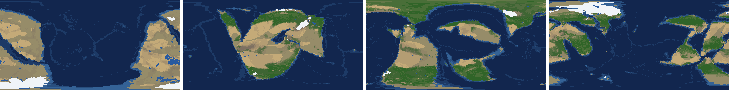
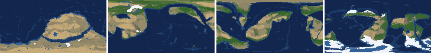
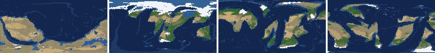
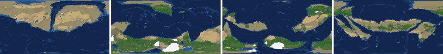
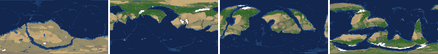
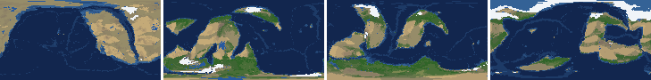
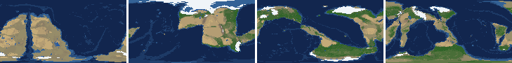
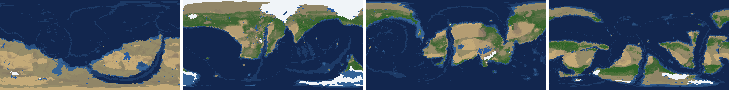

# Health sweep 2026-10-23 06:01

Commit 59b83d7. 8 runs (default params, `--every 4`) at 2 workers x 2 numba threads; simulations 35.9 min wall. Made by `tools/health.py` (PW-246).

## Runs

| seed | L | Myr | run | sim s | trees / flowering trees from | dT range C | peaks > 9.5 km | giant-lake frames % | crust volume end/start | ice SL < -150 m % | <= 4 plates % | ice bar old | ice bar new (ice-v2-criteria.md) | icehouse % |
|---|---|---|---|---|---|---|---|---|---|---|---|---|---|---|
| 1 | 6 | 500 | 97e789 | 481 | 132 / 412 | 9.9 | 0 | 3.9 | 0.97 | 0.0 | 0.0 | ok | ok | 15.7 |
| 2 | 6 | 500 | 68d371 | 518 | 140 / 396 | 13.5 | 0 | 7.8 | 0.97 | 11.8 | 0.0 | ok | ok | 19.6 |
| 11 | 6 | 500 | 25061d | 537 | 128 / 372 | 10.4 | 0 | 27.5 | 0.955 | 0.0 | 0.0 | ok | ok | 43.1 |
| 21 | 6 | 500 | 45536b | 491 | 136 / 404 | 11.6 | 0 | 0.0 | 0.965 | 0.0 | 0.0 | ok | F: icehouse 0% of the time, outside 5-70% | 0.0 |
| 3199 | 6 | 500 | a0f63c | 467 | 132 / 376 | 6.3 | 0 | 3.9 | 0.971 | 0.0 | 0.0 | ok | F: icehouse 0% of the time, outside 5-70% | 0.0 |
| 42 | 6 | 500 | 5c81c5 | 539 | 116 / 404 | 11.1 | 0 | 0.0 | 0.971 | 11.8 | 0.0 | ok | ok | 62.7 |
| 77 | 6 | 500 | 999e54 | 638 | 124 / 416 | 8.0 | 0 | 9.8 | 0.97 | 9.8 | 0.0 | ok | F: icehouse 84% of the time, outside 5-70% | 84.3 |
| 505 | 6 | 500 | 385f55 | 514 | 132 / 416 | 6.1 | 0 | 7.8 | 0.969 | 0.0 | 0.0 | ok | F: icehouse 4% of the time, outside 5-70% | 3.9 |

## Medians by seed (after 300 Myr; tree cover after forests, NPP after flowering trees appear)

| seed | L | land_pct | cont_pct | cont_km | plates | ocean_age | speed | sea_level | sea_ice_m | sea_tect_m | ice_pct | temp | co2 | dry_pct | inland_pct | lake_pct | lake_max_mkm2 | max_elev_km | trees_pct | npp | landmasses | largest_pct |
|---|---|---|---|---|---|---|---|---|---|---|---|---|---|---|---|---|---|---|---|---|---|---|
| 1 | 6 | 33.3 | 40.3 | 33.7 | 15.0 | 57.5 | 4.5 | 84.7 | -9.1 | 91.5 | 0.6 | 16.3 | 0.6 | 23.3 | 3.5 | 0.3 | 0.1 | 6.1 | 33.3 | 333.5 | 10.0 | 15.9 |
| 2 | 6 | 33.6 | 40.8 | 33.2 | 11.0 | 61.3 | 3.9 | 19.7 | -3.5 | 22.3 | 0.3 | 16.4 | 0.7 | 22.6 | 4.6 | 0.4 | 0.1 | 4.6 | 37.8 | 344.4 | 10.0 | 26.7 |
| 11 | 6 | 30.9 | 40.9 | 33.1 | 15.0 | 47.1 | 4.1 | 107.6 | -18.3 | 157.9 | 1.6 | 15.4 | -0.3 | 23.0 | 5.6 | 0.7 | 0.3 | 5.3 | 30.1 | 307.9 | 9.0 | 14.1 |
| 21 | 6 | 32.8 | 41.1 | 33.3 | 11.0 | 47.9 | 3.9 | 132.5 | -4.8 | 136.6 | 0.3 | 15.5 | -0.3 | 16.3 | 2.3 | 0.3 | 0.1 | 4.9 | 31.8 | 411.7 | 10.0 | 18.9 |
| 3199 | 6 | 33.3 | 40.2 | 33.6 | 12.0 | 50.0 | 4.7 | 134.9 | -3.1 | 136.7 | 0.2 | 14.8 | 0.2 | 23.8 | 3.6 | 0.3 | 0.1 | 4.5 | 35.9 | 277.8 | 7.0 | 17.1 |
| 42 | 6 | 34.0 | 39.9 | 34.3 | 10.0 | 56.4 | 4.5 | -35.8 | -24.5 | 24.3 | 1.6 | 15.2 | 0.4 | 24.2 | 4.1 | 0.5 | 0.1 | 6.6 | 31.4 | 303.5 | 7.0 | 16.7 |
| 77 | 6 | 33.9 | 40.3 | 33.7 | 10.0 | 68.8 | 3.5 | -126.0 | -61.0 | -68.4 | 3.0 | 14.5 | 0.2 | 19.8 | 4.2 | 0.8 | 0.3 | 6.3 | 33.5 | 324.1 | 5.0 | 32.3 |
| 505 | 6 | 34.1 | 40.4 | 34.0 | 10.0 | 62.0 | 4.3 | -15.1 | -3.2 | -5.9 | 0.3 | 15.7 | -0.1 | 34.2 | 5.5 | 0.3 | 0.1 | 6.1 | 25.7 | 367.5 | 9.0 | 20.6 |

Measured on the run's keyframes (no slicing). A keyframe's rivers and lakes are routed on its own terrain (PW-239), so `inland_raw_pct` (every routed end on land, as highlights counts it) and `inland_pct` (ends that are closed lakes, salt pans or real pits) agree but for ends under land ice. Land ice and land shares use cells (near-equal area).

## Envelopes

| metric | low | high | Earth | source |
|---|---|---|---|---|
| land, % of surface (`land_pct`) | 22 | 42 | 29.20 | tests/test_envelopes.py (22-42%); Earth 29.2% |
| continental crust, % of surface (`cont_pct`) | 33 | 50 | 41 | tests/test_envelopes.py (33-50%); Earth ~41% with shelves (Cogley 1984) |
| mean continental crust thickness, km (`cont_km`) | 31 | 40 | 39 | target 35 km (PW-238, continental_thickness); Earth ~39 km (Christensen & Mooney 1995); known thinning to 32-33 km (PW-046) |
| plates (`plates`) | 5 | 30 | 15 | tests/test_envelopes.py (5-30; max_plates 30); Earth 7 major + ~8 minor; <= 4 is the PW-191 collapse |
| mean ocean-floor age, Myr (`ocean_age`) | 25 | 120 | 64 | tests/test_envelopes.py (25-120); Earth ~64 Myr (Mueller et al. 2008); PW-051 |
| mean plate speed, cm/yr (`speed`) | 2 | 9 | 4.50 | tests/test_envelopes.py (2-9 cm/yr); Earth ~4-5 |
| sea level, m (ice + ocean basins) (`sea_level`) | -250 | 300 | 0 | Phanerozoic ~-130 (LGM) .. +250 m (earth.py; Haq & Schutter 2008); -250: PW-240's hard goal |
| sea level from land ice, m (`sea_ice_m`) | -250 | - | 0 | Earth LGM ~-130 m; PW-240 goal -150 m typical / -250 m worst |
| sea level from the ocean basins, m (the other part of sea_level) (`sea_tect_m`) | -250 | 300 | 0 | PW-293/549: the floor's mean depth against the start's; Phanerozoic ~-100..+250 m without the ice (Haq & Schutter 2008; Mueller et al. 2008) |
| land ice, % of surface (`ice_pct`) | - | 10 | 3.10 | Earth 3.1% now (earth.EARTH_ICE), ~7-8% at the LGM |
| global mean temperature, C (`temp`) | 8 | 30 | 14.50 | Earth 14.5 C; LGM ~8 C (Tierney et al. 2020); Phanerozoic hothouses to ~30 C (Scotese et al. 2021) |
| CO2 index (ln of the CO2 stock against the reference balance) (`co2`) | -6.0 | 6.0 | 0.00 | where the forcing levels off in earth.py (+-CO2_MAX = 6 e-folds); Earth 0 |
| arid (Koppen B), % of land (`dry_pct`) | 12 | 45 | 30 | tests/test_envelopes.py (12-45%); Earth ~30% (Beck et al. 2018) |
| land draining inland, % of ice-free land (to a closed lake, salt pan or real pit) (`inland_pct`) | 8 | 30 | 18 | Earth ~18% (overview 2.9); L6 known ~9.5-11% (PW-054, PW-243). `inland_raw_pct` (not checked) follows the stored `downstream` to any end, as highlights does; since PW-239 the two agree but for ends under land ice |
| lakes, % of land (`lake_pct`) | 0.2 | 3.0 | 1.80 | Earth ~1.8% of ice-free land (HydroLAKES, Messager et al. 2016); generated L6 worlds 0.5-1% |
| largest lake, million km2 (`lake_max_mkm2`) | - | 1.0 | 0.37 | Caspian 0.37 Mkm2; 1 Mkm2 = the overview's giant lake (2.9) |
| highest peak, km (`max_elev_km`) | - | 9.5 | 8.85 | Everest 8.85 km; PW-172 (spikes above ~9.5 km) |
| tree cover, % of ice-free land (after forests appear) (`trees_pct`) | 10 | 50 | 30 | Earth ~30% potential canopy (forest 55-60 of ~130 Mkm2, overview 2.18) |
| land NPP, g C/m2/yr (after flowering trees appear) (`npp`) | 200 | 700 | 430 | Earth ~56 Pg C/yr over ~130 Mkm2 = ~430; the model on Earth's terrain 50 Pg C/yr, ~385 (overview 2.18). Before flowering trees (plant group 4) stand-ins grow at 70%, so runs sit at ~150-280 |
| landmasses (>= 3 cells) (`landmasses`) | 3 | 80 | - | loose: a lone supercontinent or a shattered archipelago |
| largest landmass, % of surface (`largest_pct`) | 5 | 35 | 16.60 | Afro-Eurasia 16.6%; a Pangaea ~30% (scorecard largest_max) |
| global temperature range over the run, C (`dT_range`, per run) | - | 25 | 25 | Phanerozoic 11-36 C (Scotese et al. 2021) |
| keyframes with a peak above 9.5 km (`peak_frames`, per run) | - | 0 | 0 | PW-172 (L7 seed 3199: 3 of 251) |
| % of keyframes with a lake over 1 Mkm2 (`giant_lake_frames`, per run) | - | 5 | 0 | overview 2.9 (L6: 3 of ~150 frames) |
| continental crust volume, end / start (`volume_ratio`, per run) | 0.9 | 1.1 | 1.0 | scorecard volume_ratio (x1.006) |
| % of keyframes with ice sea level below -150 m (`sea_ice_below_150`, per run) | - | 10 | 0 | PW-240 |
| % of keyframes with <= 4 plates (`low_plates`, per run) | - | 2 | 0 | PW-191 (L7 seed 21: 1%) |

## Top outliers (of 72 spells; severity = excess / band width x (0.2 + share of the run))

| seed | L | metric | Myr | frames | worst | envelope | severity |
|---|---|---|---|---|---|---|---|
| 11 | 6 | giant_lake_frames | run | - | 27.50 | -..5 | 4.5 |
| 11 | 6 | lake_max_mkm2 | 464-464 | 1 | 6.28 | -..1.0 | 1.097 |
| 77 | 6 | giant_lake_frames | run | - | 9.80 | -..5 | 0.96 |
| 11 | 6 | lake_max_mkm2 | 428-452 | 7 | 4.61 | -..1.0 | 0.922 |
| 2 | 6 | giant_lake_frames | run | - | 7.80 | -..5 | 0.56 |
| 505 | 6 | giant_lake_frames | run | - | 7.80 | -..5 | 0.56 |
| 1 | 6 | lake_max_mkm2 | 400-400 | 1 | 2.96 | -..1.0 | 0.408 |
| 11 | 6 | lake_max_mkm2 | 332-336 | 2 | 2.88 | -..1.0 | 0.405 |
| 3199 | 6 | lake_max_mkm2 | 448-448 | 1 | 2.85 | -..1.0 | 0.385 |
| 2 | 6 | lake_max_mkm2 | 456-456 | 1 | 2.50 | -..1.0 | 0.313 |
| 505 | 6 | lake_max_mkm2 | 348-356 | 2 | 2.43 | -..1.0 | 0.308 |
| 77 | 6 | lake_max_mkm2 | 388-388 | 1 | 2.47 | -..1.0 | 0.305 |
| 21 | 6 | inland_pct | 300-500 | 51 | 0.38 | 8..30 | 0.209 |
| 3199 | 6 | inland_pct | 300-500 | 49 | 0.95 | 8..30 | 0.189 |
| 2 | 6 | sea_ice_below_150 | run | - | 11.80 | -..10 | 0.18 |
| 42 | 6 | sea_ice_below_150 | run | - | 11.80 | -..10 | 0.18 |
| 1 | 6 | inland_pct | 332-500 | 40 | 0.96 | 8..30 | 0.166 |
| 2 | 6 | inland_pct | 300-500 | 48 | 1.92 | 8..30 | 0.161 |
| 11 | 6 | lake_max_mkm2 | 404-404 | 1 | 1.77 | -..1.0 | 0.16 |
| 505 | 6 | inland_pct | 368-500 | 33 | 0.77 | 8..30 | 0.152 |
| 42 | 6 | inland_pct | 300-500 | 48 | 2.34 | 8..30 | 0.149 |
| 11 | 6 | lake_max_mkm2 | 368-368 | 1 | 1.68 | -..1.0 | 0.142 |
| 77 | 6 | inland_pct | 300-404 | 26 | 1.22 | 8..30 | 0.125 |
| 2 | 6 | lake_max_mkm2 | 308-312 | 2 | 1.56 | -..1.0 | 0.12 |
| 77 | 6 | lake_max_mkm2 | 408-416 | 3 | 1.53 | -..1.0 | 0.119 |
| 77 | 6 | inland_pct | 420-500 | 21 | 1.06 | 8..30 | 0.116 |
| 11 | 6 | lake_pct | 464-464 | 1 | 4.39 | 0.2..3.0 | 0.103 |
| 2 | 6 | sea_level | 480-500 | 6 | -450.90 | -250..300 | 0.09 |
| 11 | 6 | inland_pct | 456-500 | 11 | 1.35 | 8..30 | 0.087 |
| 11 | 6 | inland_pct | 384-424 | 11 | 2.53 | 8..30 | 0.071 |

## Per seed: min / median / max after the 300 Myr spin-up, and spells outside the envelopes

### Seed 1, L6 (run 97e789)

*At 48, 200, 348, 500 Myr: sea by depth, land green by tree cover / tan where arid, shaded by height, ice white, lakes blue.*

| metric | min | median | max | outside (Myr: worst) |
|---|---|---|---|---|
| land_pct | 32.46 | 33.30 | 34.84 |  |
| cont_pct | 39.18 | 40.27 | 41.05 |  |
| cont_km | 32.87 | 33.69 | 34.81 |  |
| plates | 13.00 | 15.00 | 17.00 |  |
| ocean_age | 43.70 | 57.50 | 61.90 |  |
| speed | 3.74 | 4.49 | 5.02 |  |
| sea_level | -7.50 | 84.70 | 140.50 |  |
| sea_ice_m | -31.70 | -9.10 | -2.10 |  |
| sea_tect_m | 18.70 | 91.50 | 152.80 |  |
| ice_pct | 0.10 | 0.60 | 1.60 |  |
| temp | 12.20 | 16.30 | 22.10 |  |
| co2 | -0.34 | 0.56 | 1.64 |  |
| dry_pct | 20.06 | 23.29 | 31.85 |  |
| inland_pct | 0.96 | 3.51 | 11.96 | 304-320: 2.93; 332-500: 0.96 |
| lake_pct | 0.12 | 0.34 | 2.38 | 364-376: 0.12; 428-428: 0.18 |
| lake_max_mkm2 | 0.01 | 0.07 | 2.96 | 400-400: 2.96; 412-412: 1.33 |
| max_elev_km | 4.01 | 6.08 | 7.37 |  |
| trees_pct | 28.71 | 33.33 | 44.73 |  |
| npp | 212.60 | 333.50 | 378.20 |  |
| landmasses | 6.00 | 10.00 | 14.00 |  |
| largest_pct | 11.40 | 15.90 | 25.60 |  |

### Seed 2, L6 (run 68d371)

*At 48, 200, 348, 500 Myr: sea by depth, land green by tree cover / tan where arid, shaded by height, ice white, lakes blue.*

| metric | min | median | max | outside (Myr: worst) |
|---|---|---|---|---|
| land_pct | 32.01 | 33.60 | 34.38 |  |
| cont_pct | 40.50 | 40.76 | 41.54 |  |
| cont_km | 32.70 | 33.20 | 33.72 |  |
| plates | 8.00 | 11.00 | 13.00 |  |
| ocean_age | 47.30 | 61.30 | 82.10 |  |
| speed | 1.44 | 3.89 | 5.00 | 452-484: 1.44 |
| sea_level | -450.90 | 19.70 | 104.30 | 480-500: -450.90 |
| sea_ice_m | -309.50 | -3.50 | -0.00 | 484-500: -309.50 |
| sea_tect_m | -143.00 | 22.30 | 107.90 |  |
| ice_pct | 0.00 | 0.30 | 9.60 |  |
| temp | 6.30 | 16.40 | 19.80 | 488-500: 6.30 |
| co2 | -0.59 | 0.68 | 1.49 |  |
| dry_pct | 16.49 | 22.56 | 30.33 |  |
| inland_pct | 1.92 | 4.58 | 10.93 | 300-500: 1.92 |
| lake_pct | 0.16 | 0.42 | 2.41 | 372-372: 0.16; 388-392: 0.16 |
| lake_max_mkm2 | 0.04 | 0.10 | 2.50 | 308-312: 1.56; 408-408: 1.10; 456-456: 2.50 |
| max_elev_km | 3.79 | 4.63 | 8.38 |  |
| trees_pct | 25.43 | 37.81 | 50.75 | 412-420: 50.75 |
| npp | 248.10 | 344.40 | 486.60 |  |
| landmasses | 6.00 | 10.00 | 17.00 |  |
| largest_pct | 11.00 | 26.70 | 34.70 |  |

### Seed 11, L6 (run 25061d)

*At 48, 200, 348, 500 Myr: sea by depth, land green by tree cover / tan where arid, shaded by height, ice white, lakes blue.*

| metric | min | median | max | outside (Myr: worst) |
|---|---|---|---|---|
| land_pct | 30.13 | 30.91 | 31.66 |  |
| cont_pct | 39.29 | 40.92 | 42.08 |  |
| cont_km | 31.83 | 33.10 | 34.44 |  |
| plates | 11.00 | 15.00 | 19.00 |  |
| ocean_age | 40.50 | 47.10 | 64.30 |  |
| speed | 3.11 | 4.09 | 4.92 |  |
| sea_level | -65.70 | 107.60 | 210.80 |  |
| sea_ice_m | -104.90 | -18.30 | -7.00 |  |
| sea_tect_m | -3.40 | 157.90 | 226.90 |  |
| ice_pct | 0.50 | 1.60 | 4.50 |  |
| temp | 10.10 | 15.40 | 20.50 |  |
| co2 | -1.25 | -0.29 | 0.51 |  |
| dry_pct | 17.51 | 22.98 | 28.05 |  |
| inland_pct | 1.35 | 5.64 | 16.49 | 300-324: 2.43; 340-340: 3.98; 384-424: 2.53; 456-500: 1.35 |
| lake_pct | 0.16 | 0.68 | 4.39 | 436-452: 3.53; 464-464: 4.39; 492-496: 0.16 |
| lake_max_mkm2 | 0.03 | 0.29 | 6.28 | 332-336: 2.88; 368-368: 1.68; 384-388: 1.15; 404-404: 1.77; +2 more |
| max_elev_km | 3.64 | 5.31 | 8.19 |  |
| trees_pct | 16.85 | 30.06 | 44.39 |  |
| npp | 228.60 | 307.90 | 419.00 |  |
| landmasses | 5.00 | 9.00 | 15.00 |  |
| largest_pct | 9.20 | 14.10 | 17.10 |  |

### Seed 21, L6 (run 45536b)

*At 48, 200, 348, 500 Myr: sea by depth, land green by tree cover / tan where arid, shaded by height, ice white, lakes blue.*

| metric | min | median | max | outside (Myr: worst) |
|---|---|---|---|---|
| land_pct | 31.93 | 32.81 | 33.50 |  |
| cont_pct | 40.11 | 41.09 | 41.59 |  |
| cont_km | 32.69 | 33.27 | 34.28 |  |
| plates | 8.00 | 11.00 | 15.00 |  |
| ocean_age | 40.10 | 47.90 | 51.60 |  |
| speed | 2.28 | 3.94 | 5.23 |  |
| sea_level | 30.60 | 132.50 | 170.90 |  |
| sea_ice_m | -16.50 | -4.80 | -0.00 |  |
| sea_tect_m | 37.40 | 136.60 | 180.50 |  |
| ice_pct | 0.00 | 0.30 | 1.10 |  |
| temp | 11.80 | 15.50 | 23.40 |  |
| co2 | -1.49 | -0.32 | 0.49 |  |
| dry_pct | 12.17 | 16.31 | 26.18 |  |
| inland_pct | 0.38 | 2.26 | 7.84 | 300-500: 0.38 |
| lake_pct | 0.11 | 0.35 | 0.73 | 300-300: 0.19; 380-408: 0.11; 456-456: 0.19; 468-468: 0.16 |
| lake_max_mkm2 | 0.01 | 0.05 | 0.37 |  |
| max_elev_km | 3.55 | 4.87 | 8.29 |  |
| trees_pct | 20.89 | 31.77 | 42.65 |  |
| npp | 199.40 | 411.70 | 459.10 | 432-432: 199.40 |
| landmasses | 6.00 | 10.00 | 15.00 |  |
| largest_pct | 11.90 | 18.90 | 24.40 |  |

### Seed 3199, L6 (run a0f63c)

*At 48, 200, 348, 500 Myr: sea by depth, land green by tree cover / tan where arid, shaded by height, ice white, lakes blue.*

| metric | min | median | max | outside (Myr: worst) |
|---|---|---|---|---|
| land_pct | 32.97 | 33.32 | 33.89 |  |
| cont_pct | 38.25 | 40.22 | 40.64 |  |
| cont_km | 33.34 | 33.57 | 35.36 |  |
| plates | 10.00 | 12.00 | 15.00 |  |
| ocean_age | 44.40 | 50.00 | 56.40 |  |
| speed | 2.71 | 4.70 | 5.15 |  |
| sea_level | 45.00 | 134.90 | 160.60 |  |
| sea_ice_m | -16.30 | -3.10 | -0.30 |  |
| sea_tect_m | 60.20 | 136.70 | 162.30 |  |
| ice_pct | 0.00 | 0.20 | 1.10 |  |
| temp | 12.00 | 14.80 | 18.30 |  |
| co2 | -0.28 | 0.21 | 1.38 |  |
| dry_pct | 18.23 | 23.82 | 33.07 |  |
| inland_pct | 0.95 | 3.57 | 8.49 | 300-500: 0.95 |
| lake_pct | 0.19 | 0.32 | 3.08 | 448-456: 3.08 |
| lake_max_mkm2 | 0.03 | 0.06 | 2.85 | 448-448: 2.85; 480-480: 1.02 |
| max_elev_km | 3.65 | 4.54 | 8.31 |  |
| trees_pct | 26.82 | 35.86 | 45.72 |  |
| npp | 219.50 | 277.75 | 352.10 |  |
| landmasses | 3.00 | 7.00 | 13.00 |  |
| largest_pct | 10.90 | 17.10 | 21.00 |  |

### Seed 42, L6 (run 5c81c5)

*At 48, 200, 348, 500 Myr: sea by depth, land green by tree cover / tan where arid, shaded by height, ice white, lakes blue.*

| metric | min | median | max | outside (Myr: worst) |
|---|---|---|---|---|
| land_pct | 33.19 | 34.01 | 34.88 |  |
| cont_pct | 39.04 | 39.87 | 40.56 |  |
| cont_km | 33.64 | 34.30 | 34.86 |  |
| plates | 8.00 | 10.00 | 13.00 |  |
| ocean_age | 42.90 | 56.40 | 75.30 |  |
| speed | 3.26 | 4.54 | 5.49 |  |
| sea_level | -319.40 | -35.80 | 112.90 | 484-500: -319.40 |
| sea_ice_m | -181.80 | -24.50 | -1.30 |  |
| sea_tect_m | -137.50 | 24.30 | 143.80 |  |
| ice_pct | 0.10 | 1.60 | 5.20 |  |
| temp | 9.70 | 15.20 | 20.80 |  |
| co2 | -0.20 | 0.42 | 1.07 |  |
| dry_pct | 17.06 | 24.23 | 30.29 |  |
| inland_pct | 2.34 | 4.11 | 10.54 | 300-500: 2.34 |
| lake_pct | 0.19 | 0.47 | 1.12 | 304-304: 0.19 |
| lake_max_mkm2 | 0.01 | 0.11 | 0.83 |  |
| max_elev_km | 4.96 | 6.57 | 7.93 |  |
| trees_pct | 26.75 | 31.41 | 40.11 |  |
| npp | 275.50 | 303.50 | 318.90 |  |
| landmasses | 5.00 | 7.00 | 9.00 |  |
| largest_pct | 14.40 | 16.70 | 34.20 |  |

### Seed 77, L6 (run 999e54)

*At 48, 200, 348, 500 Myr: sea by depth, land green by tree cover / tan where arid, shaded by height, ice white, lakes blue.*

| metric | min | median | max | outside (Myr: worst) |
|---|---|---|---|---|
| land_pct | 32.07 | 33.89 | 34.77 |  |
| cont_pct | 39.61 | 40.33 | 40.65 |  |
| cont_km | 33.30 | 33.71 | 34.23 |  |
| plates | 7.00 | 10.00 | 17.00 |  |
| ocean_age | 51.70 | 68.80 | 81.10 |  |
| speed | 2.17 | 3.52 | 4.57 |  |
| sea_level | -263.80 | -126.00 | -4.10 | 440-452: -263.80 |
| sea_ice_m | -321.80 | -61.00 | -14.40 | 300-312: -321.80 |
| sea_tect_m | -162.60 | -68.40 | 80.00 |  |
| ice_pct | 1.30 | 3.00 | 10.10 | 304-304: 10.10 |
| temp | 10.60 | 14.50 | 18.60 |  |
| co2 | -0.83 | 0.24 | 1.20 |  |
| dry_pct | 16.17 | 19.75 | 23.84 |  |
| inland_pct | 1.06 | 4.22 | 11.38 | 300-404: 1.22; 420-500: 1.06 |
| lake_pct | 0.26 | 0.77 | 2.30 |  |
| lake_max_mkm2 | 0.04 | 0.27 | 2.47 | 388-388: 2.47; 408-416: 1.53; 436-436: 1.10 |
| max_elev_km | 4.91 | 6.34 | 7.51 |  |
| trees_pct | 25.25 | 33.53 | 50.89 | 308-312: 50.89 |
| npp | 238.30 | 324.05 | 375.30 |  |
| landmasses | 1.00 | 5.00 | 9.00 | 300-316: 1; 488-496: 1 |
| largest_pct | 20.70 | 32.30 | 34.60 |  |

### Seed 505, L6 (run 385f55)

*At 48, 200, 348, 500 Myr: sea by depth, land green by tree cover / tan where arid, shaded by height, ice white, lakes blue.*

| metric | min | median | max | outside (Myr: worst) |
|---|---|---|---|---|
| land_pct | 32.57 | 34.13 | 35.28 |  |
| cont_pct | 39.56 | 40.38 | 42.85 |  |
| cont_km | 31.81 | 33.97 | 34.51 |  |
| plates | 8.00 | 10.00 | 12.00 |  |
| ocean_age | 50.50 | 62.00 | 88.20 |  |
| speed | 3.64 | 4.26 | 5.68 |  |
| sea_level | -257.60 | -15.10 | 49.70 | 300-300: -257.60 |
| sea_ice_m | -21.70 | -3.20 | -0.50 |  |
| sea_tect_m | -235.90 | -5.90 | 51.50 |  |
| ice_pct | 0.00 | 0.30 | 1.40 |  |
| temp | 13.40 | 15.70 | 19.50 |  |
| co2 | -0.81 | -0.12 | 0.51 |  |
| dry_pct | 17.05 | 34.20 | 37.48 |  |
| inland_pct | 0.77 | 5.51 | 13.25 | 300-316: 6.72; 336-340: 7.40; 352-356: 5.24; 368-500: 0.77 |
| lake_pct | 0.11 | 0.29 | 1.77 | 412-412: 0.19; 428-452: 0.11; 472-480: 0.17 |
| lake_max_mkm2 | 0.01 | 0.05 | 2.43 | 312-312: 1.03; 348-356: 2.43; 424-424: 1.27 |
| max_elev_km | 3.53 | 6.08 | 8.57 |  |
| trees_pct | 15.70 | 25.74 | 35.24 |  |
| npp | 162.10 | 367.50 | 405.30 | 416-440: 162.10 |
| landmasses | 4.00 | 9.00 | 13.00 |  |
| largest_pct | 10.60 | 20.60 | 34.70 |  |

## Determinism

Seed 1 L6 re-run to 100 Myr (run 842f12) against the sweep's run 97e789: 26 keyframes x 44 layers, **bit-identical** (layer hashes and frame stats).
