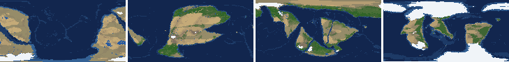
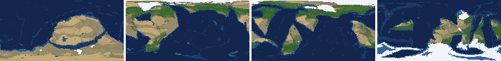
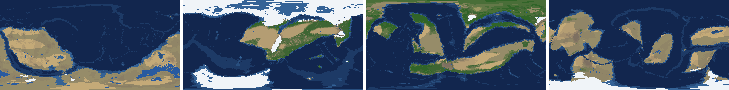
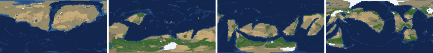
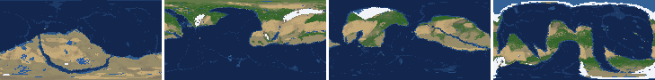
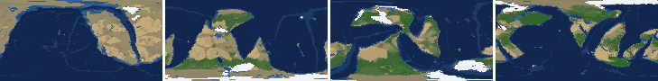
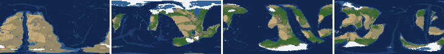
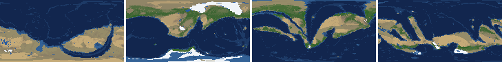

# Health sweep 2026-10-23 07:53

Commit 89cc49c+dirty. 8 runs (default params, `--every 4`) at 6 workers x 2 numba threads; simulations 12.8 min wall. Made by `tools/health.py` (PW-246).

## Runs

| seed | L | Myr | run | sim s | trees / flowering trees from | dT range C | peaks > 9.5 km | giant-lake frames % | crust volume end/start | ice SL < -150 m % | <= 4 plates % | ice bar old | ice bar new (ice-v2-criteria.md) | icehouse % |
|---|---|---|---|---|---|---|---|---|---|---|---|---|---|---|
| 1 | 6 | 500 | 22fbe8 | 390 | 132 / 412 | 16.5 | 0 | 0.0 | 0.972 | 29.4 | 9.8 | F | ok | 37.3 |
| 2 | 6 | 500 | 61d1be | 398 | 140 / 396 | 16.6 | 0 | 0.0 | 0.977 | 19.6 | 0.0 | ok | F: icehouse 75% of the time, outside 5-70% | 74.5 |
| 11 | 6 | 500 | b9fdc8 | 419 | 128 / 372 | 9.5 | 0 | 7.8 | 0.974 | 15.7 | 0.0 | F | ok | 60.8 |
| 21 | 6 | 500 | eedd5d | 364 | 136 / 404 | 8.3 | 0 | 5.9 | 0.968 | 0.0 | 0.0 | ok | ok | 11.8 |
| 3199 | 6 | 500 | f2714d | 427 | 132 / 376 | 6.1 | 0 | 7.8 | 0.972 | 0.0 | 0.0 | ok | ok | 19.6 |
| 42 | 6 | 500 | 073088 | 449 | 116 / 404 | 7.7 | 0 | 15.7 | 0.975 | 0.0 | 0.0 | ok | ok | 45.1 |
| 77 | 6 | 500 | 4455c8 | 402 | 124 / 416 | 7.9 | 0 | 2.0 | 0.958 | 0.0 | 0.0 | ok | F: icehouse 82% of the time, outside 5-70% | 82.4 |
| 505 | 6 | 500 | 61ff02 | 318 | 132 / 416 | 5.5 | 0 | 3.9 | 0.982 | 0.0 | 0.0 | ok | ok | 13.7 |

## Medians by seed (after 300 Myr; tree cover after forests, NPP after flowering trees appear)

| seed | L | land_pct | cont_pct | cont_km | plates | ocean_age | speed | sea_level | sea_ice_m | sea_tect_m | ice_pct | temp | co2 | dry_pct | inland_pct | lake_pct | lake_max_mkm2 | max_elev_km | trees_pct | npp | landmasses | largest_pct |
|---|---|---|---|---|---|---|---|---|---|---|---|---|---|---|---|---|---|---|---|---|---|---|
| 1 | 6 | 32.8 | 39.2 | 34.5 | 8.0 | 55.1 | 3.5 | 62.7 | -11.9 | 76.7 | 1.5 | 14.4 | -0.6 | 14.0 | 3.3 | 0.5 | 0.1 | 6.7 | 31.7 | 258.4 | 7.0 | 15.5 |
| 2 | 6 | 32.8 | 40.8 | 33.4 | 12.0 | 54.0 | 4.3 | 78.7 | -29.7 | 95.7 | 2.1 | 15.6 | 0.5 | 19.8 | 2.5 | 0.5 | 0.1 | 4.8 | 39.4 | 314.6 | 8.0 | 17.0 |
| 11 | 6 | 32.5 | 40.0 | 33.8 | 11.0 | 52.1 | 4.2 | 52.3 | -41.7 | 90.5 | 2.0 | 15.3 | -0.3 | 23.2 | 4.5 | 0.6 | 0.1 | 6.5 | 30.7 | 253.4 | 8.0 | 13.4 |
| 21 | 6 | 33.0 | 40.6 | 33.4 | 14.0 | 49.7 | 4.1 | 121.2 | -5.7 | 127.4 | 0.4 | 15.6 | -0.2 | 25.2 | 4.4 | 0.4 | 0.1 | 5.2 | 23.6 | 307.1 | 9.0 | 11.0 |
| 3199 | 6 | 33.1 | 40.4 | 33.3 | 13.0 | 50.3 | 4.3 | 91.5 | -14.6 | 134.9 | 1.4 | 14.8 | 0.4 | 23.4 | 2.8 | 0.3 | 0.1 | 5.3 | 36.8 | 326.3 | 6.0 | 20.0 |
| 42 | 6 | 33.4 | 41.1 | 33.2 | 13.0 | 52.6 | 4.1 | 10.4 | -18.7 | 25.7 | 1.3 | 15.0 | 0.6 | 22.3 | 3.1 | 0.5 | 0.3 | 5.6 | 38.0 | 425.3 | 7.0 | 16.4 |
| 77 | 6 | 32.8 | 40.3 | 33.1 | 12.0 | 64.8 | 4.2 | -20.5 | -38.5 | -3.2 | 2.4 | 15.5 | 0.4 | 15.4 | 2.8 | 0.5 | 0.1 | 5.5 | 40.0 | 338.8 | 8.0 | 16.9 |
| 505 | 6 | 32.7 | 40.9 | 33.7 | 12.0 | 50.2 | 4.0 | 107.2 | -3.1 | 113.6 | 0.2 | 14.6 | -0.5 | 27.2 | 3.9 | 0.3 | 0.1 | 5.8 | 26.5 | 269.8 | 6.0 | 30.5 |

Measured on the run's keyframes (no slicing). A keyframe's rivers and lakes are routed on its own terrain (PW-239), so `inland_raw_pct` (every routed end on land, as highlights counts it) and `inland_pct` (ends that are closed lakes, salt pans or real pits) agree but for ends under land ice. Land ice and land shares use cells (near-equal area).

## Envelopes

| metric | low | high | Earth | source |
|---|---|---|---|---|
| land, % of surface (`land_pct`) | 22 | 42 | 29.20 | tests/test_envelopes.py (22-42%); Earth 29.2% |
| continental crust, % of surface (`cont_pct`) | 33 | 50 | 41 | tests/test_envelopes.py (33-50%); Earth ~41% with shelves (Cogley 1984) |
| mean continental crust thickness, km (`cont_km`) | 31 | 40 | 39 | target 35 km (PW-238, continental_thickness); Earth ~39 km (Christensen & Mooney 1995); known thinning to 32-33 km (PW-046) |
| plates (`plates`) | 5 | 30 | 15 | tests/test_envelopes.py (5-30; max_plates 30); Earth 7 major + ~8 minor; <= 4 is the PW-191 collapse |
| mean ocean-floor age, Myr (`ocean_age`) | 25 | 120 | 64 | tests/test_envelopes.py (25-120); Earth ~64 Myr (Mueller et al. 2008); PW-051 |
| mean plate speed, cm/yr (`speed`) | 2 | 9 | 4.50 | tests/test_envelopes.py (2-9 cm/yr); Earth ~4-5 |
| sea level, m (ice + ocean basins) (`sea_level`) | -250 | 300 | 0 | Phanerozoic ~-130 (LGM) .. +250 m (earth.py; Haq & Schutter 2008); -250: PW-240's hard goal |
| sea level from land ice, m (`sea_ice_m`) | -250 | - | 0 | Earth LGM ~-130 m; PW-240 goal -150 m typical / -250 m worst |
| sea level from the ocean basins, m (the other part of sea_level) (`sea_tect_m`) | -250 | 300 | 0 | PW-293/549: the floor's mean depth against the start's; Phanerozoic ~-100..+250 m without the ice (Haq & Schutter 2008; Mueller et al. 2008) |
| land ice, % of surface (`ice_pct`) | - | 10 | 3.10 | Earth 3.1% now (earth.EARTH_ICE), ~7-8% at the LGM |
| global mean temperature, C (`temp`) | 8 | 30 | 14.50 | Earth 14.5 C; LGM ~8 C (Tierney et al. 2020); Phanerozoic hothouses to ~30 C (Scotese et al. 2021) |
| CO2 index (ln of the CO2 stock against the reference balance) (`co2`) | -6.0 | 6.0 | 0.00 | where the forcing levels off in earth.py (+-CO2_MAX = 6 e-folds); Earth 0 |
| arid (Koppen B), % of land (`dry_pct`) | 12 | 45 | 30 | tests/test_envelopes.py (12-45%); Earth ~30% (Beck et al. 2018) |
| land draining inland, % of ice-free land (to a closed lake, salt pan or real pit) (`inland_pct`) | 8 | 30 | 18 | Earth ~18% (overview 2.9); L6 known ~9.5-11% (PW-054, PW-243). `inland_raw_pct` (not checked) follows the stored `downstream` to any end, as highlights does; since PW-239 the two agree but for ends under land ice |
| lakes, % of land (`lake_pct`) | 0.2 | 3.0 | 1.80 | Earth ~1.8% of ice-free land (HydroLAKES, Messager et al. 2016); generated L6 worlds 0.5-1% |
| largest lake, million km2 (`lake_max_mkm2`) | - | 1.0 | 0.37 | Caspian 0.37 Mkm2; 1 Mkm2 = the overview's giant lake (2.9) |
| highest peak, km (`max_elev_km`) | - | 9.5 | 8.85 | Everest 8.85 km; PW-172 (spikes above ~9.5 km) |
| tree cover, % of ice-free land (after forests appear) (`trees_pct`) | 10 | 50 | 30 | Earth ~30% potential canopy (forest 55-60 of ~130 Mkm2, overview 2.18) |
| land NPP, g C/m2/yr (after flowering trees appear) (`npp`) | 200 | 700 | 430 | Earth ~56 Pg C/yr over ~130 Mkm2 = ~430; the model on Earth's terrain 50 Pg C/yr, ~385 (overview 2.18). Before flowering trees (plant group 4) stand-ins grow at 70%, so runs sit at ~150-280 |
| landmasses (>= 3 cells) (`landmasses`) | 3 | 80 | - | loose: a lone supercontinent or a shattered archipelago |
| largest landmass, % of surface (`largest_pct`) | 5 | 35 | 16.60 | Afro-Eurasia 16.6%; a Pangaea ~30% (scorecard largest_max) |
| global temperature range over the run, C (`dT_range`, per run) | - | 25 | 25 | Phanerozoic 11-36 C (Scotese et al. 2021) |
| keyframes with a peak above 9.5 km (`peak_frames`, per run) | - | 0 | 0 | PW-172 (L7 seed 3199: 3 of 251) |
| % of keyframes with a lake over 1 Mkm2 (`giant_lake_frames`, per run) | - | 5 | 0 | overview 2.9 (L6: 3 of ~150 frames) |
| continental crust volume, end / start (`volume_ratio`, per run) | 0.9 | 1.1 | 1.0 | scorecard volume_ratio (x1.006) |
| % of keyframes with ice sea level below -150 m (`sea_ice_below_150`, per run) | - | 10 | 0 | PW-240 |
| % of keyframes with <= 4 plates (`low_plates`, per run) | - | 2 | 0 | PW-191 (L7 seed 21: 1%) |

## Top outliers (of 67 spells; severity = excess / band width x (0.2 + share of the run))

| seed | L | metric | Myr | frames | worst | envelope | severity |
|---|---|---|---|---|---|---|---|
| 1 | 6 | low_plates | run | - | 9.80 | -..2 | 3.9 |
| 42 | 6 | giant_lake_frames | run | - | 15.70 | -..5 | 2.14 |
| 1 | 6 | sea_ice_below_150 | run | - | 29.40 | -..10 | 1.94 |
| 2 | 6 | sea_ice_below_150 | run | - | 19.60 | -..10 | 0.96 |
| 42 | 6 | lake_max_mkm2 | 432-448 | 5 | 3.82 | -..1.0 | 0.677 |
| 42 | 6 | lake_max_mkm2 | 336-340 | 2 | 3.96 | -..1.0 | 0.639 |
| 21 | 6 | lake_max_mkm2 | 316-320 | 2 | 3.71 | -..1.0 | 0.585 |
| 11 | 6 | sea_ice_below_150 | run | - | 15.70 | -..10 | 0.57 |
| 11 | 6 | giant_lake_frames | run | - | 7.80 | -..5 | 0.56 |
| 3199 | 6 | giant_lake_frames | run | - | 7.80 | -..5 | 0.56 |
| 77 | 6 | lake_max_mkm2 | 324-324 | 1 | 3.21 | -..1.0 | 0.46 |
| 21 | 6 | lake_max_mkm2 | 392-392 | 1 | 2.78 | -..1.0 | 0.37 |
| 1 | 6 | sea_ice_m | 444-500 | 15 | -499.70 | -250..- | 0.319 |
| 505 | 6 | lake_max_mkm2 | 312-316 | 2 | 2.48 | -..1.0 | 0.319 |
| 1 | 6 | sea_level | 444-500 | 15 | -741.90 | -250..300 | 0.285 |
| 3199 | 6 | lake_max_mkm2 | 376-388 | 4 | 2.09 | -..1.0 | 0.253 |
| 2 | 6 | sea_ice_m | 468-500 | 9 | -441.40 | -250..- | 0.208 |
| 2 | 6 | inland_pct | 300-500 | 51 | 0.94 | 8..30 | 0.194 |
| 3199 | 6 | inland_pct | 320-500 | 46 | 0.58 | 8..30 | 0.191 |
| 1 | 6 | inland_pct | 300-500 | 51 | 1.10 | 8..30 | 0.19 |
| 77 | 6 | inland_pct | 304-500 | 49 | 1.20 | 8..30 | 0.182 |
| 21 | 6 | giant_lake_frames | run | - | 5.90 | -..5 | 0.18 |
| 11 | 6 | lake_max_mkm2 | 388-396 | 3 | 1.79 | -..1.0 | 0.177 |
| 21 | 6 | inland_pct | 324-496 | 42 | 0.85 | 8..30 | 0.173 |
| 505 | 6 | inland_pct | 324-500 | 45 | 1.33 | 8..30 | 0.169 |
| 1 | 6 | ice_pct | 444-500 | 15 | 14.70 | -..10 | 0.15 |
| 42 | 6 | inland_pct | 304-428 | 32 | 0.74 | 8..30 | 0.15 |
| 11 | 6 | inland_pct | 332-500 | 42 | 1.92 | 8..30 | 0.147 |
| 2 | 6 | sea_level | 464-500 | 10 | -528.90 | -250..300 | 0.142 |
| 42 | 6 | lake_max_mkm2 | 324-324 | 1 | 1.64 | -..1.0 | 0.134 |

## Per seed: min / median / max after the 300 Myr spin-up, and spells outside the envelopes

### Seed 1, L6 (run 22fbe8)

*At 48, 200, 348, 500 Myr: sea by depth, land green by tree cover / tan where arid, shaded by height, ice white, lakes blue.*

| metric | min | median | max | outside (Myr: worst) |
|---|---|---|---|---|
| land_pct | 31.78 | 32.80 | 34.35 |  |
| cont_pct | 38.15 | 39.23 | 40.84 |  |
| cont_km | 33.33 | 34.51 | 35.24 |  |
| plates | 4.00 | 8.00 | 13.00 | 484-500: 4 |
| ocean_age | 48.10 | 55.10 | 104.10 |  |
| speed | 1.94 | 3.52 | 4.60 | 424-428: 1.94 |
| sea_level | -741.90 | 62.70 | 145.20 | 444-500: -741.90 |
| sea_ice_m | -499.70 | -11.90 | -1.80 | 444-500: -499.70 |
| sea_tect_m | -280.00 | 76.70 | 147.00 | 492-500: -280.00 |
| ice_pct | 0.10 | 1.50 | 14.70 | 444-500: 14.70 |
| temp | 4.10 | 14.40 | 20.60 | 468-500: 4.10 |
| co2 | -1.35 | -0.58 | 0.30 |  |
| dry_pct | 10.87 | 13.99 | 20.98 | 396-432: 10.87 |
| inland_pct | 1.10 | 3.28 | 6.45 | 300-500: 1.10 |
| lake_pct | 0.17 | 0.51 | 0.96 | 472-476: 0.17 |
| lake_max_mkm2 | 0.01 | 0.10 | 0.54 |  |
| max_elev_km | 4.76 | 6.65 | 8.44 |  |
| trees_pct | 14.06 | 31.73 | 42.22 |  |
| npp | 127.90 | 258.40 | 351.20 | 416-436: 127.90 |
| landmasses | 5.00 | 7.00 | 12.00 |  |
| largest_pct | 11.40 | 15.50 | 20.40 |  |

### Seed 2, L6 (run 61d1be)

*At 48, 200, 348, 500 Myr: sea by depth, land green by tree cover / tan where arid, shaded by height, ice white, lakes blue.*

| metric | min | median | max | outside (Myr: worst) |
|---|---|---|---|---|
| land_pct | 32.17 | 32.84 | 33.94 |  |
| cont_pct | 39.07 | 40.78 | 41.49 |  |
| cont_km | 32.98 | 33.43 | 34.72 |  |
| plates | 5.00 | 12.00 | 16.00 |  |
| ocean_age | 45.60 | 54.00 | 76.50 |  |
| speed | 2.27 | 4.30 | 5.07 |  |
| sea_level | -528.90 | 78.70 | 136.30 | 464-500: -528.90 |
| sea_ice_m | -441.40 | -29.70 | -8.80 | 468-500: -441.40 |
| sea_tect_m | -109.00 | 95.70 | 160.10 |  |
| ice_pct | 0.90 | 2.10 | 13.40 | 472-500: 13.40 |
| temp | 3.60 | 15.60 | 20.20 | 480-500: 3.60 |
| co2 | -0.78 | 0.48 | 1.39 |  |
| dry_pct | 13.45 | 19.78 | 22.05 |  |
| inland_pct | 0.94 | 2.47 | 7.13 | 300-500: 0.94 |
| lake_pct | 0.23 | 0.48 | 1.12 |  |
| lake_max_mkm2 | 0.03 | 0.10 | 0.83 |  |
| max_elev_km | 3.97 | 4.84 | 8.28 |  |
| trees_pct | 21.56 | 39.43 | 54.31 | 380-408: 54.31 |
| npp | 250.30 | 314.60 | 569.50 |  |
| landmasses | 6.00 | 8.00 | 13.00 |  |
| largest_pct | 7.80 | 17.00 | 30.30 |  |

### Seed 11, L6 (run b9fdc8)

*At 48, 200, 348, 500 Myr: sea by depth, land green by tree cover / tan where arid, shaded by height, ice white, lakes blue.*

| metric | min | median | max | outside (Myr: worst) |
|---|---|---|---|---|
| land_pct | 31.00 | 32.53 | 33.88 |  |
| cont_pct | 39.04 | 40.02 | 40.77 |  |
| cont_km | 33.09 | 33.79 | 34.36 |  |
| plates | 8.00 | 11.00 | 15.00 |  |
| ocean_age | 45.60 | 52.10 | 79.60 |  |
| speed | 2.66 | 4.19 | 4.89 |  |
| sea_level | -301.80 | 52.30 | 128.50 | 436-460: -301.80 |
| sea_ice_m | -311.80 | -41.70 | -2.40 | 436-448: -311.80 |
| sea_tect_m | -156.10 | 90.50 | 134.80 |  |
| ice_pct | 0.20 | 2.00 | 9.80 |  |
| temp | 10.70 | 15.30 | 20.20 |  |
| co2 | -1.70 | -0.33 | 0.73 |  |
| dry_pct | 17.21 | 23.17 | 27.67 |  |
| inland_pct | 1.90 | 4.54 | 11.23 | 300-312: 1.90; 332-500: 1.92 |
| lake_pct | 0.19 | 0.64 | 1.50 | 352-352: 0.19 |
| lake_max_mkm2 | 0.03 | 0.14 | 1.79 | 336-336: 1.22; 388-396: 1.79 |
| max_elev_km | 4.62 | 6.46 | 8.68 |  |
| trees_pct | 1.05 | 30.72 | 51.01 | 376-380: 51.01; 464-500: 1.05 |
| npp | 183.20 | 253.40 | 327.40 | 412-412: 183.20 |
| landmasses | 5.00 | 8.00 | 13.00 |  |
| largest_pct | 9.80 | 13.40 | 19.60 |  |

### Seed 21, L6 (run eedd5d)

*At 48, 200, 348, 500 Myr: sea by depth, land green by tree cover / tan where arid, shaded by height, ice white, lakes blue.*

| metric | min | median | max | outside (Myr: worst) |
|---|---|---|---|---|
| land_pct | 32.54 | 32.97 | 33.46 |  |
| cont_pct | 39.89 | 40.58 | 41.40 |  |
| cont_km | 32.97 | 33.41 | 34.56 |  |
| plates | 11.00 | 14.00 | 16.00 |  |
| ocean_age | 42.90 | 49.70 | 58.70 |  |
| speed | 2.67 | 4.11 | 4.85 |  |
| sea_level | 10.20 | 121.20 | 183.10 |  |
| sea_ice_m | -25.40 | -5.70 | -0.00 |  |
| sea_tect_m | 35.60 | 127.40 | 183.10 |  |
| ice_pct | 0.00 | 0.40 | 1.80 |  |
| temp | 13.60 | 15.60 | 21.90 |  |
| co2 | -0.77 | -0.24 | 0.39 |  |
| dry_pct | 15.72 | 25.20 | 36.54 |  |
| inland_pct | 0.85 | 4.42 | 17.63 | 304-312: 5.96; 324-496: 0.85 |
| lake_pct | 0.18 | 0.37 | 2.71 | 336-336: 0.18; 412-412: 0.18 |
| lake_max_mkm2 | 0.03 | 0.07 | 3.71 | 316-320: 3.71; 392-392: 2.78 |
| max_elev_km | 3.74 | 5.22 | 8.04 |  |
| trees_pct | 13.37 | 23.63 | 49.66 |  |
| npp | 194.50 | 307.10 | 356.90 | 428-428: 194.50 |
| landmasses | 5.00 | 9.00 | 13.00 |  |
| largest_pct | 9.90 | 11.00 | 21.10 |  |

### Seed 3199, L6 (run f2714d)

*At 48, 200, 348, 500 Myr: sea by depth, land green by tree cover / tan where arid, shaded by height, ice white, lakes blue.*

| metric | min | median | max | outside (Myr: worst) |
|---|---|---|---|---|
| land_pct | 32.22 | 33.12 | 33.89 |  |
| cont_pct | 37.69 | 40.40 | 41.56 |  |
| cont_km | 32.71 | 33.33 | 35.26 |  |
| plates | 8.00 | 13.00 | 15.00 |  |
| ocean_age | 43.80 | 50.30 | 58.50 |  |
| speed | 2.80 | 4.33 | 5.20 |  |
| sea_level | 8.30 | 91.50 | 185.00 |  |
| sea_ice_m | -97.70 | -14.60 | -10.30 |  |
| sea_tect_m | 20.20 | 134.90 | 195.70 |  |
| ice_pct | 0.80 | 1.40 | 4.10 |  |
| temp | 12.60 | 14.80 | 18.70 |  |
| co2 | -0.22 | 0.39 | 1.08 |  |
| dry_pct | 15.98 | 23.44 | 34.46 |  |
| inland_pct | 0.58 | 2.84 | 9.24 | 300-308: 4.56; 320-500: 0.58 |
| lake_pct | 0.09 | 0.33 | 1.36 | 364-372: 0.09; 392-400: 0.10; 416-428: 0.16 |
| lake_max_mkm2 | 0.03 | 0.07 | 2.09 | 376-388: 2.09 |
| max_elev_km | 4.20 | 5.29 | 8.31 |  |
| trees_pct | 23.12 | 36.78 | 53.06 | 388-420: 53.06 |
| npp | 239.00 | 326.30 | 425.70 |  |
| landmasses | 3.00 | 6.00 | 13.00 |  |
| largest_pct | 10.90 | 20.00 | 33.80 |  |

### Seed 42, L6 (run 073088)

*At 48, 200, 348, 500 Myr: sea by depth, land green by tree cover / tan where arid, shaded by height, ice white, lakes blue.*

| metric | min | median | max | outside (Myr: worst) |
|---|---|---|---|---|
| land_pct | 31.89 | 33.36 | 35.13 |  |
| cont_pct | 39.41 | 41.15 | 41.67 |  |
| cont_km | 32.66 | 33.17 | 34.69 |  |
| plates | 6.00 | 13.00 | 15.00 |  |
| ocean_age | 41.70 | 52.60 | 74.40 |  |
| speed | 3.57 | 4.14 | 5.14 |  |
| sea_level | -225.80 | 10.40 | 147.20 |  |
| sea_ice_m | -94.80 | -18.70 | -11.20 |  |
| sea_tect_m | -148.80 | 25.70 | 171.30 |  |
| ice_pct | 0.70 | 1.30 | 4.00 |  |
| temp | 12.50 | 15.00 | 20.20 |  |
| co2 | -0.71 | 0.61 | 1.44 |  |
| dry_pct | 14.45 | 22.34 | 31.51 |  |
| inland_pct | 0.74 | 3.12 | 9.31 | 304-428: 0.74; 440-500: 2.23 |
| lake_pct | 0.29 | 0.53 | 2.80 |  |
| lake_max_mkm2 | 0.03 | 0.26 | 3.96 | 324-324: 1.64; 336-340: 3.96; 432-448: 3.82 |
| max_elev_km | 4.29 | 5.56 | 7.81 |  |
| trees_pct | 18.93 | 37.98 | 45.32 |  |
| npp | 371.60 | 425.30 | 448.40 |  |
| landmasses | 4.00 | 7.00 | 11.00 |  |
| largest_pct | 9.90 | 16.40 | 34.60 |  |

### Seed 77, L6 (run 4455c8)

*At 48, 200, 348, 500 Myr: sea by depth, land green by tree cover / tan where arid, shaded by height, ice white, lakes blue.*

| metric | min | median | max | outside (Myr: worst) |
|---|---|---|---|---|
| land_pct | 31.58 | 32.77 | 33.48 |  |
| cont_pct | 39.04 | 40.29 | 41.49 |  |
| cont_km | 32.31 | 33.12 | 34.25 |  |
| plates | 8.00 | 12.00 | 16.00 |  |
| ocean_age | 43.70 | 64.80 | 78.20 |  |
| speed | 2.97 | 4.21 | 5.09 |  |
| sea_level | -160.60 | -20.50 | 118.80 |  |
| sea_ice_m | -106.90 | -38.50 | -13.80 |  |
| sea_tect_m | -104.50 | -3.20 | 156.80 |  |
| ice_pct | 1.00 | 2.40 | 5.40 |  |
| temp | 11.30 | 15.50 | 19.20 |  |
| co2 | -0.72 | 0.37 | 1.51 |  |
| dry_pct | 11.17 | 15.42 | 23.50 | 432-440: 11.17 |
| inland_pct | 1.20 | 2.82 | 13.38 | 304-500: 1.20 |
| lake_pct | 0.25 | 0.49 | 3.36 | 324-324: 3.36 |
| lake_max_mkm2 | 0.03 | 0.10 | 3.21 | 324-324: 3.21 |
| max_elev_km | 3.98 | 5.55 | 7.00 |  |
| trees_pct | 26.40 | 40.02 | 46.98 |  |
| npp | 300.40 | 338.75 | 376.60 |  |
| landmasses | 5.00 | 8.00 | 12.00 |  |
| largest_pct | 11.90 | 16.90 | 27.30 |  |

### Seed 505, L6 (run 61ff02)

*At 48, 200, 348, 500 Myr: sea by depth, land green by tree cover / tan where arid, shaded by height, ice white, lakes blue.*

| metric | min | median | max | outside (Myr: worst) |
|---|---|---|---|---|
| land_pct | 31.88 | 32.73 | 34.25 |  |
| cont_pct | 38.58 | 40.93 | 41.64 |  |
| cont_km | 33.02 | 33.67 | 35.11 |  |
| plates | 8.00 | 12.00 | 16.00 |  |
| ocean_age | 44.10 | 50.20 | 69.80 |  |
| speed | 3.02 | 4.03 | 4.95 |  |
| sea_level | -71.60 | 107.20 | 165.70 |  |
| sea_ice_m | -38.70 | -3.10 | -0.00 |  |
| sea_tect_m | -54.50 | 113.60 | 169.60 |  |
| ice_pct | 0.00 | 0.20 | 2.00 |  |
| temp | 11.50 | 14.60 | 17.00 |  |
| co2 | -1.55 | -0.48 | 0.56 |  |
| dry_pct | 22.14 | 27.22 | 41.65 |  |
| inland_pct | 1.33 | 3.87 | 17.42 | 308-308: 7.83; 324-500: 1.33 |
| lake_pct | 0.12 | 0.29 | 2.10 | 360-360: 0.14; 392-392: 0.18; 444-468: 0.12; 480-484: 0.16 |
| lake_max_mkm2 | 0.01 | 0.05 | 2.48 | 312-316: 2.48 |
| max_elev_km | 4.52 | 5.78 | 8.60 |  |
| trees_pct | 1.87 | 26.53 | 36.71 | 432-496: 1.87 |
| npp | 82.60 | 269.75 | 330.00 | 416-444: 82.60 |
| landmasses | 3.00 | 6.00 | 10.00 |  |
| largest_pct | 16.50 | 30.50 | 34.10 |  |

## Determinism

Seed 1 L6 re-run to 100 Myr (run 449fb9) against the sweep's run 22fbe8: 26 keyframes x 44 layers, **bit-identical** (layer hashes and frame stats).
