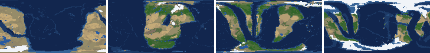
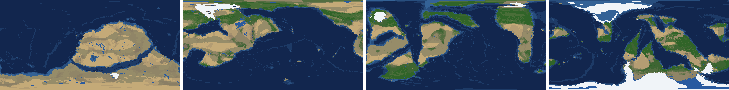
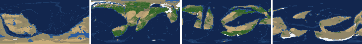
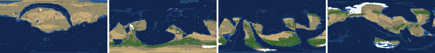
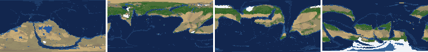
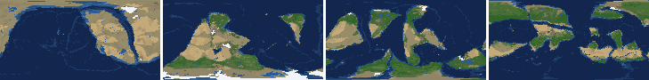
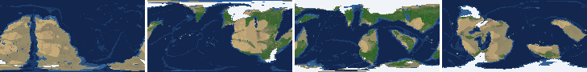
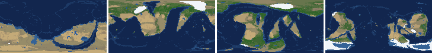

# Health sweep 2026-10-23 09:45

Commit None. 8 runs (default params, `--every 4`) at 4 workers x 2 numba threads; simulations 25.8 min wall. Made by `tools/health.py` (PW-246).

## Runs

| seed | L | Myr | run | sim s | trees / flowering trees from | dT range C | peaks > 9.5 km | giant-lake frames % | crust volume end/start | ice SL < -150 m % | <= 4 plates % | ice bar old | ice bar new (ice-v2-criteria.md) | icehouse % |
|---|---|---|---|---|---|---|---|---|---|---|---|---|---|---|
| 1 | 6 | 500 | 61ec4e | 690 | 132 / 412 | 12.0 | 0 | 23.5 | 0.978 | 39.2 | 0.0 | ok | ok | 60.8 |
| 2 | 6 | 500 | 4daadd | 618 | 140 / 396 | 11.3 | 0 | 15.7 | 0.956 | 0.0 | 0.0 | ok | ok | 11.8 |
| 11 | 6 | 500 | 391f53 | 750 | 128 / 372 | 7.3 | 0 | 5.9 | 0.953 | 0.0 | 0.0 | ok | F: icehouse 0% of the time, outside 5-70% | 0.0 |
| 21 | 6 | 500 | 2537aa | 606 | 136 / 404 | 11.8 | 0 | 3.9 | 0.962 | 0.0 | 0.0 | ok | ok | 21.6 |
| 3199 | 6 | 500 | b255b8 | 819 | 132 / 376 | 10.7 | 0 | 0.0 | 0.961 | 5.9 | 0.0 | ok | ok | 23.5 |
| 42 | 6 | 500 | d86d35 | 769 | 116 / 404 | 5.0 | 0 | 11.8 | 0.975 | 0.0 | 0.0 | ok | F: icehouse 0% of the time, outside 5-70% | 0.0 |
| 77 | 6 | 500 | e1c5bd | 836 | 124 / 416 | 10.7 | 0 | 0.0 | 0.956 | 19.6 | 0.0 | ok | F: icehouse 100% of the time, outside 5-70% | 100.0 |
| 505 | 6 | 500 | 24f230 | 787 | 132 / 416 | 11.4 | 0 | 0.0 | 0.949 | 3.9 | 0.0 | ok | ok | 56.9 |

## Medians by seed (after 300 Myr; tree cover after forests, NPP after flowering trees appear)

| seed | L | land_pct | cont_pct | cont_km | plates | ocean_age | speed | sea_level | sea_ice_m | sea_tect_m | ice_pct | temp | co2 | dry_pct | inland_pct | lake_pct | lake_max_mkm2 | max_elev_km | trees_pct | npp | landmasses | largest_pct |
|---|---|---|---|---|---|---|---|---|---|---|---|---|---|---|---|---|---|---|---|---|---|---|
| 1 | 6 | 32.6 | 41.3 | 33.1 | 9.0 | 59.7 | 4.0 | 17.2 | -32.4 | 49.6 | 2.5 | 13.6 | -0.3 | 13.9 | 1.6 | 0.5 | 0.2 | 5.3 | 33.2 | 332.1 | 4.0 | 26.9 |
| 2 | 6 | 32.5 | 41.9 | 32.3 | 13.0 | 52.8 | 4.1 | 83.1 | -7.6 | 89.1 | 0.8 | 19.9 | 1.3 | 21.0 | 2.9 | 0.3 | 0.1 | 5.9 | 40.9 | 384.0 | 15.0 | 12.9 |
| 11 | 6 | 33.3 | 40.6 | 33.1 | 13.0 | 51.5 | 4.0 | 117.3 | -9.2 | 123.4 | 0.8 | 14.7 | -0.5 | 23.1 | 2.7 | 0.4 | 0.1 | 5.2 | 17.3 | 268.0 | 7.0 | 16.1 |
| 21 | 6 | 34.0 | 42.2 | 32.3 | 10.0 | 60.7 | 3.7 | 50.2 | -3.5 | 53.5 | 0.3 | 14.3 | -0.4 | 23.5 | 3.4 | 0.2 | 0.1 | 5.1 | 19.1 | 234.4 | 8.0 | 16.1 |
| 3199 | 6 | 34.0 | 41.4 | 32.7 | 10.0 | 60.3 | 4.9 | 1.5 | -9.7 | 11.2 | 0.7 | 14.8 | 0.4 | 32.9 | 4.5 | 0.2 | 0.1 | 4.8 | 32.7 | 281.3 | 8.0 | 20.5 |
| 42 | 6 | 33.1 | 40.8 | 33.1 | 13.0 | 49.8 | 3.8 | 75.7 | -5.1 | 81.2 | 0.4 | 17.3 | 0.8 | 20.9 | 2.3 | 0.4 | 0.1 | 4.7 | 40.9 | 407.9 | 9.0 | 11.4 |
| 77 | 6 | 32.9 | 41.0 | 33.3 | 10.0 | 61.6 | 4.2 | -111.9 | -97.8 | -11.9 | 5.2 | 14.9 | 0.4 | 19.5 | 1.4 | 0.3 | 0.1 | 6.0 | 34.2 | 272.0 | 10.0 | 22.3 |
| 505 | 6 | 32.3 | 40.4 | 33.5 | 12.0 | 55.4 | 4.6 | 63.2 | -22.5 | 98.5 | 1.7 | 16.3 | 0.1 | 21.0 | 3.6 | 0.5 | 0.1 | 5.9 | 34.1 | 241.6 | 11.0 | 14.6 |

Measured on the run's keyframes (no slicing). A keyframe's rivers and lakes are routed on its own terrain (PW-239), so `inland_raw_pct` (every routed end on land, as highlights counts it) and `inland_pct` (ends that are closed lakes, salt pans or real pits) agree but for ends under land ice. Land ice and land shares use cells (near-equal area).

## Envelopes

| metric | low | high | Earth | source |
|---|---|---|---|---|
| land, % of surface (`land_pct`) | 22 | 42 | 29.20 | tests/test_envelopes.py (22-42%); Earth 29.2% |
| continental crust, % of surface (`cont_pct`) | 33 | 50 | 41 | tests/test_envelopes.py (33-50%); Earth ~41% with shelves (Cogley 1984) |
| mean continental crust thickness, km (`cont_km`) | 31 | 40 | 39 | target 35 km (PW-238, continental_thickness); Earth ~39 km (Christensen & Mooney 1995); known thinning to 32-33 km (PW-046) |
| plates (`plates`) | 5 | 30 | 15 | tests/test_envelopes.py (5-30; max_plates 30); Earth 7 major + ~8 minor; <= 4 is the PW-191 collapse |
| mean ocean-floor age, Myr (`ocean_age`) | 25 | 120 | 64 | tests/test_envelopes.py (25-120); Earth ~64 Myr (Mueller et al. 2008); PW-051 |
| mean plate speed, cm/yr (`speed`) | 2 | 9 | 4.50 | tests/test_envelopes.py (2-9 cm/yr); Earth ~4-5 |
| sea level, m (ice + ocean basins) (`sea_level`) | -250 | 300 | 0 | Phanerozoic ~-130 (LGM) .. +250 m (earth.py; Haq & Schutter 2008); -250: PW-240's hard goal |
| sea level from land ice, m (`sea_ice_m`) | -250 | - | 0 | Earth LGM ~-130 m; PW-240 goal -150 m typical / -250 m worst |
| sea level from the ocean basins, m (the other part of sea_level) (`sea_tect_m`) | -250 | 300 | 0 | PW-293/549: the floor's mean depth against the start's; Phanerozoic ~-100..+250 m without the ice (Haq & Schutter 2008; Mueller et al. 2008) |
| land ice, % of surface (`ice_pct`) | - | 10 | 3.10 | Earth 3.1% now (earth.EARTH_ICE), ~7-8% at the LGM |
| global mean temperature, C (`temp`) | 8 | 30 | 14.50 | Earth 14.5 C; LGM ~8 C (Tierney et al. 2020); Phanerozoic hothouses to ~30 C (Scotese et al. 2021) |
| CO2 index (ln of the CO2 stock against the reference balance) (`co2`) | -6.0 | 6.0 | 0.00 | where the forcing levels off in earth.py (+-CO2_MAX = 6 e-folds); Earth 0 |
| arid (Koppen B), % of land (`dry_pct`) | 12 | 45 | 30 | tests/test_envelopes.py (12-45%); Earth ~30% (Beck et al. 2018) |
| land draining inland, % of ice-free land (to a closed lake, salt pan or real pit) (`inland_pct`) | 8 | 30 | 18 | Earth ~18% (overview 2.9); L6 known ~9.5-11% (PW-054, PW-243). `inland_raw_pct` (not checked) follows the stored `downstream` to any end, as highlights does; since PW-239 the two agree but for ends under land ice |
| lakes, % of land (`lake_pct`) | 0.2 | 3.0 | 1.80 | Earth ~1.8% of ice-free land (HydroLAKES, Messager et al. 2016); generated L6 worlds 0.5-1% |
| largest lake, million km2 (`lake_max_mkm2`) | - | 1.0 | 0.37 | Caspian 0.37 Mkm2; 1 Mkm2 = the overview's giant lake (2.9) |
| highest peak, km (`max_elev_km`) | - | 9.5 | 8.85 | Everest 8.85 km; PW-172 (spikes above ~9.5 km) |
| tree cover, % of ice-free land (after forests appear) (`trees_pct`) | 10 | 50 | 30 | Earth ~30% potential canopy (forest 55-60 of ~130 Mkm2, overview 2.18) |
| land NPP, g C/m2/yr (after flowering trees appear) (`npp`) | 200 | 700 | 430 | Earth ~56 Pg C/yr over ~130 Mkm2 = ~430; the model on Earth's terrain 50 Pg C/yr, ~385 (overview 2.18). Before flowering trees (plant group 4) stand-ins grow at 70%, so runs sit at ~150-280 |
| landmasses (>= 3 cells) (`landmasses`) | 3 | 80 | - | loose: a lone supercontinent or a shattered archipelago |
| largest landmass, % of surface (`largest_pct`) | 5 | 35 | 16.60 | Afro-Eurasia 16.6%; a Pangaea ~30% (scorecard largest_max) |
| global temperature range over the run, C (`dT_range`, per run) | - | 25 | 25 | Phanerozoic 11-36 C (Scotese et al. 2021) |
| keyframes with a peak above 9.5 km (`peak_frames`, per run) | - | 0 | 0 | PW-172 (L7 seed 3199: 3 of 251) |
| % of keyframes with a lake over 1 Mkm2 (`giant_lake_frames`, per run) | - | 5 | 0 | overview 2.9 (L6: 3 of ~150 frames) |
| continental crust volume, end / start (`volume_ratio`, per run) | 0.9 | 1.1 | 1.0 | scorecard volume_ratio (x1.006) |
| % of keyframes with ice sea level below -150 m (`sea_ice_below_150`, per run) | - | 10 | 0 | PW-240 |
| % of keyframes with <= 4 plates (`low_plates`, per run) | - | 2 | 0 | PW-191 (L7 seed 21: 1%) |

## Top outliers (of 83 spells; severity = excess / band width x (0.2 + share of the run))

| seed | L | metric | Myr | frames | worst | envelope | severity |
|---|---|---|---|---|---|---|---|
| 1 | 6 | giant_lake_frames | run | - | 23.50 | -..5 | 3.7 |
| 1 | 6 | sea_ice_below_150 | run | - | 39.20 | -..10 | 2.92 |
| 2 | 6 | giant_lake_frames | run | - | 15.70 | -..5 | 2.14 |
| 42 | 6 | giant_lake_frames | run | - | 11.80 | -..5 | 1.36 |
| 77 | 6 | sea_ice_below_150 | run | - | 19.60 | -..10 | 0.96 |
| 2 | 6 | lake_max_mkm2 | 488-500 | 4 | 3.31 | -..1.0 | 0.536 |
| 11 | 6 | lake_max_mkm2 | 456-456 | 1 | 2.98 | -..1.0 | 0.411 |
| 21 | 6 | lake_max_mkm2 | 496-496 | 1 | 2.29 | -..1.0 | 0.268 |
| 2 | 6 | lake_max_mkm2 | 384-388 | 2 | 2.23 | -..1.0 | 0.265 |
| 77 | 6 | inland_pct | 300-500 | 51 | 0.22 | 8..30 | 0.214 |
| 1 | 6 | inland_pct | 300-500 | 51 | 0.26 | 8..30 | 0.213 |
| 2 | 6 | inland_pct | 300-500 | 51 | 0.89 | 8..30 | 0.195 |
| 42 | 6 | inland_pct | 308-500 | 49 | 0.74 | 8..30 | 0.194 |
| 1 | 6 | lake_max_mkm2 | 308-356 | 12 | 1.64 | -..1.0 | 0.19 |
| 11 | 6 | giant_lake_frames | run | - | 5.90 | -..5 | 0.18 |
| 3199 | 6 | inland_pct | 384-500 | 29 | 0.31 | 8..30 | 0.15 |
| 11 | 6 | lake_max_mkm2 | 372-372 | 1 | 1.69 | -..1.0 | 0.144 |
| 11 | 6 | inland_pct | 404-500 | 25 | 0.72 | 8..30 | 0.132 |
| 1 | 6 | sea_level | 428-500 | 19 | -441.80 | -250..300 | 0.122 |
| 505 | 6 | inland_pct | 392-500 | 28 | 1.70 | 8..30 | 0.121 |
| 21 | 6 | inland_pct | 412-500 | 23 | 1.22 | 8..30 | 0.118 |
| 21 | 6 | lake_max_mkm2 | 484-484 | 1 | 1.53 | -..1.0 | 0.111 |
| 11 | 6 | inland_pct | 300-392 | 23 | 1.81 | 8..30 | 0.108 |
| 21 | 6 | inland_pct | 300-360 | 16 | 1.12 | 8..30 | 0.102 |
| 42 | 6 | lake_max_mkm2 | 320-340 | 6 | 1.36 | -..1.0 | 0.088 |
| 505 | 6 | inland_pct | 324-380 | 14 | 2.13 | 8..30 | 0.083 |
| 3199 | 6 | inland_pct | 300-368 | 16 | 3.43 | 8..30 | 0.068 |
| 505 | 6 | trees_pct | 452-496 | 12 | 1.81 | 10..50 | 0.06 |
| 77 | 6 | sea_level | 300-324 | 7 | -371.60 | -250..300 | 0.057 |
| 11 | 6 | trees_pct | 448-500 | 14 | 2.75 | 10..50 | 0.056 |

## Per seed: min / median / max after the 300 Myr spin-up, and spells outside the envelopes

### Seed 1, L6 (run 61ec4e)

*At 48, 200, 348, 500 Myr: sea by depth, land green by tree cover / tan where arid, shaded by height, ice white, lakes blue.*

| metric | min | median | max | outside (Myr: worst) |
|---|---|---|---|---|
| land_pct | 32.16 | 32.56 | 33.40 |  |
| cont_pct | 39.05 | 41.26 | 42.80 |  |
| cont_km | 32.00 | 33.14 | 34.35 |  |
| plates | 6.00 | 9.00 | 14.00 |  |
| ocean_age | 48.50 | 59.70 | 83.70 |  |
| speed | 3.20 | 4.01 | 5.00 |  |
| sea_level | -441.80 | 17.20 | 135.20 | 428-500: -441.80 |
| sea_ice_m | -291.70 | -32.40 | -8.50 | 440-500: -291.70 |
| sea_tect_m | -169.50 | 49.60 | 154.00 |  |
| ice_pct | 0.60 | 2.50 | 11.20 | 444-500: 11.20 |
| temp | 7.50 | 13.60 | 19.50 | 444-444: 7.90; 480-480: 7.80; 492-500: 7.50 |
| co2 | -1.03 | -0.29 | 0.60 |  |
| dry_pct | 11.57 | 13.89 | 20.89 | 420-428: 11.57 |
| inland_pct | 0.26 | 1.65 | 6.06 | 300-500: 0.26 |
| lake_pct | 0.19 | 0.51 | 2.04 | 368-376: 0.19; 472-472: 0.20 |
| lake_max_mkm2 | 0.03 | 0.25 | 1.64 | 308-356: 1.64 |
| max_elev_km | 4.20 | 5.30 | 7.44 |  |
| trees_pct | 5.47 | 33.19 | 44.80 | 400-400: 5.47 |
| npp | 120.80 | 332.10 | 466.00 | 412-424: 120.80; 436-436: 130.00 |
| landmasses | 3.00 | 4.00 | 12.00 |  |
| largest_pct | 12.50 | 26.90 | 34.80 |  |

### Seed 2, L6 (run 4daadd)

*At 48, 200, 348, 500 Myr: sea by depth, land green by tree cover / tan where arid, shaded by height, ice white, lakes blue.*

| metric | min | median | max | outside (Myr: worst) |
|---|---|---|---|---|
| land_pct | 31.30 | 32.54 | 34.61 |  |
| cont_pct | 40.07 | 41.88 | 42.42 |  |
| cont_km | 31.97 | 32.32 | 33.60 |  |
| plates | 10.00 | 13.00 | 15.00 |  |
| ocean_age | 42.40 | 52.80 | 65.90 |  |
| speed | 2.75 | 4.08 | 5.19 |  |
| sea_level | -88.30 | 83.10 | 192.70 |  |
| sea_ice_m | -141.70 | -7.60 | -5.10 |  |
| sea_tect_m | -51.50 | 89.10 | 201.10 |  |
| ice_pct | 0.50 | 0.80 | 6.10 |  |
| temp | 11.20 | 19.90 | 22.50 |  |
| co2 | 0.38 | 1.33 | 2.04 |  |
| dry_pct | 18.37 | 21.01 | 27.99 |  |
| inland_pct | 0.89 | 2.92 | 7.69 | 300-500: 0.89 |
| lake_pct | 0.10 | 0.31 | 2.71 | 308-308: 0.20; 324-348: 0.10; 412-412: 0.10 |
| lake_max_mkm2 | 0.01 | 0.05 | 3.31 | 384-388: 2.23; 468-472: 1.25; 488-500: 3.31 |
| max_elev_km | 4.83 | 5.88 | 7.07 |  |
| trees_pct | 24.40 | 40.92 | 53.30 | 388-420: 53.30 |
| npp | 288.60 | 384.00 | 483.40 |  |
| landmasses | 6.00 | 15.00 | 21.00 |  |
| largest_pct | 9.10 | 12.90 | 25.70 |  |

### Seed 11, L6 (run 391f53)

*At 48, 200, 348, 500 Myr: sea by depth, land green by tree cover / tan where arid, shaded by height, ice white, lakes blue.*

| metric | min | median | max | outside (Myr: worst) |
|---|---|---|---|---|
| land_pct | 31.80 | 33.28 | 34.30 |  |
| cont_pct | 39.53 | 40.64 | 41.40 |  |
| cont_km | 32.63 | 33.08 | 34.14 |  |
| plates | 7.00 | 13.00 | 19.00 |  |
| ocean_age | 36.40 | 51.50 | 77.50 |  |
| speed | 3.04 | 3.99 | 4.74 |  |
| sea_level | -143.60 | 117.30 | 227.00 |  |
| sea_ice_m | -17.70 | -9.20 | -0.10 |  |
| sea_tect_m | -125.80 | 123.40 | 231.10 |  |
| ice_pct | 0.00 | 0.80 | 1.40 |  |
| temp | 11.70 | 14.70 | 19.00 |  |
| co2 | -1.73 | -0.53 | 0.51 |  |
| dry_pct | 16.95 | 23.05 | 27.10 |  |
| inland_pct | 0.72 | 2.73 | 10.16 | 300-392: 1.81; 404-500: 0.72 |
| lake_pct | 0.20 | 0.39 | 2.02 |  |
| lake_max_mkm2 | 0.03 | 0.06 | 2.98 | 372-372: 1.69; 456-456: 2.98; 468-468: 1.02 |
| max_elev_km | 3.77 | 5.23 | 6.54 |  |
| trees_pct | 2.75 | 17.34 | 51.66 | 300-312: 5.84; 360-372: 51.66; 448-500: 2.75 |
| npp | 160.20 | 268.00 | 360.90 | 404-420: 160.20 |
| landmasses | 3.00 | 7.00 | 11.00 |  |
| largest_pct | 9.60 | 16.10 | 31.60 |  |

### Seed 21, L6 (run 2537aa)

*At 48, 200, 348, 500 Myr: sea by depth, land green by tree cover / tan where arid, shaded by height, ice white, lakes blue.*

| metric | min | median | max | outside (Myr: worst) |
|---|---|---|---|---|
| land_pct | 32.93 | 33.95 | 35.04 |  |
| cont_pct | 40.10 | 42.21 | 43.28 |  |
| cont_km | 31.34 | 32.26 | 33.66 |  |
| plates | 6.00 | 10.00 | 14.00 |  |
| ocean_age | 48.20 | 60.70 | 82.80 |  |
| speed | 2.88 | 3.72 | 4.73 |  |
| sea_level | -277.40 | 50.20 | 137.90 | 492-500: -277.40 |
| sea_ice_m | -75.40 | -3.50 | -0.00 |  |
| sea_tect_m | -203.10 | 53.50 | 139.00 |  |
| ice_pct | 0.00 | 0.30 | 3.40 |  |
| temp | 10.80 | 14.30 | 22.60 |  |
| co2 | -1.47 | -0.37 | 0.43 |  |
| dry_pct | 17.31 | 23.51 | 34.87 |  |
| inland_pct | 1.12 | 3.41 | 10.18 | 300-360: 1.12; 372-400: 4.57; 412-500: 1.22 |
| lake_pct | 0.12 | 0.24 | 2.34 | 300-308: 0.12; 320-328: 0.14; 340-360: 0.15; 384-388: 0.17; +2 more |
| lake_max_mkm2 | 0.03 | 0.05 | 2.29 | 484-484: 1.53; 496-496: 2.29 |
| max_elev_km | 3.39 | 5.13 | 8.22 |  |
| trees_pct | 2.78 | 19.05 | 34.86 | 420-432: 2.78; 468-496: 4.40 |
| npp | 97.20 | 234.40 | 378.30 | 408-440: 97.20 |
| landmasses | 3.00 | 8.00 | 13.00 |  |
| largest_pct | 10.40 | 16.10 | 32.40 |  |

### Seed 3199, L6 (run b255b8)

*At 48, 200, 348, 500 Myr: sea by depth, land green by tree cover / tan where arid, shaded by height, ice white, lakes blue.*

| metric | min | median | max | outside (Myr: worst) |
|---|---|---|---|---|
| land_pct | 33.07 | 33.99 | 35.13 |  |
| cont_pct | 39.51 | 41.43 | 42.83 |  |
| cont_km | 31.70 | 32.70 | 34.78 |  |
| plates | 6.00 | 10.00 | 12.00 |  |
| ocean_age | 49.30 | 60.30 | 71.80 |  |
| speed | 2.73 | 4.87 | 5.37 |  |
| sea_level | -290.00 | 1.50 | 133.90 | 480-500: -290.00 |
| sea_ice_m | -160.70 | -9.70 | -1.10 |  |
| sea_tect_m | -129.30 | 11.20 | 138.70 |  |
| ice_pct | 0.10 | 0.70 | 5.20 |  |
| temp | 10.60 | 14.80 | 21.30 |  |
| co2 | -0.48 | 0.39 | 1.35 |  |
| dry_pct | 20.16 | 32.86 | 44.41 |  |
| inland_pct | 0.31 | 4.51 | 12.37 | 300-368: 3.43; 384-500: 0.31 |
| lake_pct | 0.08 | 0.19 | 0.87 | 324-340: 0.12; 352-356: 0.09; 376-376: 0.12; 388-456: 0.08; +1 more |
| lake_max_mkm2 | 0.01 | 0.05 | 0.52 |  |
| max_elev_km | 3.63 | 4.75 | 6.46 |  |
| trees_pct | 17.53 | 32.68 | 41.51 |  |
| npp | 167.00 | 281.30 | 400.40 | 376-376: 194.90; 416-428: 167.00 |
| landmasses | 3.00 | 8.00 | 14.00 |  |
| largest_pct | 9.70 | 20.50 | 35.00 |  |

### Seed 42, L6 (run d86d35)

*At 48, 200, 348, 500 Myr: sea by depth, land green by tree cover / tan where arid, shaded by height, ice white, lakes blue.*

| metric | min | median | max | outside (Myr: worst) |
|---|---|---|---|---|
| land_pct | 32.11 | 33.12 | 34.12 |  |
| cont_pct | 39.84 | 40.84 | 41.45 |  |
| cont_km | 32.75 | 33.06 | 34.18 |  |
| plates | 11.00 | 13.00 | 16.00 |  |
| ocean_age | 40.30 | 49.80 | 63.90 |  |
| speed | 3.47 | 3.84 | 4.51 |  |
| sea_level | -12.50 | 75.70 | 178.10 |  |
| sea_ice_m | -12.70 | -5.10 | -0.50 |  |
| sea_tect_m | -1.80 | 81.20 | 181.20 |  |
| ice_pct | 0.00 | 0.40 | 0.80 |  |
| temp | 16.00 | 17.30 | 21.00 |  |
| co2 | -0.41 | 0.82 | 1.70 |  |
| dry_pct | 16.54 | 20.87 | 31.36 |  |
| inland_pct | 0.74 | 2.32 | 8.27 | 308-500: 0.74 |
| lake_pct | 0.11 | 0.37 | 1.06 | 444-452: 0.19; 468-476: 0.11; 492-492: 0.15 |
| lake_max_mkm2 | 0.03 | 0.10 | 1.36 | 320-340: 1.36 |
| max_elev_km | 3.42 | 4.71 | 6.82 |  |
| trees_pct | 20.36 | 40.94 | 51.23 | 388-392: 51.23 |
| npp | 380.50 | 407.90 | 419.90 |  |
| landmasses | 4.00 | 9.00 | 12.00 |  |
| largest_pct | 7.30 | 11.40 | 14.40 |  |

### Seed 77, L6 (run e1c5bd)

*At 48, 200, 348, 500 Myr: sea by depth, land green by tree cover / tan where arid, shaded by height, ice white, lakes blue.*

| metric | min | median | max | outside (Myr: worst) |
|---|---|---|---|---|
| land_pct | 30.18 | 32.86 | 34.05 |  |
| cont_pct | 39.31 | 40.98 | 41.72 |  |
| cont_km | 32.38 | 33.29 | 34.20 |  |
| plates | 9.00 | 10.00 | 13.00 |  |
| ocean_age | 51.70 | 61.60 | 90.40 |  |
| speed | 1.82 | 4.24 | 5.02 | 476-484: 1.82 |
| sea_level | -371.60 | -111.90 | 33.00 | 300-324: -371.60; 480-500: -332.70 |
| sea_ice_m | -243.70 | -97.80 | -23.00 |  |
| sea_tect_m | -210.70 | -11.90 | 60.60 |  |
| ice_pct | 1.70 | 5.20 | 8.90 |  |
| temp | 9.50 | 14.90 | 20.20 |  |
| co2 | -1.56 | 0.43 | 1.07 |  |
| dry_pct | 13.58 | 19.49 | 28.32 |  |
| inland_pct | 0.22 | 1.45 | 6.53 | 300-500: 0.22 |
| lake_pct | 0.16 | 0.33 | 0.74 | 404-404: 0.17; 468-476: 0.16; 500-500: 0.19 |
| lake_max_mkm2 | 0.03 | 0.11 | 0.60 |  |
| max_elev_km | 4.68 | 5.96 | 8.24 |  |
| trees_pct | 3.95 | 34.17 | 50.72 | 316-316: 50.72; 468-500: 3.95 |
| npp | 219.70 | 271.95 | 371.20 |  |
| landmasses | 6.00 | 10.00 | 17.00 |  |
| largest_pct | 6.30 | 22.30 | 29.60 |  |

### Seed 505, L6 (run 24f230)

*At 48, 200, 348, 500 Myr: sea by depth, land green by tree cover / tan where arid, shaded by height, ice white, lakes blue.*

| metric | min | median | max | outside (Myr: worst) |
|---|---|---|---|---|
| land_pct | 30.29 | 32.26 | 34.15 |  |
| cont_pct | 37.95 | 40.37 | 40.89 |  |
| cont_km | 32.97 | 33.51 | 34.82 |  |
| plates | 7.00 | 12.00 | 15.00 |  |
| ocean_age | 47.60 | 55.40 | 67.70 |  |
| speed | 3.41 | 4.64 | 5.54 |  |
| sea_level | -181.70 | 63.20 | 125.00 |  |
| sea_ice_m | -168.80 | -22.50 | -10.80 |  |
| sea_tect_m | -12.90 | 98.50 | 142.80 |  |
| ice_pct | 0.70 | 1.70 | 6.10 |  |
| temp | 9.60 | 16.30 | 21.00 |  |
| co2 | -1.57 | 0.10 | 1.18 |  |
| dry_pct | 17.68 | 21.00 | 27.45 |  |
| inland_pct | 1.70 | 3.57 | 14.89 | 300-304: 4.37; 324-380: 2.13; 392-500: 1.70 |
| lake_pct | 0.19 | 0.49 | 1.28 | 324-324: 0.19 |
| lake_max_mkm2 | 0.03 | 0.07 | 0.77 |  |
| max_elev_km | 4.54 | 5.88 | 8.37 |  |
| trees_pct | 1.81 | 34.09 | 49.01 | 452-496: 1.81 |
| npp | 164.50 | 241.55 | 346.70 | 428-444: 164.50 |
| landmasses | 6.00 | 11.00 | 15.00 |  |
| largest_pct | 11.40 | 14.60 | 24.80 |  |

## Determinism

Seed 1 L6 re-run to 100 Myr (run 53ac86) against the sweep's run 61ec4e: 26 keyframes x 44 layers, **bit-identical** (layer hashes and frame stats).
