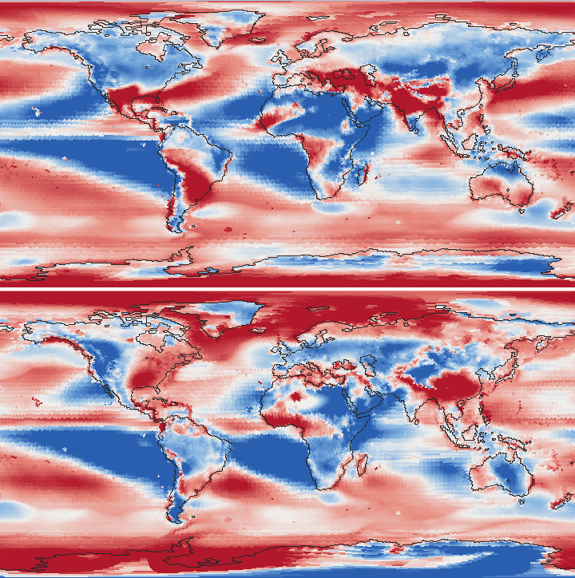
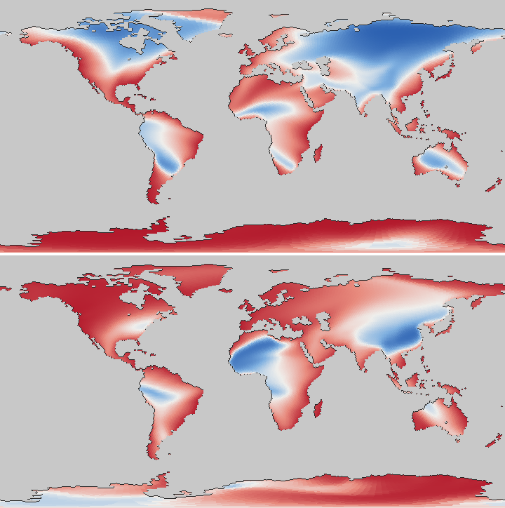
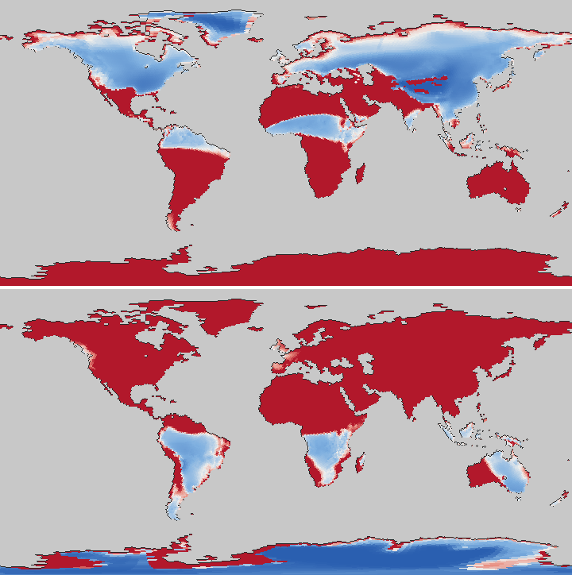

# Lane 58: Earth's moisture budget by region and half-year (PW-1093, with SE USA and the Pampas), 2026-10-30

Status: **diagnosis only.** No model code changed and no planet sims. Main 347b4374, Earth L6 and L7.
Everything here comes from `tools/moisture_regions.py` (new). It records the model's own Earth climate (as
`earth_check` does) and re-runs the rain kernel in `moisture_budget`'s instrumented copy. That copy is bit for bit the
model's rain ("probe reproduces the model's rain: True"). It closes each box's books to within 3 mm/yr.

```
PYTHONPATH=. uv run python tools/moisture_regions.py --level 6 [--json f] [--figs dir] [--no-cf] [--ageo 0.3]
```

Raw output: [budget_L6.txt](budget_L6.txt), [budget_L7.txt](budget_L7.txt) (L7 has no c11 columns: it ran before them),
[budget_L6_ageo0.3.txt](budget_L6_ageo0.3.txt).

## In plain words

- **The extra rain on the northern mid-latitude land falls mostly in summer.** At 40-50 N, 88% of the yearly excess
  falls in Apr-Sep. At 50-60 N it is 70%.
- **None of the five suspects is the main cause.** The table of tests below shows each one moves the land by a few
  percent at most.
- **The cause at 40-50 N is the summer sea breeze on a continental scale.** In summer the model's continents pull sea
  air in across the coasts, and that flow brings the whole column's vapour with it, too strongly. The vapour blows
  past the coast and rains 1000-2500 km inland: Mongolia, the Great Plains, the US north-east. The same inflow is the
  only thing that wets the US south-east and the Pampas. So turning it down dries the interiors and those coasts
  together.
  - In the model, this one flow is both why the interiors are too wet and why the subtropical east coasts are too dry.
    It is too strong, and it doesn't rain where it comes ashore.
- **The winter part (50-60 N, Europe and Russia) is the westerlies.** In winter they bring about 3x the observed net
  vapour into the continent, and it rains out as the air cools inland.
- **The sea under the storm tracks is short of rain for its own reasons.** In winter it evaporates a third to a half of
  what the reanalysis says, and it rains its vapour at 0.7-0.8 of the observed rate.
- **The kernel has no rain from rising air where the wind converges.** Its large-scale rain knows only the latitude
  belts and storminess. A probe that adds that rain wets the storm-track seas and dries the winter interiors.
- **Two of the candidate fixes are soundness fixes, and neither works alone:**
  - the land-sea inflow carrying only its boundary layer's share of the vapour;
  - rain from low-level convergence.
  - Retuning the drift, the shower rates or the sea's rain rates either doesn't move the land or breaks something else.
    Those are owner calls, and I'd decline them.

## Figures

Rain, model over observed (GPCC on land, GPCP at sea), log scale. Blue is wetter than observed, red drier. Full colour
is 4x either way. Top is Apr-Sep, bottom Oct-Mar.



The share of each land cell's rain that evaporated from land (tracers). Blue is 100%, grey-white 50%, red 0%. Top is
Apr-Sep. In summer the interiors of Eurasia and Canada rain almost only land vapour.



The share of rain that falls as showers (same scale). Summer interiors are 66-89% showers.



The vapour budget per box and half-year: evaporation in the box, and the net inflow by the mean wind, by the storms'
drift and by eddy mixing. Model P is the solid line, observed P the dashed one.
[northern boxes](budget_north_L6.svg), [subtropical east coasts](budget_subtropics_L6.svg).

## 1. Where the excess falls (L6; L7 within ~3%)

| land band | Apr-Sep model / obs | Oct-Mar model / obs | share of the annual excess in summer |
|---|---|---|---|
| 40-50 N | 1356 / 628 | 548 / 447 | 88% |
| 50-60 N | 1251 / 709 | 690 / 455 | 70% |
| 60-80 N | 564 / 453 | 234 / 317 | (about right annually) |

Rates are mm/yr in the half-year. Observed is GPCC.

## 2. The budgets (L6, mm/yr over the box, as a rate in the half-year)

Columns:
- **conv** is the net vapour inflow: mean wind + storm drift + eddy mixing.
- **obs conv** is P_obs - NCEP E. NCEP is a reanalysis, and its E runs high.
- **P/PW** is the rain per day per mm of column vapour.
- **land** is the share of the box's rain that evaporated from land.

| box | half | P / obs | E / NCEP | conv / obs conv | PW / NCEP | P/PW per day / obs | land % | showers % |
|---|---|---|---|---|---|---|---|---|
| W Europe | Oct-Mar | 1509 / 913 | 167 / 503 | +1345 / +411 | 15.4 / 11.8 | 0.27 / 0.21 | 8 | 9 (55% oversaturation) |
| European Russia | Oct-Mar | 1023 / 499 | 50 / 215 | +962 / +284 | 9.8 / 9.0 | 0.29 / 0.15 | 17 | 0 (62% oversaturation) |
| W Siberia | Oct-Mar | 534 / 368 | 13 / 200 | +518 / +168 | 6.3 / 6.3 | 0.23 / 0.16 | 26 | 0 (51% oversaturation) |
| W Siberia | Apr-Sep | 871 / 638 | 696 / 1060 | +209 / -422 | 8.4 / 17.2 | 0.28 / 0.10 | 93 | 66 |
| E Siberia | Apr-Sep | 757 / 422 | 478 / 720 | +250 / -298 | 6.5 / 13.3 | 0.32 / 0.09 | 96 | 69 |
| Canada 45-60N | Apr-Sep | 1744 / 765 | 901 / 1093 | +859 / -328 | 13.0 / 16.3 | 0.37 / 0.13 | 56 | 74 |
| Gobi/Mongolia | Apr-Sep | 1135 / 277 | 661 / 303 | +432 / -25 | 10.5 / 12.5 | 0.30 / 0.06 | 72 | 89 |
| Great Plains | Apr-Sep | 1476 / 807 | 967 / 1071 | +516 / -265 | 17.8 / 21.8 | 0.23 / 0.10 | 51 | 82 |
| NE USA | Apr-Sep | 2634 / 1132 | 1377 / 1412 | +1256 / -280 | 20.8 / 24.0 | 0.35 / 0.13 | 34 | 83 |
| N Atlantic 40-60N | Apr-Sep | 805 / 1057 | 846 / 610 | -3 / +447 | 15.6 / 21.6 | 0.14 / 0.13 | 8 | 20 |
| N Atlantic 40-60N | Oct-Mar | 1197 / 1651 | 448 / 1339 | +776 / +312 | 14.1 / 15.2 | 0.23 / 0.30 | 6 | 42 |
| N Pacific 40-60N | Apr-Sep | 889 / 1095 | 759 / 268 | +160 / +827 | 16.6 / 21.2 | 0.15 / 0.14 | 5 | 31 |
| N Pacific 40-60N | Oct-Mar | 1214 / 1465 | 430 / 882 | +810 / +584 | 14.6 / 12.2 | 0.23 / 0.33 | 4 | 40 |

**What the budget says before any test:**
- **Summer interiors import vapour.** In the model they draw it in: W Siberia +209, Canada +859, NE USA +1256. In the
  observations every one of them exports (NCEP E > GPCC P). Their evaporation is *below* NCEP's, and their column
  holds about half NCEP's vapour, but it rains that vapour 2.3-4.9x faster per mm.
- **Winter interiors import about 3x the observed net vapour.** It falls when the maritime air cools below its
  saturation (51-62% of the rain is "oversaturation"). Their vapour is about right (W Siberia 6.3 vs 6.3 mm).
- **The storm-track seas' errors flip with the season:**
  - In summer the Atlantic box exports where NCEP imports, and its evaporation is 1.4-2.8x NCEP's.
  - In winter it imports more than observed, but evaporates only a third to a half of NCEP, and rains at 0.7-0.8x per mm.
  - So the sea doesn't make its own winter vapour. It is fed from the south, with the drift supplying +143.
- **Globally the land's rain is 1047 mm, against GPCC's 789.** Land evaporation is 529 mm, about what GPCC's rain less
  the published river runoff leaves. The land's P - E is 2.26 Sv, against the published runoff of ~1.15 Sv (the
  numbers quoted in `tools/moisture_budget.py`'s PUBLISHED table). So the excess is **sea vapour imported**, not
  land vapour recycled.
- **The land keeps its own vapour because it rains it fast.** The kernel's vapour lasts 4.1 days over land and 6.1 over
  the sea before it rains. The observed residence (NCEP PW over GPCC/GPCP P) is about the same over both: land 9.9 /
  8.7 days, sea 9.2 / 8.8. That is why 75% of the model's land evaporation rains on land, against the ~57% that
  `tools/moisture_budget.py`'s reference gives.

## 3. The five candidates, tested (kernel re-runs on the same recorded inputs)

Each column changes one thing and re-runs the kernel. The rain is renormalised to the same global mean, as compute
does. Temperatures, winds and vegetation are held, so these are first-order answers. Annual mm/yr; L7 agrees within a
few percent ([budget_L7.txt](budget_L7.txt)).

| | obs | base | 1: sea ls x1.5 (35 deg+) | 2: drift 0.8 | 2: drift 0 | 3: land E down (w x0.8) | 4: showers x0.5, summer land | 4: showers' air aloft feels the land (jet_anom) | 5: winter land wind x0.7 |
|---|---|---|---|---|---|---|---|---|---|
| land 40-50 N | 537 | 952 | 926 | 950 | 946 | 918 | 879 | 942 | 1021 |
| land 50-60 N | 582 | 970 | 947 | 959 | 906 | 935 | 966 | 999 | 940 |
| land 60-80 N | 385 | 399 | 388 | 379 | **299** | 383 | 407 | 409 | 396 |
| sea 50-60 N | 1140 | 947 | 988 | 929 | 857 | 947 | 1010 | 1020 | 937 |
| W Siberia (Oct-Mar) | 503 (368) | 703 (534) | 684 | 680 | 584 (400) | 653 | 713 | 697 | 633 (**399**) |
| Gobi/Mongolia | 157 | 601 | 588 | 601 | 612 | 569 | 512 | 575 | 602 |
| NE USA | 1032 | 1489 | 1477 | 1493 | 1511 | 1441 | 1244 | 1466 | 1494 |
| European Russia | 590 | 909 | 870 | 901 | 854 | 865 | 859 | 872 | 785 |
| SE USA | 1328 | 636 | 621 | 627 | 603 | 629 | 565 | **491** | 639 |
| Pampas | 944 | 401 | 403 | 387 | **330** | 386 | 389 | **305** | 401 |
| northward vapour at 50 N (Sv; implied 0.52) | | 0.65 | 0.61 | 0.61 | 0.46 | 0.65 | 0.68 | 0.67 | 0.62 |
| Koppen B % (Kottek 30.1) | | 25.2 | 25.2 | 25.4 | 25.6 | 25.3 | 25.6 | 26.2 | 25.0 |
| land P - E (Sv) | | 2.26 | 2.17 | 2.26 | 2.24 | 2.28 | 2.22 | 2.28 | 2.29 |

The extra probes (same harness):

| | obs | base | sea's ls x1.5 at 20-60 deg | all sea rain x1.5 | land rain rates x0.5 (35 deg+) | land rates x0.65 everywhere | all rates x0.64 | no subtropical sink, W Atlantic flanks | convergence lift, c0 2e-6 / 5e-7 1/s |
|---|---|---|---|---|---|---|---|---|---|
| land 40-50 N | 537 | 952 | 904 | 854 | 825 | 894 | 983 | 943 | 999 / 900 |
| land 50-60 N | 582 | 970 | 927 | 877 | 993 | 998 | 1126 | 968 | 929 / 819 |
| land 60-80 N | 385 | 399 | 385 | 361 | 413 | 410 | 470 | 398 | 406 / 333 |
| sea 50-60 N | 1140 | 947 | 952 | 940 | 1014 | 993 | 1046 | 944 | 1088 / 1085 |
| W Siberia, Oct-Mar | 368 | 534 | 493 | 462 | 590 | 581 | 743 | 533 | 415 / 232 |
| SE USA (Oct-Mar) | 1328 (1333) | 636 (361) | 578 | 543 | 534 | 495 | 561 | **707** | 603 (163) / 534 (125) |
| Pampas | 944 | 401 | 375 | 354 | 364 | 344 | 380 | 366 | 386 / 360 |
| land P | 789 | 1047 | 1000 | 938 | 1026 | 1009 | 1128 | 1045 | 1054 / 949 |
| B % | 30.1 | 25.2 | 25.8 | 26.9 | 27.4 | 28.2 | 26.9 | 25.0 | 25.7 / 26.6 |

The convergence-lift probe multiplies the large-scale rain by clip(1 + conv / c0, 0.3, 4). conv is the mean wind's
convergence, smoothed over 300 km. Its 5-95% range is +-2.5e-6 1/s.

### Verdicts
1. **The sea doesn't rain out along the storm tracks: partly true, not the cause.**
   - The storm-track seas rain at 0.7-0.8x the observed rate per mm of vapour in winter, and 1.0-1.05x in summer.
   - Raising their rain by half moves the 40-60 N land by only -25 mm, and it moves the sea +40-90.
   - Only raising *all* the sea's rain moves the land much (land P 1047 -> 938, P - E 2.26 -> 1.91 Sv). That is a
     global retune, and it makes the sea's vapour residence 4.9 days against the observed ~9.
   - The bigger sea-side error is the evaporation's seasons (draft below).
2. **The drift: a contributor, about 15% of the 50-60 N excess. Not the cause, as the ticket expected.**
   - Taking it out entirely takes 64 mm off 50-60 N. It also takes 100 mm off the polar land (to 299, against 385),
     70 off the Pampas and 0.22 Sv off 30 N.
   - Drift 0.8 (50 N 0.61 Sv) moves the land by 10 mm or less.
   - Not worth a split or a retune now.
3. **Land recycling: ruled out.**
   - The land's evaporation is about right in total, and in the summer interiors it is *below* NCEP's.
   - The high land-origin shares (93% in W Siberia's summer) mean the land rains its vapour before it can leave. They
     don't mean it evaporates too much.
   - Cutting land evaporation by a fifth moves the land 40-60 N by -35 mm.
4. **Summer convection: the excess is summer, but the shower rate isn't the lever.**
   - The showers are how the summer interiors rain (66-89%), at 2.3-4.9x the observed rate per mm of vapour.
   - Halving them moves 40-50 N by -73 and 50-60 N by -4. The rain is supply-limited: the vapour that doesn't rain
     here rains a little further on.
   - So does halving every land rain rate (-127 / +23, land P -2%). The cubic humidity gate lets the vapour build up
     until it rains anyway.
   - The physical form ("the air aloft over a warm continent is warmer too", jet_anom's share) mostly dries SE USA and
     the Pampas.
5. **The westerlies' inland reach: supported, for the winter at 50-60 N only.**
   - Winter interiors import 3x the observed net vapour.
   - A 0.7x winter land wind brings W Siberia's winter to 399 (368) and European Russia's year to 785 (590).
   - But the vapour piles up at the coast (W Europe +130, 40-50 N winter +135): the import across the coast is what's
     too big, not the speed inland.

### Not on the list: the land-sea inflow (whole Earth solves, `--ageo`)
`monsoon_wind` turns the land-sea pressure gradient into a wind poleward of 15 deg. That wind is 0.9 x the geostrophic
flow plus 0.45 x the cross-isobar inflow, down the gradient. The inflow is the part that crosses coasts. The vapour
rides all of it, for the whole column. These solves vary the 0.45 (0.45 reproduces the model exactly). The other
columns are `earth_check` L6 on the same patch.

| | obs | 0.45 (model) | 0.3 | 0.2 | 0.0 |
|---|---|---|---|---|---|
| land 40-50 N | 537 | 952 | 884 | 817 | 668 |
| land 50-60 N | 582 | 970 | 972 | 963 | 910 |
| Gobi/Mongolia | 157 | 601 | 432 | 284 | 117 |
| Great Plains | 550 | 896 | 589 | 428 | 272 |
| NE USA | 1032 | 1490 | 1353 | 1161 | 654 |
| Sahel | 593 | 2099 | 1778 | 1546 | |
| SE USA | 1328 | 636 | 451 | 382 | 319 |
| Pampas | 944 | 401 | 234 | 190 | 168 |
| India | 1111 | 632 | 445 | 364 | |
| SE China | 1462 | 1052 | 937 | 826 | |
| land P (GPCC 789) | | 1047 | 987 | 946 | 873 |
| summer share of land rain (GPCC 0.65) | | 0.69 | 0.66 | 0.63 | |
| N Atlantic 40-60 N, Apr-Sep conv (obs +447) | | -3 | +126 | +220 | +421 |
| B % (Kottek 30.1) / exact % / log-rain corr | | 25.2 / 38 / 0.721 | 28.5 / 40 / 0.702 | 31.5 / 41 / 0.681 | 36.3 / - / - |

- **This is the lever for 40-50 N.** Mongolia, the Great Plains, NE USA and the Sahel all move toward the
  observations. So do the land's total, the summer share and the B share, and the summer storm-track sea's
  convergence moves to its observed value.
- **It is also the only supply of the monsoon coasts.** SE USA, the Pampas, India and SE China lose a third to a half,
  and the correlation falls.
- **So the inflow is too strong, and it rains in the wrong place.** In the model the vapour blows past the coast and
  rains 1000-2500 km inland. The Gulf inflow path (`moisture_budget` inland paths, Apr-Sep) rains 0.22x the observed
  rate in its first 250 km and 2.0-2.8x at 1250-2250 km. Lane 26 measured SE USA's and Japan's summer onshore wind
  at +5.0 / +5.4 m/s, against NCEP's +1.1-1.6 (see the coasts README).
- **It doesn't touch 50-60 N.** At that latitude the winter half gets slightly wetter, as less cold-high outflow lets
  more maritime air in.
- **Changing the 0.45 is a retune** (owner's), and I wouldn't take it alone: it trades one error for the other.
  - Lane 25's round 2 (PW-015 Updates, "the vapour's share of the land-sea circulation") is the soundness form of the
    same lever. It had the same costs: B 26-31, corr 0.58-0.62, India drier.
  - Both say the same thing: the depth rule needs a partner that rains the inflow where it comes ashore and converges.

## 4. SE USA and the Pampas

| box | half | P / obs | E / NCEP | conv / obs | PW / NCEP | P/PW / obs | what limits it |
|---|---|---|---|---|---|---|---|
| SE USA | Apr-Sep | 912 / 1323 | 717 / 1686 | +159 / -363 | 25.2 / 33.5 | 0.10 / 0.11 | the column is flushed north |
| SE USA | Oct-Mar | 361 / 1333 | 280 / 954 | -43 / +380 | 8.6 / 17.5 | 0.12 / 0.21 | the wind's sign; the frontal gate |
| Gulf of Mexico | Oct-Mar | 475 / 912 | 1890 / 2174 | -1354 / -1261 | 24.4 / 29.1 | 0.05 / 0.09 | exports the right amount, but south |
| Pampas | Apr-Sep | 163 / 566 | 92 / 465 | -45 / +100 | 6.3 / 16.5 | 0.07 / 0.09 | no vapour (no low-level jet) |
| Pampas | Oct-Mar | 639 / 1321 | 459 / 1128 | +56 / +193 | 23.2 / 24.5 | 0.075 / 0.148 | the vapour is there; it rains at half the rate |

- **SE USA, summer.** It rains at the observed rate per mm of vapour, but holds 75% of the vapour. Its south-face
  inflow is +3853 mm and its north-face outflow -4189 mm: the over-strong inflow carries the Gulf's vapour on to NE
  USA (2634 vs 1132) and the Great Plains.
  - Slowing the land's summer wind poleward of 35 deg (kernel probe) lets it pile up: SE USA summer 912 -> 1692.
  - Taking the subtropics' zonal sinking-air belt off the Atlantic's western flank: 912 -> 1023 (draft below).
- **SE USA, winter.** The mean wind blows offshore (-455). The drift (+198) and the mixing (+214) only partly offset
  it. The Gulf exports its vapour southward. The air arrives at q/qs 0.40 and rains at 0.55x the observed rate per mm.
  That is PW-1097, already ticketed: the return flow plus frontal lift.
  - The convergence-lift probe makes it worse (361 -> 125-163), because the flow there is divergent offshore. So that
    probe is only usable once the winter wind's sign is right.
- **Pampas, winter.** No vapour: 6.3 against 16.5 mm (PW-1094's low-level jet).
- **Pampas, summer.** The vapour is right, but it rains at half the observed rate per mm, 66% as showers with a weak
  trigger (dry part -20.8 C against LQ q +22.4 C).
  - 45% of its rain is SW Atlantic vapour. Wetting that sea's rain or taking its sinking air away makes the Pampas
    drier, not wetter.
  - Only the drift feeds it (no drift: 401 -> 330). Nothing among the five candidates helps. Its summer storms are
    PW-1094's low-level jet too.

## 5. Fixes, with costs and risks

| fix | kind | what it would move | cost | risk |
|---|---|---|---|---|
| A. The land-sea inflow carries only its boundary layer's share of the vapour (a circulation-depth rule) | soundness | 40-50 N interiors, the Sahel, B, the summer share | m: one rule in the vapour wind, one Earth gate, then a paired judge | it takes the monsoon coasts' supply away. Lane 25 round 2 already lost corr (0.58-0.62). It needs B with it |
| B. Large-scale rain from low-level convergence (ascent), which the kernel lacks (its ls knows only latitude belts, storminess and the ITCZ) | soundness | the storm-track seas (+140 at 50-60 N), the winter interiors (W Siberia winter 534 -> 232-415), rain at coasts where an inflow converges | l: design, one scale c0 that needs an anchor (unverified: synoptic convergence ~1e-6 1/s), CFL unchanged | it dries every coast whose winter wind is offshore (SE USA winter -55-65%) until PW-1097's return flow is right. Generated worlds' deserts and monsoons move. A+B together are untested |
| C. Storm-track sea evaporation's seasons (the one-layer column, PW-015's boundary layer, option A) | soundness | the storm-track seas' winter rain, the sea/land split | l | old, large; already PW-015's open option |
| D. Zonal sinking-air belt, made weaker on the oceans' western flanks | soundness | SE USA summer +111 (annual +71); Pampas none | m | needs a rule for "western flank" on generated worlds |
| E. eddy_drift 1.0 -> 0.8 | retune (owner) | 50 N 0.65 -> 0.61 Sv; land 50-60 N -11 | xs | polar land -20, Pampas -14; buys almost nothing |
| F. Sea rain rates x1.5 | retune (owner) | land P -10% | xs | sea residence 4.9 d vs 9; global vapour drier |
| G. Land shower or rain rates down | retune (owner) | 40-50 N -73 to -127, 50-60 N none | xs | SE USA -70 to -140; supply-limited, so the rain moves rather than leaves |
| H. monsoon_wind's 0.45 -> 0.3 | retune (owner) | 40-50 N 952 -> 884, B 28.5, exact 40 | xs | SE USA 451, Pampas 234, India 445, corr 0.702 |

**My lean:**
- **A + B as one design round.** The inflow carries only the boundary layer's vapour, and it rains where it converges.
  - Probe it like this README does (one Earth solve per form).
  - Gate: 40-50 N land, B, corr, and SE USA and the Pampas not falling.
  - It waits on PW-1097's winter return flow for the coasts' winter half.
- **No drift or shower retune.** The numbers say neither is the lever.
- **50-60 N's summer is left open.** It resists every lever tried here: Siberia, and Canada beyond its southern
  inflow. There, observations say the land exports vapour in summer (E > P, drawing on the winter's stored water). The
  model imports, and its rain efficiency is 2.8-3.6x.

## Caveats
- **Kernel re-runs hold the temperatures, winds and vegetation fixed.** Only the `--ageo` columns are whole Earth
  solves.
- **NCEP's E is a reanalysis**, high by ~10% globally (`moisture_budget`'s note). Over land it is a model too. The
  summer "obs conv < 0" over the interiors rests on it.
- **The column vapour factor (9.8 mm per unit) is fitted over the open sea.** The kernel's own global rain is 1560 mm/yr
  in those units, and compute rescales it to 1000 (x0.64). Slowing every rate to match makes the land *wetter* (+81
  mm), so that isn't this ticket's fix. A draft records it.
