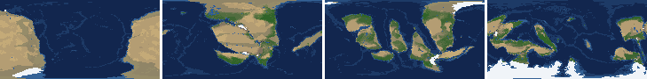
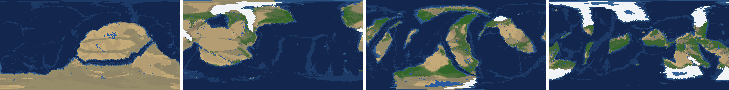
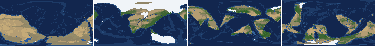
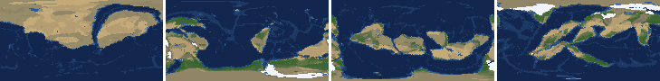
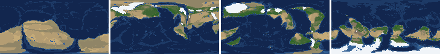
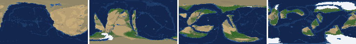
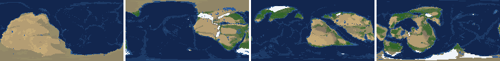
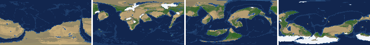

# Health sweep 2026-10-15 18:43

Commit 58a12c0. 8 runs (default params, `--every 4`) at 8 workers x 2 numba threads; simulations 4.0 min wall. Made by `tools/health.py` (PW-246).

## Runs

| seed | L | Myr | run | sim s | trees / flowering trees from | dT range C | peaks > 9.5 km | giant-lake frames % | crust volume end/start | ice SL < -150 m % | <= 4 plates % |
|---|---|---|---|---|---|---|---|---|---|---|---|
| 1 | 6 | 500 | c97af3 | 236 | 132 / 412 | 9.4 | 0 | 11.5 | 0.89 | 0.0 | 0.0 |
| 2 | 6 | 500 | f496a3 | 238 | 140 / 396 | 19.1 | 0 | 17.7 | 0.9 | 6.2 | 0.0 |
| 11 | 6 | 500 | 7069a1 | 239 | 128 / 372 | 18.0 | 0 | 13.3 | 0.891 | 15.0 | 0.0 |
| 21 | 6 | 500 | 9a4532 | 237 | 136 / 404 | 12.6 | 0 | 21.2 | 0.891 | 0.0 | 0.0 |
| 3199 | 6 | 500 | eaf87e | 233 | 132 / 376 | 12.3 | 0 | 8.8 | 0.892 | 0.0 | 0.0 |
| 42 | 6 | 500 | 3354df | 234 | 116 / 404 | 13.8 | 0 | 32.7 | 0.873 | 13.3 | 0.0 |
| 77 | 6 | 500 | fec787 | 236 | 124 / 416 | 10.7 | 0 | 14.2 | 0.886 | 0.0 | 0.0 |
| 505 | 6 | 500 | 9b3a70 | 238 | 132 / 416 | 8.4 | 0 | 19.5 | 0.907 | 0.0 | 0.0 |

## Medians by seed (after 50 Myr; tree cover after forests, NPP after flowering trees appear)

| seed | L | land_pct | cont_pct | cont_km | plates | ocean_age | speed | sea_level | sea_ice_m | ice_pct | temp | co2 | dry_pct | inland_pct | lake_pct | lake_max_mkm2 | max_elev_km | trees_pct | npp | landmasses | largest_pct |
|---|---|---|---|---|---|---|---|---|---|---|---|---|---|---|---|---|---|---|---|---|---|
| 1 | 6 | 32.2 | 39.2 | 35.3 | 11.0 | 36.4 | 6.0 | 35.0 | -5.1 | 0.5 | 15.4 | -0.5 | 35.2 | 11.5 | 0.9 | 0.2 | 6.4 | 31.6 | 365.8 | 4.0 | 18.8 |
| 2 | 6 | 31.4 | 38.9 | 34.9 | 11.0 | 40.2 | 6.0 | 32.2 | -15.2 | 1.1 | 15.2 | -0.2 | 41.4 | 10.5 | 1.2 | 0.3 | 5.5 | 26.1 | 381.1 | 7.0 | 18.3 |
| 11 | 6 | 31.6 | 38.3 | 35.0 | 13.0 | 38.4 | 6.2 | 22.4 | -12.8 | 1.2 | 13.5 | -0.3 | 30.2 | 10.1 | 0.9 | 0.2 | 5.7 | 30.7 | 350.5 | 6.0 | 21.8 |
| 21 | 6 | 31.7 | 38.3 | 35.4 | 13.0 | 41.5 | 6.4 | -2.9 | -9.9 | 0.7 | 16.7 | -0.2 | 32.6 | 9.8 | 0.9 | 0.2 | 6.7 | 24.5 | 333.8 | 6.0 | 25.1 |
| 3199 | 6 | 30.0 | 39.0 | 34.8 | 12.0 | 38.2 | 6.3 | 18.9 | -44.7 | 2.9 | 15.3 | 0.0 | 31.2 | 8.6 | 0.8 | 0.1 | 6.4 | 30.8 | 386.1 | 6.0 | 20.7 |
| 42 | 6 | 33.1 | 39.0 | 34.8 | 12.0 | 34.5 | 6.6 | 66.6 | -0.6 | 0.1 | 14.7 | -0.3 | 42.4 | 10.5 | 0.8 | 0.4 | 5.3 | 20.9 | 390.4 | 5.0 | 18.2 |
| 77 | 6 | 32.1 | 38.5 | 35.7 | 12.0 | 38.6 | 6.3 | 23.8 | -34.3 | 2.3 | 12.8 | -0.3 | 44.7 | 14.1 | 0.9 | 0.3 | 5.8 | 22.6 | 334.2 | 6.0 | 24.6 |
| 505 | 6 | 31.6 | 38.7 | 35.2 | 12.0 | 42.6 | 6.0 | 8.3 | -5.5 | 0.5 | 14.9 | -0.3 | 36.1 | 11.5 | 1.3 | 0.3 | 5.3 | 27.8 | 309.7 | 6.0 | 24.7 |

Measured on the run's keyframes (no slicing). Caveats: a keyframe's lakes and `downstream` come from the terrain before that step's erosion and deposition (PW-239), so `inland_raw_pct` (every routed end on land, as highlights counts it) runs ~2-3x `inland_pct` (ends that are closed lakes, salt pans or real pits on the frame's own elevation); lake shares are the run's lakes during the step. Land ice and land shares use cells (near-equal area).

## Envelopes

| metric | low | high | Earth | source |
|---|---|---|---|---|
| land, % of surface (`land_pct`) | 22 | 42 | 29.20 | tests/test_envelopes.py (22-42%); Earth 29.2% |
| continental crust, % of surface (`cont_pct`) | 33 | 50 | 41 | tests/test_envelopes.py (33-50%); Earth ~41% with shelves (Cogley 1984) |
| mean continental crust thickness, km (`cont_km`) | 31 | 40 | 39 | target 35 km (PW-238, continental_thickness); Earth ~39 km (Christensen & Mooney 1995); known thinning to 32-33 km (PW-046) |
| plates (`plates`) | 5 | 30 | 15 | tests/test_envelopes.py (5-30; max_plates 30); Earth 7 major + ~8 minor; <= 4 is the PW-191 collapse |
| mean ocean-floor age, Myr (`ocean_age`) | 25 | 120 | 64 | tests/test_envelopes.py (25-120); Earth ~64 Myr (Mueller et al. 2008); PW-051 |
| mean plate speed, cm/yr (`speed`) | 2 | 9 | 4.50 | tests/test_envelopes.py (2-9 cm/yr); Earth ~4-5 |
| sea level, m (ice + ocean basins) (`sea_level`) | -250 | 300 | 0 | Phanerozoic ~-130 (LGM) .. +250 m (earth.py; Haq & Schutter 2008); -250: PW-240's hard goal |
| sea level from land ice, m (`sea_ice_m`) | -250 | - | 0 | Earth LGM ~-130 m; PW-240 goal -150 m typical / -250 m worst |
| land ice, % of surface (`ice_pct`) | - | 10 | 3.10 | Earth 3.1% now (earth.EARTH_ICE), ~7-8% at the LGM |
| global mean temperature, C (`temp`) | 8 | 30 | 14.50 | Earth 14.5 C; LGM ~8 C (Tierney et al. 2020); Phanerozoic hothouses to ~30 C (Scotese et al. 2021) |
| CO2 index (ln source/sink) (`co2`) | -1.5 | 1.5 | 0.00 | the forcing's clip in earth.py (+-1.5); Earth 0 |
| arid (Koppen B), % of land (`dry_pct`) | 12 | 45 | 30 | tests/test_envelopes.py (12-45%); Earth ~30% (Beck et al. 2018) |
| land draining inland, % of ice-free land (to a closed lake, salt pan or real pit) (`inland_pct`) | 8 | 30 | 18 | Earth ~18% (overview 2.9); L6 known ~9.5-11% (PW-054, PW-243). `inland_raw_pct` (not checked) follows the stored `downstream` to any end, as highlights does: stale by a step (PW-239) |
| lakes, % of land (`lake_pct`) | 0.2 | 3.0 | 1.80 | Earth ~1.8% of ice-free land (HydroLAKES, Messager et al. 2016); generated L6 worlds 0.5-1% |
| largest lake, million km2 (`lake_max_mkm2`) | - | 1.0 | 0.37 | Caspian 0.37 Mkm2; 1 Mkm2 = the overview's giant lake (2.9) |
| highest peak, km (`max_elev_km`) | - | 9.5 | 8.85 | Everest 8.85 km; PW-172 (spikes above ~9.5 km) |
| tree cover, % of ice-free land (after forests appear) (`trees_pct`) | 10 | 50 | 30 | Earth ~30% potential canopy (forest 55-60 of ~130 Mkm2, overview 2.18) |
| land NPP, g C/m2/yr (after flowering trees appear) (`npp`) | 200 | 700 | 430 | Earth ~56 Pg C/yr over ~130 Mkm2 = ~430; the model on Earth's terrain 50 Pg C/yr, ~385 (overview 2.18). Before flowering trees (plant group 4) stand-ins grow at 70%, so runs sit at ~150-280 |
| landmasses (>= 3 cells) (`landmasses`) | 3 | 80 | - | loose: a lone supercontinent or a shattered archipelago |
| largest landmass, % of surface (`largest_pct`) | 5 | 35 | 16.60 | Afro-Eurasia 16.6%; a Pangaea ~30% (scorecard largest_max) |
| global temperature range over the run, C (`dT_range`, per run) | - | 25 | 25 | Phanerozoic 11-36 C (Scotese et al. 2021) |
| keyframes with a peak above 9.5 km (`peak_frames`, per run) | - | 0 | 0 | PW-172 (L7 seed 3199: 3 of 251) |
| % of keyframes with a lake over 1 Mkm2 (`giant_lake_frames`, per run) | - | 5 | 0 | overview 2.9 (L6: 3 of ~150 frames) |
| continental crust volume, end / start (`volume_ratio`, per run) | 0.9 | 1.1 | 1.0 | scorecard volume_ratio (x1.006) |
| % of keyframes with ice sea level below -150 m (`sea_ice_below_150`, per run) | - | 10 | 0 | PW-240 |
| % of keyframes with <= 4 plates (`low_plates`, per run) | - | 2 | 0 | PW-191 (L7 seed 21: 1%) |

## Top outliers (of 240 spells; severity = excess / band width x (0.2 + share of the run))

| seed | L | metric | Myr | frames | worst | envelope | severity |
|---|---|---|---|---|---|---|---|
| 42 | 6 | giant_lake_frames | run | - | 32.70 | -..5 | 5.54 |
| 21 | 6 | giant_lake_frames | run | - | 21.20 | -..5 | 3.24 |
| 505 | 6 | giant_lake_frames | run | - | 19.50 | -..5 | 2.9 |
| 2 | 6 | giant_lake_frames | run | - | 17.70 | -..5 | 2.54 |
| 77 | 6 | giant_lake_frames | run | - | 14.20 | -..5 | 1.84 |
| 11 | 6 | giant_lake_frames | run | - | 13.30 | -..5 | 1.66 |
| 1 | 6 | giant_lake_frames | run | - | 11.50 | -..5 | 1.3 |
| 1 | 6 | lake_max_mkm2 | 272-304 | 7 | 5.72 | -..1.0 | 1.205 |
| 505 | 6 | lake_max_mkm2 | 388-400 | 3 | 5.62 | -..1.0 | 1.033 |
| 21 | 6 | lake_max_mkm2 | 380-388 | 2 | 5.08 | -..1.0 | 0.881 |
| 21 | 6 | lake_max_mkm2 | 108-148 | 8 | 4.06 | -..1.0 | 0.806 |
| 3199 | 6 | giant_lake_frames | run | - | 8.80 | -..5 | 0.76 |
| 1 | 6 | lake_max_mkm2 | 388-396 | 2 | 4.46 | -..1.0 | 0.746 |
| 42 | 6 | lake_max_mkm2 | 360-444 | 21 | 2.67 | -..1.0 | 0.611 |
| 11 | 6 | lake_max_mkm2 | 212-224 | 4 | 3.50 | -..1.0 | 0.579 |
| 2 | 6 | lake_max_mkm2 | 328-368 | 10 | 3.03 | -..1.0 | 0.566 |
| 21 | 6 | lake_max_mkm2 | 192-192 | 1 | 3.71 | -..1.0 | 0.564 |
| 505 | 6 | lake_max_mkm2 | 368-368 | 1 | 3.45 | -..1.0 | 0.509 |
| 11 | 6 | sea_ice_below_150 | run | - | 15.00 | -..10 | 0.5 |
| 42 | 6 | lake_max_mkm2 | 184-184 | 1 | 3.29 | -..1.0 | 0.476 |
| 505 | 6 | lake_max_mkm2 | 176-176 | 1 | 3.23 | -..1.0 | 0.463 |
| 42 | 6 | lake_max_mkm2 | 204-208 | 2 | 3.09 | -..1.0 | 0.451 |
| 42 | 6 | lake_max_mkm2 | 224-224 | 1 | 3.16 | -..1.0 | 0.45 |
| 11 | 6 | lake_max_mkm2 | 240-260 | 4 | 2.69 | -..1.0 | 0.392 |
| 77 | 6 | lake_max_mkm2 | 172-184 | 3 | 2.67 | -..1.0 | 0.373 |
| 42 | 6 | lake_max_mkm2 | 252-252 | 1 | 2.79 | -..1.0 | 0.372 |
| 1 | 6 | lake_max_mkm2 | 64-64 | 1 | 2.69 | -..1.0 | 0.351 |
| 42 | 6 | sea_ice_below_150 | run | - | 13.30 | -..10 | 0.33 |
| 1 | 6 | dry_pct | 52-108 | 15 | 73.53 | 12..45 | 0.276 |
| 21 | 6 | lake_max_mkm2 | 180-180 | 1 | 2.30 | -..1.0 | 0.271 |

## Per seed: min / median / max after the 50 Myr spin-up, and spells outside the envelopes

### Seed 1, L6 (run c97af3)

*At 48, 200, 348, 500 Myr: sea by depth, land green by tree cover / tan where arid, shaded by height, ice white, lakes blue.*

| metric | min | median | max | outside (Myr: worst) |
|---|---|---|---|---|
| land_pct | 28.76 | 32.22 | 38.49 |  |
| cont_pct | 37.32 | 39.19 | 42.19 |  |
| cont_km | 32.96 | 35.26 | 37.34 |  |
| plates | 7.00 | 11.00 | 17.00 |  |
| ocean_age | 24.00 | 36.40 | 55.90 | 96-104: 24.00 |
| speed | 4.49 | 5.99 | 10.30 | 68-120: 10.30 |
| sea_level | -146.70 | 35.00 | 191.20 |  |
| sea_ice_m | -111.60 | -5.10 | -0.00 |  |
| ice_pct | 0.00 | 0.50 | 5.50 |  |
| temp | 9.20 | 15.40 | 18.60 |  |
| co2 | -1.11 | -0.47 | 0.38 |  |
| dry_pct | 27.02 | 35.25 | 73.53 | 52-108: 73.53; 196-248: 56.09 |
| inland_pct | 3.32 | 11.52 | 29.78 | 104-104: 7.54; 116-116: 7.04; 316-344: 5.41; 360-364: 6.27; +3 more |
| lake_pct | 0.13 | 0.87 | 6.32 | 52-52: 0.17; 64-64: 3.40; 116-116: 0.13; 132-132: 0.18; +4 more |
| lake_max_mkm2 | 0.04 | 0.21 | 5.72 | 64-64: 2.69; 136-136: 2.29; 160-160: 1.26; 192-192: 2.28; +2 more |
| max_elev_km | 2.06 | 6.44 | 7.80 |  |
| trees_pct | 14.44 | 31.62 | 45.18 |  |
| npp | 234.60 | 365.80 | 395.60 |  |
| landmasses | 1.00 | 4.00 | 18.00 | 52-80: 1; 140-152: 2; 248-256: 2; 276-280: 2 |
| largest_pct | 8.30 | 18.80 | 38.50 | 52-64: 38.50 |

### Seed 2, L6 (run f496a3)

*At 48, 200, 348, 500 Myr: sea by depth, land green by tree cover / tan where arid, shaded by height, ice white, lakes blue.*

| metric | min | median | max | outside (Myr: worst) |
|---|---|---|---|---|
| land_pct | 29.12 | 31.40 | 37.66 |  |
| cont_pct | 36.38 | 38.89 | 42.46 |  |
| cont_km | 33.86 | 34.94 | 38.04 |  |
| plates | 7.00 | 11.00 | 16.00 |  |
| ocean_age | 22.00 | 40.20 | 64.00 | 80-104: 22.00 |
| speed | 3.09 | 5.98 | 11.08 | 52-112: 11.08 |
| sea_level | -143.70 | 32.20 | 202.10 |  |
| sea_ice_m | -173.60 | -15.20 | -0.00 |  |
| ice_pct | 0.00 | 1.10 | 8.50 |  |
| temp | 3.20 | 15.20 | 22.30 | 476-500: 3.20 |
| co2 | -1.23 | -0.19 | 0.30 |  |
| dry_pct | 15.05 | 41.38 | 53.55 | 52-68: 50.47; 84-92: 47.61; 172-208: 48.87; 224-292: 53.55 |
| inland_pct | 2.35 | 10.53 | 24.64 | 80-84: 4.99; 100-120: 2.35; 136-136: 6.98; 296-296: 6.29; +2 more |
| lake_pct | 0.20 | 1.17 | 2.90 | 100-100: 0.20 |
| lake_max_mkm2 | 0.04 | 0.35 | 3.03 | 124-128: 1.85; 152-160: 1.49; 220-232: 1.91; 308-308: 2.02; +2 more |
| max_elev_km | 1.78 | 5.49 | 8.74 |  |
| trees_pct | 10.92 | 26.15 | 49.51 |  |
| npp | 251.40 | 381.10 | 464.80 |  |
| landmasses | 1.00 | 7.00 | 17.00 | 52-64: 2; 168-184: 1; 248-260: 2 |
| largest_pct | 5.60 | 18.30 | 33.30 |  |

### Seed 11, L6 (run 7069a1)

*At 48, 200, 348, 500 Myr: sea by depth, land green by tree cover / tan where arid, shaded by height, ice white, lakes blue.*

| metric | min | median | max | outside (Myr: worst) |
|---|---|---|---|---|
| land_pct | 29.62 | 31.65 | 37.80 |  |
| cont_pct | 37.42 | 38.33 | 42.60 |  |
| cont_km | 34.27 | 35.04 | 37.09 |  |
| plates | 6.00 | 13.00 | 18.00 |  |
| ocean_age | 18.90 | 38.40 | 58.00 | 60-104: 18.90 |
| speed | 3.61 | 6.17 | 10.89 | 56-120: 10.89 |
| sea_level | -497.50 | 22.40 | 202.20 | 164-224: -497.50 |
| sea_ice_m | -359.80 | -12.80 | -0.00 | 172-212: -359.80 |
| ice_pct | 0.00 | 1.20 | 12.70 | 168-208: 12.70 |
| temp | 2.20 | 13.50 | 20.20 | 144-216: 2.20 |
| co2 | -1.02 | -0.34 | 0.33 |  |
| dry_pct | 17.89 | 30.18 | 60.02 | 52-100: 60.02 |
| inland_pct | 2.78 | 10.08 | 34.37 | 52-56: 34.37; 124-152: 2.78; 204-204: 6.82; 284-284: 7.45; +9 more |
| lake_pct | 0.24 | 0.90 | 3.12 | 216-216: 3.12 |
| lake_max_mkm2 | 0.04 | 0.16 | 3.50 | 52-64: 2.13; 136-136: 1.01; 164-164: 1.01; 212-224: 3.50; +2 more |
| max_elev_km | 1.43 | 5.74 | 9.26 |  |
| trees_pct | 19.71 | 30.73 | 45.12 |  |
| npp | 234.40 | 350.50 | 390.80 |  |
| landmasses | 2.00 | 6.00 | 12.00 | 132-132: 2 |
| largest_pct | 10.80 | 21.80 | 32.60 |  |

### Seed 21, L6 (run 9a4532)

*At 48, 200, 348, 500 Myr: sea by depth, land green by tree cover / tan where arid, shaded by height, ice white, lakes blue.*

| metric | min | median | max | outside (Myr: worst) |
|---|---|---|---|---|
| land_pct | 29.73 | 31.72 | 37.88 |  |
| cont_pct | 37.10 | 38.29 | 42.35 |  |
| cont_km | 34.53 | 35.41 | 37.47 |  |
| plates | 9.00 | 13.00 | 19.00 |  |
| ocean_age | 20.00 | 41.50 | 52.60 | 68-104: 20.00; 332-344: 24.10 |
| speed | 3.83 | 6.42 | 10.23 | 64-100: 10.23 |
| sea_level | -159.30 | -2.90 | 184.00 |  |
| sea_ice_m | -71.60 | -9.90 | -0.00 |  |
| ice_pct | 0.00 | 0.70 | 3.90 |  |
| temp | 11.10 | 16.70 | 23.70 |  |
| co2 | -0.94 | -0.21 | 0.22 |  |
| dry_pct | 19.71 | 32.57 | 58.56 | 52-104: 58.56; 268-280: 46.65; 304-312: 47.28 |
| inland_pct | 3.30 | 9.77 | 31.61 | 64-64: 31.61; 100-100: 6.63; 144-144: 7.91; 176-176: 7.40; +1 more |
| lake_pct | 0.19 | 0.94 | 5.90 | 100-100: 0.19; 136-136: 5.90; 148-148: 3.36; 192-192: 4.57; +3 more |
| lake_max_mkm2 | 0.03 | 0.24 | 5.08 | 64-64: 1.03; 76-92: 1.49; 108-148: 4.06; 180-180: 2.30; +5 more |
| max_elev_km | 1.99 | 6.70 | 8.80 |  |
| trees_pct | 11.84 | 24.52 | 46.24 |  |
| npp | 264.40 | 333.80 | 350.40 |  |
| landmasses | 1.00 | 6.00 | 12.00 | 52-64: 2; 240-240: 1; 264-284: 1; 456-460: 2 |
| largest_pct | 7.70 | 25.10 | 32.20 |  |

### Seed 3199, L6 (run eaf87e)

*At 48, 200, 348, 500 Myr: sea by depth, land green by tree cover / tan where arid, shaded by height, ice white, lakes blue.*

| metric | min | median | max | outside (Myr: worst) |
|---|---|---|---|---|
| land_pct | 29.11 | 29.99 | 38.10 |  |
| cont_pct | 36.05 | 39.04 | 42.60 |  |
| cont_km | 33.36 | 34.80 | 37.48 |  |
| plates | 7.00 | 12.00 | 15.00 |  |
| ocean_age | 28.50 | 38.20 | 60.10 |  |
| speed | 4.04 | 6.28 | 10.04 | 72-112: 10.04 |
| sea_level | -268.30 | 18.90 | 164.20 | 468-492: -268.30 |
| sea_ice_m | -128.90 | -44.70 | -0.00 |  |
| ice_pct | 0.00 | 2.90 | 6.30 |  |
| temp | 8.40 | 15.30 | 20.70 |  |
| co2 | -0.69 | 0.01 | 0.40 |  |
| dry_pct | 17.19 | 31.18 | 58.64 | 52-88: 58.64; 124-156: 47.82 |
| inland_pct | 2.00 | 8.61 | 27.55 | 64-72: 6.02; 92-112: 2.84; 292-296: 6.32; 316-480: 2.00; +1 more |
| lake_pct | 0.15 | 0.81 | 3.10 | 72-72: 0.15; 168-172: 3.10 |
| lake_max_mkm2 | 0.03 | 0.14 | 2.02 | 144-152: 1.53; 164-180: 1.56; 268-272: 2.02 |
| max_elev_km | 1.69 | 6.43 | 9.23 |  |
| trees_pct | 12.16 | 30.77 | 39.62 |  |
| npp | 290.50 | 386.10 | 433.80 |  |
| landmasses | 2.00 | 6.00 | 14.00 | 52-64: 2; 308-308: 2 |
| largest_pct | 7.80 | 20.70 | 32.30 |  |

### Seed 42, L6 (run 3354df)

*At 48, 200, 348, 500 Myr: sea by depth, land green by tree cover / tan where arid, shaded by height, ice white, lakes blue.*

| metric | min | median | max | outside (Myr: worst) |
|---|---|---|---|---|
| land_pct | 29.77 | 33.12 | 38.69 |  |
| cont_pct | 37.37 | 39.04 | 42.47 |  |
| cont_km | 33.06 | 34.83 | 37.15 |  |
| plates | 5.00 | 12.00 | 19.00 |  |
| ocean_age | 19.60 | 34.50 | 56.30 | 80-128: 19.60; 336-356: 24.40 |
| speed | 4.16 | 6.64 | 11.21 | 68-132: 11.21 |
| sea_level | -429.90 | 66.60 | 209.70 | 444-500: -429.90 |
| sea_ice_m | -303.60 | -0.60 | -0.00 | 452-476: -303.60 |
| ice_pct | 0.00 | 0.10 | 10.80 | 452-468: 10.80 |
| temp | 6.40 | 14.70 | 20.20 | 444-464: 6.40 |
| co2 | -1.15 | -0.30 | 0.36 |  |
| dry_pct | 15.18 | 42.37 | 70.79 | 52-116: 70.79; 192-308: 57.47 |
| inland_pct | 2.23 | 10.54 | 38.35 | 88-88: 7.97; 116-124: 5.90; 144-144: 5.40; 156-156: 5.61; +6 more |
| lake_pct | 0.16 | 0.84 | 3.36 | 56-56: 0.16; 184-184: 3.36 |
| lake_max_mkm2 | 0.03 | 0.36 | 3.29 | 68-84: 1.68; 112-112: 2.15; 136-136: 1.42; 160-168: 2.03; +6 more |
| max_elev_km | 1.82 | 5.35 | 7.86 |  |
| trees_pct | 12.71 | 20.93 | 46.89 |  |
| npp | 260.70 | 390.40 | 430.60 |  |
| landmasses | 1.00 | 5.00 | 12.00 | 52-88: 2; 192-200: 2; 228-248: 1; 284-292: 2 |
| largest_pct | 8.90 | 18.20 | 38.70 | 52-60: 38.70 |

### Seed 77, L6 (run fec787)

*At 48, 200, 348, 500 Myr: sea by depth, land green by tree cover / tan where arid, shaded by height, ice white, lakes blue.*

| metric | min | median | max | outside (Myr: worst) |
|---|---|---|---|---|
| land_pct | 29.89 | 32.13 | 38.53 |  |
| cont_pct | 36.74 | 38.49 | 42.55 |  |
| cont_km | 34.67 | 35.74 | 37.88 |  |
| plates | 7.00 | 12.00 | 16.00 |  |
| ocean_age | 22.20 | 38.60 | 62.40 | 112-128: 22.20; 396-404: 24.20 |
| speed | 4.84 | 6.26 | 11.13 | 88-144: 11.13 |
| sea_level | -213.00 | 23.80 | 171.10 |  |
| sea_ice_m | -99.30 | -34.30 | -0.00 |  |
| ice_pct | 0.00 | 2.30 | 5.10 |  |
| temp | 7.30 | 12.80 | 18.00 | 144-148: 7.30 |
| co2 | -1.34 | -0.25 | 0.46 |  |
| dry_pct | 27.43 | 44.73 | 68.13 | 52-92: 68.13; 180-196: 45.24; 208-360: 56.05 |
| inland_pct | 5.49 | 14.07 | 33.17 | 52-56: 33.17; 104-112: 5.59; 144-144: 7.32; 288-288: 32.63; +6 more |
| lake_pct | 0.17 | 0.89 | 3.94 | 76-76: 0.17; 144-144: 0.19; 184-184: 3.39; 216-216: 3.94; +1 more |
| lake_max_mkm2 | 0.04 | 0.26 | 2.67 | 172-184: 2.67; 196-216: 2.13; 240-248: 1.42; 340-340: 1.51; +2 more |
| max_elev_km | 2.00 | 5.82 | 8.58 |  |
| trees_pct | 17.07 | 22.55 | 35.07 |  |
| npp | 245.00 | 334.20 | 348.40 |  |
| landmasses | 1.00 | 6.00 | 13.00 | 52-72: 1; 208-216: 2 |
| largest_pct | 10.60 | 24.60 | 38.60 | 52-64: 38.60 |

### Seed 505, L6 (run 9b3a70)

*At 48, 200, 348, 500 Myr: sea by depth, land green by tree cover / tan where arid, shaded by height, ice white, lakes blue.*

| metric | min | median | max | outside (Myr: worst) |
|---|---|---|---|---|
| land_pct | 30.11 | 31.61 | 37.86 |  |
| cont_pct | 35.79 | 38.69 | 42.99 |  |
| cont_km | 34.02 | 35.24 | 37.97 |  |
| plates | 6.00 | 12.00 | 16.00 |  |
| ocean_age | 20.00 | 42.60 | 75.60 | 68-104: 20.00 |
| speed | 3.27 | 6.03 | 10.30 | 52-100: 10.30 |
| sea_level | -298.20 | 8.30 | 201.20 | 500-500: -298.20 |
| sea_ice_m | -128.20 | -5.50 | -0.00 |  |
| ice_pct | 0.00 | 0.50 | 5.80 |  |
| temp | 10.20 | 14.90 | 18.60 |  |
| co2 | -0.97 | -0.31 | 0.12 |  |
| dry_pct | 23.45 | 36.12 | 51.81 | 52-60: 51.81; 92-112: 51.55 |
| inland_pct | 2.68 | 11.52 | 30.93 | 76-88: 4.60; 100-144: 2.68; 208-208: 30.09; 256-260: 30.93; +3 more |
| lake_pct | 0.22 | 1.32 | 5.56 | 176-176: 4.10; 264-268: 3.03; 368-368: 3.72; 392-400: 5.56 |
| lake_max_mkm2 | 0.05 | 0.29 | 5.62 | 64-68: 1.41; 92-92: 1.79; 128-144: 1.48; 176-176: 3.23; +7 more |
| max_elev_km | 1.97 | 5.26 | 8.52 |  |
| trees_pct | 20.23 | 27.76 | 40.19 |  |
| npp | 210.30 | 309.70 | 346.00 |  |
| landmasses | 1.00 | 6.00 | 11.00 | 52-60: 2; 172-176: 1 |
| largest_pct | 8.80 | 24.70 | 32.50 |  |

## Determinism

(not run)
