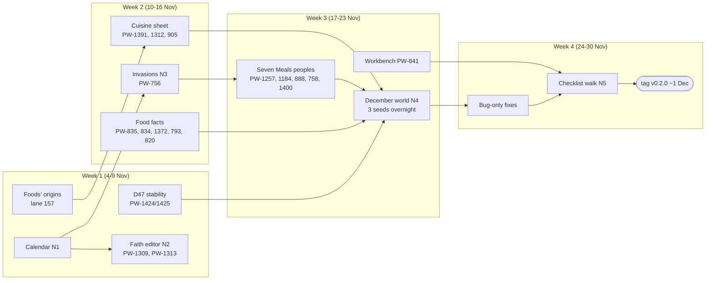

# December plan: what v2 (v0.2.0) has to be for Daniel to use this repo in December

*Lane 161, 2026-11-03. A proposal only: no ticket was moved. Builds on lane 156's triage (`triage-2026-11-03.md`). Every
"works today" below was checked against the code and the viewer on main e3070912, with the file named.*

## The choice, in plain words

**Proposed definition of v2:** *the Seven Meals campaign kit.* On 1 December you can, from the viewer alone: make an
Earth-like planet that doesn't blow up, run the Seven Meals peoples on it, look at who lives where and what they believe,
**write in your own faiths and your own invasions ("the antelope-kin come down on the humans around year 1400") and re-run**,
and read a per-culture food sheet that answers the book's five questions (fuel, staple, drink, who eats together, what
outsiders get wrong). Then tag v0.2.0 and stop.

**What you give up to get it by 1 December:**
- **No more physics accuracy in v2.** The known climate faults stay as known faults: inland rain about 1.7x too wet in
  places like the Great Plains, low-latitude summers 3-4 C too hot, tallest mountains about 5.7 km, wet tropical forest
  growing about half what it should, the star's brightening not anchored to "now". Each of these costs a day or more of
  simulations per attempt, and several have already failed three times. Only D47 (the stability fix, already being checked)
  goes in. Physics comes back in v3.
- **No states or empires.** Invasions will move peoples and be remembered by their neighbours, but there will be no
  political map: no empire borders, no vassals, no kings. Your antelope-kin empire and the fallen cervid-kin empire can be
  written in as invasions, not drawn as states. Polities are v3.
- **No languages.** Cultures, faiths, gods and towns keep descriptive names ("the sea faith of the river humans"). You can
  name your own faiths and gods; everything else waits for the language work (v3).
- **A coarse calendar.** The history steps a century at a time over the last 30,000 years, so "around year Z" means within
  about a hundred years. The finer 25-year history zoom is v3.
- **No whole-planet fine map.** Regional zooms (1-4 km per pixel, on demand in the viewer) stay how you look closely at a
  campaign area. The seamless whole-planet land zoom is v3; it also needs the machine for hours, which clashes with your jobs.

**Where your wish for accuracy and the deadline really conflict:** the simulations that take a day each are almost all
physics (climate and its judge runs). The peoples and food work is cheap by comparison: a peoples run is minutes, and
religion and the food sheet are read-outs that rebuild in seconds. So the plan spends December's month on the cheap,
visible layers you will actually touch, and keeps physics to "fix it only if it visibly breaks your world". If you would
rather have one more physics fix (rain inland is the likeliest to matter, because wet interiors put the wrong crops in the
brief), it costs about a week and pushes the tag to mid-December. That is the honest trade.

**Alternative, smaller:** drop the faith and invasion editors (items 4 and 5 below) and ship only the food sheet and the
stable planet by ~20 November. You would then write religion and history by hand outside the tool. I don't recommend it:
those two are the parts of your December you named.

**Alternative, larger:** keep the triage's v2 (89 tickets) as is. At the board's recent pace that is a spring release,
not December.

---

## 1. What "using it in December" means: the workflow, step by step

From "New planet" to "a world I run a campaign in". Status: **works** (you can do it in the viewer today), **rough**
(you can, but something visible is off or missing), **missing** (not there, or only on the command line).

| # | What you want to do | Status | What exists today (checked in) | What is missing |
|---|---|---|---|---|
| 1 | Make a new planet: kind (Earth-like), seed, detail level, length | **works** | Start screen "New planet" form (`viewer/start.js`, `planet/make.py`): presets, seed, level 5-7, length, planet settings, time estimate | - |
| 2 | Have it make the ice ages, the finished world, highlights, zooms and the Seven Meals peoples in one go | **works** | Same form: time zoom, finished world, highlights, up to 6 regional zooms, "Peoples on the finished world: seven_meals" (`make.py` stage `peoples`, PW-1394) | An L7 1 Gyr planet takes about an hour (`make.py` timings: run ~50 min, peoples ~10 min) |
| 3 | Refuse a planet with no lasting ice and re-roll | **works** | "Require permanent ice" with tries (`make.py`, D19) | - |
| 4 | Trust it not to come out frozen over or cooked | **rough** | v0.1.0 had 0 hard failures in 42 draws, but a do-nothing change still fails 2 of the 6 coldest test planets (PW-1404) | D47 (PW-1424 one yardstick per level, PW-1425 "frozen" means it ends frozen): lane 160 is checking it |
| 5 | Look at the land, climate, biomes, rivers, lakes, coasts on the globe and 2D map; save a PNG | **works** | Globe and map (`viewer/globe/*`), "Download PNG" (`viewer/index.html`) | Known physics faults above show as greener interiors and hot summers |
| 6 | Zoom into the campaign region | **works** | Regional zooms on demand from the viewer (POST `/api/zoom`, `viewer/zoom.html`), 3D zoom | Fine-zoom carving leaves box-shaped river cuts (PW-541) |
| 7 | Open the Seven Meals tree, change who splits off where and when, set wishes ("halflings near humans"), pick the era | **works** | Peoples workbench `viewer/lineages.html`: Tree & timeline, Peoples, Places & land use, Wishes, era select, war and raider dials, save/load, "Run on world" | The tree and timeline overlap and are hard to scroll sideways (PW-841, your complaint 10-26) |
| 8 | See who lives where, their regional populations, mixing, cultures, settlements, technology | **works** | Globe layers peoples, peoples blend, peoples mix, demes, settlements overlay, technology map (`viewer/globe/layers.js`, `settlements.js`); workbench Cultures, Results, Technology tabs | Settlements are v0 (PW-1011); nothing is named except landmasses (`planet/names.py`) |
| 9 | Every Seven Meals people actually appears | **rough** | 75-row `seven_meals.toml` | Half-orcs are never founded on 3 of 5 tries on one world (PW-1257); a split whose parent died out is founded anywhere on the planet (PW-1184); origins crowd onto one small continent (PW-888) |
| 10 | See the religion: gods, faiths, where they spread, taboos | **works** (read-only) | Religion tab (`viewer/religiontab.js`: god trees, faith map with time slider, faith timeline, taboos), from `planet/lineages/gods.py` and `taboos.py` | Dead cultures' gods show as living (PW-1313) |
| 11 | **Tweak the religion set**: say "the dwarves keep a smith god called X", "this faith is founded here at that time", rename a faith, change a god's domains | **missing** | Gods and faiths are emergent only: `gods.py` founds faiths from each culture's land and way of life; the tree has no faith rows; nothing in the tab is editable | An authored-faith row and an editor (new ticket N2 below) |
| 12 | Pick the gods mode (faith-made, belief only, absolute) | **missing in the viewer** | Exists in code (`techtree.GODS_MODES`, `/api/gods?mode=`); the tab only shows the mode | A control and a stored setting (PW-1309) |
| 13 | **Schedule an invasion**: "people X invades people Y around year Z" | **missing** | `[[event]] kind = "conquest"` rows parse (`reputation.parse_events`) but only change who *remembers* whom as conquerors; the history itself is never moved (`reputation.py` header, PW-756). The sim detects its own incursions (`contacts.py`, last 100 kyr) but the viewer never shows them; the workbench has no event editor | An invasion row that nudges the history, an editor, and an "it happened / it didn't" read-out (new ticket N3, built on PW-756) |
| 14 | Talk in years, not "kyr ago" | **missing** | Every readout is "kyr ago" (brief, workbench, settlements every 100 years: `settlements.py` STEP_KYR 0.1) | A "the present is year N" setting (new ticket N1) |
| 15 | Read what a people eats at a place and era; copy it out | **works** for a people or a place | Globe "Culinary brief" panel: people or "brief here", era, Copy text, Download JSON (`viewer/globe/colours.js`, `/api/brief`, `planet/lineages/brief.py`) | - |
| 16 | Read what **a culture** cooks (the book's unit): fuel, staple, drink, who eats together, what outsiders get wrong, and what it won't eat | **rough** | The brief covers land, fuels, wild food, fish, salt, crops, herds, neighbours and reputation; food taboos exist per culture but don't reach the brief | Per-culture brief and cuisine sheet (PW-1391), taboos in it (PW-1312), drink and who-eats-together have no model; pigs, camels, llamas, reindeer, yak and buffalo are missing (PW-835); foragers get dairy herds (PW-834) |
| 17 | Hand it to the culinary-dnd repo | **works** | JSON and Markdown brief (BRIEF_VERSION contract) | - |
| 18 | Nudge something small and get a recognisably similar world back | **rough** | Peoples stress suite `tools/peoples_robust.py`; climate judge `tools/judge.py`, `tools/hard_bar.py` | D47 for the planet; the peoples-mechanisms ledger you approved (retire idle mechanisms) |

Summary: steps 1-8, 10, 15 and 17 work today. The two things you named (11 religion, 13 invasions) don't exist as
anything you can steer, and the food sheet (16) is per people, not per culture. Those three are the heart of v2.

## 2. v2 (v0.2.0): the definition, the list, the order

### The definition (five lines)

1. A new Earth-like L7 planet with the Seven Meals peoples comes out of the viewer's "New planet" in about an hour and is never frozen over, boiled or ocean-less (D47 accepted and in).
2. Every Seven Meals people is founded, near where its tree says, on each of 3 fresh seeds.
3. In the viewer you can write in a faith (founder, place, year, named gods) and an invasion (who, whom, year, from where, how hard), and see what came of them.
4. Each culture gets a cuisine sheet answering the book's five questions, with its food taboos, at a year you pick.
5. Then freeze, walk the checklist below, tag v0.2.0 around 1 December. Physics only if your chosen world is visibly broken.

### The list, in order (existing tickets first; "N" = new ticket to file, not filed here)

| Order | Item | Tickets | Effort (agent time) | Why it is in |
|---|---|---|---|---|
| 1 | **Planet stability**: one carbon yardstick per level, "frozen" means it ends frozen | PW-1424, PW-1425 (D47), fold in PW-1404 | in progress (lane 160); ~1-2 days to merge if it passes | "not prone to exploding when nudged" |
| 2 | **Where foods come from**: crop homelands and dates, staples first, crops don't cross oceans before seafaring | lane 157 (D44's 20-50 native foods) | in progress; ~1 day | food first (D44) |
| 3 | **Year calendar**: "the present is year N"; every readout and editor in years | N1 | s (~2 h) | invasions "around year Z" need it |
| 4 | **Faiths you can write**: a `[[faith]]` row (name, founding people or culture, place, year, core domains, named gods, spreads or stays closed) seeded into the existing faith rules; an editor in the Religion tab; rebuilds in seconds without re-running the peoples. With the gods mode control and the dead-gods fix | N2, PW-1309, PW-1313 (under PW-1308) | m-l (~1.5 days) | your "tweak a religion set" |
| 5 | **Invasions you can schedule**: `[[event]] kind = "invasion"` (by, over, year, how long, from where, light or strong) that *nudges* the history (people X presses harder on Y's land in that window and place; the sim decides how far it gets), an editor in the workbench, a read-out of what happened from the existing incursion detector, incursions shown on the globe and in the brief; the tree editor keeps `[[event]]` rows | N3, PW-756 (its direction and polity-valence items), relates PW-730 | l (~2 days) | your "invasions from X to Y around year Z" |
| 6 | **Cuisine sheet per culture**: the brief takes a culture; a cuisine module with drink and who-eats-together lines; taboos in it; food fit per body | PW-1391 (D44 said food first: move to todo), PW-1312, PW-905 | m (~1 day) | the book's unit is the culture |
| 7 | **Food facts that are visibly wrong**: missing herd animals; foragers don't keep dairy; lactase from herding; Seven Meals ruminant-kin don't milk by default; water thresholds in real units | PW-835, PW-834, PW-1372, PW-793, PW-820 | ~1.5 days together | wrong food in the sheet |
| 8 | **Peoples that are visibly wrong in Seven Meals**: half-orcs founded; splits founded near their parents; origins spread across continents; half-elves as a contact hybrid; drawn rungs in order | PW-1257, PW-1184, PW-888 (fold PW-1151, and decide PW-1202 inside it), PW-758, PW-1400 | ~2 days | step 9 of the workflow |
| 9 | **Workbench readable**: tree and timeline don't overlap, scroll sideways | PW-841 | s-m | you hit it every time |
| 10 | **Your December world**: 3 candidate L7 Earth-like seeds with Seven Meals, made overnight; you pick one; a bug-only pass on what breaks; PW-755 re-read on it; how-to page in the viewer's help | N4, PW-755, PW-730 | m + overnight compute | the real test |
| 11 | **Checklist walk and tag**: an agent walks the checklist below headless, then you do; tag v0.2.0 | N5, PW-900 (close) | s | the stopping point |

Also in v2 but not work: close as "v0 done, rest later" PW-670 (cultures), PW-719 (animal stocks), PW-981 (demes),
PW-1011 (settlements), PW-1015, PW-1241 (answered by D31 A), PW-728 (closes with PW-1391); epics PW-691, PW-692, PW-856
stay open as parents of their v2 slices. One owner sitting of ~20 minutes on 10 small calls: PW-833 (likely done by the
density ladder), PW-1038 (likely done by lane 48's saurian branch), PW-1131, PW-1145, PW-1151, PW-1170, PW-1396,
PW-1397, PW-1398, PW-1406.

The peoples-mechanisms ledger (approved in D44, next after lane 157) fits v2 only as **measure and report** in week 1;
retiring mechanisms touches the same history code as item 5, so the retiring waits until the invasion lane has merged,
and moves to v3 if week 3 is tight.

Result: v2 goes from 90 open to about **32 open** (24 kept, 3 moved back in, ~5 new), plus 7 to close and 10 small calls.

### Definition of done: what you check in the viewer

1. Start screen, New planet: Earth-like, L7, 1 Gyr, peoples seven_meals. It finishes without an error in about an hour and a quarter. Do it for 3 seeds: none frozen over (40%+ of land under ice at the end), none boiled.
2. Globe: climate, biomes, rivers, the peoples layer, settlements and the technology map all draw on the finished world; a regional zoom of your campaign area opens.
3. Workbench, Results: every Seven Meals people is listed as living on all 3 seeds (half-orcs founded; half-elves shown as a contact hybrid where elves and humans meet); no people is founded on a continent far from its parent.
4. Workbench, Tree & timeline: labels don't overlap, you can scroll to the earliest split; you can move a root, save, run, and the run finishes.
5. Religion tab: switch the gods mode. Add a faith ("the Forge Faith, founded by the dwarves in the northern hills in year 300, gods: Mardun of the forge, Esk of the deep roads"). Rebuild: within seconds it shows on the faith map, the timeline and in the dwarves' taboos.
6. Workbench, history anchors: add "antelope-kin invade the humans around year 1400, from their border, strong". Run. Results says whether it happened, where and how much land changed hands; the globe at year 1400 vs 1600 shows it; the humans' brief remembers "the horned ones".
7. Globe, Culinary brief: pick a culture (not just a people) and a year: the sheet names its fuel, staple, drink, who eats together and what outsiders get wrong, and lists what it won't eat.
8. Nudge test: change one wish weight and re-run with the same seed; the world is recognisably the same (same peoples roughly where they were).

If 1-8 pass, v0.2.0 is tagged. Anything else found in the walk is filed `later` unless it breaks one of 1-8.

## 3. What is not in v2

### v3: wanted, with a reason it waits

The reason is the same for most of it: each attempt costs a day or more of simulations, competes with your own jobs for the
machine, and several targets have already failed three times. Proposed v3 after the moves: about **63 open** (25 today
+ 38 from v2).

| Subsystem | Moving to v3 | Reason it waits |
|---|---|---|
| climate | 14 | the star anchor chain (PW-807, 809, 812, 815), the star thermostat (PW-791, 865, the PW-570 plan), CO2 stock and frozen spells (PW-558, 1156), too-warm finishes (PW-1161), 2 Gyr icebox (PW-894), summer heat (PW-1279), monsoon vapour (PW-1120), forage quality (PW-836). Every one changes the planet and needs a full judge round (36 draws); none breaks a 1 Gyr Earth-like once D47 is in. Re-check after D47: if D47 makes frozen spells harmless, PW-558 and PW-1156 may go to later |
| peoples | 7 | dragon and giant food budget (PW-977, 960, 1018, 1179, 1221), one environment per epoch (PW-1392), continental blocs (PW-1202, unless PW-888 needs it). They re-tune the whole peoples balance; you paused share tuning until war and polities exist |
| zoom | 5 | whole-planet land zoom (PW-1299, 1296, 1355), refined-world terrain (PW-1264), fine-zoom box cuts (PW-541: the one zoom fault you would see; first to pull if a lane is idle in week 3) |
| culture | 3 | the 25-year history zoom (PW-908: century steps are enough for "around year Z"), the rest of the tech tree (PW-913: the era stop already works), species voice profiles (PW-1423: the first step of languages, which is a v3 system) |
| food | 3 | dragons and giants in the food output (PW-961), wild herd density (PW-1261, PW-1329): physics of plant growth |
| tectonics, surface, infra, timezoom | 6 | mountains too low (PW-846), grass growth against weathering (PW-1332), wet forest growth (PW-1331), peat to coal (PW-212), the rest of the speed pass (PW-247), the ice-age v2 plan (PW-555) |

Already in v3 and staying there: civilization and war (PW-661), unifying pressure (PW-676), weather (PW-156), moons and
weird worlds, L8/L9, magic design (PW-696), named individuals (PW-911), trade crops (PW-912), the species placement helper
(PW-1010), export targets (PW-1200), fine terrain in the peoples sim (PW-1360).

**Later `later` tickets that I would make v3 rather than backlog**, because they are the natural next step after v2's
anchors: polities and empires (PW-785, PW-1280, PW-1285), war as a cut (PW-1172, PW-1243), languages (PW-986, PW-972,
PW-767). That is your call; lane 156 left them in `later` because v3 needs you to want them.

### Backlog (`later`)

About **452 open** after the moves (441 today + 11 from v2). The 11 are: dnd-only portal and density calls (PW-1185,
1191, 1214, 1215, 1149) and gnome remnants (PW-956), since Seven Meals is your world and has no gnomes; peoples
proposals not needed for December (PW-1169, 1206); a tech-tree deposit test (PW-1154); a plates memory saving (PW-1409);
peoples on worlds whose time zoom was deleted (PW-651: New planet keeps the time zoom by default).

By subsystem the backlog is peoples ~81, climate ~72, time zoom ~48, viewer ~42, zoom ~40, culture ~29, tectonics ~26,
ocean ~19, surface ~17, food ~16, highlights ~18, infra ~13, docs ~11, coast ~9, store ~6, hydrology ~5. Most of it is
rain and regional climate calibration against Earth, zoom and coast polish, viewer niceties, ore and salt detail, and
the war, plague, events and life-history set.

The **137 unscheduled tickets** are neither promised nor backlog. Suggestion: treat unscheduled as `later` by default
and don't spend a lane triaging them before December.

### Moves, in one place

- **Out of v2 to v3 (38):** PW-212, 247, 541, 555, 558, 570, 791, 807, 809, 812, 815, 836, 846, 865, 894, 908, 913, 960,
  961, 977, 1018, 1120, 1156, 1161, 1179, 1202, 1221, 1261, 1264, 1279, 1296, 1299, 1329, 1331, 1332, 1355, 1392, 1423.
  (In-progress ones keep their status and their notes; only the milestone changes.)
- **Out of v2 to later (11):** PW-651, 956, 1149, 1154, 1169, 1185, 1191, 1206, 1214, 1215, 1409.
- **Back into v2 from later (3):** PW-1308 (religion epic, as the parent of the v2 slice only; PW-1307, 1310, 1366, 1368
  stay later), PW-1309 (gods mode control), PW-1313 (dead gods shown as living).
- **New tickets to file (5):** N1 calendar, N2 authored faiths and editor, N3 scheduled invasions that nudge the history
  and editor, N4 the December world, N5 checklist walk and tag.
- **Close as v0 done (7):** PW-670, 719, 981, 1011, 1015, 1241, and PW-900 at the tag.

## 4. Risk: what could make December slip, and the caps

| Risk | How likely | Cap |
|---|---|---|
| **D47 fails lane 160's check** (36 draws x 2, about a day of compute) | medium | Decide by ~8 Nov. If PW-1424 fails, take PW-1425 alone (it changes how the check reads, not the planet) and move PW-1424 to v3. No second round in v2 |
| **A physics lane "just one more"** | high, by habit | No physics in v2 after D47 unless your chosen world is visibly broken (frozen, boiled, a continent of desert where it shouldn't be). Then one lane, time box 2 days, three strikes still applies. No judge-cycle physics after 16 Nov |
| **Judge cycles eat the machine** while you run your own jobs | high | v2's remaining work is peoples, food, religion and viewer: peoples runs are minutes; religion and the brief rebuild in seconds. Only N4 (3 L7 planets, ~1 h each) needs real compute: run it overnight in week 3. Daytime cap stays 32 cores, ~90 GB |
| **The invasion nudge doesn't take** (the sim's own balance pushes back) | medium | Nudge, not force, as the project's rule says; but the read-out must say "it didn't happen" honestly, and a "strong" setting must work on the Seven Meals world. Time box 2 days; if it can't be made to work, fall back to the reputation-only anchor that exists today and say so |
| **Two lanes edit the history code at once** (invasions, the mechanisms ledger, peoples fixes) | medium | Order: lane 157 → invasions (N3) → peoples fixes (item 8); the ledger is measure-only until N3 merges |
| **Ticket growth** (lanes filed ~65 a day) | high | Already capped at 3 drafts a lane. Add: in November every draft is `later` unless it breaks a checklist item |
| **New owner asks mid-month** | likely and fine | Anything new goes into v3 or later unless it replaces a v2 item of the same size |
| **Calendar**: Thanksgiving week (26-29 Nov) | certain | Week 4 is freeze, walk and fix only; nothing new starts after 23 Nov |

## 5. Map and weeks

Week by week (lanes: one serial physics lane, two or three parallel feature lanes, as now):

- **Week 1, 4-9 Nov.** Lane 160 finishes D47; you rule on it. Lane 157 merges. Start N1 (calendar, small) then N2 (faiths
  you can write, with PW-1309 and PW-1313) in a religion lane. The ledger as a measure-only report. One 20-minute sitting
  on the 10 small calls. Board moves from section 3 done by the coordinator once you agree.
- **Week 2, 10-16 Nov.** N3 (invasions) in the peoples lane, after lane 157. Food lane: PW-1391 cuisine sheet with taboos
  and food fit, then the food facts (PW-835, 834, 1372, 793, 820). Physics lane: nothing unless D47 needs a fix; after
  16 Nov no judge-cycle physics.
- **Week 3, 17-23 Nov.** Peoples fixes for Seven Meals (PW-1257, 1184, 888, 758, 1400). PW-841. N4: three L7 Earth-like
  Seven Meals planets overnight; you pick your world; PW-755 re-read on it. If a lane is free: PW-541 (box-shaped cuts).
- **Week 4, 24-30 Nov.** Freeze: bug fixes only, nothing new. N5: an agent walks the checklist headless, then you walk it.
  Tag v0.2.0 on or about 1 December. Then v3 opens with whatever you missed most in the walk.

## Sources checked for this plan

Viewer: `viewer/start.js` (New planet form), `viewer/lineages.html` (workbench tabs, era, war and raider dials, no event
editor), `viewer/religiontab.js` (four read-only views), `viewer/globe/layers.js`, `viewer/globe/colours.js` (brief panel),
`viewer/globe/settlements.js`, `viewer/index.html` (PNG). Code: `planet/make.py` (stages, timings, peoples step),
`planet/server.py` (routes, `gods_doc` mode), `planet/lineages/gods.py` (faiths founded, inherited, schism, conversion;
read-out only), `taboos.py`, `contacts.py` (incursions, last 100 kyr), `reputation.py` and `spec.py` (`[[event]]`
conquest, wishes near/apart/among), `history/steps.py` and `recent.py` (deep, glacial, century steps over the last 30 kyr),
`history/competition.py` (where a nudge would act), `settlements.py` (100-year ledger), `brief.py`, `names.py`,
`samples/seven_meals.toml`. Board: `board.py milestones`, `board.py milestones v2` and v3, the ticket files named above;
`docs/wiki/state.md`, `decisions.md`, lane 156's triage; the culinary-dnd README (the five questions) and its tiefling
history decision (events at the scale of centuries, ~3,000-1,500 years ago).
