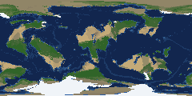

# The world catalogue: 12 Earth-like 2 Gyr worlds to choose from (lane 307, 2026-11-11)

Daniel, 11-11: "why limit to three [December worlds]? ... I also would love to have a variety of worlds to choose from.
2 billion year runs, some slight variation besides seed value ... for a total of at least 10." December A-C (PW-1437) were
`planet make --preset earthlike --level 7 --peoples seven_meals` at 1000 Myr with the then 300 kyr time zoom; this catalogue
is the same recipe at 2000 Myr and the current 2000 kyr time zoom, with one lever moved per world.

Runner: `tools/catalogue.py` (`plan`, `run`, `summary`). Runs are named "Catalogue 1-01" ... "Catalogue 1-12", so they show
on the start screen.

## 1. The levers that exist today

Every lever is a `tectonics.Params` field (`planet make --set KEY=VALUE`; the New planet form offers the first seven,
`planet/make.py` SETTINGS). Evidence is the repo's own; "no evidence" means no doc, test or ticket measures it.

| lever | default | exposed | Earth-like range the repo backs | evidence and known failures |
|---|---|---|---|---|
| `start` (supercontinent / scattered) | supercontinent | form + `--set` | supercontinent; scattered unmeasured for climate | PW-379 (wontdo): scattered at L6 stays dispersed, slow plates (3.7 vs 4.5 cm/yr), old ocean, sea -185 m through 500 Myr; `tests/test_sea_level.py` |
| `continental_fraction` | 0.4 (form 0.1-0.7) | form + `--set` | 0.4 well measured (crust 40-41%, land 31-32%, docs/overview.md); 0.6 one seed passes (land-heavy showcase, end pCO2 766 ppm, outside 180-600) | nothing measured below 0.4 or between 0.4 and 0.6 |
| `continental_start` | -1 (off) | form + `--set` | -1 | water world (0.1 with heat_start 2, 2 Gyr): always icebox, soft fail (PW-790; v010-showcases/notes.md) |
| `tilt` | 23.4 (form 0-60) | form + `--set` | 23.4; 15 and 45 only paired with climate offsets | no tilt-only sweep anywhere |
| `climate_offset` | 0 (form -10..10) | form + `--set` | hard bar held over -6..+3 on one seed each | cold (-6): soft fail, 44.5% peak iced land; hothouse (+3): only +3.5 C, soft fail (PW-811 re-pick) |
| `n_plates` | 12 (form 4-30) | form + `--set` | 12 | no sweep; seed 21 spends 6% of its run at 3-4 plates (PW-289) |
| `heat_start` | 1 (form 1-3) | form + `--set` | 1-2 | 1 vs 2 on the water world both dT -8.5 (v2-climate-1); nothing above 2 |
| `star_brightening` | 1.0 (Gough's Sun) | `--set` only | 1.0 | old pass rates at 0.45 predate the end-anchored star; the star-anchor audit says re-measure |
| `star_thermostat` (PW-791) | off | `--set` only | opt-in (owner rulings, docs/wiki/decisions.md) | off in every preset (docs/overview.md); `params.py`'s comment "on for the Earth-like preset" is stale |
| `star_now_offset_myr` | 0 | `--set` only | 0 | no measurement |
| run length (`--myr`) | 1000 (earthlike) | form + CLI | 1000; 1500 one showcase passes | **2 Gyr L6, 13 draws: bar 0/13, icebox 81-99.8% of the time** (docs/review/base-climate/v1-finish-14, 2026-10-25 code; PW-894 todo, post-v1 by owner ruling) |
| day length / rotation | Earth | **not exposed** | - | `climate.py` OMEGA = 7.292e-5, fixed wind-belt latitudes (TRADE_ROUND, FRONT_LAT); exposing it is not small (circulation, tides; PW-481) |
| year length | 365.25 d | **not exposed** | - | hard-coded in climate (MONTH_DAYS, declination), vegetation, timezoom kernels; not small (PW-481) |
| star brightness (a brighter / older star) | today's Sun at the run's end | only via `star_brightening` / `star_now_offset_myr`, `climate_offset` | - | `make.py` UNSUPPORTED: "a different star (always Sun-like, ...)"; a luminosity scale is small code but unmeasured |
| ocean fraction / water inventory | - | **not exposed** | - | sea level follows the crust and ice; `continental_fraction` is the only land-share lever (PW-481) |
| orbit (distance, eccentricity) | fixed (S0 1361) | **not exposed** | - | eccentricity only in the time zoom's Milankovitch cycles |

## 2. The twelve configs

All `planet make --preset earthlike --level 7 --myr 2000 --kyr 2000`, then `planet lineages WORLD --tree seven_meals`
(the December tree) and `planet languages`. One lever (or one pair) per world, fixed seeds 307001-307012. `uv run python
tools/catalogue.py plan` prints this list from the code.

| # | levers | what makes it interesting | risk |
|---|---|---|---|
| 01 | defaults | the control | the 2 Gyr icebox risk shared by all (section 1) |
| 02 | start=scattered | no supercontinent: many seas and coasts early, a later assembly | PW-379: stays dispersed, old ocean at L6; no climate pass rate |
| 03 | continental_fraction=0.33 | more ocean, island-rich, maritime | below anything measured; land may come out ~25% |
| 04 | continental_fraction=0.48 | land-rich: wide interiors, more steppe and desert | between 0.4 and the land-heavy 0.6 (one seed, high end pCO2) |
| 05 | start=scattered, continental_fraction=0.48 | many mid-sized continents, long coastlines | two levers (02 and 04 name the suspect) |
| 06 | tilt=17 | mild seasons, narrow tropics | tilt alone untested; likeliest to end too icy |
| 07 | tilt=30 | hard winters, hot summers, wide tropics and polar circles | tilt alone untested |
| 08 | n_plates=8 | few big plates: large old continents | no sweep; the count may wash out over 2 Gyr |
| 09 | n_plates=18 | many small plates: arcs, young ranges | no sweep |
| 10 | heat_start=1.5 | hot young mantle: more plumes and faster plates early | 1-2 is the measured range; hot sea floor raises the early sea |
| 11 | climate_offset=1.5, tilt=26 | a warm Earth: little ice, wide forests | +1.5 unmeasured; the warm side is the safer side at 2 Gyr |
| 12 | star_thermostat=true | the guided star, the owner's preferred hand of god | opt-in, off in every preset; bounded to +-4% of the output |

## 3. Cost and batches

Measured on 2026-11-11 in a scratch data root (`/data/personal/scratch/lane307/root`), this branch (main 02050888 plus
the runner), `NUMBA_NUM_THREADS=4`, machine load 10-48 from other lanes, `/usr/bin/time -v`:

| stage | config 01 (seed 307001, "Catalogue 0-01") | source |
|---|---|---|
| simulate 2000 Myr, L7 | run 922ef9: 8,125 s (2:15) | `meta.generated_in_s` |
| time zoom 2000 kyr | 9bc575: 5,809 s (1:37) | `meta.generated_in_s`; two-myr.md had 1:54 on December A |
| finish, highlights, 4 zooms | ~3 min | |
| **the whole `planet make`** | **3:55:29 wall, 6.9 GB peak** | `tools/catalogue.py` state.json |
| peoples (seven_meals, 1 try) | still running at hand-off (log `cat-test/01/log.txt`) | estimate: dnd 1 try on a 2 Myr zoom took 1:27 wall, 20.3 GB (two-myr.md) |
| languages | not yet run | ~11 min at 8 workers (make.LANGUAGES_S) |

The world (9d36b1): land 33.8%, mean surface T 14.5 C (land 7.7 C), ice sheet 18.4% of the land, finish moment passes
(20 of 20 candidates), end pCO2 1,013 ppm (outside the 180-600 diagnostic band), and the run's ice criteria fail on time
spent in icehouse (90% of the 2 Gyr, against the 5-70% band; one icehouse lasting 1,004 Myr). That is PW-894's
always-icebox story on one L7 seed of today's code, but the finished moment itself looks Earth-like (thumbnail below).



**How many at once.** The L7 run is mostly serial numpy: on this machine one L6 run is barely faster at 16 threads than at
4 (45.7 s at 4, 39-40 s at 16-48), while 8 runs at once at 2 threads each took 54 s (~6x the throughput;
docs/coordination.md, "Concurrency comes from processes"). So 6 configs at 4 threads each (24 cores) should each run about
as fast as one alone, which is what Daniel remembers. Memory sets the limit, not cores: a make peaks at ~7 GB (6 x 7 = 42 GB),
but a peoples run on a 2 Myr zoom at ~20 GB, so six peoples stages at once would want ~120 GB. The runner starts each stage
only when the memory it caps plus 8 GB is free, so the peoples stages queue themselves instead of crowding.

**Per world**, at 4 threads: ~4 h make + ~1.5 h peoples (1 try) + ~15 min languages = ~6 h; with the 4 tries of the
December recipe the peoples history runs 4 times (the tries are sequential; ~50 min of history each on a 2 Myr zoom), so
~8-9 h. Recommendation: `--tries 1` for the catalogue (the peoples are a preview; the picked world gets its real peoples
run later).

**Batches.** Two nights: batch A = configs 01-06, batch B = 07-12, each 6 at once at 24 cores, ~6-7 h with 1 try. The
final batch waits for the physics lanes at the end of the month; this plan re-runs unchanged then (fixed seeds).

## 4. Launch

Not launched by lane 307 (it was before 20:00 when the plan was ready). The command, for the coordinator (main code, main
data folders, 24 cores, 1 peoples try):

```
cd /home/daniel/personal/repos/procedural-world-generation/.claude/worktrees/lane307 && \
nohup uv run python tools/catalogue.py run --data /home/daniel/personal/repos/procedural-world-generation \
  --code /home/daniel/personal/repos/procedural-world-generation --out /data/personal/scratch/lane307/catalogue-1 \
  --only 01-06 --jobs 6 --cores 24 --tries 1 > /data/personal/scratch/lane307/catalogue-1.log 2>&1 &
# next morning:
uv run python tools/catalogue.py summary --data /home/daniel/personal/repos/procedural-world-generation \
  --out /data/personal/scratch/lane307/catalogue-1
```

Re-running the same command resumes (each config's finished stages are in its state.json). Add `--refine` to also refine
each world to L8 (~8.5 min, ~12 GB each; measured below).

## 5. Is L7 -> L8 ready? (the end-to-end check)

On Earth-like A's finished world 899985 (286 kyr zoom fc5311, the shortest zoom on hand), copied to the scratch root:
- `planet refine 899985 --level 8` -> 20b777: 8:30 wall, 12.3 GB peak (baseline: docs/review/timezoom/two-myr.md, 4:22 and
  11.7 GB for December A's 2 Myr world, a quieter machine).
- `planet lineages 20b777 --tree seven_meals --tries 1` (the split) **crashed twice on main** at the hand-over (cut 12.0 kyr ago):
  1. the live dragon cultures (merged 11-10) and the dragon realms' rings were carried over on the L7 grid
     (`ValueError ... (655362,) (163842,)` in `DragonCultures.step`; 33 min in, 22 GB);
  2. after that fix, the live tech tree's cached goods matrix (`LiveTech._have`, 35 min in, 26 GB).
  Both fixed in `history/handover.py` (commits on lane307). The third run finished: run e32fab, **2:27:47 wall, 37.5 GB
  peak**, exit 0; people conserved across the hand-over (18,813,034.58 before and after); 56 peoples alive, 1,835 M people,
  262 cultures, 345 cities, 5,261 towns. Baseline: the dnd split 025b98 on 5d09cc, 1:56:41 and 35.5 GB
  (docs/review/refine-l8/split.md; another tree, so not a clean pair).
- Neither crash showed in the suite: the split test's tree has no dragon people (inbox draft).
