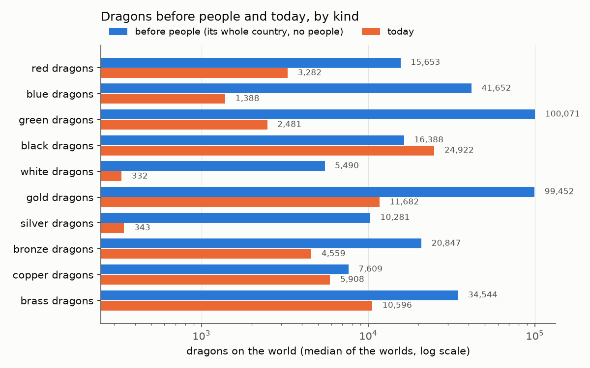
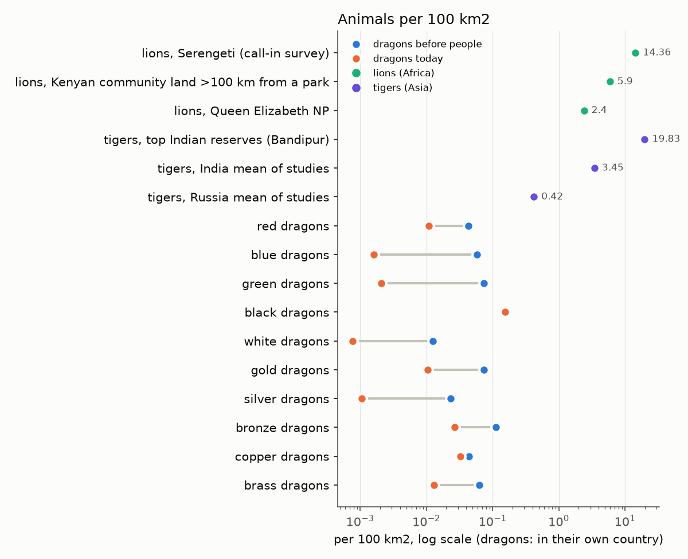

# How many dragons? Before people, after people, beside lions and tigers (lane 99: PW-1232, PW-1221, D28)

**Superseded in part by [round2.md](round2.md) (lane 103):** the persecution (KILL_Q, the never-zero form) was replaced by local
extirpation on the lions' 25 people per km², and the numbers were re-run (`round2/`).

Lane 99, 2026-10-31. The code is main after D20 and PW-1229 (merge 8a95477e), plus D28 B's sea food on this branch. The numbers come
from six probe worlds at roll 7000 (2a7385, 1df1c3, e71172, 6909cb, a12762, 067778), each run once through the dnd history. Lane 97 is
changing the peoples model, so **every number here will move when it merges. To refresh them, run one command from the repository
root**:

    bash docs/review/dragon-numbers/run_all.sh /some/scratch/dir 4

That takes ~3-5 h on a shared machine (twelve runs, four at a time, two threads each). It writes `tables.md`, `numbers.json` and the
two charts into that directory. Sections 3 and 4 below are those tables pasted in. Where not said otherwise, "today" and the per-kind
numbers are the `nosea` arm (main's code before D28 B). Section 4 gives the sea food's effect.

## In plain words

**How many dragons.** On a typical world today the model has about **80,000 dragons** (33,000-121,000 across the six worlds). That is
about **1,700 in a region the size of the Sword Coast**. Before people, the same worlds could hold at most about 360,000 (every kind
spread over all of its own country). On just the land the dragons hold today, they would number about 134,000 without people. So the
peoples have cut the dragons to about a fifth of what the land could carry, and to three fifths of what the land they still hold
could carry. The deep-time peak was about 500,000 dragons (350,000-1,050,000), 0.2-1.2 million years ago.

**Beside lions and tigers.** Dragons are rare beasts. Today they live at about 0.001-0.16 per 100 km² of their own country,
depending on the kind. Lions and tigers live at 2-20 per 100 km² in good reserves, about 6 on peopled Kenyan range, and about 0.4 in
Russia's cold forests. So a dragon is tens to thousands of times scarcer than a big cat on the same ground. That is what one expects
of an animal that eats ~5 t of meat a year.

What people did to dragons looks much like what people did to the big cats:
- **Range.** Lions keep 6-13% of their old range and tigers under 7%. Six dragon kinds keep 4-14% of their country at a tenth or more
  of their pre-people density (red, blue, green, white, gold and silver). Four kinds keep 26-68% of it (bronze, brass, copper and
  black).
- **Numbers.** Blue, green and silver dragons are down to about 3% of the most their country could hold, and white dragons to 6%. For
  comparison, tigers are at ~4% of their number a century ago and lions at ~25% of theirs in 1970. Africa is not lousy with lions,
  and the model's peopled worlds are not lousy with blue dragons.
- **The exceptions.** Black and copper dragons gain or hold steady. On the land they hold today, with the people taken out, they
  would already number more than their whole-country bound. So the peoples' herds and the land other kinds left behind feed them.

**Meeting one.** About a third of all people (35%) live where dragons live, with ~700 dragons per million of them. Suppose a dragon
killed people as often as an Indian tiger does (about one person a year per 50 tigers). Then dragons would kill about 1,500 people a
year on a world (670-2,300), or ~15 per million people in their range. For comparison, lions in Tanzania killed ~1.3 per million
Tanzanians a year, and tigers once killed ~1,000 a year in British India. Dragon attacks would be a regular, regional news item, like
man-eating tigers. That kill rate is a borrowed assumption, not something the model computes.

**What changed and why.** After D20 the dragons rose about tenfold. They rose because they **hold more land**, not because people hunt
them less hard. D20 made a new people start at one spot and spread, instead of taking its parent's whole range. So the peoples now
hold less of the land (humans 3,983 cells against 14,767 before, on the test world), and the rest is dragon country. The persecution
constant (`KILL_Q`) was set against a stated density point, not fitted to the old peoples, so I left it alone. The new count is the
model's answer. The deep-time peak moved for the same reason.

**D28 B (sea food).** White, bronze and blue dragons now also hunt seals and other sea mammals, worked out from how much the ocean
grows. On the median world, white dragons rose by 86%, bronze by 59% and blue by 36%. Silver dragons are not sea hunters and did not
change. All dragons together rose ~5%. White and silver dragons are still among the rarest kinds.

**Judgement calls for Daniel** (drafts, not decisions):
- Should dragons be cleared from the farmland outright, as lions and tigers were, or stay thinned everywhere? My lean is to keep it for now (A): the shares of country kept already match the big cats for most kinds.
  (`draft-dragon-range-loss-to-people.md`)
- The sea food's open points. (`draft-sea-food-follow-ups.md`)

The second chart has two marks per dragon kind: before people (blue) and today (orange). For black dragons the two marks overlap
(15.4 and 15.6 per 10,000 km²).

## 1. Why the dragons rose tenfold after D20 (PW-1232)

**What was run.** World 067778, roll 7000, `docs/review/megafauna/probe.py --eras 31,29,25,10,5,0 --cells`, the "on" arm, each arm a
scratch copy of the code (not committed): the lane 90 tip (1532de63), main (711f67f7), main with D20's switchable parts turned back
one at a time, and the lane 90 tip with only D20's first commit applied (4a01368b, patched in). A wrapper split the persecution by
people at the present. All at `NUMBA_NUM_THREADS=2`, 4-5 at a time.

| arm | dragons now | the dragons' range (kind-cells held) | dragons per cell held | mean kill where they live | people on the world | humans' cells | deep-time peak |
|---|---|---|---|---|---|---|---|
| lane 90 tip | 2,946 | 5,021 | 0.59 | 0.00227 | 769 M | 14,767 | 465,409 at 16,196 kyr |
| tip + D20's first commit only (fit-weighted contest, one-spot founding, the stem's land left empty) | 12,352 | 15,299 | 0.81 | - | 617 M | 7,490 | 544,827 at 196 kyr |
| main | 22,001 | 27,624 | 0.80 | 0.00092 | 350 M | 3,983 | 556,530 at 400 kyr |
| main, farmers' era density off (`ERA_DENSITY`) | 19,390 | 26,524 | 0.73 | 0.00140 | 394 M | 5,581 | 556,530 at 400 kyr |
| main with the pre-D20 tree (densities, ways, contest, learning limits, denning) | 13,823 | 26,123 | 0.53 | 0.00089 | 384 M | 4,303 | 528,492 at 2,500 kyr |
| main, every switch back (era density, kin stacking, DENSITY_PUSH, megafauna-stem founding, fit contest) + the pre-D20 tree | 16,092 | 23,803 | 0.68 | 0.00113 | 629 M | 10,438 | 599,412 at 400 kyr |
| main, kin stacking back (GROUP_KIN 0.5) | 22,001 | - | - | - | - | - | inert: the one capacity is also read in `competition.py` |

**The cause.** It is the dragons' **range**, not the persecution's strength:
- **The range grew 5.5 times** (5,021 to 27,624 kind-cells): every kind now holds far more land. Gold dragons went from 734 cells to
  2,799, copper from 200 to 4,301, white from 262 to 2,162.
- **The density per cell grew only 1.36 times** (0.59 to 0.80 dragons a cell). The kill where they live is 2.5 times weaker (0.00227 to
  0.00092), mostly because more of their range is now empty of people (blue: 64% to 78% kill-free, green 1% to 59%).
- **The peoples hold less land.** The humans fell from 14,767 cells to 3,983, the kobolds (a split of the dragons' own stem, who live
  in dragon country) from 9,596 to 414, and the people on the world from 769 to 350 million. The land they left is dragon country.
- **D20's first commit does most of it.** Alone on the lane 90 tip it takes the dragons from 2,946 to 12,352 (x4.2 of the x7.5) and the
  range x3. That commit made the contest go by fit and made a new people start at one spot instead of taking over its parent's whole
  range; at a stem's end its land now lies empty for its children to spread into (before, the stem's range was handed to the nearest
  child, so the dragons' stem's land went partly to kobolds and dragonborn). The rest of D20 (the tree's densities and ways, stage 2;
  the one capacity, stage 3; the megafauna-stem founding, lane 83b) adds the remaining x1.8 between them; on one world each switch
  moves the count by 10-40% either way, which is within what one draw can do, so I do not split it further.
- **The farming density by era is not it** (22,001 to 19,390 with it off), and nor is the persecution calibration (below).

**The deep-time peak.** It moved from 16 Myr ago to the 196-400 kyr switch with the same first commit (b1: 196 kyr, the time zoom's
start on this world). It is the same cause: the kinds now start at one spot and spread, so their range, and their number, is largest
where the deep epoch hands over to the recent pass, not in the deep past when the draconic stem's whole range was counted.

**Was `KILL_Q` calibrated against the old, inflated densities?** No. It was set once against a stated density point, not fitted to the
model's peoples: "dense renaissance farmers, 10 per km², keep 10% of their dragons" (megafauna.py, PW-1068; lane 90 re-scaled it for
the means read from the history, the same kill on such farmers). It reads the people per km² in each cell, whatever made them. D20
left the farmers' numbers alone (humans 10, human farmers 12, the same in both trees); what it changed is where the peoples live and
how much of the land they hold. Nothing else in the dragons' chain reads the peoples' densities except the hunters' take and the
herds, which are physical. So `KILL_Q` stays, and **the new number is the model's answer** for the D20 peoples: the dragons are more
numerous because they share less of their country with people. Lane 97's change to the peoples (brakes on fast breeders, spread
founding) will move it again, by the same route.

Not done: re-running the H1/H2 pressure-off and persecution-off arms of the paper (PW-1232's second box). The census below gives the
pre-people numbers directly instead.

## 2. The real apex predators beside people

Every figure below was read this session (2026-10-31). **R**: read in the source's own text. **S**: seen only in a news or search
summary or a secondary page quoting the source (unverified until the primary is read). **D**: my arithmetic on the figures named.

| animal | measure | value | where, when | source | flag |
|---|---|---|---|---|---|
| lion | density in a park | 14.4 per 100 km² (call-in survey; track surveys gave 35-41, judged biased high) | SE Serengeti NP, 2015 | Global Ecol Conserv 2019 (track surveys vs call-ins) | S |
| lion | density in a park | 2.4 (Queen Elizabeth NP), 6.7 (Lake Nakuru NP) per 100 km² | Uganda, Kenya | quoted in Western et al. 2022 | R |
| lion | density on peopled land | 5.9 per 100 km² (lions over 1 yr; 95% HPD 3.3-8.6), community land over 100 km from any protected area | South Rift, Kenya, c. 2018-20 | Western et al. 2022, Ecol Evol 12:e8662 | R |
| lion | fenced against unfenced | fenced reserves hold lions at 80% of their potential density on ~$500/km²/yr; unfenced ones need over $2,000/km²/yr to reach half | 42 sites, 11 countries | Packer et al. 2013, Ecol Lett 16:635 (abstract) | R |
| lion | numbers then and now | ~92,054 (83,017-101,094) c. 1970; a ~75% decline since | Africa | Loveridge et al. 2022, Divers Distrib 28:2388 (abstract) | R |
| lion | numbers now | 23,000 mature lions; area of occupancy 1,654,375 km²; "historic range loss 85-92%" | Africa, 2014 assessment | IUCN Red List (Bauer et al. 2016), as on a 2023 CMS slide | R (slide) |
| lion | range kept | today's lion populations hold 13% of their maximum historical range (c. 1500 AD) | Africa | Loveridge et al. 2022 | R |
| lion | range kept | 566,675 km², 6.13% of the historical range | Africa, 2025 | IUCN Cat Specialist Group, via a news factbox | S |
| lion | people killed | over 563 Tanzanians killed and at least 308 injured since 1990; 815 attacks Jan 1990-Sep 2004 | Tanzania | Packer et al. 2005, Nature 436:927 | R |
| lion | people killed, a rate | ~38 a year, ~1.3 per million Tanzanians a year (on 23.1 M in 1988 and 34.6 M in 2002, the paper's figures); the rate inside the lions' districts is higher, but the paper gives no district populations | Tanzania, 1990-2004 | Packer et al. 2005 | D |
| tiger | density in the best reserves | Bandipur 19.8, Corbett 19.6, Kaziranga 18.7 per 100 km² | India, 2022-24 | All-India tiger estimate, via a news summary | S |
| tiger | density, studies by country | India: mean 3.45, median 2.2 (0.19-14); Russia 0.42; Thailand 1.2; Malaysia 1.28 per 100 km² | by country | Zhu et al. 2022, Biodiversity Science 30:22421, Table 1 | R |
| tiger | numbers then and now | "probably over 100,000 a century ago" (an expert estimate, not a census); 4,485 (3,726-5,578) now | Asia; 2022 | Luo 2010, CATnews (citing Dinerstein et al. 2007); Sanderson et al. 2023 (citing Goodrich et al. 2022) | R |
| tiger | range kept | "over 93% of tiger range is now empty of tigers"; the tiger landscapes cover 911,920 km² (2020), down from 1,025,488 km² (2001) | Asia | Sanderson et al. 2023, Front Conserv Sci 4:1191280 | R |
| tiger | range kept | under 3,500 tigers "occupying less than 7% of their historical range" | Asia, 2010 | Walston et al. 2010, PLoS Biol 8:e1000485 | R |
| tiger | people killed | 51, 59, 110, 85 and 73 a year in 2020-24 (378 in all, ~76 a year) | India | Rajya Sabha reply, 1 Aug 2025, via a news wire | S |
| tiger | people killed per tiger | ~0.021 a tiger a year (76 over India's 3,682 tigers of 2022, itself from news summaries) | India | D on S figures | D |
| tiger | people killed | 0-50 a year, a mean of 22.7 in 1947-83 | Sundarbans | UNESCO, via Wikipedia | S |
| tiger | people killed, a rate | ~650 per million forest workers a year (22.7 over ~35,000 who enter the forest; workers, not residents) | Sundarbans | D on S figures | D |
| tiger | people killed, the past | "nearly 1,000 people annually throughout the late 1800s" | British India | Smithsonian Magazine | S |
| wolf | people killed | 2 fatal attacks in Europe and North America in 2002-20 (~60,000 wolves in North America, ~15,000 in Europe) | 2002-20 | Linnell et al. 2021, NINA Report 1944, via summaries | S |

What these say, read together:
- **Density.** Big cats in good country live at about 2-20 per 100 km², a few per 100 km² outside parks where they still live, and well
  under 1 per 100 km² in poor or cold country (Russia's tigers).
- **Range.** People took most of it. Lions keep 6-13% of their historical range, tigers under 7% (or ~7% of it still has tigers).
  Within what is left they are not rare: lions on Kenyan community land at 5.9 per 100 km² are as dense as in some parks.
- **Meeting them.** A lion or tiger killing someone is a yearly news item, not an everyday risk: ~1.3 per million Tanzanians a year,
  ~76 people a year in all of India. Where people go into the predators' own country the risk is hundreds of times higher (the
  Sundarbans' forest workers).

## 3. The dragons in the same terms (the census)

**Method** (`docs/review/dragon-numbers/census.py`, on top of `docs/review/megafauna/probe.py`). At the present of each run, per kind:
- **today**: the model's dragons, sum over cells of the kind's presence x `local_density` x cell area.
- **on today's land, no people**: the same cells with every people's presence zeroed (no kill, no overkill of the prey, no herds,
  no hunters' take), the food and the food cap worked again.
- **before people, the most**: the kind present on its whole own country (its capacity at least `SUITABLE` of its best), no people.
  It is an upper bound, since even with no people a kind does not hold all its country.
- A cell of the paper's biome classes counts in each class whose bit it carries. A Sword Coast-sized region is 3.9 Mkm² at the
  world's land average.
- **Meeting them**: the people living in cells with any dragon, and a death toll at India's tigers' rate per animal (0.021 a tiger a
  year; section 2, flag D on S). That is an assumption to give a scale, not a model output.

Arm `nosea`, 6 worlds (067778_7000, 1df1c3_7000, 2a7385_7000, 6909cb_7000, a12762_7000, e71172_7000); medians over the worlds (range).

| | before people | today |
|---|---|---|
| dragons on the world | 358,723 (207,655-488,394) | 80,290 (32,998-120,715) |
| ...on the cells they hold today, people taken out | 133,896 (73,502-234,735) | |
| in a Sword Coast-sized region (3.9 Mkm2, land average) | 7,661 (4,272-10,320) | 1,712 (682-2,551) |
| deep-time peak (all dragons) | 495,685 (353,367-1,052,800) | at 196, 286, 300, 300, 294, 1,200 kyr ago |

Per kind. Before people, the most: the kind's whole own country, no people (an upper bound: even without people a kind does not hold all of it). On today's land: the cells it holds now, with the people taken out. Today: the model's present.

| kind | before people, the most | on today's land, no people | today | today / before | per 10,000 km2 of its country, before -> today | region, before -> today | country held (peopled part / empty part) | its country peopled | country at >= 10% of its pre-people density |
|---|---|---|---|---|---|---|---|---|---|
| red | 15,653 (9,188-25,706) | 4,838 (1,770-24,162) | 3,282 (995-11,841) | 0.22 | 4.29 -> 1.09 | 335 -> 67.7 | 0.12 (0.11 / 0.09) | 0.97 | 0.12 |
| blue | 41,652 (23,936-63,396) | 2,218 (890-6,917) | 1,388 (464-5,741) | 0.03 | 5.85 -> 0.161 | 885 -> 30.3 | 0.14 (0.09 / 0.73) | 0.91 | 0.14 |
| green | 100,071 (55,501-130,556) | 5,214 (2,142-23,204) | 2,481 (1,195-8,350) | 0.03 | 7.41 -> 0.209 | 2,132 -> 52.4 | 0.04 (0.03 / 0.07) | 0.95 | 0.04 |
| black | 16,388 (7,261-36,596) | 50,531 (11,819-84,011) | 24,922 (5,343-47,507) | 1.26 | 15.4 -> 15.6 | 344 -> 523 | 0.69 (0.69 / 0.96) | 1.00 | 0.68 |
| white | 5,490 (3,515-8,215) | 668 (158-738) | 332 (30.8-549) | 0.06 | 1.26 -> 0.077 | 113 -> 7.25 | 0.09 (0.02 / 0.31) | 0.82 | 0.09 |
| gold | 99,452 (55,854-129,694) | 23,441 (6,260-54,184) | 11,682 (2,458-34,442) | 0.14 | 7.37 -> 1.04 | 2,118 -> 247 | 0.14 (0.12 / 0.41) | 0.97 | 0.13 |
| silver | 10,281 (7,419-15,285) | 1,196 (529-1,561) | 343 (170-827) | 0.03 | 2.35 -> 0.107 | 213 -> 7.19 | 0.06 (0.04 / 0.38) | 0.91 | 0.05 |
| bronze | 20,847 (9,483-41,362) | 7,734 (4,613-19,247) | 4,559 (2,664-9,357) | 0.30 | 11.2 -> 2.68 | 437 -> 96.6 | 0.29 (0.29 / 0.30) | 0.99 | 0.29 |
| copper | 7,609 (3,831-16,157) | 9,496 (5,207-24,849) | 5,908 (3,399-12,945) | 0.77 | 4.42 -> 3.24 | 163 -> 126 | 0.33 (0.34 / 0.04) | 0.99 | 0.32 |
| brass | 34,544 (20,037-55,997) | 17,492 (7,978-27,387) | 10,596 (2,617-15,394) | 0.31 | 6.29 -> 1.31 | 736 -> 222 | 0.26 (0.25 / 0.36) | 0.94 | 0.26 |

All dragons by biome (per 10,000 km2 of that biome's land):

| biome | share of land | before people | today |
|---|---|---|---|
| forest | 0.28 | 22.7 (6.15-35.3) | 1.74 (0.550-3.70) |
| grassland | 0.34 | 30.8 (13.1-38.2) | 4.79 (2.60-12.1) |
| desert | 0.10 | 2.98 (0.582-5.94) | 1.83 (0.384-5.46) |
| tundra | 0.01 | 0.502 (0.193-2.10) | 0.124 (0.012-1.43) |
| mountain | 0.10 | 6.17 (3.99-9.38) | 1.01 (0.431-1.57) |
| wetland | 0.06 | 66.3 (48.4-78.1) | 18.7 (13.8-31.4) |
| other | 0.06 | 0.856 (0.168-2.74) | 0.187 (0.007-0.933) |

Meeting them (people living in cells with dragons; the toll is an estimate at India's tigers' rate per animal):

| | median (range) |
|---|---|
| people in the dragons' range, share of all | 0.353 (0.245-0.401) |
| dragons in peopled country | 74,035 (32,558-114,121) |
| dragons per million people there | 714 (364-1,115) |
| estimated deaths a year, world (x 0.021 a dragon) | 1,520 (668-2,343) |
| estimated deaths a year per million people in range | 14.7 (7.47-22.9) |

Read with care:
- One draw per world. Kinds with a few hundred dragons (white, silver) swing several-fold between worlds.
- The "before people" bound treats every kind as present on its whole country at once, with no rival kinds; the ratio today/before is
  therefore a lower bound on what each kind kept.
- Black dragons today exceed the bound, and copper's "today's land, no people" exceeds it too: on those cells the herds and the guilds'
  freed food feed them (the bound is drawn with no people, so with no herds).

## 4. D28 B: sea food for the coast and ice dragons

**What was added** (commits 3ff2aa8c, 8c0c28e5):
- `prey.sea_npp(layers, grid)`: the ocean's net primary production per sea cell, g C/m²/yr, from the world's layers. Open ocean 50,
  shelf 100 (a cell's mean depth under 300 m; deep sea from 1,500 m, linear between, as `seafood.SHELF_M`), upwelling 300 (by the
  `upwelling` layer, 0.5-3 °C of cooling, as `coastform.PROD_UPWELL`). Under perennial sea ice it is cut by coastform's own rule for
  its sea production, x (1 - 0.8 x ramp(the year's ice share, 0.6, 0.98)). The sea is `geo.is_land`'s (PW-1229).
- `prey.sea_prey(npp)`: the marine mammals' production, t wet/km²/yr = `MM_SHARE` x NPP x `SEA_TE`^(`SEA_TL` - 1) x `WET_PER_C`.
  That is ~0.17 t/km²/yr over a shelf, ~0.08 over open ocean.
- `megafauna.sea_food(h)`: that production over a dragon's foraging reach (`_reach`, ~77 km, so a coast cell with half its reach at sea
  gets half), x `PRODUCTION_KILLED` (0.45, the land's share of a prey's production its predators kill), x `dragon_share` (~0.21, the
  dragons as the apex class among the seal hunters).
- The trait `sea_hunter` (spec.TRAITS, inert otherwise), on white, bronze and blue dragons in dnd.toml. Their natural density reads
  the land's food plus the sea's. In `food_scale`, the sea's food feeds only the sea hunters' share of the need in a cell. The deep
  epoch has none, since its plates lay elsewhere. `megafauna.SEA_FOOD` turns it off, and so does `census.py --no-sea`.
- Tests: `test_sea_prey_from_ocean_npp` (tests/test_prey.py) and `test_sea_hunters_eat_the_sea` (tests/test_lineages.py).

**Sources, read 2026-10-31** (R: the source's own text; S: secondary):

| constant | value | source | flag |
|---|---|---|---|
| `SEA_NPP` | 50 / 100 / 300 g C/m²/yr (open ocean; coastal waters to 180 m; upwelling) | Ryther 1969, Science 166:72, Table 1, quoted in Pauly 1996, Fish Res 25:25, sec. 5 ("open seas (326 x 10^6 km2) with a PP of 50 g C m-2 year-1"; "coastal waters (i.e. areas down to 100 fathoms, or 180 m) ... mean PP of 100"; upwelling "a mean PP of 300") | S (Ryther not read itself) |
| (higher estimates) | 1.4-2.6x Ryther's | Martin et al. 1987, via a NOAA-SWFSC 1988 review; Stock et al. 2017, PNAS 114:1441: large marine ecosystems' NPP "tightly bounded between 100 and 400 g C/m2/yr" | S / R |
| `SEA_TE` | 0.10 a trophic level | Pauly & Christensen 1995, Nature 374:255 ("average ... transfer efficiency between trophic levels (TE) was estimated to 10%", FishBase summary); Chassot et al. 2010, Ecol Lett 13:495, p. 497: 10% temperate, 5% upwelling, 14% tropical | S / R |
| `SEA_TL` | 4.0 | Pauly, Trites, Capuli & Christensen 1998, ICES J Mar Sci 55:467, Table 2: harbour, larga and grey seals 4.0; the pinnipeds 3.8-4.4 | R |
| `MM_SHARE` | 25/135 = 0.185 | Trites, Christensen & Pauly 1997, J Northw Atl Fish Sci 22:173: the marine mammals' primary production required "varied within a very narrow range of 20 to 30 g C per m2 per year" across the Pacific's FAO areas (Fig. 4), against the Pacific's mean primary production of 135 (Table 1) | R |
| `WET_PER_C` | 9 g wet per g C | Chassot et al. 2010 ("a conservative 9:1 ratio for the conversion of wet weight to carbon (Strathmann 1967)"); Stock et al. 2017 the same | R |

**Judgements, marked in the code.** `PRODUCTION_KILLED` and `dragon_share` are carried over from the land. The peoples' own fishing
and sealing are not taken out. The mammal share mixes whales (lower diets) with seals. The ice cut is coastform's. A sea-ice
production figure and a polar-bear cross-check are left to a draft (`draft-sea-food-follow-ups.md`). A search snippet put polar bears at
a mean 2.36 per 1,000 km² (Hamilton & Derocher), unverified.

**What it does to one coast.** Over a 100 g C shelf, the sea alone feeds ~0.016 t/km²/yr to the dragons, one dragon (4.9 t a year)
per ~310 km² of shelf. Spread over the cell's whole reach, the sea food reaches 12-15% of the land cells, at a median of ~0.004 t/km²/yr
there (census, five worlds). The dragons' land food with no people has a median of 0.0002-0.009 t/km²/yr per land cell on those worlds
(mean 0.008-0.018). So on the coasts the sea roughly doubles a hunter's food or more, and inland it adds nothing.

**Before and after, six worlds** (the `on` arm is this branch's code; `nosea` is `megafauna.SEA_FOOD = False`):

Arms compared, median count today (range):

| kind | nosea | on |
|---|---|---|
| red | 3,282 (995-11,841) | 2,832 (995-11,848) |
| blue | 1,388 (464-5,741) | 1,854 (983-6,110) |
| green | 2,481 (1,195-8,350) | 2,481 (1,195-8,350) |
| black | 24,922 (5,343-47,507) | 24,584 (5,343-47,518) |
| white | 332 (30.8-549) | 527 (292-833) |
| gold | 11,682 (2,458-34,442) | 11,685 (2,459-34,449) |
| silver | 343 (170-827) | 344 (153-829) |
| bronze | 4,559 (2,664-9,357) | 7,941 (4,744-14,073) |
| copper | 5,908 (3,399-12,945) | 5,843 (3,400-12,959) |
| brass | 10,596 (2,617-15,394) | 10,470 (2,621-15,433) |
| all | 80,290 (32,998-120,715) | 83,987 (35,656-126,271) |

`on` over `nosea`, world by world (the worlds both arms ran), median ratio (range):

| kind | ratio |
|---|---|
| red | 1.00 (0.779-1.00) |
| blue | 1.36 (1.06-2.12) |
| green | 1.00 (1.00-1.34) |
| black | 1.00 (0.953-1.00) |
| white | 1.86 (1.12-12.7) |
| gold | 1.00 (0.623-1.00) |
| silver | 1.00 (0.790-1.00) |
| bronze | 1.59 (1.50-1.82) |
| copper | 1.00 (0.868-1.01) |
| brass | 1.00 (0.961-1.00) |
| all | 1.05 (0.957-1.08) |

The sea hunters gain (white x1.86, bronze x1.59, blue x1.36 on the median world). Silver is unchanged (x1.00; it is not a sea hunter
in dnd.toml, and its cold country is mostly inland on these worlds). The other kinds move only on some worlds, by up to a third either
way (gold 0.62 on one world, green 1.34 on one). That is through the shared food cap and the kinds' contest for country, not their own
food. The white dragons' 12.7 is the world with the fewest of them (world a12762: 31 without the sea, 391 with it). World by world, white: 452->506, 549->833, 144->292, 416->703, 31->391, 247->548; silver: 170, 303, 384, 618 unchanged, 194->153, 827->829.

## 5. Files, tests, handoff

- Scripts: `census.py` (one world and arm), `tables.py` (tables and charts from the census outputs), `run_all.sh` (all of it, one
  command). All in `docs/review/dragon-numbers/`. Outputs: `tables.md`, `numbers.json`, the two PNGs.
- Model changes on this branch (D28 B): `planet/lineages/prey.py` (`sea_npp`, `sea_prey`), `planet/lineages/recent.py` (the field),
  `planet/lineages/history/megafauna.py` (`SEA_FOOD`, `sea_food`, the natural density and the food cap), `planet/lineages/spec.py`
  (trait `sea_hunter`), `planet/lineages/samples/dnd.toml` (white, bronze, blue).
- Tests: `uv run pytest -q -m 'not slow'` 862 passed, 1 skipped; `tests/test_prey.py` and `tests/test_lineages.py` 132 passed (after the
  main merge).
- The isolation arms of section 1 were run on scratch copies of the code before the PW-1229 merge, on world 067778 only; the census
  (sections 3, 4) is on the merged code. An earlier census on pre-PW-1229 code was discarded.
- Drafts: `issue-tracking/inbox/draft-dragon-range-loss-to-people.md` (needs-decision), `issue-tracking/inbox/draft-sea-food-follow-ups.md`.
- Not done: the paper's H1/H2 pressure-off and persecution-off arms (PW-1232's second box); the census gives the pre-people numbers
  directly instead. A primary read of the S-flagged figures in section 2.
