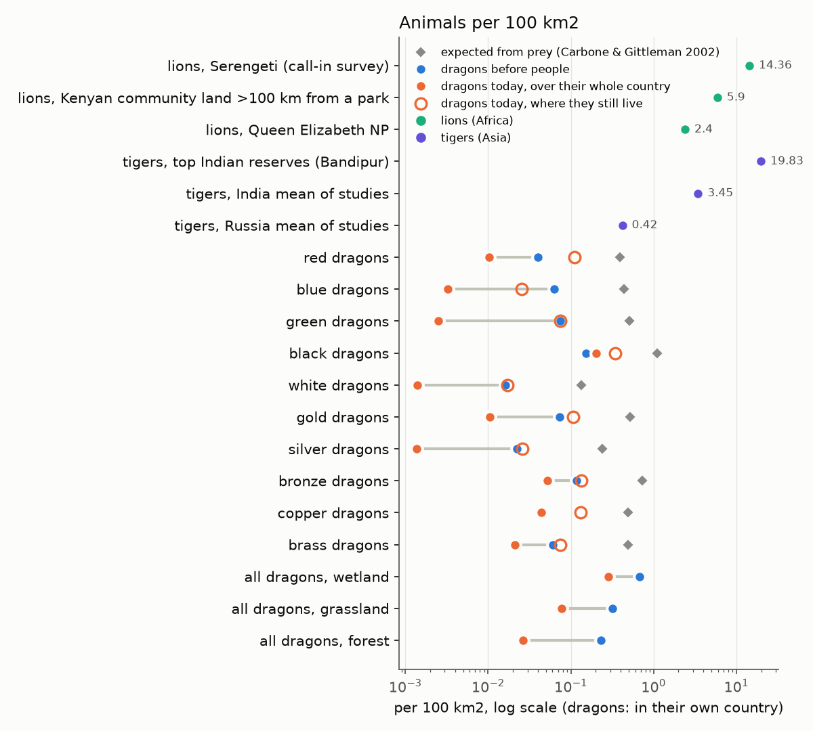
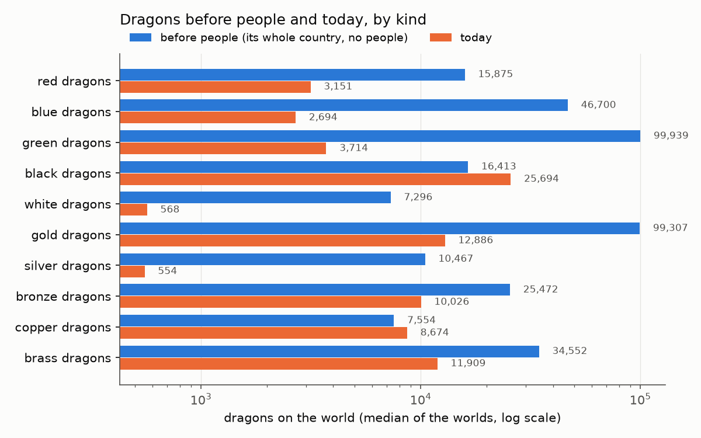

# How many dragons, round 2: why so few, persecution like lions, and a dial (lane 103: D28, PW-1246, PW-1221)

Lane 103, 2026-10-31. One round. The code is main at 8202f169 plus this lane's commits. The census is lane 99's (`census.py`, six
worlds at roll 7000, the model's own arm with the sea food on), re-run once on this code. The tables and charts are in
[round2/](round2/) (`tables.md`, `numbers.json`, two PNGs). Lane 99's numbers, which this round compares against, are in
[report.md](report.md) and `numbers.json` beside it.

## In plain words

**Why dragons are so much rarer than lions.** I traced each step from the land's plants to the dragons and checked it against papers
on file. Three things make dragons rare, and two of them are sound:
- **Size.** On the same prey, Carbone & Gittleman's law for meat-eaters puts a 1.65 t dragon at about 1/13 the density of a 142 kg lion.
  That is the main reason, and it is real. Daniel asked whether "averaged out against more numerous younger ones" helps. It is already
  counted. The census counts every age, and 79% of dragons are wyrmlings and young. The density uses the food a dragon of the average
  age eats.
- **Ten kinds, one share.** All ten dragon kinds together hold the top predator's share of the food, like one big-cat species. So one kind
  on land it shares with others is 5-6 times rarer than it would be alone. Compare all dragons together with lions, not one kind: before
  people, 0.68 per 100 km² in swamps, 0.32 in grassland and 0.23 in forest.
- **Thin herds. This one may be a real error.** The model's savanna holds 2-3 times fewer grazers than real African parks at the same
  rainfall (Coe et al. 1976, measured herds). The cause is upstream, in how much plant growth the model puts above ground. It is a
  judgement call for Daniel, in a draft. It is not changed here.
- **Not a mortality problem.** Death rates by age only set how much the average dragon eats. A harsher schedule gives *more* dragons
  (younger and smaller), not fewer. The model's dragons per tonne of prey sit at 0.86 of Carbone & Gittleman's line.

**The north star** (what the allometry predicts for the model's own dragon, 1.65 t, every age counted):
- Carbone & Gittleman 2002 at the prey in each kind's country gives **0.13-1.1 dragons per 100 km²** for one kind alone. The model
  gives 0.7-0.9 of that, so it is on the line. On Serengeti-rich prey (8.4 t/km², Coe 1976) the same law gives **~3 per 100 km²**.
- Damuth's line on Marshall's dinosaur intercept (the model's "mesotherm" setting) gives **3.7 per 100 km²**, the same everywhere.
- The model, all kinds together before people, gives **0.2-0.7 per 100 km²** in its richest biomes. That is a fifth to a tenth of the
  north star. The thin herds explain about half of the gap, and poorer country than a Serengeti the rest.

**Persecution, replaced.** The old rule was "dense farmers at 10 per km² keep 10% of their dragons". That was a judgement, and Daniel
did not want it. It is gone, and the lions' own evidence replaces it (option B of PW-1246):
- Riggio et al. 2013 map Africa's lions as gone from land above **25 people per km²**. They quote Woodroffe 2000's 26 per km² as the
  density at which lions went extinct.
- Dragons are now set to be lost from land that busy, in the most advanced era. Below it they are thinned, and where nobody lives they
  are left whole. Thinned dragons breed back, up to twice as fast. Where the kill outruns that, they fade from that land.
- In the renaissance (the dnd default), dragons are gone above ~20 riding farmers or ~30 plain farmers per km². Farmers at 10 per km² now
  keep about half their dragons, not 10%. Earlier eras reach the adults less, so dragons can live among much denser peoples then.
- The smaller predators (wolves, leopards) take the same 25 per km² line.
- No kind is ended by it. Little of the model's land is that busy: 0.5% of dragon country is above 20 people per km². So the "gone from
  farmland" pattern shows mostly through the peoples thinning the herds, and the kill only finishes it in the busiest land.

**Numbers now.** A typical world has about **96,000 dragons** (48,000-237,000 across the six worlds), up from about 84,000. World by
world that is a median rise of 30%. A Sword Coast-sized region holds about **2,000** (1,000-5,000), up from 1,700. Before people the
same land could hold at most about 370,000. Where a kind still lives today it is at 0.02-0.34 per 100 km². One draw per world, and
single kinds swing a lot between draws. Green dragons fell to 46 on one world and rose fivefold on another.

**The dial.** New setting: **dragon abundance**, x0.25 / x0.5 / x1 / x2 / x4, in the viewer's peoples settings next to the pressure
dials (`meta.dragon_abundance`). It multiplies every dragon kind's numbers everywhere. Their map and their pattern beside the peoples
stay the same. It is a world-builder's choice, not physics: at x2 the dragons eat twice what the herds could give them. The allometry
says a dragon in lion country is about 3 per 100 km², and the model gives a tenth of that. So x2-x4 is a fair "more dragons" setting
that stays under the north star.

**For Daniel** (drafts):
- The herds are 2-3 times thinner than Africa's at the same rain. Should the vegetation's above-ground growth be checked?
  (`draft-wild-herds-below-coe-1976.md`, needs-decision.)
- Option C (dragons avoiding busy country) is not built, and the persecution's open points are listed.
  (`draft-dragon-persecution-follow-ups.md`.)

In the first chart the grey diamond is the allometric expectation for one kind alone on its country's prey (Carbone & Gittleman 2002).
The hollow orange ring is today's density where the kind still lives. The last three rows are every kind together in a biome.

## 1. Diagnosis: where the gap to lions comes from

Each step, its number, and whether it is sound. Sources are on file in `docs/references/megafauna/` unless said otherwise. All reads
were done in this lane.

**The allometry (the expectation).** Carbone & Gittleman 2002 (Science 295:2273, p. 2274): carnivores per 10,000 kg of prey =
89.1 M^-1.05 (M kg, N = 25). Their Table 1 (p. 2274) gives the lion at 142 kg, 3.40 per 10,000 kg of prey (species average; densities
0.80-38.5 per 100 km², prey 0.01-117 x 10,000 kg per 100 km²), and the tiger at 181 kg, 0.33 (0.70-15.8 per 100 km²). On the line a
142 kg lion is at 0.49 per 10 t. The lion's own average sits 7x above the line, the tiger on it (0.38).

| | per 10 t of prey | per 100 km² at 1 t/km² of prey | per 100 km² at 8.4 t/km² (Serengeti's herds, Coe 1976 Table 1) |
|---|---|---|---|
| lion, on the line (142 kg) | 0.49 | 4.9 | 41 |
| tiger, on the line (181 kg) | 0.38 | 3.8 | 32 |
| dragon, on the line (1,654 kg, the "younger" schedule's ecological mass) | 0.037 | 0.37 | 3.1 |
| the model's dragon (food mode: offtake 0.075 x dragon share 0.21 / 4.9 t a year) | 0.032 | 0.32 | 2.7 |

So a dragon on lion prey would be at 1/13 of a lion on the same line (sound: the allometry), and the model's chain from prey to dragons
is 0.86 of the line (sound). Damuth's line on Marshall et al. 2021's mesotherm intercept (log10 a = 2.99, M in g, per km²; Table 1,
p. 284), times the age schedule's all-ages factor (1.74), gives 3.7 per 100 km² uniform. The mammal-carnivore intercept gives 1.8.

**Mortality and the life table (Daniel: "maybe we have a mortality problem?").** No. In `natural` (food mode) the density is the
dragons' food over the mean food per dragon, averaged over every age by survivorship (`dragon_ages.structure`: `cattle_yr`). Death
rates set only the age mix, and so that mean. The census counts every dragon of every age (presence x `local_density` x area; the
summary splits the count into stages by the same shares). On the default "younger" schedule 24% are wyrmlings, 55% young, 19% adults
and 3% ancients. By schedule:

| schedule | shares (wyrmling / young / adult / ancient) | ecological mass, kg | food per dragon, t a year | model, dragons per km² per t/km² of prey | Carbone at that mass | generation, yr |
|---|---|---|---|---|---|---|
| base | 0.09 / 0.33 / 0.51 / 0.07 | 3,156 | 10.9 | 0.00144 | 0.00189 | 433 |
| younger (default) | 0.24 / 0.55 / 0.19 / 0.03 | 1,654 | 4.9 | 0.00321 | 0.00372 | 427 |
| harsher | 0.37 / 0.47 / 0.16 / 0.003 | 927 | 3.0 | 0.00519 | 0.00683 | 290 |
| gentler | 0.03 / 0.17 / 0.54 / 0.26 | 7,505 | 22.5 | 0.00070 | 0.00076 | 692 |

A harsher schedule gives more, smaller dragons on the same food. On every schedule the model sits at 0.76-0.92 of Carbone. The breeding
age (BREED_FROM, 100 yr), the fecundity and the generation do not enter the natural density at all. They enter only the persecution
(section 2) and the viable-population check.

**The steps, per kind, before people** (six worlds, medians; per 100 km² of the kind's own country; `round2/tables.md`):

| kind | prey there, t/km² | Carbone at that prey | model, the kind alone on its food | model, the kinds sharing the food (before people) | today, where it lives |
|---|---|---|---|---|---|
| red | 1.06 | 0.39 | 0.27 | 0.040 | 0.11 |
| blue | 1.17 | 0.44 | 0.35 | 0.063 | 0.026 |
| green | 1.38 | 0.51 | 0.42 | 0.074 | 0.075 |
| black | 2.95 | 1.10 | 0.94 | 0.15 | 0.34 |
| white | 0.36 | 0.13 | 0.092 | 0.016 | 0.017 |
| gold | 1.39 | 0.52 | 0.42 | 0.074 | 0.11 |
| silver | 0.64 | 0.24 | 0.15 | 0.022 | 0.026 |
| bronze | 1.97 | 0.73 | 0.68 | 0.12 | 0.13 |
| copper | 1.33 | 0.49 | 0.32 | 0.044 | 0.13 |
| brass | 1.31 | 0.49 | 0.36 | 0.060 | 0.075 |

Reading it step by step:
1. **The prey: 0.4-3 t/km² in dragon country, against 2-20 in Coe's African parks. Possibly unsound (2-3x), upstream.** Against Coe,
   Cumming & Phillipson 1976 (Oecologia 22:341; Table 1, pp. 344-345, measured herds; linear fit under 700 mm, p. 348: biomass =
   8.684 x rain - 1205.9 kg/km²), the model's warm-country herds are 2-3x low at every rain band. At 550-700 mm the model has
   1.5-2.1 t/km² against Coe's 4.2; at 700-900 mm it has 2.3 against Serengeti 8.4, Nakuru 6.7 and Nairobi 4.8. Both herd fits
   (McNaughton 1989, Coe's own NAAP fit) reproduce Coe's herds at Rosenzweig's above-ground production. The model's above-ground
   production (the vegetation NPP x Gherardi & Sala's above-ground share, PW-1073) is ~2.4x below it. Which side is off needs a savanna
   NPP source, so it is left to `draft-wild-herds-below-coe-1976.md`. Some of the gap is just that dragon country is poor: mountains,
   desert and tundra.
2. **The food budget's share, OFFTAKE x dragon share (0.075 x 0.21). Sound.** With each kind alone on its food, the model is 0.7-0.9 of
   Carbone at the same prey. The guild's prior draw is already inside this: Carbone's per-species line embeds the other predators.
3. **The kinds sharing one apex share (the food cap, FOOD_CAP). Sound, and the largest factor per kind (x0.15-0.19).** In the
   "before people" bound every kind sits on its whole country at once. Countries overlap (green and gold each hold ~100,000 dragons'
   worth of land), so the cap splits the dragons' share between ~5-6 kinds in a cell. The dragons' share is the apex size class's of
   Carbone, Turvey & Bielby 2011's guild (one class, not one species), so more kinds on one land do not make more food. The lion
   comparison is therefore all kinds together, not one kind: 0.68 (wetland), 0.32 (grassland), 0.23 (forest) per 100 km² before people.
4. **The share of country held (today). Mostly the peoples' food effect.** Today each kind holds 4-59% of its country at a tenth or more
   of its pre-people density. In dragon country with 1-5 people per km² the dragons are at 0.31 of before (pooled kinds, median world).
   The kill there is small (kept >= 0.9), so it is the overkill of the herds and the hunters' take (prey.field, the budget) that does
   it, plus where the history has not put them.

**So the gap to lions** (2-14 per 100 km² after people; 0.01-0.1 per kind for dragons before people) is: x1/13 size (sound); x1/2 to
x1/10 thinner prey, of which ~x1/2.5 may be the herds being too thin (draft); x0.86 the food chain (sound); x~1/6 one kind among the
others sharing the apex share (sound, a comparison artefact); and the history's own placement. None of it is the mortality.

## 2. Persecution: local extirpation on the lions' threshold (PW-1246 B)

**What changed** (`planet/lineages/history/megafauna.py`):
- `dragon_kept`: on the age schedule, the kill lowers lifetime births by F (`births_rise`, unchanged arithmetic). The births rise to make
  up for it, at most BREED_X-fold (2) where dragons are fewest, linear between (density compensation). Kept = 1 - (F - 1) / (BREED_X - 1),
  and **0 where F >= BREED_X**: lost from that land. The old form, 1 / (1 + (F - 1) / (BREED_X - 1)), was a never-zero saturating
  judgement. The code's own note said a strict life table with births capped at BREED_X "dies out once F > BREED_X". That is now the rule.
- Giants: kept = 1 - kill x v_adult / r, r = ln(BREED_X) / generation, 0 beyond.
- **KILL_Q is derived, not judged.** It is the kill per head at which **25 farmers per km²** (`LOSS_KM2`), of a farming people that keeps
  herds and does not ride (`MEANS_REF` = 0.625, from `means`' own formula), at the top tech level (`LOSS_LEV` = 1, the modern Africa of
  the observation), bring the default schedule to F = BREED_X. The result is 1.85e-4, down from 1.87e-3 (`_calibrate`). The figure:
  Riggio et al. 2013 (Biodivers Conserv 22:17; CC-BY; read 2026-10-31, the PDF saved as
  `docs/references/megafauna/riggio2013_savannah_africa_lion_view_biodivconserv.pdf`, local like the other PDFs):
  - "Exclude areas with human population density greater than 25 people per km2" in mapping lion areas (p. 21, rule 3);
  - the overlap of people with land converted to crops "peaks between 10 and 25 people per km2" in all four focus areas (p. 23);
  - "Woodroffe (2000) estimated a mean human population density threshold at which lions went extinct of 26 people per km2" (p. 30;
    Woodroffe itself not read: the full text was not reachable);
  - lion areas are ~3.4 Mkm², 25% of savannah Africa (p. 29).
- `guild_kept` (the wolf- to leopard-sized predators): linear in the kill, 0 at the same 25 per km² line, directly (lions are the
  guild's largest). `GUILD_GEN_YR` is gone.

**What it means by era**, for the dnd default schedule (people per km² at which dragons are lost; plain farmers, means 0.625 / riding
farmers, 0.94):

| era (tech level) | lost above, plain farmers | lost above, riding farmers |
|---|---|---|
| industrial (1.0) | 25 | 17 |
| renaissance (0.9) | 30 | 20 |
| medieval (0.75) | 39 | 26 |
| classical (0.55) | 62 | 41 |
| bronze age (0.15) | 240 | 160 |
| stone age (0) | 450 | 300 |

Below that, the kept share falls about linearly with the people: renaissance riding farmers at 10 per km² keep ~51%, plain farmers ~68% (old: 10%).
`press_early` / `press_late` still multiply the kill, so x2 late halves those thresholds.

**Is it a sound mechanism or a fudge?** The form is the standard reading of a life table with capped compensation (the code's own
earlier note). The threshold is an observation about the apex predator, carried to the dragon. That carry is the judgement: a lion's
life table at the same per-head kill would make the slow-breeding dragon vanish from almost any peopled land (eps* 0.0029 at tech 1,
~0.7 farmers per km²). So the model says, in effect, that a person kills a dragon far less often than a lion, which is the fantasy
offset for an adult dragon's danger. The tech vulnerabilities (VULNERABILITY), the means and BREED_X remain judgements, as before.
Option C (dragons avoiding busy country) is not built: B already carries the pattern, and C would double-count it.

**Does it give the lions' pattern?** Pooled kinds, median world (`by_people.py`, a scratch script):

| people per km² in the cell | share of dragon country | cells with dragons (> 1% of before) | today / before |
|---|---|---|---|
| none | 0.09 | 0.87 | 0.94 |
| 0-1 | 0.40 | 0.42 | 0.32 |
| 1-5 | 0.33 | 0.40 | 0.31 |
| 5-10 | 0.13 | 0.29 | 0.11 |
| 10-20 | 0.03 | 0.37 | 0.27 |
| 20-40 | 0.005 (2 worlds) | 0.76 | 0.31 |

The wild is near-whole, and peopled land holds a third or less. But the model's peoples are rarely as dense as lion-losing farmland:
0.5% of dragon country is above 20 per km², and that land is rich, so dragons hang on there. In the model the "gone from farmland" effect
comes mostly through the herds (overkill, the hunters' take), with the kill finishing it only in the busiest land. Per-kind country
held, peopled / empty part: blue 0.07 / 0.70, white 0.03 / 0.51, gold 0.12 / 0.50, silver 0.04 / 0.32. That is the lion and tiger shape.
No kind is lost on any world. The fewest are green dragons on 6909cb at 46, a draw effect: 1,194 in lane 99's run, and other worlds rose.

## 3. The dial: meta.dragon_abundance

`spec.ABUNDANCE_X` = (0.25, 0.5, 1, 2, 4), default 1; `Tree.dragon_abundance`, parsed, saved, in the run schema's defaults
(`abundance_x`), and a select in the viewer's peoples/lineages controls beside the pressure and rivals dials (`viewer/lineages.html`).
`megafauna.abundance(tree)` multiplies every flying kind's `local_density`, after the food, the food cap and the persecution, in the
deep epoch too, and not the giants. A world-builder's choice, not physics, and labelled so in the viewer's tooltip. The test
`test_megafauna_natural_density_pressed_by_peoples` checks x4 gives 4x the dragons and leaves the giants alone. Because the history's
contest and viable-population checks read the densities, a run at x4 can also shift where kinds settle, not just scale the counts.

## 4. The census, round 2

Six worlds, roll 7000, this branch's code with the sea food on (lane 99's `on` arm). Full tables: `round2/tables.md`. Against lane 99's
`on` arm, world by world, today:

| world | all | red | blue | green | black | white | gold | silver | bronze | copper | brass |
|---|---|---|---|---|---|---|---|---|---|---|---|
| 067778 | 35,656 -> 47,663 | 1,440 -> 2,281 | 983 -> 1,308 | 2,939 -> 3,982 | 5,343 -> 13,282 | 506 -> 547 | 13,508 -> 1,631 | 170 -> 373 | 4,744 -> 8,316 | 3,399 -> 7,086 | 2,620 -> 8,852 |
| 1df1c3 | 82,249 -> 103,534 | 2,495 -> 2,422 | 6,109 -> 5,898 | 1,416 -> 1,044 | 11,558 -> 10,308 | 832 -> 317 | 31,361 -> 56,977 | 302 -> 496 | 7,931 -> 9,019 | 4,808 -> 4,936 | 15,432 -> 12,111 |
| 2a7385 | 126,271 -> 237,108 | 4,401 -> 5,420 | 2,477 -> 4,499 | 8,350 -> 3,445 | 35,446 -> 35,286 | 292 -> 588 | 34,448 -> 104,735 | 384 -> 831 | 14,072 -> 23,358 | 12,959 -> 27,626 | 13,437 -> 31,316 |
| 6909cb | 85,724 -> 106,229 | 994 -> 975 | 1,587 -> 3,806 | 1,194 -> 46 | 47,518 -> 48,908 | 703 -> 770 | 2,458 -> 6,825 | 617 -> 1,119 | 8,893 -> 11,580 | 6,878 -> 9,797 | 14,876 -> 22,398 |
| a12762 | 45,000 -> 89,045 | 3,168 -> 3,879 | 1,079 -> 1,189 | 4,061 -> 21,427 | 13,721 -> 18,671 | 391 -> 765 | 5,015 -> 13,673 | 152 -> 241 | 5,617 -> 9,222 | 4,289 -> 8,265 | 7,502 -> 11,707 |
| e71172 | 89,693 -> 83,392 | 11,848 -> 5,515 | 2,120 -> 1,582 | 2,022 -> 4,244 | 40,366 -> 32,715 | 547 -> 423 | 9,860 -> 12,098 | 828 -> 610 | 7,950 -> 10,829 | 7,199 -> 9,081 | 6,946 -> 6,290 |
| median ratio | x1.30 | x1.10 | x1.22 | x1.05 | x1.01 | x1.09 | x2.27 | x1.73 | x1.50 | x1.68 | x1.53 |

Medians over the worlds: today 96,290 (47,664-237,109) dragons; before people (bound) 368,426; a Sword Coast-sized region 1,987
(985-5,010); people living among dragons 31%, ~850 dragons per million of them; at India's tigers' kill rate per animal (lane 99's
borrowed figure), ~1,800 deaths a year on a world, ~17 per million people in range.

Read with care: one draw per world, and the history feeds back (the densities steer the kinds' contest for land), so single kinds swing
several-fold between runs (gold on 067778, green on 6909cb). The median over six worlds is the number to quote.

## 5. Files, tests, handoff

- Code: `planet/lineages/history/megafauna.py` (`births_rise`, `dragon_kept`, `kept`, `guild_kept`, `_calibrate`, `LOSS_KM2`,
  `LOSS_LEV`, `MEANS_REF`, `abundance`), `planet/lineages/spec.py` (`ABUNDANCE_X`, `Tree.dragon_abundance`), `planet/lineages/run.py`
  (schema defaults), `viewer/lineages.html` (the dial; the late-press tooltip's "a tenth" replaced).
- Review scripts: `census.py` saves each kind alone on its food, the no-people prey and the ecological mass; `tables.py` adds the
  allometric table, the density where a kind lives, the Carbone marks and the all-kinds biome rows. Run: `run_all.sh` as before, or
  the six worlds one arm at a time.
- Tests: `uv run pytest -q -m 'not slow'` 869 passed, 1 skipped; `tests/test_prey.py` and `tests/test_lineages.py` 137 passed.
  `test_megafauna_natural_density_pressed_by_peoples` now checks the extirpation point, the calibration and the dial.
- Drafts: `issue-tracking/inbox/draft-wild-herds-below-coe-1976.md` (needs-decision), `issue-tracking/inbox/draft-dragon-persecution-follow-ups.md`.
- Not done: Woodroffe 2000 read in full (only via Riggio); a run at x2/x4 abundance (it is a plain multiplier, tested); option C.
