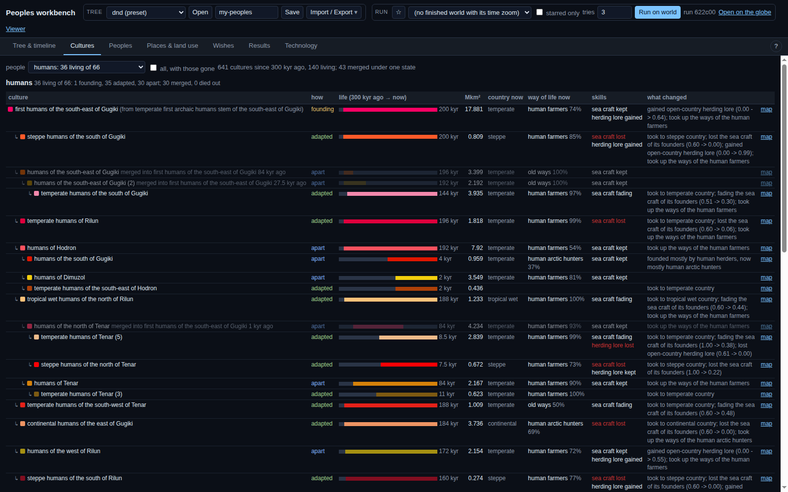

# Emergent cultures, first cut (PW-670): report

Lane 107, 2026-10-31. Design: [design.md](design.md). Code: `planet/lineages/cultures.py`. Tests: `tests/test_cultures.py`.

## In plain words

Peoples now split into cultures as they spread. A part of a people becomes its own culture in one of two ways. It may learn to
live in new country, like the tundra elves of niche learning; that counts straight away. Or it may be cut off by sea, hard country
or distance for 1 kyr or more. Each culture starts with its parent's skills, then drifts with its land. Inland daughters of a
seafaring people lose their boats within a thousand years or two. Open-country cultures slowly pick up herding, once their people has
herds. Cultures also merge. When a population folds back into another, its culture goes with it. Once a people has cities or
written law, neighbouring sister cultures that live the same way merge under one state, if one state could hold them both. There is
no cap on the count. The dragons get no cultures: they are beasts, not peoples. The giants keep theirs for now.

The workbench has a new **Cultures** tab, separate from the species tree. It shows each people's cultures as a family tree, with
each culture's life span, land, way of life, skills, what changed, and a link to the map. The species tree is unchanged. It is all
worked out after the run, in about 2 seconds, and nothing in the history changes.

On Daniel's two dnd runs (read only): about 360–370 cultures over the last 300 kyr, 135–155 alive today. Humans have 36–40 living
cultures, kobolds 26–30, dragonborn 11–22, kenku 12–15, storm giants 13, most other peoples 1–5.

(The screenshot was taken before the dragons were dropped. The humans' table it shows is unchanged.)

## Runs

| run | cultures (300 kyr) | alive | merged under one state |
|---|---|---|---|
| cc22df | 367 | 156 | 29 |
| 622c00 | 362 | 133 | 43 |

## Examples (622c00)

- **The skiff-and-canoe case.** "temperate humans of Drama (2)" split off 17 kyr ago from coastal humans whose founders were mostly
  arctic hunters with full sea craft (1.00). It took to temperate country inland, and its sea craft is now 0.00: "lost the sea craft
  of its founders". Its sister "temperate humans of the east of Drama" stayed near the coast and kept its craft (0.85 → 0.77).
- **Ways of life drift.** "humans of Drama" (apart since 48 kyr) was founded mostly by human arctic hunters and is now mostly human
  nomads. It gained herding lore (0.00 → 0.63) once the humans had herds.
- **Adapted.** "continental humans of the east of Gugiki" (since 184 kyr) took to continental country. It lost its sea craft
  (0.79 → 0.00) and its herding lore, and lives as human arctic hunters. "steppe orcs of the south-west of Tenar" (8.5 kyr) took to
  the steppe, and its sea craft is fading (0.76 → 0.40).
- **Merged.** "dragonborn of the south of Gutam (2)" merged into "dragonborn of Gutam" 2.5 kyr ago under one state (2.7 Mkm²).
  "temperate gnomes of the east of Tholosas" merged into the first gnomes 2.5 kyr ago.
- **Elves.** The first elves of Tholosas (25 kyr) are alive. Two daughter cultures cut off 21 kyr ago had merged back or died out
  by 10–12 kyr ago.
- **Brief.** For a circle of 1,500 km around -20, 140 at 3 kyr ago: humans of the west of Tenar hold 30% of the land, humans of
  Tenar 28%, desert orcs 26%, and three smaller cultures the rest.

## Grounding

Henrich 2004 (read in full): the Tasmanians lost bone tools and fish over several thousand years and never took them back; his
account of Rivers 1912 has the Torres Islanders losing seaworthy canoes while still on islands. That supports losing a skill faster
than gaining it. Glottochronology retention rates (Lees 0.805, Swadesh 0.86 per kyr, via Wikipedia's summary) put a split into
separate languages at about 0.5–0.7 kyr, so 1 kyr leaves a margin. The state sizes (1 Mkm² with cities, 5 Mkm² with written law) are
judgements, not read from a source.

## Known limits

Names are placeholders and repeat (inbox draft). "What changed" describes a culture's whole life, even in a brief for an early era.
A people seen only as a second people in a cell is undercounted. Henrich's pool-size effect is not modelled. Different peoples
never merge. These are in the drafts and the design note.
