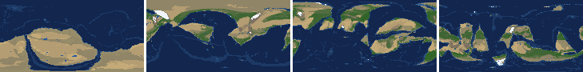

# Health sweep 2026-10-16 04:08

Commit b9ae8ed. 1 runs (default params, `--every 4`) at 1 workers x 4 numba threads; simulations 11.4 min wall. Made by `tools/health.py` (PW-246).

## Runs

| seed | L | Myr | run | sim s | trees / flowering trees from | dT range C | peaks > 9.5 km | giant-lake frames % | crust volume end/start | ice SL < -150 m % | <= 4 plates % |
|---|---|---|---|---|---|---|---|---|---|---|---|
| 3199 | 7 | 500 | 9973e0 | 686 | 132 / 376 | 10.8 | 0 | 10.6 | 0.9 | 0.0 | 5.3 |

## Medians by seed (after 50 Myr; tree cover after forests, NPP after flowering trees appear)

| seed | L | land_pct | cont_pct | cont_km | plates | ocean_age | speed | sea_level | sea_ice_m | ice_pct | temp | co2 | dry_pct | inland_pct | lake_pct | lake_max_mkm2 | max_elev_km | trees_pct | npp | landmasses | largest_pct |
|---|---|---|---|---|---|---|---|---|---|---|---|---|---|---|---|---|---|---|---|---|---|
| 3199 | 7 | 34.6 | 38.1 | 36.4 | 13.0 | 52.9 | 4.6 | 53.0 | -2.0 | 0.4 | 15.0 | -0.2 | 33.7 | 5.9 | 0.5 | 0.1 | 7.4 | 27.0 | 405.9 | 12.0 | 22.6 |

Measured on the run's keyframes (no slicing). A keyframe's rivers and lakes are routed on its own terrain (PW-239), so `inland_raw_pct` (every routed end on land, as highlights counts it) and `inland_pct` (ends that are closed lakes, salt pans or real pits) agree but for ends under land ice. Land ice and land shares use cells (near-equal area).

## Envelopes

| metric | low | high | Earth | source |
|---|---|---|---|---|
| land, % of surface (`land_pct`) | 22 | 42 | 29.20 | tests/test_envelopes.py (22-42%); Earth 29.2% |
| continental crust, % of surface (`cont_pct`) | 33 | 50 | 41 | tests/test_envelopes.py (33-50%); Earth ~41% with shelves (Cogley 1984) |
| mean continental crust thickness, km (`cont_km`) | 31 | 40 | 39 | target 35 km (PW-238, continental_thickness); Earth ~39 km (Christensen & Mooney 1995); known thinning to 32-33 km (PW-046) |
| plates (`plates`) | 5 | 30 | 15 | tests/test_envelopes.py (5-30; max_plates 30); Earth 7 major + ~8 minor; <= 4 is the PW-191 collapse |
| mean ocean-floor age, Myr (`ocean_age`) | 25 | 120 | 64 | tests/test_envelopes.py (25-120); Earth ~64 Myr (Mueller et al. 2008); PW-051 |
| mean plate speed, cm/yr (`speed`) | 2 | 9 | 4.50 | tests/test_envelopes.py (2-9 cm/yr); Earth ~4-5 |
| sea level, m (ice + ocean basins) (`sea_level`) | -250 | 300 | 0 | Phanerozoic ~-130 (LGM) .. +250 m (earth.py; Haq & Schutter 2008); -250: PW-240's hard goal |
| sea level from land ice, m (`sea_ice_m`) | -250 | - | 0 | Earth LGM ~-130 m; PW-240 goal -150 m typical / -250 m worst |
| land ice, % of surface (`ice_pct`) | - | 10 | 3.10 | Earth 3.1% now (earth.EARTH_ICE), ~7-8% at the LGM |
| global mean temperature, C (`temp`) | 8 | 30 | 14.50 | Earth 14.5 C; LGM ~8 C (Tierney et al. 2020); Phanerozoic hothouses to ~30 C (Scotese et al. 2021) |
| CO2 index (ln source/sink) (`co2`) | -1.5 | 1.5 | 0.00 | the forcing's clip in earth.py (+-1.5); Earth 0 |
| arid (Koppen B), % of land (`dry_pct`) | 12 | 45 | 30 | tests/test_envelopes.py (12-45%); Earth ~30% (Beck et al. 2018) |
| land draining inland, % of ice-free land (to a closed lake, salt pan or real pit) (`inland_pct`) | 8 | 30 | 18 | Earth ~18% (overview 2.9); L6 known ~9.5-11% (PW-054, PW-243). `inland_raw_pct` (not checked) follows the stored `downstream` to any end, as highlights does; since PW-239 the two agree but for ends under land ice |
| lakes, % of land (`lake_pct`) | 0.2 | 3.0 | 1.80 | Earth ~1.8% of ice-free land (HydroLAKES, Messager et al. 2016); generated L6 worlds 0.5-1% |
| largest lake, million km2 (`lake_max_mkm2`) | - | 1.0 | 0.37 | Caspian 0.37 Mkm2; 1 Mkm2 = the overview's giant lake (2.9) |
| highest peak, km (`max_elev_km`) | - | 9.5 | 8.85 | Everest 8.85 km; PW-172 (spikes above ~9.5 km) |
| tree cover, % of ice-free land (after forests appear) (`trees_pct`) | 10 | 50 | 30 | Earth ~30% potential canopy (forest 55-60 of ~130 Mkm2, overview 2.18) |
| land NPP, g C/m2/yr (after flowering trees appear) (`npp`) | 200 | 700 | 430 | Earth ~56 Pg C/yr over ~130 Mkm2 = ~430; the model on Earth's terrain 50 Pg C/yr, ~385 (overview 2.18). Before flowering trees (plant group 4) stand-ins grow at 70%, so runs sit at ~150-280 |
| landmasses (>= 3 cells) (`landmasses`) | 3 | 80 | - | loose: a lone supercontinent or a shattered archipelago |
| largest landmass, % of surface (`largest_pct`) | 5 | 35 | 16.60 | Afro-Eurasia 16.6%; a Pangaea ~30% (scorecard largest_max) |
| global temperature range over the run, C (`dT_range`, per run) | - | 25 | 25 | Phanerozoic 11-36 C (Scotese et al. 2021) |
| keyframes with a peak above 9.5 km (`peak_frames`, per run) | - | 0 | 0 | PW-172 (L7 seed 3199: 3 of 251) |
| % of keyframes with a lake over 1 Mkm2 (`giant_lake_frames`, per run) | - | 5 | 0 | overview 2.9 (L6: 3 of ~150 frames) |
| continental crust volume, end / start (`volume_ratio`, per run) | 0.9 | 1.1 | 1.0 | scorecard volume_ratio (x1.006) |
| % of keyframes with ice sea level below -150 m (`sea_ice_below_150`, per run) | - | 10 | 0 | PW-240 |
| % of keyframes with <= 4 plates (`low_plates`, per run) | - | 2 | 0 | PW-191 (L7 seed 21: 1%) |

## Top outliers (of 20 spells; severity = excess / band width x (0.2 + share of the run))

| seed | L | metric | Myr | frames | worst | envelope | severity |
|---|---|---|---|---|---|---|---|
| 3199 | 7 | low_plates | run | - | 5.30 | -..2 | 1.65 |
| 3199 | 7 | giant_lake_frames | run | - | 10.60 | -..5 | 1.12 |
| 3199 | 7 | lake_max_mkm2 | 252-252 | 1 | 3.46 | -..1.0 | 0.511 |
| 3199 | 7 | lake_max_mkm2 | 320-320 | 1 | 3.06 | -..1.0 | 0.428 |
| 3199 | 7 | lake_max_mkm2 | 120-144 | 6 | 2.32 | -..1.0 | 0.327 |
| 3199 | 7 | inland_pct | 272-500 | 53 | 1.50 | 8..30 | 0.183 |
| 3199 | 7 | dry_pct | 52-112 | 16 | 58.81 | 12..45 | 0.137 |
| 3199 | 7 | lake_max_mkm2 | 160-164 | 2 | 1.45 | -..1.0 | 0.097 |
| 3199 | 7 | inland_pct | 152-200 | 11 | 3.37 | 8..30 | 0.06 |
| 3199 | 7 | inland_pct | 220-248 | 6 | 3.78 | 8..30 | 0.047 |
| 3199 | 7 | inland_pct | 132-140 | 2 | 4.43 | 8..30 | 0.035 |
| 3199 | 7 | inland_pct | 100-116 | 4 | 4.73 | 8..30 | 0.034 |
| 3199 | 7 | lake_max_mkm2 | 208-216 | 2 | 1.10 | -..1.0 | 0.021 |
| 3199 | 7 | plates | 172-192 | 6 | 3 | 5..30 | 0.02 |
| 3199 | 7 | lake_pct | 88-116 | 6 | 0.08 | 0.2..3.0 | 0.011 |
| 3199 | 7 | lake_pct | 68-76 | 2 | 0.13 | 0.2..3.0 | 0.006 |
| 3199 | 7 | lake_pct | 252-252 | 1 | 3.06 | 0.2..3.0 | 0.004 |
| 3199 | 7 | lake_pct | 376-376 | 1 | 0.16 | 0.2..3.0 | 0.003 |
| 3199 | 7 | landmasses | 52-52 | 1 | 2 | 3..80 | 0.003 |
| 3199 | 7 | largest_pct | 204-228 | 7 | 35.30 | 5..35 | 0.003 |

## Per seed: min / median / max after the 50 Myr spin-up, and spells outside the envelopes

### Seed 3199, L7 (run 9973e0)

*At 48, 200, 348, 500 Myr: sea by depth, land green by tree cover / tan where arid, shaded by height, ice white, lakes blue.*

| metric | min | median | max | outside (Myr: worst) |
|---|---|---|---|---|
| land_pct | 32.05 | 34.65 | 38.89 |  |
| cont_pct | 36.92 | 38.13 | 41.14 |  |
| cont_km | 35.72 | 36.44 | 38.28 |  |
| plates | 3.00 | 13.00 | 19.00 | 172-192: 3 |
| ocean_age | 32.10 | 52.90 | 74.80 |  |
| speed | 3.27 | 4.58 | 7.75 |  |
| sea_level | -228.70 | 53.00 | 230.80 |  |
| sea_ice_m | -9.60 | -2.00 | -0.00 |  |
| ice_pct | 0.00 | 0.40 | 2.00 |  |
| temp | 10.40 | 15.00 | 21.20 |  |
| co2 | -1.38 | -0.15 | 0.19 |  |
| dry_pct | 18.93 | 33.73 | 58.81 | 52-112: 58.81 |
| inland_pct | 1.50 | 5.87 | 21.99 | 100-116: 4.73; 132-140: 4.43; 152-200: 3.37; 220-248: 3.78; +1 more |
| lake_pct | 0.08 | 0.53 | 3.06 | 68-76: 0.13; 88-116: 0.08; 252-252: 3.06; 376-376: 0.16 |
| lake_max_mkm2 | 0.01 | 0.13 | 3.46 | 120-144: 2.32; 160-164: 1.45; 208-216: 1.10; 252-252: 3.46; +1 more |
| max_elev_km | 2.51 | 7.40 | 8.85 |  |
| trees_pct | 13.99 | 26.99 | 33.47 |  |
| npp | 275.30 | 405.90 | 427.50 |  |
| landmasses | 2.00 | 12.00 | 25.00 | 52-52: 2 |
| largest_pct | 11.40 | 22.60 | 35.30 | 204-228: 35.30 |

## Determinism

(not run)
