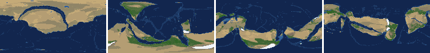
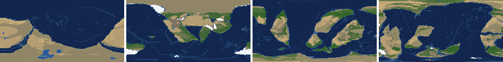

# Health sweep 2026-10-16 04:30

Commit b9ae8ed. 2 runs (default params, `--every 4`) at 2 workers x 2 numba threads; simulations 21.2 min wall. Made by `tools/health.py` (PW-246).

## Runs

| seed | L | Myr | run | sim s | trees / flowering trees from | dT range C | peaks > 9.5 km | giant-lake frames % | crust volume end/start | ice SL < -150 m % | <= 4 plates % |
|---|---|---|---|---|---|---|---|---|---|---|---|
| 21 | 7 | 500 | c89413 | 1246 | 136 / 404 | 9.5 | 0 | 15.0 | 0.923 | 0.0 | 0.0 |
| 11 | 7 | 500 | b70bc1 | 1272 | 128 / 372 | 16.0 | 0 | 4.4 | 0.903 | 0.0 | 0.0 |

## Medians by seed (after 50 Myr; tree cover after forests, NPP after flowering trees appear)

| seed | L | land_pct | cont_pct | cont_km | plates | ocean_age | speed | sea_level | sea_ice_m | ice_pct | temp | co2 | dry_pct | inland_pct | lake_pct | lake_max_mkm2 | max_elev_km | trees_pct | npp | landmasses | largest_pct |
|---|---|---|---|---|---|---|---|---|---|---|---|---|---|---|---|---|---|---|---|---|---|
| 21 | 7 | 35.2 | 38.3 | 36.6 | 11.0 | 54.4 | 4.6 | 18.0 | -2.4 | 0.5 | 16.4 | -0.3 | 40.1 | 5.7 | 0.4 | 0.1 | 7.2 | 20.5 | 387.5 | 15.0 | 20.0 |
| 11 | 7 | 33.5 | 38.0 | 36.6 | 14.0 | 51.4 | 4.4 | 60.4 | -2.9 | 0.6 | 13.9 | -0.3 | 28.4 | 6.4 | 0.6 | 0.2 | 6.8 | 29.7 | 318.4 | 12.0 | 18.0 |

Measured on the run's keyframes (no slicing). A keyframe's rivers and lakes are routed on its own terrain (PW-239), so `inland_raw_pct` (every routed end on land, as highlights counts it) and `inland_pct` (ends that are closed lakes, salt pans or real pits) agree but for ends under land ice. Land ice and land shares use cells (near-equal area).

## Envelopes

| metric | low | high | Earth | source |
|---|---|---|---|---|
| land, % of surface (`land_pct`) | 22 | 42 | 29.20 | tests/test_envelopes.py (22-42%); Earth 29.2% |
| continental crust, % of surface (`cont_pct`) | 33 | 50 | 41 | tests/test_envelopes.py (33-50%); Earth ~41% with shelves (Cogley 1984) |
| mean continental crust thickness, km (`cont_km`) | 31 | 40 | 39 | target 35 km (PW-238, continental_thickness); Earth ~39 km (Christensen & Mooney 1995); known thinning to 32-33 km (PW-046) |
| plates (`plates`) | 5 | 30 | 15 | tests/test_envelopes.py (5-30; max_plates 30); Earth 7 major + ~8 minor; <= 4 is the PW-191 collapse |
| mean ocean-floor age, Myr (`ocean_age`) | 25 | 120 | 64 | tests/test_envelopes.py (25-120); Earth ~64 Myr (Mueller et al. 2008); PW-051 |
| mean plate speed, cm/yr (`speed`) | 2 | 9 | 4.50 | tests/test_envelopes.py (2-9 cm/yr); Earth ~4-5 |
| sea level, m (ice + ocean basins) (`sea_level`) | -250 | 300 | 0 | Phanerozoic ~-130 (LGM) .. +250 m (earth.py; Haq & Schutter 2008); -250: PW-240's hard goal |
| sea level from land ice, m (`sea_ice_m`) | -250 | - | 0 | Earth LGM ~-130 m; PW-240 goal -150 m typical / -250 m worst |
| land ice, % of surface (`ice_pct`) | - | 10 | 3.10 | Earth 3.1% now (earth.EARTH_ICE), ~7-8% at the LGM |
| global mean temperature, C (`temp`) | 8 | 30 | 14.50 | Earth 14.5 C; LGM ~8 C (Tierney et al. 2020); Phanerozoic hothouses to ~30 C (Scotese et al. 2021) |
| CO2 index (ln source/sink) (`co2`) | -1.5 | 1.5 | 0.00 | the forcing's clip in earth.py (+-1.5); Earth 0 |
| arid (Koppen B), % of land (`dry_pct`) | 12 | 45 | 30 | tests/test_envelopes.py (12-45%); Earth ~30% (Beck et al. 2018) |
| land draining inland, % of ice-free land (to a closed lake, salt pan or real pit) (`inland_pct`) | 8 | 30 | 18 | Earth ~18% (overview 2.9); L6 known ~9.5-11% (PW-054, PW-243). `inland_raw_pct` (not checked) follows the stored `downstream` to any end, as highlights does; since PW-239 the two agree but for ends under land ice |
| lakes, % of land (`lake_pct`) | 0.2 | 3.0 | 1.80 | Earth ~1.8% of ice-free land (HydroLAKES, Messager et al. 2016); generated L6 worlds 0.5-1% |
| largest lake, million km2 (`lake_max_mkm2`) | - | 1.0 | 0.37 | Caspian 0.37 Mkm2; 1 Mkm2 = the overview's giant lake (2.9) |
| highest peak, km (`max_elev_km`) | - | 9.5 | 8.85 | Everest 8.85 km; PW-172 (spikes above ~9.5 km) |
| tree cover, % of ice-free land (after forests appear) (`trees_pct`) | 10 | 50 | 30 | Earth ~30% potential canopy (forest 55-60 of ~130 Mkm2, overview 2.18) |
| land NPP, g C/m2/yr (after flowering trees appear) (`npp`) | 200 | 700 | 430 | Earth ~56 Pg C/yr over ~130 Mkm2 = ~430; the model on Earth's terrain 50 Pg C/yr, ~385 (overview 2.18). Before flowering trees (plant group 4) stand-ins grow at 70%, so runs sit at ~150-280 |
| landmasses (>= 3 cells) (`landmasses`) | 3 | 80 | - | loose: a lone supercontinent or a shattered archipelago |
| largest landmass, % of surface (`largest_pct`) | 5 | 35 | 16.60 | Afro-Eurasia 16.6%; a Pangaea ~30% (scorecard largest_max) |
| global temperature range over the run, C (`dT_range`, per run) | - | 25 | 25 | Phanerozoic 11-36 C (Scotese et al. 2021) |
| keyframes with a peak above 9.5 km (`peak_frames`, per run) | - | 0 | 0 | PW-172 (L7 seed 3199: 3 of 251) |
| % of keyframes with a lake over 1 Mkm2 (`giant_lake_frames`, per run) | - | 5 | 0 | overview 2.9 (L6: 3 of ~150 frames) |
| continental crust volume, end / start (`volume_ratio`, per run) | 0.9 | 1.1 | 1.0 | scorecard volume_ratio (x1.006) |
| % of keyframes with ice sea level below -150 m (`sea_ice_below_150`, per run) | - | 10 | 0 | PW-240 |
| % of keyframes with <= 4 plates (`low_plates`, per run) | - | 2 | 0 | PW-191 (L7 seed 21: 1%) |

## Top outliers (of 40 spells; severity = excess / band width x (0.2 + share of the run))

| seed | L | metric | Myr | frames | worst | envelope | severity |
|---|---|---|---|---|---|---|---|
| 21 | 7 | giant_lake_frames | run | - | 15.00 | -..5 | 2.0 |
| 21 | 7 | lake_max_mkm2 | 284-328 | 12 | 1.80 | -..1.0 | 0.235 |
| 11 | 7 | lake_max_mkm2 | 56-56 | 1 | 2.00 | -..1.0 | 0.207 |
| 21 | 7 | lake_max_mkm2 | 392-400 | 2 | 1.84 | -..1.0 | 0.181 |
| 11 | 7 | inland_pct | 316-500 | 45 | 2.11 | 8..30 | 0.149 |
| 21 | 7 | inland_pct | 84-156 | 17 | 0.78 | 8..30 | 0.11 |
| 11 | 7 | lake_max_mkm2 | 188-188 | 1 | 1.52 | -..1.0 | 0.109 |
| 21 | 7 | inland_pct | 348-468 | 28 | 2.50 | 8..30 | 0.106 |
| 11 | 7 | inland_pct | 76-180 | 23 | 1.91 | 8..30 | 0.106 |
| 21 | 7 | lake_max_mkm2 | 460-460 | 1 | 1.45 | -..1.0 | 0.093 |
| 21 | 7 | inland_pct | 200-300 | 23 | 2.72 | 8..30 | 0.092 |
| 21 | 7 | lake_max_mkm2 | 488-488 | 1 | 1.44 | -..1.0 | 0.092 |
| 21 | 7 | dry_pct | 52-92 | 11 | 53.31 | 12..45 | 0.072 |
| 21 | 7 | inland_pct | 168-188 | 5 | 2.65 | 8..30 | 0.058 |
| 21 | 7 | inland_pct | 480-500 | 5 | 2.64 | 8..30 | 0.058 |
| 11 | 7 | lake_max_mkm2 | 472-476 | 2 | 1.25 | -..1.0 | 0.055 |
| 21 | 7 | inland_pct | 312-332 | 6 | 3.16 | 8..30 | 0.054 |
| 11 | 7 | inland_pct | 56-56 | 1 | 35.01 | 8..30 | 0.047 |
| 11 | 7 | temp | 168-200 | 9 | 4.50 | 8..30 | 0.043 |
| 21 | 7 | lake_max_mkm2 | 416-416 | 1 | 1.18 | -..1.0 | 0.038 |
| 11 | 7 | dry_pct | 52-64 | 4 | 49.53 | 12..45 | 0.032 |
| 11 | 7 | inland_pct | 236-236 | 1 | 4.57 | 8..30 | 0.032 |
| 21 | 7 | largest_pct | 56-56 | 1 | 39.20 | 5..35 | 0.029 |
| 21 | 7 | dry_pct | 264-276 | 4 | 48.82 | 12..45 | 0.027 |
| 11 | 7 | inland_pct | 272-288 | 4 | 6.09 | 8..30 | 0.02 |
| 11 | 7 | lake_max_mkm2 | 228-228 | 1 | 1.07 | -..1.0 | 0.014 |
| 11 | 7 | lake_pct | 84-84 | 1 | 0.04 | 0.2..3.0 | 0.012 |
| 11 | 7 | inland_pct | 256-256 | 1 | 6.91 | 8..30 | 0.01 |
| 21 | 7 | lake_pct | 84-108 | 6 | 0.10 | 0.2..3.0 | 0.009 |
| 11 | 7 | dry_pct | 84-84 | 1 | 46.39 | 12..45 | 0.009 |

## Per seed: min / median / max after the 50 Myr spin-up, and spells outside the envelopes

### Seed 21, L7 (run c89413)

*At 48, 200, 348, 500 Myr: sea by depth, land green by tree cover / tan where arid, shaded by height, ice white, lakes blue.*

| metric | min | median | max | outside (Myr: worst) |
|---|---|---|---|---|
| land_pct | 33.10 | 35.24 | 39.22 |  |
| cont_pct | 37.05 | 38.34 | 42.13 |  |
| cont_km | 35.38 | 36.65 | 37.44 |  |
| plates | 6.00 | 11.00 | 16.00 |  |
| ocean_age | 37.90 | 54.40 | 82.40 |  |
| speed | 2.58 | 4.63 | 7.11 |  |
| sea_level | -264.00 | 18.00 | 184.80 | 252-280: -264.00 |
| sea_ice_m | -7.10 | -2.40 | -0.00 |  |
| ice_pct | 0.00 | 0.50 | 1.50 |  |
| temp | 12.30 | 16.40 | 21.80 |  |
| co2 | -0.81 | -0.33 | -0.04 |  |
| dry_pct | 28.74 | 40.14 | 53.31 | 52-92: 53.31; 264-276: 48.82 |
| inland_pct | 0.78 | 5.69 | 25.27 | 84-156: 0.78; 168-188: 2.65; 200-300: 2.72; 312-332: 3.16; +2 more |
| lake_pct | 0.10 | 0.40 | 1.70 | 84-108: 0.10; 124-144: 0.12; 168-168: 0.17; 180-188: 0.13; +1 more |
| lake_max_mkm2 | 0.02 | 0.11 | 1.84 | 284-328: 1.80; 392-400: 1.84; 416-416: 1.18; 460-460: 1.45; +1 more |
| max_elev_km | 2.43 | 7.20 | 9.46 |  |
| trees_pct | 13.54 | 20.50 | 39.15 |  |
| npp | 225.60 | 387.50 | 453.60 |  |
| landmasses | 5.00 | 15.00 | 34.00 |  |
| largest_pct | 13.70 | 20.00 | 39.20 | 56-56: 39.20; 248-292: 35.30 |

### Seed 11, L7 (run b70bc1)

*At 48, 200, 348, 500 Myr: sea by depth, land green by tree cover / tan where arid, shaded by height, ice white, lakes blue.*

| metric | min | median | max | outside (Myr: worst) |
|---|---|---|---|---|
| land_pct | 32.32 | 33.53 | 39.30 |  |
| cont_pct | 36.84 | 37.95 | 41.92 |  |
| cont_km | 35.66 | 36.58 | 38.54 |  |
| plates | 7.00 | 14.00 | 19.00 |  |
| ocean_age | 28.40 | 51.40 | 68.40 |  |
| speed | 3.03 | 4.38 | 7.44 |  |
| sea_level | -245.60 | 60.40 | 244.20 |  |
| sea_ice_m | -61.00 | -2.90 | -0.00 |  |
| ice_pct | 0.00 | 0.60 | 3.70 |  |
| temp | 4.50 | 13.90 | 20.50 | 168-200: 4.50 |
| co2 | -0.59 | -0.33 | 0.15 |  |
| dry_pct | 20.09 | 28.39 | 49.53 | 52-64: 49.53; 84-84: 46.39 |
| inland_pct | 1.91 | 6.42 | 35.01 | 56-56: 35.01; 76-180: 1.91; 224-224: 7.09; 236-236: 4.57; +4 more |
| lake_pct | 0.04 | 0.63 | 1.95 | 84-84: 0.04; 100-100: 0.14; 124-128: 0.10 |
| lake_max_mkm2 | 0.01 | 0.19 | 2.00 | 56-56: 2.00; 188-188: 1.52; 228-228: 1.07; 472-476: 1.25 |
| max_elev_km | 3.01 | 6.76 | 8.79 |  |
| trees_pct | 17.35 | 29.73 | 42.13 |  |
| npp | 227.70 | 318.40 | 393.30 |  |
| landmasses | 5.00 | 12.00 | 25.00 |  |
| largest_pct | 9.30 | 18.00 | 31.90 |  |

## Determinism

(not run)
