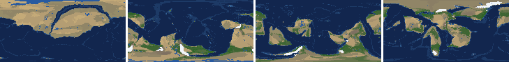
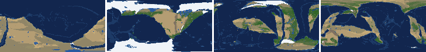

# Health sweep 2026-10-16 04:30

Commit None. 2 runs (default params, `--every 4`) at 2 workers x 2 numba threads; simulations 21.0 min wall. Made by `tools/health.py` (PW-246).

## Runs

| seed | L | Myr | run | sim s | trees / flowering trees from | dT range C | peaks > 9.5 km | giant-lake frames % | crust volume end/start | ice SL < -150 m % | <= 4 plates % |
|---|---|---|---|---|---|---|---|---|---|---|---|
| 21 | 7 | 500 | 0501db | 1259 | 136 / 404 | 9.4 | 0 | 13.3 | 0.921 | 0.0 | 0.0 |
| 11 | 7 | 500 | 862203 | 1259 | 128 / 372 | 16.5 | 0 | 24.8 | 0.907 | 18.6 | 0.0 |

## Medians by seed (after 50 Myr; tree cover after forests, NPP after flowering trees appear)

| seed | L | land_pct | cont_pct | cont_km | plates | ocean_age | speed | sea_level | sea_ice_m | ice_pct | temp | co2 | dry_pct | inland_pct | lake_pct | lake_max_mkm2 | max_elev_km | trees_pct | npp | landmasses | largest_pct |
|---|---|---|---|---|---|---|---|---|---|---|---|---|---|---|---|---|---|---|---|---|---|
| 21 | 7 | 33.4 | 37.9 | 36.6 | 11.0 | 49.2 | 4.5 | 55.3 | -3.4 | 0.6 | 16.0 | -0.4 | 30.6 | 8.6 | 1.4 | 0.4 | 6.8 | 24.2 | 351.9 | 19.0 | 19.3 |
| 11 | 7 | 34.9 | 38.9 | 36.3 | 12.0 | 52.4 | 4.7 | 13.4 | -7.4 | 1.5 | 13.5 | -0.2 | 32.0 | 9.6 | 1.5 | 0.5 | 6.8 | 29.4 | 378.7 | 11.0 | 24.0 |

Measured on the run's keyframes (no slicing). A keyframe's rivers and lakes are routed on its own terrain (PW-239), so `inland_raw_pct` (every routed end on land, as highlights counts it) and `inland_pct` (ends that are closed lakes, salt pans or real pits) agree but for ends under land ice. Land ice and land shares use cells (near-equal area).

## Envelopes

| metric | low | high | Earth | source |
|---|---|---|---|---|
| land, % of surface (`land_pct`) | 22 | 42 | 29.20 | tests/test_envelopes.py (22-42%); Earth 29.2% |
| continental crust, % of surface (`cont_pct`) | 33 | 50 | 41 | tests/test_envelopes.py (33-50%); Earth ~41% with shelves (Cogley 1984) |
| mean continental crust thickness, km (`cont_km`) | 31 | 40 | 39 | target 35 km (PW-238, continental_thickness); Earth ~39 km (Christensen & Mooney 1995); known thinning to 32-33 km (PW-046) |
| plates (`plates`) | 5 | 30 | 15 | tests/test_envelopes.py (5-30; max_plates 30); Earth 7 major + ~8 minor; <= 4 is the PW-191 collapse |
| mean ocean-floor age, Myr (`ocean_age`) | 25 | 120 | 64 | tests/test_envelopes.py (25-120); Earth ~64 Myr (Mueller et al. 2008); PW-051 |
| mean plate speed, cm/yr (`speed`) | 2 | 9 | 4.50 | tests/test_envelopes.py (2-9 cm/yr); Earth ~4-5 |
| sea level, m (ice + ocean basins) (`sea_level`) | -250 | 300 | 0 | Phanerozoic ~-130 (LGM) .. +250 m (earth.py; Haq & Schutter 2008); -250: PW-240's hard goal |
| sea level from land ice, m (`sea_ice_m`) | -250 | - | 0 | Earth LGM ~-130 m; PW-240 goal -150 m typical / -250 m worst |
| land ice, % of surface (`ice_pct`) | - | 10 | 3.10 | Earth 3.1% now (earth.EARTH_ICE), ~7-8% at the LGM |
| global mean temperature, C (`temp`) | 8 | 30 | 14.50 | Earth 14.5 C; LGM ~8 C (Tierney et al. 2020); Phanerozoic hothouses to ~30 C (Scotese et al. 2021) |
| CO2 index (ln source/sink) (`co2`) | -1.5 | 1.5 | 0.00 | the forcing's clip in earth.py (+-1.5); Earth 0 |
| arid (Koppen B), % of land (`dry_pct`) | 12 | 45 | 30 | tests/test_envelopes.py (12-45%); Earth ~30% (Beck et al. 2018) |
| land draining inland, % of ice-free land (to a closed lake, salt pan or real pit) (`inland_pct`) | 8 | 30 | 18 | Earth ~18% (overview 2.9); L6 known ~9.5-11% (PW-054, PW-243). `inland_raw_pct` (not checked) follows the stored `downstream` to any end, as highlights does; since PW-239 the two agree but for ends under land ice |
| lakes, % of land (`lake_pct`) | 0.2 | 3.0 | 1.80 | Earth ~1.8% of ice-free land (HydroLAKES, Messager et al. 2016); generated L6 worlds 0.5-1% |
| largest lake, million km2 (`lake_max_mkm2`) | - | 1.0 | 0.37 | Caspian 0.37 Mkm2; 1 Mkm2 = the overview's giant lake (2.9) |
| highest peak, km (`max_elev_km`) | - | 9.5 | 8.85 | Everest 8.85 km; PW-172 (spikes above ~9.5 km) |
| tree cover, % of ice-free land (after forests appear) (`trees_pct`) | 10 | 50 | 30 | Earth ~30% potential canopy (forest 55-60 of ~130 Mkm2, overview 2.18) |
| land NPP, g C/m2/yr (after flowering trees appear) (`npp`) | 200 | 700 | 430 | Earth ~56 Pg C/yr over ~130 Mkm2 = ~430; the model on Earth's terrain 50 Pg C/yr, ~385 (overview 2.18). Before flowering trees (plant group 4) stand-ins grow at 70%, so runs sit at ~150-280 |
| landmasses (>= 3 cells) (`landmasses`) | 3 | 80 | - | loose: a lone supercontinent or a shattered archipelago |
| largest landmass, % of surface (`largest_pct`) | 5 | 35 | 16.60 | Afro-Eurasia 16.6%; a Pangaea ~30% (scorecard largest_max) |
| global temperature range over the run, C (`dT_range`, per run) | - | 25 | 25 | Phanerozoic 11-36 C (Scotese et al. 2021) |
| keyframes with a peak above 9.5 km (`peak_frames`, per run) | - | 0 | 0 | PW-172 (L7 seed 3199: 3 of 251) |
| % of keyframes with a lake over 1 Mkm2 (`giant_lake_frames`, per run) | - | 5 | 0 | overview 2.9 (L6: 3 of ~150 frames) |
| continental crust volume, end / start (`volume_ratio`, per run) | 0.9 | 1.1 | 1.0 | scorecard volume_ratio (x1.006) |
| % of keyframes with ice sea level below -150 m (`sea_ice_below_150`, per run) | - | 10 | 0 | PW-240 |
| % of keyframes with <= 4 plates (`low_plates`, per run) | - | 2 | 0 | PW-191 (L7 seed 21: 1%) |

## Top outliers (of 50 spells; severity = excess / band width x (0.2 + share of the run))

| seed | L | metric | Myr | frames | worst | envelope | severity |
|---|---|---|---|---|---|---|---|
| 11 | 7 | giant_lake_frames | run | - | 24.80 | -..5 | 3.96 |
| 11 | 7 | lake_max_mkm2 | 172-240 | 16 | 7.06 | -..1.0 | 1.982 |
| 21 | 7 | giant_lake_frames | run | - | 13.30 | -..5 | 1.66 |
| 11 | 7 | sea_ice_below_150 | run | - | 18.60 | -..10 | 0.86 |
| 11 | 7 | lake_max_mkm2 | 316-328 | 3 | 3.26 | -..1.0 | 0.505 |
| 11 | 7 | lake_pct | 172-200 | 7 | 6.62 | 0.2..3.0 | 0.33 |
| 11 | 7 | inland_pct | 184-212 | 7 | 50.94 | 8..30 | 0.243 |
| 11 | 7 | lake_max_mkm2 | 480-484 | 2 | 1.92 | -..1.0 | 0.199 |
| 11 | 7 | inland_pct | 224-236 | 3 | 45.64 | 8..30 | 0.159 |
| 21 | 7 | lake_max_mkm2 | 52-56 | 2 | 1.73 | -..1.0 | 0.158 |
| 11 | 7 | lake_pct | 316-340 | 5 | 4.84 | 0.2..3.0 | 0.158 |
| 21 | 7 | lake_max_mkm2 | 416-436 | 6 | 1.59 | -..1.0 | 0.146 |
| 21 | 7 | inland_pct | 324-456 | 33 | 1.42 | 8..30 | 0.138 |
| 11 | 7 | sea_level | 188-284 | 25 | -406.00 | -250..300 | 0.113 |
| 11 | 7 | lake_max_mkm2 | 420-420 | 1 | 1.52 | -..1.0 | 0.107 |
| 11 | 7 | lake_max_mkm2 | 288-292 | 2 | 1.42 | -..1.0 | 0.09 |
| 11 | 7 | lake_max_mkm2 | 340-340 | 1 | 1.41 | -..1.0 | 0.085 |
| 11 | 7 | inland_pct | 120-168 | 11 | 1.55 | 8..30 | 0.084 |
| 21 | 7 | inland_pct | 76-144 | 16 | 2.55 | 8..30 | 0.081 |
| 21 | 7 | lake_max_mkm2 | 312-312 | 1 | 1.39 | -..1.0 | 0.081 |
| 21 | 7 | lake_max_mkm2 | 300-300 | 1 | 1.38 | -..1.0 | 0.078 |
| 11 | 7 | ice_pct | 188-240 | 14 | 12.50 | -..10 | 0.078 |
| 21 | 7 | lake_max_mkm2 | 284-288 | 2 | 1.34 | -..1.0 | 0.074 |
| 11 | 7 | inland_pct | 392-476 | 20 | 3.77 | 8..30 | 0.069 |
| 11 | 7 | lake_max_mkm2 | 52-56 | 2 | 1.32 | -..1.0 | 0.069 |
| 21 | 7 | lake_max_mkm2 | 164-164 | 1 | 1.31 | -..1.0 | 0.065 |
| 11 | 7 | sea_ice_m | 192-236 | 12 | -305.10 | -250..- | 0.065 |
| 21 | 7 | dry_pct | 52-68 | 5 | 53.52 | 12..45 | 0.062 |
| 11 | 7 | trees_pct | 368-416 | 13 | 57.55 | 10..50 | 0.057 |
| 11 | 7 | temp | 172-204 | 9 | 3.60 | 8..30 | 0.054 |

## Per seed: min / median / max after the 50 Myr spin-up, and spells outside the envelopes

### Seed 21, L7 (run 0501db)

*At 48, 200, 348, 500 Myr: sea by depth, land green by tree cover / tan where arid, shaded by height, ice white, lakes blue.*

| metric | min | median | max | outside (Myr: worst) |
|---|---|---|---|---|
| land_pct | 32.51 | 33.39 | 38.91 |  |
| cont_pct | 36.78 | 37.90 | 42.39 |  |
| cont_km | 35.27 | 36.59 | 38.92 |  |
| plates | 7.00 | 11.00 | 16.00 |  |
| ocean_age | 32.40 | 49.20 | 69.00 |  |
| speed | 3.24 | 4.45 | 7.49 |  |
| sea_level | -117.50 | 55.30 | 211.50 |  |
| sea_ice_m | -10.80 | -3.40 | -0.00 |  |
| ice_pct | 0.00 | 0.60 | 2.10 |  |
| temp | 12.10 | 16.00 | 21.50 |  |
| co2 | -0.57 | -0.37 | -0.12 |  |
| dry_pct | 14.29 | 30.57 | 53.52 | 52-68: 53.52 |
| inland_pct | 1.42 | 8.64 | 29.93 | 76-144: 2.55; 304-304: 6.93; 324-456: 1.42; 488-488: 7.75; +1 more |
| lake_pct | 0.15 | 1.36 | 3.34 | 88-88: 0.15; 164-164: 3.04; 208-208: 3.17; 300-300: 3.34 |
| lake_max_mkm2 | 0.04 | 0.41 | 1.73 | 52-56: 1.73; 80-80: 1.01; 164-164: 1.31; 284-288: 1.34; +4 more |
| max_elev_km | 2.61 | 6.84 | 8.56 |  |
| trees_pct | 16.29 | 24.24 | 45.78 |  |
| npp | 261.40 | 351.90 | 363.60 |  |
| landmasses | 4.00 | 19.00 | 35.00 |  |
| largest_pct | 11.40 | 19.30 | 33.90 |  |

### Seed 11, L7 (run 862203)

*At 48, 200, 348, 500 Myr: sea by depth, land green by tree cover / tan where arid, shaded by height, ice white, lakes blue.*

| metric | min | median | max | outside (Myr: worst) |
|---|---|---|---|---|
| land_pct | 32.55 | 34.92 | 39.22 |  |
| cont_pct | 37.76 | 38.89 | 42.00 |  |
| cont_km | 35.51 | 36.31 | 37.91 |  |
| plates | 6.00 | 12.00 | 16.00 |  |
| ocean_age | 34.80 | 52.40 | 64.90 |  |
| speed | 2.91 | 4.66 | 7.45 |  |
| sea_level | -406.00 | 13.40 | 201.80 | 188-284: -406.00 |
| sea_ice_m | -305.10 | -7.40 | -0.10 | 192-236: -305.10 |
| ice_pct | 0.00 | 1.50 | 12.50 | 188-240: 12.50 |
| temp | 3.60 | 13.50 | 20.10 | 172-204: 3.60 |
| co2 | -0.60 | -0.24 | 0.10 |  |
| dry_pct | 17.22 | 32.01 | 49.81 | 52-64: 49.81 |
| inland_pct | 1.55 | 9.56 | 50.94 | 52-52: 32.36; 72-72: 7.39; 88-108: 4.20; 120-168: 1.55; +5 more |
| lake_pct | 0.15 | 1.49 | 6.62 | 108-108: 0.15; 172-200: 6.62; 232-232: 3.39; 288-288: 3.56; +1 more |
| lake_max_mkm2 | 0.07 | 0.45 | 7.06 | 52-56: 1.32; 172-240: 7.06; 288-292: 1.42; 316-328: 3.26; +4 more |
| max_elev_km | 2.21 | 6.79 | 8.82 |  |
| trees_pct | 13.79 | 29.40 | 57.55 | 368-416: 57.55 |
| npp | 278.10 | 378.70 | 415.50 |  |
| landmasses | 4.00 | 11.00 | 26.00 |  |
| largest_pct | 14.40 | 24.00 | 35.90 | 204-288: 35.90 |

## Determinism

(not run)
