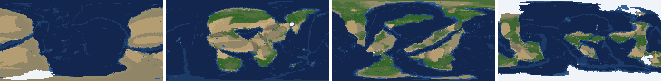
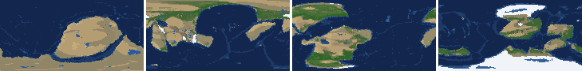
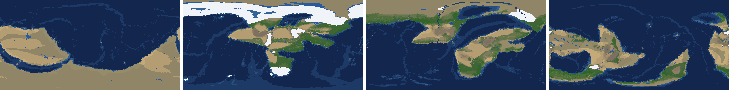
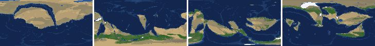
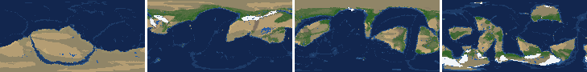
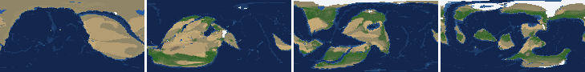
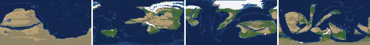
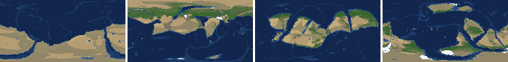

# Health sweep 2026-10-16 02:37

Commit b2c7759. 8 runs (default params, `--every 4`) at 8 workers x 1 numba threads; simulations 5.2 min wall. Made by `tools/health.py` (PW-246).

## Runs

| seed | L | Myr | run | sim s | trees / flowering trees from | dT range C | peaks > 9.5 km | giant-lake frames % | crust volume end/start | ice SL < -150 m % | <= 4 plates % |
|---|---|---|---|---|---|---|---|---|---|---|---|
| 1 | 6 | 500 | 8bdd26 | 312 | 132 / 412 | 12.3 | 0 | 6.2 | 0.878 | 0.0 | 0.0 |
| 2 | 6 | 500 | 83a099 | 305 | 140 / 396 | 19.2 | 0 | 2.7 | 0.905 | 2.7 | 0.0 |
| 11 | 6 | 500 | e2cd5f | 307 | 128 / 372 | 16.9 | 0 | 20.4 | 0.921 | 9.7 | 0.0 |
| 21 | 6 | 500 | cce24d | 304 | 136 / 404 | 9.0 | 0 | 9.7 | 0.886 | 0.0 | 0.0 |
| 3199 | 6 | 500 | 7e4f8f | 302 | 132 / 376 | 10.7 | 0 | 8.8 | 0.913 | 0.0 | 0.0 |
| 42 | 6 | 500 | e54f87 | 305 | 116 / 404 | 10.7 | 0 | 5.3 | 0.886 | 0.0 | 0.0 |
| 77 | 6 | 500 | 3e6229 | 307 | 124 / 416 | 12.0 | 0 | 14.2 | 0.882 | 5.3 | 0.0 |
| 505 | 6 | 500 | 9ad1b7 | 309 | 132 / 416 | 7.7 | 0 | 3.5 | 0.896 | 0.0 | 0.0 |

## Medians by seed (after 50 Myr; tree cover after forests, NPP after flowering trees appear)

| seed | L | land_pct | cont_pct | cont_km | plates | ocean_age | speed | sea_level | sea_ice_m | ice_pct | temp | co2 | dry_pct | inland_pct | lake_pct | lake_max_mkm2 | max_elev_km | trees_pct | npp | landmasses | largest_pct |
|---|---|---|---|---|---|---|---|---|---|---|---|---|---|---|---|---|---|---|---|---|---|
| 1 | 6 | 33.0 | 39.3 | 34.7 | 12.0 | 48.9 | 4.2 | 47.6 | -1.2 | 0.2 | 15.9 | -0.3 | 24.2 | 3.9 | 0.5 | 0.1 | 6.8 | 32.4 | 358.6 | 6.0 | 23.9 |
| 2 | 6 | 33.5 | 38.4 | 35.4 | 12.0 | 48.2 | 5.2 | 60.0 | -0.9 | 0.2 | 16.1 | -0.1 | 31.9 | 6.1 | 0.5 | 0.1 | 6.5 | 22.4 | 286.4 | 6.0 | 20.7 |
| 11 | 6 | 33.2 | 38.9 | 36.0 | 11.0 | 57.4 | 4.3 | -93.6 | -6.7 | 0.8 | 13.1 | -0.5 | 27.1 | 6.2 | 0.9 | 0.3 | 6.3 | 24.5 | 360.0 | 5.0 | 29.7 |
| 21 | 6 | 33.9 | 40.3 | 34.1 | 12.0 | 52.6 | 4.3 | 46.9 | -1.8 | 0.3 | 16.5 | -0.3 | 30.1 | 4.3 | 0.5 | 0.1 | 6.2 | 22.6 | 337.8 | 7.0 | 21.7 |
| 3199 | 6 | 33.3 | 40.2 | 35.5 | 11.0 | 60.7 | 4.5 | -43.4 | -1.2 | 0.2 | 14.8 | -0.2 | 31.8 | 5.1 | 0.5 | 0.1 | 6.5 | 25.3 | 360.6 | 6.0 | 20.1 |
| 42 | 6 | 34.1 | 39.5 | 34.4 | 13.0 | 49.0 | 4.4 | 59.0 | -1.1 | 0.2 | 15.3 | -0.3 | 31.1 | 3.9 | 0.5 | 0.1 | 5.3 | 24.3 | 367.1 | 5.0 | 18.9 |
| 77 | 6 | 33.1 | 40.7 | 34.7 | 11.0 | 58.8 | 4.2 | -68.5 | -23.9 | 2.1 | 12.0 | -0.3 | 27.0 | 5.5 | 0.8 | 0.2 | 5.1 | 31.5 | 373.4 | 6.0 | 16.4 |
| 505 | 6 | 33.7 | 39.2 | 34.9 | 13.0 | 48.2 | 4.6 | 67.0 | -0.5 | 0.1 | 15.3 | -0.2 | 29.8 | 4.3 | 0.5 | 0.1 | 5.1 | 26.4 | 332.5 | 7.0 | 21.0 |

Measured on the run's keyframes (no slicing). A keyframe's rivers and lakes are routed on its own terrain (PW-239), so `inland_raw_pct` (every routed end on land, as highlights counts it) and `inland_pct` (ends that are closed lakes, salt pans or real pits) agree but for ends under land ice. Land ice and land shares use cells (near-equal area).

## Envelopes

| metric | low | high | Earth | source |
|---|---|---|---|---|
| land, % of surface (`land_pct`) | 22 | 42 | 29.20 | tests/test_envelopes.py (22-42%); Earth 29.2% |
| continental crust, % of surface (`cont_pct`) | 33 | 50 | 41 | tests/test_envelopes.py (33-50%); Earth ~41% with shelves (Cogley 1984) |
| mean continental crust thickness, km (`cont_km`) | 31 | 40 | 39 | target 35 km (PW-238, continental_thickness); Earth ~39 km (Christensen & Mooney 1995); known thinning to 32-33 km (PW-046) |
| plates (`plates`) | 5 | 30 | 15 | tests/test_envelopes.py (5-30; max_plates 30); Earth 7 major + ~8 minor; <= 4 is the PW-191 collapse |
| mean ocean-floor age, Myr (`ocean_age`) | 25 | 120 | 64 | tests/test_envelopes.py (25-120); Earth ~64 Myr (Mueller et al. 2008); PW-051 |
| mean plate speed, cm/yr (`speed`) | 2 | 9 | 4.50 | tests/test_envelopes.py (2-9 cm/yr); Earth ~4-5 |
| sea level, m (ice + ocean basins) (`sea_level`) | -250 | 300 | 0 | Phanerozoic ~-130 (LGM) .. +250 m (earth.py; Haq & Schutter 2008); -250: PW-240's hard goal |
| sea level from land ice, m (`sea_ice_m`) | -250 | - | 0 | Earth LGM ~-130 m; PW-240 goal -150 m typical / -250 m worst |
| land ice, % of surface (`ice_pct`) | - | 10 | 3.10 | Earth 3.1% now (earth.EARTH_ICE), ~7-8% at the LGM |
| global mean temperature, C (`temp`) | 8 | 30 | 14.50 | Earth 14.5 C; LGM ~8 C (Tierney et al. 2020); Phanerozoic hothouses to ~30 C (Scotese et al. 2021) |
| CO2 index (ln source/sink) (`co2`) | -1.5 | 1.5 | 0.00 | the forcing's clip in earth.py (+-1.5); Earth 0 |
| arid (Koppen B), % of land (`dry_pct`) | 12 | 45 | 30 | tests/test_envelopes.py (12-45%); Earth ~30% (Beck et al. 2018) |
| land draining inland, % of ice-free land (to a closed lake, salt pan or real pit) (`inland_pct`) | 8 | 30 | 18 | Earth ~18% (overview 2.9); L6 known ~9.5-11% (PW-054, PW-243). `inland_raw_pct` (not checked) follows the stored `downstream` to any end, as highlights does; since PW-239 the two agree but for ends under land ice |
| lakes, % of land (`lake_pct`) | 0.2 | 3.0 | 1.80 | Earth ~1.8% of ice-free land (HydroLAKES, Messager et al. 2016); generated L6 worlds 0.5-1% |
| largest lake, million km2 (`lake_max_mkm2`) | - | 1.0 | 0.37 | Caspian 0.37 Mkm2; 1 Mkm2 = the overview's giant lake (2.9) |
| highest peak, km (`max_elev_km`) | - | 9.5 | 8.85 | Everest 8.85 km; PW-172 (spikes above ~9.5 km) |
| tree cover, % of ice-free land (after forests appear) (`trees_pct`) | 10 | 50 | 30 | Earth ~30% potential canopy (forest 55-60 of ~130 Mkm2, overview 2.18) |
| land NPP, g C/m2/yr (after flowering trees appear) (`npp`) | 200 | 700 | 430 | Earth ~56 Pg C/yr over ~130 Mkm2 = ~430; the model on Earth's terrain 50 Pg C/yr, ~385 (overview 2.18). Before flowering trees (plant group 4) stand-ins grow at 70%, so runs sit at ~150-280 |
| landmasses (>= 3 cells) (`landmasses`) | 3 | 80 | - | loose: a lone supercontinent or a shattered archipelago |
| largest landmass, % of surface (`largest_pct`) | 5 | 35 | 16.60 | Afro-Eurasia 16.6%; a Pangaea ~30% (scorecard largest_max) |
| global temperature range over the run, C (`dT_range`, per run) | - | 25 | 25 | Phanerozoic 11-36 C (Scotese et al. 2021) |
| keyframes with a peak above 9.5 km (`peak_frames`, per run) | - | 0 | 0 | PW-172 (L7 seed 3199: 3 of 251) |
| % of keyframes with a lake over 1 Mkm2 (`giant_lake_frames`, per run) | - | 5 | 0 | overview 2.9 (L6: 3 of ~150 frames) |
| continental crust volume, end / start (`volume_ratio`, per run) | 0.9 | 1.1 | 1.0 | scorecard volume_ratio (x1.006) |
| % of keyframes with ice sea level below -150 m (`sea_ice_below_150`, per run) | - | 10 | 0 | PW-240 |
| % of keyframes with <= 4 plates (`low_plates`, per run) | - | 2 | 0 | PW-191 (L7 seed 21: 1%) |

## Top outliers (of 158 spells; severity = excess / band width x (0.2 + share of the run))

| seed | L | metric | Myr | frames | worst | envelope | severity |
|---|---|---|---|---|---|---|---|
| 11 | 6 | giant_lake_frames | run | - | 20.40 | -..5 | 3.08 |
| 77 | 6 | giant_lake_frames | run | - | 14.20 | -..5 | 1.84 |
| 42 | 6 | lake_max_mkm2 | 144-148 | 2 | 6.84 | -..1.0 | 1.26 |
| 21 | 6 | giant_lake_frames | run | - | 9.70 | -..5 | 0.94 |
| 77 | 6 | lake_max_mkm2 | 480-496 | 5 | 4.62 | -..1.0 | 0.868 |
| 3199 | 6 | lake_max_mkm2 | 52-52 | 1 | 5.16 | -..1.0 | 0.864 |
| 11 | 6 | lake_max_mkm2 | 216-252 | 10 | 3.81 | -..1.0 | 0.785 |
| 3199 | 6 | giant_lake_frames | run | - | 8.80 | -..5 | 0.76 |
| 1 | 6 | lake_max_mkm2 | 52-52 | 1 | 4.12 | -..1.0 | 0.649 |
| 1 | 6 | lake_max_mkm2 | 280-292 | 3 | 3.38 | -..1.0 | 0.532 |
| 505 | 6 | lake_max_mkm2 | 332-332 | 1 | 3.50 | -..1.0 | 0.52 |
| 42 | 6 | lake_max_mkm2 | 52-52 | 1 | 3.24 | -..1.0 | 0.465 |
| 2 | 6 | lake_max_mkm2 | 420-420 | 1 | 2.96 | -..1.0 | 0.408 |
| 21 | 6 | lake_max_mkm2 | 152-172 | 5 | 2.69 | -..1.0 | 0.405 |
| 3199 | 6 | lake_max_mkm2 | 272-292 | 6 | 2.43 | -..1.0 | 0.354 |
| 77 | 6 | lake_max_mkm2 | 276-276 | 1 | 2.65 | -..1.0 | 0.344 |
| 11 | 6 | lake_max_mkm2 | 180-196 | 5 | 2.43 | -..1.0 | 0.342 |
| 21 | 6 | lake_max_mkm2 | 52-72 | 4 | 2.37 | -..1.0 | 0.317 |
| 3199 | 6 | lake_max_mkm2 | 72-72 | 1 | 2.37 | -..1.0 | 0.284 |
| 77 | 6 | lake_max_mkm2 | 72-76 | 2 | 2.25 | -..1.0 | 0.271 |
| 1 | 6 | giant_lake_frames | run | - | 6.20 | -..5 | 0.24 |
| 3199 | 6 | lake_max_mkm2 | 200-200 | 1 | 2.15 | -..1.0 | 0.24 |
| 42 | 6 | inland_pct | 268-500 | 58 | 0.68 | 8..30 | 0.22 |
| 3199 | 6 | inland_pct | 296-500 | 52 | 0.17 | 8..30 | 0.218 |
| 1 | 6 | lake_max_mkm2 | 68-68 | 1 | 2.04 | -..1.0 | 0.217 |
| 1 | 6 | inland_pct | 296-500 | 52 | 0.31 | 8..30 | 0.214 |
| 505 | 6 | inland_pct | 68-316 | 58 | 1.12 | 8..30 | 0.206 |
| 77 | 6 | lake_max_mkm2 | 312-320 | 3 | 1.88 | -..1.0 | 0.197 |
| 11 | 6 | inland_pct | 312-500 | 48 | 1.14 | 8..30 | 0.181 |
| 77 | 6 | inland_pct | 320-500 | 42 | 0.54 | 8..30 | 0.181 |

## Per seed: min / median / max after the 50 Myr spin-up, and spells outside the envelopes

### Seed 1, L6 (run 8bdd26)

*At 48, 200, 348, 500 Myr: sea by depth, land green by tree cover / tan where arid, shaded by height, ice white, lakes blue.*

| metric | min | median | max | outside (Myr: worst) |
|---|---|---|---|---|
| land_pct | 30.96 | 33.03 | 38.73 |  |
| cont_pct | 37.13 | 39.26 | 43.22 |  |
| cont_km | 33.70 | 34.73 | 37.32 |  |
| plates | 8.00 | 12.00 | 17.00 |  |
| ocean_age | 32.70 | 48.90 | 73.70 |  |
| speed | 2.91 | 4.17 | 7.51 |  |
| sea_level | -262.20 | 47.60 | 187.80 | 496-500: -262.20 |
| sea_ice_m | -95.90 | -1.20 | -0.00 |  |
| ice_pct | 0.00 | 0.20 | 6.40 |  |
| temp | 7.80 | 15.90 | 20.10 | 492-496: 7.80 |
| co2 | -0.93 | -0.28 | 0.10 |  |
| dry_pct | 12.35 | 24.16 | 40.83 |  |
| inland_pct | 0.31 | 3.90 | 25.09 | 72-228: 0.98; 240-284: 1.98; 296-500: 0.31 |
| lake_pct | 0.11 | 0.54 | 3.49 | 52-52: 3.49; 108-124: 0.11; 384-384: 0.19; 396-396: 0.20 |
| lake_max_mkm2 | 0.03 | 0.14 | 4.12 | 52-52: 4.12; 68-68: 2.04; 120-120: 1.31; 208-208: 1.20; +1 more |
| max_elev_km | 2.02 | 6.79 | 8.51 |  |
| trees_pct | 19.99 | 32.39 | 46.05 |  |
| npp | 208.50 | 358.60 | 422.80 |  |
| landmasses | 2.00 | 6.00 | 11.00 | 52-52: 2; 196-196: 2 |
| largest_pct | 11.10 | 23.90 | 33.50 |  |

### Seed 2, L6 (run 83a099)

*At 48, 200, 348, 500 Myr: sea by depth, land green by tree cover / tan where arid, shaded by height, ice white, lakes blue.*

| metric | min | median | max | outside (Myr: worst) |
|---|---|---|---|---|
| land_pct | 31.35 | 33.45 | 38.53 |  |
| cont_pct | 37.24 | 38.42 | 42.90 |  |
| cont_km | 34.44 | 35.44 | 37.38 |  |
| plates | 6.00 | 12.00 | 19.00 |  |
| ocean_age | 33.30 | 48.20 | 64.00 |  |
| speed | 3.68 | 5.24 | 7.21 |  |
| sea_level | -224.00 | 60.00 | 196.10 |  |
| sea_ice_m | -211.90 | -0.90 | -0.00 |  |
| ice_pct | 0.00 | 0.20 | 9.30 |  |
| temp | 4.00 | 16.10 | 23.20 | 484-500: 4.00 |
| co2 | -1.08 | -0.10 | 0.53 |  |
| dry_pct | 14.11 | 31.95 | 51.61 | 52-68: 51.61; 272-300: 49.20 |
| inland_pct | 1.53 | 6.07 | 16.31 | 68-184: 1.83; 220-220: 7.57; 236-240: 7.80; 256-276: 6.66; +1 more |
| lake_pct | 0.06 | 0.52 | 2.16 | 60-60: 0.18; 84-84: 0.13; 96-124: 0.06 |
| lake_max_mkm2 | 0.01 | 0.12 | 2.96 | 52-52: 1.68; 420-420: 2.96; 456-456: 1.79 |
| max_elev_km | 1.35 | 6.46 | 8.86 |  |
| trees_pct | 8.68 | 22.39 | 44.28 | 276-284: 8.68 |
| npp | 228.40 | 286.40 | 415.50 |  |
| landmasses | 2.00 | 6.00 | 11.00 | 56-64: 2 |
| largest_pct | 11.80 | 20.70 | 33.80 |  |

### Seed 11, L6 (run e2cd5f)

*At 48, 200, 348, 500 Myr: sea by depth, land green by tree cover / tan where arid, shaded by height, ice white, lakes blue.*

| metric | min | median | max | outside (Myr: worst) |
|---|---|---|---|---|
| land_pct | 31.76 | 33.23 | 38.57 |  |
| cont_pct | 36.67 | 38.90 | 42.76 |  |
| cont_km | 34.19 | 35.97 | 38.26 |  |
| plates | 8.00 | 11.00 | 18.00 |  |
| ocean_age | 32.30 | 57.40 | 88.40 |  |
| speed | 2.41 | 4.30 | 7.86 |  |
| sea_level | -366.20 | -93.60 | 221.20 | 176-220: -366.20 |
| sea_ice_m | -247.70 | -6.70 | -0.00 |  |
| ice_pct | 0.00 | 0.80 | 11.90 | 180-204: 11.90 |
| temp | 3.20 | 13.10 | 20.10 | 140-208: 3.20 |
| co2 | -0.98 | -0.46 | 0.02 |  |
| dry_pct | 17.04 | 27.15 | 45.05 | 304-304: 45.05 |
| inland_pct | 0.69 | 6.17 | 20.65 | 68-80: 2.90; 92-136: 0.69; 156-156: 7.10; 172-172: 6.62; +5 more |
| lake_pct | 0.12 | 0.87 | 3.11 | 64-64: 0.12; 76-80: 0.13; 116-116: 0.17; 220-224: 3.06; +2 more |
| lake_max_mkm2 | 0.03 | 0.29 | 3.81 | 156-160: 1.43; 180-196: 2.43; 216-252: 3.81; 288-288: 1.56; +2 more |
| max_elev_km | 1.71 | 6.34 | 8.72 |  |
| trees_pct | 14.83 | 24.52 | 44.04 |  |
| npp | 216.80 | 360.00 | 409.50 |  |
| landmasses | 2.00 | 5.00 | 12.00 | 224-228: 2; 252-264: 2; 324-332: 2 |
| largest_pct | 11.40 | 29.70 | 34.10 |  |

### Seed 21, L6 (run cce24d)

*At 48, 200, 348, 500 Myr: sea by depth, land green by tree cover / tan where arid, shaded by height, ice white, lakes blue.*

| metric | min | median | max | outside (Myr: worst) |
|---|---|---|---|---|
| land_pct | 31.72 | 33.93 | 38.37 |  |
| cont_pct | 38.50 | 40.34 | 43.72 |  |
| cont_km | 33.00 | 34.06 | 36.44 |  |
| plates | 7.00 | 12.00 | 14.00 |  |
| ocean_age | 34.30 | 52.60 | 75.80 |  |
| speed | 2.58 | 4.32 | 6.75 |  |
| sea_level | -145.50 | 46.90 | 201.80 |  |
| sea_ice_m | -9.00 | -1.80 | -0.00 |  |
| ice_pct | 0.00 | 0.30 | 1.20 |  |
| temp | 12.50 | 16.50 | 21.50 |  |
| co2 | -0.73 | -0.32 | -0.03 |  |
| dry_pct | 25.77 | 30.10 | 46.55 | 52-60: 46.55 |
| inland_pct | 0.52 | 4.34 | 17.38 | 64-212: 0.52; 224-380: 1.48; 392-500: 1.04 |
| lake_pct | 0.07 | 0.52 | 2.19 | 84-96: 0.09; 116-144: 0.07 |
| lake_max_mkm2 | 0.01 | 0.15 | 2.69 | 52-72: 2.37; 88-88: 1.16; 152-172: 2.69; 332-332: 1.33 |
| max_elev_km | 1.85 | 6.19 | 8.27 |  |
| trees_pct | 12.51 | 22.63 | 41.22 |  |
| npp | 218.60 | 337.80 | 357.70 |  |
| landmasses | 3.00 | 7.00 | 15.00 |  |
| largest_pct | 11.30 | 21.70 | 34.70 |  |

### Seed 3199, L6 (run 7e4f8f)

*At 48, 200, 348, 500 Myr: sea by depth, land green by tree cover / tan where arid, shaded by height, ice white, lakes blue.*

| metric | min | median | max | outside (Myr: worst) |
|---|---|---|---|---|
| land_pct | 32.28 | 33.32 | 38.95 |  |
| cont_pct | 35.94 | 40.16 | 43.01 |  |
| cont_km | 33.54 | 35.48 | 39.17 |  |
| plates | 5.00 | 11.00 | 14.00 |  |
| ocean_age | 35.70 | 60.70 | 76.30 |  |
| speed | 1.70 | 4.49 | 7.77 | 208-212: 1.70 |
| sea_level | -239.60 | -43.40 | 192.00 |  |
| sea_ice_m | -32.80 | -1.20 | -0.00 |  |
| ice_pct | 0.00 | 0.20 | 3.40 |  |
| temp | 10.50 | 14.80 | 21.20 |  |
| co2 | -0.73 | -0.19 | 0.16 |  |
| dry_pct | 13.69 | 31.76 | 60.20 | 60-88: 60.20 |
| inland_pct | 0.17 | 5.14 | 28.54 | 80-152: 1.05; 188-188: 7.01; 296-500: 0.17 |
| lake_pct | 0.03 | 0.53 | 3.30 | 52-56: 3.30; 88-88: 0.12; 100-120: 0.03; 144-144: 0.19; +1 more |
| lake_max_mkm2 | 0.01 | 0.10 | 5.16 | 52-52: 5.16; 72-72: 2.37; 148-148: 1.87; 200-200: 2.15; +1 more |
| max_elev_km | 1.99 | 6.47 | 8.56 |  |
| trees_pct | 15.09 | 25.30 | 35.69 |  |
| npp | 275.20 | 360.65 | 382.30 |  |
| landmasses | 2.00 | 6.00 | 12.00 | 68-72: 2; 276-276: 2 |
| largest_pct | 9.70 | 20.10 | 33.90 |  |

### Seed 42, L6 (run e54f87)

*At 48, 200, 348, 500 Myr: sea by depth, land green by tree cover / tan where arid, shaded by height, ice white, lakes blue.*

| metric | min | median | max | outside (Myr: worst) |
|---|---|---|---|---|
| land_pct | 29.63 | 34.09 | 38.58 |  |
| cont_pct | 38.29 | 39.51 | 43.35 |  |
| cont_km | 33.67 | 34.36 | 36.55 |  |
| plates | 8.00 | 13.00 | 17.00 |  |
| ocean_age | 35.20 | 49.00 | 60.00 |  |
| speed | 3.16 | 4.43 | 6.80 |  |
| sea_level | -91.80 | 59.00 | 167.20 |  |
| sea_ice_m | -24.40 | -1.10 | -0.00 |  |
| ice_pct | 0.00 | 0.20 | 3.00 |  |
| temp | 9.30 | 15.30 | 20.00 |  |
| co2 | -0.67 | -0.26 | 0.29 |  |
| dry_pct | 7.86 | 31.08 | 56.35 | 196-296: 56.35; 444-500: 7.86 |
| inland_pct | 0.68 | 3.91 | 18.15 | 60-140: 1.19; 156-176: 3.14; 188-188: 6.11; 224-228: 7.06; +2 more |
| lake_pct | 0.08 | 0.46 | 3.91 | 64-64: 0.08; 80-100: 0.10; 120-144: 3.91; 156-156: 0.16; +4 more |
| lake_max_mkm2 | 0.01 | 0.15 | 6.84 | 52-52: 3.24; 144-148: 6.84; 208-208: 1.23; 324-324: 1.23; +1 more |
| max_elev_km | 1.38 | 5.34 | 8.36 |  |
| trees_pct | 12.11 | 24.29 | 37.22 |  |
| npp | 276.50 | 367.10 | 386.50 |  |
| landmasses | 1.00 | 5.00 | 10.00 | 224-228: 1; 240-256: 1 |
| largest_pct | 10.80 | 18.90 | 34.50 |  |

### Seed 77, L6 (run 3e6229)

*At 48, 200, 348, 500 Myr: sea by depth, land green by tree cover / tan where arid, shaded by height, ice white, lakes blue.*

| metric | min | median | max | outside (Myr: worst) |
|---|---|---|---|---|
| land_pct | 31.16 | 33.14 | 38.63 |  |
| cont_pct | 37.59 | 40.69 | 43.57 |  |
| cont_km | 32.30 | 34.73 | 37.50 |  |
| plates | 7.00 | 11.00 | 14.00 |  |
| ocean_age | 36.60 | 58.80 | 88.70 |  |
| speed | 2.32 | 4.25 | 7.39 |  |
| sea_level | -432.60 | -68.50 | 161.50 | 260-344: -432.60 |
| sea_ice_m | -168.40 | -23.90 | -0.00 |  |
| ice_pct | 0.00 | 2.10 | 7.70 |  |
| temp | 6.40 | 12.00 | 18.40 | 136-148: 6.40; 284-308: 7.10 |
| co2 | -0.87 | -0.33 | 0.08 |  |
| dry_pct | 15.17 | 27.01 | 39.43 |  |
| inland_pct | 0.54 | 5.45 | 26.89 | 64-160: 1.42; 264-304: 4.35; 320-500: 0.54 |
| lake_pct | 0.10 | 0.81 | 3.36 | 96-112: 0.10; 124-124: 0.20; 180-188: 3.36; 312-312: 3.12; +3 more |
| lake_max_mkm2 | 0.03 | 0.22 | 4.62 | 72-76: 2.25; 92-92: 1.59; 180-188: 1.79; 204-204: 1.08; +4 more |
| max_elev_km | 1.97 | 5.11 | 8.27 |  |
| trees_pct | 19.37 | 31.50 | 45.91 |  |
| npp | 270.10 | 373.40 | 395.00 |  |
| landmasses | 2.00 | 6.00 | 14.00 | 52-64: 2 |
| largest_pct | 8.70 | 16.40 | 31.90 |  |

### Seed 505, L6 (run 9ad1b7)

*At 48, 200, 348, 500 Myr: sea by depth, land green by tree cover / tan where arid, shaded by height, ice white, lakes blue.*

| metric | min | median | max | outside (Myr: worst) |
|---|---|---|---|---|
| land_pct | 32.21 | 33.67 | 38.62 |  |
| cont_pct | 37.90 | 39.22 | 43.26 |  |
| cont_km | 33.80 | 34.94 | 37.03 |  |
| plates | 7.00 | 13.00 | 18.00 |  |
| ocean_age | 33.10 | 48.20 | 66.90 |  |
| speed | 3.20 | 4.64 | 7.06 |  |
| sea_level | -148.80 | 67.00 | 213.70 |  |
| sea_ice_m | -9.40 | -0.50 | -0.00 |  |
| ice_pct | 0.00 | 0.10 | 1.20 |  |
| temp | 12.00 | 15.30 | 19.70 |  |
| co2 | -0.76 | -0.22 | 0.17 |  |
| dry_pct | 16.58 | 29.82 | 50.78 | 64-72: 45.60; 88-104: 50.78 |
| inland_pct | 0.69 | 4.27 | 15.71 | 68-316: 1.12; 328-328: 7.79; 340-500: 0.69 |
| lake_pct | 0.04 | 0.52 | 3.14 | 60-112: 0.04; 332-332: 3.14; 356-356: 0.19; 372-372: 0.13 |
| lake_max_mkm2 | 0.01 | 0.12 | 3.50 | 228-228: 1.23; 332-332: 3.50; 424-428: 1.64 |
| max_elev_km | 1.91 | 5.07 | 8.47 |  |
| trees_pct | 16.74 | 26.38 | 35.80 |  |
| npp | 179.20 | 332.45 | 358.00 | 416-432: 179.20 |
| landmasses | 2.00 | 7.00 | 16.00 | 56-64: 2; 76-76: 2 |
| largest_pct | 10.60 | 21.00 | 34.50 |  |

## Determinism

(not run)
