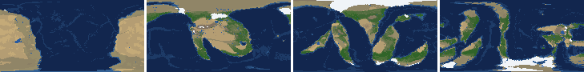
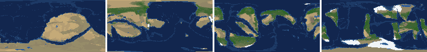
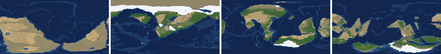
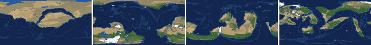
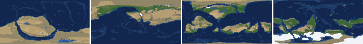
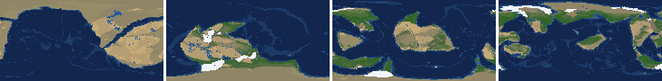
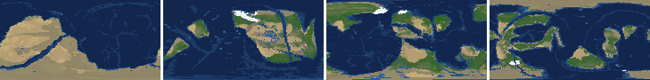
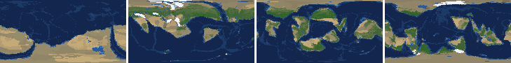

# Health sweep 2026-10-15 19:46

Commit fb390f7+dirty. 8 runs (default params, `--every 4`) at 8 workers x 1 numba threads; simulations 6.2 min wall. Made by `tools/health.py` (PW-246).

## Runs

| seed | L | Myr | run | sim s | trees / flowering trees from | dT range C | peaks > 9.5 km | giant-lake frames % | crust volume end/start | ice SL < -150 m % | <= 4 plates % |
|---|---|---|---|---|---|---|---|---|---|---|---|
| 1 | 6 | 500 | c51ed5 | 361 | 132 / 412 | 11.0 | 0 | 10.6 | 0.883 | 0.0 | 0.0 |
| 2 | 6 | 500 | efbb74 | 364 | 140 / 396 | 18.4 | 0 | 12.4 | 0.879 | 0.0 | 0.0 |
| 11 | 6 | 500 | 81ffae | 365 | 128 / 372 | 18.0 | 0 | 17.7 | 0.886 | 6.2 | 0.0 |
| 21 | 6 | 500 | 391ed2 | 361 | 136 / 404 | 10.1 | 0 | 12.4 | 0.898 | 0.0 | 0.0 |
| 3199 | 6 | 500 | b050b9 | 354 | 132 / 376 | 13.7 | 0 | 18.6 | 0.886 | 7.1 | 0.0 |
| 42 | 6 | 500 | 7c9045 | 362 | 116 / 404 | 10.6 | 0 | 10.6 | 0.905 | 0.0 | 0.0 |
| 77 | 6 | 500 | 36d135 | 364 | 124 / 416 | 12.9 | 0 | 11.5 | 0.877 | 0.0 | 0.0 |
| 505 | 6 | 500 | 8b91ba | 370 | 132 / 416 | 10.0 | 0 | 25.7 | 0.897 | 0.0 | 0.0 |

## Medians by seed (after 50 Myr; tree cover after forests, NPP after flowering trees appear)

| seed | L | land_pct | cont_pct | cont_km | plates | ocean_age | speed | sea_level | sea_ice_m | ice_pct | temp | co2 | dry_pct | inland_pct | lake_pct | lake_max_mkm2 | max_elev_km | trees_pct | npp | landmasses | largest_pct |
|---|---|---|---|---|---|---|---|---|---|---|---|---|---|---|---|---|---|---|---|---|---|
| 1 | 6 | 32.4 | 39.3 | 35.5 | 11.0 | 41.0 | 5.8 | 19.1 | -14.9 | 1.2 | 14.8 | -0.6 | 29.0 | 7.4 | 0.9 | 0.2 | 6.5 | 32.8 | 341.0 | 5.0 | 19.5 |
| 2 | 6 | 32.0 | 39.4 | 34.5 | 12.0 | 46.6 | 5.3 | 29.2 | -1.6 | 0.2 | 15.7 | -0.2 | 29.3 | 6.2 | 0.8 | 0.1 | 5.0 | 32.8 | 336.3 | 6.0 | 16.2 |
| 11 | 6 | 32.3 | 38.9 | 35.2 | 14.0 | 32.1 | 7.1 | 19.1 | -21.2 | 1.3 | 13.7 | -0.2 | 23.7 | 6.8 | 0.9 | 0.2 | 5.3 | 32.9 | 352.5 | 5.0 | 22.2 |
| 21 | 6 | 31.0 | 38.5 | 35.2 | 10.0 | 47.2 | 5.8 | -8.9 | -5.3 | 0.5 | 16.7 | -0.2 | 28.8 | 8.0 | 0.9 | 0.1 | 6.9 | 27.8 | 368.1 | 8.0 | 23.6 |
| 3199 | 6 | 33.5 | 38.6 | 35.1 | 10.0 | 41.1 | 6.3 | 27.7 | -0.6 | 0.1 | 15.6 | -0.1 | 30.6 | 8.6 | 0.9 | 0.3 | 5.4 | 25.7 | 357.2 | 7.0 | 20.4 |
| 42 | 6 | 31.8 | 38.4 | 35.3 | 13.0 | 41.9 | 6.4 | 47.8 | -10.6 | 0.8 | 14.4 | -0.2 | 29.2 | 8.4 | 1.1 | 0.2 | 5.4 | 25.3 | 336.5 | 5.0 | 22.4 |
| 77 | 6 | 31.8 | 39.0 | 34.8 | 10.0 | 40.2 | 6.2 | 33.1 | -7.8 | 0.6 | 13.1 | -0.2 | 24.6 | 6.5 | 0.9 | 0.2 | 4.9 | 36.4 | 284.8 | 7.0 | 15.7 |
| 505 | 6 | 31.5 | 39.2 | 34.6 | 14.0 | 35.0 | 5.9 | 84.5 | -1.0 | 0.1 | 15.1 | -0.2 | 23.6 | 8.2 | 1.4 | 0.4 | 5.3 | 32.2 | 334.1 | 8.0 | 11.6 |

Measured on the run's keyframes (no slicing). Caveats: a keyframe's lakes and `downstream` come from the terrain before that step's erosion and deposition (PW-239), so `inland_raw_pct` (every routed end on land, as highlights counts it) runs ~2-3x `inland_pct` (ends that are closed lakes, salt pans or real pits on the frame's own elevation); lake shares are the run's lakes during the step. Land ice and land shares use cells (near-equal area).

## Envelopes

| metric | low | high | Earth | source |
|---|---|---|---|---|
| land, % of surface (`land_pct`) | 22 | 42 | 29.20 | tests/test_envelopes.py (22-42%); Earth 29.2% |
| continental crust, % of surface (`cont_pct`) | 33 | 50 | 41 | tests/test_envelopes.py (33-50%); Earth ~41% with shelves (Cogley 1984) |
| mean continental crust thickness, km (`cont_km`) | 31 | 40 | 39 | target 35 km (PW-238, continental_thickness); Earth ~39 km (Christensen & Mooney 1995); known thinning to 32-33 km (PW-046) |
| plates (`plates`) | 5 | 30 | 15 | tests/test_envelopes.py (5-30; max_plates 30); Earth 7 major + ~8 minor; <= 4 is the PW-191 collapse |
| mean ocean-floor age, Myr (`ocean_age`) | 25 | 120 | 64 | tests/test_envelopes.py (25-120); Earth ~64 Myr (Mueller et al. 2008); PW-051 |
| mean plate speed, cm/yr (`speed`) | 2 | 9 | 4.50 | tests/test_envelopes.py (2-9 cm/yr); Earth ~4-5 |
| sea level, m (ice + ocean basins) (`sea_level`) | -250 | 300 | 0 | Phanerozoic ~-130 (LGM) .. +250 m (earth.py; Haq & Schutter 2008); -250: PW-240's hard goal |
| sea level from land ice, m (`sea_ice_m`) | -250 | - | 0 | Earth LGM ~-130 m; PW-240 goal -150 m typical / -250 m worst |
| land ice, % of surface (`ice_pct`) | - | 10 | 3.10 | Earth 3.1% now (earth.EARTH_ICE), ~7-8% at the LGM |
| global mean temperature, C (`temp`) | 8 | 30 | 14.50 | Earth 14.5 C; LGM ~8 C (Tierney et al. 2020); Phanerozoic hothouses to ~30 C (Scotese et al. 2021) |
| CO2 index (ln source/sink) (`co2`) | -1.5 | 1.5 | 0.00 | the forcing's clip in earth.py (+-1.5); Earth 0 |
| arid (Koppen B), % of land (`dry_pct`) | 12 | 45 | 30 | tests/test_envelopes.py (12-45%); Earth ~30% (Beck et al. 2018) |
| land draining inland, % of ice-free land (to a closed lake, salt pan or real pit) (`inland_pct`) | 8 | 30 | 18 | Earth ~18% (overview 2.9); L6 known ~9.5-11% (PW-054, PW-243). `inland_raw_pct` (not checked) follows the stored `downstream` to any end, as highlights does: stale by a step (PW-239) |
| lakes, % of land (`lake_pct`) | 0.2 | 3.0 | 1.80 | Earth ~1.8% of ice-free land (HydroLAKES, Messager et al. 2016); generated L6 worlds 0.5-1% |
| largest lake, million km2 (`lake_max_mkm2`) | - | 1.0 | 0.37 | Caspian 0.37 Mkm2; 1 Mkm2 = the overview's giant lake (2.9) |
| highest peak, km (`max_elev_km`) | - | 9.5 | 8.85 | Everest 8.85 km; PW-172 (spikes above ~9.5 km) |
| tree cover, % of ice-free land (after forests appear) (`trees_pct`) | 10 | 50 | 30 | Earth ~30% potential canopy (forest 55-60 of ~130 Mkm2, overview 2.18) |
| land NPP, g C/m2/yr (after flowering trees appear) (`npp`) | 200 | 700 | 430 | Earth ~56 Pg C/yr over ~130 Mkm2 = ~430; the model on Earth's terrain 50 Pg C/yr, ~385 (overview 2.18). Before flowering trees (plant group 4) stand-ins grow at 70%, so runs sit at ~150-280 |
| landmasses (>= 3 cells) (`landmasses`) | 3 | 80 | - | loose: a lone supercontinent or a shattered archipelago |
| largest landmass, % of surface (`largest_pct`) | 5 | 35 | 16.60 | Afro-Eurasia 16.6%; a Pangaea ~30% (scorecard largest_max) |
| global temperature range over the run, C (`dT_range`, per run) | - | 25 | 25 | Phanerozoic 11-36 C (Scotese et al. 2021) |
| keyframes with a peak above 9.5 km (`peak_frames`, per run) | - | 0 | 0 | PW-172 (L7 seed 3199: 3 of 251) |
| % of keyframes with a lake over 1 Mkm2 (`giant_lake_frames`, per run) | - | 5 | 0 | overview 2.9 (L6: 3 of ~150 frames) |
| continental crust volume, end / start (`volume_ratio`, per run) | 0.9 | 1.1 | 1.0 | scorecard volume_ratio (x1.006) |
| % of keyframes with ice sea level below -150 m (`sea_ice_below_150`, per run) | - | 10 | 0 | PW-240 |
| % of keyframes with <= 4 plates (`low_plates`, per run) | - | 2 | 0 | PW-191 (L7 seed 21: 1%) |

## Top outliers (of 246 spells; severity = excess / band width x (0.2 + share of the run))

| seed | L | metric | Myr | frames | worst | envelope | severity |
|---|---|---|---|---|---|---|---|
| 505 | 6 | giant_lake_frames | run | - | 25.70 | -..5 | 4.14 |
| 3199 | 6 | giant_lake_frames | run | - | 18.60 | -..5 | 2.72 |
| 11 | 6 | giant_lake_frames | run | - | 17.70 | -..5 | 2.54 |
| 2 | 6 | giant_lake_frames | run | - | 12.40 | -..5 | 1.48 |
| 21 | 6 | giant_lake_frames | run | - | 12.40 | -..5 | 1.48 |
| 77 | 6 | giant_lake_frames | run | - | 11.50 | -..5 | 1.3 |
| 1 | 6 | giant_lake_frames | run | - | 10.60 | -..5 | 1.12 |
| 42 | 6 | giant_lake_frames | run | - | 10.60 | -..5 | 1.12 |
| 11 | 6 | lake_max_mkm2 | 236-236 | 1 | 6.34 | -..1.0 | 1.11 |
| 2 | 6 | lake_max_mkm2 | 64-76 | 4 | 5.11 | -..1.0 | 0.951 |
| 21 | 6 | lake_max_mkm2 | 236-248 | 4 | 4.74 | -..1.0 | 0.868 |
| 1 | 6 | lake_max_mkm2 | 168-168 | 1 | 5.08 | -..1.0 | 0.848 |
| 505 | 6 | lake_max_mkm2 | 88-92 | 2 | 4.71 | -..1.0 | 0.8 |
| 11 | 6 | lake_max_mkm2 | 408-408 | 1 | 4.52 | -..1.0 | 0.732 |
| 505 | 6 | lake_max_mkm2 | 376-416 | 8 | 3.62 | -..1.0 | 0.691 |
| 3199 | 6 | lake_max_mkm2 | 184-184 | 1 | 4.00 | -..1.0 | 0.623 |
| 42 | 6 | lake_max_mkm2 | 308-308 | 1 | 3.95 | -..1.0 | 0.613 |
| 11 | 6 | lake_max_mkm2 | 252-252 | 1 | 3.87 | -..1.0 | 0.597 |
| 21 | 6 | lake_max_mkm2 | 108-120 | 3 | 3.66 | -..1.0 | 0.596 |
| 2 | 6 | lake_max_mkm2 | 160-168 | 2 | 3.67 | -..1.0 | 0.577 |
| 505 | 6 | lake_max_mkm2 | 56-60 | 2 | 3.45 | -..1.0 | 0.529 |
| 3199 | 6 | lake_max_mkm2 | 76-76 | 1 | 3.50 | -..1.0 | 0.52 |
| 505 | 6 | lake_max_mkm2 | 268-292 | 6 | 3.09 | -..1.0 | 0.517 |
| 2 | 6 | lake_max_mkm2 | 444-444 | 1 | 3.40 | -..1.0 | 0.499 |
| 11 | 6 | lake_max_mkm2 | 352-376 | 5 | 2.94 | -..1.0 | 0.465 |
| 11 | 6 | lake_max_mkm2 | 136-156 | 5 | 2.73 | -..1.0 | 0.414 |
| 1 | 6 | lake_max_mkm2 | 132-132 | 1 | 2.98 | -..1.0 | 0.411 |
| 42 | 6 | lake_max_mkm2 | 160-160 | 1 | 2.96 | -..1.0 | 0.408 |
| 21 | 6 | lake_max_mkm2 | 200-200 | 1 | 2.95 | -..1.0 | 0.406 |
| 505 | 6 | lake_max_mkm2 | 236-236 | 1 | 2.76 | -..1.0 | 0.367 |

## Per seed: min / median / max after the 50 Myr spin-up, and spells outside the envelopes

### Seed 1, L6 (run c51ed5)

*At 48, 200, 348, 500 Myr: sea by depth, land green by tree cover / tan where arid, shaded by height, ice white, lakes blue.*

| metric | min | median | max | outside (Myr: worst) |
|---|---|---|---|---|
| land_pct | 28.84 | 32.41 | 38.59 |  |
| cont_pct | 36.94 | 39.31 | 42.64 |  |
| cont_km | 33.08 | 35.46 | 37.89 |  |
| plates | 8.00 | 11.00 | 16.00 |  |
| ocean_age | 22.80 | 41.00 | 57.80 | 84-116: 22.80 |
| speed | 3.47 | 5.81 | 10.99 | 64-136: 10.99 |
| sea_level | -134.70 | 19.10 | 194.20 |  |
| sea_ice_m | -39.80 | -14.90 | -0.00 |  |
| ice_pct | 0.00 | 1.20 | 2.80 |  |
| temp | 7.40 | 14.80 | 18.40 | 492-500: 7.40 |
| co2 | -1.53 | -0.56 | 0.50 | 168-172: -1.53 |
| dry_pct | 12.76 | 28.96 | 67.04 | 52-72: 67.04 |
| inland_pct | 1.80 | 7.44 | 28.86 | 60-60: 5.82; 72-72: 7.64; 104-108: 4.48; 120-144: 2.88; +1 more |
| lake_pct | 0.14 | 0.89 | 4.28 | 52-60: 0.14; 168-168: 4.28; 224-228: 3.96 |
| lake_max_mkm2 | 0.04 | 0.19 | 5.08 | 68-68: 1.29; 92-100: 1.64; 116-116: 1.15; 132-132: 2.98; +5 more |
| max_elev_km | 2.08 | 6.53 | 8.49 |  |
| trees_pct | 20.22 | 32.76 | 50.29 | 428-428: 50.29 |
| npp | 250.10 | 341.00 | 363.70 |  |
| landmasses | 1.00 | 5.00 | 12.00 | 52-56: 1; 72-80: 2; 248-256: 2; 276-280: 2 |
| largest_pct | 7.60 | 19.50 | 38.60 | 52-60: 38.60 |

### Seed 2, L6 (run efbb74)

*At 48, 200, 348, 500 Myr: sea by depth, land green by tree cover / tan where arid, shaded by height, ice white, lakes blue.*

| metric | min | median | max | outside (Myr: worst) |
|---|---|---|---|---|
| land_pct | 29.83 | 32.05 | 37.92 |  |
| cont_pct | 38.55 | 39.38 | 42.92 |  |
| cont_km | 33.32 | 34.50 | 36.00 |  |
| plates | 8.00 | 12.00 | 18.00 |  |
| ocean_age | 22.10 | 46.60 | 52.00 | 80-104: 22.10 |
| speed | 3.88 | 5.35 | 10.22 | 64-116: 10.22 |
| sea_level | -100.60 | 29.20 | 201.10 |  |
| sea_ice_m | -92.90 | -1.60 | -0.00 |  |
| ice_pct | 0.00 | 0.20 | 5.00 |  |
| temp | 4.20 | 15.70 | 22.60 | 484-500: 4.20 |
| co2 | -1.30 | -0.16 | 0.36 |  |
| dry_pct | 7.13 | 29.31 | 50.99 | 52-64: 50.99; 480-500: 7.13 |
| inland_pct | 0.68 | 6.18 | 24.07 | 88-104: 4.23; 116-144: 2.48; 156-164: 6.53; 192-192: 7.57; +3 more |
| lake_pct | 0.14 | 0.79 | 5.28 | 72-76: 5.28; 120-132: 0.14; 168-168: 3.59; 444-444: 3.24 |
| lake_max_mkm2 | 0.03 | 0.15 | 5.11 | 64-76: 5.11; 92-92: 1.08; 112-112: 1.51; 160-168: 3.67; +3 more |
| max_elev_km | 1.60 | 5.02 | 8.02 |  |
| trees_pct | 13.26 | 32.83 | 52.22 | 384-420: 52.22; 500-500: 50.32 |
| npp | 257.50 | 336.30 | 424.10 |  |
| landmasses | 2.00 | 6.00 | 11.00 | 56-68: 2 |
| largest_pct | 5.80 | 16.20 | 34.60 |  |

### Seed 11, L6 (run 81ffae)

*At 48, 200, 348, 500 Myr: sea by depth, land green by tree cover / tan where arid, shaded by height, ice white, lakes blue.*

| metric | min | median | max | outside (Myr: worst) |
|---|---|---|---|---|
| land_pct | 28.62 | 32.30 | 37.77 |  |
| cont_pct | 37.56 | 38.85 | 42.54 |  |
| cont_km | 33.46 | 35.22 | 37.05 |  |
| plates | 9.00 | 14.00 | 18.00 |  |
| ocean_age | 18.50 | 32.10 | 51.50 | 56-108: 18.50; 244-284: 22.20 |
| speed | 3.81 | 7.09 | 10.69 | 52-112: 10.69 |
| sea_level | -292.10 | 19.10 | 203.40 | 184-200: -292.10 |
| sea_ice_m | -206.00 | -21.20 | -0.00 |  |
| ice_pct | 0.00 | 1.30 | 8.70 |  |
| temp | 3.00 | 13.70 | 21.00 | 144-204: 3.00 |
| co2 | -1.10 | -0.18 | 0.31 |  |
| dry_pct | 12.04 | 23.67 | 52.70 | 60-104: 52.70 |
| inland_pct | 1.78 | 6.85 | 19.06 | 80-84: 5.00; 96-188: 2.44; 200-204: 6.82; 216-232: 5.84; +5 more |
| lake_pct | 0.10 | 0.92 | 4.50 | 80-80: 0.10; 108-108: 0.14; 236-236: 4.50; 252-252: 3.80; +2 more |
| lake_max_mkm2 | 0.03 | 0.17 | 6.34 | 124-124: 1.64; 136-156: 2.73; 168-168: 1.41; 236-236: 6.34; +6 more |
| max_elev_km | 1.76 | 5.35 | 8.14 |  |
| trees_pct | 20.53 | 32.91 | 49.86 |  |
| npp | 244.50 | 352.50 | 432.90 |  |
| landmasses | 1.00 | 5.00 | 12.00 | 224-228: 1; 256-256: 2 |
| largest_pct | 14.50 | 22.20 | 33.60 |  |

### Seed 21, L6 (run 391ed2)

*At 48, 200, 348, 500 Myr: sea by depth, land green by tree cover / tan where arid, shaded by height, ice white, lakes blue.*

| metric | min | median | max | outside (Myr: worst) |
|---|---|---|---|---|
| land_pct | 30.06 | 31.02 | 37.79 |  |
| cont_pct | 34.91 | 38.54 | 43.46 |  |
| cont_km | 32.57 | 35.23 | 37.95 |  |
| plates | 7.00 | 10.00 | 14.00 |  |
| ocean_age | 23.50 | 47.20 | 59.70 | 68-96: 23.50 |
| speed | 3.96 | 5.81 | 9.52 | 64-84: 9.52 |
| sea_level | -162.70 | -8.90 | 177.30 |  |
| sea_ice_m | -28.90 | -5.30 | -0.00 |  |
| ice_pct | 0.00 | 0.50 | 2.10 |  |
| temp | 12.10 | 16.70 | 22.20 |  |
| co2 | -0.89 | -0.23 | 0.05 |  |
| dry_pct | 15.27 | 28.77 | 40.66 |  |
| inland_pct | 1.18 | 8.01 | 24.86 | 72-152: 2.04; 256-280: 4.04; 348-348: 7.45; 372-500: 1.18 |
| lake_pct | 0.07 | 0.91 | 4.26 | 80-92: 0.07; 104-104: 0.18; 124-124: 0.17; 200-200: 3.29; +1 more |
| lake_max_mkm2 | 0.01 | 0.15 | 4.74 | 52-60: 2.18; 108-120: 3.66; 200-200: 2.95; 236-248: 4.74; +2 more |
| max_elev_km | 1.59 | 6.89 | 8.96 |  |
| trees_pct | 17.78 | 27.84 | 47.34 |  |
| npp | 258.00 | 368.10 | 400.50 |  |
| landmasses | 2.00 | 8.00 | 14.00 | 56-60: 2 |
| largest_pct | 8.30 | 23.60 | 31.70 |  |

### Seed 3199, L6 (run b050b9)

*At 48, 200, 348, 500 Myr: sea by depth, land green by tree cover / tan where arid, shaded by height, ice white, lakes blue.*

| metric | min | median | max | outside (Myr: worst) |
|---|---|---|---|---|
| land_pct | 30.09 | 33.53 | 38.09 |  |
| cont_pct | 37.92 | 38.61 | 42.40 |  |
| cont_km | 34.22 | 35.11 | 37.71 |  |
| plates | 7.00 | 10.00 | 15.00 |  |
| ocean_age | 27.00 | 41.10 | 62.30 |  |
| speed | 2.82 | 6.29 | 10.24 | 68-104: 10.24 |
| sea_level | -289.20 | 27.70 | 162.80 | 488-500: -289.20 |
| sea_ice_m | -173.60 | -0.60 | -0.00 |  |
| ice_pct | 0.00 | 0.10 | 7.80 |  |
| temp | 7.50 | 15.60 | 21.20 | 496-500: 7.50 |
| co2 | -1.07 | -0.06 | 0.33 |  |
| dry_pct | 5.90 | 30.63 | 56.03 | 52-96: 56.03; 452-500: 5.90 |
| inland_pct | 0.65 | 8.62 | 25.51 | 84-112: 2.39; 124-124: 6.37; 136-136: 7.15; 240-240: 7.83; +6 more |
| lake_pct | 0.07 | 0.94 | 3.43 | 76-76: 3.43; 92-100: 0.07; 124-124: 0.18; 184-184: 3.25 |
| lake_max_mkm2 | 0.01 | 0.30 | 4.00 | 76-76: 3.50; 108-120: 1.44; 144-160: 2.38; 184-184: 4.00; +6 more |
| max_elev_km | 1.31 | 5.41 | 8.45 |  |
| trees_pct | 14.19 | 25.67 | 54.25 | 472-500: 54.25 |
| npp | 249.30 | 357.25 | 410.50 |  |
| landmasses | 1.00 | 7.00 | 12.00 | 52-60: 2; 152-156: 2; 192-200: 2; 224-236: 1; +1 more |
| largest_pct | 8.70 | 20.40 | 35.20 | 156-164: 35.20; 216-216: 35.10 |

### Seed 42, L6 (run 7c9045)

*At 48, 200, 348, 500 Myr: sea by depth, land green by tree cover / tan where arid, shaded by height, ice white, lakes blue.*

| metric | min | median | max | outside (Myr: worst) |
|---|---|---|---|---|
| land_pct | 30.29 | 31.84 | 38.28 |  |
| cont_pct | 35.37 | 38.44 | 42.37 |  |
| cont_km | 34.12 | 35.30 | 38.40 |  |
| plates | 6.00 | 13.00 | 19.00 |  |
| ocean_age | 19.80 | 41.90 | 63.60 | 84-108: 19.80; 324-324: 24.90 |
| speed | 3.87 | 6.36 | 11.16 | 64-116: 11.16; 312-328: 9.38 |
| sea_level | -181.60 | 47.80 | 204.30 |  |
| sea_ice_m | -45.00 | -10.60 | -0.00 |  |
| ice_pct | 0.00 | 0.80 | 2.90 |  |
| temp | 9.80 | 14.40 | 20.40 |  |
| co2 | -1.49 | -0.19 | 0.29 |  |
| dry_pct | 12.16 | 29.22 | 46.44 | 52-64: 46.44 |
| inland_pct | 1.26 | 8.40 | 26.64 | 76-80: 6.28; 92-100: 6.39; 116-124: 6.25; 140-152: 5.26; +6 more |
| lake_pct | 0.23 | 1.10 | 4.13 | 160-160: 3.86; 192-200: 4.13; 308-308: 3.75; 336-344: 3.71 |
| lake_max_mkm2 | 0.04 | 0.24 | 3.95 | 52-56: 1.37; 96-96: 1.03; 160-160: 2.96; 188-188: 1.02; +5 more |
| max_elev_km | 1.68 | 5.41 | 8.62 |  |
| trees_pct | 15.38 | 25.26 | 42.99 |  |
| npp | 280.10 | 336.50 | 359.30 |  |
| landmasses | 1.00 | 5.00 | 11.00 | 116-120: 2; 148-148: 2; 160-176: 2; 192-200: 2; +2 more |
| largest_pct | 10.20 | 22.40 | 35.70 | 120-140: 35.70 |

### Seed 77, L6 (run 36d135)

*At 48, 200, 348, 500 Myr: sea by depth, land green by tree cover / tan where arid, shaded by height, ice white, lakes blue.*

| metric | min | median | max | outside (Myr: worst) |
|---|---|---|---|---|
| land_pct | 29.04 | 31.80 | 38.11 |  |
| cont_pct | 37.60 | 39.04 | 42.96 |  |
| cont_km | 32.83 | 34.75 | 36.76 |  |
| plates | 7.00 | 10.00 | 17.00 |  |
| ocean_age | 23.70 | 40.20 | 63.20 | 108-112: 23.70 |
| speed | 2.76 | 6.18 | 9.51 | 72-112: 9.51 |
| sea_level | -149.80 | 33.10 | 168.30 |  |
| sea_ice_m | -23.00 | -7.80 | -0.00 |  |
| ice_pct | 0.00 | 0.60 | 1.70 |  |
| temp | 5.80 | 13.10 | 18.70 | 132-152: 5.80 |
| co2 | -1.46 | -0.22 | 0.57 |  |
| dry_pct | 10.42 | 24.65 | 44.94 | 408-460: 10.42 |
| inland_pct | 1.07 | 6.52 | 25.08 | 72-96: 3.70; 108-152: 3.82; 232-232: 7.44; 292-300: 5.43; +3 more |
| lake_pct | 0.11 | 0.92 | 4.57 | 84-84: 0.11; 176-180: 4.57; 200-200: 4.33; 264-268: 3.44 |
| lake_max_mkm2 | 0.03 | 0.17 | 2.30 | 100-100: 1.83; 132-132: 1.16; 176-180: 1.96; 200-200: 2.30; +4 more |
| max_elev_km | 2.12 | 4.89 | 8.14 |  |
| trees_pct | 29.32 | 36.42 | 46.03 |  |
| npp | 258.20 | 284.75 | 351.80 |  |
| landmasses | 2.00 | 7.00 | 14.00 | 52-72: 2 |
| largest_pct | 10.00 | 15.70 | 32.10 |  |

### Seed 505, L6 (run 8b91ba)

*At 48, 200, 348, 500 Myr: sea by depth, land green by tree cover / tan where arid, shaded by height, ice white, lakes blue.*

| metric | min | median | max | outside (Myr: worst) |
|---|---|---|---|---|
| land_pct | 29.97 | 31.49 | 37.87 |  |
| cont_pct | 36.62 | 39.16 | 42.95 |  |
| cont_km | 33.62 | 34.64 | 37.11 |  |
| plates | 8.00 | 14.00 | 20.00 |  |
| ocean_age | 20.60 | 35.00 | 56.60 | 72-104: 20.60 |
| speed | 5.01 | 5.89 | 10.03 | 52-96: 10.03 |
| sea_level | -107.60 | 84.50 | 199.20 |  |
| sea_ice_m | -18.80 | -1.00 | -0.00 |  |
| ice_pct | 0.00 | 0.10 | 1.80 |  |
| temp | 11.00 | 15.10 | 21.00 |  |
| co2 | -0.93 | -0.19 | 0.10 |  |
| dry_pct | 14.26 | 23.62 | 42.77 |  |
| inland_pct | 2.52 | 8.19 | 21.59 | 68-84: 4.20; 100-100: 6.56; 112-144: 3.39; 160-200: 3.01; +7 more |
| lake_pct | 0.22 | 1.41 | 3.74 | 56-56: 3.37; 88-88: 3.12; 220-220: 3.12; 236-236: 3.42; +3 more |
| lake_max_mkm2 | 0.05 | 0.40 | 4.71 | 56-60: 3.45; 88-92: 4.71; 124-128: 1.36; 148-148: 1.29; +4 more |
| max_elev_km | 1.91 | 5.28 | 8.40 |  |
| trees_pct | 24.07 | 32.21 | 43.18 |  |
| npp | 192.00 | 334.10 | 368.10 | 428-432: 192.00 |
| landmasses | 2.00 | 8.00 | 12.00 | 52-60: 2 |
| largest_pct | 6.80 | 11.60 | 31.90 |  |

## Determinism

(not run)
