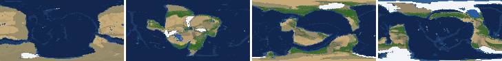
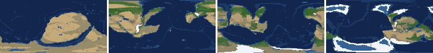
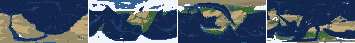
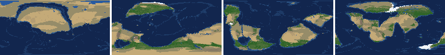
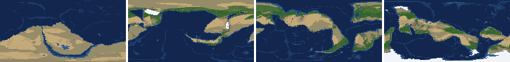
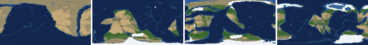
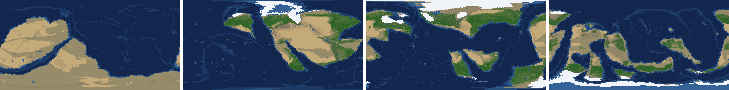
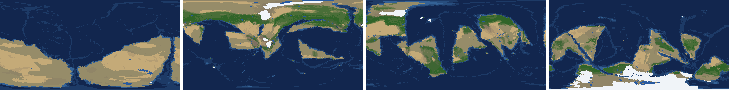

# Health sweep 2026-10-16 07:21

Commit 508c352+dirty. 8 runs (default params, `--every 4`) at 8 workers x 1 numba threads; simulations 8.6 min wall. Made by `tools/health.py` (PW-246).

## Runs

| seed | L | Myr | run | sim s | trees / flowering trees from | dT range C | peaks > 9.5 km | giant-lake frames % | crust volume end/start | ice SL < -150 m % | <= 4 plates % |
|---|---|---|---|---|---|---|---|---|---|---|---|
| 1 | 6 | 500 | a6c7e2 | 479 | 132 / 412 | 11.3 | 0 | 27.4 | 0.998 | 0.0 | 0.0 |
| 2 | 6 | 500 | c2f2ef | 513 | 140 / 396 | 19.9 | 0 | 6.2 | 0.971 | 0.0 | 0.0 |
| 11 | 6 | 500 | 202fd1 | 459 | 128 / 372 | 17.6 | 0 | 2.7 | 0.964 | 18.6 | 0.0 |
| 21 | 6 | 500 | b902f1 | 352 | 136 / 404 | 9.2 | 0 | 15.0 | 0.975 | 0.0 | 0.0 |
| 3199 | 6 | 500 | 0f6800 | 430 | 132 / 376 | 11.9 | 0 | 5.3 | 0.97 | 0.0 | 0.0 |
| 42 | 6 | 500 | 820a7a | 486 | 116 / 404 | 13.9 | 0 | 16.8 | 0.99 | 0.0 | 0.0 |
| 77 | 6 | 500 | 7f4997 | 454 | 124 / 416 | 10.9 | 0 | 10.6 | 0.963 | 0.0 | 0.0 |
| 505 | 6 | 500 | 31a176 | 494 | 132 / 416 | 7.2 | 0 | 7.1 | 0.963 | 0.0 | 0.0 |

## Medians by seed (after 50 Myr; tree cover after forests, NPP after flowering trees appear)

| seed | L | land_pct | cont_pct | cont_km | plates | ocean_age | speed | sea_level | sea_ice_m | ice_pct | temp | co2 | dry_pct | inland_pct | lake_pct | lake_max_mkm2 | max_elev_km | trees_pct | npp | landmasses | largest_pct |
|---|---|---|---|---|---|---|---|---|---|---|---|---|---|---|---|---|---|---|---|---|---|
| 1 | 6 | 32.8 | 38.4 | 35.5 | 11.0 | 56.8 | 4.8 | -57.3 | -5.5 | 1.0 | 15.4 | -0.2 | 33.5 | 7.6 | 0.8 | 0.3 | 5.7 | 24.7 | 281.0 | 5.0 | 30.2 |
| 2 | 6 | 33.5 | 40.1 | 34.0 | 11.0 | 57.5 | 4.8 | -66.4 | -5.3 | 1.0 | 15.1 | -0.2 | 30.7 | 5.8 | 0.5 | 0.2 | 5.0 | 22.4 | 338.4 | 7.0 | 25.1 |
| 11 | 6 | 31.8 | 39.2 | 34.5 | 11.0 | 50.7 | 4.4 | 42.3 | -8.3 | 1.5 | 13.1 | -0.4 | 27.0 | 4.3 | 0.4 | 0.1 | 5.6 | 28.9 | 391.4 | 7.0 | 26.1 |
| 21 | 6 | 33.9 | 39.4 | 34.5 | 12.0 | 51.0 | 4.3 | 39.4 | -0.2 | 0.1 | 16.6 | -0.3 | 34.6 | 4.8 | 0.4 | 0.1 | 5.3 | 22.9 | 373.8 | 8.0 | 24.4 |
| 3199 | 6 | 33.5 | 39.3 | 34.2 | 12.0 | 55.8 | 4.6 | -10.1 | -4.2 | 0.7 | 14.4 | -0.2 | 31.6 | 5.1 | 0.3 | 0.1 | 5.3 | 28.0 | 387.2 | 5.0 | 26.2 |
| 42 | 6 | 33.0 | 39.8 | 34.3 | 14.0 | 48.7 | 4.4 | 42.5 | -9.8 | 2.1 | 14.0 | -0.3 | 32.2 | 4.2 | 0.6 | 0.2 | 5.6 | 22.8 | 373.5 | 5.0 | 29.1 |
| 77 | 6 | 33.1 | 39.6 | 34.0 | 12.0 | 51.5 | 4.4 | -9.9 | -13.5 | 2.0 | 12.9 | -0.2 | 30.2 | 3.8 | 0.5 | 0.1 | 5.2 | 25.9 | 431.6 | 8.0 | 19.9 |
| 505 | 6 | 33.2 | 39.6 | 34.3 | 12.0 | 49.7 | 4.6 | 30.8 | -3.3 | 0.5 | 14.8 | -0.4 | 26.1 | 4.3 | 0.6 | 0.1 | 5.9 | 27.7 | 411.4 | 7.0 | 17.1 |

Measured on the run's keyframes (no slicing). A keyframe's rivers and lakes are routed on its own terrain (PW-239), so `inland_raw_pct` (every routed end on land, as highlights counts it) and `inland_pct` (ends that are closed lakes, salt pans or real pits) agree but for ends under land ice. Land ice and land shares use cells (near-equal area).

## Envelopes

| metric | low | high | Earth | source |
|---|---|---|---|---|
| land, % of surface (`land_pct`) | 22 | 42 | 29.20 | tests/test_envelopes.py (22-42%); Earth 29.2% |
| continental crust, % of surface (`cont_pct`) | 33 | 50 | 41 | tests/test_envelopes.py (33-50%); Earth ~41% with shelves (Cogley 1984) |
| mean continental crust thickness, km (`cont_km`) | 31 | 40 | 39 | target 35 km (PW-238, continental_thickness); Earth ~39 km (Christensen & Mooney 1995); known thinning to 32-33 km (PW-046) |
| plates (`plates`) | 5 | 30 | 15 | tests/test_envelopes.py (5-30; max_plates 30); Earth 7 major + ~8 minor; <= 4 is the PW-191 collapse |
| mean ocean-floor age, Myr (`ocean_age`) | 25 | 120 | 64 | tests/test_envelopes.py (25-120); Earth ~64 Myr (Mueller et al. 2008); PW-051 |
| mean plate speed, cm/yr (`speed`) | 2 | 9 | 4.50 | tests/test_envelopes.py (2-9 cm/yr); Earth ~4-5 |
| sea level, m (ice + ocean basins) (`sea_level`) | -250 | 300 | 0 | Phanerozoic ~-130 (LGM) .. +250 m (earth.py; Haq & Schutter 2008); -250: PW-240's hard goal |
| sea level from land ice, m (`sea_ice_m`) | -250 | - | 0 | Earth LGM ~-130 m; PW-240 goal -150 m typical / -250 m worst |
| land ice, % of surface (`ice_pct`) | - | 10 | 3.10 | Earth 3.1% now (earth.EARTH_ICE), ~7-8% at the LGM |
| global mean temperature, C (`temp`) | 8 | 30 | 14.50 | Earth 14.5 C; LGM ~8 C (Tierney et al. 2020); Phanerozoic hothouses to ~30 C (Scotese et al. 2021) |
| CO2 index (ln source/sink) (`co2`) | -1.5 | 1.5 | 0.00 | the forcing's clip in earth.py (+-1.5); Earth 0 |
| arid (Koppen B), % of land (`dry_pct`) | 12 | 45 | 30 | tests/test_envelopes.py (12-45%); Earth ~30% (Beck et al. 2018) |
| land draining inland, % of ice-free land (to a closed lake, salt pan or real pit) (`inland_pct`) | 8 | 30 | 18 | Earth ~18% (overview 2.9); L6 known ~9.5-11% (PW-054, PW-243). `inland_raw_pct` (not checked) follows the stored `downstream` to any end, as highlights does; since PW-239 the two agree but for ends under land ice |
| lakes, % of land (`lake_pct`) | 0.2 | 3.0 | 1.80 | Earth ~1.8% of ice-free land (HydroLAKES, Messager et al. 2016); generated L6 worlds 0.5-1% |
| largest lake, million km2 (`lake_max_mkm2`) | - | 1.0 | 0.37 | Caspian 0.37 Mkm2; 1 Mkm2 = the overview's giant lake (2.9) |
| highest peak, km (`max_elev_km`) | - | 9.5 | 8.85 | Everest 8.85 km; PW-172 (spikes above ~9.5 km) |
| tree cover, % of ice-free land (after forests appear) (`trees_pct`) | 10 | 50 | 30 | Earth ~30% potential canopy (forest 55-60 of ~130 Mkm2, overview 2.18) |
| land NPP, g C/m2/yr (after flowering trees appear) (`npp`) | 200 | 700 | 430 | Earth ~56 Pg C/yr over ~130 Mkm2 = ~430; the model on Earth's terrain 50 Pg C/yr, ~385 (overview 2.18). Before flowering trees (plant group 4) stand-ins grow at 70%, so runs sit at ~150-280 |
| landmasses (>= 3 cells) (`landmasses`) | 3 | 80 | - | loose: a lone supercontinent or a shattered archipelago |
| largest landmass, % of surface (`largest_pct`) | 5 | 35 | 16.60 | Afro-Eurasia 16.6%; a Pangaea ~30% (scorecard largest_max) |
| global temperature range over the run, C (`dT_range`, per run) | - | 25 | 25 | Phanerozoic 11-36 C (Scotese et al. 2021) |
| keyframes with a peak above 9.5 km (`peak_frames`, per run) | - | 0 | 0 | PW-172 (L7 seed 3199: 3 of 251) |
| % of keyframes with a lake over 1 Mkm2 (`giant_lake_frames`, per run) | - | 5 | 0 | overview 2.9 (L6: 3 of ~150 frames) |
| continental crust volume, end / start (`volume_ratio`, per run) | 0.9 | 1.1 | 1.0 | scorecard volume_ratio (x1.006) |
| % of keyframes with ice sea level below -150 m (`sea_ice_below_150`, per run) | - | 10 | 0 | PW-240 |
| % of keyframes with <= 4 plates (`low_plates`, per run) | - | 2 | 0 | PW-191 (L7 seed 21: 1%) |

## Top outliers (of 184 spells; severity = excess / band width x (0.2 + share of the run))

| seed | L | metric | Myr | frames | worst | envelope | severity |
|---|---|---|---|---|---|---|---|
| 1 | 6 | giant_lake_frames | run | - | 27.40 | -..5 | 4.48 |
| 21 | 6 | lake_max_mkm2 | 272-292 | 6 | 10.75 | -..1.0 | 2.413 |
| 42 | 6 | giant_lake_frames | run | - | 16.80 | -..5 | 2.36 |
| 21 | 6 | giant_lake_frames | run | - | 15.00 | -..5 | 2.0 |
| 42 | 6 | lake_max_mkm2 | 428-464 | 10 | 6.50 | -..1.0 | 1.537 |
| 77 | 6 | giant_lake_frames | run | - | 10.60 | -..5 | 1.12 |
| 1 | 6 | lake_max_mkm2 | 476-500 | 6 | 5.42 | -..1.0 | 1.094 |
| 77 | 6 | lake_max_mkm2 | 148-152 | 2 | 5.48 | -..1.0 | 0.967 |
| 11 | 6 | sea_ice_below_150 | run | - | 18.60 | -..10 | 0.86 |
| 1 | 6 | lake_max_mkm2 | 440-460 | 6 | 3.98 | -..1.0 | 0.739 |
| 21 | 6 | lake_max_mkm2 | 480-492 | 3 | 4.22 | -..1.0 | 0.721 |
| 42 | 6 | lake_max_mkm2 | 84-84 | 1 | 4.28 | -..1.0 | 0.683 |
| 21 | 6 | lake_max_mkm2 | 52-60 | 3 | 4.05 | -..1.0 | 0.682 |
| 1 | 6 | lake_max_mkm2 | 196-204 | 3 | 3.90 | -..1.0 | 0.649 |
| 42 | 6 | lake_max_mkm2 | 96-100 | 2 | 3.60 | -..1.0 | 0.561 |
| 1 | 6 | lake_max_mkm2 | 276-276 | 1 | 3.61 | -..1.0 | 0.543 |
| 42 | 6 | lake_max_mkm2 | 116-116 | 1 | 3.31 | -..1.0 | 0.481 |
| 1 | 6 | lake_max_mkm2 | 184-184 | 1 | 3.16 | -..1.0 | 0.45 |
| 1 | 6 | lake_max_mkm2 | 412-424 | 3 | 2.95 | -..1.0 | 0.437 |
| 505 | 6 | giant_lake_frames | run | - | 7.10 | -..5 | 0.42 |
| 505 | 6 | lake_max_mkm2 | 56-56 | 1 | 2.95 | -..1.0 | 0.406 |
| 77 | 6 | lake_max_mkm2 | 408-408 | 1 | 2.83 | -..1.0 | 0.38 |
| 11 | 6 | lake_max_mkm2 | 212-212 | 1 | 2.78 | -..1.0 | 0.37 |
| 77 | 6 | lake_max_mkm2 | 436-436 | 1 | 2.70 | -..1.0 | 0.354 |
| 11 | 6 | sea_level | 172-292 | 31 | -664.10 | -250..300 | 0.336 |
| 11 | 6 | inland_pct | 72-500 | 100 | 0.55 | 8..30 | 0.336 |
| 1 | 6 | lake_max_mkm2 | 308-308 | 1 | 2.56 | -..1.0 | 0.325 |
| 11 | 6 | ice_pct | 172-256 | 22 | 18.00 | -..10 | 0.3 |
| 77 | 6 | inland_pct | 192-500 | 77 | 0.58 | 8..30 | 0.274 |
| 77 | 6 | lake_max_mkm2 | 92-108 | 4 | 2.15 | -..1.0 | 0.267 |

## Per seed: min / median / max after the 50 Myr spin-up, and spells outside the envelopes

### Seed 1, L6 (run a6c7e2)

*At 48, 200, 348, 500 Myr: sea by depth, land green by tree cover / tan where arid, shaded by height, ice white, lakes blue.*

| metric | min | median | max | outside (Myr: worst) |
|---|---|---|---|---|
| land_pct | 31.94 | 32.78 | 38.34 |  |
| cont_pct | 35.09 | 38.41 | 42.46 |  |
| cont_km | 32.87 | 35.55 | 37.87 |  |
| plates | 5.00 | 11.00 | 17.00 |  |
| ocean_age | 32.00 | 56.80 | 79.20 |  |
| speed | 2.66 | 4.77 | 8.19 |  |
| sea_level | -275.80 | -57.30 | 194.90 | 208-216: -252.60; 500-500: -275.80 |
| sea_ice_m | -125.10 | -5.50 | -0.00 |  |
| ice_pct | 0.00 | 1.00 | 7.60 |  |
| temp | 8.40 | 15.40 | 19.70 |  |
| co2 | -1.63 | -0.19 | 0.23 | 164-192: -1.63 |
| dry_pct | 14.20 | 33.53 | 58.65 | 60-60: 45.28; 208-292: 58.65 |
| inland_pct | 1.09 | 7.59 | 24.57 | 52-168: 1.09; 292-304: 4.15; 316-416: 2.56; 428-440: 4.48; +2 more |
| lake_pct | 0.03 | 0.76 | 5.12 | 52-56: 0.13; 68-84: 0.03; 108-108: 0.14; 200-204: 3.21; +4 more |
| lake_max_mkm2 | 0.01 | 0.27 | 5.42 | 64-64: 1.23; 140-140: 1.98; 184-184: 3.16; 196-204: 3.90; +9 more |
| max_elev_km | 1.77 | 5.67 | 8.48 |  |
| trees_pct | 12.02 | 24.69 | 39.01 |  |
| npp | 193.40 | 281.00 | 317.60 | 412-416: 193.40 |
| landmasses | 2.00 | 5.00 | 12.00 | 164-164: 2; 240-256: 2 |
| largest_pct | 10.90 | 30.20 | 34.90 |  |

### Seed 2, L6 (run c2f2ef)

*At 48, 200, 348, 500 Myr: sea by depth, land green by tree cover / tan where arid, shaded by height, ice white, lakes blue.*

| metric | min | median | max | outside (Myr: worst) |
|---|---|---|---|---|
| land_pct | 29.63 | 33.54 | 37.97 |  |
| cont_pct | 36.62 | 40.13 | 42.80 |  |
| cont_km | 32.70 | 34.00 | 36.69 |  |
| plates | 6.00 | 11.00 | 16.00 |  |
| ocean_age | 33.10 | 57.50 | 87.10 |  |
| speed | 2.92 | 4.76 | 7.37 |  |
| sea_level | -404.70 | -66.40 | 184.70 | 360-372: -252.40; 484-500: -404.70 |
| sea_ice_m | -137.80 | -5.30 | -0.00 |  |
| ice_pct | 0.00 | 1.00 | 12.50 | 484-500: 12.50 |
| temp | 2.10 | 15.10 | 22.00 | 480-500: 2.10 |
| co2 | -1.10 | -0.24 | 0.30 |  |
| dry_pct | 13.35 | 30.71 | 53.88 | 52-68: 53.80; 220-304: 53.88 |
| inland_pct | 0.86 | 5.80 | 28.49 | 64-188: 1.00; 224-496: 0.86 |
| lake_pct | 0.03 | 0.50 | 1.96 | 64-88: 0.03; 100-108: 0.04; 128-128: 0.12; 284-284: 0.19 |
| lake_max_mkm2 | 0.01 | 0.16 | 2.10 | 348-356: 1.59; 376-376: 1.27; 400-400: 1.06; 452-452: 2.10; +1 more |
| max_elev_km | 1.11 | 5.05 | 8.81 |  |
| trees_pct | 9.55 | 22.39 | 47.27 | 240-240: 9.90; 276-280: 9.55 |
| npp | 248.40 | 338.40 | 398.80 |  |
| landmasses | 2.00 | 7.00 | 12.00 | 56-60: 2; 180-184: 2 |
| largest_pct | 12.40 | 25.10 | 34.30 |  |

### Seed 11, L6 (run 202fd1)

*At 48, 200, 348, 500 Myr: sea by depth, land green by tree cover / tan where arid, shaded by height, ice white, lakes blue.*

| metric | min | median | max | outside (Myr: worst) |
|---|---|---|---|---|
| land_pct | 30.31 | 31.84 | 37.62 |  |
| cont_pct | 37.67 | 39.23 | 42.68 |  |
| cont_km | 32.86 | 34.52 | 35.61 |  |
| plates | 5.00 | 11.00 | 17.00 |  |
| ocean_age | 32.90 | 50.70 | 87.30 |  |
| speed | 3.50 | 4.42 | 7.21 |  |
| sea_level | -664.10 | 42.30 | 223.40 | 172-292: -664.10 |
| sea_ice_m | -351.50 | -8.30 | -0.00 | 180-240: -351.50 |
| ice_pct | 0.00 | 1.50 | 18.00 | 172-256: 18.00 |
| temp | 2.30 | 13.10 | 19.90 | 168-220: 2.30 |
| co2 | -1.04 | -0.39 | 0.06 |  |
| dry_pct | 16.58 | 26.98 | 44.54 |  |
| inland_pct | 0.55 | 4.30 | 20.68 | 72-500: 0.55 |
| lake_pct | 0.04 | 0.42 | 2.07 | 72-84: 0.04; 96-104: 0.04; 116-128: 0.15; 192-204: 0.18; +1 more |
| lake_max_mkm2 | 0.03 | 0.10 | 2.78 | 68-68: 1.94; 140-140: 1.08; 212-212: 2.78 |
| max_elev_km | 1.44 | 5.60 | 8.39 |  |
| trees_pct | 14.40 | 28.90 | 47.89 |  |
| npp | 229.30 | 391.40 | 432.30 |  |
| landmasses | 2.00 | 7.00 | 13.00 | 64-64: 2; 316-332: 2; 360-360: 2 |
| largest_pct | 11.40 | 26.10 | 33.30 |  |

### Seed 21, L6 (run b902f1)

*At 48, 200, 348, 500 Myr: sea by depth, land green by tree cover / tan where arid, shaded by height, ice white, lakes blue.*

| metric | min | median | max | outside (Myr: worst) |
|---|---|---|---|---|
| land_pct | 32.12 | 33.88 | 37.56 |  |
| cont_pct | 37.77 | 39.42 | 42.96 |  |
| cont_km | 32.64 | 34.45 | 35.88 |  |
| plates | 7.00 | 12.00 | 18.00 |  |
| ocean_age | 34.20 | 51.00 | 69.50 |  |
| speed | 1.93 | 4.33 | 6.93 | 500-500: 1.93 |
| sea_level | -145.60 | 39.40 | 196.60 |  |
| sea_ice_m | -8.10 | -0.20 | -0.00 |  |
| ice_pct | 0.00 | 0.10 | 1.10 |  |
| temp | 12.50 | 16.60 | 21.70 |  |
| co2 | -1.01 | -0.34 | 0.02 |  |
| dry_pct | 20.94 | 34.56 | 48.51 | 52-64: 48.51; 92-96: 47.40; 212-212: 45.10; 244-272: 47.71 |
| inland_pct | 0.36 | 4.85 | 25.70 | 76-156: 0.36; 168-176: 6.13; 188-212: 4.77; 228-228: 7.47; +4 more |
| lake_pct | 0.01 | 0.38 | 6.40 | 60-60: 3.31; 76-112: 0.01; 132-140: 0.10; 232-240: 0.13; +4 more |
| lake_max_mkm2 | 0.01 | 0.11 | 10.75 | 52-60: 4.05; 124-124: 1.57; 216-224: 2.18; 272-292: 10.75; +3 more |
| max_elev_km | 1.51 | 5.32 | 7.16 |  |
| trees_pct | 14.41 | 22.92 | 45.24 |  |
| npp | 242.70 | 373.80 | 385.90 |  |
| landmasses | 1.00 | 8.00 | 16.00 | 260-280: 1; 308-312: 2 |
| largest_pct | 8.60 | 24.40 | 34.50 |  |

### Seed 3199, L6 (run 0f6800)

*At 48, 200, 348, 500 Myr: sea by depth, land green by tree cover / tan where arid, shaded by height, ice white, lakes blue.*

| metric | min | median | max | outside (Myr: worst) |
|---|---|---|---|---|
| land_pct | 32.35 | 33.53 | 38.33 |  |
| cont_pct | 37.85 | 39.29 | 42.74 |  |
| cont_km | 32.53 | 34.18 | 35.82 |  |
| plates | 5.00 | 12.00 | 18.00 |  |
| ocean_age | 34.00 | 55.80 | 74.40 |  |
| speed | 3.03 | 4.59 | 7.81 |  |
| sea_level | -211.80 | -10.10 | 198.60 |  |
| sea_ice_m | -35.60 | -4.20 | -0.00 |  |
| ice_pct | 0.00 | 0.70 | 2.60 |  |
| temp | 10.10 | 14.40 | 22.00 |  |
| co2 | -1.02 | -0.24 | 0.18 |  |
| dry_pct | 23.24 | 31.60 | 49.13 | 64-72: 49.13 |
| inland_pct | 0.33 | 5.14 | 14.09 | 52-52: 5.41; 72-140: 0.33; 152-168: 2.55; 180-500: 1.22 |
| lake_pct | 0.01 | 0.34 | 1.86 | 52-132: 0.01; 152-152: 0.13; 220-220: 0.15; 404-404: 0.17 |
| lake_max_mkm2 | 0.01 | 0.09 | 2.12 | 120-120: 1.33; 144-148: 1.38; 172-172: 1.62; 312-312: 1.37; +1 more |
| max_elev_km | 1.47 | 5.35 | 7.10 |  |
| trees_pct | 12.25 | 27.99 | 32.23 |  |
| npp | 234.90 | 387.20 | 395.80 |  |
| landmasses | 1.00 | 5.00 | 11.00 | 52-72: 2; 268-276: 1 |
| largest_pct | 9.20 | 26.20 | 34.10 |  |

### Seed 42, L6 (run 820a7a)

*At 48, 200, 348, 500 Myr: sea by depth, land green by tree cover / tan where arid, shaded by height, ice white, lakes blue.*

| metric | min | median | max | outside (Myr: worst) |
|---|---|---|---|---|
| land_pct | 30.85 | 32.96 | 38.27 |  |
| cont_pct | 36.69 | 39.77 | 42.25 |  |
| cont_km | 33.04 | 34.30 | 36.94 |  |
| plates | 7.00 | 14.00 | 20.00 |  |
| ocean_age | 34.90 | 48.70 | 64.50 |  |
| speed | 2.78 | 4.37 | 7.88 |  |
| sea_level | -281.20 | 42.50 | 186.40 | 464-496: -281.20 |
| sea_ice_m | -111.50 | -9.80 | -0.00 |  |
| ice_pct | 0.00 | 2.10 | 9.60 |  |
| temp | 6.10 | 14.00 | 20.00 | 440-464: 6.10 |
| co2 | -0.87 | -0.33 | -0.05 |  |
| dry_pct | 11.50 | 32.25 | 45.36 | 64-64: 45.36; 380-400: 11.50 |
| inland_pct | 0.29 | 4.18 | 22.55 | 68-92: 2.26; 104-164: 1.37; 180-188: 3.51; 208-500: 0.29 |
| lake_pct | 0.08 | 0.60 | 4.37 | 56-56: 0.09; 72-76: 0.10; 88-88: 0.08; 108-108: 0.17; +1 more |
| lake_max_mkm2 | 0.03 | 0.16 | 6.50 | 64-64: 1.12; 84-84: 4.28; 96-100: 3.60; 116-116: 3.31; +5 more |
| max_elev_km | 1.76 | 5.59 | 8.35 |  |
| trees_pct | 14.27 | 22.79 | 37.62 |  |
| npp | 287.60 | 373.50 | 401.60 |  |
| landmasses | 2.00 | 5.00 | 11.00 | 244-248: 2; 500-500: 2 |
| largest_pct | 9.20 | 29.10 | 34.20 |  |

### Seed 77, L6 (run 7f4997)

*At 48, 200, 348, 500 Myr: sea by depth, land green by tree cover / tan where arid, shaded by height, ice white, lakes blue.*

| metric | min | median | max | outside (Myr: worst) |
|---|---|---|---|---|
| land_pct | 30.42 | 33.15 | 38.01 |  |
| cont_pct | 38.16 | 39.58 | 42.91 |  |
| cont_km | 32.47 | 33.96 | 35.50 |  |
| plates | 9.00 | 12.00 | 15.00 |  |
| ocean_age | 36.70 | 51.50 | 66.00 |  |
| speed | 2.86 | 4.39 | 7.50 |  |
| sea_level | -142.90 | -9.90 | 152.40 |  |
| sea_ice_m | -82.90 | -13.50 | -0.00 |  |
| ice_pct | 0.00 | 2.00 | 6.50 |  |
| temp | 7.30 | 12.90 | 18.20 | 140-148: 7.30; 444-444: 7.60; 456-456: 7.90 |
| co2 | -0.72 | -0.19 | 0.82 |  |
| dry_pct | 15.05 | 30.19 | 44.55 |  |
| inland_pct | 0.58 | 3.75 | 14.79 | 64-92: 2.92; 112-144: 0.80; 156-156: 4.67; 168-172: 5.81; +1 more |
| lake_pct | 0.01 | 0.46 | 3.55 | 52-52: 0.11; 112-128: 0.01; 148-148: 3.55; 448-448: 0.17 |
| lake_max_mkm2 | 0.03 | 0.14 | 5.48 | 60-60: 1.38; 72-76: 2.03; 92-108: 2.15; 148-152: 5.48; +3 more |
| max_elev_km | 1.49 | 5.18 | 7.24 |  |
| trees_pct | 18.23 | 25.87 | 41.70 |  |
| npp | 247.70 | 431.55 | 457.60 |  |
| landmasses | 2.00 | 8.00 | 11.00 | 52-64: 2 |
| largest_pct | 10.70 | 19.90 | 34.60 |  |

### Seed 505, L6 (run 31a176)

*At 48, 200, 348, 500 Myr: sea by depth, land green by tree cover / tan where arid, shaded by height, ice white, lakes blue.*

| metric | min | median | max | outside (Myr: worst) |
|---|---|---|---|---|
| land_pct | 32.14 | 33.23 | 37.81 |  |
| cont_pct | 37.82 | 39.56 | 43.14 |  |
| cont_km | 32.51 | 34.27 | 35.90 |  |
| plates | 8.00 | 12.00 | 17.00 |  |
| ocean_age | 33.80 | 49.70 | 72.70 |  |
| speed | 3.19 | 4.63 | 7.16 |  |
| sea_level | -176.30 | 30.80 | 208.90 |  |
| sea_ice_m | -37.20 | -3.30 | -0.00 |  |
| ice_pct | 0.00 | 0.50 | 3.70 |  |
| temp | 11.90 | 14.80 | 19.10 |  |
| co2 | -1.07 | -0.35 | 0.16 |  |
| dry_pct | 14.66 | 26.05 | 47.48 | 100-108: 47.48 |
| inland_pct | 0.12 | 4.31 | 23.43 | 60-100: 0.12; 112-376: 0.21; 388-500: 1.70 |
| lake_pct | 0.02 | 0.62 | 2.40 | 60-100: 0.02; 112-124: 0.03 |
| lake_max_mkm2 | 0.01 | 0.15 | 2.95 | 56-56: 2.95; 104-108: 1.94; 152-152: 1.73; 172-172: 1.05; +2 more |
| max_elev_km | 1.72 | 5.90 | 8.44 |  |
| trees_pct | 15.75 | 27.69 | 40.84 |  |
| npp | 178.40 | 411.40 | 432.70 | 416-432: 178.40 |
| landmasses | 2.00 | 7.00 | 12.00 | 56-64: 2 |
| largest_pct | 9.50 | 17.10 | 33.40 |  |

## Determinism

(not run)
