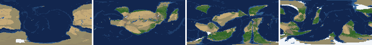
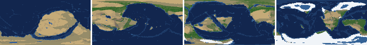
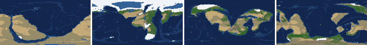
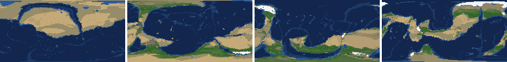
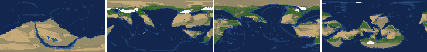
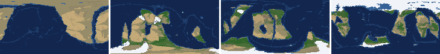
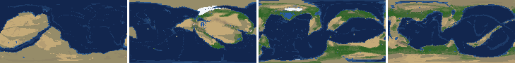
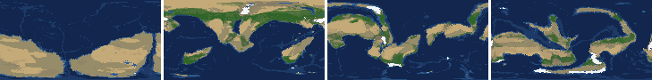

# Health sweep 2026-10-16 06:45

Commit dcf6cba. 8 runs (default params, `--every 4`) at 8 workers x 1 numba threads; simulations 4.8 min wall. Made by `tools/health.py` (PW-246).

## Runs

| seed | L | Myr | run | sim s | trees / flowering trees from | dT range C | peaks > 9.5 km | giant-lake frames % | crust volume end/start | ice SL < -150 m % | <= 4 plates % |
|---|---|---|---|---|---|---|---|---|---|---|---|
| 1 | 6 | 500 | a6a284 | 286 | 132 / 412 | 10.6 | 0 | 7.1 | 0.951 | 0.0 | 0.0 |
| 2 | 6 | 500 | 2cfcd0 | 279 | 140 / 396 | 19.1 | 0 | 8.0 | 0.978 | 4.4 | 0.0 |
| 11 | 6 | 500 | 293850 | 281 | 128 / 372 | 17.3 | 0 | 6.2 | 0.988 | 7.1 | 0.0 |
| 21 | 6 | 500 | cb9184 | 280 | 136 / 404 | 9.2 | 0 | 12.4 | 0.939 | 0.0 | 0.0 |
| 3199 | 6 | 500 | e865a1 | 284 | 132 / 376 | 11.2 | 0 | 4.4 | 0.963 | 0.0 | 0.0 |
| 42 | 6 | 500 | 1e7dd2 | 283 | 116 / 404 | 11.8 | 0 | 6.2 | 0.97 | 0.0 | 0.0 |
| 77 | 6 | 500 | 4e8366 | 280 | 124 / 416 | 10.1 | 0 | 15.9 | 0.957 | 0.0 | 0.0 |
| 505 | 6 | 500 | 1da3fd | 286 | 132 / 416 | 8.1 | 0 | 10.6 | 0.958 | 0.0 | 0.0 |

## Medians by seed (after 50 Myr; tree cover after forests, NPP after flowering trees appear)

| seed | L | land_pct | cont_pct | cont_km | plates | ocean_age | speed | sea_level | sea_ice_m | ice_pct | temp | co2 | dry_pct | inland_pct | lake_pct | lake_max_mkm2 | max_elev_km | trees_pct | npp | landmasses | largest_pct |
|---|---|---|---|---|---|---|---|---|---|---|---|---|---|---|---|---|---|---|---|---|---|
| 1 | 6 | 33.2 | 39.6 | 34.1 | 11.0 | 51.8 | 4.4 | 13.3 | -1.8 | 0.3 | 15.7 | -0.1 | 31.2 | 4.5 | 0.4 | 0.1 | 6.0 | 29.1 | 305.3 | 6.0 | 20.2 |
| 2 | 6 | 34.5 | 39.7 | 34.2 | 11.0 | 58.4 | 4.2 | -58.5 | -0.9 | 0.2 | 15.5 | -0.2 | 34.8 | 4.6 | 0.4 | 0.2 | 4.9 | 20.9 | 326.4 | 8.0 | 23.2 |
| 11 | 6 | 32.8 | 39.7 | 34.4 | 13.0 | 51.3 | 4.4 | 37.1 | -8.6 | 1.6 | 13.1 | -0.5 | 27.2 | 3.2 | 0.4 | 0.1 | 5.1 | 29.9 | 377.5 | 6.0 | 23.1 |
| 21 | 6 | 34.3 | 39.5 | 33.9 | 12.0 | 54.0 | 4.4 | 20.1 | -1.5 | 0.3 | 16.6 | -0.3 | 38.5 | 5.4 | 0.4 | 0.1 | 6.0 | 22.3 | 375.4 | 8.0 | 29.6 |
| 3199 | 6 | 33.5 | 40.5 | 33.6 | 11.0 | 52.5 | 4.8 | 17.8 | -5.6 | 0.7 | 14.3 | -0.2 | 27.3 | 4.4 | 0.4 | 0.1 | 4.5 | 23.9 | 377.8 | 7.0 | 21.1 |
| 42 | 6 | 32.5 | 39.6 | 34.1 | 11.0 | 52.4 | 4.4 | -12.3 | -8.4 | 1.5 | 14.5 | -0.3 | 30.1 | 3.8 | 0.5 | 0.1 | 5.8 | 25.8 | 426.7 | 6.0 | 20.4 |
| 77 | 6 | 34.0 | 40.7 | 33.4 | 10.0 | 53.7 | 4.4 | 1.3 | -0.3 | 0.1 | 13.3 | -0.3 | 29.9 | 4.8 | 0.5 | 0.2 | 3.2 | 27.9 | 267.1 | 7.0 | 30.0 |
| 505 | 6 | 33.5 | 39.5 | 34.1 | 11.0 | 53.8 | 4.1 | 0.6 | -2.2 | 0.4 | 14.8 | -0.5 | 31.6 | 3.8 | 0.4 | 0.1 | 5.8 | 25.4 | 398.9 | 6.0 | 28.1 |

Measured on the run's keyframes (no slicing). A keyframe's rivers and lakes are routed on its own terrain (PW-239), so `inland_raw_pct` (every routed end on land, as highlights counts it) and `inland_pct` (ends that are closed lakes, salt pans or real pits) agree but for ends under land ice. Land ice and land shares use cells (near-equal area).

## Envelopes

| metric | low | high | Earth | source |
|---|---|---|---|---|
| land, % of surface (`land_pct`) | 22 | 42 | 29.20 | tests/test_envelopes.py (22-42%); Earth 29.2% |
| continental crust, % of surface (`cont_pct`) | 33 | 50 | 41 | tests/test_envelopes.py (33-50%); Earth ~41% with shelves (Cogley 1984) |
| mean continental crust thickness, km (`cont_km`) | 31 | 40 | 39 | target 35 km (PW-238, continental_thickness); Earth ~39 km (Christensen & Mooney 1995); known thinning to 32-33 km (PW-046) |
| plates (`plates`) | 5 | 30 | 15 | tests/test_envelopes.py (5-30; max_plates 30); Earth 7 major + ~8 minor; <= 4 is the PW-191 collapse |
| mean ocean-floor age, Myr (`ocean_age`) | 25 | 120 | 64 | tests/test_envelopes.py (25-120); Earth ~64 Myr (Mueller et al. 2008); PW-051 |
| mean plate speed, cm/yr (`speed`) | 2 | 9 | 4.50 | tests/test_envelopes.py (2-9 cm/yr); Earth ~4-5 |
| sea level, m (ice + ocean basins) (`sea_level`) | -250 | 300 | 0 | Phanerozoic ~-130 (LGM) .. +250 m (earth.py; Haq & Schutter 2008); -250: PW-240's hard goal |
| sea level from land ice, m (`sea_ice_m`) | -250 | - | 0 | Earth LGM ~-130 m; PW-240 goal -150 m typical / -250 m worst |
| land ice, % of surface (`ice_pct`) | - | 10 | 3.10 | Earth 3.1% now (earth.EARTH_ICE), ~7-8% at the LGM |
| global mean temperature, C (`temp`) | 8 | 30 | 14.50 | Earth 14.5 C; LGM ~8 C (Tierney et al. 2020); Phanerozoic hothouses to ~30 C (Scotese et al. 2021) |
| CO2 index (ln source/sink) (`co2`) | -1.5 | 1.5 | 0.00 | the forcing's clip in earth.py (+-1.5); Earth 0 |
| arid (Koppen B), % of land (`dry_pct`) | 12 | 45 | 30 | tests/test_envelopes.py (12-45%); Earth ~30% (Beck et al. 2018) |
| land draining inland, % of ice-free land (to a closed lake, salt pan or real pit) (`inland_pct`) | 8 | 30 | 18 | Earth ~18% (overview 2.9); L6 known ~9.5-11% (PW-054, PW-243). `inland_raw_pct` (not checked) follows the stored `downstream` to any end, as highlights does; since PW-239 the two agree but for ends under land ice |
| lakes, % of land (`lake_pct`) | 0.2 | 3.0 | 1.80 | Earth ~1.8% of ice-free land (HydroLAKES, Messager et al. 2016); generated L6 worlds 0.5-1% |
| largest lake, million km2 (`lake_max_mkm2`) | - | 1.0 | 0.37 | Caspian 0.37 Mkm2; 1 Mkm2 = the overview's giant lake (2.9) |
| highest peak, km (`max_elev_km`) | - | 9.5 | 8.85 | Everest 8.85 km; PW-172 (spikes above ~9.5 km) |
| tree cover, % of ice-free land (after forests appear) (`trees_pct`) | 10 | 50 | 30 | Earth ~30% potential canopy (forest 55-60 of ~130 Mkm2, overview 2.18) |
| land NPP, g C/m2/yr (after flowering trees appear) (`npp`) | 200 | 700 | 430 | Earth ~56 Pg C/yr over ~130 Mkm2 = ~430; the model on Earth's terrain 50 Pg C/yr, ~385 (overview 2.18). Before flowering trees (plant group 4) stand-ins grow at 70%, so runs sit at ~150-280 |
| landmasses (>= 3 cells) (`landmasses`) | 3 | 80 | - | loose: a lone supercontinent or a shattered archipelago |
| largest landmass, % of surface (`largest_pct`) | 5 | 35 | 16.60 | Afro-Eurasia 16.6%; a Pangaea ~30% (scorecard largest_max) |
| global temperature range over the run, C (`dT_range`, per run) | - | 25 | 25 | Phanerozoic 11-36 C (Scotese et al. 2021) |
| keyframes with a peak above 9.5 km (`peak_frames`, per run) | - | 0 | 0 | PW-172 (L7 seed 3199: 3 of 251) |
| % of keyframes with a lake over 1 Mkm2 (`giant_lake_frames`, per run) | - | 5 | 0 | overview 2.9 (L6: 3 of ~150 frames) |
| continental crust volume, end / start (`volume_ratio`, per run) | 0.9 | 1.1 | 1.0 | scorecard volume_ratio (x1.006) |
| % of keyframes with ice sea level below -150 m (`sea_ice_below_150`, per run) | - | 10 | 0 | PW-240 |
| % of keyframes with <= 4 plates (`low_plates`, per run) | - | 2 | 0 | PW-191 (L7 seed 21: 1%) |

## Top outliers (of 157 spells; severity = excess / band width x (0.2 + share of the run))

| seed | L | metric | Myr | frames | worst | envelope | severity |
|---|---|---|---|---|---|---|---|
| 77 | 6 | giant_lake_frames | run | - | 15.90 | -..5 | 2.18 |
| 21 | 6 | lake_max_mkm2 | 292-308 | 4 | 7.51 | -..1.0 | 1.508 |
| 21 | 6 | giant_lake_frames | run | - | 12.40 | -..5 | 1.48 |
| 21 | 6 | lake_max_mkm2 | 324-324 | 1 | 7.16 | -..1.0 | 1.281 |
| 77 | 6 | lake_max_mkm2 | 348-376 | 8 | 5.82 | -..1.0 | 1.269 |
| 505 | 6 | giant_lake_frames | run | - | 10.60 | -..5 | 1.12 |
| 2 | 6 | lake_max_mkm2 | 272-272 | 1 | 5.75 | -..1.0 | 0.988 |
| 42 | 6 | lake_max_mkm2 | 120-140 | 5 | 4.73 | -..1.0 | 0.894 |
| 21 | 6 | lake_max_mkm2 | 52-60 | 3 | 3.87 | -..1.0 | 0.643 |
| 2 | 6 | giant_lake_frames | run | - | 8.00 | -..5 | 0.6 |
| 505 | 6 | lake_max_mkm2 | 88-88 | 1 | 3.60 | -..1.0 | 0.54 |
| 505 | 6 | lake_max_mkm2 | 68-72 | 2 | 3.35 | -..1.0 | 0.507 |
| 11 | 6 | lake_max_mkm2 | 68-68 | 1 | 3.14 | -..1.0 | 0.445 |
| 505 | 6 | lake_max_mkm2 | 52-56 | 2 | 2.99 | -..1.0 | 0.429 |
| 1 | 6 | giant_lake_frames | run | - | 7.10 | -..5 | 0.42 |
| 1 | 6 | lake_max_mkm2 | 184-184 | 1 | 3.01 | -..1.0 | 0.419 |
| 1 | 6 | lake_max_mkm2 | 416-416 | 1 | 2.56 | -..1.0 | 0.325 |
| 505 | 6 | lake_max_mkm2 | 488-488 | 1 | 2.45 | -..1.0 | 0.302 |
| 11 | 6 | lake_max_mkm2 | 244-244 | 1 | 2.44 | -..1.0 | 0.3 |
| 42 | 6 | inland_pct | 172-500 | 82 | 0.48 | 8..30 | 0.291 |
| 505 | 6 | inland_pct | 60-356 | 70 | 0.11 | 8..30 | 0.271 |
| 505 | 6 | lake_max_mkm2 | 416-416 | 1 | 2.24 | -..1.0 | 0.258 |
| 11 | 6 | lake_max_mkm2 | 200-204 | 2 | 2.13 | -..1.0 | 0.244 |
| 11 | 6 | giant_lake_frames | run | - | 6.20 | -..5 | 0.24 |
| 42 | 6 | giant_lake_frames | run | - | 6.20 | -..5 | 0.24 |
| 3199 | 6 | lake_max_mkm2 | 272-284 | 4 | 2.02 | -..1.0 | 0.236 |
| 77 | 6 | lake_max_mkm2 | 72-76 | 2 | 2.09 | -..1.0 | 0.236 |
| 505 | 6 | lake_max_mkm2 | 452-460 | 3 | 2.03 | -..1.0 | 0.231 |
| 2 | 6 | inland_pct | 196-500 | 72 | 1.57 | 8..30 | 0.225 |
| 11 | 6 | lake_max_mkm2 | 216-224 | 2 | 2.03 | -..1.0 | 0.222 |

## Per seed: min / median / max after the 50 Myr spin-up, and spells outside the envelopes

### Seed 1, L6 (run a6a284)

*At 48, 200, 348, 500 Myr: sea by depth, land green by tree cover / tan where arid, shaded by height, ice white, lakes blue.*

| metric | min | median | max | outside (Myr: worst) |
|---|---|---|---|---|
| land_pct | 31.19 | 33.19 | 38.41 |  |
| cont_pct | 38.22 | 39.60 | 42.53 |  |
| cont_km | 32.91 | 34.09 | 35.81 |  |
| plates | 6.00 | 11.00 | 16.00 |  |
| ocean_age | 32.90 | 51.80 | 75.00 |  |
| speed | 2.64 | 4.42 | 7.30 |  |
| sea_level | -206.60 | 13.30 | 184.50 |  |
| sea_ice_m | -25.70 | -1.80 | -0.00 |  |
| ice_pct | 0.00 | 0.30 | 3.50 |  |
| temp | 10.10 | 15.70 | 20.70 |  |
| co2 | -1.49 | -0.14 | 0.47 |  |
| dry_pct | 12.95 | 31.20 | 55.21 | 60-60: 45.25; 124-156: 51.11; 172-176: 45.73; 196-236: 55.21 |
| inland_pct | 1.03 | 4.55 | 22.87 | 64-156: 1.03; 168-176: 6.58; 244-500: 1.34 |
| lake_pct | 0.02 | 0.44 | 2.62 | 56-92: 0.07; 104-104: 0.12; 116-148: 0.02; 332-332: 0.10 |
| lake_max_mkm2 | 0.01 | 0.10 | 3.01 | 96-100: 1.46; 112-120: 1.47; 184-184: 3.01; 228-232: 1.41; +1 more |
| max_elev_km | 1.57 | 6.03 | 8.03 |  |
| trees_pct | 7.85 | 29.10 | 47.20 | 132-160: 7.85 |
| npp | 212.90 | 305.30 | 314.40 |  |
| landmasses | 3.00 | 6.00 | 12.00 |  |
| largest_pct | 10.70 | 20.20 | 34.60 |  |

### Seed 2, L6 (run 2cfcd0)

*At 48, 200, 348, 500 Myr: sea by depth, land green by tree cover / tan where arid, shaded by height, ice white, lakes blue.*

| metric | min | median | max | outside (Myr: worst) |
|---|---|---|---|---|
| land_pct | 32.21 | 34.46 | 37.99 |  |
| cont_pct | 37.41 | 39.74 | 42.47 |  |
| cont_km | 32.96 | 34.20 | 36.35 |  |
| plates | 7.00 | 11.00 | 14.00 |  |
| ocean_age | 32.50 | 58.40 | 80.50 |  |
| speed | 2.80 | 4.22 | 7.96 |  |
| sea_level | -508.60 | -58.50 | 196.00 | 484-500: -508.60 |
| sea_ice_m | -284.70 | -0.90 | -0.00 | 496-500: -284.70 |
| ice_pct | 0.00 | 0.20 | 15.70 | 484-500: 15.70 |
| temp | 3.00 | 15.50 | 22.10 | 476-500: 3.00 |
| co2 | -1.21 | -0.21 | 0.45 |  |
| dry_pct | 13.62 | 34.84 | 55.77 | 52-92: 53.85; 216-292: 55.77 |
| inland_pct | 0.79 | 4.61 | 20.98 | 60-172: 0.79; 184-184: 6.86; 196-500: 1.57 |
| lake_pct | 0.02 | 0.45 | 3.38 | 68-80: 0.02; 92-92: 0.10; 124-124: 0.19; 240-240: 0.17; +4 more |
| lake_max_mkm2 | 0.01 | 0.17 | 5.75 | 104-104: 1.84; 272-272: 5.75; 344-344: 1.27; 368-376: 1.56; +2 more |
| max_elev_km | 1.11 | 4.88 | 8.61 |  |
| trees_pct | 9.46 | 20.92 | 40.44 | 276-280: 9.46 |
| npp | 207.30 | 326.40 | 463.80 |  |
| landmasses | 2.00 | 8.00 | 14.00 | 56-64: 2; 316-316: 2 |
| largest_pct | 15.90 | 23.20 | 34.80 |  |

### Seed 11, L6 (run 293850)

*At 48, 200, 348, 500 Myr: sea by depth, land green by tree cover / tan where arid, shaded by height, ice white, lakes blue.*

| metric | min | median | max | outside (Myr: worst) |
|---|---|---|---|---|
| land_pct | 29.36 | 32.78 | 37.68 |  |
| cont_pct | 36.47 | 39.71 | 42.52 |  |
| cont_km | 33.04 | 34.44 | 36.81 |  |
| plates | 7.00 | 13.00 | 18.00 |  |
| ocean_age | 30.30 | 51.30 | 68.20 |  |
| speed | 3.10 | 4.43 | 7.50 |  |
| sea_level | -476.20 | 37.10 | 238.70 | 180-272: -476.20 |
| sea_ice_m | -165.30 | -8.60 | -0.00 |  |
| ice_pct | 0.00 | 1.60 | 13.10 | 180-244: 13.10 |
| temp | 2.40 | 13.10 | 19.70 | 168-216: 2.40 |
| co2 | -0.75 | -0.53 | 0.06 |  |
| dry_pct | 18.04 | 27.21 | 44.75 |  |
| inland_pct | 0.12 | 3.20 | 19.05 | 68-196: 0.12; 208-308: 0.93; 328-332: 4.78; 352-500: 1.48 |
| lake_pct | 0.01 | 0.43 | 2.43 | 76-92: 0.05; 104-120: 0.01 |
| lake_max_mkm2 | 0.01 | 0.12 | 3.14 | 68-68: 3.14; 140-140: 1.12; 200-204: 2.13; 216-224: 2.03; +1 more |
| max_elev_km | 1.05 | 5.09 | 8.64 |  |
| trees_pct | 14.63 | 29.87 | 42.56 |  |
| npp | 227.00 | 377.50 | 459.60 |  |
| landmasses | 2.00 | 6.00 | 12.00 | 64-68: 2; 296-308: 2; 328-332: 2 |
| largest_pct | 10.30 | 23.10 | 34.00 |  |

### Seed 21, L6 (run cb9184)

*At 48, 200, 348, 500 Myr: sea by depth, land green by tree cover / tan where arid, shaded by height, ice white, lakes blue.*

| metric | min | median | max | outside (Myr: worst) |
|---|---|---|---|---|
| land_pct | 30.86 | 34.29 | 37.61 |  |
| cont_pct | 38.64 | 39.55 | 43.01 |  |
| cont_km | 32.57 | 33.91 | 35.07 |  |
| plates | 6.00 | 12.00 | 16.00 |  |
| ocean_age | 36.20 | 54.00 | 85.90 |  |
| speed | 2.63 | 4.36 | 7.07 |  |
| sea_level | -269.60 | 20.10 | 184.10 | 272-328: -269.60 |
| sea_ice_m | -6.80 | -1.50 | -0.00 |  |
| ice_pct | 0.00 | 0.30 | 1.20 |  |
| temp | 12.30 | 16.60 | 21.50 |  |
| co2 | -1.11 | -0.33 | 0.18 |  |
| dry_pct | 25.05 | 38.51 | 48.58 | 52-64: 48.58; 92-92: 45.50; 280-304: 48.54 |
| inland_pct | 0.44 | 5.40 | 22.69 | 76-136: 0.44; 148-172: 3.04; 188-196: 5.62; 208-288: 2.51; +3 more |
| lake_pct | 0.02 | 0.40 | 4.75 | 60-60: 3.32; 76-116: 0.02; 256-268: 0.15; 284-332: 4.75 |
| lake_max_mkm2 | 0.01 | 0.12 | 7.51 | 52-60: 3.87; 140-144: 1.36; 292-308: 7.51; 324-324: 7.16; +4 more |
| max_elev_km | 1.81 | 5.97 | 7.83 |  |
| trees_pct | 15.83 | 22.34 | 29.39 |  |
| npp | 214.10 | 375.40 | 388.70 |  |
| landmasses | 2.00 | 8.00 | 13.00 | 308-308: 2 |
| largest_pct | 12.10 | 29.60 | 35.50 | 276-316: 35.50 |

### Seed 3199, L6 (run e865a1)

*At 48, 200, 348, 500 Myr: sea by depth, land green by tree cover / tan where arid, shaded by height, ice white, lakes blue.*

| metric | min | median | max | outside (Myr: worst) |
|---|---|---|---|---|
| land_pct | 31.80 | 33.53 | 38.33 |  |
| cont_pct | 38.01 | 40.51 | 42.86 |  |
| cont_km | 32.49 | 33.59 | 35.58 |  |
| plates | 5.00 | 11.00 | 17.00 |  |
| ocean_age | 33.50 | 52.50 | 84.40 |  |
| speed | 2.64 | 4.85 | 7.86 |  |
| sea_level | -248.80 | 17.80 | 203.40 |  |
| sea_ice_m | -12.10 | -5.60 | -0.00 |  |
| ice_pct | 0.00 | 0.70 | 2.30 |  |
| temp | 10.80 | 14.30 | 22.00 |  |
| co2 | -1.11 | -0.25 | 0.34 |  |
| dry_pct | 22.19 | 27.31 | 49.13 | 64-72: 49.13 |
| inland_pct | 0.40 | 4.37 | 17.31 | 52-52: 5.41; 72-216: 0.40; 236-248: 6.19; 260-272: 7.15; +2 more |
| lake_pct | 0.01 | 0.37 | 1.95 | 52-140: 0.01; 484-484: 0.19 |
| lake_max_mkm2 | 0.01 | 0.10 | 2.02 | 272-284: 2.02; 336-336: 1.28 |
| max_elev_km | 1.47 | 4.47 | 6.97 |  |
| trees_pct | 13.16 | 23.88 | 32.20 |  |
| npp | 216.70 | 377.80 | 400.10 |  |
| landmasses | 2.00 | 7.00 | 17.00 | 52-72: 2 |
| largest_pct | 9.00 | 21.10 | 34.80 |  |

### Seed 42, L6 (run 1e7dd2)

*At 48, 200, 348, 500 Myr: sea by depth, land green by tree cover / tan where arid, shaded by height, ice white, lakes blue.*

| metric | min | median | max | outside (Myr: worst) |
|---|---|---|---|---|
| land_pct | 30.70 | 32.51 | 38.26 |  |
| cont_pct | 36.65 | 39.62 | 42.57 |  |
| cont_km | 32.76 | 34.06 | 36.58 |  |
| plates | 8.00 | 11.00 | 18.00 |  |
| ocean_age | 39.10 | 52.40 | 64.40 |  |
| speed | 2.74 | 4.41 | 7.60 |  |
| sea_level | -202.70 | -12.30 | 150.10 |  |
| sea_ice_m | -103.20 | -8.40 | -0.00 |  |
| ice_pct | 0.00 | 1.50 | 8.10 |  |
| temp | 7.80 | 14.50 | 19.60 | 452-452: 7.80 |
| co2 | -0.73 | -0.29 | 0.09 |  |
| dry_pct | 9.99 | 30.07 | 45.64 | 64-64: 45.64; 476-500: 9.99 |
| inland_pct | 0.48 | 3.84 | 20.95 | 60-120: 0.71; 144-144: 5.41; 172-500: 0.48 |
| lake_pct | 0.07 | 0.47 | 3.46 | 56-56: 0.11; 80-80: 0.19; 92-96: 0.10; 108-108: 0.07; +1 more |
| lake_max_mkm2 | 0.04 | 0.12 | 4.73 | 120-140: 4.73; 444-448: 1.20 |
| max_elev_km | 1.70 | 5.81 | 8.80 |  |
| trees_pct | 17.08 | 25.77 | 35.45 |  |
| npp | 290.00 | 426.70 | 440.40 |  |
| landmasses | 1.00 | 6.00 | 13.00 | 224-244: 1 |
| largest_pct | 6.70 | 20.40 | 32.80 |  |

### Seed 77, L6 (run 4e8366)

*At 48, 200, 348, 500 Myr: sea by depth, land green by tree cover / tan where arid, shaded by height, ice white, lakes blue.*

| metric | min | median | max | outside (Myr: worst) |
|---|---|---|---|---|
| land_pct | 32.73 | 33.96 | 38.00 |  |
| cont_pct | 38.03 | 40.69 | 43.16 |  |
| cont_km | 32.50 | 33.37 | 35.66 |  |
| plates | 6.00 | 10.00 | 15.00 |  |
| ocean_age | 37.30 | 53.70 | 79.20 |  |
| speed | 2.06 | 4.36 | 7.12 |  |
| sea_level | -213.90 | 1.30 | 147.70 |  |
| sea_ice_m | -17.80 | -0.30 | -0.00 |  |
| ice_pct | 0.00 | 0.10 | 2.00 |  |
| temp | 7.90 | 13.30 | 18.00 | 144-144: 7.90 |
| co2 | -0.84 | -0.30 | 0.16 |  |
| dry_pct | 12.88 | 29.88 | 55.03 | 196-260: 55.03 |
| inland_pct | 0.60 | 4.77 | 22.55 | 68-88: 4.05; 100-196: 1.53; 240-240: 7.99; 256-360: 1.16; +1 more |
| lake_pct | 0.03 | 0.47 | 3.73 | 56-60: 0.14; 112-112: 0.03; 124-144: 0.04; 160-176: 0.09; +3 more |
| lake_max_mkm2 | 0.01 | 0.17 | 5.82 | 72-76: 2.09; 92-108: 1.85; 200-204: 1.13; 348-376: 5.82; +1 more |
| max_elev_km | 1.46 | 3.21 | 7.07 |  |
| trees_pct | 14.20 | 27.86 | 41.72 |  |
| npp | 240.50 | 267.10 | 283.00 |  |
| landmasses | 1.00 | 7.00 | 12.00 | 52-64: 2; 184-196: 2; 284-300: 1 |
| largest_pct | 12.00 | 30.00 | 34.30 |  |

### Seed 505, L6 (run 1da3fd)

*At 48, 200, 348, 500 Myr: sea by depth, land green by tree cover / tan where arid, shaded by height, ice white, lakes blue.*

| metric | min | median | max | outside (Myr: worst) |
|---|---|---|---|---|
| land_pct | 32.04 | 33.52 | 37.82 |  |
| cont_pct | 38.41 | 39.54 | 43.26 |  |
| cont_km | 32.41 | 34.09 | 34.94 |  |
| plates | 7.00 | 11.00 | 16.00 |  |
| ocean_age | 34.20 | 53.80 | 103.30 |  |
| speed | 1.98 | 4.11 | 6.93 | 432-432: 1.98 |
| sea_level | -305.90 | 0.60 | 201.10 | 436-500: -305.90 |
| sea_ice_m | -7.70 | -2.20 | -0.00 |  |
| ice_pct | 0.00 | 0.40 | 1.40 |  |
| temp | 10.60 | 14.80 | 18.70 |  |
| co2 | -1.15 | -0.54 | 0.04 |  |
| dry_pct | 16.78 | 31.60 | 44.31 |  |
| inland_pct | 0.11 | 3.78 | 26.30 | 60-356: 0.11; 368-500: 1.50 |
| lake_pct | 0.01 | 0.42 | 2.75 | 60-64: 0.04; 80-136: 0.01 |
| lake_max_mkm2 | 0.01 | 0.11 | 3.60 | 52-56: 2.99; 68-72: 3.35; 88-88: 3.60; 196-196: 1.49; +4 more |
| max_elev_km | 1.38 | 5.82 | 8.32 |  |
| trees_pct | 17.11 | 25.37 | 37.35 |  |
| npp | 170.60 | 398.95 | 458.90 | 416-440: 170.60 |
| landmasses | 2.00 | 6.00 | 12.00 | 56-68: 2; 352-352: 2 |
| largest_pct | 12.00 | 28.10 | 33.60 |  |

## Determinism

(not run)
