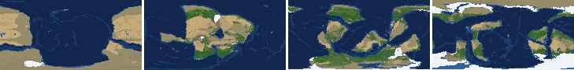
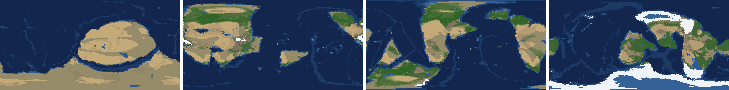
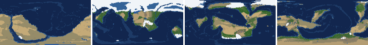
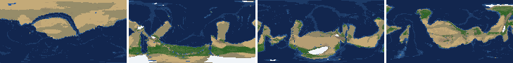
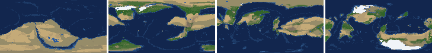
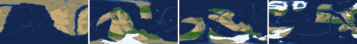
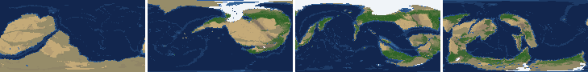
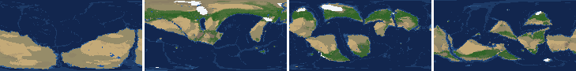

# Health sweep 2026-10-16 07:46

Commit af5f15c. 8 runs (default params, `--every 4`) at 8 workers x 1 numba threads; simulations 10.0 min wall. Made by `tools/health.py` (PW-246).

## Runs

| seed | L | Myr | run | sim s | trees / flowering trees from | dT range C | peaks > 9.5 km | giant-lake frames % | crust volume end/start | ice SL < -150 m % | <= 4 plates % |
|---|---|---|---|---|---|---|---|---|---|---|---|
| 1 | 6 | 500 | 4464fb | 434 | 132 / 412 | 10.8 | 0 | 8.0 | 0.973 | 0.0 | 0.0 |
| 2 | 6 | 500 | 1885a5 | 445 | 140 / 396 | 20.3 | 0 | 3.5 | 0.969 | 0.0 | 0.0 |
| 11 | 6 | 500 | 5c8435 | 545 | 128 / 372 | 18.0 | 0 | 24.8 | 0.98 | 7.1 | 0.0 |
| 21 | 6 | 500 | 899345 | 372 | 136 / 404 | 8.0 | 0 | 9.7 | 0.974 | 0.0 | 0.0 |
| 3199 | 6 | 500 | 6868b4 | 433 | 132 / 376 | 12.0 | 0 | 0.9 | 0.965 | 0.0 | 0.0 |
| 42 | 6 | 500 | 1d7fb2 | 601 | 116 / 404 | 13.3 | 0 | 8.0 | 0.951 | 0.0 | 0.0 |
| 77 | 6 | 500 | 8e458b | 552 | 124 / 416 | 9.8 | 0 | 11.5 | 0.957 | 0.0 | 0.0 |
| 505 | 6 | 500 | 32b177 | 426 | 132 / 416 | 7.5 | 0 | 14.2 | 0.957 | 0.0 | 0.0 |

## Medians by seed (after 50 Myr; tree cover after forests, NPP after flowering trees appear)

| seed | L | land_pct | cont_pct | cont_km | plates | ocean_age | speed | sea_level | sea_ice_m | ice_pct | temp | co2 | dry_pct | inland_pct | lake_pct | lake_max_mkm2 | max_elev_km | trees_pct | npp | landmasses | largest_pct |
|---|---|---|---|---|---|---|---|---|---|---|---|---|---|---|---|---|---|---|---|---|---|
| 1 | 6 | 33.5 | 40.5 | 33.7 | 11.0 | 57.6 | 4.4 | -51.3 | -2.4 | 0.4 | 15.5 | -0.2 | 28.2 | 4.6 | 0.7 | 0.2 | 5.3 | 27.5 | 314.2 | 5.0 | 25.9 |
| 2 | 6 | 33.6 | 39.3 | 34.6 | 10.0 | 55.2 | 4.6 | -41.5 | -1.4 | 0.3 | 15.1 | -0.1 | 31.9 | 4.9 | 0.5 | 0.1 | 6.2 | 22.9 | 324.1 | 7.0 | 21.5 |
| 11 | 6 | 32.4 | 39.1 | 34.7 | 10.0 | 53.4 | 4.5 | -34.1 | -18.4 | 2.9 | 13.3 | -0.5 | 26.4 | 5.1 | 0.5 | 0.1 | 4.8 | 31.0 | 320.6 | 7.0 | 25.5 |
| 21 | 6 | 33.4 | 40.3 | 34.0 | 10.0 | 56.9 | 4.4 | -43.0 | -3.1 | 0.6 | 15.9 | -0.4 | 34.9 | 5.3 | 0.4 | 0.1 | 6.0 | 20.8 | 398.2 | 6.0 | 31.6 |
| 3199 | 6 | 33.1 | 40.0 | 33.9 | 10.0 | 54.9 | 4.2 | -11.4 | -3.6 | 0.5 | 15.0 | -0.2 | 34.6 | 4.6 | 0.3 | 0.1 | 5.3 | 23.9 | 219.4 | 7.0 | 19.7 |
| 42 | 6 | 33.5 | 39.4 | 34.3 | 12.0 | 54.3 | 4.6 | -22.9 | -9.4 | 1.9 | 14.1 | -0.3 | 29.3 | 3.7 | 0.4 | 0.1 | 5.2 | 23.3 | 344.4 | 6.0 | 28.8 |
| 77 | 6 | 32.6 | 39.2 | 34.5 | 11.0 | 57.6 | 4.1 | -65.8 | -17.7 | 3.0 | 12.5 | -0.3 | 34.1 | 4.4 | 0.5 | 0.1 | 5.9 | 23.9 | 342.4 | 8.0 | 19.0 |
| 505 | 6 | 33.6 | 40.1 | 33.8 | 13.0 | 48.6 | 4.5 | 37.4 | -4.7 | 0.7 | 15.0 | -0.2 | 31.0 | 3.9 | 0.4 | 0.1 | 5.0 | 26.5 | 390.9 | 8.0 | 20.7 |

Measured on the run's keyframes (no slicing). A keyframe's rivers and lakes are routed on its own terrain (PW-239), so `inland_raw_pct` (every routed end on land, as highlights counts it) and `inland_pct` (ends that are closed lakes, salt pans or real pits) agree but for ends under land ice. Land ice and land shares use cells (near-equal area).

## Envelopes

| metric | low | high | Earth | source |
|---|---|---|---|---|
| land, % of surface (`land_pct`) | 22 | 42 | 29.20 | tests/test_envelopes.py (22-42%); Earth 29.2% |
| continental crust, % of surface (`cont_pct`) | 33 | 50 | 41 | tests/test_envelopes.py (33-50%); Earth ~41% with shelves (Cogley 1984) |
| mean continental crust thickness, km (`cont_km`) | 31 | 40 | 39 | target 35 km (PW-238, continental_thickness); Earth ~39 km (Christensen & Mooney 1995); known thinning to 32-33 km (PW-046) |
| plates (`plates`) | 5 | 30 | 15 | tests/test_envelopes.py (5-30; max_plates 30); Earth 7 major + ~8 minor; <= 4 is the PW-191 collapse |
| mean ocean-floor age, Myr (`ocean_age`) | 25 | 120 | 64 | tests/test_envelopes.py (25-120); Earth ~64 Myr (Mueller et al. 2008); PW-051 |
| mean plate speed, cm/yr (`speed`) | 2 | 9 | 4.50 | tests/test_envelopes.py (2-9 cm/yr); Earth ~4-5 |
| sea level, m (ice + ocean basins) (`sea_level`) | -250 | 300 | 0 | Phanerozoic ~-130 (LGM) .. +250 m (earth.py; Haq & Schutter 2008); -250: PW-240's hard goal |
| sea level from land ice, m (`sea_ice_m`) | -250 | - | 0 | Earth LGM ~-130 m; PW-240 goal -150 m typical / -250 m worst |
| land ice, % of surface (`ice_pct`) | - | 10 | 3.10 | Earth 3.1% now (earth.EARTH_ICE), ~7-8% at the LGM |
| global mean temperature, C (`temp`) | 8 | 30 | 14.50 | Earth 14.5 C; LGM ~8 C (Tierney et al. 2020); Phanerozoic hothouses to ~30 C (Scotese et al. 2021) |
| CO2 index (ln source/sink) (`co2`) | -1.5 | 1.5 | 0.00 | the forcing's clip in earth.py (+-1.5); Earth 0 |
| arid (Koppen B), % of land (`dry_pct`) | 12 | 45 | 30 | tests/test_envelopes.py (12-45%); Earth ~30% (Beck et al. 2018) |
| land draining inland, % of ice-free land (to a closed lake, salt pan or real pit) (`inland_pct`) | 8 | 30 | 18 | Earth ~18% (overview 2.9); L6 known ~9.5-11% (PW-054, PW-243). `inland_raw_pct` (not checked) follows the stored `downstream` to any end, as highlights does; since PW-239 the two agree but for ends under land ice |
| lakes, % of land (`lake_pct`) | 0.2 | 3.0 | 1.80 | Earth ~1.8% of ice-free land (HydroLAKES, Messager et al. 2016); generated L6 worlds 0.5-1% |
| largest lake, million km2 (`lake_max_mkm2`) | - | 1.0 | 0.37 | Caspian 0.37 Mkm2; 1 Mkm2 = the overview's giant lake (2.9) |
| highest peak, km (`max_elev_km`) | - | 9.5 | 8.85 | Everest 8.85 km; PW-172 (spikes above ~9.5 km) |
| tree cover, % of ice-free land (after forests appear) (`trees_pct`) | 10 | 50 | 30 | Earth ~30% potential canopy (forest 55-60 of ~130 Mkm2, overview 2.18) |
| land NPP, g C/m2/yr (after flowering trees appear) (`npp`) | 200 | 700 | 430 | Earth ~56 Pg C/yr over ~130 Mkm2 = ~430; the model on Earth's terrain 50 Pg C/yr, ~385 (overview 2.18). Before flowering trees (plant group 4) stand-ins grow at 70%, so runs sit at ~150-280 |
| landmasses (>= 3 cells) (`landmasses`) | 3 | 80 | - | loose: a lone supercontinent or a shattered archipelago |
| largest landmass, % of surface (`largest_pct`) | 5 | 35 | 16.60 | Afro-Eurasia 16.6%; a Pangaea ~30% (scorecard largest_max) |
| global temperature range over the run, C (`dT_range`, per run) | - | 25 | 25 | Phanerozoic 11-36 C (Scotese et al. 2021) |
| keyframes with a peak above 9.5 km (`peak_frames`, per run) | - | 0 | 0 | PW-172 (L7 seed 3199: 3 of 251) |
| % of keyframes with a lake over 1 Mkm2 (`giant_lake_frames`, per run) | - | 5 | 0 | overview 2.9 (L6: 3 of ~150 frames) |
| continental crust volume, end / start (`volume_ratio`, per run) | 0.9 | 1.1 | 1.0 | scorecard volume_ratio (x1.006) |
| % of keyframes with ice sea level below -150 m (`sea_ice_below_150`, per run) | - | 10 | 0 | PW-240 |
| % of keyframes with <= 4 plates (`low_plates`, per run) | - | 2 | 0 | PW-191 (L7 seed 21: 1%) |

## Top outliers (of 172 spells; severity = excess / band width x (0.2 + share of the run))

| seed | L | metric | Myr | frames | worst | envelope | severity |
|---|---|---|---|---|---|---|---|
| 11 | 6 | giant_lake_frames | run | - | 24.80 | -..5 | 3.96 |
| 21 | 6 | lake_max_mkm2 | 208-208 | 1 | 19.05 | -..1.0 | 3.754 |
| 21 | 6 | lake_max_mkm2 | 260-260 | 1 | 17.87 | -..1.0 | 3.508 |
| 21 | 6 | lake_max_mkm2 | 180-184 | 2 | 17.17 | -..1.0 | 3.491 |
| 21 | 6 | lake_max_mkm2 | 220-220 | 1 | 17.73 | -..1.0 | 3.479 |
| 21 | 6 | lake_max_mkm2 | 196-196 | 1 | 17.15 | -..1.0 | 3.358 |
| 505 | 6 | giant_lake_frames | run | - | 14.20 | -..5 | 1.84 |
| 11 | 6 | lake_max_mkm2 | 376-412 | 10 | 7.21 | -..1.0 | 1.735 |
| 77 | 6 | giant_lake_frames | run | - | 11.50 | -..5 | 1.3 |
| 505 | 6 | lake_max_mkm2 | 396-408 | 4 | 5.47 | -..1.0 | 1.035 |
| 42 | 6 | lake_max_mkm2 | 80-96 | 5 | 5.14 | -..1.0 | 0.993 |
| 1 | 6 | lake_max_mkm2 | 380-380 | 1 | 5.76 | -..1.0 | 0.991 |
| 11 | 6 | lake_max_mkm2 | 160-200 | 11 | 4.37 | -..1.0 | 0.968 |
| 21 | 6 | giant_lake_frames | run | - | 9.70 | -..5 | 0.94 |
| 2 | 6 | lake_max_mkm2 | 116-116 | 1 | 5.22 | -..1.0 | 0.877 |
| 505 | 6 | lake_max_mkm2 | 420-424 | 2 | 4.31 | -..1.0 | 0.714 |
| 21 | 6 | lake_pct | 260-260 | 1 | 12.21 | 0.2..3.0 | 0.684 |
| 21 | 6 | lake_pct | 208-208 | 1 | 12.06 | 0.2..3.0 | 0.673 |
| 21 | 6 | lake_pct | 220-220 | 1 | 11.70 | 0.2..3.0 | 0.646 |
| 42 | 6 | lake_max_mkm2 | 316-316 | 1 | 4.02 | -..1.0 | 0.628 |
| 1 | 6 | giant_lake_frames | run | - | 8.00 | -..5 | 0.6 |
| 42 | 6 | giant_lake_frames | run | - | 8.00 | -..5 | 0.6 |
| 2 | 6 | lake_max_mkm2 | 492-500 | 3 | 3.61 | -..1.0 | 0.584 |
| 21 | 6 | lake_pct | 180-184 | 2 | 10.42 | 0.2..3.0 | 0.572 |
| 21 | 6 | lake_pct | 196-196 | 1 | 10.66 | 0.2..3.0 | 0.569 |
| 21 | 6 | lake_max_mkm2 | 68-72 | 2 | 3.59 | -..1.0 | 0.558 |
| 11 | 6 | lake_max_mkm2 | 300-300 | 1 | 3.42 | -..1.0 | 0.504 |
| 505 | 6 | lake_max_mkm2 | 360-360 | 1 | 3.16 | -..1.0 | 0.45 |
| 77 | 6 | lake_max_mkm2 | 476-480 | 2 | 3.06 | -..1.0 | 0.445 |
| 1 | 6 | lake_max_mkm2 | 220-220 | 1 | 2.95 | -..1.0 | 0.406 |

## Per seed: min / median / max after the 50 Myr spin-up, and spells outside the envelopes

### Seed 1, L6 (run 4464fb)

*At 48, 200, 348, 500 Myr: sea by depth, land green by tree cover / tan where arid, shaded by height, ice white, lakes blue.*

| metric | min | median | max | outside (Myr: worst) |
|---|---|---|---|---|
| land_pct | 32.17 | 33.47 | 38.31 |  |
| cont_pct | 37.09 | 40.46 | 42.69 |  |
| cont_km | 32.76 | 33.71 | 36.54 |  |
| plates | 6.00 | 11.00 | 17.00 |  |
| ocean_age | 31.70 | 57.60 | 72.30 |  |
| speed | 3.08 | 4.37 | 7.59 |  |
| sea_level | -184.30 | -51.30 | 199.90 |  |
| sea_ice_m | -117.10 | -2.40 | -0.00 |  |
| ice_pct | 0.00 | 0.40 | 7.10 |  |
| temp | 9.40 | 15.50 | 20.20 |  |
| co2 | -1.41 | -0.22 | 0.37 |  |
| dry_pct | 9.54 | 28.18 | 47.18 | 60-60: 45.28; 208-248: 47.18; 444-464: 9.54; 480-480: 11.98 |
| inland_pct | 0.87 | 4.60 | 20.14 | 68-168: 1.47; 180-180: 5.11; 212-500: 0.87 |
| lake_pct | 0.03 | 0.72 | 4.13 | 52-60: 0.09; 72-80: 0.03; 100-104: 0.08; 380-380: 4.13 |
| lake_max_mkm2 | 0.01 | 0.22 | 5.76 | 64-64: 1.11; 164-172: 2.73; 220-220: 2.95; 300-300: 1.68; +2 more |
| max_elev_km | 1.70 | 5.32 | 8.25 |  |
| trees_pct | 14.26 | 27.46 | 43.72 |  |
| npp | 204.90 | 314.20 | 361.90 |  |
| landmasses | 1.00 | 5.00 | 10.00 | 208-212: 1; 304-304: 2 |
| largest_pct | 12.10 | 25.90 | 33.70 |  |

### Seed 2, L6 (run 1885a5)

*At 48, 200, 348, 500 Myr: sea by depth, land green by tree cover / tan where arid, shaded by height, ice white, lakes blue.*

| metric | min | median | max | outside (Myr: worst) |
|---|---|---|---|---|
| land_pct | 31.96 | 33.65 | 38.01 |  |
| cont_pct | 37.15 | 39.28 | 43.14 |  |
| cont_km | 32.31 | 34.60 | 36.28 |  |
| plates | 6.00 | 10.00 | 17.00 |  |
| ocean_age | 31.90 | 55.20 | 81.20 |  |
| speed | 1.97 | 4.60 | 7.52 | 172-172: 1.97 |
| sea_level | -395.00 | -41.50 | 214.30 | 224-236: -254.60; 480-500: -395.00 |
| sea_ice_m | -141.10 | -1.40 | -0.00 |  |
| ice_pct | 0.00 | 0.30 | 9.90 |  |
| temp | 2.70 | 15.10 | 23.00 | 480-500: 2.70 |
| co2 | -1.62 | -0.12 | 0.31 | 176-192: -1.62 |
| dry_pct | 18.39 | 31.87 | 50.16 | 60-60: 45.13; 88-88: 46.09; 232-288: 50.16 |
| inland_pct | 0.30 | 4.93 | 18.47 | 56-180: 0.30; 196-212: 5.60; 228-488: 0.76 |
| lake_pct | 0.06 | 0.47 | 3.38 | 68-80: 0.06; 100-132: 3.38 |
| lake_max_mkm2 | 0.03 | 0.10 | 5.22 | 116-116: 5.22; 492-500: 3.61 |
| max_elev_km | 1.52 | 6.24 | 8.50 |  |
| trees_pct | 7.16 | 22.93 | 44.00 | 272-288: 7.16 |
| npp | 180.60 | 324.10 | 455.70 | 396-408: 180.60 |
| landmasses | 2.00 | 7.00 | 12.00 | 52-64: 2 |
| largest_pct | 10.80 | 21.50 | 32.60 |  |

### Seed 11, L6 (run 5c8435)

*At 48, 200, 348, 500 Myr: sea by depth, land green by tree cover / tan where arid, shaded by height, ice white, lakes blue.*

| metric | min | median | max | outside (Myr: worst) |
|---|---|---|---|---|
| land_pct | 29.00 | 32.40 | 37.66 |  |
| cont_pct | 37.53 | 39.08 | 42.95 |  |
| cont_km | 32.76 | 34.73 | 35.80 |  |
| plates | 7.00 | 10.00 | 18.00 |  |
| ocean_age | 32.10 | 53.40 | 74.90 |  |
| speed | 2.62 | 4.50 | 7.74 |  |
| sea_level | -586.20 | -34.10 | 230.30 | 172-228: -586.20; 400-452: -325.10 |
| sea_ice_m | -218.70 | -18.40 | -0.00 |  |
| ice_pct | 0.00 | 2.90 | 15.70 | 176-220: 15.70 |
| temp | 1.60 | 13.30 | 19.60 | 148-216: 1.60 |
| co2 | -0.90 | -0.48 | 0.07 |  |
| dry_pct | 15.39 | 26.42 | 44.83 |  |
| inland_pct | 0.25 | 5.13 | 24.80 | 72-156: 0.25; 172-172: 7.07; 192-368: 0.99; 420-500: 1.11 |
| lake_pct | 0.07 | 0.54 | 7.42 | 80-92: 0.13; 104-104: 0.07; 120-124: 0.08; 168-168: 3.24; +2 more |
| lake_max_mkm2 | 0.03 | 0.12 | 7.21 | 68-68: 1.34; 108-112: 1.56; 160-200: 4.37; 224-224: 1.61; +3 more |
| max_elev_km | 1.39 | 4.78 | 9.00 |  |
| trees_pct | 12.75 | 31.03 | 49.74 |  |
| npp | 246.00 | 320.60 | 394.00 |  |
| landmasses | 2.00 | 7.00 | 14.00 | 64-64: 2 |
| largest_pct | 12.30 | 25.50 | 30.90 |  |

### Seed 21, L6 (run 899345)

*At 48, 200, 348, 500 Myr: sea by depth, land green by tree cover / tan where arid, shaded by height, ice white, lakes blue.*

| metric | min | median | max | outside (Myr: worst) |
|---|---|---|---|---|
| land_pct | 32.23 | 33.41 | 37.60 |  |
| cont_pct | 36.93 | 40.30 | 43.25 |  |
| cont_km | 32.57 | 34.02 | 36.56 |  |
| plates | 8.00 | 10.00 | 16.00 |  |
| ocean_age | 35.00 | 56.90 | 84.80 |  |
| speed | 2.09 | 4.44 | 7.01 |  |
| sea_level | -267.20 | -43.00 | 195.40 | 280-320: -267.20 |
| sea_ice_m | -9.80 | -3.10 | -0.00 |  |
| ice_pct | 0.00 | 0.60 | 2.40 |  |
| temp | 12.00 | 15.90 | 20.00 |  |
| co2 | -1.11 | -0.41 | 0.01 |  |
| dry_pct | 11.48 | 34.94 | 45.59 | 60-60: 45.59; 244-244: 11.48 |
| inland_pct | 0.72 | 5.27 | 28.89 | 64-64: 7.29; 76-176: 0.72; 188-292: 1.45; 304-332: 3.97; +2 more |
| lake_pct | 0.03 | 0.39 | 12.21 | 52-52: 0.10; 80-80: 0.16; 92-128: 0.03; 140-144: 0.14; +6 more |
| lake_max_mkm2 | 0.01 | 0.10 | 19.05 | 68-72: 3.59; 88-88: 1.44; 132-136: 1.53; 180-184: 17.17; +4 more |
| max_elev_km | 1.69 | 5.99 | 7.57 |  |
| trees_pct | 13.13 | 20.76 | 40.19 |  |
| npp | 212.10 | 398.20 | 443.30 |  |
| landmasses | 1.00 | 6.00 | 14.00 | 264-276: 1; 300-312: 2; 476-476: 2 |
| largest_pct | 13.90 | 31.60 | 34.00 |  |

### Seed 3199, L6 (run 6868b4)

*At 48, 200, 348, 500 Myr: sea by depth, land green by tree cover / tan where arid, shaded by height, ice white, lakes blue.*

| metric | min | median | max | outside (Myr: worst) |
|---|---|---|---|---|
| land_pct | 32.32 | 33.06 | 38.35 |  |
| cont_pct | 38.44 | 40.02 | 43.41 |  |
| cont_km | 32.22 | 33.92 | 35.31 |  |
| plates | 7.00 | 10.00 | 15.00 |  |
| ocean_age | 36.00 | 54.90 | 73.00 |  |
| speed | 2.71 | 4.18 | 7.34 |  |
| sea_level | -191.10 | -11.40 | 188.10 |  |
| sea_ice_m | -67.10 | -3.60 | -0.00 |  |
| ice_pct | 0.00 | 0.50 | 4.00 |  |
| temp | 9.60 | 15.00 | 21.60 |  |
| co2 | -0.76 | -0.22 | 0.02 |  |
| dry_pct | 23.78 | 34.56 | 49.03 | 64-68: 49.03 |
| inland_pct | 0.53 | 4.62 | 10.06 | 52-56: 4.70; 68-500: 0.53 |
| lake_pct | 0.00 | 0.30 | 1.41 | 52-128: 0.00; 140-152: 0.11; 316-316: 0.16; 332-332: 0.19; +2 more |
| lake_max_mkm2 | 0.00 | 0.07 | 1.68 | 268-268: 1.68 |
| max_elev_km | 1.28 | 5.30 | 7.48 |  |
| trees_pct | 14.79 | 23.92 | 36.15 |  |
| npp | 187.90 | 219.45 | 324.80 | 376-380: 187.90; 396-428: 188.00 |
| landmasses | 2.00 | 7.00 | 13.00 | 52-68: 2 |
| largest_pct | 10.50 | 19.70 | 32.00 |  |

### Seed 42, L6 (run 1d7fb2)

*At 48, 200, 348, 500 Myr: sea by depth, land green by tree cover / tan where arid, shaded by height, ice white, lakes blue.*

| metric | min | median | max | outside (Myr: worst) |
|---|---|---|---|---|
| land_pct | 30.17 | 33.52 | 38.14 |  |
| cont_pct | 37.60 | 39.44 | 42.79 |  |
| cont_km | 32.71 | 34.26 | 36.02 |  |
| plates | 5.00 | 12.00 | 20.00 |  |
| ocean_age | 39.90 | 54.30 | 80.50 |  |
| speed | 2.49 | 4.59 | 7.39 |  |
| sea_level | -316.80 | -22.90 | 153.60 | 484-500: -316.80 |
| sea_ice_m | -81.60 | -9.40 | -0.00 |  |
| ice_pct | 0.00 | 1.90 | 7.10 |  |
| temp | 6.80 | 14.10 | 20.10 | 444-464: 6.80 |
| co2 | -0.98 | -0.32 | -0.05 |  |
| dry_pct | 18.51 | 29.32 | 47.62 | 244-264: 47.62 |
| inland_pct | 0.45 | 3.66 | 21.51 | 64-76: 0.59; 100-244: 0.45; 268-280: 4.14; 296-456: 0.64; +1 more |
| lake_pct | 0.03 | 0.40 | 4.45 | 52-72: 0.04; 96-104: 3.26; 316-316: 4.45; 364-364: 0.14; +2 more |
| lake_max_mkm2 | 0.01 | 0.10 | 5.14 | 64-64: 1.05; 80-96: 5.14; 120-120: 2.90; 192-192: 2.06; +1 more |
| max_elev_km | 1.39 | 5.18 | 8.50 |  |
| trees_pct | 14.50 | 23.29 | 35.49 |  |
| npp | 311.30 | 344.40 | 385.80 |  |
| landmasses | 1.00 | 6.00 | 12.00 | 292-316: 1 |
| largest_pct | 10.70 | 28.80 | 34.20 |  |

### Seed 77, L6 (run 8e458b)

*At 48, 200, 348, 500 Myr: sea by depth, land green by tree cover / tan where arid, shaded by height, ice white, lakes blue.*

| metric | min | median | max | outside (Myr: worst) |
|---|---|---|---|---|
| land_pct | 28.92 | 32.63 | 38.01 |  |
| cont_pct | 36.76 | 39.20 | 42.40 |  |
| cont_km | 33.01 | 34.51 | 36.97 |  |
| plates | 7.00 | 11.00 | 14.00 |  |
| ocean_age | 35.90 | 57.60 | 78.40 |  |
| speed | 2.20 | 4.13 | 8.14 |  |
| sea_level | -284.90 | -65.80 | 151.40 | 284-308: -284.90 |
| sea_ice_m | -81.50 | -17.70 | -0.00 |  |
| ice_pct | 0.00 | 3.00 | 7.80 |  |
| temp | 7.60 | 12.50 | 17.40 | 144-144: 7.80; 288-296: 7.60 |
| co2 | -0.88 | -0.30 | 0.07 |  |
| dry_pct | 18.07 | 34.14 | 49.07 | 168-176: 45.54; 188-244: 49.07 |
| inland_pct | 0.59 | 4.41 | 21.77 | 72-92: 3.86; 108-164: 1.39; 184-292: 3.70; 304-500: 0.59 |
| lake_pct | 0.04 | 0.50 | 2.79 | 52-60: 0.09; 108-140: 0.04; 304-304: 0.18 |
| lake_max_mkm2 | 0.03 | 0.15 | 3.06 | 56-56: 1.11; 80-84: 2.06; 104-112: 2.17; 156-156: 1.97; +6 more |
| max_elev_km | 1.58 | 5.94 | 8.05 |  |
| trees_pct | 18.10 | 23.94 | 41.11 |  |
| npp | 252.30 | 342.45 | 373.30 |  |
| landmasses | 2.00 | 8.00 | 15.00 | 52-68: 2 |
| largest_pct | 9.80 | 19.00 | 35.00 |  |

### Seed 505, L6 (run 32b177)

*At 48, 200, 348, 500 Myr: sea by depth, land green by tree cover / tan where arid, shaded by height, ice white, lakes blue.*

| metric | min | median | max | outside (Myr: worst) |
|---|---|---|---|---|
| land_pct | 32.16 | 33.62 | 37.84 |  |
| cont_pct | 37.83 | 40.07 | 43.16 |  |
| cont_km | 32.44 | 33.79 | 35.86 |  |
| plates | 7.00 | 13.00 | 16.00 |  |
| ocean_age | 34.50 | 48.60 | 63.00 |  |
| speed | 2.89 | 4.55 | 7.08 |  |
| sea_level | -80.90 | 37.40 | 200.10 |  |
| sea_ice_m | -16.90 | -4.70 | -0.00 |  |
| ice_pct | 0.00 | 0.70 | 2.00 |  |
| temp | 11.90 | 15.00 | 19.40 |  |
| co2 | -1.16 | -0.24 | 0.43 |  |
| dry_pct | 20.99 | 31.02 | 43.11 |  |
| inland_pct | 0.26 | 3.94 | 16.57 | 60-272: 0.26; 288-500: 1.28 |
| lake_pct | 0.01 | 0.45 | 3.56 | 60-60: 0.01; 76-76: 0.10; 88-124: 0.02; 348-356: 0.05; +4 more |
| lake_max_mkm2 | 0.01 | 0.11 | 5.47 | 56-56: 1.56; 68-80: 2.52; 92-92: 2.75; 172-172: 2.68; +5 more |
| max_elev_km | 1.73 | 4.99 | 8.43 |  |
| trees_pct | 13.78 | 26.52 | 36.95 |  |
| npp | 178.00 | 390.95 | 410.30 | 416-432: 178.00 |
| landmasses | 2.00 | 8.00 | 13.00 | 52-68: 2 |
| largest_pct | 7.60 | 20.70 | 34.60 |  |

## Determinism

(not run)
