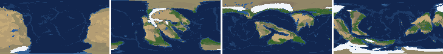
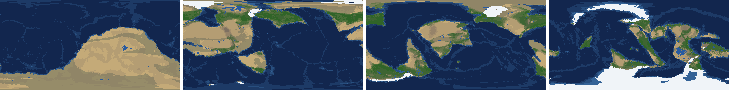
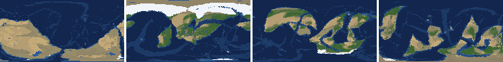
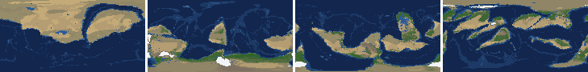
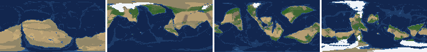
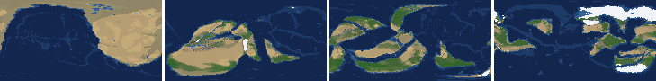
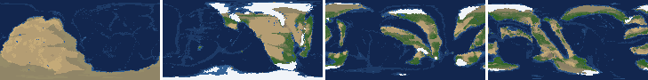
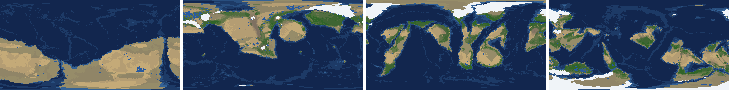

# Health sweep 2026-10-15 19:39

Commit a26c7eb. 8 runs (default params, `--every 4`) at 8 workers x 1 numba threads; simulations 5.3 min wall. Made by `tools/health.py` (PW-246).

## Runs

| seed | L | Myr | run | sim s | trees / flowering trees from | dT range C | peaks > 9.5 km | giant-lake frames % | crust volume end/start | ice SL < -150 m % | <= 4 plates % |
|---|---|---|---|---|---|---|---|---|---|---|---|
| 1 | 6 | 500 | 779dca | 318 | 132 / 412 | 10.9 | 0 | 15.0 | 0.908 | 0.0 | 0.0 |
| 2 | 6 | 500 | 529ad5 | 316 | 140 / 396 | 18.9 | 0 | 10.6 | 0.889 | 0.0 | 0.0 |
| 11 | 6 | 500 | e1da0a | 311 | 128 / 372 | 17.9 | 0 | 7.1 | 0.852 | 9.7 | 0.0 |
| 21 | 6 | 500 | c56b23 | 314 | 136 / 404 | 10.9 | 0 | 17.7 | 0.889 | 0.0 | 0.0 |
| 3199 | 6 | 500 | 62f493 | 318 | 132 / 376 | 10.8 | 0 | 11.5 | 0.894 | 0.0 | 0.0 |
| 42 | 6 | 500 | f014a9 | 314 | 116 / 404 | 12.9 | 0 | 17.7 | 0.88 | 0.0 | 0.0 |
| 77 | 6 | 500 | e18705 | 311 | 124 / 416 | 11.6 | 0 | 15.9 | 0.874 | 0.0 | 0.0 |
| 505 | 6 | 500 | 37fd5b | 316 | 132 / 416 | 9.4 | 0 | 13.3 | 0.886 | 0.0 | 0.0 |

## Medians by seed (after 50 Myr; tree cover after forests, NPP after flowering trees appear)

| seed | L | land_pct | cont_pct | cont_km | plates | ocean_age | speed | sea_level | sea_ice_m | ice_pct | temp | co2 | dry_pct | inland_pct | lake_pct | lake_max_mkm2 | max_elev_km | trees_pct | npp | landmasses | largest_pct |
|---|---|---|---|---|---|---|---|---|---|---|---|---|---|---|---|---|---|---|---|---|---|
| 1 | 6 | 30.3 | 38.1 | 35.9 | 13.0 | 35.4 | 7.2 | 62.6 | -9.7 | 1.6 | 15.1 | -0.3 | 33.4 | 12.6 | 1.3 | 0.4 | 5.8 | 27.5 | 345.8 | 5.0 | 23.5 |
| 2 | 6 | 31.3 | 38.3 | 35.4 | 13.0 | 36.0 | 6.4 | 51.9 | -2.4 | 0.5 | 15.5 | -0.2 | 40.1 | 10.0 | 1.1 | 0.2 | 6.8 | 26.0 | 363.8 | 5.0 | 20.8 |
| 11 | 6 | 31.6 | 40.2 | 34.3 | 12.0 | 40.6 | 6.3 | -15.4 | -6.0 | 1.1 | 13.5 | -0.4 | 30.6 | 5.4 | 0.6 | 0.1 | 4.7 | 31.5 | 372.7 | 6.0 | 17.4 |
| 21 | 6 | 31.0 | 38.3 | 35.4 | 11.0 | 35.9 | 6.1 | 41.2 | -5.6 | 1.0 | 16.7 | -0.2 | 33.9 | 10.3 | 1.1 | 0.3 | 6.8 | 20.7 | 338.3 | 7.0 | 17.6 |
| 3199 | 6 | 30.4 | 38.7 | 35.2 | 13.0 | 37.4 | 6.4 | 68.9 | -8.5 | 1.7 | 15.8 | -0.0 | 37.0 | 10.0 | 0.9 | 0.2 | 5.7 | 27.9 | 346.4 | 5.0 | 20.2 |
| 42 | 6 | 32.2 | 38.7 | 34.9 | 12.0 | 38.4 | 6.8 | 46.4 | -0.9 | 0.2 | 14.9 | -0.4 | 41.8 | 8.2 | 0.9 | 0.2 | 5.6 | 24.2 | 419.0 | 5.0 | 22.1 |
| 77 | 6 | 30.9 | 39.2 | 34.6 | 10.0 | 39.2 | 6.1 | -7.1 | -17.0 | 2.3 | 12.2 | -0.3 | 37.4 | 8.3 | 0.7 | 0.2 | 6.9 | 30.9 | 375.9 | 7.0 | 18.8 |
| 505 | 6 | 30.0 | 39.5 | 34.4 | 13.0 | 37.8 | 6.4 | 25.7 | -11.5 | 2.3 | 15.0 | -0.3 | 31.0 | 8.4 | 1.0 | 0.3 | 6.0 | 26.2 | 375.4 | 6.0 | 15.5 |

Measured on the run's keyframes (no slicing). Caveats: a keyframe's lakes and `downstream` come from the terrain before that step's erosion and deposition (PW-239), so `inland_raw_pct` (every routed end on land, as highlights counts it) runs ~2-3x `inland_pct` (ends that are closed lakes, salt pans or real pits on the frame's own elevation); lake shares are the run's lakes during the step. Land ice and land shares use cells (near-equal area).

## Envelopes

| metric | low | high | Earth | source |
|---|---|---|---|---|
| land, % of surface (`land_pct`) | 22 | 42 | 29.20 | tests/test_envelopes.py (22-42%); Earth 29.2% |
| continental crust, % of surface (`cont_pct`) | 33 | 50 | 41 | tests/test_envelopes.py (33-50%); Earth ~41% with shelves (Cogley 1984) |
| mean continental crust thickness, km (`cont_km`) | 31 | 40 | 39 | target 35 km (PW-238, continental_thickness); Earth ~39 km (Christensen & Mooney 1995); known thinning to 32-33 km (PW-046) |
| plates (`plates`) | 5 | 30 | 15 | tests/test_envelopes.py (5-30; max_plates 30); Earth 7 major + ~8 minor; <= 4 is the PW-191 collapse |
| mean ocean-floor age, Myr (`ocean_age`) | 25 | 120 | 64 | tests/test_envelopes.py (25-120); Earth ~64 Myr (Mueller et al. 2008); PW-051 |
| mean plate speed, cm/yr (`speed`) | 2 | 9 | 4.50 | tests/test_envelopes.py (2-9 cm/yr); Earth ~4-5 |
| sea level, m (ice + ocean basins) (`sea_level`) | -250 | 300 | 0 | Phanerozoic ~-130 (LGM) .. +250 m (earth.py; Haq & Schutter 2008); -250: PW-240's hard goal |
| sea level from land ice, m (`sea_ice_m`) | -250 | - | 0 | Earth LGM ~-130 m; PW-240 goal -150 m typical / -250 m worst |
| land ice, % of surface (`ice_pct`) | - | 10 | 3.10 | Earth 3.1% now (earth.EARTH_ICE), ~7-8% at the LGM |
| global mean temperature, C (`temp`) | 8 | 30 | 14.50 | Earth 14.5 C; LGM ~8 C (Tierney et al. 2020); Phanerozoic hothouses to ~30 C (Scotese et al. 2021) |
| CO2 index (ln source/sink) (`co2`) | -1.5 | 1.5 | 0.00 | the forcing's clip in earth.py (+-1.5); Earth 0 |
| arid (Koppen B), % of land (`dry_pct`) | 12 | 45 | 30 | tests/test_envelopes.py (12-45%); Earth ~30% (Beck et al. 2018) |
| land draining inland, % of ice-free land (to a closed lake, salt pan or real pit) (`inland_pct`) | 8 | 30 | 18 | Earth ~18% (overview 2.9); L6 known ~9.5-11% (PW-054, PW-243). `inland_raw_pct` (not checked) follows the stored `downstream` to any end, as highlights does: stale by a step (PW-239) |
| lakes, % of land (`lake_pct`) | 0.2 | 3.0 | 1.80 | Earth ~1.8% of ice-free land (HydroLAKES, Messager et al. 2016); generated L6 worlds 0.5-1% |
| largest lake, million km2 (`lake_max_mkm2`) | - | 1.0 | 0.37 | Caspian 0.37 Mkm2; 1 Mkm2 = the overview's giant lake (2.9) |
| highest peak, km (`max_elev_km`) | - | 9.5 | 8.85 | Everest 8.85 km; PW-172 (spikes above ~9.5 km) |
| tree cover, % of ice-free land (after forests appear) (`trees_pct`) | 10 | 50 | 30 | Earth ~30% potential canopy (forest 55-60 of ~130 Mkm2, overview 2.18) |
| land NPP, g C/m2/yr (after flowering trees appear) (`npp`) | 200 | 700 | 430 | Earth ~56 Pg C/yr over ~130 Mkm2 = ~430; the model on Earth's terrain 50 Pg C/yr, ~385 (overview 2.18). Before flowering trees (plant group 4) stand-ins grow at 70%, so runs sit at ~150-280 |
| landmasses (>= 3 cells) (`landmasses`) | 3 | 80 | - | loose: a lone supercontinent or a shattered archipelago |
| largest landmass, % of surface (`largest_pct`) | 5 | 35 | 16.60 | Afro-Eurasia 16.6%; a Pangaea ~30% (scorecard largest_max) |
| global temperature range over the run, C (`dT_range`, per run) | - | 25 | 25 | Phanerozoic 11-36 C (Scotese et al. 2021) |
| keyframes with a peak above 9.5 km (`peak_frames`, per run) | - | 0 | 0 | PW-172 (L7 seed 3199: 3 of 251) |
| % of keyframes with a lake over 1 Mkm2 (`giant_lake_frames`, per run) | - | 5 | 0 | overview 2.9 (L6: 3 of ~150 frames) |
| continental crust volume, end / start (`volume_ratio`, per run) | 0.9 | 1.1 | 1.0 | scorecard volume_ratio (x1.006) |
| % of keyframes with ice sea level below -150 m (`sea_ice_below_150`, per run) | - | 10 | 0 | PW-240 |
| % of keyframes with <= 4 plates (`low_plates`, per run) | - | 2 | 0 | PW-191 (L7 seed 21: 1%) |

## Top outliers (of 229 spells; severity = excess / band width x (0.2 + share of the run))

| seed | L | metric | Myr | frames | worst | envelope | severity |
|---|---|---|---|---|---|---|---|
| 21 | 6 | giant_lake_frames | run | - | 17.70 | -..5 | 2.54 |
| 42 | 6 | giant_lake_frames | run | - | 17.70 | -..5 | 2.54 |
| 77 | 6 | giant_lake_frames | run | - | 15.90 | -..5 | 2.18 |
| 1 | 6 | giant_lake_frames | run | - | 15.00 | -..5 | 2.0 |
| 505 | 6 | giant_lake_frames | run | - | 13.30 | -..5 | 1.66 |
| 3199 | 6 | giant_lake_frames | run | - | 11.50 | -..5 | 1.3 |
| 2 | 6 | giant_lake_frames | run | - | 10.60 | -..5 | 1.12 |
| 3199 | 6 | lake_max_mkm2 | 288-288 | 1 | 5.95 | -..1.0 | 1.03 |
| 21 | 6 | lake_max_mkm2 | 324-332 | 2 | 4.91 | -..1.0 | 0.843 |
| 2 | 6 | lake_max_mkm2 | 364-372 | 2 | 4.22 | -..1.0 | 0.695 |
| 1 | 6 | lake_max_mkm2 | 432-436 | 2 | 4.11 | -..1.0 | 0.671 |
| 505 | 6 | lake_max_mkm2 | 144-148 | 2 | 3.98 | -..1.0 | 0.644 |
| 21 | 6 | lake_max_mkm2 | 144-160 | 5 | 3.64 | -..1.0 | 0.632 |
| 2 | 6 | lake_max_mkm2 | 132-144 | 3 | 3.59 | -..1.0 | 0.579 |
| 3199 | 6 | lake_max_mkm2 | 300-300 | 1 | 3.74 | -..1.0 | 0.569 |
| 1 | 6 | lake_max_mkm2 | 344-360 | 5 | 3.05 | -..1.0 | 0.492 |
| 2 | 6 | lake_max_mkm2 | 392-392 | 1 | 3.30 | -..1.0 | 0.478 |
| 505 | 6 | lake_max_mkm2 | 232-232 | 1 | 3.17 | -..1.0 | 0.452 |
| 42 | 6 | lake_max_mkm2 | 228-248 | 4 | 2.90 | -..1.0 | 0.441 |
| 42 | 6 | lake_max_mkm2 | 264-280 | 4 | 2.84 | -..1.0 | 0.426 |
| 11 | 6 | giant_lake_frames | run | - | 7.10 | -..5 | 0.42 |
| 1 | 6 | lake_max_mkm2 | 448-452 | 2 | 2.90 | -..1.0 | 0.41 |
| 11 | 6 | lake_max_mkm2 | 240-244 | 2 | 2.88 | -..1.0 | 0.405 |
| 1 | 6 | lake_max_mkm2 | 84-84 | 1 | 2.89 | -..1.0 | 0.393 |
| 505 | 6 | lake_max_mkm2 | 112-112 | 1 | 2.84 | -..1.0 | 0.382 |
| 3199 | 6 | lake_max_mkm2 | 240-240 | 1 | 2.79 | -..1.0 | 0.372 |
| 11 | 6 | lake_max_mkm2 | 52-64 | 4 | 2.37 | -..1.0 | 0.317 |
| 1 | 6 | dry_pct | 52-112 | 16 | 76.03 | 12..45 | 0.307 |
| 21 | 6 | lake_max_mkm2 | 372-380 | 2 | 2.40 | -..1.0 | 0.303 |
| 2 | 6 | lake_max_mkm2 | 500-500 | 1 | 2.34 | -..1.0 | 0.279 |

## Per seed: min / median / max after the 50 Myr spin-up, and spells outside the envelopes

### Seed 1, L6 (run 779dca)

*At 48, 200, 348, 500 Myr: sea by depth, land green by tree cover / tan where arid, shaded by height, ice white, lakes blue.*

| metric | min | median | max | outside (Myr: worst) |
|---|---|---|---|---|
| land_pct | 29.29 | 30.27 | 38.54 |  |
| cont_pct | 35.23 | 38.14 | 42.87 |  |
| cont_km | 34.30 | 35.93 | 38.62 |  |
| plates | 8.00 | 13.00 | 17.00 |  |
| ocean_age | 26.60 | 35.40 | 47.70 |  |
| speed | 5.31 | 7.15 | 10.55 | 100-148: 10.55 |
| sea_level | -64.30 | 62.60 | 172.80 |  |
| sea_ice_m | -58.10 | -9.70 | -0.00 |  |
| ice_pct | 0.00 | 1.60 | 4.70 |  |
| temp | 8.70 | 15.10 | 19.60 |  |
| co2 | -1.38 | -0.27 | 0.41 |  |
| dry_pct | 20.99 | 33.35 | 76.03 | 52-112: 76.03 |
| inland_pct | 1.88 | 12.61 | 42.91 | 72-84: 42.91; 120-156: 1.88; 320-348: 5.34; 440-444: 5.40; +2 more |
| lake_pct | 0.13 | 1.29 | 3.65 | 52-52: 0.13; 352-360: 3.65; 384-384: 3.03; 432-436: 3.47 |
| lake_max_mkm2 | 0.04 | 0.39 | 4.11 | 84-84: 2.89; 224-224: 1.02; 268-268: 1.02; 284-284: 1.10; +5 more |
| max_elev_km | 2.18 | 5.81 | 8.64 |  |
| trees_pct | 18.95 | 27.49 | 36.77 |  |
| npp | 201.80 | 345.80 | 380.90 |  |
| landmasses | 1.00 | 5.00 | 17.00 | 52-56: 1; 76-84: 2; 140-144: 2; 288-288: 2; +1 more |
| largest_pct | 10.60 | 23.50 | 38.60 | 52-88: 38.60 |

### Seed 2, L6 (run 529ad5)

*At 48, 200, 348, 500 Myr: sea by depth, land green by tree cover / tan where arid, shaded by height, ice white, lakes blue.*

| metric | min | median | max | outside (Myr: worst) |
|---|---|---|---|---|
| land_pct | 27.44 | 31.29 | 38.72 |  |
| cont_pct | 36.46 | 38.34 | 42.63 |  |
| cont_km | 34.06 | 35.40 | 36.64 |  |
| plates | 8.00 | 13.00 | 17.00 |  |
| ocean_age | 22.00 | 36.00 | 46.90 | 88-120: 22.00 |
| speed | 5.00 | 6.38 | 9.98 | 72-120: 9.98 |
| sea_level | -93.70 | 51.90 | 203.40 |  |
| sea_ice_m | -114.60 | -2.40 | -0.00 |  |
| ice_pct | 0.00 | 0.50 | 8.90 |  |
| temp | 3.90 | 15.50 | 22.80 | 480-500: 3.90 |
| co2 | -0.87 | -0.21 | 0.58 |  |
| dry_pct | 19.57 | 40.09 | 61.77 | 52-168: 61.77; 200-200: 45.46 |
| inland_pct | 3.72 | 9.98 | 34.96 | 56-56: 34.96; 72-72: 6.60; 96-132: 3.72; 160-160: 6.39; +6 more |
| lake_pct | 0.16 | 1.10 | 3.64 | 72-72: 0.20; 100-108: 0.16; 364-372: 3.64; 392-392: 3.24 |
| lake_max_mkm2 | 0.04 | 0.21 | 4.22 | 56-64: 2.18; 116-116: 1.32; 132-144: 3.59; 176-176: 1.82; +3 more |
| max_elev_km | 1.69 | 6.76 | 8.92 |  |
| trees_pct | 7.42 | 26.01 | 43.95 | 140-144: 7.42 |
| npp | 246.60 | 363.80 | 421.90 |  |
| landmasses | 1.00 | 5.00 | 14.00 | 52-80: 1; 244-264: 2; 436-436: 2 |
| largest_pct | 10.40 | 20.80 | 38.70 | 52-56: 38.70 |

### Seed 11, L6 (run e1da0a)

*At 48, 200, 348, 500 Myr: sea by depth, land green by tree cover / tan where arid, shaded by height, ice white, lakes blue.*

| metric | min | median | max | outside (Myr: worst) |
|---|---|---|---|---|
| land_pct | 29.56 | 31.60 | 37.76 |  |
| cont_pct | 38.66 | 40.24 | 42.35 |  |
| cont_km | 32.42 | 34.27 | 36.19 |  |
| plates | 9.00 | 12.00 | 18.00 |  |
| ocean_age | 19.00 | 40.60 | 64.20 | 60-112: 19.00 |
| speed | 4.55 | 6.27 | 10.73 | 52-112: 10.73 |
| sea_level | -340.60 | -15.40 | 202.90 | 184-216: -340.60 |
| sea_ice_m | -246.80 | -6.00 | -0.00 |  |
| ice_pct | 0.00 | 1.10 | 9.50 |  |
| temp | 2.70 | 13.50 | 20.60 | 168-216: 2.70 |
| co2 | -0.87 | -0.43 | 0.33 |  |
| dry_pct | 19.84 | 30.62 | 62.47 | 52-120: 62.47 |
| inland_pct | 1.48 | 5.39 | 24.96 | 120-160: 2.95; 176-232: 3.30; 248-248: 6.13; 264-288: 3.05; +1 more |
| lake_pct | 0.18 | 0.57 | 2.60 | 124-124: 0.18 |
| lake_max_mkm2 | 0.03 | 0.15 | 2.88 | 52-64: 2.37; 100-100: 1.96; 172-172: 1.88; 240-244: 2.88 |
| max_elev_km | 1.86 | 4.65 | 7.05 |  |
| trees_pct | 19.51 | 31.50 | 50.55 | 404-416: 50.55 |
| npp | 244.90 | 372.70 | 400.90 |  |
| landmasses | 3.00 | 6.00 | 11.00 |  |
| largest_pct | 8.50 | 17.40 | 34.40 |  |

### Seed 21, L6 (run c56b23)

*At 48, 200, 348, 500 Myr: sea by depth, land green by tree cover / tan where arid, shaded by height, ice white, lakes blue.*

| metric | min | median | max | outside (Myr: worst) |
|---|---|---|---|---|
| land_pct | 29.56 | 30.98 | 37.91 |  |
| cont_pct | 36.68 | 38.33 | 42.40 |  |
| cont_km | 32.89 | 35.44 | 37.58 |  |
| plates | 7.00 | 11.00 | 16.00 |  |
| ocean_age | 19.90 | 35.90 | 62.10 | 68-108: 19.90 |
| speed | 3.97 | 6.13 | 10.13 | 68-108: 10.13 |
| sea_level | -156.50 | 41.20 | 185.20 |  |
| sea_ice_m | -31.90 | -5.60 | -0.00 |  |
| ice_pct | 0.00 | 1.00 | 2.80 |  |
| temp | 11.70 | 16.70 | 22.60 |  |
| co2 | -0.97 | -0.25 | 0.15 |  |
| dry_pct | 21.92 | 33.87 | 60.85 | 52-100: 60.85 |
| inland_pct | 3.14 | 10.27 | 28.86 | 108-112: 5.95; 124-124: 7.10; 136-136: 5.74; 304-308: 6.07; +2 more |
| lake_pct | 0.26 | 1.15 | 4.53 | 152-160: 3.46; 324-332: 4.53; 348-348: 3.27; 380-380: 3.04 |
| lake_max_mkm2 | 0.03 | 0.27 | 4.91 | 88-92: 1.48; 104-104: 1.78; 116-132: 1.99; 144-160: 3.64; +5 more |
| max_elev_km | 1.91 | 6.82 | 8.87 |  |
| trees_pct | 16.49 | 20.66 | 40.18 |  |
| npp | 236.00 | 338.30 | 372.70 |  |
| landmasses | 2.00 | 7.00 | 13.00 | 52-60: 2; 220-240: 2; 368-368: 2 |
| largest_pct | 7.40 | 17.60 | 32.20 |  |

### Seed 3199, L6 (run 62f493)

*At 48, 200, 348, 500 Myr: sea by depth, land green by tree cover / tan where arid, shaded by height, ice white, lakes blue.*

| metric | min | median | max | outside (Myr: worst) |
|---|---|---|---|---|
| land_pct | 29.09 | 30.38 | 38.10 |  |
| cont_pct | 36.30 | 38.67 | 42.26 |  |
| cont_km | 34.02 | 35.21 | 38.31 |  |
| plates | 7.00 | 13.00 | 21.00 |  |
| ocean_age | 24.80 | 37.40 | 55.00 | 284-288: 24.80 |
| speed | 4.55 | 6.44 | 10.04 | 72-112: 10.04 |
| sea_level | -116.10 | 68.90 | 164.20 |  |
| sea_ice_m | -84.30 | -8.50 | -0.00 |  |
| ice_pct | 0.00 | 1.70 | 6.70 |  |
| temp | 9.80 | 15.80 | 20.60 |  |
| co2 | -0.61 | -0.02 | 0.34 |  |
| dry_pct | 22.27 | 36.98 | 58.64 | 52-88: 58.64; 120-156: 50.16 |
| inland_pct | 3.22 | 10.03 | 26.44 | 64-72: 6.02; 92-120: 4.39; 152-152: 7.24; 228-236: 4.27; +7 more |
| lake_pct | 0.15 | 0.87 | 5.00 | 72-72: 0.15; 288-288: 4.93; 300-300: 5.00 |
| lake_max_mkm2 | 0.04 | 0.17 | 5.95 | 112-112: 1.26; 136-168: 1.44; 240-240: 2.79; 256-256: 1.01; +3 more |
| max_elev_km | 1.69 | 5.71 | 8.16 |  |
| trees_pct | 12.25 | 27.92 | 36.54 |  |
| npp | 292.50 | 346.45 | 374.60 |  |
| landmasses | 2.00 | 5.00 | 15.00 | 52-64: 2; 220-236: 2 |
| largest_pct | 9.40 | 20.20 | 32.60 |  |

### Seed 42, L6 (run f014a9)

*At 48, 200, 348, 500 Myr: sea by depth, land green by tree cover / tan where arid, shaded by height, ice white, lakes blue.*

| metric | min | median | max | outside (Myr: worst) |
|---|---|---|---|---|
| land_pct | 29.28 | 32.19 | 38.66 |  |
| cont_pct | 36.28 | 38.69 | 42.69 |  |
| cont_km | 33.87 | 34.85 | 37.93 |  |
| plates | 7.00 | 12.00 | 18.00 |  |
| ocean_age | 20.60 | 38.40 | 64.80 | 88-124: 20.60 |
| speed | 3.44 | 6.85 | 10.47 | 68-124: 10.47 |
| sea_level | -281.90 | 46.40 | 204.40 | 480-500: -281.90 |
| sea_ice_m | -124.10 | -0.90 | -0.00 |  |
| ice_pct | 0.00 | 0.20 | 7.20 |  |
| temp | 6.70 | 14.90 | 19.60 | 448-464: 6.70 |
| co2 | -1.50 | -0.44 | 0.31 | 164-164: -1.50 |
| dry_pct | 18.12 | 41.83 | 70.90 | 52-96: 70.90; 164-300: 64.09 |
| inland_pct | 2.09 | 8.18 | 46.17 | 52-76: 46.17; 96-132: 3.79; 152-156: 3.17; 300-320: 5.59; +2 more |
| lake_pct | 0.24 | 0.95 | 3.25 | 236-236: 3.25; 280-280: 3.01 |
| lake_max_mkm2 | 0.03 | 0.25 | 2.90 | 64-76: 1.61; 172-176: 2.00; 196-196: 1.73; 228-248: 2.90; +6 more |
| max_elev_km | 1.72 | 5.58 | 8.91 |  |
| trees_pct | 13.37 | 24.25 | 43.87 |  |
| npp | 280.70 | 419.00 | 435.30 |  |
| landmasses | 1.00 | 5.00 | 12.00 | 52-88: 2; 188-188: 2; 216-248: 1; 268-304: 1 |
| largest_pct | 8.00 | 22.10 | 38.60 | 52-60: 38.60 |

### Seed 77, L6 (run e18705)

*At 48, 200, 348, 500 Myr: sea by depth, land green by tree cover / tan where arid, shaded by height, ice white, lakes blue.*

| metric | min | median | max | outside (Myr: worst) |
|---|---|---|---|---|
| land_pct | 28.38 | 30.94 | 38.47 |  |
| cont_pct | 37.66 | 39.18 | 42.74 |  |
| cont_km | 32.45 | 34.65 | 37.10 |  |
| plates | 8.00 | 10.00 | 16.00 |  |
| ocean_age | 23.70 | 39.20 | 65.70 | 108-132: 23.70 |
| speed | 4.04 | 6.11 | 10.69 | 80-132: 10.69 |
| sea_level | -180.20 | -7.10 | 163.50 |  |
| sea_ice_m | -127.40 | -17.00 | -0.00 |  |
| ice_pct | 0.00 | 2.30 | 7.90 |  |
| temp | 5.40 | 12.20 | 17.00 | 132-152: 5.40 |
| co2 | -0.92 | -0.30 | 0.25 |  |
| dry_pct | 18.93 | 37.36 | 68.30 | 52-92: 68.30; 180-208: 48.21 |
| inland_pct | 1.39 | 8.35 | 40.93 | 56-56: 31.29; 96-104: 5.80; 144-144: 7.14; 156-156: 3.60; +4 more |
| lake_pct | 0.20 | 0.72 | 3.87 | 184-184: 3.62; 228-228: 3.87 |
| lake_max_mkm2 | 0.03 | 0.16 | 2.19 | 68-68: 2.08; 88-92: 1.29; 116-128: 1.82; 140-168: 2.09; +5 more |
| max_elev_km | 2.07 | 6.86 | 8.95 |  |
| trees_pct | 19.85 | 30.89 | 43.77 |  |
| npp | 278.30 | 375.85 | 387.40 |  |
| landmasses | 1.00 | 7.00 | 12.00 | 52-68: 1; 188-188: 2 |
| largest_pct | 11.10 | 18.80 | 38.50 | 52-64: 38.50 |

### Seed 505, L6 (run 37fd5b)

*At 48, 200, 348, 500 Myr: sea by depth, land green by tree cover / tan where arid, shaded by height, ice white, lakes blue.*

| metric | min | median | max | outside (Myr: worst) |
|---|---|---|---|---|
| land_pct | 28.30 | 29.99 | 38.06 |  |
| cont_pct | 36.16 | 39.50 | 42.95 |  |
| cont_km | 32.65 | 34.36 | 37.68 |  |
| plates | 10.00 | 13.00 | 18.00 |  |
| ocean_age | 18.90 | 37.80 | 48.70 | 72-112: 18.90; 316-324: 24.40 |
| speed | 4.36 | 6.43 | 10.28 | 52-120: 10.28 |
| sea_level | -91.60 | 25.70 | 204.90 |  |
| sea_ice_m | -51.60 | -11.50 | -0.00 |  |
| ice_pct | 0.00 | 2.30 | 4.70 |  |
| temp | 9.90 | 15.00 | 19.30 |  |
| co2 | -0.70 | -0.30 | 0.12 |  |
| dry_pct | 19.90 | 31.03 | 50.63 | 52-64: 50.63; 108-112: 45.94 |
| inland_pct | 2.31 | 8.36 | 27.28 | 80-92: 5.59; 116-140: 2.31; 156-156: 6.87; 252-260: 5.91; +3 more |
| lake_pct | 0.17 | 1.01 | 3.78 | 116-116: 0.17; 144-144: 3.76; 196-200: 3.40; 232-232: 3.78 |
| lake_max_mkm2 | 0.04 | 0.26 | 3.98 | 64-64: 1.12; 112-112: 2.84; 144-148: 3.98; 160-172: 1.79; +6 more |
| max_elev_km | 1.91 | 6.00 | 8.61 |  |
| trees_pct | 20.31 | 26.17 | 52.45 | 400-416: 52.45 |
| npp | 216.30 | 375.40 | 393.50 |  |
| landmasses | 2.00 | 6.00 | 11.00 | 52-60: 2; 164-184: 2; 232-232: 2; 268-284: 2 |
| largest_pct | 5.90 | 15.50 | 32.00 |  |

## Determinism

(not run)
