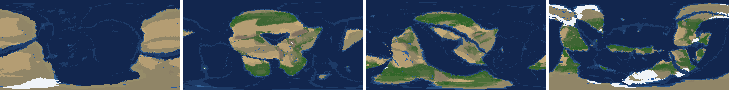
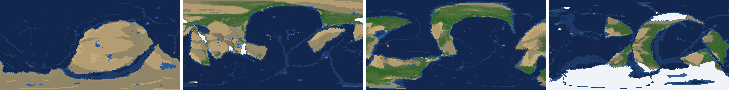
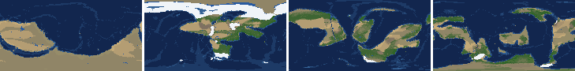
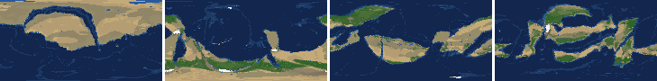
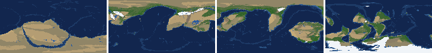
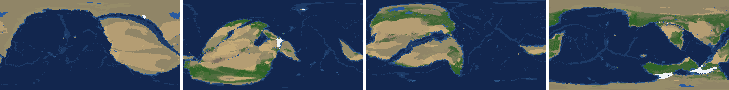
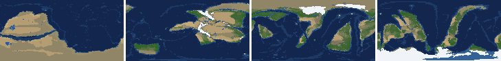
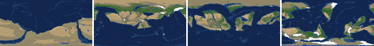

# Health sweep 2026-10-16 01:24

Commit a876572+dirty. 8 runs (default params, `--every 4`) at 8 workers x 1 numba threads; simulations 5.5 min wall. Made by `tools/health.py` (PW-246).

## Runs

| seed | L | Myr | run | sim s | trees / flowering trees from | dT range C | peaks > 9.5 km | giant-lake frames % | crust volume end/start | ice SL < -150 m % | <= 4 plates % |
|---|---|---|---|---|---|---|---|---|---|---|---|
| 1 | 6 | 500 | 27bb7f | 327 | 132 / 412 | 11.5 | 0 | 5.3 | 0.885 | 0.0 | 0.0 |
| 2 | 6 | 500 | f72446 | 322 | 140 / 396 | 19.4 | 0 | 6.2 | 0.898 | 4.4 | 0.0 |
| 11 | 6 | 500 | 6671ec | 325 | 128 / 372 | 16.9 | 0 | 19.5 | 0.898 | 10.6 | 0.0 |
| 21 | 6 | 500 | 068611 | 328 | 136 / 404 | 10.1 | 0 | 7.1 | 0.871 | 0.0 | 0.0 |
| 3199 | 6 | 500 | d56a19 | 322 | 132 / 376 | 12.5 | 0 | 4.4 | 0.919 | 0.0 | 0.0 |
| 42 | 6 | 500 | b2da0a | 320 | 116 / 404 | 9.1 | 0 | 26.5 | 0.9 | 0.0 | 0.0 |
| 77 | 6 | 500 | 481e8d | 325 | 124 / 416 | 10.8 | 0 | 8.8 | 0.912 | 0.0 | 0.0 |
| 505 | 6 | 500 | bc40fb | 328 | 132 / 416 | 8.0 | 0 | 6.2 | 0.899 | 0.0 | 0.0 |

## Medians by seed (after 50 Myr; tree cover after forests, NPP after flowering trees appear)

| seed | L | land_pct | cont_pct | cont_km | plates | ocean_age | speed | sea_level | sea_ice_m | ice_pct | temp | co2 | dry_pct | inland_pct | lake_pct | lake_max_mkm2 | max_elev_km | trees_pct | npp | landmasses | largest_pct |
|---|---|---|---|---|---|---|---|---|---|---|---|---|---|---|---|---|---|---|---|---|---|
| 1 | 6 | 33.3 | 39.0 | 35.1 | 14.0 | 47.4 | 4.8 | 81.2 | -0.1 | 0.0 | 16.2 | -0.2 | 30.2 | 4.9 | 0.5 | 0.1 | 4.6 | 25.6 | 315.5 | 6.0 | 18.0 |
| 2 | 6 | 33.5 | 39.0 | 35.0 | 11.0 | 55.6 | 4.4 | -20.6 | -1.6 | 0.3 | 15.5 | -0.2 | 31.4 | 4.4 | 0.5 | 0.1 | 5.7 | 28.1 | 288.5 | 7.0 | 26.5 |
| 11 | 6 | 32.8 | 39.2 | 35.7 | 13.0 | 54.5 | 4.3 | -20.9 | -8.6 | 0.7 | 13.3 | -0.4 | 25.6 | 4.1 | 0.6 | 0.2 | 6.5 | 28.8 | 332.3 | 6.0 | 24.6 |
| 21 | 6 | 33.1 | 39.6 | 34.4 | 14.0 | 44.3 | 4.1 | 108.2 | -0.3 | 0.1 | 16.5 | -0.3 | 30.0 | 3.6 | 0.4 | 0.1 | 5.6 | 26.5 | 372.3 | 7.0 | 17.1 |
| 3199 | 6 | 33.4 | 39.6 | 35.7 | 11.0 | 56.4 | 4.6 | -8.2 | -4.2 | 0.7 | 14.8 | -0.2 | 32.1 | 5.6 | 0.6 | 0.1 | 6.4 | 23.8 | 318.0 | 6.0 | 28.8 |
| 42 | 6 | 34.8 | 39.2 | 35.4 | 11.0 | 48.7 | 5.0 | 45.2 | -0.1 | 0.0 | 15.3 | -0.2 | 34.4 | 7.3 | 0.5 | 0.2 | 4.4 | 19.4 | 262.9 | 5.0 | 23.2 |
| 77 | 6 | 32.8 | 39.4 | 35.3 | 11.0 | 49.0 | 4.7 | -41.7 | -11.1 | 1.8 | 12.8 | -0.4 | 24.4 | 3.8 | 0.7 | 0.2 | 6.3 | 29.7 | 390.3 | 6.0 | 20.8 |
| 505 | 6 | 33.5 | 39.4 | 34.5 | 11.0 | 57.4 | 4.1 | -13.6 | -2.6 | 0.5 | 15.1 | -0.3 | 27.8 | 4.9 | 0.5 | 0.1 | 5.6 | 26.7 | 310.2 | 7.0 | 19.8 |

Measured on the run's keyframes (no slicing). A keyframe's rivers and lakes are routed on its own terrain (PW-239), so `inland_raw_pct` (every routed end on land, as highlights counts it) and `inland_pct` (ends that are closed lakes, salt pans or real pits) agree but for ends under land ice. Land ice and land shares use cells (near-equal area).

## Envelopes

| metric | low | high | Earth | source |
|---|---|---|---|---|
| land, % of surface (`land_pct`) | 22 | 42 | 29.20 | tests/test_envelopes.py (22-42%); Earth 29.2% |
| continental crust, % of surface (`cont_pct`) | 33 | 50 | 41 | tests/test_envelopes.py (33-50%); Earth ~41% with shelves (Cogley 1984) |
| mean continental crust thickness, km (`cont_km`) | 31 | 40 | 39 | target 35 km (PW-238, continental_thickness); Earth ~39 km (Christensen & Mooney 1995); known thinning to 32-33 km (PW-046) |
| plates (`plates`) | 5 | 30 | 15 | tests/test_envelopes.py (5-30; max_plates 30); Earth 7 major + ~8 minor; <= 4 is the PW-191 collapse |
| mean ocean-floor age, Myr (`ocean_age`) | 25 | 120 | 64 | tests/test_envelopes.py (25-120); Earth ~64 Myr (Mueller et al. 2008); PW-051 |
| mean plate speed, cm/yr (`speed`) | 2 | 9 | 4.50 | tests/test_envelopes.py (2-9 cm/yr); Earth ~4-5 |
| sea level, m (ice + ocean basins) (`sea_level`) | -250 | 300 | 0 | Phanerozoic ~-130 (LGM) .. +250 m (earth.py; Haq & Schutter 2008); -250: PW-240's hard goal |
| sea level from land ice, m (`sea_ice_m`) | -250 | - | 0 | Earth LGM ~-130 m; PW-240 goal -150 m typical / -250 m worst |
| land ice, % of surface (`ice_pct`) | - | 10 | 3.10 | Earth 3.1% now (earth.EARTH_ICE), ~7-8% at the LGM |
| global mean temperature, C (`temp`) | 8 | 30 | 14.50 | Earth 14.5 C; LGM ~8 C (Tierney et al. 2020); Phanerozoic hothouses to ~30 C (Scotese et al. 2021) |
| CO2 index (ln source/sink) (`co2`) | -1.5 | 1.5 | 0.00 | the forcing's clip in earth.py (+-1.5); Earth 0 |
| arid (Koppen B), % of land (`dry_pct`) | 12 | 45 | 30 | tests/test_envelopes.py (12-45%); Earth ~30% (Beck et al. 2018) |
| land draining inland, % of ice-free land (to a closed lake, salt pan or real pit) (`inland_pct`) | 8 | 30 | 18 | Earth ~18% (overview 2.9); L6 known ~9.5-11% (PW-054, PW-243). `inland_raw_pct` (not checked) follows the stored `downstream` to any end, as highlights does; since PW-239 the two agree but for ends under land ice |
| lakes, % of land (`lake_pct`) | 0.2 | 3.0 | 1.80 | Earth ~1.8% of ice-free land (HydroLAKES, Messager et al. 2016); generated L6 worlds 0.5-1% |
| largest lake, million km2 (`lake_max_mkm2`) | - | 1.0 | 0.37 | Caspian 0.37 Mkm2; 1 Mkm2 = the overview's giant lake (2.9) |
| highest peak, km (`max_elev_km`) | - | 9.5 | 8.85 | Everest 8.85 km; PW-172 (spikes above ~9.5 km) |
| tree cover, % of ice-free land (after forests appear) (`trees_pct`) | 10 | 50 | 30 | Earth ~30% potential canopy (forest 55-60 of ~130 Mkm2, overview 2.18) |
| land NPP, g C/m2/yr (after flowering trees appear) (`npp`) | 200 | 700 | 430 | Earth ~56 Pg C/yr over ~130 Mkm2 = ~430; the model on Earth's terrain 50 Pg C/yr, ~385 (overview 2.18). Before flowering trees (plant group 4) stand-ins grow at 70%, so runs sit at ~150-280 |
| landmasses (>= 3 cells) (`landmasses`) | 3 | 80 | - | loose: a lone supercontinent or a shattered archipelago |
| largest landmass, % of surface (`largest_pct`) | 5 | 35 | 16.60 | Afro-Eurasia 16.6%; a Pangaea ~30% (scorecard largest_max) |
| global temperature range over the run, C (`dT_range`, per run) | - | 25 | 25 | Phanerozoic 11-36 C (Scotese et al. 2021) |
| keyframes with a peak above 9.5 km (`peak_frames`, per run) | - | 0 | 0 | PW-172 (L7 seed 3199: 3 of 251) |
| % of keyframes with a lake over 1 Mkm2 (`giant_lake_frames`, per run) | - | 5 | 0 | overview 2.9 (L6: 3 of ~150 frames) |
| continental crust volume, end / start (`volume_ratio`, per run) | 0.9 | 1.1 | 1.0 | scorecard volume_ratio (x1.006) |
| % of keyframes with ice sea level below -150 m (`sea_ice_below_150`, per run) | - | 10 | 0 | PW-240 |
| % of keyframes with <= 4 plates (`low_plates`, per run) | - | 2 | 0 | PW-191 (L7 seed 21: 1%) |

## Top outliers (of 180 spells; severity = excess / band width x (0.2 + share of the run))

| seed | L | metric | Myr | frames | worst | envelope | severity |
|---|---|---|---|---|---|---|---|
| 42 | 6 | giant_lake_frames | run | - | 26.50 | -..5 | 4.3 |
| 11 | 6 | lake_max_mkm2 | 180-256 | 20 | 9.39 | -..1.0 | 3.009 |
| 11 | 6 | giant_lake_frames | run | - | 19.50 | -..5 | 2.9 |
| 42 | 6 | lake_max_mkm2 | 144-148 | 2 | 6.81 | -..1.0 | 1.254 |
| 3199 | 6 | lake_max_mkm2 | 52-52 | 1 | 5.16 | -..1.0 | 0.864 |
| 42 | 6 | lake_max_mkm2 | 440-456 | 4 | 4.68 | -..1.0 | 0.853 |
| 505 | 6 | lake_max_mkm2 | 140-152 | 4 | 4.62 | -..1.0 | 0.839 |
| 77 | 6 | giant_lake_frames | run | - | 8.80 | -..5 | 0.76 |
| 42 | 6 | lake_max_mkm2 | 380-428 | 12 | 3.52 | -..1.0 | 0.745 |
| 1 | 6 | lake_max_mkm2 | 52-52 | 1 | 4.12 | -..1.0 | 0.649 |
| 42 | 6 | lake_max_mkm2 | 52-52 | 1 | 3.24 | -..1.0 | 0.465 |
| 21 | 6 | giant_lake_frames | run | - | 7.10 | -..5 | 0.42 |
| 11 | 6 | lake_pct | 236-252 | 5 | 6.72 | 0.2..3.0 | 0.318 |
| 21 | 6 | lake_max_mkm2 | 52-72 | 4 | 2.37 | -..1.0 | 0.317 |
| 77 | 6 | lake_max_mkm2 | 236-244 | 2 | 2.44 | -..1.0 | 0.311 |
| 42 | 6 | lake_max_mkm2 | 316-316 | 1 | 2.45 | -..1.0 | 0.302 |
| 3199 | 6 | lake_max_mkm2 | 72-72 | 1 | 2.37 | -..1.0 | 0.284 |
| 42 | 6 | dry_pct | 200-344 | 37 | 63.59 | 12..45 | 0.278 |
| 77 | 6 | lake_max_mkm2 | 72-76 | 2 | 2.25 | -..1.0 | 0.271 |
| 21 | 6 | lake_max_mkm2 | 172-176 | 2 | 2.24 | -..1.0 | 0.268 |
| 505 | 6 | lake_max_mkm2 | 316-316 | 1 | 2.27 | -..1.0 | 0.263 |
| 2 | 6 | giant_lake_frames | run | - | 6.20 | -..5 | 0.24 |
| 3199 | 6 | lake_max_mkm2 | 200-200 | 1 | 2.15 | -..1.0 | 0.24 |
| 505 | 6 | giant_lake_frames | run | - | 6.20 | -..5 | 0.24 |
| 77 | 6 | inland_pct | 280-500 | 56 | 0.22 | 8..30 | 0.228 |
| 1 | 6 | lake_max_mkm2 | 68-68 | 1 | 2.04 | -..1.0 | 0.217 |
| 11 | 6 | inland_pct | 260-500 | 58 | 0.76 | 8..30 | 0.217 |
| 505 | 6 | inland_pct | 256-500 | 61 | 1.16 | 8..30 | 0.213 |
| 1 | 6 | lake_max_mkm2 | 264-264 | 1 | 2.00 | -..1.0 | 0.209 |
| 2 | 6 | inland_pct | 300-500 | 50 | 0.77 | 8..30 | 0.196 |

## Per seed: min / median / max after the 50 Myr spin-up, and spells outside the envelopes

### Seed 1, L6 (run 27bb7f)

*At 48, 200, 348, 500 Myr: sea by depth, land green by tree cover / tan where arid, shaded by height, ice white, lakes blue.*

| metric | min | median | max | outside (Myr: worst) |
|---|---|---|---|---|
| land_pct | 31.02 | 33.31 | 38.73 |  |
| cont_pct | 37.64 | 39.01 | 43.22 |  |
| cont_km | 33.85 | 35.14 | 37.11 |  |
| plates | 10.00 | 14.00 | 18.00 |  |
| ocean_age | 32.70 | 47.40 | 60.60 |  |
| speed | 3.16 | 4.75 | 7.51 |  |
| sea_level | -104.10 | 81.20 | 187.80 |  |
| sea_ice_m | -30.00 | -0.10 | -0.00 |  |
| ice_pct | 0.00 | 0.00 | 3.40 |  |
| temp | 9.00 | 16.20 | 20.50 |  |
| co2 | -1.02 | -0.16 | 0.15 |  |
| dry_pct | 8.56 | 30.24 | 50.87 | 252-292: 50.87; 428-432: 11.63; 460-500: 8.56 |
| inland_pct | 0.45 | 4.91 | 25.09 | 72-140: 0.96; 152-156: 5.33; 176-220: 4.64; 232-260: 4.31; +2 more |
| lake_pct | 0.12 | 0.49 | 3.49 | 52-52: 3.49; 108-116: 0.12; 248-248: 0.18; 288-288: 0.17; +2 more |
| lake_max_mkm2 | 0.03 | 0.11 | 4.12 | 52-52: 4.12; 68-68: 2.04; 264-264: 2.00; 300-300: 1.66; +1 more |
| max_elev_km | 2.02 | 4.57 | 8.39 |  |
| trees_pct | 13.88 | 25.57 | 50.70 | 432-436: 50.70 |
| npp | 224.20 | 315.50 | 333.60 |  |
| landmasses | 2.00 | 6.00 | 15.00 | 52-52: 2 |
| largest_pct | 8.60 | 18.00 | 31.30 |  |

### Seed 2, L6 (run f72446)

*At 48, 200, 348, 500 Myr: sea by depth, land green by tree cover / tan where arid, shaded by height, ice white, lakes blue.*

| metric | min | median | max | outside (Myr: worst) |
|---|---|---|---|---|
| land_pct | 31.56 | 33.54 | 38.53 |  |
| cont_pct | 37.13 | 39.02 | 42.90 |  |
| cont_km | 34.19 | 34.97 | 37.54 |  |
| plates | 6.00 | 11.00 | 14.00 |  |
| ocean_age | 33.30 | 55.60 | 79.70 |  |
| speed | 3.23 | 4.41 | 7.21 |  |
| sea_level | -568.20 | -20.60 | 196.10 | 476-500: -568.20 |
| sea_ice_m | -340.20 | -1.60 | -0.00 | 492-500: -340.20 |
| ice_pct | 0.00 | 0.30 | 13.50 | 492-500: 13.50 |
| temp | 3.00 | 15.50 | 22.40 | 480-500: 3.00 |
| co2 | -1.08 | -0.20 | 0.31 |  |
| dry_pct | 13.26 | 31.36 | 51.61 | 52-68: 51.61 |
| inland_pct | 0.77 | 4.36 | 16.31 | 68-184: 1.83; 240-240: 7.92; 256-280: 3.40; 300-500: 0.77 |
| lake_pct | 0.06 | 0.52 | 2.03 | 60-60: 0.18; 84-84: 0.13; 96-124: 0.06 |
| lake_max_mkm2 | 0.01 | 0.12 | 1.68 | 52-52: 1.68; 244-252: 1.31; 288-288: 1.01; 484-488: 1.66 |
| max_elev_km | 1.35 | 5.71 | 8.53 |  |
| trees_pct | 12.23 | 28.09 | 48.00 |  |
| npp | 225.70 | 288.50 | 434.50 |  |
| landmasses | 2.00 | 7.00 | 13.00 | 56-64: 2; 236-240: 2; 260-264: 2 |
| largest_pct | 9.60 | 26.50 | 33.80 |  |

### Seed 11, L6 (run 6671ec)

*At 48, 200, 348, 500 Myr: sea by depth, land green by tree cover / tan where arid, shaded by height, ice white, lakes blue.*

| metric | min | median | max | outside (Myr: worst) |
|---|---|---|---|---|
| land_pct | 30.89 | 32.81 | 38.57 |  |
| cont_pct | 36.79 | 39.22 | 42.76 |  |
| cont_km | 33.74 | 35.68 | 38.18 |  |
| plates | 10.00 | 13.00 | 18.00 |  |
| ocean_age | 32.30 | 54.50 | 63.70 |  |
| speed | 3.26 | 4.28 | 7.86 |  |
| sea_level | -372.00 | -20.90 | 221.20 | 176-220: -372.00 |
| sea_ice_m | -246.00 | -8.60 | -0.00 |  |
| ice_pct | 0.00 | 0.70 | 11.80 | 180-200: 11.80 |
| temp | 3.20 | 13.30 | 20.10 | 140-208: 3.20 |
| co2 | -0.96 | -0.43 | 0.02 |  |
| dry_pct | 19.53 | 25.58 | 37.93 |  |
| inland_pct | 0.69 | 4.11 | 27.72 | 68-80: 2.90; 92-136: 0.69; 156-156: 7.09; 200-200: 7.41; +1 more |
| lake_pct | 0.12 | 0.58 | 6.72 | 64-64: 0.12; 76-80: 0.13; 116-116: 0.17; 204-220: 5.00; +1 more |
| lake_max_mkm2 | 0.04 | 0.16 | 9.39 | 156-160: 1.43; 180-256: 9.39 |
| max_elev_km | 1.71 | 6.46 | 8.69 |  |
| trees_pct | 19.31 | 28.84 | 47.36 |  |
| npp | 241.30 | 332.30 | 428.90 |  |
| landmasses | 2.00 | 6.00 | 11.00 | 232-232: 2 |
| largest_pct | 10.10 | 24.60 | 33.20 |  |

### Seed 21, L6 (run 068611)

*At 48, 200, 348, 500 Myr: sea by depth, land green by tree cover / tan where arid, shaded by height, ice white, lakes blue.*

| metric | min | median | max | outside (Myr: worst) |
|---|---|---|---|---|
| land_pct | 30.26 | 33.06 | 38.37 |  |
| cont_pct | 37.92 | 39.62 | 43.72 |  |
| cont_km | 32.91 | 34.40 | 37.03 |  |
| plates | 11.00 | 14.00 | 17.00 |  |
| ocean_age | 34.30 | 44.30 | 65.50 |  |
| speed | 3.25 | 4.14 | 6.74 |  |
| sea_level | -58.60 | 108.20 | 200.70 |  |
| sea_ice_m | -2.90 | -0.30 | -0.00 |  |
| ice_pct | 0.00 | 0.10 | 0.60 |  |
| temp | 12.50 | 16.50 | 22.60 |  |
| co2 | -0.67 | -0.28 | -0.01 |  |
| dry_pct | 20.88 | 29.99 | 47.70 | 52-60: 46.55; 296-312: 47.70 |
| inland_pct | 0.62 | 3.64 | 17.38 | 64-188: 1.41; 200-200: 3.83; 224-276: 1.75; 288-288: 7.79; +2 more |
| lake_pct | 0.05 | 0.44 | 2.10 | 84-96: 0.10; 112-140: 0.05; 308-308: 0.17; 468-468: 0.18; +1 more |
| lake_max_mkm2 | 0.01 | 0.14 | 2.37 | 52-72: 2.37; 172-176: 2.24; 280-280: 1.22; 364-364: 1.13 |
| max_elev_km | 1.85 | 5.57 | 7.31 |  |
| trees_pct | 8.22 | 26.51 | 51.78 | 304-308: 8.22; 400-408: 51.78 |
| npp | 255.60 | 372.30 | 413.70 |  |
| landmasses | 3.00 | 7.00 | 15.00 |  |
| largest_pct | 11.50 | 17.10 | 35.00 |  |

### Seed 3199, L6 (run d56a19)

*At 48, 200, 348, 500 Myr: sea by depth, land green by tree cover / tan where arid, shaded by height, ice white, lakes blue.*

| metric | min | median | max | outside (Myr: worst) |
|---|---|---|---|---|
| land_pct | 32.47 | 33.38 | 38.95 |  |
| cont_pct | 35.92 | 39.60 | 43.01 |  |
| cont_km | 34.13 | 35.68 | 39.18 |  |
| plates | 5.00 | 11.00 | 16.00 |  |
| ocean_age | 35.70 | 56.40 | 77.40 |  |
| speed | 1.70 | 4.59 | 7.77 | 208-212: 1.70 |
| sea_level | -260.40 | -8.20 | 192.00 | 500-500: -260.40 |
| sea_ice_m | -78.10 | -4.20 | -0.00 |  |
| ice_pct | 0.00 | 0.70 | 5.80 |  |
| temp | 8.70 | 14.80 | 21.20 |  |
| co2 | -0.73 | -0.21 | 0.16 |  |
| dry_pct | 16.58 | 32.07 | 60.20 | 60-88: 60.20 |
| inland_pct | 1.05 | 5.59 | 28.54 | 80-152: 1.05; 188-188: 7.01; 268-308: 4.08; 320-500: 1.06 |
| lake_pct | 0.03 | 0.60 | 3.30 | 52-56: 3.30; 88-88: 0.12; 100-120: 0.03; 144-144: 0.19 |
| lake_max_mkm2 | 0.01 | 0.14 | 5.16 | 52-52: 5.16; 72-72: 2.37; 148-148: 1.87; 200-200: 2.15; +1 more |
| max_elev_km | 1.99 | 6.40 | 8.60 |  |
| trees_pct | 15.09 | 23.79 | 39.93 |  |
| npp | 262.10 | 318.05 | 344.40 |  |
| landmasses | 1.00 | 6.00 | 15.00 | 68-72: 2; 304-352: 1 |
| largest_pct | 10.70 | 28.80 | 33.90 |  |

### Seed 42, L6 (run b2da0a)

*At 48, 200, 348, 500 Myr: sea by depth, land green by tree cover / tan where arid, shaded by height, ice white, lakes blue.*

| metric | min | median | max | outside (Myr: worst) |
|---|---|---|---|---|
| land_pct | 32.72 | 34.76 | 38.58 |  |
| cont_pct | 37.86 | 39.24 | 43.35 |  |
| cont_km | 34.08 | 35.35 | 36.58 |  |
| plates | 5.00 | 11.00 | 17.00 |  |
| ocean_age | 35.20 | 48.70 | 61.20 |  |
| speed | 3.27 | 4.96 | 6.80 |  |
| sea_level | -120.30 | 45.20 | 167.20 |  |
| sea_ice_m | -5.70 | -0.10 | -0.00 |  |
| ice_pct | 0.00 | 0.00 | 1.00 |  |
| temp | 11.10 | 15.30 | 20.20 |  |
| co2 | -0.69 | -0.24 | 0.50 |  |
| dry_pct | 15.97 | 34.37 | 63.59 | 200-344: 63.59 |
| inland_pct | 1.19 | 7.29 | 24.27 | 60-140: 1.19; 156-164: 3.39; 192-200: 4.95; 212-212: 6.84; +6 more |
| lake_pct | 0.08 | 0.50 | 3.88 | 64-64: 0.08; 80-100: 0.10; 120-144: 3.88; 156-156: 0.18; +7 more |
| lake_max_mkm2 | 0.04 | 0.24 | 6.81 | 52-52: 3.24; 144-148: 6.81; 180-180: 1.02; 204-204: 1.37; +7 more |
| max_elev_km | 1.38 | 4.36 | 8.34 |  |
| trees_pct | 7.35 | 19.42 | 34.72 | 276-316: 7.35 |
| npp | 238.30 | 262.90 | 283.10 |  |
| landmasses | 2.00 | 5.00 | 10.00 | 228-228: 2; 240-244: 2; 344-344: 2 |
| largest_pct | 16.00 | 23.20 | 35.10 | 296-312: 35.10 |

### Seed 77, L6 (run 481e8d)

*At 48, 200, 348, 500 Myr: sea by depth, land green by tree cover / tan where arid, shaded by height, ice white, lakes blue.*

| metric | min | median | max | outside (Myr: worst) |
|---|---|---|---|---|
| land_pct | 30.14 | 32.78 | 38.63 |  |
| cont_pct | 36.59 | 39.42 | 43.57 |  |
| cont_km | 34.11 | 35.26 | 38.30 |  |
| plates | 8.00 | 11.00 | 15.00 |  |
| ocean_age | 36.60 | 49.00 | 81.00 |  |
| speed | 2.92 | 4.69 | 7.39 |  |
| sea_level | -250.60 | -41.70 | 162.00 | 316-316: -250.60 |
| sea_ice_m | -145.80 | -11.10 | -0.00 |  |
| ice_pct | 0.00 | 1.80 | 8.00 |  |
| temp | 6.80 | 12.80 | 17.60 | 136-148: 6.80 |
| co2 | -0.69 | -0.35 | 0.08 |  |
| dry_pct | 9.90 | 24.42 | 42.83 | 444-464: 9.90 |
| inland_pct | 0.22 | 3.77 | 28.68 | 64-160: 1.42; 280-500: 0.22 |
| lake_pct | 0.09 | 0.71 | 3.53 | 96-116: 0.09; 236-236: 3.53 |
| lake_max_mkm2 | 0.03 | 0.19 | 2.44 | 72-76: 2.25; 92-92: 1.59; 180-180: 1.18; 224-224: 1.06; +3 more |
| max_elev_km | 1.97 | 6.34 | 8.03 |  |
| trees_pct | 20.03 | 29.73 | 46.30 |  |
| npp | 282.70 | 390.30 | 422.00 |  |
| landmasses | 2.00 | 6.00 | 14.00 | 52-64: 2; 224-224: 2; 248-252: 2; 280-284: 2 |
| largest_pct | 8.40 | 20.80 | 32.00 |  |

### Seed 505, L6 (run bc40fb)

*At 48, 200, 348, 500 Myr: sea by depth, land green by tree cover / tan where arid, shaded by height, ice white, lakes blue.*

| metric | min | median | max | outside (Myr: worst) |
|---|---|---|---|---|
| land_pct | 30.24 | 33.50 | 38.62 |  |
| cont_pct | 37.19 | 39.43 | 43.24 |  |
| cont_km | 33.11 | 34.53 | 37.43 |  |
| plates | 7.00 | 11.00 | 16.00 |  |
| ocean_age | 31.90 | 57.40 | 69.00 |  |
| speed | 2.60 | 4.13 | 7.27 |  |
| sea_level | -156.30 | -13.60 | 219.50 |  |
| sea_ice_m | -17.10 | -2.60 | -0.00 |  |
| ice_pct | 0.00 | 0.50 | 3.00 |  |
| temp | 11.70 | 15.10 | 19.70 |  |
| co2 | -0.69 | -0.33 | 0.02 |  |
| dry_pct | 11.55 | 27.75 | 50.33 | 64-72: 45.60; 88-104: 50.33; 136-136: 11.55 |
| inland_pct | 0.77 | 4.92 | 14.95 | 68-136: 0.77; 152-168: 2.41; 184-184: 5.74; 196-196: 6.73; +1 more |
| lake_pct | 0.04 | 0.51 | 3.06 | 60-108: 0.04; 148-148: 3.06; 384-384: 0.19 |
| lake_max_mkm2 | 0.01 | 0.12 | 4.62 | 140-152: 4.62; 188-188: 1.12; 216-216: 1.34; 316-316: 2.27 |
| max_elev_km | 1.74 | 5.64 | 8.45 |  |
| trees_pct | 21.14 | 26.67 | 44.66 |  |
| npp | 202.90 | 310.20 | 341.40 |  |
| landmasses | 2.00 | 7.00 | 13.00 | 56-64: 2; 76-76: 2 |
| largest_pct | 8.10 | 19.80 | 33.60 |  |

## Determinism

(not run)
