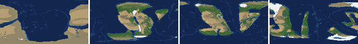
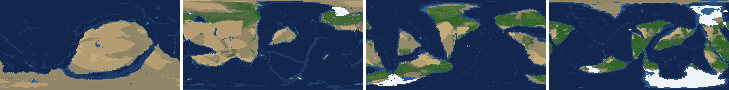
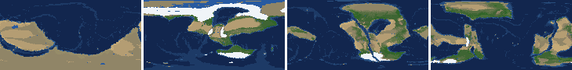
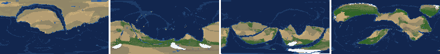
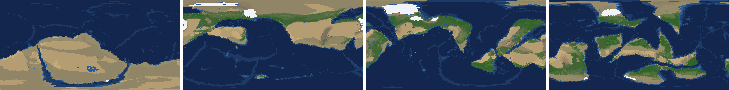
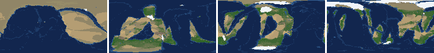
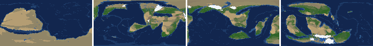
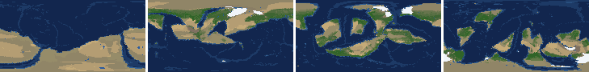

# Health sweep 2026-10-15 23:03

Commit 10ac1a4+dirty. 8 runs (default params, `--every 4`) at 8 workers x 1 numba threads; simulations 5.5 min wall. Made by `tools/health.py` (PW-246).

## Runs

| seed | L | Myr | run | sim s | trees / flowering trees from | dT range C | peaks > 9.5 km | giant-lake frames % | crust volume end/start | ice SL < -150 m % | <= 4 plates % |
|---|---|---|---|---|---|---|---|---|---|---|---|
| 1 | 6 | 500 | d7a597 | 328 | 132 / 412 | 10.5 | 0 | 10.6 | 0.914 | 0.0 | 0.0 |
| 2 | 6 | 500 | bc9caf | 323 | 140 / 396 | 19.5 | 0 | 1.8 | 0.891 | 0.0 | 0.0 |
| 11 | 6 | 500 | 2a42a3 | 328 | 128 / 372 | 16.9 | 0 | 14.2 | 0.897 | 5.3 | 0.0 |
| 21 | 6 | 500 | 534396 | 327 | 136 / 404 | 10.9 | 0 | 18.6 | 0.927 | 0.0 | 0.0 |
| 3199 | 6 | 500 | 98fc16 | 324 | 132 / 376 | 10.3 | 0 | 11.5 | 0.911 | 0.0 | 0.0 |
| 42 | 6 | 500 | 7f9bff | 325 | 116 / 404 | 12.7 | 0 | 1.8 | 0.887 | 0.0 | 0.0 |
| 77 | 6 | 500 | 41d0e7 | 326 | 124 / 416 | 11.6 | 0 | 10.6 | 0.899 | 0.0 | 0.0 |
| 505 | 6 | 500 | 61037d | 329 | 132 / 416 | 8.5 | 0 | 8.0 | 0.891 | 0.0 | 0.0 |

## Medians by seed (after 50 Myr; tree cover after forests, NPP after flowering trees appear)

| seed | L | land_pct | cont_pct | cont_km | plates | ocean_age | speed | sea_level | sea_ice_m | ice_pct | temp | co2 | dry_pct | inland_pct | lake_pct | lake_max_mkm2 | max_elev_km | trees_pct | npp | landmasses | largest_pct |
|---|---|---|---|---|---|---|---|---|---|---|---|---|---|---|---|---|---|---|---|---|---|
| 1 | 6 | 32.5 | 38.8 | 36.0 | 13.0 | 49.3 | 4.7 | 45.1 | -4.1 | 0.7 | 15.7 | -0.1 | 29.8 | 7.8 | 0.9 | 0.2 | 5.9 | 28.1 | 309.4 | 5.0 | 25.4 |
| 2 | 6 | 34.3 | 39.3 | 35.0 | 14.0 | 43.8 | 4.5 | 124.1 | -2.0 | 0.4 | 15.8 | -0.1 | 32.1 | 4.8 | 0.4 | 0.1 | 5.7 | 24.7 | 324.5 | 7.0 | 19.2 |
| 11 | 6 | 33.9 | 39.4 | 35.5 | 11.0 | 57.1 | 4.4 | -52.8 | -7.6 | 1.0 | 13.6 | -0.4 | 27.5 | 5.4 | 0.4 | 0.1 | 6.4 | 26.4 | 283.9 | 6.0 | 26.6 |
| 21 | 6 | 35.9 | 39.5 | 35.5 | 11.0 | 52.1 | 4.4 | 26.0 | -2.3 | 0.4 | 16.7 | -0.1 | 38.6 | 7.8 | 0.5 | 0.2 | 4.6 | 20.3 | 295.0 | 5.0 | 30.8 |
| 3199 | 6 | 33.2 | 39.6 | 35.5 | 11.0 | 55.3 | 4.5 | -48.4 | -5.3 | 1.0 | 14.9 | -0.2 | 30.7 | 6.3 | 0.6 | 0.2 | 5.3 | 33.6 | 330.4 | 6.0 | 18.8 |
| 42 | 6 | 32.7 | 39.5 | 34.9 | 12.0 | 53.3 | 4.2 | -2.6 | -2.7 | 0.6 | 14.8 | -0.3 | 24.2 | 3.7 | 0.6 | 0.1 | 6.8 | 27.7 | 342.8 | 5.0 | 21.7 |
| 77 | 6 | 33.0 | 39.2 | 35.1 | 12.0 | 50.0 | 4.7 | 25.7 | -5.5 | 1.0 | 13.2 | -0.3 | 23.7 | 3.8 | 0.6 | 0.1 | 6.2 | 34.0 | 297.6 | 7.0 | 23.0 |
| 505 | 6 | 33.9 | 39.8 | 34.8 | 14.0 | 51.0 | 4.5 | 32.0 | -3.8 | 0.7 | 15.1 | -0.3 | 23.1 | 4.5 | 0.6 | 0.2 | 5.5 | 26.9 | 348.6 | 6.0 | 19.8 |

Measured on the run's keyframes (no slicing). A keyframe's rivers and lakes are routed on its own terrain (PW-239), so `inland_raw_pct` (every routed end on land, as highlights counts it) and `inland_pct` (ends that are closed lakes, salt pans or real pits) agree but for ends under land ice. Land ice and land shares use cells (near-equal area).

## Envelopes

| metric | low | high | Earth | source |
|---|---|---|---|---|
| land, % of surface (`land_pct`) | 22 | 42 | 29.20 | tests/test_envelopes.py (22-42%); Earth 29.2% |
| continental crust, % of surface (`cont_pct`) | 33 | 50 | 41 | tests/test_envelopes.py (33-50%); Earth ~41% with shelves (Cogley 1984) |
| mean continental crust thickness, km (`cont_km`) | 31 | 40 | 39 | target 35 km (PW-238, continental_thickness); Earth ~39 km (Christensen & Mooney 1995); known thinning to 32-33 km (PW-046) |
| plates (`plates`) | 5 | 30 | 15 | tests/test_envelopes.py (5-30; max_plates 30); Earth 7 major + ~8 minor; <= 4 is the PW-191 collapse |
| mean ocean-floor age, Myr (`ocean_age`) | 25 | 120 | 64 | tests/test_envelopes.py (25-120); Earth ~64 Myr (Mueller et al. 2008); PW-051 |
| mean plate speed, cm/yr (`speed`) | 2 | 9 | 4.50 | tests/test_envelopes.py (2-9 cm/yr); Earth ~4-5 |
| sea level, m (ice + ocean basins) (`sea_level`) | -250 | 300 | 0 | Phanerozoic ~-130 (LGM) .. +250 m (earth.py; Haq & Schutter 2008); -250: PW-240's hard goal |
| sea level from land ice, m (`sea_ice_m`) | -250 | - | 0 | Earth LGM ~-130 m; PW-240 goal -150 m typical / -250 m worst |
| land ice, % of surface (`ice_pct`) | - | 10 | 3.10 | Earth 3.1% now (earth.EARTH_ICE), ~7-8% at the LGM |
| global mean temperature, C (`temp`) | 8 | 30 | 14.50 | Earth 14.5 C; LGM ~8 C (Tierney et al. 2020); Phanerozoic hothouses to ~30 C (Scotese et al. 2021) |
| CO2 index (ln source/sink) (`co2`) | -1.5 | 1.5 | 0.00 | the forcing's clip in earth.py (+-1.5); Earth 0 |
| arid (Koppen B), % of land (`dry_pct`) | 12 | 45 | 30 | tests/test_envelopes.py (12-45%); Earth ~30% (Beck et al. 2018) |
| land draining inland, % of ice-free land (to a closed lake, salt pan or real pit) (`inland_pct`) | 8 | 30 | 18 | Earth ~18% (overview 2.9); L6 known ~9.5-11% (PW-054, PW-243). `inland_raw_pct` (not checked) follows the stored `downstream` to any end, as highlights does; since PW-239 the two agree but for ends under land ice |
| lakes, % of land (`lake_pct`) | 0.2 | 3.0 | 1.80 | Earth ~1.8% of ice-free land (HydroLAKES, Messager et al. 2016); generated L6 worlds 0.5-1% |
| largest lake, million km2 (`lake_max_mkm2`) | - | 1.0 | 0.37 | Caspian 0.37 Mkm2; 1 Mkm2 = the overview's giant lake (2.9) |
| highest peak, km (`max_elev_km`) | - | 9.5 | 8.85 | Everest 8.85 km; PW-172 (spikes above ~9.5 km) |
| tree cover, % of ice-free land (after forests appear) (`trees_pct`) | 10 | 50 | 30 | Earth ~30% potential canopy (forest 55-60 of ~130 Mkm2, overview 2.18) |
| land NPP, g C/m2/yr (after flowering trees appear) (`npp`) | 200 | 700 | 430 | Earth ~56 Pg C/yr over ~130 Mkm2 = ~430; the model on Earth's terrain 50 Pg C/yr, ~385 (overview 2.18). Before flowering trees (plant group 4) stand-ins grow at 70%, so runs sit at ~150-280 |
| landmasses (>= 3 cells) (`landmasses`) | 3 | 80 | - | loose: a lone supercontinent or a shattered archipelago |
| largest landmass, % of surface (`largest_pct`) | 5 | 35 | 16.60 | Afro-Eurasia 16.6%; a Pangaea ~30% (scorecard largest_max) |
| global temperature range over the run, C (`dT_range`, per run) | - | 25 | 25 | Phanerozoic 11-36 C (Scotese et al. 2021) |
| keyframes with a peak above 9.5 km (`peak_frames`, per run) | - | 0 | 0 | PW-172 (L7 seed 3199: 3 of 251) |
| % of keyframes with a lake over 1 Mkm2 (`giant_lake_frames`, per run) | - | 5 | 0 | overview 2.9 (L6: 3 of ~150 frames) |
| continental crust volume, end / start (`volume_ratio`, per run) | 0.9 | 1.1 | 1.0 | scorecard volume_ratio (x1.006) |
| % of keyframes with ice sea level below -150 m (`sea_ice_below_150`, per run) | - | 10 | 0 | PW-240 |
| % of keyframes with <= 4 plates (`low_plates`, per run) | - | 2 | 0 | PW-191 (L7 seed 21: 1%) |

## Top outliers (of 173 spells; severity = excess / band width x (0.2 + share of the run))

| seed | L | metric | Myr | frames | worst | envelope | severity |
|---|---|---|---|---|---|---|---|
| 21 | 6 | giant_lake_frames | run | - | 18.60 | -..5 | 2.72 |
| 11 | 6 | lake_max_mkm2 | 172-232 | 15 | 7.07 | -..1.0 | 1.938 |
| 11 | 6 | giant_lake_frames | run | - | 14.20 | -..5 | 1.84 |
| 3199 | 6 | giant_lake_frames | run | - | 11.50 | -..5 | 1.3 |
| 21 | 6 | lake_max_mkm2 | 56-80 | 6 | 5.62 | -..1.0 | 1.143 |
| 1 | 6 | giant_lake_frames | run | - | 10.60 | -..5 | 1.12 |
| 77 | 6 | giant_lake_frames | run | - | 10.60 | -..5 | 1.12 |
| 1 | 6 | lake_max_mkm2 | 276-288 | 3 | 5.80 | -..1.0 | 1.075 |
| 1 | 6 | lake_max_mkm2 | 380-380 | 1 | 5.90 | -..1.0 | 1.019 |
| 1 | 6 | lake_max_mkm2 | 368-368 | 1 | 4.99 | -..1.0 | 0.83 |
| 1 | 6 | lake_max_mkm2 | 52-52 | 1 | 3.92 | -..1.0 | 0.608 |
| 21 | 6 | lake_max_mkm2 | 272-296 | 6 | 3.42 | -..1.0 | 0.6 |
| 505 | 6 | giant_lake_frames | run | - | 8.00 | -..5 | 0.6 |
| 42 | 6 | lake_max_mkm2 | 52-52 | 1 | 3.27 | -..1.0 | 0.473 |
| 77 | 6 | lake_max_mkm2 | 448-460 | 3 | 2.91 | -..1.0 | 0.428 |
| 21 | 6 | lake_max_mkm2 | 196-196 | 1 | 3.04 | -..1.0 | 0.424 |
| 3199 | 6 | lake_max_mkm2 | 156-180 | 5 | 2.63 | -..1.0 | 0.39 |
| 42 | 6 | inland_pct | 64-500 | 105 | 0.21 | 8..30 | 0.366 |
| 505 | 6 | lake_max_mkm2 | 140-148 | 3 | 2.58 | -..1.0 | 0.353 |
| 42 | 6 | lake_max_mkm2 | 212-212 | 1 | 2.55 | -..1.0 | 0.323 |
| 3199 | 6 | lake_max_mkm2 | 116-116 | 1 | 2.39 | -..1.0 | 0.289 |
| 77 | 6 | lake_max_mkm2 | 88-92 | 2 | 2.27 | -..1.0 | 0.273 |
| 77 | 6 | inland_pct | 200-500 | 74 | 0.70 | 8..30 | 0.261 |
| 77 | 6 | lake_max_mkm2 | 472-480 | 3 | 2.08 | -..1.0 | 0.242 |
| 2 | 6 | inland_pct | 244-500 | 64 | 0.93 | 8..30 | 0.228 |
| 3199 | 6 | lake_max_mkm2 | 384-384 | 1 | 2.06 | -..1.0 | 0.219 |
| 1 | 6 | lake_max_mkm2 | 444-452 | 2 | 2.00 | -..1.0 | 0.217 |
| 505 | 6 | inland_pct | 280-500 | 54 | 0.67 | 8..30 | 0.209 |
| 21 | 6 | lake_max_mkm2 | 152-160 | 2 | 1.93 | -..1.0 | 0.201 |
| 1 | 6 | lake_max_mkm2 | 416-416 | 1 | 1.94 | -..1.0 | 0.196 |

## Per seed: min / median / max after the 50 Myr spin-up, and spells outside the envelopes

### Seed 1, L6 (run d7a597)

*At 48, 200, 348, 500 Myr: sea by depth, land green by tree cover / tan where arid, shaded by height, ice white, lakes blue.*

| metric | min | median | max | outside (Myr: worst) |
|---|---|---|---|---|
| land_pct | 31.47 | 32.51 | 38.84 |  |
| cont_pct | 35.84 | 38.76 | 42.57 |  |
| cont_km | 34.48 | 35.97 | 38.23 |  |
| plates | 10.00 | 13.00 | 17.00 |  |
| ocean_age | 31.60 | 49.30 | 61.30 |  |
| speed | 3.04 | 4.68 | 7.65 |  |
| sea_level | -94.30 | 45.10 | 215.30 |  |
| sea_ice_m | -57.20 | -4.10 | -0.00 |  |
| ice_pct | 0.00 | 0.70 | 4.30 |  |
| temp | 9.80 | 15.70 | 20.30 |  |
| co2 | -0.91 | -0.11 | 0.26 |  |
| dry_pct | 22.79 | 29.80 | 43.44 |  |
| inland_pct | 0.65 | 7.78 | 24.45 | 68-148: 0.65; 296-300: 5.88; 316-500: 1.40 |
| lake_pct | 0.08 | 0.90 | 4.38 | 52-56: 3.70; 72-80: 0.08; 100-120: 0.13; 276-288: 4.38; +2 more |
| lake_max_mkm2 | 0.03 | 0.17 | 5.90 | 52-52: 3.92; 64-64: 1.56; 160-160: 1.10; 252-252: 1.29; +5 more |
| max_elev_km | 2.22 | 5.90 | 8.57 |  |
| trees_pct | 18.37 | 28.12 | 45.75 |  |
| npp | 213.30 | 309.40 | 327.10 |  |
| landmasses | 2.00 | 5.00 | 11.00 | 52-52: 2; 156-156: 2; 328-340: 2 |
| largest_pct | 11.30 | 25.40 | 32.70 |  |

### Seed 2, L6 (run bc9caf)

*At 48, 200, 348, 500 Myr: sea by depth, land green by tree cover / tan where arid, shaded by height, ice white, lakes blue.*

| metric | min | median | max | outside (Myr: worst) |
|---|---|---|---|---|
| land_pct | 29.48 | 34.28 | 38.53 |  |
| cont_pct | 38.32 | 39.34 | 42.84 |  |
| cont_km | 33.51 | 34.96 | 36.74 |  |
| plates | 6.00 | 14.00 | 20.00 |  |
| ocean_age | 30.10 | 43.80 | 66.10 |  |
| speed | 3.38 | 4.50 | 7.23 |  |
| sea_level | -140.60 | 124.10 | 215.60 |  |
| sea_ice_m | -52.70 | -2.00 | -0.00 |  |
| ice_pct | 0.00 | 0.40 | 5.60 |  |
| temp | 4.20 | 15.80 | 23.70 | 480-500: 4.20 |
| co2 | -0.97 | -0.07 | 0.54 |  |
| dry_pct | 11.52 | 32.08 | 55.09 | 52-72: 52.75; 192-252: 55.09; 500-500: 11.52 |
| inland_pct | 0.93 | 4.75 | 24.87 | 68-164: 3.62; 192-192: 5.29; 204-224: 5.84; 244-500: 0.93 |
| lake_pct | 0.04 | 0.41 | 1.62 | 60-60: 0.16; 88-116: 0.04; 128-144: 0.06; 436-436: 0.20 |
| lake_max_mkm2 | 0.01 | 0.14 | 1.03 | 52-52: 1.03; 152-152: 1.02 |
| max_elev_km | 1.35 | 5.73 | 7.92 |  |
| trees_pct | 7.48 | 24.72 | 55.47 | 232-248: 7.48; 276-284: 8.10; 496-500: 55.47 |
| npp | 222.60 | 324.50 | 429.00 |  |
| landmasses | 2.00 | 7.00 | 11.00 | 56-64: 2; 252-252: 2 |
| largest_pct | 8.50 | 19.20 | 34.90 |  |

### Seed 11, L6 (run 2a42a3)

*At 48, 200, 348, 500 Myr: sea by depth, land green by tree cover / tan where arid, shaded by height, ice white, lakes blue.*

| metric | min | median | max | outside (Myr: worst) |
|---|---|---|---|---|
| land_pct | 31.96 | 33.92 | 38.55 |  |
| cont_pct | 37.97 | 39.35 | 42.82 |  |
| cont_km | 34.29 | 35.54 | 37.39 |  |
| plates | 8.00 | 11.00 | 18.00 |  |
| ocean_age | 33.70 | 57.10 | 67.10 |  |
| speed | 2.53 | 4.41 | 7.89 |  |
| sea_level | -369.60 | -52.80 | 212.80 | 184-220: -369.60 |
| sea_ice_m | -264.10 | -7.60 | -0.00 | 188-188: -264.10 |
| ice_pct | 0.00 | 1.00 | 12.10 | 184-196: 12.10 |
| temp | 3.50 | 13.60 | 20.40 | 148-148: 7.70; 168-208: 3.50 |
| co2 | -0.82 | -0.40 | 0.03 |  |
| dry_pct | 19.22 | 27.52 | 41.81 |  |
| inland_pct | 1.00 | 5.41 | 17.93 | 68-148: 1.00; 160-160: 6.37; 184-188: 7.42; 208-208: 6.72; +4 more |
| lake_pct | 0.09 | 0.44 | 4.71 | 68-76: 0.09; 88-104: 0.12; 116-124: 0.13; 184-216: 4.71; +1 more |
| lake_max_mkm2 | 0.03 | 0.10 | 7.07 | 64-64: 1.01; 172-232: 7.07 |
| max_elev_km | 1.82 | 6.43 | 8.80 |  |
| trees_pct | 16.52 | 26.35 | 49.69 |  |
| npp | 215.00 | 283.90 | 331.50 |  |
| landmasses | 2.00 | 6.00 | 12.00 | 68-68: 2; 224-224: 2 |
| largest_pct | 11.40 | 26.60 | 34.00 |  |

### Seed 21, L6 (run 534396)

*At 48, 200, 348, 500 Myr: sea by depth, land green by tree cover / tan where arid, shaded by height, ice white, lakes blue.*

| metric | min | median | max | outside (Myr: worst) |
|---|---|---|---|---|
| land_pct | 33.49 | 35.92 | 38.29 |  |
| cont_pct | 38.14 | 39.46 | 42.92 |  |
| cont_km | 34.61 | 35.49 | 37.42 |  |
| plates | 6.00 | 11.00 | 15.00 |  |
| ocean_age | 33.40 | 52.10 | 61.50 |  |
| speed | 2.92 | 4.37 | 7.49 |  |
| sea_level | -92.70 | 26.00 | 206.60 |  |
| sea_ice_m | -13.90 | -2.30 | -0.00 |  |
| ice_pct | 0.00 | 0.40 | 1.90 |  |
| temp | 12.50 | 16.70 | 23.40 |  |
| co2 | -0.86 | -0.14 | 0.23 |  |
| dry_pct | 22.91 | 38.63 | 61.83 | 52-60: 46.81; 84-84: 45.79; 252-320: 61.83 |
| inland_pct | 1.90 | 7.76 | 32.67 | 76-84: 5.40; 96-140: 1.90; 164-164: 2.42; 176-176: 4.28; +8 more |
| lake_pct | 0.07 | 0.55 | 4.28 | 68-84: 4.28; 104-104: 0.07; 120-136: 0.09; 280-284: 3.89; +1 more |
| lake_max_mkm2 | 0.01 | 0.24 | 5.62 | 56-80: 5.62; 152-160: 1.93; 196-196: 3.04; 212-212: 1.78; +3 more |
| max_elev_km | 1.94 | 4.60 | 7.46 |  |
| trees_pct | 5.31 | 20.33 | 35.14 | 276-312: 5.31 |
| npp | 212.30 | 295.00 | 307.50 |  |
| landmasses | 1.00 | 5.00 | 17.00 | 232-300: 1 |
| largest_pct | 13.10 | 30.80 | 36.20 | 164-304: 36.20 |

### Seed 3199, L6 (run 98fc16)

*At 48, 200, 348, 500 Myr: sea by depth, land green by tree cover / tan where arid, shaded by height, ice white, lakes blue.*

| metric | min | median | max | outside (Myr: worst) |
|---|---|---|---|---|
| land_pct | 31.65 | 33.17 | 38.90 |  |
| cont_pct | 37.42 | 39.60 | 42.48 |  |
| cont_km | 33.64 | 35.49 | 37.71 |  |
| plates | 5.00 | 11.00 | 16.00 |  |
| ocean_age | 36.80 | 55.30 | 68.10 |  |
| speed | 3.47 | 4.46 | 7.56 |  |
| sea_level | -163.40 | -48.40 | 191.50 |  |
| sea_ice_m | -15.50 | -5.30 | -0.00 |  |
| ice_pct | 0.00 | 1.00 | 2.10 |  |
| temp | 10.60 | 14.90 | 20.90 |  |
| co2 | -0.72 | -0.24 | 0.39 |  |
| dry_pct | 17.15 | 30.67 | 53.83 | 60-92: 53.83 |
| inland_pct | 1.50 | 6.32 | 21.82 | 76-152: 2.09; 192-192: 7.85; 204-204: 7.69; 216-220: 6.56; +5 more |
| lake_pct | 0.12 | 0.56 | 2.46 | 60-68: 0.17; 108-108: 0.14; 124-136: 0.12; 152-152: 0.19; +2 more |
| lake_max_mkm2 | 0.03 | 0.16 | 2.63 | 72-72: 1.48; 104-104: 1.49; 116-116: 2.39; 156-180: 2.63; +5 more |
| max_elev_km | 1.60 | 5.32 | 7.41 |  |
| trees_pct | 8.78 | 33.62 | 41.71 | 132-132: 8.78 |
| npp | 248.30 | 330.40 | 376.70 |  |
| landmasses | 2.00 | 6.00 | 12.00 | 52-68: 2 |
| largest_pct | 9.10 | 18.80 | 34.60 |  |

### Seed 42, L6 (run 7f9bff)

*At 48, 200, 348, 500 Myr: sea by depth, land green by tree cover / tan where arid, shaded by height, ice white, lakes blue.*

| metric | min | median | max | outside (Myr: worst) |
|---|---|---|---|---|
| land_pct | 31.29 | 32.74 | 38.57 |  |
| cont_pct | 37.98 | 39.52 | 42.87 |  |
| cont_km | 32.80 | 34.94 | 36.61 |  |
| plates | 6.00 | 12.00 | 16.00 |  |
| ocean_age | 34.40 | 53.30 | 99.50 |  |
| speed | 1.92 | 4.17 | 6.89 | 400-400: 1.92 |
| sea_level | -299.00 | -2.60 | 178.50 | 432-500: -299.00 |
| sea_ice_m | -28.30 | -2.70 | -0.00 |  |
| ice_pct | 0.00 | 0.60 | 3.60 |  |
| temp | 7.70 | 14.80 | 20.40 | 452-452: 7.70 |
| co2 | -0.74 | -0.33 | -0.03 |  |
| dry_pct | 17.28 | 24.23 | 44.32 |  |
| inland_pct | 0.21 | 3.68 | 14.28 | 64-500: 0.21 |
| lake_pct | 0.09 | 0.56 | 2.51 | 60-64: 0.09; 76-108: 0.10 |
| lake_max_mkm2 | 0.04 | 0.14 | 3.27 | 52-52: 3.27; 212-212: 2.55 |
| max_elev_km | 1.39 | 6.85 | 8.32 |  |
| trees_pct | 17.37 | 27.69 | 44.01 |  |
| npp | 285.20 | 342.80 | 354.50 |  |
| landmasses | 2.00 | 5.00 | 13.00 | 220-224: 2; 240-244: 2; 320-320: 2 |
| largest_pct | 9.50 | 21.70 | 33.40 |  |

### Seed 77, L6 (run 41d0e7)

*At 48, 200, 348, 500 Myr: sea by depth, land green by tree cover / tan where arid, shaded by height, ice white, lakes blue.*

| metric | min | median | max | outside (Myr: worst) |
|---|---|---|---|---|
| land_pct | 31.11 | 32.98 | 38.81 |  |
| cont_pct | 37.17 | 39.19 | 43.22 |  |
| cont_km | 34.34 | 35.11 | 37.76 |  |
| plates | 10.00 | 12.00 | 18.00 |  |
| ocean_age | 36.40 | 50.00 | 61.30 |  |
| speed | 2.88 | 4.67 | 6.84 |  |
| sea_level | -85.20 | 25.70 | 181.80 |  |
| sea_ice_m | -41.30 | -5.50 | -0.00 |  |
| ice_pct | 0.00 | 1.00 | 3.50 |  |
| temp | 6.30 | 13.20 | 17.90 | 132-148: 6.30 |
| co2 | -0.72 | -0.27 | 0.34 |  |
| dry_pct | 16.95 | 23.71 | 38.13 |  |
| inland_pct | 0.56 | 3.76 | 14.79 | 68-172: 0.56; 184-184: 3.57; 200-500: 0.70 |
| lake_pct | 0.04 | 0.58 | 2.25 | 56-60: 0.11; 76-80: 0.14; 96-104: 0.04; 116-116: 0.05; +1 more |
| lake_max_mkm2 | 0.01 | 0.14 | 2.91 | 88-92: 2.27; 180-180: 1.16; 448-460: 2.91; 472-480: 2.08; +1 more |
| max_elev_km | 1.79 | 6.15 | 8.36 |  |
| trees_pct | 25.89 | 33.97 | 40.88 |  |
| npp | 251.70 | 297.65 | 319.40 |  |
| landmasses | 2.00 | 7.00 | 12.00 | 52-60: 2; 288-288: 2 |
| largest_pct | 14.30 | 23.00 | 33.10 |  |

### Seed 505, L6 (run 61037d)

*At 48, 200, 348, 500 Myr: sea by depth, land green by tree cover / tan where arid, shaded by height, ice white, lakes blue.*

| metric | min | median | max | outside (Myr: worst) |
|---|---|---|---|---|
| land_pct | 31.10 | 33.89 | 38.59 |  |
| cont_pct | 37.90 | 39.78 | 43.32 |  |
| cont_km | 33.44 | 34.78 | 37.09 |  |
| plates | 7.00 | 14.00 | 17.00 |  |
| ocean_age | 32.80 | 51.00 | 58.00 |  |
| speed | 2.83 | 4.50 | 7.43 |  |
| sea_level | -47.90 | 32.00 | 213.70 |  |
| sea_ice_m | -11.90 | -3.80 | -0.00 |  |
| ice_pct | 0.00 | 0.70 | 1.90 |  |
| temp | 11.40 | 15.10 | 19.90 |  |
| co2 | -0.88 | -0.26 | 0.08 |  |
| dry_pct | 16.42 | 23.12 | 46.09 | 64-64: 46.09; 84-92: 45.58 |
| inland_pct | 0.66 | 4.55 | 16.89 | 68-128: 0.66; 152-160: 4.44; 172-240: 2.12; 280-500: 0.67 |
| lake_pct | 0.06 | 0.62 | 2.58 | 68-108: 0.06; 324-324: 0.17; 336-344: 0.18; 380-380: 0.13 |
| lake_max_mkm2 | 0.01 | 0.16 | 2.58 | 140-148: 2.58; 384-396: 1.73; 436-440: 1.53; 452-452: 1.47 |
| max_elev_km | 2.00 | 5.54 | 7.88 |  |
| trees_pct | 20.14 | 26.86 | 49.11 |  |
| npp | 194.30 | 348.55 | 393.50 | 428-432: 194.30 |
| landmasses | 2.00 | 6.00 | 16.00 | 52-52: 2 |
| largest_pct | 9.40 | 19.80 | 34.10 |  |

## Determinism

(not run)
