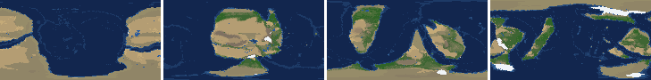
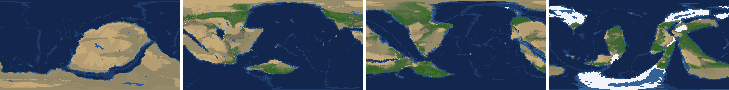
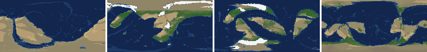
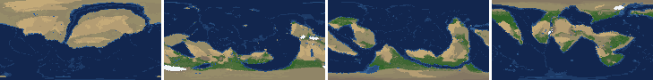
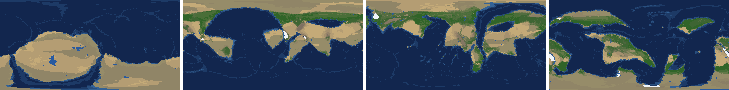
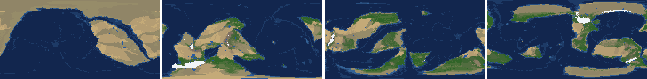
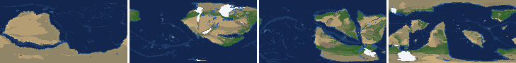
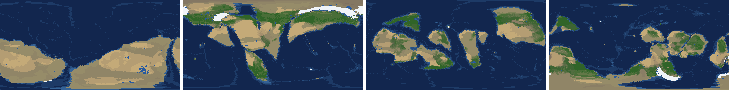

# Health sweep 2026-10-15 22:55

Commit 10ac1a4. 8 runs (default params, `--every 4`) at 8 workers x 1 numba threads; simulations 5.4 min wall. Made by `tools/health.py` (PW-246).

## Runs

| seed | L | Myr | run | sim s | trees / flowering trees from | dT range C | peaks > 9.5 km | giant-lake frames % | crust volume end/start | ice SL < -150 m % | <= 4 plates % |
|---|---|---|---|---|---|---|---|---|---|---|---|
| 1 | 6 | 500 | d7fbb5 | 320 | 132 / 412 | 11.1 | 0 | 2.7 | 0.916 | 0.0 | 0.0 |
| 2 | 6 | 500 | 1820c0 | 315 | 140 / 396 | 20.1 | 0 | 3.5 | 0.906 | 0.0 | 0.0 |
| 11 | 6 | 500 | df5b16 | 319 | 128 / 372 | 15.3 | 0 | 4.4 | 0.9 | 0.0 | 0.0 |
| 21 | 6 | 500 | c7fde9 | 319 | 136 / 404 | 11.0 | 0 | 10.6 | 0.912 | 0.0 | 0.0 |
| 3199 | 6 | 500 | aff233 | 316 | 132 / 376 | 9.8 | 0 | 2.7 | 0.897 | 0.0 | 0.0 |
| 42 | 6 | 500 | a25ace | 318 | 116 / 404 | 13.2 | 0 | 2.7 | 0.887 | 0.0 | 0.0 |
| 77 | 6 | 500 | b1811f | 321 | 124 / 416 | 11.5 | 0 | 13.3 | 0.916 | 0.0 | 0.0 |
| 505 | 6 | 500 | f8456c | 322 | 132 / 416 | 8.1 | 0 | 1.8 | 0.893 | 0.0 | 0.0 |

## Medians by seed (after 50 Myr; tree cover after forests, NPP after flowering trees appear)

| seed | L | land_pct | cont_pct | cont_km | plates | ocean_age | speed | sea_level | sea_ice_m | ice_pct | temp | co2 | dry_pct | inland_pct | lake_pct | lake_max_mkm2 | max_elev_km | trees_pct | npp | landmasses | largest_pct |
|---|---|---|---|---|---|---|---|---|---|---|---|---|---|---|---|---|---|---|---|---|---|
| 1 | 6 | 33.0 | 38.2 | 36.2 | 12.0 | 54.7 | 4.7 | 121.3 | -1.4 | 0.3 | 15.5 | -0.3 | 33.1 | 7.7 | 0.7 | 0.1 | 6.6 | 25.6 | 318.9 | 5.0 | 22.4 |
| 2 | 6 | 33.9 | 39.9 | 35.1 | 9.0 | 54.6 | 4.3 | 146.6 | -0.7 | 0.1 | 15.8 | -0.3 | 32.8 | 4.6 | 0.4 | 0.1 | 6.2 | 22.8 | 326.0 | 6.0 | 21.9 |
| 11 | 6 | 32.1 | 39.0 | 35.1 | 15.0 | 45.0 | 4.7 | 154.7 | -6.7 | 1.2 | 13.8 | -0.2 | 24.1 | 5.9 | 0.6 | 0.2 | 5.3 | 28.4 | 307.6 | 8.0 | 19.1 |
| 21 | 6 | 34.5 | 40.3 | 35.0 | 12.0 | 53.1 | 4.5 | 111.7 | -1.1 | 0.2 | 16.9 | -0.2 | 27.4 | 5.4 | 0.5 | 0.2 | 5.2 | 22.8 | 341.5 | 7.0 | 26.9 |
| 3199 | 6 | 33.4 | 39.6 | 35.5 | 13.0 | 44.9 | 4.9 | 154.7 | -0.4 | 0.1 | 16.1 | 0.0 | 32.8 | 5.7 | 0.4 | 0.1 | 5.1 | 22.0 | 317.6 | 5.0 | 27.9 |
| 42 | 6 | 33.2 | 38.1 | 35.9 | 14.0 | 43.9 | 4.5 | 208.1 | -2.9 | 0.5 | 14.6 | -0.3 | 28.9 | 5.7 | 0.5 | 0.1 | 6.6 | 22.3 | 265.8 | 6.0 | 18.6 |
| 77 | 6 | 33.8 | 38.8 | 36.2 | 12.0 | 57.9 | 4.5 | 0.1 | -5.1 | 0.8 | 12.5 | -0.3 | 29.9 | 7.0 | 0.6 | 0.1 | 6.2 | 28.8 | 295.4 | 8.0 | 23.4 |
| 505 | 6 | 32.7 | 39.8 | 34.7 | 13.0 | 48.7 | 4.3 | 178.7 | -1.5 | 0.3 | 15.5 | -0.3 | 26.4 | 4.3 | 0.5 | 0.1 | 6.6 | 27.4 | 348.0 | 7.0 | 17.4 |

Measured on the run's keyframes (no slicing). A keyframe's rivers and lakes are routed on its own terrain (PW-239), so `inland_raw_pct` (every routed end on land, as highlights counts it) and `inland_pct` (ends that are closed lakes, salt pans or real pits) agree but for ends under land ice. Land ice and land shares use cells (near-equal area).

## Envelopes

| metric | low | high | Earth | source |
|---|---|---|---|---|
| land, % of surface (`land_pct`) | 22 | 42 | 29.20 | tests/test_envelopes.py (22-42%); Earth 29.2% |
| continental crust, % of surface (`cont_pct`) | 33 | 50 | 41 | tests/test_envelopes.py (33-50%); Earth ~41% with shelves (Cogley 1984) |
| mean continental crust thickness, km (`cont_km`) | 31 | 40 | 39 | target 35 km (PW-238, continental_thickness); Earth ~39 km (Christensen & Mooney 1995); known thinning to 32-33 km (PW-046) |
| plates (`plates`) | 5 | 30 | 15 | tests/test_envelopes.py (5-30; max_plates 30); Earth 7 major + ~8 minor; <= 4 is the PW-191 collapse |
| mean ocean-floor age, Myr (`ocean_age`) | 25 | 120 | 64 | tests/test_envelopes.py (25-120); Earth ~64 Myr (Mueller et al. 2008); PW-051 |
| mean plate speed, cm/yr (`speed`) | 2 | 9 | 4.50 | tests/test_envelopes.py (2-9 cm/yr); Earth ~4-5 |
| sea level, m (ice + ocean basins) (`sea_level`) | -250 | 300 | 0 | Phanerozoic ~-130 (LGM) .. +250 m (earth.py; Haq & Schutter 2008); -250: PW-240's hard goal |
| sea level from land ice, m (`sea_ice_m`) | -250 | - | 0 | Earth LGM ~-130 m; PW-240 goal -150 m typical / -250 m worst |
| land ice, % of surface (`ice_pct`) | - | 10 | 3.10 | Earth 3.1% now (earth.EARTH_ICE), ~7-8% at the LGM |
| global mean temperature, C (`temp`) | 8 | 30 | 14.50 | Earth 14.5 C; LGM ~8 C (Tierney et al. 2020); Phanerozoic hothouses to ~30 C (Scotese et al. 2021) |
| CO2 index (ln source/sink) (`co2`) | -1.5 | 1.5 | 0.00 | the forcing's clip in earth.py (+-1.5); Earth 0 |
| arid (Koppen B), % of land (`dry_pct`) | 12 | 45 | 30 | tests/test_envelopes.py (12-45%); Earth ~30% (Beck et al. 2018) |
| land draining inland, % of ice-free land (to a closed lake, salt pan or real pit) (`inland_pct`) | 8 | 30 | 18 | Earth ~18% (overview 2.9); L6 known ~9.5-11% (PW-054, PW-243). `inland_raw_pct` (not checked) follows the stored `downstream` to any end, as highlights does; since PW-239 the two agree but for ends under land ice |
| lakes, % of land (`lake_pct`) | 0.2 | 3.0 | 1.80 | Earth ~1.8% of ice-free land (HydroLAKES, Messager et al. 2016); generated L6 worlds 0.5-1% |
| largest lake, million km2 (`lake_max_mkm2`) | - | 1.0 | 0.37 | Caspian 0.37 Mkm2; 1 Mkm2 = the overview's giant lake (2.9) |
| highest peak, km (`max_elev_km`) | - | 9.5 | 8.85 | Everest 8.85 km; PW-172 (spikes above ~9.5 km) |
| tree cover, % of ice-free land (after forests appear) (`trees_pct`) | 10 | 50 | 30 | Earth ~30% potential canopy (forest 55-60 of ~130 Mkm2, overview 2.18) |
| land NPP, g C/m2/yr (after flowering trees appear) (`npp`) | 200 | 700 | 430 | Earth ~56 Pg C/yr over ~130 Mkm2 = ~430; the model on Earth's terrain 50 Pg C/yr, ~385 (overview 2.18). Before flowering trees (plant group 4) stand-ins grow at 70%, so runs sit at ~150-280 |
| landmasses (>= 3 cells) (`landmasses`) | 3 | 80 | - | loose: a lone supercontinent or a shattered archipelago |
| largest landmass, % of surface (`largest_pct`) | 5 | 35 | 16.60 | Afro-Eurasia 16.6%; a Pangaea ~30% (scorecard largest_max) |
| global temperature range over the run, C (`dT_range`, per run) | - | 25 | 25 | Phanerozoic 11-36 C (Scotese et al. 2021) |
| keyframes with a peak above 9.5 km (`peak_frames`, per run) | - | 0 | 0 | PW-172 (L7 seed 3199: 3 of 251) |
| % of keyframes with a lake over 1 Mkm2 (`giant_lake_frames`, per run) | - | 5 | 0 | overview 2.9 (L6: 3 of ~150 frames) |
| continental crust volume, end / start (`volume_ratio`, per run) | 0.9 | 1.1 | 1.0 | scorecard volume_ratio (x1.006) |
| % of keyframes with ice sea level below -150 m (`sea_ice_below_150`, per run) | - | 10 | 0 | PW-240 |
| % of keyframes with <= 4 plates (`low_plates`, per run) | - | 2 | 0 | PW-191 (L7 seed 21: 1%) |

## Top outliers (of 148 spells; severity = excess / band width x (0.2 + share of the run))

| seed | L | metric | Myr | frames | worst | envelope | severity |
|---|---|---|---|---|---|---|---|
| 77 | 6 | giant_lake_frames | run | - | 13.30 | -..5 | 1.66 |
| 21 | 6 | giant_lake_frames | run | - | 10.60 | -..5 | 1.12 |
| 21 | 6 | lake_max_mkm2 | 104-104 | 1 | 5.75 | -..1.0 | 0.988 |
| 77 | 6 | lake_max_mkm2 | 484-488 | 2 | 4.91 | -..1.0 | 0.843 |
| 77 | 6 | lake_max_mkm2 | 464-472 | 3 | 4.07 | -..1.0 | 0.688 |
| 2 | 6 | lake_max_mkm2 | 80-80 | 1 | 4.12 | -..1.0 | 0.649 |
| 11 | 6 | lake_max_mkm2 | 168-168 | 1 | 3.95 | -..1.0 | 0.613 |
| 77 | 6 | lake_max_mkm2 | 412-432 | 4 | 3.00 | -..1.0 | 0.464 |
| 21 | 6 | lake_max_mkm2 | 160-164 | 2 | 2.91 | -..1.0 | 0.413 |
| 77 | 6 | lake_max_mkm2 | 68-68 | 1 | 2.96 | -..1.0 | 0.408 |
| 1 | 6 | lake_max_mkm2 | 52-52 | 1 | 2.76 | -..1.0 | 0.367 |
| 1 | 6 | lake_max_mkm2 | 312-312 | 1 | 2.62 | -..1.0 | 0.336 |
| 42 | 6 | lake_max_mkm2 | 168-168 | 1 | 2.62 | -..1.0 | 0.336 |
| 77 | 6 | lake_max_mkm2 | 80-80 | 1 | 2.37 | -..1.0 | 0.284 |
| 77 | 6 | lake_max_mkm2 | 384-388 | 2 | 2.29 | -..1.0 | 0.279 |
| 42 | 6 | lake_max_mkm2 | 100-100 | 1 | 2.27 | -..1.0 | 0.263 |
| 21 | 6 | lake_max_mkm2 | 272-284 | 3 | 2.10 | -..1.0 | 0.247 |
| 21 | 6 | lake_max_mkm2 | 300-300 | 1 | 2.18 | -..1.0 | 0.245 |
| 2 | 6 | inland_pct | 236-500 | 64 | 1.06 | 8..30 | 0.223 |
| 505 | 6 | lake_max_mkm2 | 92-100 | 2 | 2.03 | -..1.0 | 0.222 |
| 11 | 6 | inland_pct | 300-500 | 51 | 0.24 | 8..30 | 0.213 |
| 21 | 6 | inland_pct | 288-500 | 53 | 0.93 | 8..30 | 0.199 |
| 21 | 6 | lake_max_mkm2 | 184-192 | 2 | 1.88 | -..1.0 | 0.19 |
| 3199 | 6 | inland_pct | 284-500 | 50 | 1.06 | 8..30 | 0.188 |
| 505 | 6 | inland_pct | 52-228 | 42 | 1.20 | 8..30 | 0.165 |
| 42 | 6 | inland_pct | 352-488 | 35 | 0.88 | 8..30 | 0.155 |
| 1 | 6 | inland_pct | 328-500 | 43 | 1.74 | 8..30 | 0.154 |
| 505 | 6 | inland_pct | 336-500 | 42 | 1.74 | 8..30 | 0.152 |
| 3199 | 6 | dry_pct | 52-96 | 12 | 61.29 | 12..45 | 0.146 |
| 1 | 6 | dry_pct | 144-244 | 25 | 56.98 | 12..45 | 0.145 |

## Per seed: min / median / max after the 50 Myr spin-up, and spells outside the envelopes

### Seed 1, L6 (run d7fbb5)

*At 48, 200, 348, 500 Myr: sea by depth, land green by tree cover / tan where arid, shaded by height, ice white, lakes blue.*

| metric | min | median | max | outside (Myr: worst) |
|---|---|---|---|---|
| land_pct | 30.79 | 33.02 | 38.57 |  |
| cont_pct | 35.71 | 38.25 | 42.69 |  |
| cont_km | 34.57 | 36.16 | 39.73 |  |
| plates | 7.00 | 12.00 | 17.00 |  |
| ocean_age | 30.60 | 54.70 | 71.30 |  |
| speed | 2.93 | 4.71 | 8.40 |  |
| sea_level | -57.60 | 121.30 | 223.90 |  |
| sea_ice_m | -15.40 | -1.40 | -0.00 |  |
| ice_pct | 0.00 | 0.30 | 2.40 |  |
| temp | 8.70 | 15.50 | 19.80 |  |
| co2 | -1.27 | -0.33 | 0.13 |  |
| dry_pct | 15.31 | 33.08 | 56.98 | 144-244: 56.98 |
| inland_pct | 1.74 | 7.66 | 37.34 | 72-128: 1.79; 184-192: 37.34; 248-248: 31.33; 284-300: 6.70; +1 more |
| lake_pct | 0.08 | 0.65 | 3.68 | 52-52: 3.68; 72-72: 0.11; 88-108: 0.08; 120-120: 0.10 |
| lake_max_mkm2 | 0.01 | 0.15 | 2.76 | 52-52: 2.76; 212-212: 1.38; 312-312: 2.62 |
| max_elev_km | 2.02 | 6.60 | 7.98 |  |
| trees_pct | 12.12 | 25.57 | 43.39 |  |
| npp | 222.50 | 318.90 | 342.90 |  |
| landmasses | 1.00 | 5.00 | 12.00 | 52-52: 2; 172-172: 2; 192-192: 2; 208-220: 1; +1 more |
| largest_pct | 7.80 | 22.40 | 33.60 |  |

### Seed 2, L6 (run 1820c0)

*At 48, 200, 348, 500 Myr: sea by depth, land green by tree cover / tan where arid, shaded by height, ice white, lakes blue.*

| metric | min | median | max | outside (Myr: worst) |
|---|---|---|---|---|
| land_pct | 29.47 | 33.85 | 37.91 |  |
| cont_pct | 37.77 | 39.86 | 43.05 |  |
| cont_km | 33.85 | 35.12 | 37.21 |  |
| plates | 5.00 | 9.00 | 16.00 |  |
| ocean_age | 32.00 | 54.60 | 104.60 |  |
| speed | 1.79 | 4.33 | 7.61 | 240-252: 1.79 |
| sea_level | -167.60 | 146.60 | 234.40 |  |
| sea_ice_m | -93.50 | -0.70 | -0.00 |  |
| ice_pct | 0.00 | 0.10 | 8.10 |  |
| temp | 1.90 | 15.80 | 22.00 | 480-500: 1.90 |
| co2 | -0.91 | -0.28 | 0.32 |  |
| dry_pct | 15.02 | 32.81 | 51.84 | 52-60: 51.84; 80-88: 47.23 |
| inland_pct | 1.06 | 4.59 | 21.25 | 68-144: 1.60; 160-164: 3.84; 236-500: 1.06 |
| lake_pct | 0.07 | 0.40 | 4.08 | 56-56: 0.07; 68-92: 4.08; 104-112: 0.15; 128-128: 0.16; +5 more |
| lake_max_mkm2 | 0.03 | 0.10 | 4.12 | 52-52: 1.68; 80-80: 4.12; 148-148: 1.43; 452-452: 1.18 |
| max_elev_km | 1.84 | 6.20 | 8.50 |  |
| trees_pct | 13.85 | 22.75 | 43.30 |  |
| npp | 212.40 | 326.00 | 365.30 |  |
| landmasses | 2.00 | 6.00 | 13.00 | 52-68: 2; 244-260: 2 |
| largest_pct | 11.30 | 21.90 | 34.50 |  |

### Seed 11, L6 (run df5b16)

*At 48, 200, 348, 500 Myr: sea by depth, land green by tree cover / tan where arid, shaded by height, ice white, lakes blue.*

| metric | min | median | max | outside (Myr: worst) |
|---|---|---|---|---|
| land_pct | 30.85 | 32.11 | 38.21 |  |
| cont_pct | 37.27 | 38.98 | 42.89 |  |
| cont_km | 34.63 | 35.15 | 37.59 |  |
| plates | 7.00 | 15.00 | 19.00 |  |
| ocean_age | 32.20 | 45.00 | 62.60 |  |
| speed | 2.84 | 4.65 | 8.03 |  |
| sea_level | -4.50 | 154.70 | 223.30 |  |
| sea_ice_m | -33.20 | -6.70 | -0.00 |  |
| ice_pct | 0.00 | 1.20 | 3.90 |  |
| temp | 5.10 | 13.80 | 20.40 | 172-196: 5.10 |
| co2 | -0.85 | -0.19 | 0.01 |  |
| dry_pct | 9.62 | 24.10 | 44.23 | 352-408: 9.62 |
| inland_pct | 0.24 | 5.93 | 21.35 | 64-148: 1.61; 160-188: 4.38; 236-248: 6.28; 300-500: 0.24 |
| lake_pct | 0.10 | 0.57 | 2.83 | 76-76: 0.17; 120-124: 0.10; 464-464: 0.18; 476-488: 0.12 |
| lake_max_mkm2 | 0.01 | 0.20 | 3.95 | 68-68: 1.16; 88-96: 1.54; 168-168: 3.95; 276-276: 1.01 |
| max_elev_km | 1.75 | 5.27 | 8.40 |  |
| trees_pct | 14.12 | 28.39 | 54.87 | 364-408: 54.87 |
| npp | 239.20 | 307.60 | 405.90 |  |
| landmasses | 3.00 | 8.00 | 13.00 |  |
| largest_pct | 10.70 | 19.10 | 34.10 |  |

### Seed 21, L6 (run c7fde9)

*At 48, 200, 348, 500 Myr: sea by depth, land green by tree cover / tan where arid, shaded by height, ice white, lakes blue.*

| metric | min | median | max | outside (Myr: worst) |
|---|---|---|---|---|
| land_pct | 31.94 | 34.53 | 37.94 |  |
| cont_pct | 38.54 | 40.31 | 43.78 |  |
| cont_km | 34.02 | 34.98 | 36.99 |  |
| plates | 8.00 | 12.00 | 20.00 |  |
| ocean_age | 34.70 | 53.10 | 61.40 |  |
| speed | 2.88 | 4.51 | 7.07 |  |
| sea_level | 35.60 | 111.70 | 207.90 |  |
| sea_ice_m | -8.10 | -1.10 | -0.00 |  |
| ice_pct | 0.00 | 0.20 | 1.30 |  |
| temp | 12.10 | 16.90 | 23.10 |  |
| co2 | -0.76 | -0.19 | 0.13 |  |
| dry_pct | 16.43 | 27.37 | 47.99 | 52-60: 47.99 |
| inland_pct | 0.93 | 5.36 | 17.29 | 68-124: 1.31; 136-140: 1.19; 172-172: 5.74; 204-208: 6.11; +2 more |
| lake_pct | 0.09 | 0.49 | 3.34 | 68-68: 0.18; 80-112: 3.34; 124-124: 0.16; 296-296: 0.18; +2 more |
| lake_max_mkm2 | 0.03 | 0.17 | 5.75 | 56-56: 1.06; 104-104: 5.75; 160-164: 2.91; 184-192: 1.88; +4 more |
| max_elev_km | 1.53 | 5.16 | 8.35 |  |
| trees_pct | 10.32 | 22.75 | 44.40 |  |
| npp | 231.80 | 341.50 | 347.20 |  |
| landmasses | 1.00 | 7.00 | 15.00 | 60-60: 2; 256-268: 1; 280-296: 2; 500-500: 2 |
| largest_pct | 12.20 | 26.90 | 35.00 |  |

### Seed 3199, L6 (run aff233)

*At 48, 200, 348, 500 Myr: sea by depth, land green by tree cover / tan where arid, shaded by height, ice white, lakes blue.*

| metric | min | median | max | outside (Myr: worst) |
|---|---|---|---|---|
| land_pct | 31.21 | 33.39 | 38.83 |  |
| cont_pct | 37.25 | 39.60 | 42.93 |  |
| cont_km | 34.30 | 35.55 | 37.66 |  |
| plates | 9.00 | 13.00 | 20.00 |  |
| ocean_age | 37.40 | 44.90 | 56.90 |  |
| speed | 3.95 | 4.92 | 7.15 |  |
| sea_level | -29.60 | 154.70 | 204.40 |  |
| sea_ice_m | -4.80 | -0.40 | -0.00 |  |
| ice_pct | 0.00 | 0.10 | 0.90 |  |
| temp | 11.20 | 16.10 | 21.00 |  |
| co2 | -0.68 | 0.01 | 0.48 |  |
| dry_pct | 15.83 | 32.84 | 61.29 | 52-96: 61.29; 272-272: 45.28 |
| inland_pct | 1.06 | 5.66 | 23.02 | 72-176: 1.13; 196-228: 1.90; 252-252: 7.33; 264-264: 7.30; +1 more |
| lake_pct | 0.01 | 0.39 | 2.67 | 76-108: 0.01; 132-132: 0.03; 144-144: 0.15; 220-220: 0.19; +1 more |
| lake_max_mkm2 | 0.01 | 0.11 | 1.43 | 56-56: 1.43; 68-68: 1.36; 216-216: 1.36 |
| max_elev_km | 1.60 | 5.08 | 8.27 |  |
| trees_pct | 11.03 | 21.98 | 35.78 |  |
| npp | 251.40 | 317.60 | 351.80 |  |
| landmasses | 2.00 | 5.00 | 10.00 | 52-64: 2; 188-188: 2 |
| largest_pct | 13.40 | 27.90 | 34.50 |  |

### Seed 42, L6 (run a25ace)

*At 48, 200, 348, 500 Myr: sea by depth, land green by tree cover / tan where arid, shaded by height, ice white, lakes blue.*

| metric | min | median | max | outside (Myr: worst) |
|---|---|---|---|---|
| land_pct | 29.74 | 33.20 | 38.25 |  |
| cont_pct | 36.58 | 38.09 | 42.79 |  |
| cont_km | 34.69 | 35.87 | 37.36 |  |
| plates | 9.00 | 14.00 | 19.00 |  |
| ocean_age | 34.80 | 43.90 | 74.60 |  |
| speed | 2.90 | 4.45 | 7.33 |  |
| sea_level | -1.50 | 208.10 | 235.10 |  |
| sea_ice_m | -21.20 | -2.90 | -0.00 |  |
| ice_pct | 0.00 | 0.50 | 2.60 |  |
| temp | 7.80 | 14.60 | 21.00 | 452-452: 7.80 |
| co2 | -0.93 | -0.26 | 0.01 |  |
| dry_pct | 17.32 | 28.86 | 47.98 | 244-284: 47.98 |
| inland_pct | 0.27 | 5.67 | 17.97 | 64-136: 0.27; 148-156: 5.88; 272-300: 3.69; 316-340: 3.72; +2 more |
| lake_pct | 0.05 | 0.51 | 2.84 | 56-108: 0.05; 120-124: 0.06 |
| lake_max_mkm2 | 0.01 | 0.11 | 2.62 | 100-100: 2.27; 168-168: 2.62; 260-260: 1.28 |
| max_elev_km | 1.89 | 6.58 | 8.16 |  |
| trees_pct | 11.78 | 22.28 | 35.16 |  |
| npp | 251.60 | 265.80 | 286.80 |  |
| landmasses | 3.00 | 6.00 | 10.00 |  |
| largest_pct | 9.10 | 18.60 | 33.30 |  |

### Seed 77, L6 (run b1811f)

*At 48, 200, 348, 500 Myr: sea by depth, land green by tree cover / tan where arid, shaded by height, ice white, lakes blue.*

| metric | min | median | max | outside (Myr: worst) |
|---|---|---|---|---|
| land_pct | 31.26 | 33.83 | 38.64 |  |
| cont_pct | 36.94 | 38.76 | 43.53 |  |
| cont_km | 33.92 | 36.19 | 38.65 |  |
| plates | 7.00 | 12.00 | 15.00 |  |
| ocean_age | 35.80 | 57.90 | 92.20 |  |
| speed | 2.33 | 4.45 | 7.88 |  |
| sea_level | -182.10 | 0.10 | 171.80 |  |
| sea_ice_m | -24.30 | -5.10 | -0.00 |  |
| ice_pct | 0.00 | 0.80 | 2.60 |  |
| temp | 7.00 | 12.50 | 18.50 | 136-148: 7.00 |
| co2 | -0.87 | -0.25 | 0.35 |  |
| dry_pct | 13.61 | 29.91 | 49.73 | 236-284: 49.73 |
| inland_pct | 0.48 | 7.00 | 25.92 | 64-176: 0.48; 288-380: 1.10; 396-424: 2.34; 436-460: 2.84; +2 more |
| lake_pct | 0.04 | 0.61 | 3.83 | 52-72: 3.83; 88-120: 0.07; 132-132: 0.11; 200-200: 3.06; +1 more |
| lake_max_mkm2 | 0.03 | 0.15 | 4.91 | 68-68: 2.96; 80-80: 2.37; 104-104: 1.41; 220-220: 1.10; +4 more |
| max_elev_km | 1.63 | 6.15 | 7.75 |  |
| trees_pct | 21.75 | 28.82 | 36.07 |  |
| npp | 219.90 | 295.45 | 330.70 |  |
| landmasses | 2.00 | 8.00 | 14.00 | 52-56: 2 |
| largest_pct | 9.30 | 23.40 | 33.90 |  |

### Seed 505, L6 (run f8456c)

*At 48, 200, 348, 500 Myr: sea by depth, land green by tree cover / tan where arid, shaded by height, ice white, lakes blue.*

| metric | min | median | max | outside (Myr: worst) |
|---|---|---|---|---|
| land_pct | 31.21 | 32.69 | 38.24 |  |
| cont_pct | 37.81 | 39.84 | 43.51 |  |
| cont_km | 33.84 | 34.74 | 37.23 |  |
| plates | 9.00 | 13.00 | 17.00 |  |
| ocean_age | 34.00 | 48.70 | 63.50 |  |
| speed | 3.31 | 4.28 | 6.96 |  |
| sea_level | 86.70 | 178.70 | 231.00 |  |
| sea_ice_m | -11.70 | -1.50 | -0.00 |  |
| ice_pct | 0.00 | 0.30 | 2.60 |  |
| temp | 11.30 | 15.50 | 19.40 |  |
| co2 | -0.72 | -0.26 | 0.17 |  |
| dry_pct | 20.37 | 26.36 | 41.60 |  |
| inland_pct | 1.20 | 4.30 | 14.02 | 52-228: 1.20; 252-252: 6.97; 264-264: 7.79; 284-324: 4.38; +1 more |
| lake_pct | 0.08 | 0.55 | 2.36 | 60-72: 0.11; 96-132: 0.08; 444-444: 0.17 |
| lake_max_mkm2 | 0.03 | 0.14 | 2.03 | 92-100: 2.03 |
| max_elev_km | 1.98 | 6.60 | 8.26 |  |
| trees_pct | 20.13 | 27.35 | 48.36 |  |
| npp | 185.40 | 348.00 | 384.30 | 424-432: 185.40 |
| landmasses | 2.00 | 7.00 | 16.00 | 56-60: 2 |
| largest_pct | 8.90 | 17.40 | 33.40 |  |

## Determinism

(not run)
