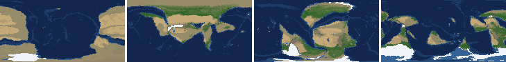
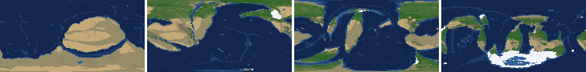
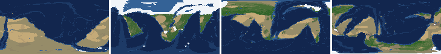
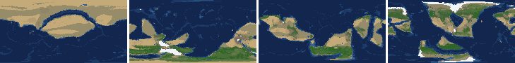
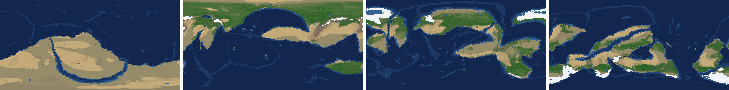
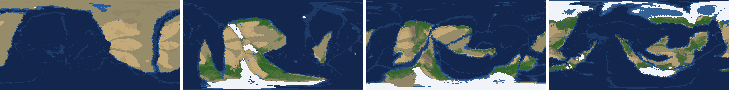
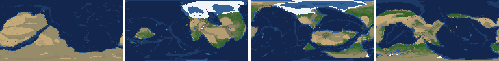
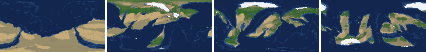

# Health sweep 2026-10-16 20:05

Commit d1a0f77+dirty. 8 runs (default params, `--every 4`) at 8 workers x 2 numba threads; simulations 8.1 min wall. Made by `tools/health.py` (PW-246).

## Runs

| seed | L | Myr | run | sim s | trees / flowering trees from | dT range C | peaks > 9.5 km | giant-lake frames % | crust volume end/start | ice SL < -150 m % | <= 4 plates % |
|---|---|---|---|---|---|---|---|---|---|---|---|
| 1 | 6 | 500 | bbb610 | 382 | 132 / 412 | 11.6 | 0 | 0.0 | 0.945 | 0.0 | 0.0 |
| 2 | 6 | 500 | 4437e5 | 327 | 140 / 396 | 20.4 | 0 | 1.8 | 0.959 | 0.0 | 0.0 |
| 11 | 6 | 500 | c3cf2a | 387 | 128 / 372 | 19.6 | 0 | 4.4 | 0.933 | 12.4 | 0.0 |
| 21 | 6 | 500 | 39d815 | 302 | 136 / 404 | 10.3 | 0 | 7.1 | 0.963 | 0.0 | 0.0 |
| 3199 | 6 | 500 | 67758d | 345 | 132 / 376 | 11.3 | 0 | 3.5 | 0.958 | 0.0 | 0.0 |
| 42 | 6 | 500 | 585476 | 431 | 116 / 404 | 10.2 | 0 | 9.7 | 0.976 | 0.0 | 0.0 |
| 77 | 6 | 500 | d997ad | 483 | 124 / 416 | 13.1 | 0 | 6.2 | 0.967 | 0.0 | 0.0 |
| 505 | 6 | 500 | 048e80 | 365 | 132 / 416 | 9.0 | 0 | 1.8 | 0.958 | 0.0 | 0.0 |

## Medians by seed (after 50 Myr; tree cover after forests, NPP after flowering trees appear)

| seed | L | land_pct | cont_pct | cont_km | plates | ocean_age | speed | sea_level | sea_ice_m | ice_pct | temp | co2 | dry_pct | inland_pct | lake_pct | lake_max_mkm2 | max_elev_km | trees_pct | npp | landmasses | largest_pct |
|---|---|---|---|---|---|---|---|---|---|---|---|---|---|---|---|---|---|---|---|---|---|
| 1 | 6 | 33.4 | 39.8 | 33.9 | 10.0 | 60.0 | 4.9 | -100.5 | -5.5 | 1.1 | 14.9 | -0.3 | 33.5 | 3.1 | 0.3 | 0.1 | 6.1 | 24.2 | 340.0 | 5.0 | 25.9 |
| 2 | 6 | 33.8 | 40.4 | 33.9 | 11.0 | 54.9 | 4.2 | -11.1 | -1.3 | 0.2 | 16.2 | -0.3 | 25.9 | 3.1 | 0.3 | 0.1 | 5.1 | 27.1 | 350.1 | 7.0 | 22.2 |
| 11 | 6 | 32.8 | 40.6 | 33.3 | 12.0 | 51.6 | 4.3 | -16.7 | -5.6 | 0.9 | 13.5 | -0.3 | 23.2 | 2.2 | 0.3 | 0.1 | 5.0 | 31.3 | 345.0 | 6.0 | 30.3 |
| 21 | 6 | 32.5 | 38.6 | 34.8 | 14.0 | 47.2 | 4.5 | 73.9 | -1.1 | 0.2 | 16.5 | -0.3 | 29.4 | 4.7 | 0.4 | 0.1 | 6.0 | 24.8 | 341.3 | 7.0 | 17.2 |
| 3199 | 6 | 34.0 | 40.0 | 33.9 | 11.0 | 56.0 | 4.4 | -29.5 | -2.4 | 0.4 | 14.7 | -0.3 | 27.3 | 3.1 | 0.3 | 0.1 | 5.3 | 26.4 | 361.2 | 7.0 | 22.9 |
| 42 | 6 | 32.1 | 40.1 | 34.0 | 11.0 | 55.4 | 4.4 | -68.2 | -18.8 | 3.0 | 14.3 | -0.2 | 25.6 | 5.7 | 0.5 | 0.1 | 6.4 | 24.2 | 366.2 | 5.0 | 20.4 |
| 77 | 6 | 31.9 | 40.1 | 33.9 | 11.0 | 51.4 | 4.3 | -128.7 | -29.8 | 4.4 | 12.2 | -0.4 | 27.9 | 3.8 | 0.4 | 0.1 | 4.9 | 30.6 | 326.9 | 8.0 | 28.8 |
| 505 | 6 | 32.6 | 40.5 | 33.1 | 10.0 | 58.1 | 4.0 | -58.1 | -10.1 | 1.6 | 14.7 | -0.4 | 25.4 | 3.1 | 0.4 | 0.1 | 6.4 | 26.2 | 393.1 | 8.0 | 18.9 |

Measured on the run's keyframes (no slicing). A keyframe's rivers and lakes are routed on its own terrain (PW-239), so `inland_raw_pct` (every routed end on land, as highlights counts it) and `inland_pct` (ends that are closed lakes, salt pans or real pits) agree but for ends under land ice. Land ice and land shares use cells (near-equal area).

## Envelopes

| metric | low | high | Earth | source |
|---|---|---|---|---|
| land, % of surface (`land_pct`) | 22 | 42 | 29.20 | tests/test_envelopes.py (22-42%); Earth 29.2% |
| continental crust, % of surface (`cont_pct`) | 33 | 50 | 41 | tests/test_envelopes.py (33-50%); Earth ~41% with shelves (Cogley 1984) |
| mean continental crust thickness, km (`cont_km`) | 31 | 40 | 39 | target 35 km (PW-238, continental_thickness); Earth ~39 km (Christensen & Mooney 1995); known thinning to 32-33 km (PW-046) |
| plates (`plates`) | 5 | 30 | 15 | tests/test_envelopes.py (5-30; max_plates 30); Earth 7 major + ~8 minor; <= 4 is the PW-191 collapse |
| mean ocean-floor age, Myr (`ocean_age`) | 25 | 120 | 64 | tests/test_envelopes.py (25-120); Earth ~64 Myr (Mueller et al. 2008); PW-051 |
| mean plate speed, cm/yr (`speed`) | 2 | 9 | 4.50 | tests/test_envelopes.py (2-9 cm/yr); Earth ~4-5 |
| sea level, m (ice + ocean basins) (`sea_level`) | -250 | 300 | 0 | Phanerozoic ~-130 (LGM) .. +250 m (earth.py; Haq & Schutter 2008); -250: PW-240's hard goal |
| sea level from land ice, m (`sea_ice_m`) | -250 | - | 0 | Earth LGM ~-130 m; PW-240 goal -150 m typical / -250 m worst |
| land ice, % of surface (`ice_pct`) | - | 10 | 3.10 | Earth 3.1% now (earth.EARTH_ICE), ~7-8% at the LGM |
| global mean temperature, C (`temp`) | 8 | 30 | 14.50 | Earth 14.5 C; LGM ~8 C (Tierney et al. 2020); Phanerozoic hothouses to ~30 C (Scotese et al. 2021) |
| CO2 index (ln source/sink) (`co2`) | -1.5 | 1.5 | 0.00 | the forcing's clip in earth.py (+-1.5); Earth 0 |
| arid (Koppen B), % of land (`dry_pct`) | 12 | 45 | 30 | tests/test_envelopes.py (12-45%); Earth ~30% (Beck et al. 2018) |
| land draining inland, % of ice-free land (to a closed lake, salt pan or real pit) (`inland_pct`) | 8 | 30 | 18 | Earth ~18% (overview 2.9); L6 known ~9.5-11% (PW-054, PW-243). `inland_raw_pct` (not checked) follows the stored `downstream` to any end, as highlights does; since PW-239 the two agree but for ends under land ice |
| lakes, % of land (`lake_pct`) | 0.2 | 3.0 | 1.80 | Earth ~1.8% of ice-free land (HydroLAKES, Messager et al. 2016); generated L6 worlds 0.5-1% |
| largest lake, million km2 (`lake_max_mkm2`) | - | 1.0 | 0.37 | Caspian 0.37 Mkm2; 1 Mkm2 = the overview's giant lake (2.9) |
| highest peak, km (`max_elev_km`) | - | 9.5 | 8.85 | Everest 8.85 km; PW-172 (spikes above ~9.5 km) |
| tree cover, % of ice-free land (after forests appear) (`trees_pct`) | 10 | 50 | 30 | Earth ~30% potential canopy (forest 55-60 of ~130 Mkm2, overview 2.18) |
| land NPP, g C/m2/yr (after flowering trees appear) (`npp`) | 200 | 700 | 430 | Earth ~56 Pg C/yr over ~130 Mkm2 = ~430; the model on Earth's terrain 50 Pg C/yr, ~385 (overview 2.18). Before flowering trees (plant group 4) stand-ins grow at 70%, so runs sit at ~150-280 |
| landmasses (>= 3 cells) (`landmasses`) | 3 | 80 | - | loose: a lone supercontinent or a shattered archipelago |
| largest landmass, % of surface (`largest_pct`) | 5 | 35 | 16.60 | Afro-Eurasia 16.6%; a Pangaea ~30% (scorecard largest_max) |
| global temperature range over the run, C (`dT_range`, per run) | - | 25 | 25 | Phanerozoic 11-36 C (Scotese et al. 2021) |
| keyframes with a peak above 9.5 km (`peak_frames`, per run) | - | 0 | 0 | PW-172 (L7 seed 3199: 3 of 251) |
| % of keyframes with a lake over 1 Mkm2 (`giant_lake_frames`, per run) | - | 5 | 0 | overview 2.9 (L6: 3 of ~150 frames) |
| continental crust volume, end / start (`volume_ratio`, per run) | 0.9 | 1.1 | 1.0 | scorecard volume_ratio (x1.006) |
| % of keyframes with ice sea level below -150 m (`sea_ice_below_150`, per run) | - | 10 | 0 | PW-240 |
| % of keyframes with <= 4 plates (`low_plates`, per run) | - | 2 | 0 | PW-191 (L7 seed 21: 1%) |

## Top outliers (of 126 spells; severity = excess / band width x (0.2 + share of the run))

| seed | L | metric | Myr | frames | worst | envelope | severity |
|---|---|---|---|---|---|---|---|
| 42 | 6 | giant_lake_frames | run | - | 9.70 | -..5 | 0.94 |
| 42 | 6 | lake_max_mkm2 | 100-116 | 5 | 3.97 | -..1.0 | 0.712 |
| 11 | 6 | lake_max_mkm2 | 188-192 | 2 | 4.22 | -..1.0 | 0.695 |
| 2 | 6 | lake_max_mkm2 | 140-140 | 1 | 3.50 | -..1.0 | 0.52 |
| 2 | 6 | lake_max_mkm2 | 488-488 | 1 | 3.33 | -..1.0 | 0.483 |
| 21 | 6 | giant_lake_frames | run | - | 7.10 | -..5 | 0.42 |
| 3199 | 6 | lake_max_mkm2 | 52-52 | 1 | 2.84 | -..1.0 | 0.382 |
| 505 | 6 | inland_pct | 56-500 | 108 | 0.05 | 8..30 | 0.382 |
| 11 | 6 | inland_pct | 52-500 | 110 | 0.27 | 8..30 | 0.377 |
| 2 | 6 | inland_pct | 52-500 | 109 | 0.24 | 8..30 | 0.376 |
| 505 | 6 | lake_max_mkm2 | 296-300 | 2 | 2.67 | -..1.0 | 0.359 |
| 11 | 6 | sea_level | 164-272 | 28 | -641.30 | -250..300 | 0.3 |
| 11 | 6 | lake_max_mkm2 | 112-116 | 2 | 2.30 | -..1.0 | 0.281 |
| 11 | 6 | sea_ice_below_150 | run | - | 12.40 | -..10 | 0.24 |
| 77 | 6 | giant_lake_frames | run | - | 6.20 | -..5 | 0.24 |
| 77 | 6 | inland_pct | 200-500 | 74 | 1.49 | 8..30 | 0.233 |
| 3199 | 6 | inland_pct | 244-500 | 65 | 1.10 | 8..30 | 0.225 |
| 3199 | 6 | lake_max_mkm2 | 232-240 | 2 | 1.97 | -..1.0 | 0.209 |
| 1 | 6 | inland_pct | 280-500 | 54 | 0.82 | 8..30 | 0.205 |
| 21 | 6 | inland_pct | 292-500 | 51 | 1.10 | 8..30 | 0.19 |
| 1 | 6 | inland_pct | 52-212 | 40 | 0.14 | 8..30 | 0.185 |
| 42 | 6 | inland_pct | 276-472 | 45 | 0.73 | 8..30 | 0.184 |
| 3199 | 6 | inland_pct | 60-228 | 40 | 0.20 | 8..30 | 0.183 |
| 11 | 6 | ice_pct | 164-248 | 22 | 14.30 | -..10 | 0.161 |
| 77 | 6 | inland_pct | 60-184 | 31 | 0.27 | 8..30 | 0.157 |
| 21 | 6 | inland_pct | 64-188 | 30 | 0.21 | 8..30 | 0.155 |
| 21 | 6 | lake_max_mkm2 | 140-140 | 1 | 1.72 | -..1.0 | 0.149 |
| 3199 | 6 | lake_max_mkm2 | 180-180 | 1 | 1.63 | -..1.0 | 0.131 |
| 77 | 6 | lake_max_mkm2 | 304-304 | 1 | 1.61 | -..1.0 | 0.126 |
| 77 | 6 | lake_max_mkm2 | 488-488 | 1 | 1.52 | -..1.0 | 0.108 |

## Per seed: min / median / max after the 50 Myr spin-up, and spells outside the envelopes

### Seed 1, L6 (run bbb610)

*At 48, 200, 348, 500 Myr: sea by depth, land green by tree cover / tan where arid, shaded by height, ice white, lakes blue.*

| metric | min | median | max | outside (Myr: worst) |
|---|---|---|---|---|
| land_pct | 30.71 | 33.40 | 38.31 |  |
| cont_pct | 36.47 | 39.76 | 41.94 |  |
| cont_km | 33.41 | 33.93 | 36.81 |  |
| plates | 7.00 | 10.00 | 14.00 |  |
| ocean_age | 33.50 | 60.00 | 70.10 |  |
| speed | 2.26 | 4.92 | 6.45 |  |
| sea_level | -239.70 | -100.50 | 186.00 |  |
| sea_ice_m | -103.80 | -5.50 | -0.00 |  |
| ice_pct | 0.00 | 1.10 | 7.40 |  |
| temp | 8.00 | 14.90 | 19.60 |  |
| co2 | -1.19 | -0.33 | 0.19 |  |
| dry_pct | 14.81 | 33.55 | 48.58 | 248-288: 48.58 |
| inland_pct | 0.14 | 3.12 | 11.66 | 52-212: 0.14; 224-244: 5.87; 256-260: 3.66; 280-500: 0.82 |
| lake_pct | 0.01 | 0.34 | 1.03 | 52-192: 0.01 |
| lake_max_mkm2 | 0.01 | 0.06 | 0.93 |  |
| max_elev_km | 1.78 | 6.07 | 8.67 |  |
| trees_pct | 14.73 | 24.24 | 41.03 |  |
| npp | 204.40 | 340.00 | 393.80 |  |
| landmasses | 2.00 | 5.00 | 13.00 | 140-144: 2; 192-196: 2 |
| largest_pct | 17.70 | 25.90 | 34.80 |  |

### Seed 2, L6 (run 4437e5)

*At 48, 200, 348, 500 Myr: sea by depth, land green by tree cover / tan where arid, shaded by height, ice white, lakes blue.*

| metric | min | median | max | outside (Myr: worst) |
|---|---|---|---|---|
| land_pct | 30.51 | 33.80 | 38.04 |  |
| cont_pct | 37.99 | 40.39 | 42.45 |  |
| cont_km | 32.39 | 33.86 | 35.85 |  |
| plates | 7.00 | 11.00 | 15.00 |  |
| ocean_age | 32.80 | 54.90 | 78.70 |  |
| speed | 2.32 | 4.20 | 7.50 |  |
| sea_level | -352.70 | -11.10 | 193.90 | 484-500: -352.70 |
| sea_ice_m | -85.50 | -1.30 | -0.00 |  |
| ice_pct | 0.00 | 0.20 | 7.10 |  |
| temp | 2.20 | 16.20 | 22.60 | 468-500: 2.20 |
| co2 | -1.04 | -0.32 | 0.49 |  |
| dry_pct | 11.46 | 25.85 | 42.18 | 412-416: 11.46; 480-480: 11.96 |
| inland_pct | 0.24 | 3.06 | 12.68 | 52-500: 0.24 |
| lake_pct | 0.04 | 0.26 | 2.46 | 72-104: 0.04; 124-156: 0.11; 212-212: 0.18; 264-376: 0.06; +1 more |
| lake_max_mkm2 | 0.01 | 0.06 | 3.50 | 140-140: 3.50; 488-488: 3.33 |
| max_elev_km | 1.54 | 5.07 | 8.50 |  |
| trees_pct | 8.29 | 27.13 | 45.96 | 276-284: 8.29 |
| npp | 217.90 | 350.10 | 410.50 |  |
| landmasses | 2.00 | 7.00 | 18.00 | 52-64: 2; 168-168: 2 |
| largest_pct | 8.60 | 22.20 | 34.70 |  |

### Seed 11, L6 (run c3cf2a)

*At 48, 200, 348, 500 Myr: sea by depth, land green by tree cover / tan where arid, shaded by height, ice white, lakes blue.*

| metric | min | median | max | outside (Myr: worst) |
|---|---|---|---|---|
| land_pct | 29.26 | 32.78 | 37.91 |  |
| cont_pct | 39.22 | 40.56 | 43.22 |  |
| cont_km | 32.29 | 33.27 | 34.76 |  |
| plates | 6.00 | 12.00 | 18.00 |  |
| ocean_age | 34.50 | 51.60 | 91.10 |  |
| speed | 2.84 | 4.31 | 6.79 |  |
| sea_level | -641.30 | -16.70 | 193.70 | 164-272: -641.30; 496-500: -254.40 |
| sea_ice_m | -204.10 | -5.60 | -0.00 |  |
| ice_pct | 0.00 | 0.90 | 14.30 | 164-248: 14.30 |
| temp | 1.10 | 13.50 | 20.70 | 156-220: 1.10 |
| co2 | -1.05 | -0.28 | 0.11 |  |
| dry_pct | 15.75 | 23.21 | 38.82 |  |
| inland_pct | 0.27 | 2.20 | 12.05 | 52-500: 0.27 |
| lake_pct | 0.01 | 0.25 | 3.23 | 52-84: 0.01; 96-108: 0.03; 124-128: 0.16; 164-164: 0.12; +9 more |
| lake_max_mkm2 | 0.01 | 0.07 | 4.22 | 56-56: 1.44; 112-116: 2.30; 188-192: 4.22 |
| max_elev_km | 1.53 | 5.02 | 8.02 |  |
| trees_pct | 14.44 | 31.28 | 52.75 | 180-212: 52.75 |
| npp | 206.90 | 345.00 | 384.90 |  |
| landmasses | 2.00 | 6.00 | 15.00 | 224-224: 2 |
| largest_pct | 14.30 | 30.30 | 35.10 | 208-216: 35.10 |

### Seed 21, L6 (run 39d815)

*At 48, 200, 348, 500 Myr: sea by depth, land green by tree cover / tan where arid, shaded by height, ice white, lakes blue.*

| metric | min | median | max | outside (Myr: worst) |
|---|---|---|---|---|
| land_pct | 31.42 | 32.53 | 37.66 |  |
| cont_pct | 36.39 | 38.59 | 42.95 |  |
| cont_km | 32.75 | 34.78 | 36.83 |  |
| plates | 9.00 | 14.00 | 17.00 |  |
| ocean_age | 32.90 | 47.20 | 64.40 |  |
| speed | 3.05 | 4.52 | 7.34 |  |
| sea_level | -65.60 | 73.90 | 214.00 |  |
| sea_ice_m | -12.90 | -1.10 | -0.00 |  |
| ice_pct | 0.00 | 0.20 | 1.90 |  |
| temp | 12.00 | 16.50 | 22.30 |  |
| co2 | -0.88 | -0.32 | 0.14 |  |
| dry_pct | 16.53 | 29.41 | 47.49 | 52-64: 47.49 |
| inland_pct | 0.21 | 4.72 | 11.84 | 64-188: 0.21; 200-236: 4.21; 248-272: 5.08; 292-500: 1.10 |
| lake_pct | 0.01 | 0.41 | 1.62 | 52-52: 0.09; 72-120: 0.01; 144-144: 0.15; 388-396: 0.17 |
| lake_max_mkm2 | 0.01 | 0.10 | 1.72 | 56-56: 1.43; 140-140: 1.72; 160-160: 1.41; 176-180: 1.49; +3 more |
| max_elev_km | 1.48 | 5.98 | 8.29 |  |
| trees_pct | 11.49 | 24.82 | 41.87 |  |
| npp | 227.10 | 341.30 | 357.40 |  |
| landmasses | 3.00 | 7.00 | 13.00 |  |
| largest_pct | 10.80 | 17.20 | 33.30 |  |

### Seed 3199, L6 (run 67758d)

*At 48, 200, 348, 500 Myr: sea by depth, land green by tree cover / tan where arid, shaded by height, ice white, lakes blue.*

| metric | min | median | max | outside (Myr: worst) |
|---|---|---|---|---|
| land_pct | 30.80 | 34.04 | 38.46 |  |
| cont_pct | 37.17 | 40.01 | 42.79 |  |
| cont_km | 32.64 | 33.88 | 36.43 |  |
| plates | 6.00 | 11.00 | 17.00 |  |
| ocean_age | 37.30 | 56.00 | 89.90 |  |
| speed | 2.66 | 4.40 | 7.13 |  |
| sea_level | -331.40 | -29.50 | 163.10 | 260-336: -331.40 |
| sea_ice_m | -75.80 | -2.40 | -0.00 |  |
| ice_pct | 0.00 | 0.40 | 4.60 |  |
| temp | 10.40 | 14.70 | 21.70 |  |
| co2 | -0.69 | -0.29 | 0.15 |  |
| dry_pct | 10.89 | 27.33 | 48.30 | 72-84: 48.30; 316-324: 10.89 |
| inland_pct | 0.20 | 3.07 | 12.27 | 60-228: 0.20; 244-500: 1.10 |
| lake_pct | 0.01 | 0.28 | 1.70 | 56-160: 0.01; 172-176: 0.12; 284-284: 0.20; 364-372: 0.15; +3 more |
| lake_max_mkm2 | 0.01 | 0.07 | 2.84 | 52-52: 2.84; 180-180: 1.63; 232-240: 1.97 |
| max_elev_km | 1.34 | 5.32 | 8.37 |  |
| trees_pct | 13.95 | 26.38 | 41.13 |  |
| npp | 242.30 | 361.25 | 389.70 |  |
| landmasses | 2.00 | 7.00 | 12.00 | 52-68: 2; 472-472: 2 |
| largest_pct | 11.50 | 22.90 | 34.20 |  |

### Seed 42, L6 (run 585476)

*At 48, 200, 348, 500 Myr: sea by depth, land green by tree cover / tan where arid, shaded by height, ice white, lakes blue.*

| metric | min | median | max | outside (Myr: worst) |
|---|---|---|---|---|
| land_pct | 28.82 | 32.15 | 38.26 |  |
| cont_pct | 36.27 | 40.09 | 42.36 |  |
| cont_km | 32.66 | 34.01 | 36.73 |  |
| plates | 8.00 | 11.00 | 17.00 |  |
| ocean_age | 35.60 | 55.40 | 82.20 |  |
| speed | 2.42 | 4.38 | 7.73 |  |
| sea_level | -259.70 | -68.20 | 166.30 | 288-304: -259.70 |
| sea_ice_m | -93.40 | -18.80 | -0.00 |  |
| ice_pct | 0.00 | 3.00 | 10.40 | 456-468: 10.40 |
| temp | 8.20 | 14.30 | 18.40 |  |
| co2 | -1.04 | -0.21 | 0.35 |  |
| dry_pct | 13.27 | 25.62 | 38.15 |  |
| inland_pct | 0.66 | 5.68 | 18.10 | 52-96: 0.66; 116-116: 6.15; 128-152: 3.17; 164-196: 3.38; +3 more |
| lake_pct | 0.01 | 0.50 | 3.47 | 52-72: 0.01; 92-96: 0.05; 108-112: 3.47; 144-144: 0.14 |
| lake_max_mkm2 | 0.01 | 0.10 | 3.97 | 100-116: 3.97; 404-404: 1.08; 476-484: 1.31; 496-500: 1.32 |
| max_elev_km | 1.91 | 6.43 | 8.87 |  |
| trees_pct | 14.80 | 24.19 | 38.77 |  |
| npp | 291.50 | 366.20 | 374.80 |  |
| landmasses | 3.00 | 5.00 | 14.00 |  |
| largest_pct | 9.10 | 20.40 | 32.10 |  |

### Seed 77, L6 (run d997ad)

*At 48, 200, 348, 500 Myr: sea by depth, land green by tree cover / tan where arid, shaded by height, ice white, lakes blue.*

| metric | min | median | max | outside (Myr: worst) |
|---|---|---|---|---|
| land_pct | 29.42 | 31.92 | 38.14 |  |
| cont_pct | 36.79 | 40.12 | 42.66 |  |
| cont_km | 32.78 | 33.90 | 36.74 |  |
| plates | 7.00 | 11.00 | 16.00 |  |
| ocean_age | 36.50 | 51.40 | 73.10 |  |
| speed | 2.20 | 4.34 | 7.39 |  |
| sea_level | -363.00 | -128.70 | 164.80 | 180-312: -363.00 |
| sea_ice_m | -59.50 | -29.80 | -0.00 |  |
| ice_pct | 0.00 | 4.40 | 8.70 |  |
| temp | 5.00 | 12.20 | 18.10 | 136-160: 5.00; 456-456: 7.80 |
| co2 | -1.22 | -0.38 | 0.18 |  |
| dry_pct | 20.55 | 27.91 | 37.27 |  |
| inland_pct | 0.27 | 3.83 | 11.61 | 60-184: 0.27; 200-500: 1.49 |
| lake_pct | 0.01 | 0.36 | 1.92 | 52-56: 0.12; 72-92: 0.01; 104-120: 0.04; 132-132: 0.19 |
| lake_max_mkm2 | 0.01 | 0.10 | 1.61 | 64-68: 1.20; 96-96: 1.49; 304-304: 1.61; 360-360: 1.06; +2 more |
| max_elev_km | 1.80 | 4.90 | 8.88 |  |
| trees_pct | 19.53 | 30.58 | 39.28 |  |
| npp | 236.70 | 326.90 | 338.20 |  |
| landmasses | 2.00 | 8.00 | 17.00 | 52-60: 2 |
| largest_pct | 11.50 | 28.80 | 33.90 |  |

### Seed 505, L6 (run 048e80)

*At 48, 200, 348, 500 Myr: sea by depth, land green by tree cover / tan where arid, shaded by height, ice white, lakes blue.*

| metric | min | median | max | outside (Myr: worst) |
|---|---|---|---|---|
| land_pct | 29.63 | 32.61 | 37.71 |  |
| cont_pct | 37.66 | 40.49 | 44.26 |  |
| cont_km | 31.87 | 33.13 | 35.81 |  |
| plates | 6.00 | 10.00 | 17.00 |  |
| ocean_age | 31.40 | 58.10 | 84.00 |  |
| speed | 2.54 | 4.02 | 6.84 |  |
| sea_level | -253.30 | -58.10 | 224.10 | 500-500: -253.30 |
| sea_ice_m | -101.70 | -10.10 | -0.00 |  |
| ice_pct | 0.00 | 1.60 | 6.50 |  |
| temp | 10.00 | 14.70 | 19.00 |  |
| co2 | -0.82 | -0.43 | 0.23 |  |
| dry_pct | 14.70 | 25.37 | 46.63 | 64-64: 46.63 |
| inland_pct | 0.05 | 3.08 | 10.45 | 56-500: 0.05 |
| lake_pct | 0.01 | 0.37 | 1.96 | 52-148: 0.01; 324-332: 0.17; 404-412: 0.18 |
| lake_max_mkm2 | 0.01 | 0.07 | 2.67 | 296-300: 2.67 |
| max_elev_km | 1.67 | 6.38 | 8.42 |  |
| trees_pct | 15.26 | 26.22 | 50.78 | 404-404: 50.78 |
| npp | 198.50 | 393.10 | 414.90 | 432-432: 198.50 |
| landmasses | 3.00 | 8.00 | 15.00 |  |
| largest_pct | 8.40 | 18.90 | 33.50 |  |

## Determinism

(not run)
