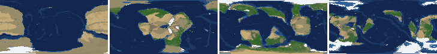
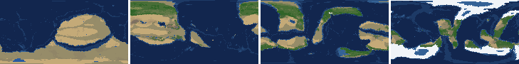
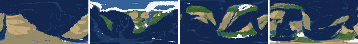
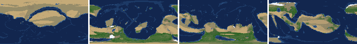
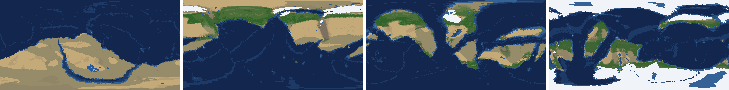
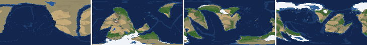
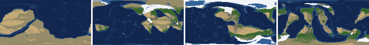
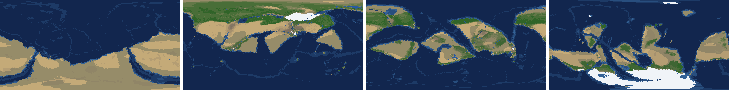

# Health sweep 2026-10-16 18:15

Commit da90e23+dirty. 8 runs (default params, `--every 4`) at 9 workers x 2 numba threads; simulations 8.8 min wall. Made by `tools/health.py` (PW-246).

## Runs

| seed | L | Myr | run | sim s | trees / flowering trees from | dT range C | peaks > 9.5 km | giant-lake frames % | crust volume end/start | ice SL < -150 m % | <= 4 plates % |
|---|---|---|---|---|---|---|---|---|---|---|---|
| 1 | 6 | 500 | 04c40b | 442 | 132 / 412 | 14.0 | 1 | 8.8 | 0.976 | 0.0 | 0.0 |
| 2 | 6 | 500 | 4d4c93 | 399 | 140 / 396 | 20.3 | 0 | 0.9 | 0.954 | 6.2 | 0.0 |
| 11 | 6 | 500 | 613aed | 465 | 128 / 372 | 17.8 | 0 | 16.8 | 0.96 | 8.0 | 0.0 |
| 21 | 6 | 500 | f2dffe | 304 | 136 / 404 | 9.4 | 0 | 3.5 | 0.956 | 0.0 | 0.0 |
| 3199 | 6 | 500 | e0dee2 | 402 | 132 / 376 | 14.9 | 0 | 7.1 | 0.96 | 8.0 | 0.0 |
| 42 | 6 | 500 | 5c8677 | 459 | 116 / 404 | 13.3 | 0 | 14.2 | 0.976 | 8.8 | 0.0 |
| 77 | 6 | 500 | 78b897 | 527 | 124 / 416 | 9.3 | 0 | 12.4 | 0.989 | 0.0 | 0.0 |
| 505 | 6 | 500 | 102853 | 350 | 132 / 416 | 9.7 | 0 | 8.8 | 0.96 | 0.0 | 4.4 |

## Medians by seed (after 50 Myr; tree cover after forests, NPP after flowering trees appear)

| seed | L | land_pct | cont_pct | cont_km | plates | ocean_age | speed | sea_level | sea_ice_m | ice_pct | temp | co2 | dry_pct | inland_pct | lake_pct | lake_max_mkm2 | max_elev_km | trees_pct | npp | landmasses | largest_pct |
|---|---|---|---|---|---|---|---|---|---|---|---|---|---|---|---|---|---|---|---|---|---|
| 1 | 6 | 32.3 | 40.2 | 34.0 | 11.0 | 54.0 | 4.3 | -22.6 | -4.3 | 0.8 | 15.7 | -0.3 | 25.4 | 4.6 | 0.5 | 0.1 | 5.4 | 30.2 | 324.9 | 8.0 | 22.7 |
| 2 | 6 | 33.8 | 40.2 | 33.4 | 11.0 | 52.0 | 4.2 | 3.2 | -0.8 | 0.2 | 16.1 | -0.1 | 27.2 | 2.3 | 0.3 | 0.1 | 5.3 | 20.1 | 353.8 | 7.0 | 20.4 |
| 11 | 6 | 31.8 | 39.5 | 34.1 | 14.0 | 45.7 | 4.6 | 77.8 | -13.6 | 1.8 | 13.2 | -0.4 | 19.5 | 3.4 | 0.4 | 0.1 | 5.5 | 34.0 | 342.4 | 7.0 | 19.5 |
| 21 | 6 | 34.4 | 40.9 | 33.9 | 8.0 | 58.7 | 4.7 | -51.8 | -1.3 | 0.2 | 16.5 | -0.4 | 30.6 | 4.2 | 0.3 | 0.1 | 5.1 | 22.3 | 343.2 | 6.0 | 31.3 |
| 3199 | 6 | 33.5 | 40.6 | 33.6 | 13.0 | 48.5 | 4.8 | 53.2 | -5.6 | 1.1 | 15.3 | -0.1 | 32.1 | 3.0 | 0.3 | 0.1 | 5.3 | 23.5 | 316.4 | 7.0 | 20.5 |
| 42 | 6 | 33.0 | 38.9 | 34.9 | 9.0 | 65.9 | 4.1 | -142.1 | -11.0 | 2.1 | 13.8 | -0.5 | 24.7 | 4.7 | 0.6 | 0.1 | 6.2 | 25.6 | 347.6 | 5.0 | 24.1 |
| 77 | 6 | 31.9 | 39.0 | 34.9 | 12.0 | 53.6 | 4.3 | -62.8 | -19.5 | 3.0 | 12.6 | -0.2 | 26.6 | 5.6 | 0.6 | 0.2 | 5.0 | 30.4 | 337.3 | 6.0 | 24.5 |
| 505 | 6 | 33.4 | 40.8 | 33.9 | 11.0 | 47.4 | 4.5 | 61.6 | -3.2 | 0.6 | 14.9 | -0.4 | 28.4 | 3.9 | 0.4 | 0.1 | 5.1 | 22.8 | 355.2 | 6.0 | 18.2 |

Measured on the run's keyframes (no slicing). A keyframe's rivers and lakes are routed on its own terrain (PW-239), so `inland_raw_pct` (every routed end on land, as highlights counts it) and `inland_pct` (ends that are closed lakes, salt pans or real pits) agree but for ends under land ice. Land ice and land shares use cells (near-equal area).

## Envelopes

| metric | low | high | Earth | source |
|---|---|---|---|---|
| land, % of surface (`land_pct`) | 22 | 42 | 29.20 | tests/test_envelopes.py (22-42%); Earth 29.2% |
| continental crust, % of surface (`cont_pct`) | 33 | 50 | 41 | tests/test_envelopes.py (33-50%); Earth ~41% with shelves (Cogley 1984) |
| mean continental crust thickness, km (`cont_km`) | 31 | 40 | 39 | target 35 km (PW-238, continental_thickness); Earth ~39 km (Christensen & Mooney 1995); known thinning to 32-33 km (PW-046) |
| plates (`plates`) | 5 | 30 | 15 | tests/test_envelopes.py (5-30; max_plates 30); Earth 7 major + ~8 minor; <= 4 is the PW-191 collapse |
| mean ocean-floor age, Myr (`ocean_age`) | 25 | 120 | 64 | tests/test_envelopes.py (25-120); Earth ~64 Myr (Mueller et al. 2008); PW-051 |
| mean plate speed, cm/yr (`speed`) | 2 | 9 | 4.50 | tests/test_envelopes.py (2-9 cm/yr); Earth ~4-5 |
| sea level, m (ice + ocean basins) (`sea_level`) | -250 | 300 | 0 | Phanerozoic ~-130 (LGM) .. +250 m (earth.py; Haq & Schutter 2008); -250: PW-240's hard goal |
| sea level from land ice, m (`sea_ice_m`) | -250 | - | 0 | Earth LGM ~-130 m; PW-240 goal -150 m typical / -250 m worst |
| land ice, % of surface (`ice_pct`) | - | 10 | 3.10 | Earth 3.1% now (earth.EARTH_ICE), ~7-8% at the LGM |
| global mean temperature, C (`temp`) | 8 | 30 | 14.50 | Earth 14.5 C; LGM ~8 C (Tierney et al. 2020); Phanerozoic hothouses to ~30 C (Scotese et al. 2021) |
| CO2 index (ln source/sink) (`co2`) | -1.5 | 1.5 | 0.00 | the forcing's clip in earth.py (+-1.5); Earth 0 |
| arid (Koppen B), % of land (`dry_pct`) | 12 | 45 | 30 | tests/test_envelopes.py (12-45%); Earth ~30% (Beck et al. 2018) |
| land draining inland, % of ice-free land (to a closed lake, salt pan or real pit) (`inland_pct`) | 8 | 30 | 18 | Earth ~18% (overview 2.9); L6 known ~9.5-11% (PW-054, PW-243). `inland_raw_pct` (not checked) follows the stored `downstream` to any end, as highlights does; since PW-239 the two agree but for ends under land ice |
| lakes, % of land (`lake_pct`) | 0.2 | 3.0 | 1.80 | Earth ~1.8% of ice-free land (HydroLAKES, Messager et al. 2016); generated L6 worlds 0.5-1% |
| largest lake, million km2 (`lake_max_mkm2`) | - | 1.0 | 0.37 | Caspian 0.37 Mkm2; 1 Mkm2 = the overview's giant lake (2.9) |
| highest peak, km (`max_elev_km`) | - | 9.5 | 8.85 | Everest 8.85 km; PW-172 (spikes above ~9.5 km) |
| tree cover, % of ice-free land (after forests appear) (`trees_pct`) | 10 | 50 | 30 | Earth ~30% potential canopy (forest 55-60 of ~130 Mkm2, overview 2.18) |
| land NPP, g C/m2/yr (after flowering trees appear) (`npp`) | 200 | 700 | 430 | Earth ~56 Pg C/yr over ~130 Mkm2 = ~430; the model on Earth's terrain 50 Pg C/yr, ~385 (overview 2.18). Before flowering trees (plant group 4) stand-ins grow at 70%, so runs sit at ~150-280 |
| landmasses (>= 3 cells) (`landmasses`) | 3 | 80 | - | loose: a lone supercontinent or a shattered archipelago |
| largest landmass, % of surface (`largest_pct`) | 5 | 35 | 16.60 | Afro-Eurasia 16.6%; a Pangaea ~30% (scorecard largest_max) |
| global temperature range over the run, C (`dT_range`, per run) | - | 25 | 25 | Phanerozoic 11-36 C (Scotese et al. 2021) |
| keyframes with a peak above 9.5 km (`peak_frames`, per run) | - | 0 | 0 | PW-172 (L7 seed 3199: 3 of 251) |
| % of keyframes with a lake over 1 Mkm2 (`giant_lake_frames`, per run) | - | 5 | 0 | overview 2.9 (L6: 3 of ~150 frames) |
| continental crust volume, end / start (`volume_ratio`, per run) | 0.9 | 1.1 | 1.0 | scorecard volume_ratio (x1.006) |
| % of keyframes with ice sea level below -150 m (`sea_ice_below_150`, per run) | - | 10 | 0 | PW-240 |
| % of keyframes with <= 4 plates (`low_plates`, per run) | - | 2 | 0 | PW-191 (L7 seed 21: 1%) |

## Top outliers (of 169 spells; severity = excess / band width x (0.2 + share of the run))

| seed | L | metric | Myr | frames | worst | envelope | severity |
|---|---|---|---|---|---|---|---|
| 21 | 6 | lake_max_mkm2 | 424-424 | 1 | 14.69 | -..1.0 | 2.847 |
| 11 | 6 | giant_lake_frames | run | - | 16.80 | -..5 | 2.36 |
| 11 | 6 | lake_max_mkm2 | 200-240 | 11 | 8.80 | -..1.0 | 2.242 |
| 42 | 6 | giant_lake_frames | run | - | 14.20 | -..5 | 1.84 |
| 21 | 6 | lake_max_mkm2 | 324-328 | 2 | 8.75 | -..1.0 | 1.674 |
| 77 | 6 | giant_lake_frames | run | - | 12.40 | -..5 | 1.48 |
| 505 | 6 | low_plates | run | - | 4.40 | -..2 | 1.2 |
| 1 | 6 | peak_frames | run | - | 1 | -..0 | 1.0 |
| 1 | 6 | lake_max_mkm2 | 480-500 | 6 | 5.03 | -..1.0 | 0.998 |
| 42 | 6 | lake_max_mkm2 | 80-88 | 3 | 4.92 | -..1.0 | 0.877 |
| 1 | 6 | giant_lake_frames | run | - | 8.80 | -..5 | 0.76 |
| 505 | 6 | giant_lake_frames | run | - | 8.80 | -..5 | 0.76 |
| 505 | 6 | lake_max_mkm2 | 132-152 | 5 | 3.76 | -..1.0 | 0.662 |
| 77 | 6 | lake_max_mkm2 | 140-140 | 1 | 4.12 | -..1.0 | 0.649 |
| 505 | 6 | lake_max_mkm2 | 196-196 | 1 | 3.96 | -..1.0 | 0.615 |
| 3199 | 6 | lake_max_mkm2 | 424-440 | 5 | 3.56 | -..1.0 | 0.614 |
| 11 | 6 | lake_pct | 200-240 | 11 | 8.62 | 0.2..3.0 | 0.577 |
| 21 | 6 | lake_pct | 424-424 | 1 | 10.46 | 0.2..3.0 | 0.554 |
| 42 | 6 | lake_max_mkm2 | 168-180 | 3 | 2.96 | -..1.0 | 0.44 |
| 3199 | 6 | giant_lake_frames | run | - | 7.10 | -..5 | 0.42 |
| 3199 | 6 | inland_pct | 52-500 | 110 | 0.19 | 8..30 | 0.381 |
| 77 | 6 | lake_max_mkm2 | 92-92 | 1 | 2.83 | -..1.0 | 0.38 |
| 2 | 6 | inland_pct | 64-500 | 109 | 0.21 | 8..30 | 0.377 |
| 11 | 6 | lake_max_mkm2 | 176-176 | 1 | 2.81 | -..1.0 | 0.377 |
| 42 | 6 | lake_max_mkm2 | 216-216 | 1 | 2.81 | -..1.0 | 0.377 |
| 11 | 6 | inland_pct | 52-224 | 43 | 42.95 | 8..30 | 0.319 |
| 1 | 6 | lake_max_mkm2 | 312-312 | 1 | 2.42 | -..1.0 | 0.294 |
| 505 | 6 | lake_max_mkm2 | 268-268 | 1 | 2.40 | -..1.0 | 0.292 |
| 505 | 6 | lake_max_mkm2 | 408-408 | 1 | 2.13 | -..1.0 | 0.235 |
| 21 | 6 | inland_pct | 84-320 | 55 | 0.06 | 8..30 | 0.23 |

## Per seed: min / median / max after the 50 Myr spin-up, and spells outside the envelopes

### Seed 1, L6 (run 04c40b)

*At 48, 200, 348, 500 Myr: sea by depth, land green by tree cover / tan where arid, shaded by height, ice white, lakes blue.*

| metric | min | median | max | outside (Myr: worst) |
|---|---|---|---|---|
| land_pct | 30.95 | 32.27 | 38.30 |  |
| cont_pct | 36.71 | 40.23 | 42.30 |  |
| cont_km | 32.90 | 34.05 | 36.64 |  |
| plates | 6.00 | 11.00 | 14.00 |  |
| ocean_age | 31.90 | 54.00 | 72.30 |  |
| speed | 2.79 | 4.34 | 8.20 |  |
| sea_level | -279.00 | -22.60 | 195.80 | 480-500: -279.00 |
| sea_ice_m | -91.10 | -4.30 | -0.00 |  |
| ice_pct | 0.00 | 0.80 | 7.60 |  |
| temp | 6.90 | 15.70 | 20.90 | 480-500: 6.90 |
| co2 | -1.55 | -0.31 | 0.19 | 168-176: -1.55 |
| dry_pct | 15.62 | 25.36 | 37.97 |  |
| inland_pct | 0.15 | 4.63 | 12.00 | 52-136: 0.15; 152-152: 7.33; 192-196: 7.65; 224-476: 2.13; +1 more |
| lake_pct | 0.04 | 0.50 | 5.16 | 52-76: 0.07; 92-92: 0.04; 120-120: 0.17; 480-484: 5.16 |
| lake_max_mkm2 | 0.03 | 0.11 | 5.03 | 100-100: 1.15; 128-128: 1.44; 312-312: 2.42; 432-432: 1.21; +1 more |
| max_elev_km | 1.73 | 5.39 | 9.59 | 272-272: 9.59 |
| trees_pct | 13.61 | 30.22 | 44.87 |  |
| npp | 214.90 | 324.90 | 378.00 |  |
| landmasses | 3.00 | 8.00 | 19.00 |  |
| largest_pct | 9.80 | 22.70 | 32.90 |  |

### Seed 2, L6 (run 4d4c93)

*At 48, 200, 348, 500 Myr: sea by depth, land green by tree cover / tan where arid, shaded by height, ice white, lakes blue.*

| metric | min | median | max | outside (Myr: worst) |
|---|---|---|---|---|
| land_pct | 31.00 | 33.78 | 37.88 |  |
| cont_pct | 38.58 | 40.25 | 42.78 |  |
| cont_km | 32.67 | 33.38 | 35.46 |  |
| plates | 7.00 | 11.00 | 16.00 |  |
| ocean_age | 32.40 | 52.00 | 66.20 |  |
| speed | 2.17 | 4.24 | 7.09 |  |
| sea_level | -473.40 | 3.20 | 198.10 | 472-500: -473.40 |
| sea_ice_m | -275.80 | -0.80 | -0.00 | 496-500: -275.80 |
| ice_pct | 0.00 | 0.20 | 14.30 | 476-500: 14.30 |
| temp | 2.30 | 16.10 | 22.60 | 476-500: 2.30 |
| co2 | -1.27 | -0.08 | 0.43 |  |
| dry_pct | 8.88 | 27.22 | 51.26 | 220-248: 51.26; 428-500: 8.88 |
| inland_pct | 0.21 | 2.34 | 11.89 | 64-500: 0.21 |
| lake_pct | 0.04 | 0.31 | 1.65 | 60-60: 0.18; 72-160: 0.04; 172-172: 0.16; 264-272: 0.15; +3 more |
| lake_max_mkm2 | 0.01 | 0.09 | 1.93 | 196-196: 1.93 |
| max_elev_km | 1.72 | 5.28 | 8.46 |  |
| trees_pct | 9.05 | 20.12 | 50.12 | 240-244: 9.05; 420-420: 50.12 |
| npp | 221.20 | 353.80 | 459.60 |  |
| landmasses | 2.00 | 7.00 | 14.00 | 52-68: 2 |
| largest_pct | 8.50 | 20.40 | 32.90 |  |

### Seed 11, L6 (run 613aed)

*At 48, 200, 348, 500 Myr: sea by depth, land green by tree cover / tan where arid, shaded by height, ice white, lakes blue.*

| metric | min | median | max | outside (Myr: worst) |
|---|---|---|---|---|
| land_pct | 28.06 | 31.81 | 37.85 |  |
| cont_pct | 37.66 | 39.54 | 43.06 |  |
| cont_km | 32.50 | 34.08 | 35.96 |  |
| plates | 8.00 | 14.00 | 18.00 |  |
| ocean_age | 35.00 | 45.70 | 58.70 |  |
| speed | 3.33 | 4.60 | 6.78 |  |
| sea_level | -536.00 | 77.80 | 205.30 | 180-272: -536.00 |
| sea_ice_m | -173.70 | -13.60 | -0.00 |  |
| ice_pct | 0.00 | 1.80 | 14.80 | 180-240: 14.80 |
| temp | 2.50 | 13.20 | 20.30 | 172-216: 2.50 |
| co2 | -0.73 | -0.39 | 0.23 |  |
| dry_pct | 14.01 | 19.48 | 39.25 |  |
| inland_pct | 0.53 | 3.36 | 42.95 | 52-224: 42.95; 244-500: 1.00 |
| lake_pct | 0.02 | 0.42 | 8.62 | 52-100: 0.02; 116-116: 0.18; 156-156: 0.16; 176-176: 3.85; +1 more |
| lake_max_mkm2 | 0.01 | 0.14 | 8.80 | 128-148: 1.56; 176-176: 2.81; 200-240: 8.80; 280-280: 1.56; +1 more |
| max_elev_km | 1.13 | 5.50 | 8.85 |  |
| trees_pct | 14.70 | 34.02 | 50.75 | 184-188: 50.75 |
| npp | 222.20 | 342.40 | 392.50 |  |
| landmasses | 1.00 | 7.00 | 12.00 | 240-264: 1 |
| largest_pct | 7.40 | 19.50 | 34.80 |  |

### Seed 21, L6 (run f2dffe)

*At 48, 200, 348, 500 Myr: sea by depth, land green by tree cover / tan where arid, shaded by height, ice white, lakes blue.*

| metric | min | median | max | outside (Myr: worst) |
|---|---|---|---|---|
| land_pct | 32.89 | 34.43 | 37.67 |  |
| cont_pct | 38.24 | 40.90 | 43.15 |  |
| cont_km | 32.41 | 33.89 | 35.55 |  |
| plates | 6.00 | 8.00 | 19.00 |  |
| ocean_age | 31.90 | 58.70 | 86.80 |  |
| speed | 1.78 | 4.71 | 6.83 | 440-460: 1.87; 480-500: 1.78 |
| sea_level | -255.00 | -51.80 | 217.40 | 500-500: -255.00 |
| sea_ice_m | -6.10 | -1.30 | -0.00 |  |
| ice_pct | 0.00 | 0.20 | 1.00 |  |
| temp | 12.20 | 16.50 | 21.60 |  |
| co2 | -1.13 | -0.42 | -0.01 |  |
| dry_pct | 17.58 | 30.65 | 46.79 | 56-60: 46.79 |
| inland_pct | 0.06 | 4.20 | 28.43 | 60-60: 7.93; 84-320: 0.06; 332-500: 1.72 |
| lake_pct | 0.04 | 0.33 | 10.46 | 52-56: 0.10; 76-128: 0.04; 220-228: 0.15; 300-328: 5.29; +4 more |
| lake_max_mkm2 | 0.01 | 0.10 | 14.69 | 208-208: 1.03; 324-328: 8.75; 424-424: 14.69 |
| max_elev_km | 1.88 | 5.13 | 7.10 |  |
| trees_pct | 18.00 | 22.28 | 34.25 |  |
| npp | 214.50 | 343.20 | 357.80 |  |
| landmasses | 3.00 | 6.00 | 17.00 |  |
| largest_pct | 12.10 | 31.30 | 34.50 |  |

### Seed 3199, L6 (run e0dee2)

*At 48, 200, 348, 500 Myr: sea by depth, land green by tree cover / tan where arid, shaded by height, ice white, lakes blue.*

| metric | min | median | max | outside (Myr: worst) |
|---|---|---|---|---|
| land_pct | 30.76 | 33.47 | 38.24 |  |
| cont_pct | 37.72 | 40.59 | 41.84 |  |
| cont_km | 32.91 | 33.59 | 35.98 |  |
| plates | 9.00 | 13.00 | 18.00 |  |
| ocean_age | 37.30 | 48.50 | 72.80 |  |
| speed | 2.73 | 4.81 | 8.17 |  |
| sea_level | -579.20 | 53.20 | 175.50 | 468-500: -579.20 |
| sea_ice_m | -362.20 | -5.60 | -0.00 | 480-500: -362.20 |
| ice_pct | 0.00 | 1.10 | 15.60 | 468-500: 15.60 |
| temp | 6.90 | 15.30 | 21.80 | 496-500: 6.90 |
| co2 | -0.71 | -0.11 | 0.11 |  |
| dry_pct | 5.82 | 32.09 | 43.83 | 432-500: 5.82 |
| inland_pct | 0.19 | 3.00 | 9.74 | 52-500: 0.19 |
| lake_pct | 0.01 | 0.30 | 2.78 | 52-120: 0.01; 144-160: 0.07; 172-184: 0.14; 244-244: 0.18; +3 more |
| lake_max_mkm2 | 0.01 | 0.09 | 3.56 | 132-140: 1.26; 424-440: 3.56 |
| max_elev_km | 1.02 | 5.34 | 7.29 |  |
| trees_pct | 5.26 | 23.48 | 49.38 | 132-140: 5.26 |
| npp | 249.40 | 316.35 | 397.40 |  |
| landmasses | 2.00 | 7.00 | 14.00 | 52-52: 2; 72-72: 2 |
| largest_pct | 10.70 | 20.50 | 34.40 |  |

### Seed 42, L6 (run 5c8677)

*At 48, 200, 348, 500 Myr: sea by depth, land green by tree cover / tan where arid, shaded by height, ice white, lakes blue.*

| metric | min | median | max | outside (Myr: worst) |
|---|---|---|---|---|
| land_pct | 32.03 | 33.05 | 38.30 |  |
| cont_pct | 36.90 | 38.92 | 42.50 |  |
| cont_km | 32.79 | 34.90 | 36.69 |  |
| plates | 6.00 | 9.00 | 18.00 |  |
| ocean_age | 34.70 | 65.90 | 85.50 |  |
| speed | 2.89 | 4.12 | 7.63 |  |
| sea_level | -475.60 | -142.10 | 177.90 | 400-500: -475.60 |
| sea_ice_m | -160.50 | -11.00 | -0.00 |  |
| ice_pct | 0.00 | 2.10 | 9.80 |  |
| temp | 6.00 | 13.80 | 19.30 | 428-464: 6.00 |
| co2 | -0.96 | -0.47 | -0.07 |  |
| dry_pct | 16.06 | 24.71 | 38.12 |  |
| inland_pct | 0.27 | 4.66 | 16.62 | 52-76: 1.09; 92-164: 0.27; 176-176: 7.38; 188-208: 4.55; +2 more |
| lake_pct | 0.02 | 0.57 | 2.96 | 56-76: 0.04; 92-116: 0.02; 448-448: 0.13 |
| lake_max_mkm2 | 0.01 | 0.14 | 4.92 | 52-52: 1.06; 80-88: 4.92; 148-148: 1.41; 168-180: 2.96; +4 more |
| max_elev_km | 1.72 | 6.25 | 8.58 |  |
| trees_pct | 19.34 | 25.57 | 41.99 |  |
| npp | 280.00 | 347.60 | 361.20 |  |
| landmasses | 2.00 | 5.00 | 9.00 | 52-52: 2 |
| largest_pct | 10.50 | 24.10 | 33.00 |  |

### Seed 77, L6 (run 78b897)

*At 48, 200, 348, 500 Myr: sea by depth, land green by tree cover / tan where arid, shaded by height, ice white, lakes blue.*

| metric | min | median | max | outside (Myr: worst) |
|---|---|---|---|---|
| land_pct | 28.39 | 31.89 | 38.12 |  |
| cont_pct | 35.34 | 39.05 | 42.89 |  |
| cont_km | 32.40 | 34.85 | 37.84 |  |
| plates | 8.00 | 12.00 | 16.00 |  |
| ocean_age | 36.80 | 53.60 | 68.90 |  |
| speed | 2.69 | 4.35 | 7.24 |  |
| sea_level | -368.80 | -62.80 | 147.60 | 288-308: -296.20; 444-468: -368.80 |
| sea_ice_m | -133.80 | -19.50 | -0.00 |  |
| ice_pct | 0.00 | 3.00 | 10.30 | 304-312: 10.30 |
| temp | 7.90 | 12.60 | 17.20 | 288-288: 7.90 |
| co2 | -0.83 | -0.15 | 0.26 |  |
| dry_pct | 11.66 | 26.60 | 37.30 | 456-456: 11.66 |
| inland_pct | 0.16 | 5.57 | 20.58 | 68-96: 1.33; 108-228: 0.16; 244-248: 4.83; 260-260: 6.69; +4 more |
| lake_pct | 0.01 | 0.64 | 3.19 | 52-52: 0.18; 88-96: 3.19; 108-132: 0.04 |
| lake_max_mkm2 | 0.01 | 0.19 | 4.12 | 68-72: 1.82; 92-92: 2.83; 104-104: 1.73; 140-140: 4.12; +6 more |
| max_elev_km | 1.74 | 5.00 | 8.47 |  |
| trees_pct | 19.18 | 30.41 | 39.80 |  |
| npp | 236.70 | 337.30 | 360.30 |  |
| landmasses | 2.00 | 6.00 | 11.00 | 52-64: 2; 392-392: 2 |
| largest_pct | 9.30 | 24.50 | 32.20 |  |

### Seed 505, L6 (run 102853)

*At 48, 200, 348, 500 Myr: sea by depth, land green by tree cover / tan where arid, shaded by height, ice white, lakes blue.*

| metric | min | median | max | outside (Myr: worst) |
|---|---|---|---|---|
| land_pct | 32.42 | 33.40 | 37.65 |  |
| cont_pct | 37.00 | 40.80 | 43.33 |  |
| cont_km | 32.44 | 33.88 | 36.69 |  |
| plates | 4.00 | 11.00 | 16.00 | 484-500: 4 |
| ocean_age | 31.50 | 47.40 | 92.40 |  |
| speed | 1.49 | 4.53 | 7.37 | 484-500: 1.49 |
| sea_level | -360.40 | 61.60 | 217.80 | 492-500: -360.40 |
| sea_ice_m | -84.80 | -3.20 | -0.00 |  |
| ice_pct | 0.00 | 0.60 | 5.00 |  |
| temp | 9.00 | 14.90 | 18.70 |  |
| co2 | -1.31 | -0.42 | 0.17 |  |
| dry_pct | 18.70 | 28.45 | 49.53 | 248-272: 49.53 |
| inland_pct | 0.06 | 3.88 | 28.69 | 52-136: 0.06; 148-188: 4.20; 204-204: 7.74; 304-500: 1.04 |
| lake_pct | 0.01 | 0.41 | 3.14 | 56-104: 0.01; 124-128: 0.13; 148-148: 0.13; 196-196: 3.14; +3 more |
| lake_max_mkm2 | 0.01 | 0.11 | 3.96 | 116-116: 1.11; 132-152: 3.76; 196-196: 3.96; 268-268: 2.40; +2 more |
| max_elev_km | 1.75 | 5.12 | 8.39 |  |
| trees_pct | 14.28 | 22.84 | 37.70 |  |
| npp | 176.60 | 355.25 | 361.80 | 416-436: 176.60 |
| landmasses | 2.00 | 6.00 | 19.00 | 164-164: 2; 244-244: 2 |
| largest_pct | 10.20 | 18.20 | 33.90 |  |

## Determinism

Seed 1 L6 re-run to 100 Myr (run 1f82cd) against the sweep's run 04c40b: 26 keyframes x 43 layers, **bit-identical** (layer hashes and frame stats).
