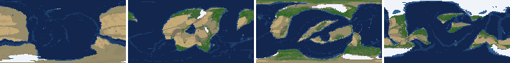
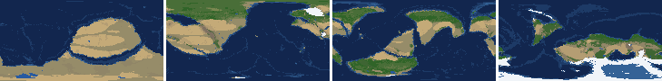
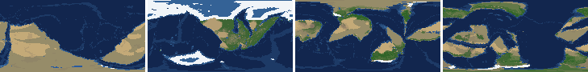
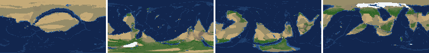
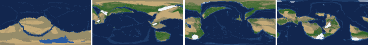
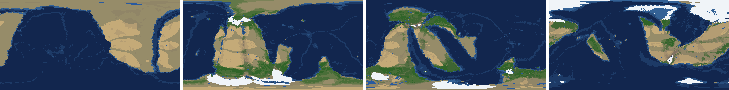
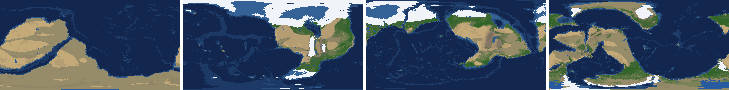
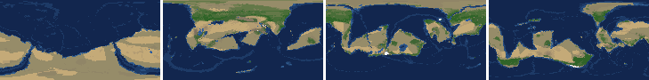

# Health sweep 2026-10-16 17:53

Commit da90e23. 8 runs (default params, `--every 4`) at 9 workers x 2 numba threads; simulations 8.3 min wall. Made by `tools/health.py` (PW-246).

## Runs

| seed | L | Myr | run | sim s | trees / flowering trees from | dT range C | peaks > 9.5 km | giant-lake frames % | crust volume end/start | ice SL < -150 m % | <= 4 plates % |
|---|---|---|---|---|---|---|---|---|---|---|---|
| 1 | 6 | 500 | 7f11f4 | 389 | 132 / 412 | 12.8 | 0 | 12.4 | 0.964 | 11.5 | 0.0 |
| 2 | 6 | 500 | ed685f | 394 | 140 / 396 | 19.7 | 0 | 10.6 | 0.954 | 0.0 | 0.0 |
| 11 | 6 | 500 | d2ac59 | 499 | 128 / 372 | 19.1 | 0 | 13.3 | 0.943 | 11.5 | 0.0 |
| 21 | 6 | 500 | 09f963 | 280 | 136 / 404 | 9.8 | 0 | 1.8 | 0.974 | 0.0 | 0.0 |
| 3199 | 6 | 500 | 6438e1 | 305 | 132 / 376 | 11.9 | 0 | 5.3 | 0.964 | 0.0 | 0.0 |
| 42 | 6 | 500 | 92e5d2 | 396 | 116 / 404 | 12.7 | 0 | 8.8 | 0.956 | 0.0 | 0.0 |
| 77 | 6 | 500 | 87f278 | 496 | 124 / 416 | 12.0 | 0 | 16.8 | 0.988 | 0.0 | 0.0 |
| 505 | 6 | 500 | ef3a09 | 310 | 132 / 416 | 8.8 | 0 | 8.8 | 0.956 | 0.0 | 0.0 |

## Medians by seed (after 50 Myr; tree cover after forests, NPP after flowering trees appear)

| seed | L | land_pct | cont_pct | cont_km | plates | ocean_age | speed | sea_level | sea_ice_m | ice_pct | temp | co2 | dry_pct | inland_pct | lake_pct | lake_max_mkm2 | max_elev_km | trees_pct | npp | landmasses | largest_pct |
|---|---|---|---|---|---|---|---|---|---|---|---|---|---|---|---|---|---|---|---|---|---|
| 1 | 6 | 33.4 | 39.7 | 34.3 | 13.0 | 53.0 | 4.0 | -11.8 | -6.3 | 1.1 | 15.0 | -0.4 | 22.1 | 3.8 | 0.6 | 0.1 | 4.7 | 30.0 | 348.7 | 6.0 | 17.0 |
| 2 | 6 | 34.1 | 39.5 | 34.5 | 11.0 | 52.4 | 4.7 | 27.0 | -3.0 | 0.5 | 15.7 | -0.3 | 30.9 | 4.6 | 0.4 | 0.1 | 5.2 | 25.4 | 308.4 | 7.0 | 29.5 |
| 11 | 6 | 31.5 | 40.1 | 33.5 | 14.0 | 51.0 | 4.4 | 38.1 | -5.9 | 0.8 | 13.5 | -0.4 | 20.2 | 2.6 | 0.4 | 0.1 | 4.9 | 30.8 | 353.0 | 8.0 | 16.5 |
| 21 | 6 | 33.7 | 40.1 | 34.0 | 12.0 | 48.5 | 4.7 | 60.9 | -2.4 | 0.5 | 16.5 | -0.3 | 28.7 | 3.9 | 0.4 | 0.1 | 5.6 | 23.9 | 336.2 | 8.0 | 25.2 |
| 3199 | 6 | 33.7 | 40.2 | 34.0 | 11.0 | 51.1 | 4.9 | 22.0 | -5.0 | 0.9 | 14.6 | -0.2 | 27.7 | 3.5 | 0.5 | 0.1 | 4.6 | 27.9 | 327.9 | 6.0 | 23.2 |
| 42 | 6 | 33.8 | 38.7 | 34.6 | 11.0 | 56.0 | 4.5 | -37.6 | -8.2 | 1.3 | 15.0 | -0.2 | 29.5 | 5.3 | 0.5 | 0.1 | 5.6 | 22.8 | 312.2 | 5.0 | 30.5 |
| 77 | 6 | 31.0 | 38.7 | 35.4 | 13.0 | 47.6 | 5.1 | -48.9 | -33.1 | 5.2 | 12.1 | -0.3 | 28.9 | 6.5 | 0.8 | 0.3 | 5.9 | 27.1 | 363.4 | 6.0 | 26.2 |
| 505 | 6 | 34.1 | 40.9 | 33.2 | 12.0 | 61.2 | 3.9 | -57.8 | -0.4 | 0.1 | 14.9 | -0.4 | 28.7 | 3.4 | 0.3 | 0.1 | 5.1 | 22.4 | 361.4 | 8.0 | 27.8 |

Measured on the run's keyframes (no slicing). A keyframe's rivers and lakes are routed on its own terrain (PW-239), so `inland_raw_pct` (every routed end on land, as highlights counts it) and `inland_pct` (ends that are closed lakes, salt pans or real pits) agree but for ends under land ice. Land ice and land shares use cells (near-equal area).

## Envelopes

| metric | low | high | Earth | source |
|---|---|---|---|---|
| land, % of surface (`land_pct`) | 22 | 42 | 29.20 | tests/test_envelopes.py (22-42%); Earth 29.2% |
| continental crust, % of surface (`cont_pct`) | 33 | 50 | 41 | tests/test_envelopes.py (33-50%); Earth ~41% with shelves (Cogley 1984) |
| mean continental crust thickness, km (`cont_km`) | 31 | 40 | 39 | target 35 km (PW-238, continental_thickness); Earth ~39 km (Christensen & Mooney 1995); known thinning to 32-33 km (PW-046) |
| plates (`plates`) | 5 | 30 | 15 | tests/test_envelopes.py (5-30; max_plates 30); Earth 7 major + ~8 minor; <= 4 is the PW-191 collapse |
| mean ocean-floor age, Myr (`ocean_age`) | 25 | 120 | 64 | tests/test_envelopes.py (25-120); Earth ~64 Myr (Mueller et al. 2008); PW-051 |
| mean plate speed, cm/yr (`speed`) | 2 | 9 | 4.50 | tests/test_envelopes.py (2-9 cm/yr); Earth ~4-5 |
| sea level, m (ice + ocean basins) (`sea_level`) | -250 | 300 | 0 | Phanerozoic ~-130 (LGM) .. +250 m (earth.py; Haq & Schutter 2008); -250: PW-240's hard goal |
| sea level from land ice, m (`sea_ice_m`) | -250 | - | 0 | Earth LGM ~-130 m; PW-240 goal -150 m typical / -250 m worst |
| land ice, % of surface (`ice_pct`) | - | 10 | 3.10 | Earth 3.1% now (earth.EARTH_ICE), ~7-8% at the LGM |
| global mean temperature, C (`temp`) | 8 | 30 | 14.50 | Earth 14.5 C; LGM ~8 C (Tierney et al. 2020); Phanerozoic hothouses to ~30 C (Scotese et al. 2021) |
| CO2 index (ln source/sink) (`co2`) | -1.5 | 1.5 | 0.00 | the forcing's clip in earth.py (+-1.5); Earth 0 |
| arid (Koppen B), % of land (`dry_pct`) | 12 | 45 | 30 | tests/test_envelopes.py (12-45%); Earth ~30% (Beck et al. 2018) |
| land draining inland, % of ice-free land (to a closed lake, salt pan or real pit) (`inland_pct`) | 8 | 30 | 18 | Earth ~18% (overview 2.9); L6 known ~9.5-11% (PW-054, PW-243). `inland_raw_pct` (not checked) follows the stored `downstream` to any end, as highlights does; since PW-239 the two agree but for ends under land ice |
| lakes, % of land (`lake_pct`) | 0.2 | 3.0 | 1.80 | Earth ~1.8% of ice-free land (HydroLAKES, Messager et al. 2016); generated L6 worlds 0.5-1% |
| largest lake, million km2 (`lake_max_mkm2`) | - | 1.0 | 0.37 | Caspian 0.37 Mkm2; 1 Mkm2 = the overview's giant lake (2.9) |
| highest peak, km (`max_elev_km`) | - | 9.5 | 8.85 | Everest 8.85 km; PW-172 (spikes above ~9.5 km) |
| tree cover, % of ice-free land (after forests appear) (`trees_pct`) | 10 | 50 | 30 | Earth ~30% potential canopy (forest 55-60 of ~130 Mkm2, overview 2.18) |
| land NPP, g C/m2/yr (after flowering trees appear) (`npp`) | 200 | 700 | 430 | Earth ~56 Pg C/yr over ~130 Mkm2 = ~430; the model on Earth's terrain 50 Pg C/yr, ~385 (overview 2.18). Before flowering trees (plant group 4) stand-ins grow at 70%, so runs sit at ~150-280 |
| landmasses (>= 3 cells) (`landmasses`) | 3 | 80 | - | loose: a lone supercontinent or a shattered archipelago |
| largest landmass, % of surface (`largest_pct`) | 5 | 35 | 16.60 | Afro-Eurasia 16.6%; a Pangaea ~30% (scorecard largest_max) |
| global temperature range over the run, C (`dT_range`, per run) | - | 25 | 25 | Phanerozoic 11-36 C (Scotese et al. 2021) |
| keyframes with a peak above 9.5 km (`peak_frames`, per run) | - | 0 | 0 | PW-172 (L7 seed 3199: 3 of 251) |
| % of keyframes with a lake over 1 Mkm2 (`giant_lake_frames`, per run) | - | 5 | 0 | overview 2.9 (L6: 3 of ~150 frames) |
| continental crust volume, end / start (`volume_ratio`, per run) | 0.9 | 1.1 | 1.0 | scorecard volume_ratio (x1.006) |
| % of keyframes with ice sea level below -150 m (`sea_ice_below_150`, per run) | - | 10 | 0 | PW-240 |
| % of keyframes with <= 4 plates (`low_plates`, per run) | - | 2 | 0 | PW-191 (L7 seed 21: 1%) |

## Top outliers (of 163 spells; severity = excess / band width x (0.2 + share of the run))

| seed | L | metric | Myr | frames | worst | envelope | severity |
|---|---|---|---|---|---|---|---|
| 77 | 6 | giant_lake_frames | run | - | 16.80 | -..5 | 2.36 |
| 3199 | 6 | lake_max_mkm2 | 52-64 | 4 | 8.99 | -..1.0 | 1.852 |
| 505 | 6 | lake_max_mkm2 | 216-220 | 2 | 8.87 | -..1.0 | 1.698 |
| 11 | 6 | giant_lake_frames | run | - | 13.30 | -..5 | 1.66 |
| 1 | 6 | giant_lake_frames | run | - | 12.40 | -..5 | 1.48 |
| 2 | 6 | lake_max_mkm2 | 452-452 | 1 | 7.67 | -..1.0 | 1.387 |
| 11 | 6 | lake_max_mkm2 | 352-368 | 4 | 6.72 | -..1.0 | 1.327 |
| 2 | 6 | giant_lake_frames | run | - | 10.60 | -..5 | 1.12 |
| 1 | 6 | lake_max_mkm2 | 472-472 | 1 | 6.16 | -..1.0 | 1.074 |
| 1 | 6 | lake_max_mkm2 | 484-484 | 1 | 5.74 | -..1.0 | 0.986 |
| 42 | 6 | lake_max_mkm2 | 316-328 | 3 | 4.52 | -..1.0 | 0.788 |
| 42 | 6 | giant_lake_frames | run | - | 8.80 | -..5 | 0.76 |
| 505 | 6 | giant_lake_frames | run | - | 8.80 | -..5 | 0.76 |
| 42 | 6 | lake_max_mkm2 | 400-404 | 2 | 4.50 | -..1.0 | 0.754 |
| 77 | 6 | lake_max_mkm2 | 352-356 | 2 | 4.12 | -..1.0 | 0.674 |
| 2 | 6 | lake_max_mkm2 | 184-184 | 1 | 3.82 | -..1.0 | 0.587 |
| 21 | 6 | lake_max_mkm2 | 120-128 | 2 | 3.62 | -..1.0 | 0.566 |
| 505 | 6 | lake_max_mkm2 | 460-476 | 5 | 3.31 | -..1.0 | 0.554 |
| 77 | 6 | lake_max_mkm2 | 152-176 | 6 | 3.21 | -..1.0 | 0.548 |
| 2 | 6 | lake_max_mkm2 | 264-268 | 2 | 3.54 | -..1.0 | 0.547 |
| 11 | 6 | lake_max_mkm2 | 428-428 | 1 | 3.55 | -..1.0 | 0.53 |
| 1 | 6 | lake_max_mkm2 | 192-196 | 2 | 3.30 | -..1.0 | 0.497 |
| 77 | 6 | lake_max_mkm2 | 80-80 | 1 | 3.27 | -..1.0 | 0.473 |
| 11 | 6 | lake_max_mkm2 | 268-276 | 3 | 3.05 | -..1.0 | 0.459 |
| 1 | 6 | lake_max_mkm2 | 64-64 | 1 | 3.11 | -..1.0 | 0.439 |
| 2 | 6 | lake_max_mkm2 | 360-364 | 2 | 2.93 | -..1.0 | 0.416 |
| 11 | 6 | lake_max_mkm2 | 440-452 | 4 | 2.76 | -..1.0 | 0.409 |
| 77 | 6 | lake_max_mkm2 | 496-500 | 2 | 2.85 | -..1.0 | 0.4 |
| 77 | 6 | lake_max_mkm2 | 64-64 | 1 | 2.83 | -..1.0 | 0.38 |
| 21 | 6 | inland_pct | 52-500 | 107 | 0.27 | 8..30 | 0.369 |

## Per seed: min / median / max after the 50 Myr spin-up, and spells outside the envelopes

### Seed 1, L6 (run 7f11f4)

*At 48, 200, 348, 500 Myr: sea by depth, land green by tree cover / tan where arid, shaded by height, ice white, lakes blue.*

| metric | min | median | max | outside (Myr: worst) |
|---|---|---|---|---|
| land_pct | 31.37 | 33.44 | 38.31 |  |
| cont_pct | 37.40 | 39.68 | 42.34 |  |
| cont_km | 33.01 | 34.33 | 36.52 |  |
| plates | 9.00 | 13.00 | 18.00 |  |
| ocean_age | 32.20 | 53.00 | 82.90 |  |
| speed | 2.31 | 4.02 | 7.65 |  |
| sea_level | -461.90 | -11.80 | 192.20 | 448-500: -461.90 |
| sea_ice_m | -203.40 | -6.30 | -0.00 |  |
| ice_pct | 0.00 | 1.10 | 9.50 |  |
| temp | 6.60 | 15.00 | 19.40 | 480-500: 6.60 |
| co2 | -1.23 | -0.39 | 0.08 |  |
| dry_pct | 12.30 | 22.14 | 41.95 |  |
| inland_pct | 0.20 | 3.83 | 15.29 | 56-124: 0.83; 136-156: 3.54; 172-172: 6.15; 200-216: 6.69; +1 more |
| lake_pct | 0.05 | 0.56 | 3.91 | 56-80: 0.06; 96-100: 0.05; 112-112: 0.05; 124-124: 0.06; +2 more |
| lake_max_mkm2 | 0.03 | 0.14 | 6.16 | 64-64: 3.11; 132-132: 2.49; 192-196: 3.30; 308-312: 1.36; +4 more |
| max_elev_km | 1.72 | 4.73 | 9.09 |  |
| trees_pct | 11.78 | 29.96 | 43.31 |  |
| npp | 215.70 | 348.70 | 363.60 |  |
| landmasses | 2.00 | 6.00 | 14.00 | 148-152: 2 |
| largest_pct | 10.50 | 17.00 | 33.60 |  |

### Seed 2, L6 (run ed685f)

*At 48, 200, 348, 500 Myr: sea by depth, land green by tree cover / tan where arid, shaded by height, ice white, lakes blue.*

| metric | min | median | max | outside (Myr: worst) |
|---|---|---|---|---|
| land_pct | 30.16 | 34.07 | 37.85 |  |
| cont_pct | 37.65 | 39.51 | 42.63 |  |
| cont_km | 32.78 | 34.51 | 36.08 |  |
| plates | 8.00 | 11.00 | 14.00 |  |
| ocean_age | 32.30 | 52.40 | 73.50 |  |
| speed | 2.31 | 4.67 | 7.76 |  |
| sea_level | -424.80 | 27.00 | 197.80 | 460-500: -424.80 |
| sea_ice_m | -112.20 | -3.00 | -0.00 |  |
| ice_pct | 0.00 | 0.50 | 9.40 |  |
| temp | 2.50 | 15.70 | 22.20 | 464-500: 2.50 |
| co2 | -0.90 | -0.34 | 0.37 |  |
| dry_pct | 14.24 | 30.90 | 46.81 | 224-248: 46.81 |
| inland_pct | 0.41 | 4.61 | 14.76 | 64-208: 0.66; 220-228: 6.42; 256-260: 3.08; 272-500: 0.41 |
| lake_pct | 0.04 | 0.43 | 5.83 | 76-76: 0.04; 92-96: 0.04; 108-112: 0.04; 228-228: 0.18; +5 more |
| lake_max_mkm2 | 0.03 | 0.15 | 7.67 | 52-56: 2.62; 184-184: 3.82; 252-252: 2.37; 264-268: 3.54; +4 more |
| max_elev_km | 1.72 | 5.24 | 8.42 |  |
| trees_pct | 10.19 | 25.41 | 40.86 |  |
| npp | 212.60 | 308.40 | 383.10 |  |
| landmasses | 2.00 | 7.00 | 13.00 | 52-64: 2 |
| largest_pct | 9.30 | 29.50 | 34.60 |  |

### Seed 11, L6 (run d2ac59)

*At 48, 200, 348, 500 Myr: sea by depth, land green by tree cover / tan where arid, shaded by height, ice white, lakes blue.*

| metric | min | median | max | outside (Myr: worst) |
|---|---|---|---|---|
| land_pct | 28.90 | 31.46 | 37.80 |  |
| cont_pct | 38.73 | 40.14 | 42.94 |  |
| cont_km | 32.50 | 33.47 | 34.89 |  |
| plates | 8.00 | 14.00 | 18.00 |  |
| ocean_age | 34.90 | 51.00 | 61.90 |  |
| speed | 3.02 | 4.40 | 7.07 |  |
| sea_level | -576.20 | 38.10 | 201.00 | 168-248: -576.20 |
| sea_ice_m | -269.70 | -5.90 | -0.00 | 180-200: -269.70 |
| ice_pct | 0.00 | 0.80 | 17.50 | 164-228: 17.50 |
| temp | 1.50 | 13.50 | 20.60 | 164-216: 1.50 |
| co2 | -0.91 | -0.40 | 0.08 |  |
| dry_pct | 12.06 | 20.20 | 38.60 |  |
| inland_pct | 0.00 | 2.58 | 12.83 | 52-300: 0.00; 316-348: 2.58; 364-436: 0.36; 456-500: 0.97 |
| lake_pct | 0.03 | 0.42 | 4.53 | 56-56: 0.18; 72-124: 0.03; 228-240: 0.14; 352-368: 4.53; +3 more |
| lake_max_mkm2 | 0.03 | 0.14 | 6.72 | 268-276: 3.05; 296-308: 2.52; 352-368: 6.72; 428-428: 3.55; +1 more |
| max_elev_km | 1.44 | 4.91 | 8.50 |  |
| trees_pct | 13.84 | 30.80 | 53.85 | 172-208: 53.85 |
| npp | 211.40 | 353.00 | 382.90 |  |
| landmasses | 2.00 | 8.00 | 13.00 | 232-232: 2 |
| largest_pct | 7.50 | 16.50 | 32.30 |  |

### Seed 21, L6 (run 09f963)

*At 48, 200, 348, 500 Myr: sea by depth, land green by tree cover / tan where arid, shaded by height, ice white, lakes blue.*

| metric | min | median | max | outside (Myr: worst) |
|---|---|---|---|---|
| land_pct | 32.33 | 33.67 | 37.61 |  |
| cont_pct | 37.86 | 40.14 | 43.10 |  |
| cont_km | 32.74 | 33.97 | 35.94 |  |
| plates | 8.00 | 12.00 | 17.00 |  |
| ocean_age | 32.90 | 48.50 | 62.60 |  |
| speed | 2.34 | 4.67 | 7.22 |  |
| sea_level | -89.50 | 60.90 | 211.00 |  |
| sea_ice_m | -15.90 | -2.40 | -0.00 |  |
| ice_pct | 0.00 | 0.50 | 2.30 |  |
| temp | 12.10 | 16.50 | 21.90 |  |
| co2 | -0.72 | -0.34 | -0.01 |  |
| dry_pct | 20.46 | 28.70 | 47.05 | 56-68: 47.05 |
| inland_pct | 0.27 | 3.89 | 9.44 | 52-500: 0.27 |
| lake_pct | 0.03 | 0.38 | 2.16 | 76-104: 0.03; 124-124: 0.14; 288-296: 0.17; 308-308: 0.12; +4 more |
| lake_max_mkm2 | 0.01 | 0.06 | 3.62 | 120-128: 3.62 |
| max_elev_km | 1.82 | 5.56 | 7.31 |  |
| trees_pct | 14.50 | 23.93 | 31.45 |  |
| npp | 209.60 | 336.20 | 349.30 |  |
| landmasses | 3.00 | 8.00 | 15.00 |  |
| largest_pct | 11.50 | 25.20 | 34.30 |  |

### Seed 3199, L6 (run 6438e1)

*At 48, 200, 348, 500 Myr: sea by depth, land green by tree cover / tan where arid, shaded by height, ice white, lakes blue.*

| metric | min | median | max | outside (Myr: worst) |
|---|---|---|---|---|
| land_pct | 31.10 | 33.68 | 38.47 |  |
| cont_pct | 36.87 | 40.20 | 42.34 |  |
| cont_km | 32.75 | 34.01 | 36.41 |  |
| plates | 8.00 | 11.00 | 13.00 |  |
| ocean_age | 39.60 | 51.10 | 64.00 |  |
| speed | 3.62 | 4.92 | 7.14 |  |
| sea_level | -68.20 | 22.00 | 150.50 |  |
| sea_ice_m | -28.00 | -5.00 | -0.00 |  |
| ice_pct | 0.00 | 0.90 | 2.60 |  |
| temp | 9.80 | 14.60 | 21.70 |  |
| co2 | -0.75 | -0.18 | 0.26 |  |
| dry_pct | 20.54 | 27.74 | 49.97 | 68-84: 49.97 |
| inland_pct | 0.25 | 3.51 | 13.67 | 56-56: 3.51; 68-204: 0.25; 216-500: 0.83 |
| lake_pct | 0.00 | 0.51 | 4.63 | 52-144: 4.63; 156-156: 0.15 |
| lake_max_mkm2 | 0.00 | 0.14 | 8.99 | 52-64: 8.99; 152-152: 1.06; 168-168: 1.57 |
| max_elev_km | 1.43 | 4.56 | 8.40 |  |
| trees_pct | 12.67 | 27.86 | 31.97 |  |
| npp | 251.80 | 327.85 | 361.20 |  |
| landmasses | 2.00 | 6.00 | 14.00 | 52-64: 2; 228-236: 2 |
| largest_pct | 8.20 | 23.20 | 34.30 |  |

### Seed 42, L6 (run 92e5d2)

*At 48, 200, 348, 500 Myr: sea by depth, land green by tree cover / tan where arid, shaded by height, ice white, lakes blue.*

| metric | min | median | max | outside (Myr: worst) |
|---|---|---|---|---|
| land_pct | 31.40 | 33.77 | 38.28 |  |
| cont_pct | 37.05 | 38.68 | 43.45 |  |
| cont_km | 32.44 | 34.61 | 36.25 |  |
| plates | 6.00 | 11.00 | 18.00 |  |
| ocean_age | 34.70 | 56.00 | 71.90 |  |
| speed | 2.51 | 4.55 | 7.01 |  |
| sea_level | -256.00 | -37.60 | 182.00 | 500-500: -256.00 |
| sea_ice_m | -65.00 | -8.20 | -0.00 |  |
| ice_pct | 0.00 | 1.30 | 4.90 |  |
| temp | 7.40 | 15.00 | 20.10 | 452-452: 7.40 |
| co2 | -0.65 | -0.24 | -0.07 |  |
| dry_pct | 18.09 | 29.46 | 41.65 |  |
| inland_pct | 0.48 | 5.30 | 15.05 | 52-196: 0.48; 208-244: 4.96; 296-308: 5.56; 320-468: 1.03; +1 more |
| lake_pct | 0.01 | 0.51 | 4.03 | 52-132: 0.01; 168-172: 0.18; 324-328: 3.62; 400-404: 4.03 |
| lake_max_mkm2 | 0.01 | 0.15 | 4.52 | 124-124: 1.34; 292-292: 1.63; 316-328: 4.52; 356-364: 1.25; +2 more |
| max_elev_km | 1.50 | 5.63 | 8.25 |  |
| trees_pct | 17.72 | 22.76 | 31.24 |  |
| npp | 239.00 | 312.20 | 324.30 |  |
| landmasses | 2.00 | 5.00 | 12.00 | 52-52: 2; 224-232: 2 |
| largest_pct | 10.40 | 30.50 | 34.40 |  |

### Seed 77, L6 (run 87f278)

*At 48, 200, 348, 500 Myr: sea by depth, land green by tree cover / tan where arid, shaded by height, ice white, lakes blue.*

| metric | min | median | max | outside (Myr: worst) |
|---|---|---|---|---|
| land_pct | 27.94 | 30.98 | 38.09 |  |
| cont_pct | 34.08 | 38.69 | 42.69 |  |
| cont_km | 32.77 | 35.38 | 38.85 |  |
| plates | 9.00 | 13.00 | 19.00 |  |
| ocean_age | 34.80 | 47.60 | 61.40 |  |
| speed | 2.90 | 5.11 | 8.19 |  |
| sea_level | -363.30 | -48.90 | 195.00 | 156-240: -363.30; 288-324: -345.30 |
| sea_ice_m | -117.10 | -33.10 | -0.00 |  |
| ice_pct | 0.00 | 5.20 | 12.50 | 144-224: 12.50; 304-304: 10.10 |
| temp | 4.80 | 12.10 | 16.80 | 136-160: 4.80 |
| co2 | -1.00 | -0.27 | 0.19 |  |
| dry_pct | 17.76 | 28.85 | 37.10 |  |
| inland_pct | 0.15 | 6.53 | 22.10 | 68-164: 0.81; 196-196: 6.95; 208-224: 6.58; 324-344: 3.58; +1 more |
| lake_pct | 0.03 | 0.80 | 4.00 | 68-120: 0.03; 172-176: 3.21; 192-192: 3.24; 356-356: 4.00 |
| lake_max_mkm2 | 0.03 | 0.26 | 4.12 | 64-64: 2.83; 80-80: 3.27; 152-176: 3.21; 192-192: 2.59; +6 more |
| max_elev_km | 1.98 | 5.89 | 8.80 |  |
| trees_pct | 15.89 | 27.12 | 35.93 |  |
| npp | 237.10 | 363.35 | 371.00 |  |
| landmasses | 2.00 | 6.00 | 11.00 | 52-60: 2; 252-252: 2 |
| largest_pct | 10.30 | 26.20 | 33.40 |  |

### Seed 505, L6 (run ef3a09)

*At 48, 200, 348, 500 Myr: sea by depth, land green by tree cover / tan where arid, shaded by height, ice white, lakes blue.*

| metric | min | median | max | outside (Myr: worst) |
|---|---|---|---|---|
| land_pct | 31.81 | 34.09 | 37.68 |  |
| cont_pct | 38.98 | 40.94 | 43.59 |  |
| cont_km | 32.31 | 33.21 | 34.91 |  |
| plates | 5.00 | 12.00 | 15.00 |  |
| ocean_age | 31.50 | 61.20 | 72.80 |  |
| speed | 2.34 | 3.90 | 6.89 |  |
| sea_level | -187.00 | -57.80 | 220.60 |  |
| sea_ice_m | -5.80 | -0.40 | -0.00 |  |
| ice_pct | 0.00 | 0.10 | 0.80 |  |
| temp | 11.30 | 14.90 | 20.10 |  |
| co2 | -1.33 | -0.38 | 0.25 |  |
| dry_pct | 18.88 | 28.70 | 47.50 | 64-64: 47.50 |
| inland_pct | 0.06 | 3.39 | 29.69 | 52-456: 0.06; 488-500: 1.24 |
| lake_pct | 0.01 | 0.31 | 6.67 | 52-76: 0.01; 92-144: 0.05; 220-220: 6.67; 240-248: 0.13; +6 more |
| lake_max_mkm2 | 0.01 | 0.09 | 8.87 | 136-136: 1.15; 200-204: 1.15; 216-220: 8.87; 460-476: 3.31 |
| max_elev_km | 1.79 | 5.08 | 8.41 |  |
| trees_pct | 10.88 | 22.40 | 33.70 |  |
| npp | 155.50 | 361.35 | 404.30 | 416-440: 155.50 |
| landmasses | 4.00 | 8.00 | 16.00 |  |
| largest_pct | 11.30 | 27.80 | 34.60 |  |

## Determinism

Seed 1 L6 re-run to 100 Myr (run 8a449e) against the sweep's run 7f11f4: 26 keyframes x 43 layers, **bit-identical** (layer hashes and frame stats).
