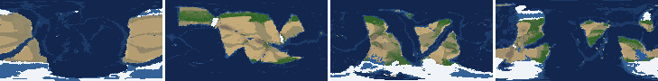
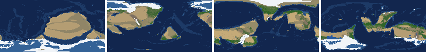
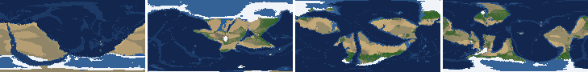
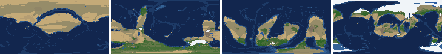
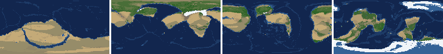
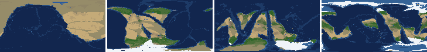
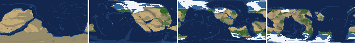
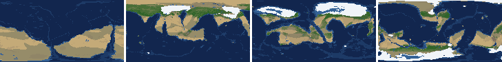

# Health sweep 2026-10-16 12:38

Commit ecffcb9. 8 runs (default params, `--every 4`) at 8 workers x 1 numba threads; simulations 24.4 min wall. Made by `tools/health.py` (PW-246).

## Runs

| seed | L | Myr | run | sim s | trees / flowering trees from | dT range C | peaks > 9.5 km | giant-lake frames % | crust volume end/start | ice SL < -150 m % | <= 4 plates % |
|---|---|---|---|---|---|---|---|---|---|---|---|
| 1 | 6 | 500 | f1ca39 | 1121 | 132 / 412 | 12.4 | 0 | 29.2 | 0.973 | 0.0 | 0.0 |
| 2 | 6 | 500 | db3d52 | 1199 | 140 / 396 | 21.1 | 0 | 14.2 | 0.959 | 0.0 | 2.7 |
| 11 | 6 | 500 | 7dd540 | 1463 | 128 / 372 | 15.3 | 0 | 21.2 | 0.969 | 0.0 | 0.0 |
| 21 | 6 | 500 | eb8154 | 653 | 136 / 404 | 9.2 | 0 | 8.8 | 0.957 | 0.0 | 0.0 |
| 3199 | 6 | 500 | 3a0aa9 | 796 | 132 / 376 | 12.9 | 0 | 20.4 | 0.959 | 8.0 | 0.0 |
| 42 | 6 | 500 | 067644 | 704 | 116 / 404 | 10.9 | 0 | 5.3 | 0.963 | 0.0 | 0.0 |
| 77 | 6 | 500 | 3969f8 | 1174 | 124 / 416 | 10.6 | 0 | 12.4 | 0.968 | 0.0 | 0.0 |
| 505 | 6 | 500 | 3d6704 | 952 | 132 / 416 | 10.9 | 0 | 6.2 | 0.958 | 29.2 | 0.0 |

## Medians by seed (after 50 Myr; tree cover after forests, NPP after flowering trees appear)

| seed | L | land_pct | cont_pct | cont_km | plates | ocean_age | speed | sea_level | sea_ice_m | ice_pct | temp | co2 | dry_pct | inland_pct | lake_pct | lake_max_mkm2 | max_elev_km | trees_pct | npp | landmasses | largest_pct |
|---|---|---|---|---|---|---|---|---|---|---|---|---|---|---|---|---|---|---|---|---|---|
| 1 | 6 | 32.7 | 38.6 | 35.1 | 10.0 | 55.3 | 4.6 | -80.3 | -20.9 | 2.9 | 14.8 | -0.3 | 37.6 | 8.9 | 0.6 | 0.2 | 6.9 | 18.2 | 261.3 | 6.0 | 27.6 |
| 2 | 6 | 32.1 | 38.4 | 35.3 | 9.0 | 58.6 | 4.0 | -171.8 | -33.8 | 4.2 | 13.7 | -0.2 | 38.4 | 7.2 | 0.5 | 0.1 | 6.7 | 17.2 | 307.6 | 8.0 | 29.4 |
| 11 | 6 | 29.7 | 40.1 | 34.2 | 13.0 | 52.3 | 4.4 | -254.6 | -64.1 | 8.5 | 11.8 | -0.4 | 37.9 | 6.2 | 0.5 | 0.1 | 6.5 | 22.4 | 264.9 | 6.0 | 28.8 |
| 21 | 6 | 33.3 | 39.8 | 34.1 | 9.0 | 58.5 | 4.5 | -40.9 | -1.8 | 0.3 | 16.2 | -0.4 | 34.9 | 6.0 | 0.4 | 0.1 | 6.2 | 18.9 | 284.8 | 7.0 | 25.4 |
| 3199 | 6 | 33.8 | 39.3 | 34.2 | 11.0 | 54.2 | 4.7 | -64.0 | -6.7 | 1.1 | 14.9 | -0.2 | 37.9 | 4.8 | 0.4 | 0.1 | 5.9 | 20.4 | 219.1 | 5.0 | 25.7 |
| 42 | 6 | 32.8 | 39.3 | 34.4 | 12.0 | 49.7 | 4.6 | -69.1 | -12.0 | 2.2 | 14.8 | -0.2 | 32.0 | 4.8 | 0.4 | 0.1 | 5.9 | 23.9 | 353.0 | 4.0 | 23.6 |
| 77 | 6 | 31.1 | 38.8 | 35.0 | 12.0 | 53.5 | 4.5 | -129.2 | -38.8 | 5.4 | 12.0 | -0.2 | 36.4 | 9.3 | 0.6 | 0.2 | 7.0 | 22.8 | 258.0 | 7.0 | 20.1 |
| 505 | 6 | 33.0 | 40.9 | 33.5 | 10.0 | 60.1 | 4.3 | -56.6 | -20.4 | 3.1 | 13.8 | -0.5 | 34.0 | 6.0 | 0.5 | 0.1 | 5.5 | 20.8 | 270.2 | 8.0 | 27.6 |

Measured on the run's keyframes (no slicing). A keyframe's rivers and lakes are routed on its own terrain (PW-239), so `inland_raw_pct` (every routed end on land, as highlights counts it) and `inland_pct` (ends that are closed lakes, salt pans or real pits) agree but for ends under land ice. Land ice and land shares use cells (near-equal area).

## Envelopes

| metric | low | high | Earth | source |
|---|---|---|---|---|
| land, % of surface (`land_pct`) | 22 | 42 | 29.20 | tests/test_envelopes.py (22-42%); Earth 29.2% |
| continental crust, % of surface (`cont_pct`) | 33 | 50 | 41 | tests/test_envelopes.py (33-50%); Earth ~41% with shelves (Cogley 1984) |
| mean continental crust thickness, km (`cont_km`) | 31 | 40 | 39 | target 35 km (PW-238, continental_thickness); Earth ~39 km (Christensen & Mooney 1995); known thinning to 32-33 km (PW-046) |
| plates (`plates`) | 5 | 30 | 15 | tests/test_envelopes.py (5-30; max_plates 30); Earth 7 major + ~8 minor; <= 4 is the PW-191 collapse |
| mean ocean-floor age, Myr (`ocean_age`) | 25 | 120 | 64 | tests/test_envelopes.py (25-120); Earth ~64 Myr (Mueller et al. 2008); PW-051 |
| mean plate speed, cm/yr (`speed`) | 2 | 9 | 4.50 | tests/test_envelopes.py (2-9 cm/yr); Earth ~4-5 |
| sea level, m (ice + ocean basins) (`sea_level`) | -250 | 300 | 0 | Phanerozoic ~-130 (LGM) .. +250 m (earth.py; Haq & Schutter 2008); -250: PW-240's hard goal |
| sea level from land ice, m (`sea_ice_m`) | -250 | - | 0 | Earth LGM ~-130 m; PW-240 goal -150 m typical / -250 m worst |
| land ice, % of surface (`ice_pct`) | - | 10 | 3.10 | Earth 3.1% now (earth.EARTH_ICE), ~7-8% at the LGM |
| global mean temperature, C (`temp`) | 8 | 30 | 14.50 | Earth 14.5 C; LGM ~8 C (Tierney et al. 2020); Phanerozoic hothouses to ~30 C (Scotese et al. 2021) |
| CO2 index (ln source/sink) (`co2`) | -1.5 | 1.5 | 0.00 | the forcing's clip in earth.py (+-1.5); Earth 0 |
| arid (Koppen B), % of land (`dry_pct`) | 12 | 45 | 30 | tests/test_envelopes.py (12-45%); Earth ~30% (Beck et al. 2018) |
| land draining inland, % of ice-free land (to a closed lake, salt pan or real pit) (`inland_pct`) | 8 | 30 | 18 | Earth ~18% (overview 2.9); L6 known ~9.5-11% (PW-054, PW-243). `inland_raw_pct` (not checked) follows the stored `downstream` to any end, as highlights does; since PW-239 the two agree but for ends under land ice |
| lakes, % of land (`lake_pct`) | 0.2 | 3.0 | 1.80 | Earth ~1.8% of ice-free land (HydroLAKES, Messager et al. 2016); generated L6 worlds 0.5-1% |
| largest lake, million km2 (`lake_max_mkm2`) | - | 1.0 | 0.37 | Caspian 0.37 Mkm2; 1 Mkm2 = the overview's giant lake (2.9) |
| highest peak, km (`max_elev_km`) | - | 9.5 | 8.85 | Everest 8.85 km; PW-172 (spikes above ~9.5 km) |
| tree cover, % of ice-free land (after forests appear) (`trees_pct`) | 10 | 50 | 30 | Earth ~30% potential canopy (forest 55-60 of ~130 Mkm2, overview 2.18) |
| land NPP, g C/m2/yr (after flowering trees appear) (`npp`) | 200 | 700 | 430 | Earth ~56 Pg C/yr over ~130 Mkm2 = ~430; the model on Earth's terrain 50 Pg C/yr, ~385 (overview 2.18). Before flowering trees (plant group 4) stand-ins grow at 70%, so runs sit at ~150-280 |
| landmasses (>= 3 cells) (`landmasses`) | 3 | 80 | - | loose: a lone supercontinent or a shattered archipelago |
| largest landmass, % of surface (`largest_pct`) | 5 | 35 | 16.60 | Afro-Eurasia 16.6%; a Pangaea ~30% (scorecard largest_max) |
| global temperature range over the run, C (`dT_range`, per run) | - | 25 | 25 | Phanerozoic 11-36 C (Scotese et al. 2021) |
| keyframes with a peak above 9.5 km (`peak_frames`, per run) | - | 0 | 0 | PW-172 (L7 seed 3199: 3 of 251) |
| % of keyframes with a lake over 1 Mkm2 (`giant_lake_frames`, per run) | - | 5 | 0 | overview 2.9 (L6: 3 of ~150 frames) |
| continental crust volume, end / start (`volume_ratio`, per run) | 0.9 | 1.1 | 1.0 | scorecard volume_ratio (x1.006) |
| % of keyframes with ice sea level below -150 m (`sea_ice_below_150`, per run) | - | 10 | 0 | PW-240 |
| % of keyframes with <= 4 plates (`low_plates`, per run) | - | 2 | 0 | PW-191 (L7 seed 21: 1%) |

## Top outliers (of 231 spells; severity = excess / band width x (0.2 + share of the run))

| seed | L | metric | Myr | frames | worst | envelope | severity |
|---|---|---|---|---|---|---|---|
| 1 | 6 | giant_lake_frames | run | - | 29.20 | -..5 | 4.84 |
| 11 | 6 | giant_lake_frames | run | - | 21.20 | -..5 | 3.24 |
| 3199 | 6 | giant_lake_frames | run | - | 20.40 | -..5 | 3.08 |
| 42 | 6 | lake_max_mkm2 | 280-292 | 3 | 12.89 | -..1.0 | 2.661 |
| 11 | 6 | lake_max_mkm2 | 188-252 | 17 | 7.38 | -..1.0 | 2.138 |
| 505 | 6 | sea_ice_below_150 | run | - | 29.20 | -..10 | 1.92 |
| 2 | 6 | lake_max_mkm2 | 408-408 | 1 | 10.05 | -..1.0 | 1.882 |
| 2 | 6 | giant_lake_frames | run | - | 14.20 | -..5 | 1.84 |
| 1 | 6 | lake_max_mkm2 | 308-388 | 20 | 6.05 | -..1.0 | 1.812 |
| 2 | 6 | lake_max_mkm2 | 312-312 | 1 | 9.29 | -..1.0 | 1.724 |
| 77 | 6 | giant_lake_frames | run | - | 12.40 | -..5 | 1.48 |
| 1 | 6 | lake_max_mkm2 | 76-76 | 1 | 5.38 | -..1.0 | 0.911 |
| 3199 | 6 | lake_max_mkm2 | 424-424 | 1 | 5.18 | -..1.0 | 0.869 |
| 11 | 6 | lake_pct | 188-252 | 17 | 9.95 | 0.2..3.0 | 0.832 |
| 3199 | 6 | lake_max_mkm2 | 452-500 | 11 | 3.67 | -..1.0 | 0.768 |
| 1 | 6 | lake_max_mkm2 | 452-456 | 2 | 4.53 | -..1.0 | 0.763 |
| 1 | 6 | lake_max_mkm2 | 484-484 | 1 | 4.66 | -..1.0 | 0.76 |
| 21 | 6 | giant_lake_frames | run | - | 8.80 | -..5 | 0.76 |
| 1 | 6 | lake_max_mkm2 | 500-500 | 1 | 4.36 | -..1.0 | 0.698 |
| 2 | 6 | lake_max_mkm2 | 492-500 | 3 | 3.77 | -..1.0 | 0.621 |
| 42 | 6 | lake_pct | 292-292 | 1 | 10.06 | 0.2..3.0 | 0.524 |
| 505 | 6 | lake_max_mkm2 | 448-456 | 2 | 3.41 | -..1.0 | 0.521 |
| 3199 | 6 | lake_max_mkm2 | 180-188 | 3 | 3.24 | -..1.0 | 0.501 |
| 2 | 6 | lake_max_mkm2 | 172-192 | 4 | 2.95 | -..1.0 | 0.452 |
| 42 | 6 | lake_max_mkm2 | 232-232 | 1 | 3.17 | -..1.0 | 0.452 |
| 3199 | 6 | lake_max_mkm2 | 132-152 | 5 | 2.80 | -..1.0 | 0.432 |
| 3199 | 6 | lake_max_mkm2 | 164-164 | 1 | 3.05 | -..1.0 | 0.426 |
| 505 | 6 | lake_max_mkm2 | 272-272 | 1 | 2.90 | -..1.0 | 0.395 |
| 2 | 6 | lake_max_mkm2 | 52-56 | 2 | 2.76 | -..1.0 | 0.381 |
| 42 | 6 | lake_max_mkm2 | 344-344 | 1 | 2.70 | -..1.0 | 0.354 |

## Per seed: min / median / max after the 50 Myr spin-up, and spells outside the envelopes

### Seed 1, L6 (run f1ca39)

*At 48, 200, 348, 500 Myr: sea by depth, land green by tree cover / tan where arid, shaded by height, ice white, lakes blue.*

| metric | min | median | max | outside (Myr: worst) |
|---|---|---|---|---|
| land_pct | 30.90 | 32.74 | 35.09 |  |
| cont_pct | 36.26 | 38.65 | 42.23 |  |
| cont_km | 33.02 | 35.10 | 37.17 |  |
| plates | 7.00 | 10.00 | 15.00 |  |
| ocean_age | 31.90 | 55.30 | 90.90 |  |
| speed | 2.04 | 4.63 | 7.14 |  |
| sea_level | -444.00 | -80.30 | 204.70 | 52-68: -426.40; 448-500: -444.00 |
| sea_ice_m | -148.70 | -20.90 | -0.00 |  |
| ice_pct | 0.00 | 2.90 | 9.00 |  |
| temp | 6.90 | 14.80 | 19.30 | 480-500: 6.90 |
| co2 | -1.07 | -0.29 | 0.27 |  |
| dry_pct | 24.43 | 37.57 | 57.43 | 52-88: 51.52; 160-292: 57.43 |
| inland_pct | 1.59 | 8.90 | 27.01 | 80-240: 1.59; 300-304: 6.25; 360-368: 1.62; 400-412: 5.21; +3 more |
| lake_pct | 0.02 | 0.59 | 4.75 | 76-200: 3.19; 308-332: 4.75; 364-372: 4.17; 452-456: 4.08; +2 more |
| lake_max_mkm2 | 0.01 | 0.21 | 6.05 | 64-64: 2.06; 76-76: 5.38; 140-140: 1.08; 248-248: 1.28; +8 more |
| max_elev_km | 1.70 | 6.94 | 8.73 |  |
| trees_pct | 9.23 | 18.16 | 33.86 | 148-160: 9.23 |
| npp | 171.10 | 261.30 | 276.00 | 412-436: 171.10 |
| landmasses | 2.00 | 6.00 | 12.00 | 52-52: 2; 148-164: 2; 192-196: 2 |
| largest_pct | 12.30 | 27.60 | 34.30 |  |

### Seed 2, L6 (run db3d52)

*At 48, 200, 348, 500 Myr: sea by depth, land green by tree cover / tan where arid, shaded by height, ice white, lakes blue.*

| metric | min | median | max | outside (Myr: worst) |
|---|---|---|---|---|
| land_pct | 29.94 | 32.08 | 34.66 |  |
| cont_pct | 37.36 | 38.38 | 43.07 |  |
| cont_km | 32.56 | 35.31 | 36.20 |  |
| plates | 4.00 | 9.00 | 16.00 | 180-192: 4 |
| ocean_age | 32.50 | 58.60 | 82.50 |  |
| speed | 1.86 | 4.05 | 7.83 | 448-448: 1.86 |
| sea_level | -577.60 | -171.80 | 201.90 | 52-68: -577.60; 176-232: -376.20; 456-500: -308.60 |
| sea_ice_m | -133.30 | -33.80 | -0.00 |  |
| ice_pct | 0.00 | 4.20 | 10.90 | 52-56: 10.90 |
| temp | 2.70 | 13.70 | 23.80 | 464-500: 2.70 |
| co2 | -1.30 | -0.24 | 0.43 |  |
| dry_pct | 30.04 | 38.38 | 55.31 | 52-92: 55.31 |
| inland_pct | 0.65 | 7.17 | 29.31 | 64-140: 0.65; 232-304: 2.79; 332-364: 5.96; 388-396: 5.78; +1 more |
| lake_pct | 0.05 | 0.51 | 7.62 | 84-88: 0.14; 100-108: 0.05; 120-128: 0.18; 268-268: 0.19; +3 more |
| lake_max_mkm2 | 0.03 | 0.14 | 10.05 | 52-56: 2.76; 112-112: 2.14; 172-192: 2.95; 312-312: 9.29; +4 more |
| max_elev_km | 1.76 | 6.73 | 8.66 |  |
| trees_pct | 9.52 | 17.25 | 35.99 | 280-280: 9.52 |
| npp | 179.10 | 307.60 | 316.50 | 396-408: 179.10 |
| landmasses | 3.00 | 8.00 | 16.00 |  |
| largest_pct | 10.60 | 29.40 | 33.30 |  |

### Seed 11, L6 (run 7dd540)

*At 48, 200, 348, 500 Myr: sea by depth, land green by tree cover / tan where arid, shaded by height, ice white, lakes blue.*

| metric | min | median | max | outside (Myr: worst) |
|---|---|---|---|---|
| land_pct | 26.76 | 29.74 | 35.06 |  |
| cont_pct | 36.95 | 40.11 | 42.37 |  |
| cont_km | 32.93 | 34.24 | 36.65 |  |
| plates | 5.00 | 13.00 | 18.00 |  |
| ocean_age | 34.50 | 52.30 | 72.90 |  |
| speed | 2.58 | 4.40 | 7.38 |  |
| sea_level | -557.40 | -254.60 | 203.80 | 52-64: -429.40; 144-300: -557.40; 412-460: -333.90 |
| sea_ice_m | -137.20 | -64.10 | -0.00 |  |
| ice_pct | 0.00 | 8.50 | 14.70 | 140-260: 14.70; 400-448: 11.40 |
| temp | 2.90 | 11.80 | 18.20 | 144-216: 2.90 |
| co2 | -0.99 | -0.35 | 0.16 |  |
| dry_pct | 19.37 | 37.87 | 49.50 | 52-80: 49.50; 292-292: 45.73; 340-360: 47.58 |
| inland_pct | 1.28 | 6.25 | 43.02 | 60-184: 1.28; 208-208: 43.02; 256-312: 3.47; 336-336: 6.81; +1 more |
| lake_pct | 0.02 | 0.54 | 9.95 | 60-100: 0.02; 116-128: 0.05; 188-252: 9.95; 296-296: 0.16 |
| lake_max_mkm2 | 0.01 | 0.15 | 7.38 | 52-52: 1.12; 72-80: 2.20; 188-252: 7.38; 308-308: 1.11; +2 more |
| max_elev_km | 1.67 | 6.55 | 8.79 |  |
| trees_pct | 12.56 | 22.44 | 44.98 |  |
| npp | 185.70 | 264.90 | 397.90 | 372-376: 185.70 |
| landmasses | 2.00 | 6.00 | 11.00 | 232-232: 2; 264-264: 2 |
| largest_pct | 8.50 | 28.80 | 34.20 |  |

### Seed 21, L6 (run eb8154)

*At 48, 200, 348, 500 Myr: sea by depth, land green by tree cover / tan where arid, shaded by height, ice white, lakes blue.*

| metric | min | median | max | outside (Myr: worst) |
|---|---|---|---|---|
| land_pct | 29.78 | 33.33 | 37.65 |  |
| cont_pct | 36.99 | 39.82 | 43.03 |  |
| cont_km | 32.60 | 34.15 | 36.15 |  |
| plates | 5.00 | 9.00 | 17.00 |  |
| ocean_age | 34.20 | 58.50 | 84.80 |  |
| speed | 1.94 | 4.46 | 7.21 | 240-252: 1.94 |
| sea_level | -280.20 | -40.90 | 205.30 | 280-292: -257.10; 500-500: -280.20 |
| sea_ice_m | -76.90 | -1.80 | -0.00 |  |
| ice_pct | 0.00 | 0.30 | 7.60 |  |
| temp | 12.00 | 16.20 | 21.20 |  |
| co2 | -1.11 | -0.43 | 0.22 |  |
| dry_pct | 20.33 | 34.87 | 51.34 | 52-72: 51.34 |
| inland_pct | 0.65 | 6.02 | 14.70 | 56-208: 0.65; 228-384: 2.37; 396-420: 5.53; 432-440: 5.38; +1 more |
| lake_pct | 0.00 | 0.41 | 1.61 | 68-116: 0.00; 292-292: 0.20; 356-356: 0.16; 372-380: 0.13; +1 more |
| lake_max_mkm2 | 0.00 | 0.10 | 1.96 | 52-64: 1.96; 124-124: 1.37; 212-220: 1.08; 348-352: 1.23; +2 more |
| max_elev_km | 1.54 | 6.21 | 8.49 |  |
| trees_pct | 14.17 | 18.91 | 26.48 |  |
| npp | 175.50 | 284.80 | 303.30 | 404-440: 175.50 |
| landmasses | 3.00 | 7.00 | 14.00 |  |
| largest_pct | 10.40 | 25.40 | 33.80 |  |

### Seed 3199, L6 (run 3a0aa9)

*At 48, 200, 348, 500 Myr: sea by depth, land green by tree cover / tan where arid, shaded by height, ice white, lakes blue.*

| metric | min | median | max | outside (Myr: worst) |
|---|---|---|---|---|
| land_pct | 29.35 | 33.78 | 38.41 |  |
| cont_pct | 36.94 | 39.34 | 42.76 |  |
| cont_km | 32.47 | 34.24 | 36.48 |  |
| plates | 5.00 | 11.00 | 15.00 |  |
| ocean_age | 36.00 | 54.20 | 80.40 |  |
| speed | 2.27 | 4.71 | 7.66 |  |
| sea_level | -491.10 | -64.00 | 181.40 | 436-500: -491.10 |
| sea_ice_m | -204.90 | -6.70 | -0.00 |  |
| ice_pct | 0.00 | 1.10 | 12.60 | 460-500: 12.60 |
| temp | 8.60 | 14.90 | 21.50 |  |
| co2 | -0.72 | -0.22 | 0.07 |  |
| dry_pct | 21.43 | 37.85 | 57.76 | 52-100: 57.76; 160-184: 49.62; 332-356: 47.74 |
| inland_pct | 0.42 | 4.85 | 15.40 | 56-136: 0.42; 152-168: 5.06; 208-248: 3.40; 260-500: 1.46 |
| lake_pct | 0.00 | 0.37 | 4.82 | 52-116: 0.00; 156-168: 0.06; 368-384: 0.11; 400-400: 0.17; +2 more |
| lake_max_mkm2 | 0.00 | 0.11 | 5.18 | 132-152: 2.80; 164-164: 3.05; 180-188: 3.24; 336-336: 1.01; +3 more |
| max_elev_km | 1.51 | 5.86 | 8.80 |  |
| trees_pct | 12.05 | 20.43 | 38.64 |  |
| npp | 167.80 | 219.05 | 347.90 | 376-380: 167.80; 412-428: 185.50 |
| landmasses | 2.00 | 5.00 | 11.00 | 68-76: 2; 192-196: 2; 232-232: 2; 328-332: 2 |
| largest_pct | 10.80 | 25.70 | 33.80 |  |

### Seed 42, L6 (run 067644)

*At 48, 200, 348, 500 Myr: sea by depth, land green by tree cover / tan where arid, shaded by height, ice white, lakes blue.*

| metric | min | median | max | outside (Myr: worst) |
|---|---|---|---|---|
| land_pct | 27.49 | 32.79 | 38.91 |  |
| cont_pct | 36.17 | 39.30 | 42.44 |  |
| cont_km | 33.01 | 34.36 | 37.27 |  |
| plates | 5.00 | 12.00 | 17.00 |  |
| ocean_age | 35.20 | 49.70 | 78.40 |  |
| speed | 3.45 | 4.64 | 8.05 |  |
| sea_level | -249.80 | -69.10 | 186.30 |  |
| sea_ice_m | -106.60 | -12.00 | -0.00 |  |
| ice_pct | 0.00 | 2.20 | 12.20 | 440-480: 12.20 |
| temp | 7.20 | 14.80 | 18.10 | 448-452: 7.20 |
| co2 | -1.20 | -0.17 | 0.10 |  |
| dry_pct | 21.27 | 32.05 | 54.29 | 52-68: 54.29; 216-280: 48.43 |
| inland_pct | 0.41 | 4.82 | 37.21 | 68-196: 0.41; 208-208: 6.59; 224-224: 6.33; 280-280: 30.64; +2 more |
| lake_pct | 0.01 | 0.40 | 10.06 | 56-124: 0.01; 148-152: 0.11; 164-188: 0.11; 280-280: 6.74; +2 more |
| lake_max_mkm2 | 0.01 | 0.09 | 12.89 | 112-112: 2.17; 232-232: 3.17; 280-292: 12.89; 344-344: 2.70 |
| max_elev_km | 1.83 | 5.91 | 8.46 |  |
| trees_pct | 14.74 | 23.91 | 33.41 |  |
| npp | 241.10 | 353.00 | 377.60 |  |
| landmasses | 2.00 | 4.00 | 10.00 | 52-60: 2; 84-88: 2; 176-176: 2; 232-244: 2; +1 more |
| largest_pct | 11.70 | 23.60 | 38.90 | 52-64: 38.90 |

### Seed 77, L6 (run 3969f8)

*At 48, 200, 348, 500 Myr: sea by depth, land green by tree cover / tan where arid, shaded by height, ice white, lakes blue.*

| metric | min | median | max | outside (Myr: worst) |
|---|---|---|---|---|
| land_pct | 28.01 | 31.12 | 38.06 |  |
| cont_pct | 36.05 | 38.79 | 43.03 |  |
| cont_km | 32.64 | 35.02 | 37.33 |  |
| plates | 9.00 | 12.00 | 19.00 |  |
| ocean_age | 35.80 | 53.50 | 96.50 |  |
| speed | 2.48 | 4.48 | 7.07 |  |
| sea_level | -393.10 | -129.20 | 145.10 | 216-232: -265.90; 444-500: -393.10 |
| sea_ice_m | -94.40 | -38.80 | -0.00 |  |
| ice_pct | 0.00 | 5.40 | 10.20 | 316-320: 10.20 |
| temp | 5.20 | 12.00 | 15.80 | 132-152: 5.20; 440-456: 6.70 |
| co2 | -1.00 | -0.21 | 0.20 |  |
| dry_pct | 24.71 | 36.44 | 48.79 | 140-268: 48.79 |
| inland_pct | 1.71 | 9.26 | 20.07 | 64-168: 1.71; 192-192: 7.51; 292-304: 5.48; 324-324: 6.37; +6 more |
| lake_pct | 0.02 | 0.55 | 2.62 | 68-100: 0.02; 124-128: 0.08 |
| lake_max_mkm2 | 0.01 | 0.19 | 2.40 | 64-72: 1.69; 152-152: 1.38; 196-200: 1.51; 280-288: 2.40; +4 more |
| max_elev_km | 1.77 | 6.97 | 8.56 |  |
| trees_pct | 10.12 | 22.83 | 31.74 |  |
| npp | 187.40 | 258.05 | 279.40 | 416-428: 187.40 |
| landmasses | 2.00 | 7.00 | 14.00 | 52-60: 2; 192-192: 2 |
| largest_pct | 10.50 | 20.10 | 33.40 |  |

### Seed 505, L6 (run 3d6704)

*At 48, 200, 348, 500 Myr: sea by depth, land green by tree cover / tan where arid, shaded by height, ice white, lakes blue.*

| metric | min | median | max | outside (Myr: worst) |
|---|---|---|---|---|
| land_pct | 30.49 | 33.02 | 38.05 |  |
| cont_pct | 37.50 | 40.86 | 43.09 |  |
| cont_km | 32.31 | 33.50 | 36.08 |  |
| plates | 7.00 | 10.00 | 17.00 |  |
| ocean_age | 33.00 | 60.10 | 97.40 |  |
| speed | 2.30 | 4.32 | 7.32 |  |
| sea_level | -590.30 | -56.60 | 209.20 | 228-388: -590.30 |
| sea_ice_m | -215.50 | -20.40 | -0.00 |  |
| ice_pct | 0.00 | 3.10 | 11.10 | 232-244: 11.10; 268-316: 10.90 |
| temp | 8.40 | 13.80 | 19.30 |  |
| co2 | -0.70 | -0.46 | 0.15 |  |
| dry_pct | 25.56 | 33.96 | 49.52 | 96-108: 49.52 |
| inland_pct | 1.82 | 6.05 | 20.94 | 52-180: 1.82; 192-220: 4.62; 276-360: 3.79; 408-500: 2.57 |
| lake_pct | 0.00 | 0.47 | 3.30 | 52-104: 0.00; 120-124: 0.12; 352-356: 0.10; 368-368: 0.15; +2 more |
| lake_max_mkm2 | 0.00 | 0.10 | 3.41 | 184-184: 1.77; 272-272: 2.90; 300-300: 1.97; 424-424: 1.22; +2 more |
| max_elev_km | 1.91 | 5.53 | 8.30 |  |
| trees_pct | 17.68 | 20.79 | 31.69 |  |
| npp | 166.10 | 270.25 | 328.40 | 416-444: 166.10 |
| landmasses | 2.00 | 8.00 | 20.00 | 60-60: 2; 156-180: 2 |
| largest_pct | 9.70 | 27.60 | 35.30 | 284-284: 35.10; 296-304: 35.30 |

## Determinism

(not run)
