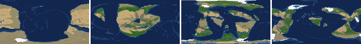
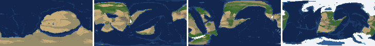
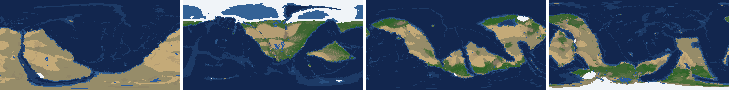
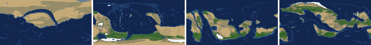
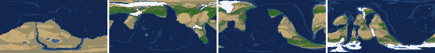
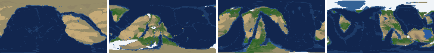
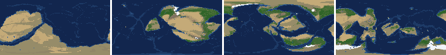
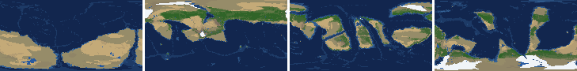

# Health sweep 2026-10-16 11:19

Commit b8872f2. 8 runs (default params, `--every 4`) at 8 workers x 1 numba threads; simulations 10.6 min wall. Made by `tools/health.py` (PW-246).

## Runs

| seed | L | Myr | run | sim s | trees / flowering trees from | dT range C | peaks > 9.5 km | giant-lake frames % | crust volume end/start | ice SL < -150 m % | <= 4 plates % |
|---|---|---|---|---|---|---|---|---|---|---|---|
| 1 | 6 | 500 | 1ffbc3 | 512 | 132 / 412 | 13.4 | 0 | 15.9 | 0.96 | 0.0 | 0.0 |
| 2 | 6 | 500 | 9b6669 | 636 | 140 / 396 | 20.1 | 0 | 6.2 | 0.975 | 7.1 | 0.0 |
| 11 | 6 | 500 | cdab52 | 473 | 128 / 372 | 16.2 | 0 | 14.2 | 0.975 | 0.0 | 0.0 |
| 21 | 6 | 500 | 0c87bc | 433 | 136 / 404 | 9.4 | 0 | 8.8 | 0.968 | 0.0 | 0.0 |
| 3199 | 6 | 500 | dc9b40 | 422 | 132 / 376 | 12.9 | 0 | 9.7 | 0.973 | 0.0 | 0.0 |
| 42 | 6 | 500 | 7e194d | 425 | 116 / 404 | 13.2 | 0 | 17.7 | 0.969 | 0.0 | 0.0 |
| 77 | 6 | 500 | 16da74 | 473 | 124 / 416 | 11.8 | 0 | 22.1 | 0.961 | 0.0 | 0.0 |
| 505 | 6 | 500 | 88d42a | 420 | 132 / 416 | 7.9 | 0 | 14.2 | 0.968 | 0.0 | 0.0 |

## Medians by seed (after 50 Myr; tree cover after forests, NPP after flowering trees appear)

| seed | L | land_pct | cont_pct | cont_km | plates | ocean_age | speed | sea_level | sea_ice_m | ice_pct | temp | co2 | dry_pct | inland_pct | lake_pct | lake_max_mkm2 | max_elev_km | trees_pct | npp | landmasses | largest_pct |
|---|---|---|---|---|---|---|---|---|---|---|---|---|---|---|---|---|---|---|---|---|---|
| 1 | 6 | 32.5 | 39.8 | 33.8 | 13.0 | 48.4 | 4.4 | 39.8 | -2.9 | 0.6 | 16.1 | -0.2 | 27.4 | 4.9 | 0.6 | 0.2 | 5.3 | 29.7 | 313.9 | 7.0 | 23.7 |
| 2 | 6 | 33.2 | 39.5 | 34.4 | 12.0 | 51.4 | 4.2 | 23.5 | -0.8 | 0.2 | 15.2 | -0.2 | 28.7 | 4.2 | 0.5 | 0.2 | 5.9 | 23.9 | 294.9 | 7.0 | 30.6 |
| 11 | 6 | 32.6 | 39.7 | 34.3 | 12.0 | 53.5 | 4.6 | -81.8 | -21.4 | 2.7 | 12.9 | -0.5 | 29.4 | 3.9 | 0.5 | 0.3 | 5.7 | 30.0 | 343.1 | 6.0 | 27.3 |
| 21 | 6 | 34.5 | 39.7 | 34.3 | 11.0 | 56.7 | 4.7 | -11.8 | -1.9 | 0.3 | 16.4 | -0.4 | 34.4 | 4.7 | 0.4 | 0.1 | 5.4 | 23.6 | 349.6 | 12.0 | 25.0 |
| 3199 | 6 | 33.4 | 39.6 | 34.4 | 10.0 | 53.9 | 4.5 | 10.6 | -6.9 | 1.3 | 14.4 | -0.2 | 28.6 | 4.8 | 0.5 | 0.1 | 5.4 | 27.5 | 320.4 | 6.0 | 20.6 |
| 42 | 6 | 33.0 | 39.5 | 34.3 | 13.0 | 55.4 | 4.6 | -25.4 | -5.7 | 1.0 | 14.3 | -0.3 | 27.4 | 4.9 | 0.7 | 0.3 | 4.9 | 25.9 | 379.6 | 6.0 | 21.8 |
| 77 | 6 | 33.6 | 40.9 | 33.5 | 12.0 | 51.3 | 4.1 | 25.0 | -1.6 | 0.3 | 13.1 | -0.3 | 30.9 | 6.2 | 0.6 | 0.2 | 4.0 | 26.2 | 343.6 | 7.0 | 20.8 |
| 505 | 6 | 34.0 | 40.8 | 33.9 | 11.0 | 57.2 | 4.4 | -22.2 | -3.2 | 0.5 | 14.5 | -0.4 | 27.9 | 3.3 | 0.5 | 0.1 | 5.1 | 29.0 | 330.1 | 7.0 | 28.5 |

Measured on the run's keyframes (no slicing). A keyframe's rivers and lakes are routed on its own terrain (PW-239), so `inland_raw_pct` (every routed end on land, as highlights counts it) and `inland_pct` (ends that are closed lakes, salt pans or real pits) agree but for ends under land ice. Land ice and land shares use cells (near-equal area).

## Envelopes

| metric | low | high | Earth | source |
|---|---|---|---|---|
| land, % of surface (`land_pct`) | 22 | 42 | 29.20 | tests/test_envelopes.py (22-42%); Earth 29.2% |
| continental crust, % of surface (`cont_pct`) | 33 | 50 | 41 | tests/test_envelopes.py (33-50%); Earth ~41% with shelves (Cogley 1984) |
| mean continental crust thickness, km (`cont_km`) | 31 | 40 | 39 | target 35 km (PW-238, continental_thickness); Earth ~39 km (Christensen & Mooney 1995); known thinning to 32-33 km (PW-046) |
| plates (`plates`) | 5 | 30 | 15 | tests/test_envelopes.py (5-30; max_plates 30); Earth 7 major + ~8 minor; <= 4 is the PW-191 collapse |
| mean ocean-floor age, Myr (`ocean_age`) | 25 | 120 | 64 | tests/test_envelopes.py (25-120); Earth ~64 Myr (Mueller et al. 2008); PW-051 |
| mean plate speed, cm/yr (`speed`) | 2 | 9 | 4.50 | tests/test_envelopes.py (2-9 cm/yr); Earth ~4-5 |
| sea level, m (ice + ocean basins) (`sea_level`) | -250 | 300 | 0 | Phanerozoic ~-130 (LGM) .. +250 m (earth.py; Haq & Schutter 2008); -250: PW-240's hard goal |
| sea level from land ice, m (`sea_ice_m`) | -250 | - | 0 | Earth LGM ~-130 m; PW-240 goal -150 m typical / -250 m worst |
| land ice, % of surface (`ice_pct`) | - | 10 | 3.10 | Earth 3.1% now (earth.EARTH_ICE), ~7-8% at the LGM |
| global mean temperature, C (`temp`) | 8 | 30 | 14.50 | Earth 14.5 C; LGM ~8 C (Tierney et al. 2020); Phanerozoic hothouses to ~30 C (Scotese et al. 2021) |
| CO2 index (ln source/sink) (`co2`) | -1.5 | 1.5 | 0.00 | the forcing's clip in earth.py (+-1.5); Earth 0 |
| arid (Koppen B), % of land (`dry_pct`) | 12 | 45 | 30 | tests/test_envelopes.py (12-45%); Earth ~30% (Beck et al. 2018) |
| land draining inland, % of ice-free land (to a closed lake, salt pan or real pit) (`inland_pct`) | 8 | 30 | 18 | Earth ~18% (overview 2.9); L6 known ~9.5-11% (PW-054, PW-243). `inland_raw_pct` (not checked) follows the stored `downstream` to any end, as highlights does; since PW-239 the two agree but for ends under land ice |
| lakes, % of land (`lake_pct`) | 0.2 | 3.0 | 1.80 | Earth ~1.8% of ice-free land (HydroLAKES, Messager et al. 2016); generated L6 worlds 0.5-1% |
| largest lake, million km2 (`lake_max_mkm2`) | - | 1.0 | 0.37 | Caspian 0.37 Mkm2; 1 Mkm2 = the overview's giant lake (2.9) |
| highest peak, km (`max_elev_km`) | - | 9.5 | 8.85 | Everest 8.85 km; PW-172 (spikes above ~9.5 km) |
| tree cover, % of ice-free land (after forests appear) (`trees_pct`) | 10 | 50 | 30 | Earth ~30% potential canopy (forest 55-60 of ~130 Mkm2, overview 2.18) |
| land NPP, g C/m2/yr (after flowering trees appear) (`npp`) | 200 | 700 | 430 | Earth ~56 Pg C/yr over ~130 Mkm2 = ~430; the model on Earth's terrain 50 Pg C/yr, ~385 (overview 2.18). Before flowering trees (plant group 4) stand-ins grow at 70%, so runs sit at ~150-280 |
| landmasses (>= 3 cells) (`landmasses`) | 3 | 80 | - | loose: a lone supercontinent or a shattered archipelago |
| largest landmass, % of surface (`largest_pct`) | 5 | 35 | 16.60 | Afro-Eurasia 16.6%; a Pangaea ~30% (scorecard largest_max) |
| global temperature range over the run, C (`dT_range`, per run) | - | 25 | 25 | Phanerozoic 11-36 C (Scotese et al. 2021) |
| keyframes with a peak above 9.5 km (`peak_frames`, per run) | - | 0 | 0 | PW-172 (L7 seed 3199: 3 of 251) |
| % of keyframes with a lake over 1 Mkm2 (`giant_lake_frames`, per run) | - | 5 | 0 | overview 2.9 (L6: 3 of ~150 frames) |
| continental crust volume, end / start (`volume_ratio`, per run) | 0.9 | 1.1 | 1.0 | scorecard volume_ratio (x1.006) |
| % of keyframes with ice sea level below -150 m (`sea_ice_below_150`, per run) | - | 10 | 0 | PW-240 |
| % of keyframes with <= 4 plates (`low_plates`, per run) | - | 2 | 0 | PW-191 (L7 seed 21: 1%) |

## Top outliers (of 188 spells; severity = excess / band width x (0.2 + share of the run))

| seed | L | metric | Myr | frames | worst | envelope | severity |
|---|---|---|---|---|---|---|---|
| 77 | 6 | giant_lake_frames | run | - | 22.10 | -..5 | 3.42 |
| 42 | 6 | giant_lake_frames | run | - | 17.70 | -..5 | 2.54 |
| 1 | 6 | giant_lake_frames | run | - | 15.90 | -..5 | 2.18 |
| 11 | 6 | giant_lake_frames | run | - | 14.20 | -..5 | 1.84 |
| 505 | 6 | giant_lake_frames | run | - | 14.20 | -..5 | 1.84 |
| 42 | 6 | lake_max_mkm2 | 500-500 | 1 | 8.06 | -..1.0 | 1.467 |
| 1 | 6 | lake_max_mkm2 | 112-112 | 1 | 6.76 | -..1.0 | 1.198 |
| 505 | 6 | lake_max_mkm2 | 148-156 | 2 | 6.18 | -..1.0 | 1.117 |
| 42 | 6 | lake_max_mkm2 | 384-408 | 4 | 5.80 | -..1.0 | 1.113 |
| 21 | 6 | lake_max_mkm2 | 360-360 | 1 | 5.69 | -..1.0 | 0.975 |
| 3199 | 6 | giant_lake_frames | run | - | 9.70 | -..5 | 0.94 |
| 21 | 6 | lake_max_mkm2 | 380-384 | 2 | 5.08 | -..1.0 | 0.881 |
| 1 | 6 | lake_max_mkm2 | 164-168 | 2 | 4.96 | -..1.0 | 0.854 |
| 505 | 6 | lake_max_mkm2 | 280-284 | 2 | 4.68 | -..1.0 | 0.795 |
| 21 | 6 | giant_lake_frames | run | - | 8.80 | -..5 | 0.76 |
| 21 | 6 | lake_max_mkm2 | 144-144 | 1 | 4.41 | -..1.0 | 0.709 |
| 3199 | 6 | lake_max_mkm2 | 248-256 | 2 | 4.27 | -..1.0 | 0.706 |
| 505 | 6 | lake_max_mkm2 | 228-264 | 6 | 3.82 | -..1.0 | 0.699 |
| 1 | 6 | lake_max_mkm2 | 328-344 | 5 | 3.55 | -..1.0 | 0.611 |
| 3199 | 6 | lake_max_mkm2 | 492-492 | 1 | 3.94 | -..1.0 | 0.61 |
| 1 | 6 | lake_max_mkm2 | 380-396 | 5 | 3.40 | -..1.0 | 0.575 |
| 77 | 6 | lake_max_mkm2 | 308-320 | 4 | 3.08 | -..1.0 | 0.481 |
| 2 | 6 | lake_max_mkm2 | 416-424 | 3 | 3.06 | -..1.0 | 0.462 |
| 11 | 6 | lake_max_mkm2 | 136-136 | 1 | 3.21 | -..1.0 | 0.46 |
| 21 | 6 | lake_max_mkm2 | 452-464 | 4 | 2.95 | -..1.0 | 0.452 |
| 3199 | 6 | lake_max_mkm2 | 220-228 | 2 | 3.00 | -..1.0 | 0.432 |
| 42 | 6 | lake_max_mkm2 | 172-172 | 1 | 2.80 | -..1.0 | 0.375 |
| 77 | 6 | lake_max_mkm2 | 448-500 | 11 | 2.29 | -..1.0 | 0.371 |
| 1 | 6 | lake_max_mkm2 | 360-368 | 3 | 2.60 | -..1.0 | 0.359 |
| 505 | 6 | lake_max_mkm2 | 188-188 | 1 | 2.58 | -..1.0 | 0.328 |

## Per seed: min / median / max after the 50 Myr spin-up, and spells outside the envelopes

### Seed 1, L6 (run 1ffbc3)

*At 48, 200, 348, 500 Myr: sea by depth, land green by tree cover / tan where arid, shaded by height, ice white, lakes blue.*

| metric | min | median | max | outside (Myr: worst) |
|---|---|---|---|---|
| land_pct | 29.94 | 32.54 | 38.34 |  |
| cont_pct | 38.06 | 39.82 | 42.74 |  |
| cont_km | 32.69 | 33.76 | 35.75 |  |
| plates | 7.00 | 13.00 | 18.00 |  |
| ocean_age | 31.50 | 48.40 | 85.60 |  |
| speed | 1.81 | 4.38 | 7.66 | 492-500: 1.81 |
| sea_level | -253.70 | 39.80 | 198.30 | 500-500: -253.70 |
| sea_ice_m | -25.70 | -2.90 | -0.00 |  |
| ice_pct | 0.00 | 0.60 | 2.40 |  |
| temp | 7.70 | 16.10 | 21.10 | 496-500: 7.70 |
| co2 | -1.53 | -0.15 | 0.26 | 160-164: -1.53 |
| dry_pct | 18.83 | 27.39 | 45.46 | 60-60: 45.46 |
| inland_pct | 0.94 | 4.89 | 22.70 | 68-140: 1.20; 152-156: 6.04; 184-184: 6.84; 196-196: 7.64; +1 more |
| lake_pct | 0.07 | 0.65 | 4.07 | 52-56: 0.10; 68-84: 0.07; 100-124: 4.07; 168-168: 3.80; +1 more |
| lake_max_mkm2 | 0.03 | 0.19 | 6.76 | 64-64: 1.28; 112-112: 6.76; 128-128: 2.10; 164-168: 4.96; +3 more |
| max_elev_km | 1.71 | 5.27 | 7.73 |  |
| trees_pct | 18.27 | 29.73 | 49.70 |  |
| npp | 217.90 | 313.90 | 326.30 |  |
| landmasses | 3.00 | 7.00 | 15.00 |  |
| largest_pct | 12.00 | 23.70 | 33.00 |  |

### Seed 2, L6 (run 9b6669)

*At 48, 200, 348, 500 Myr: sea by depth, land green by tree cover / tan where arid, shaded by height, ice white, lakes blue.*

| metric | min | median | max | outside (Myr: worst) |
|---|---|---|---|---|
| land_pct | 31.44 | 33.20 | 38.03 |  |
| cont_pct | 37.61 | 39.45 | 43.10 |  |
| cont_km | 32.55 | 34.38 | 36.16 |  |
| plates | 8.00 | 12.00 | 16.00 |  |
| ocean_age | 32.10 | 51.40 | 74.80 |  |
| speed | 3.03 | 4.24 | 7.05 |  |
| sea_level | -460.40 | 23.50 | 198.20 | 468-500: -460.40 |
| sea_ice_m | -227.50 | -0.80 | -0.00 |  |
| ice_pct | 0.00 | 0.20 | 14.30 | 468-500: 14.30 |
| temp | 2.90 | 15.20 | 23.00 | 468-500: 2.90 |
| co2 | -0.96 | -0.18 | 0.31 |  |
| dry_pct | 18.42 | 28.68 | 51.05 | 60-60: 45.51; 220-272: 51.05 |
| inland_pct | 0.33 | 4.24 | 15.26 | 68-180: 0.33; 200-200: 7.73; 248-268: 5.17; 284-500: 1.27 |
| lake_pct | 0.01 | 0.48 | 2.27 | 68-108: 0.01; 260-260: 0.17; 484-484: 0.12; 496-496: 0.12 |
| lake_max_mkm2 | 0.01 | 0.16 | 3.06 | 276-288: 1.54; 380-380: 1.43; 416-424: 3.06 |
| max_elev_km | 1.40 | 5.90 | 8.45 |  |
| trees_pct | 7.18 | 23.86 | 44.49 | 228-248: 7.18; 276-280: 9.58 |
| npp | 215.80 | 294.90 | 430.00 |  |
| landmasses | 2.00 | 7.00 | 14.00 | 52-64: 2; 452-452: 2 |
| largest_pct | 10.80 | 30.60 | 33.90 |  |

### Seed 11, L6 (run cdab52)

*At 48, 200, 348, 500 Myr: sea by depth, land green by tree cover / tan where arid, shaded by height, ice white, lakes blue.*

| metric | min | median | max | outside (Myr: worst) |
|---|---|---|---|---|
| land_pct | 29.38 | 32.65 | 37.77 |  |
| cont_pct | 37.81 | 39.74 | 42.85 |  |
| cont_km | 32.83 | 34.30 | 35.95 |  |
| plates | 6.00 | 12.00 | 20.00 |  |
| ocean_age | 31.00 | 53.50 | 76.30 |  |
| speed | 2.85 | 4.61 | 7.11 |  |
| sea_level | -343.60 | -81.80 | 232.70 | 180-224: -343.60; 440-464: -282.50 |
| sea_ice_m | -116.40 | -21.40 | -0.00 |  |
| ice_pct | 0.00 | 2.70 | 11.80 | 180-220: 11.80 |
| temp | 2.80 | 12.90 | 19.00 | 168-216: 2.80 |
| co2 | -0.86 | -0.48 | 0.06 |  |
| dry_pct | 18.07 | 29.42 | 45.26 | 72-72: 45.26 |
| inland_pct | 0.20 | 3.87 | 17.31 | 76-212: 0.20; 224-244: 6.12; 256-500: 0.67 |
| lake_pct | 0.04 | 0.55 | 2.52 | 84-84: 0.04; 104-112: 0.04; 124-124: 0.19; 412-412: 0.19; +1 more |
| lake_max_mkm2 | 0.01 | 0.26 | 3.21 | 72-72: 1.28; 116-116: 1.78; 136-136: 3.21; 160-160: 1.41; +8 more |
| max_elev_km | 1.19 | 5.65 | 8.04 |  |
| trees_pct | 12.56 | 29.96 | 52.01 | 396-416: 52.01 |
| npp | 231.20 | 343.10 | 382.30 |  |
| landmasses | 2.00 | 6.00 | 11.00 | 68-72: 2; 476-476: 2; 500-500: 2 |
| largest_pct | 10.80 | 27.30 | 34.20 |  |

### Seed 21, L6 (run 0c87bc)

*At 48, 200, 348, 500 Myr: sea by depth, land green by tree cover / tan where arid, shaded by height, ice white, lakes blue.*

| metric | min | median | max | outside (Myr: worst) |
|---|---|---|---|---|
| land_pct | 31.48 | 34.55 | 37.67 |  |
| cont_pct | 38.22 | 39.74 | 42.73 |  |
| cont_km | 32.86 | 34.26 | 35.82 |  |
| plates | 7.00 | 11.00 | 16.00 |  |
| ocean_age | 33.90 | 56.70 | 71.20 |  |
| speed | 2.47 | 4.67 | 7.04 |  |
| sea_level | -208.80 | -11.80 | 195.50 |  |
| sea_ice_m | -8.10 | -1.90 | -0.00 |  |
| ice_pct | 0.00 | 0.30 | 1.70 |  |
| temp | 12.00 | 16.40 | 21.40 |  |
| co2 | -1.28 | -0.39 | -0.04 |  |
| dry_pct | 19.60 | 34.37 | 45.52 | 60-60: 45.52 |
| inland_pct | 0.49 | 4.74 | 16.64 | 60-252: 0.49; 264-376: 3.13; 388-500: 1.15 |
| lake_pct | 0.04 | 0.41 | 3.90 | 60-60: 0.17; 76-76: 0.10; 96-116: 0.04; 128-128: 0.17; +5 more |
| lake_max_mkm2 | 0.01 | 0.11 | 5.69 | 84-84: 1.12; 144-144: 4.41; 360-360: 5.69; 380-384: 5.08; +2 more |
| max_elev_km | 1.35 | 5.36 | 8.67 |  |
| trees_pct | 14.70 | 23.58 | 36.89 |  |
| npp | 210.20 | 349.60 | 394.00 |  |
| landmasses | 5.00 | 12.00 | 18.00 |  |
| largest_pct | 12.50 | 25.00 | 34.80 |  |

### Seed 3199, L6 (run dc9b40)

*At 48, 200, 348, 500 Myr: sea by depth, land green by tree cover / tan where arid, shaded by height, ice white, lakes blue.*

| metric | min | median | max | outside (Myr: worst) |
|---|---|---|---|---|
| land_pct | 32.38 | 33.40 | 38.28 |  |
| cont_pct | 36.59 | 39.62 | 42.11 |  |
| cont_km | 32.81 | 34.44 | 36.99 |  |
| plates | 6.00 | 10.00 | 14.00 |  |
| ocean_age | 32.10 | 53.90 | 67.50 |  |
| speed | 3.15 | 4.52 | 7.57 |  |
| sea_level | -216.70 | 10.60 | 212.40 |  |
| sea_ice_m | -65.90 | -6.90 | -0.00 |  |
| ice_pct | 0.00 | 1.30 | 5.30 |  |
| temp | 9.10 | 14.40 | 22.00 |  |
| co2 | -0.77 | -0.19 | 0.08 |  |
| dry_pct | 20.15 | 28.62 | 47.28 | 64-68: 47.28 |
| inland_pct | 0.38 | 4.84 | 18.20 | 56-216: 0.38; 232-324: 2.69; 340-500: 1.64 |
| lake_pct | 0.01 | 0.50 | 3.65 | 56-96: 0.03; 108-140: 0.01; 156-156: 0.17; 248-256: 3.65; +1 more |
| lake_max_mkm2 | 0.01 | 0.12 | 4.27 | 52-52: 1.73; 100-100: 2.00; 168-168: 1.40; 220-228: 3.00; +5 more |
| max_elev_km | 1.63 | 5.37 | 8.45 |  |
| trees_pct | 9.83 | 27.51 | 32.18 | 132-132: 9.83 |
| npp | 247.70 | 320.40 | 349.20 |  |
| landmasses | 2.00 | 6.00 | 12.00 | 72-72: 2; 196-200: 2; 224-232: 2 |
| largest_pct | 10.90 | 20.60 | 33.90 |  |

### Seed 42, L6 (run 7e194d)

*At 48, 200, 348, 500 Myr: sea by depth, land green by tree cover / tan where arid, shaded by height, ice white, lakes blue.*

| metric | min | median | max | outside (Myr: worst) |
|---|---|---|---|---|
| land_pct | 30.77 | 32.96 | 38.15 |  |
| cont_pct | 37.36 | 39.47 | 43.13 |  |
| cont_km | 32.48 | 34.27 | 35.96 |  |
| plates | 6.00 | 13.00 | 18.00 |  |
| ocean_age | 35.60 | 55.40 | 73.90 |  |
| speed | 2.86 | 4.59 | 6.89 |  |
| sea_level | -292.70 | -25.40 | 181.70 | 456-496: -292.70 |
| sea_ice_m | -130.30 | -5.70 | -0.00 |  |
| ice_pct | 0.00 | 1.00 | 8.50 |  |
| temp | 6.60 | 14.30 | 19.80 | 444-464: 6.60 |
| co2 | -1.25 | -0.28 | 0.03 |  |
| dry_pct | 13.34 | 27.37 | 43.68 |  |
| inland_pct | 0.40 | 4.94 | 21.04 | 52-252: 0.40; 272-272: 7.02; 284-496: 1.02 |
| lake_pct | 0.05 | 0.73 | 5.43 | 60-76: 0.10; 92-92: 0.08; 116-120: 0.05; 392-392: 4.07; +1 more |
| lake_max_mkm2 | 0.01 | 0.27 | 8.06 | 80-84: 1.83; 96-96: 1.31; 108-108: 1.06; 128-128: 1.40; +7 more |
| max_elev_km | 1.57 | 4.89 | 6.97 |  |
| trees_pct | 18.17 | 25.89 | 36.44 |  |
| npp | 297.80 | 379.60 | 398.50 |  |
| landmasses | 2.00 | 6.00 | 11.00 | 68-68: 2 |
| largest_pct | 10.80 | 21.80 | 33.30 |  |

### Seed 77, L6 (run 16da74)

*At 48, 200, 348, 500 Myr: sea by depth, land green by tree cover / tan where arid, shaded by height, ice white, lakes blue.*

| metric | min | median | max | outside (Myr: worst) |
|---|---|---|---|---|
| land_pct | 31.33 | 33.60 | 38.03 |  |
| cont_pct | 37.61 | 40.87 | 42.90 |  |
| cont_km | 32.59 | 33.54 | 36.03 |  |
| plates | 9.00 | 12.00 | 16.00 |  |
| ocean_age | 35.70 | 51.30 | 74.70 |  |
| speed | 2.92 | 4.13 | 7.76 |  |
| sea_level | -164.20 | 25.00 | 134.50 |  |
| sea_ice_m | -48.00 | -1.60 | -0.00 |  |
| ice_pct | 0.00 | 0.30 | 3.60 |  |
| temp | 6.70 | 13.10 | 18.50 | 136-148: 6.70 |
| co2 | -0.89 | -0.29 | 0.18 |  |
| dry_pct | 18.74 | 30.94 | 49.42 | 176-240: 49.42 |
| inland_pct | 0.28 | 6.24 | 22.03 | 68-88: 1.44; 104-188: 0.28; 220-220: 6.24; 248-304: 4.75; +1 more |
| lake_pct | 0.07 | 0.56 | 3.09 | 80-84: 0.13; 112-112: 0.07; 308-308: 3.09; 408-408: 0.18 |
| lake_max_mkm2 | 0.03 | 0.24 | 3.08 | 60-60: 2.27; 72-76: 1.82; 100-104: 1.94; 168-168: 2.43; +4 more |
| max_elev_km | 1.80 | 3.96 | 6.70 |  |
| trees_pct | 19.14 | 26.16 | 33.38 |  |
| npp | 257.10 | 343.65 | 357.60 |  |
| landmasses | 1.00 | 7.00 | 15.00 | 52-68: 2; 248-248: 2; 260-260: 2; 288-304: 1 |
| largest_pct | 11.70 | 20.80 | 34.00 |  |

### Seed 505, L6 (run 88d42a)

*At 48, 200, 348, 500 Myr: sea by depth, land green by tree cover / tan where arid, shaded by height, ice white, lakes blue.*

| metric | min | median | max | outside (Myr: worst) |
|---|---|---|---|---|
| land_pct | 31.81 | 34.03 | 37.84 |  |
| cont_pct | 36.71 | 40.80 | 42.90 |  |
| cont_km | 32.77 | 33.93 | 36.92 |  |
| plates | 5.00 | 11.00 | 17.00 |  |
| ocean_age | 32.60 | 57.20 | 84.80 |  |
| speed | 2.55 | 4.38 | 7.71 |  |
| sea_level | -296.50 | -22.20 | 211.70 | 484-500: -296.50 |
| sea_ice_m | -36.10 | -3.20 | -0.00 |  |
| ice_pct | 0.00 | 0.50 | 3.30 |  |
| temp | 11.00 | 14.50 | 18.90 |  |
| co2 | -1.20 | -0.39 | 0.06 |  |
| dry_pct | 15.65 | 27.95 | 43.49 |  |
| inland_pct | 0.27 | 3.32 | 16.21 | 60-220: 0.27; 232-232: 6.59; 252-252: 5.70; 264-276: 4.65; +1 more |
| lake_pct | 0.00 | 0.49 | 6.20 | 60-120: 0.00; 148-156: 6.20; 248-248: 3.03; 280-284: 3.22; +2 more |
| lake_max_mkm2 | 0.00 | 0.10 | 6.18 | 56-56: 1.33; 132-132: 1.21; 148-156: 6.18; 188-188: 2.58; +5 more |
| max_elev_km | 1.69 | 5.14 | 8.43 |  |
| trees_pct | 21.22 | 28.96 | 37.60 |  |
| npp | 169.80 | 330.10 | 350.40 | 416-436: 169.80 |
| landmasses | 2.00 | 7.00 | 13.00 | 52-64: 2 |
| largest_pct | 7.90 | 28.50 | 34.10 |  |

## Determinism

(not run)
