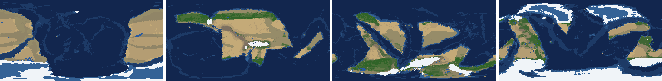
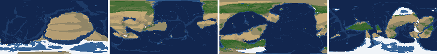
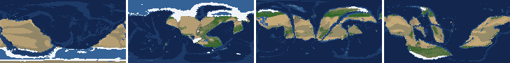
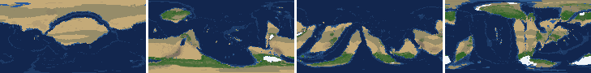
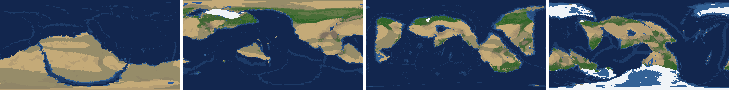
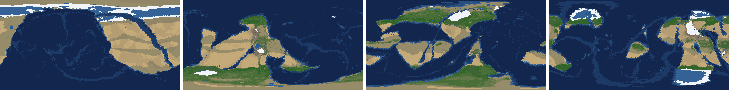
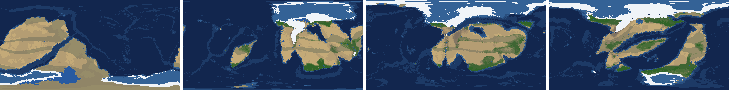
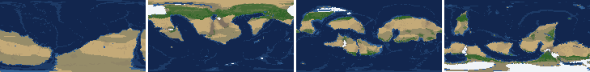

# Health sweep 2026-10-16 15:29

Commit 21dc9c0+dirty. 8 runs (default params, `--every 4`) at 8 workers x 1 numba threads; simulations 31.4 min wall. Made by `tools/health.py` (PW-246).

## Runs

| seed | L | Myr | run | sim s | trees / flowering trees from | dT range C | peaks > 9.5 km | giant-lake frames % | crust volume end/start | ice SL < -150 m % | <= 4 plates % |
|---|---|---|---|---|---|---|---|---|---|---|---|
| 1 | 6 | 500 | 3818de | 966 | 132 / 412 | 12.7 | 0 | 21.2 | 0.977 | 15.9 | 0.0 |
| 2 | 6 | 500 | d29066 | 1201 | 140 / 396 | 22.3 | 0 | 7.1 | 0.958 | 11.5 | 0.0 |
| 11 | 6 | 500 | 7afe64 | 1195 | 128 / 372 | 16.7 | 0 | 12.4 | 0.975 | 1.8 | 0.0 |
| 21 | 6 | 500 | 6d746b | 736 | 136 / 404 | 10.3 | 0 | 2.7 | 0.941 | 0.0 | 0.0 |
| 3199 | 6 | 500 | 07cbd1 | 1319 | 132 / 376 | 11.9 | 0 | 7.1 | 0.966 | 0.0 | 0.0 |
| 42 | 6 | 500 | 42da23 | 1086 | 116 / 404 | 14.1 | 0 | 12.4 | 0.946 | 0.0 | 0.0 |
| 77 | 6 | 500 | fe5b1f | 1883 | 124 / 416 | 11.6 | 0 | 15.0 | 0.968 | 1.8 | 0.0 |
| 505 | 6 | 500 | ef3c6a | 1008 | 132 / 416 | 8.7 | 0 | 7.1 | 0.965 | 0.0 | 0.0 |

## Medians by seed (after 50 Myr; tree cover after forests, NPP after flowering trees appear)

| seed | L | land_pct | cont_pct | cont_km | plates | ocean_age | speed | sea_level | sea_ice_m | ice_pct | temp | co2 | dry_pct | inland_pct | lake_pct | lake_max_mkm2 | max_elev_km | trees_pct | npp | landmasses | largest_pct |
|---|---|---|---|---|---|---|---|---|---|---|---|---|---|---|---|---|---|---|---|---|---|
| 1 | 6 | 33.3 | 39.2 | 34.5 | 12.0 | 58.3 | 4.5 | -149.8 | -14.4 | 1.8 | 15.1 | -0.2 | 41.9 | 6.7 | 0.5 | 0.1 | 5.5 | 18.6 | 261.3 | 6.0 | 23.6 |
| 2 | 6 | 33.7 | 40.4 | 33.9 | 11.0 | 52.7 | 4.5 | -9.9 | -5.6 | 0.7 | 15.3 | -0.2 | 38.7 | 6.4 | 0.3 | 0.1 | 5.0 | 21.3 | 293.3 | 8.0 | 29.3 |
| 11 | 6 | 31.0 | 40.0 | 34.0 | 12.0 | 51.2 | 4.5 | -111.6 | -18.0 | 3.9 | 12.6 | -0.4 | 41.4 | 8.7 | 0.5 | 0.2 | 5.1 | 20.3 | 329.7 | 7.0 | 27.3 |
| 21 | 6 | 33.7 | 40.9 | 33.1 | 11.0 | 48.4 | 4.4 | 51.6 | -1.1 | 0.2 | 16.6 | -0.3 | 43.4 | 5.0 | 0.3 | 0.1 | 5.6 | 15.8 | 300.9 | 11.0 | 17.1 |
| 3199 | 6 | 32.8 | 39.5 | 34.3 | 11.0 | 49.9 | 4.3 | -42.0 | -5.9 | 1.0 | 14.7 | -0.1 | 43.3 | 7.4 | 0.3 | 0.1 | 5.6 | 20.0 | 185.5 | 7.0 | 23.2 |
| 42 | 6 | 32.5 | 40.2 | 33.4 | 12.0 | 53.0 | 4.7 | -45.3 | -9.4 | 1.2 | 14.4 | -0.3 | 36.2 | 6.3 | 0.4 | 0.1 | 5.3 | 20.3 | 295.7 | 6.0 | 24.3 |
| 77 | 6 | 30.9 | 39.9 | 33.9 | 10.0 | 67.0 | 3.7 | -335.5 | -56.6 | 6.8 | 11.6 | -0.2 | 48.4 | 6.9 | 0.4 | 0.2 | 5.2 | 17.2 | 289.6 | 6.0 | 28.9 |
| 505 | 6 | 33.0 | 39.5 | 34.3 | 13.0 | 54.7 | 4.6 | -2.0 | -10.6 | 2.1 | 14.3 | -0.4 | 36.3 | 6.9 | 0.5 | 0.1 | 6.7 | 20.4 | 242.8 | 6.0 | 21.3 |

Measured on the run's keyframes (no slicing). A keyframe's rivers and lakes are routed on its own terrain (PW-239), so `inland_raw_pct` (every routed end on land, as highlights counts it) and `inland_pct` (ends that are closed lakes, salt pans or real pits) agree but for ends under land ice. Land ice and land shares use cells (near-equal area).

## Envelopes

| metric | low | high | Earth | source |
|---|---|---|---|---|
| land, % of surface (`land_pct`) | 22 | 42 | 29.20 | tests/test_envelopes.py (22-42%); Earth 29.2% |
| continental crust, % of surface (`cont_pct`) | 33 | 50 | 41 | tests/test_envelopes.py (33-50%); Earth ~41% with shelves (Cogley 1984) |
| mean continental crust thickness, km (`cont_km`) | 31 | 40 | 39 | target 35 km (PW-238, continental_thickness); Earth ~39 km (Christensen & Mooney 1995); known thinning to 32-33 km (PW-046) |
| plates (`plates`) | 5 | 30 | 15 | tests/test_envelopes.py (5-30; max_plates 30); Earth 7 major + ~8 minor; <= 4 is the PW-191 collapse |
| mean ocean-floor age, Myr (`ocean_age`) | 25 | 120 | 64 | tests/test_envelopes.py (25-120); Earth ~64 Myr (Mueller et al. 2008); PW-051 |
| mean plate speed, cm/yr (`speed`) | 2 | 9 | 4.50 | tests/test_envelopes.py (2-9 cm/yr); Earth ~4-5 |
| sea level, m (ice + ocean basins) (`sea_level`) | -250 | 300 | 0 | Phanerozoic ~-130 (LGM) .. +250 m (earth.py; Haq & Schutter 2008); -250: PW-240's hard goal |
| sea level from land ice, m (`sea_ice_m`) | -250 | - | 0 | Earth LGM ~-130 m; PW-240 goal -150 m typical / -250 m worst |
| land ice, % of surface (`ice_pct`) | - | 10 | 3.10 | Earth 3.1% now (earth.EARTH_ICE), ~7-8% at the LGM |
| global mean temperature, C (`temp`) | 8 | 30 | 14.50 | Earth 14.5 C; LGM ~8 C (Tierney et al. 2020); Phanerozoic hothouses to ~30 C (Scotese et al. 2021) |
| CO2 index (ln source/sink) (`co2`) | -1.5 | 1.5 | 0.00 | the forcing's clip in earth.py (+-1.5); Earth 0 |
| arid (Koppen B), % of land (`dry_pct`) | 12 | 45 | 30 | tests/test_envelopes.py (12-45%); Earth ~30% (Beck et al. 2018) |
| land draining inland, % of ice-free land (to a closed lake, salt pan or real pit) (`inland_pct`) | 8 | 30 | 18 | Earth ~18% (overview 2.9); L6 known ~9.5-11% (PW-054, PW-243). `inland_raw_pct` (not checked) follows the stored `downstream` to any end, as highlights does; since PW-239 the two agree but for ends under land ice |
| lakes, % of land (`lake_pct`) | 0.2 | 3.0 | 1.80 | Earth ~1.8% of ice-free land (HydroLAKES, Messager et al. 2016); generated L6 worlds 0.5-1% |
| largest lake, million km2 (`lake_max_mkm2`) | - | 1.0 | 0.37 | Caspian 0.37 Mkm2; 1 Mkm2 = the overview's giant lake (2.9) |
| highest peak, km (`max_elev_km`) | - | 9.5 | 8.85 | Everest 8.85 km; PW-172 (spikes above ~9.5 km) |
| tree cover, % of ice-free land (after forests appear) (`trees_pct`) | 10 | 50 | 30 | Earth ~30% potential canopy (forest 55-60 of ~130 Mkm2, overview 2.18) |
| land NPP, g C/m2/yr (after flowering trees appear) (`npp`) | 200 | 700 | 430 | Earth ~56 Pg C/yr over ~130 Mkm2 = ~430; the model on Earth's terrain 50 Pg C/yr, ~385 (overview 2.18). Before flowering trees (plant group 4) stand-ins grow at 70%, so runs sit at ~150-280 |
| landmasses (>= 3 cells) (`landmasses`) | 3 | 80 | - | loose: a lone supercontinent or a shattered archipelago |
| largest landmass, % of surface (`largest_pct`) | 5 | 35 | 16.60 | Afro-Eurasia 16.6%; a Pangaea ~30% (scorecard largest_max) |
| global temperature range over the run, C (`dT_range`, per run) | - | 25 | 25 | Phanerozoic 11-36 C (Scotese et al. 2021) |
| keyframes with a peak above 9.5 km (`peak_frames`, per run) | - | 0 | 0 | PW-172 (L7 seed 3199: 3 of 251) |
| % of keyframes with a lake over 1 Mkm2 (`giant_lake_frames`, per run) | - | 5 | 0 | overview 2.9 (L6: 3 of ~150 frames) |
| continental crust volume, end / start (`volume_ratio`, per run) | 0.9 | 1.1 | 1.0 | scorecard volume_ratio (x1.006) |
| % of keyframes with ice sea level below -150 m (`sea_ice_below_150`, per run) | - | 10 | 0 | PW-240 |
| % of keyframes with <= 4 plates (`low_plates`, per run) | - | 2 | 0 | PW-191 (L7 seed 21: 1%) |

## Top outliers (of 246 spells; severity = excess / band width x (0.2 + share of the run))

| seed | L | metric | Myr | frames | worst | envelope | severity |
|---|---|---|---|---|---|---|---|
| 1 | 6 | lake_max_mkm2 | 404-424 | 5 | 15.70 | -..1.0 | 3.524 |
| 1 | 6 | giant_lake_frames | run | - | 21.20 | -..5 | 3.24 |
| 1 | 6 | lake_max_mkm2 | 436-476 | 11 | 10.66 | -..1.0 | 2.775 |
| 77 | 6 | giant_lake_frames | run | - | 15.00 | -..5 | 2.0 |
| 1 | 6 | lake_max_mkm2 | 312-328 | 4 | 8.03 | -..1.0 | 1.63 |
| 11 | 6 | giant_lake_frames | run | - | 12.40 | -..5 | 1.48 |
| 42 | 6 | giant_lake_frames | run | - | 12.40 | -..5 | 1.48 |
| 42 | 6 | lake_max_mkm2 | 164-168 | 2 | 6.00 | -..1.0 | 1.08 |
| 11 | 6 | lake_max_mkm2 | 132-132 | 1 | 5.73 | -..1.0 | 0.983 |
| 3199 | 6 | lake_max_mkm2 | 312-320 | 2 | 5.52 | -..1.0 | 0.975 |
| 11 | 6 | lake_max_mkm2 | 204-208 | 2 | 4.79 | -..1.0 | 0.819 |
| 1 | 6 | sea_ice_below_150 | run | - | 15.90 | -..10 | 0.59 |
| 1 | 6 | lake_pct | 404-424 | 5 | 9.76 | 0.2..3.0 | 0.579 |
| 11 | 6 | lake_max_mkm2 | 348-352 | 2 | 3.49 | -..1.0 | 0.537 |
| 42 | 6 | lake_max_mkm2 | 396-408 | 3 | 3.16 | -..1.0 | 0.484 |
| 77 | 6 | lake_max_mkm2 | 352-352 | 1 | 3.33 | -..1.0 | 0.483 |
| 77 | 6 | lake_max_mkm2 | 232-260 | 7 | 2.70 | -..1.0 | 0.435 |
| 3199 | 6 | lake_max_mkm2 | 388-396 | 3 | 2.91 | -..1.0 | 0.428 |
| 2 | 6 | giant_lake_frames | run | - | 7.10 | -..5 | 0.42 |
| 3199 | 6 | giant_lake_frames | run | - | 7.10 | -..5 | 0.42 |
| 505 | 6 | giant_lake_frames | run | - | 7.10 | -..5 | 0.42 |
| 77 | 6 | lake_max_mkm2 | 276-276 | 1 | 2.94 | -..1.0 | 0.403 |
| 505 | 6 | lake_max_mkm2 | 180-180 | 1 | 2.81 | -..1.0 | 0.377 |
| 1 | 6 | lake_pct | 436-464 | 8 | 6.99 | 0.2..3.0 | 0.375 |
| 11 | 6 | lake_max_mkm2 | 428-448 | 5 | 2.40 | -..1.0 | 0.336 |
| 21 | 6 | lake_max_mkm2 | 52-64 | 3 | 2.39 | -..1.0 | 0.311 |
| 11 | 6 | ice_pct | 136-288 | 39 | 15.80 | -..10 | 0.296 |
| 42 | 6 | lake_max_mkm2 | 144-144 | 1 | 2.28 | -..1.0 | 0.266 |
| 77 | 6 | sea_level | 272-500 | 58 | -467.90 | -250..300 | 0.262 |
| 21 | 6 | inland_pct | 204-500 | 73 | 0.86 | 8..30 | 0.253 |

## Per seed: min / median / max after the 50 Myr spin-up, and spells outside the envelopes

### Seed 1, L6 (run 3818de)

*At 48, 200, 348, 500 Myr: sea by depth, land green by tree cover / tan where arid, shaded by height, ice white, lakes blue.*

| metric | min | median | max | outside (Myr: worst) |
|---|---|---|---|---|
| land_pct | 30.72 | 33.33 | 35.69 |  |
| cont_pct | 36.71 | 39.19 | 42.19 |  |
| cont_km | 32.98 | 34.51 | 36.78 |  |
| plates | 5.00 | 12.00 | 15.00 |  |
| ocean_age | 32.70 | 58.30 | 75.10 |  |
| speed | 2.54 | 4.49 | 7.51 |  |
| sea_level | -490.70 | -149.80 | 190.00 | 52-72: -401.70; 444-500: -490.70 |
| sea_ice_m | -257.60 | -14.40 | -0.00 | 464-464: -257.60 |
| ice_pct | 0.00 | 1.80 | 14.20 | 448-500: 14.20 |
| temp | 7.30 | 15.10 | 20.00 | 480-480: 7.90; 492-500: 7.30 |
| co2 | -1.14 | -0.15 | 0.15 |  |
| dry_pct | 27.68 | 41.90 | 60.54 | 52-108: 52.11; 144-292: 60.54 |
| inland_pct | 1.76 | 6.68 | 24.93 | 68-136: 1.77; 148-220: 2.81; 236-236: 7.72; 280-308: 5.12; +3 more |
| lake_pct | 0.01 | 0.52 | 9.76 | 68-160: 0.01; 176-176: 0.18; 312-324: 5.85; 404-424: 9.76; +1 more |
| lake_max_mkm2 | 0.01 | 0.15 | 15.70 | 52-60: 1.38; 216-216: 1.06; 312-328: 8.03; 404-424: 15.70; +1 more |
| max_elev_km | 1.73 | 5.47 | 8.78 |  |
| trees_pct | 10.16 | 18.59 | 33.70 |  |
| npp | 142.10 | 261.30 | 324.60 | 412-436: 142.10 |
| landmasses | 2.00 | 6.00 | 11.00 | 164-164: 2 |
| largest_pct | 10.10 | 23.60 | 33.60 |  |

### Seed 2, L6 (run d29066)

*At 48, 200, 348, 500 Myr: sea by depth, land green by tree cover / tan where arid, shaded by height, ice white, lakes blue.*

| metric | min | median | max | outside (Myr: worst) |
|---|---|---|---|---|
| land_pct | 29.34 | 33.66 | 35.21 |  |
| cont_pct | 37.89 | 40.35 | 43.12 |  |
| cont_km | 32.31 | 33.90 | 35.65 |  |
| plates | 7.00 | 11.00 | 16.00 |  |
| ocean_age | 36.00 | 52.70 | 85.20 |  |
| speed | 3.20 | 4.51 | 7.41 |  |
| sea_level | -602.40 | -9.90 | 166.80 | 52-72: -602.40; 456-500: -502.00 |
| sea_ice_m | -196.70 | -5.60 | -0.00 |  |
| ice_pct | 0.00 | 0.70 | 11.50 | 52-64: 11.50; 460-500: 11.40 |
| temp | 1.30 | 15.30 | 23.60 | 464-500: 1.30 |
| co2 | -1.13 | -0.20 | 0.59 |  |
| dry_pct | 23.10 | 38.68 | 54.72 | 52-92: 54.72; 196-308: 54.24 |
| inland_pct | 1.40 | 6.37 | 16.16 | 52-236: 1.40; 264-264: 7.52; 276-276: 7.64; 296-308: 4.59; +2 more |
| lake_pct | 0.03 | 0.31 | 2.29 | 52-64: 0.05; 84-96: 0.07; 108-140: 0.03; 160-188: 0.10; +6 more |
| lake_max_mkm2 | 0.01 | 0.09 | 2.20 | 80-80: 2.20; 204-204: 2.15; 280-292: 1.87; 428-428: 1.16; +1 more |
| max_elev_km | 1.64 | 4.99 | 8.44 |  |
| trees_pct | 6.34 | 21.31 | 36.37 | 228-296: 6.34 |
| npp | 179.60 | 293.30 | 339.40 | 396-408: 179.60 |
| landmasses | 3.00 | 8.00 | 19.00 |  |
| largest_pct | 11.00 | 29.30 | 34.70 |  |

### Seed 11, L6 (run 7afe64)

*At 48, 200, 348, 500 Myr: sea by depth, land green by tree cover / tan where arid, shaded by height, ice white, lakes blue.*

| metric | min | median | max | outside (Myr: worst) |
|---|---|---|---|---|
| land_pct | 26.62 | 30.99 | 33.90 |  |
| cont_pct | 36.61 | 40.05 | 42.93 |  |
| cont_km | 32.52 | 33.98 | 36.52 |  |
| plates | 9.00 | 12.00 | 17.00 |  |
| ocean_age | 35.20 | 51.20 | 70.50 |  |
| speed | 2.99 | 4.53 | 7.37 |  |
| sea_level | -491.90 | -111.60 | 113.60 | 52-64: -455.20; 140-304: -491.90 |
| sea_ice_m | -155.60 | -18.00 | -0.00 |  |
| ice_pct | 0.00 | 3.90 | 15.80 | 136-288: 15.80 |
| temp | 2.70 | 12.60 | 19.40 | 140-212: 2.70 |
| co2 | -0.87 | -0.42 | 0.11 |  |
| dry_pct | 30.66 | 41.44 | 54.08 | 52-100: 54.08; 372-388: 48.02; 404-484: 47.95 |
| inland_pct | 1.92 | 8.72 | 32.59 | 52-140: 1.92; 152-164: 3.23; 192-192: 6.51; 204-204: 32.59; +9 more |
| lake_pct | 0.05 | 0.49 | 4.50 | 56-88: 0.05; 100-100: 0.17; 112-120: 0.14; 132-132: 4.50; +5 more |
| lake_max_mkm2 | 0.03 | 0.16 | 5.73 | 108-108: 1.47; 132-132: 5.73; 144-144: 1.03; 204-208: 4.79; +4 more |
| max_elev_km | 1.37 | 5.13 | 8.74 |  |
| trees_pct | 9.13 | 20.30 | 30.96 | 456-488: 9.13 |
| npp | 178.10 | 329.70 | 347.40 | 372-428: 178.10 |
| landmasses | 3.00 | 7.00 | 12.00 |  |
| largest_pct | 9.70 | 27.30 | 34.90 |  |

### Seed 21, L6 (run 6d746b)

*At 48, 200, 348, 500 Myr: sea by depth, land green by tree cover / tan where arid, shaded by height, ice white, lakes blue.*

| metric | min | median | max | outside (Myr: worst) |
|---|---|---|---|---|
| land_pct | 31.25 | 33.68 | 37.63 |  |
| cont_pct | 38.49 | 40.85 | 43.22 |  |
| cont_km | 32.15 | 33.11 | 35.40 |  |
| plates | 9.00 | 11.00 | 14.00 |  |
| ocean_age | 35.00 | 48.40 | 63.90 |  |
| speed | 2.99 | 4.39 | 7.43 |  |
| sea_level | -118.60 | 51.60 | 191.60 |  |
| sea_ice_m | -18.80 | -1.10 | -0.00 |  |
| ice_pct | 0.00 | 0.20 | 1.80 |  |
| temp | 11.90 | 16.60 | 22.20 |  |
| co2 | -1.05 | -0.34 | 0.12 |  |
| dry_pct | 27.65 | 43.39 | 56.91 | 52-76: 56.91; 168-192: 47.68; 244-252: 46.60 |
| inland_pct | 0.86 | 4.98 | 26.91 | 64-164: 1.52; 180-180: 5.57; 192-192: 6.12; 204-500: 0.86 |
| lake_pct | 0.01 | 0.26 | 1.96 | 68-116: 0.01; 128-136: 0.03; 164-164: 0.16; 252-268: 0.09; +6 more |
| lake_max_mkm2 | 0.01 | 0.07 | 2.39 | 52-64: 2.39 |
| max_elev_km | 1.92 | 5.60 | 8.50 |  |
| trees_pct | 6.29 | 15.82 | 29.18 | 284-316: 6.29 |
| npp | 184.70 | 300.90 | 330.10 | 404-408: 184.70; 424-424: 195.30 |
| landmasses | 3.00 | 11.00 | 18.00 |  |
| largest_pct | 9.80 | 17.10 | 32.10 |  |

### Seed 3199, L6 (run 07cbd1)

*At 48, 200, 348, 500 Myr: sea by depth, land green by tree cover / tan where arid, shaded by height, ice white, lakes blue.*

| metric | min | median | max | outside (Myr: worst) |
|---|---|---|---|---|
| land_pct | 29.81 | 32.76 | 38.48 |  |
| cont_pct | 37.76 | 39.50 | 42.83 |  |
| cont_km | 32.47 | 34.27 | 36.02 |  |
| plates | 5.00 | 11.00 | 16.00 |  |
| ocean_age | 31.20 | 49.90 | 74.10 |  |
| speed | 2.92 | 4.30 | 7.77 |  |
| sea_level | -272.80 | -42.00 | 198.60 | 476-500: -272.80 |
| sea_ice_m | -124.20 | -5.90 | -0.00 |  |
| ice_pct | 0.00 | 1.00 | 8.60 |  |
| temp | 9.50 | 14.70 | 21.40 |  |
| co2 | -0.60 | -0.15 | 0.12 |  |
| dry_pct | 31.49 | 43.28 | 58.26 | 52-96: 58.26; 128-156: 54.02; 324-324: 45.06; 344-360: 46.14; +1 more |
| inland_pct | 0.52 | 7.43 | 17.17 | 72-160: 0.52; 176-176: 6.78; 208-208: 7.56; 224-256: 5.30; +8 more |
| lake_pct | 0.00 | 0.31 | 3.80 | 52-136: 0.00; 148-156: 0.08; 312-320: 3.80; 348-348: 0.18; +3 more |
| lake_max_mkm2 | 0.00 | 0.09 | 5.52 | 312-320: 5.52; 388-396: 2.91; 412-420: 1.38; 492-492: 1.06 |
| max_elev_km | 1.37 | 5.58 | 8.33 |  |
| trees_pct | 10.35 | 19.96 | 31.61 |  |
| npp | 162.50 | 185.50 | 275.10 | 376-444: 162.50 |
| landmasses | 2.00 | 7.00 | 12.00 | 64-72: 2 |
| largest_pct | 9.30 | 23.20 | 32.40 |  |

### Seed 42, L6 (run 42da23)

*At 48, 200, 348, 500 Myr: sea by depth, land green by tree cover / tan where arid, shaded by height, ice white, lakes blue.*

| metric | min | median | max | outside (Myr: worst) |
|---|---|---|---|---|
| land_pct | 28.85 | 32.53 | 34.66 |  |
| cont_pct | 38.40 | 40.21 | 42.93 |  |
| cont_km | 32.42 | 33.38 | 35.19 |  |
| plates | 6.00 | 12.00 | 16.00 |  |
| ocean_age | 32.40 | 53.00 | 69.90 |  |
| speed | 3.11 | 4.66 | 7.24 |  |
| sea_level | -317.40 | -45.30 | 193.20 | 52-68: -317.40; 448-500: -292.50 |
| sea_ice_m | -53.40 | -9.40 | -0.00 |  |
| ice_pct | 0.00 | 1.20 | 7.00 |  |
| temp | 6.20 | 14.40 | 20.30 | 440-464: 6.20 |
| co2 | -0.98 | -0.30 | 0.20 |  |
| dry_pct | 25.71 | 36.18 | 51.67 | 52-72: 51.67; 216-248: 47.43 |
| inland_pct | 1.32 | 6.26 | 29.80 | 68-108: 1.32; 120-160: 1.95; 176-192: 5.11; 204-236: 5.33; +3 more |
| lake_pct | 0.01 | 0.39 | 4.73 | 68-96: 0.01; 136-136: 0.16; 152-152: 0.13; 164-168: 4.73; +2 more |
| lake_max_mkm2 | 0.01 | 0.11 | 6.00 | 52-52: 1.25; 64-64: 1.23; 108-120: 1.71; 144-144: 2.28; +4 more |
| max_elev_km | 1.40 | 5.26 | 8.64 |  |
| trees_pct | 15.10 | 20.33 | 26.11 |  |
| npp | 220.70 | 295.70 | 313.50 |  |
| landmasses | 2.00 | 6.00 | 15.00 | 212-212: 2; 284-284: 2 |
| largest_pct | 10.00 | 24.30 | 34.20 |  |

### Seed 77, L6 (run fe5b1f)

*At 48, 200, 348, 500 Myr: sea by depth, land green by tree cover / tan where arid, shaded by height, ice white, lakes blue.*

| metric | min | median | max | outside (Myr: worst) |
|---|---|---|---|---|
| land_pct | 28.37 | 30.90 | 34.59 |  |
| cont_pct | 37.82 | 39.89 | 42.93 |  |
| cont_km | 32.31 | 33.93 | 36.04 |  |
| plates | 8.00 | 10.00 | 13.00 |  |
| ocean_age | 37.40 | 67.00 | 75.50 |  |
| speed | 1.62 | 3.72 | 7.23 | 404-404: 1.62 |
| sea_level | -584.50 | -335.50 | 23.70 | 52-84: -584.50; 272-500: -467.90 |
| sea_ice_m | -166.20 | -56.60 | -6.50 |  |
| ice_pct | 2.60 | 6.80 | 11.20 | 60-72: 11.20 |
| temp | 4.40 | 11.60 | 16.00 | 128-152: 4.40 |
| co2 | -0.63 | -0.20 | 0.07 |  |
| dry_pct | 26.40 | 48.41 | 53.21 | 52-60: 47.58; 156-396: 53.21 |
| inland_pct | 2.10 | 6.91 | 17.89 | 68-88: 4.45; 100-168: 2.30; 180-180: 7.59; 192-192: 6.66; +7 more |
| lake_pct | 0.09 | 0.44 | 2.82 | 68-68: 0.09; 324-324: 0.16; 384-384: 0.19; 404-404: 0.13; +4 more |
| lake_max_mkm2 | 0.03 | 0.19 | 3.33 | 64-64: 1.94; 80-80: 1.43; 112-112: 1.28; 144-144: 1.54; +6 more |
| max_elev_km | 1.59 | 5.23 | 8.76 |  |
| trees_pct | 9.19 | 17.23 | 28.18 | 172-176: 9.19 |
| npp | 216.30 | 289.60 | 329.70 |  |
| landmasses | 2.00 | 6.00 | 10.00 | 52-64: 2 |
| largest_pct | 12.20 | 28.90 | 34.80 |  |

### Seed 505, L6 (run ef3c6a)

*At 48, 200, 348, 500 Myr: sea by depth, land green by tree cover / tan where arid, shaded by height, ice white, lakes blue.*

| metric | min | median | max | outside (Myr: worst) |
|---|---|---|---|---|
| land_pct | 31.38 | 33.04 | 37.64 |  |
| cont_pct | 36.81 | 39.52 | 42.97 |  |
| cont_km | 32.61 | 34.33 | 36.90 |  |
| plates | 8.00 | 13.00 | 17.00 |  |
| ocean_age | 32.00 | 54.70 | 68.70 |  |
| speed | 2.89 | 4.60 | 7.41 |  |
| sea_level | -174.20 | -2.00 | 218.30 |  |
| sea_ice_m | -88.10 | -10.60 | -0.00 |  |
| ice_pct | 0.00 | 2.10 | 7.70 |  |
| temp | 10.30 | 14.30 | 19.00 |  |
| co2 | -0.81 | -0.38 | 0.16 |  |
| dry_pct | 25.26 | 36.29 | 61.64 | 52-112: 61.64; 324-368: 51.92; 448-500: 47.66 |
| inland_pct | 0.89 | 6.90 | 18.36 | 56-176: 0.89; 192-200: 6.55; 260-260: 6.53; 284-396: 4.73; +3 more |
| lake_pct | 0.01 | 0.48 | 2.77 | 52-88: 0.02; 100-108: 0.01; 120-120: 0.14; 336-364: 0.09; +1 more |
| lake_max_mkm2 | 0.01 | 0.10 | 2.81 | 180-180: 2.81; 220-220: 1.29; 240-248: 1.78; 392-400: 1.96; +1 more |
| max_elev_km | 1.72 | 6.74 | 8.47 |  |
| trees_pct | 12.34 | 20.45 | 30.34 |  |
| npp | 157.80 | 242.75 | 259.00 | 416-448: 157.80 |
| landmasses | 2.00 | 6.00 | 10.00 | 60-60: 2; 172-180: 2 |
| largest_pct | 8.50 | 21.30 | 33.00 |  |

## Determinism

(not run)
