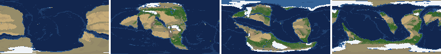
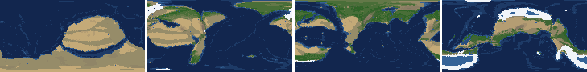
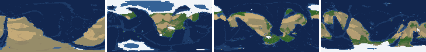
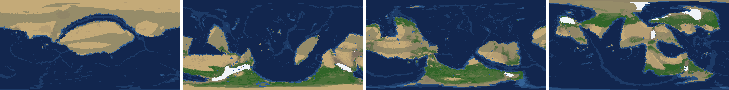
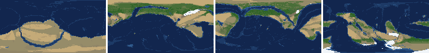
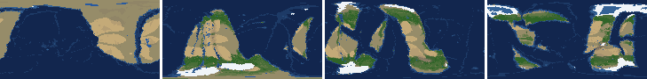
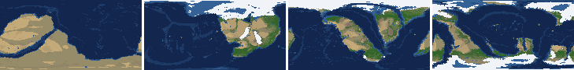
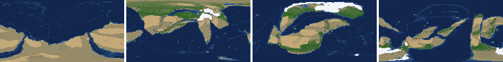

# Health sweep 2026-10-16 13:32

Commit None. 8 runs (default params, `--every 4`) at 8 workers x 1 numba threads; simulations 13.5 min wall. Made by `tools/health.py` (PW-246).

## Runs

| seed | L | Myr | run | sim s | trees / flowering trees from | dT range C | peaks > 9.5 km | giant-lake frames % | crust volume end/start | ice SL < -150 m % | <= 4 plates % |
|---|---|---|---|---|---|---|---|---|---|---|---|
| 1 | 6 | 500 | add523 | 658 | 132 / 412 | 9.7 | 0 | 7.1 | 0.996 | 0.0 | 0.0 |
| 2 | 6 | 500 | 9b50b8 | 551 | 140 / 396 | 20.9 | 0 | 8.0 | 0.972 | 0.0 | 0.0 |
| 11 | 6 | 500 | e732c3 | 754 | 128 / 372 | 17.6 | 0 | 12.4 | 0.982 | 16.8 | 0.0 |
| 21 | 6 | 500 | eb45d8 | 479 | 136 / 404 | 9.8 | 0 | 1.8 | 0.968 | 0.0 | 0.0 |
| 3199 | 6 | 500 | bb5c64 | 451 | 132 / 376 | 10.4 | 0 | 17.7 | 0.969 | 0.0 | 0.0 |
| 42 | 6 | 500 | 8ec458 | 512 | 116 / 404 | 11.3 | 0 | 2.7 | 0.962 | 0.0 | 0.0 |
| 77 | 6 | 500 | 5bf0ee | 811 | 124 / 416 | 11.7 | 0 | 23.9 | 0.968 | 6.2 | 0.0 |
| 505 | 6 | 500 | 353b14 | 524 | 132 / 416 | 8.4 | 0 | 8.8 | 0.962 | 0.0 | 0.0 |

## Medians by seed (after 50 Myr; tree cover after forests, NPP after flowering trees appear)

| seed | L | land_pct | cont_pct | cont_km | plates | ocean_age | speed | sea_level | sea_ice_m | ice_pct | temp | co2 | dry_pct | inland_pct | lake_pct | lake_max_mkm2 | max_elev_km | trees_pct | npp | landmasses | largest_pct |
|---|---|---|---|---|---|---|---|---|---|---|---|---|---|---|---|---|---|---|---|---|---|
| 1 | 6 | 32.9 | 38.8 | 35.0 | 13.0 | 49.9 | 4.8 | -4.4 | -4.8 | 0.7 | 15.5 | -0.1 | 27.3 | 3.9 | 0.6 | 0.1 | 5.8 | 26.4 | 289.5 | 6.0 | 22.4 |
| 2 | 6 | 33.9 | 39.5 | 34.3 | 12.0 | 50.8 | 4.3 | 56.5 | -5.8 | 0.9 | 16.1 | -0.3 | 29.0 | 4.4 | 0.5 | 0.2 | 5.8 | 26.7 | 294.6 | 7.0 | 29.8 |
| 11 | 6 | 32.7 | 39.3 | 34.4 | 14.0 | 47.7 | 4.6 | 7.6 | -32.0 | 3.1 | 12.7 | -0.5 | 25.0 | 2.8 | 0.5 | 0.1 | 6.5 | 31.2 | 324.2 | 6.0 | 29.4 |
| 21 | 6 | 33.9 | 40.1 | 34.2 | 11.0 | 58.4 | 4.4 | -43.8 | -4.1 | 0.5 | 16.2 | -0.4 | 32.3 | 5.5 | 0.5 | 0.1 | 5.0 | 23.0 | 301.8 | 7.0 | 27.3 |
| 3199 | 6 | 33.7 | 40.3 | 34.0 | 11.0 | 48.7 | 4.9 | 63.4 | -1.9 | 0.3 | 15.0 | -0.2 | 29.2 | 4.8 | 0.4 | 0.1 | 5.0 | 26.8 | 319.4 | 6.0 | 24.1 |
| 42 | 6 | 33.6 | 39.9 | 33.9 | 13.0 | 48.8 | 4.8 | 32.6 | -8.2 | 1.5 | 14.9 | -0.2 | 23.8 | 2.7 | 0.4 | 0.1 | 4.3 | 22.3 | 341.9 | 6.0 | 21.6 |
| 77 | 6 | 30.4 | 38.1 | 35.6 | 13.0 | 52.5 | 4.3 | -134.7 | -34.1 | 4.7 | 12.3 | -0.1 | 26.7 | 7.4 | 0.9 | 0.3 | 6.0 | 28.7 | 349.8 | 7.0 | 24.3 |
| 505 | 6 | 33.6 | 38.9 | 34.7 | 15.0 | 47.6 | 4.8 | 50.9 | -12.1 | 1.7 | 15.0 | -0.2 | 29.0 | 5.0 | 0.8 | 0.2 | 6.2 | 22.9 | 347.3 | 7.0 | 29.7 |

Measured on the run's keyframes (no slicing). A keyframe's rivers and lakes are routed on its own terrain (PW-239), so `inland_raw_pct` (every routed end on land, as highlights counts it) and `inland_pct` (ends that are closed lakes, salt pans or real pits) agree but for ends under land ice. Land ice and land shares use cells (near-equal area).

## Envelopes

| metric | low | high | Earth | source |
|---|---|---|---|---|
| land, % of surface (`land_pct`) | 22 | 42 | 29.20 | tests/test_envelopes.py (22-42%); Earth 29.2% |
| continental crust, % of surface (`cont_pct`) | 33 | 50 | 41 | tests/test_envelopes.py (33-50%); Earth ~41% with shelves (Cogley 1984) |
| mean continental crust thickness, km (`cont_km`) | 31 | 40 | 39 | target 35 km (PW-238, continental_thickness); Earth ~39 km (Christensen & Mooney 1995); known thinning to 32-33 km (PW-046) |
| plates (`plates`) | 5 | 30 | 15 | tests/test_envelopes.py (5-30; max_plates 30); Earth 7 major + ~8 minor; <= 4 is the PW-191 collapse |
| mean ocean-floor age, Myr (`ocean_age`) | 25 | 120 | 64 | tests/test_envelopes.py (25-120); Earth ~64 Myr (Mueller et al. 2008); PW-051 |
| mean plate speed, cm/yr (`speed`) | 2 | 9 | 4.50 | tests/test_envelopes.py (2-9 cm/yr); Earth ~4-5 |
| sea level, m (ice + ocean basins) (`sea_level`) | -250 | 300 | 0 | Phanerozoic ~-130 (LGM) .. +250 m (earth.py; Haq & Schutter 2008); -250: PW-240's hard goal |
| sea level from land ice, m (`sea_ice_m`) | -250 | - | 0 | Earth LGM ~-130 m; PW-240 goal -150 m typical / -250 m worst |
| land ice, % of surface (`ice_pct`) | - | 10 | 3.10 | Earth 3.1% now (earth.EARTH_ICE), ~7-8% at the LGM |
| global mean temperature, C (`temp`) | 8 | 30 | 14.50 | Earth 14.5 C; LGM ~8 C (Tierney et al. 2020); Phanerozoic hothouses to ~30 C (Scotese et al. 2021) |
| CO2 index (ln source/sink) (`co2`) | -1.5 | 1.5 | 0.00 | the forcing's clip in earth.py (+-1.5); Earth 0 |
| arid (Koppen B), % of land (`dry_pct`) | 12 | 45 | 30 | tests/test_envelopes.py (12-45%); Earth ~30% (Beck et al. 2018) |
| land draining inland, % of ice-free land (to a closed lake, salt pan or real pit) (`inland_pct`) | 8 | 30 | 18 | Earth ~18% (overview 2.9); L6 known ~9.5-11% (PW-054, PW-243). `inland_raw_pct` (not checked) follows the stored `downstream` to any end, as highlights does; since PW-239 the two agree but for ends under land ice |
| lakes, % of land (`lake_pct`) | 0.2 | 3.0 | 1.80 | Earth ~1.8% of ice-free land (HydroLAKES, Messager et al. 2016); generated L6 worlds 0.5-1% |
| largest lake, million km2 (`lake_max_mkm2`) | - | 1.0 | 0.37 | Caspian 0.37 Mkm2; 1 Mkm2 = the overview's giant lake (2.9) |
| highest peak, km (`max_elev_km`) | - | 9.5 | 8.85 | Everest 8.85 km; PW-172 (spikes above ~9.5 km) |
| tree cover, % of ice-free land (after forests appear) (`trees_pct`) | 10 | 50 | 30 | Earth ~30% potential canopy (forest 55-60 of ~130 Mkm2, overview 2.18) |
| land NPP, g C/m2/yr (after flowering trees appear) (`npp`) | 200 | 700 | 430 | Earth ~56 Pg C/yr over ~130 Mkm2 = ~430; the model on Earth's terrain 50 Pg C/yr, ~385 (overview 2.18). Before flowering trees (plant group 4) stand-ins grow at 70%, so runs sit at ~150-280 |
| landmasses (>= 3 cells) (`landmasses`) | 3 | 80 | - | loose: a lone supercontinent or a shattered archipelago |
| largest landmass, % of surface (`largest_pct`) | 5 | 35 | 16.60 | Afro-Eurasia 16.6%; a Pangaea ~30% (scorecard largest_max) |
| global temperature range over the run, C (`dT_range`, per run) | - | 25 | 25 | Phanerozoic 11-36 C (Scotese et al. 2021) |
| keyframes with a peak above 9.5 km (`peak_frames`, per run) | - | 0 | 0 | PW-172 (L7 seed 3199: 3 of 251) |
| % of keyframes with a lake over 1 Mkm2 (`giant_lake_frames`, per run) | - | 5 | 0 | overview 2.9 (L6: 3 of ~150 frames) |
| continental crust volume, end / start (`volume_ratio`, per run) | 0.9 | 1.1 | 1.0 | scorecard volume_ratio (x1.006) |
| % of keyframes with ice sea level below -150 m (`sea_ice_below_150`, per run) | - | 10 | 0 | PW-240 |
| % of keyframes with <= 4 plates (`low_plates`, per run) | - | 2 | 0 | PW-191 (L7 seed 21: 1%) |

## Top outliers (of 164 spells; severity = excess / band width x (0.2 + share of the run))

| seed | L | metric | Myr | frames | worst | envelope | severity |
|---|---|---|---|---|---|---|---|
| 77 | 6 | giant_lake_frames | run | - | 23.90 | -..5 | 3.78 |
| 3199 | 6 | giant_lake_frames | run | - | 17.70 | -..5 | 2.54 |
| 11 | 6 | giant_lake_frames | run | - | 12.40 | -..5 | 1.48 |
| 1 | 6 | lake_max_mkm2 | 208-216 | 2 | 7.45 | -..1.0 | 1.392 |
| 42 | 6 | lake_max_mkm2 | 84-92 | 3 | 5.58 | -..1.0 | 1.025 |
| 505 | 6 | lake_max_mkm2 | 404-408 | 2 | 5.53 | -..1.0 | 0.978 |
| 2 | 6 | lake_max_mkm2 | 464-480 | 5 | 5.02 | -..1.0 | 0.963 |
| 505 | 6 | lake_max_mkm2 | 168-176 | 2 | 5.28 | -..1.0 | 0.924 |
| 505 | 6 | lake_max_mkm2 | 188-188 | 1 | 5.30 | -..1.0 | 0.895 |
| 3199 | 6 | lake_max_mkm2 | 392-420 | 8 | 4.31 | -..1.0 | 0.872 |
| 505 | 6 | giant_lake_frames | run | - | 8.80 | -..5 | 0.76 |
| 77 | 6 | lake_max_mkm2 | 168-180 | 3 | 4.10 | -..1.0 | 0.693 |
| 11 | 6 | sea_ice_below_150 | run | - | 16.80 | -..10 | 0.68 |
| 11 | 6 | lake_max_mkm2 | 172-172 | 1 | 4.21 | -..1.0 | 0.667 |
| 11 | 6 | lake_max_mkm2 | 188-192 | 2 | 3.97 | -..1.0 | 0.642 |
| 2 | 6 | lake_max_mkm2 | 356-360 | 2 | 3.96 | -..1.0 | 0.639 |
| 11 | 6 | lake_max_mkm2 | 300-300 | 1 | 3.94 | -..1.0 | 0.61 |
| 2 | 6 | giant_lake_frames | run | - | 8.00 | -..5 | 0.6 |
| 77 | 6 | lake_max_mkm2 | 328-332 | 2 | 3.45 | -..1.0 | 0.529 |
| 1 | 6 | lake_max_mkm2 | 356-360 | 2 | 3.20 | -..1.0 | 0.475 |
| 77 | 6 | lake_max_mkm2 | 64-72 | 3 | 3.09 | -..1.0 | 0.467 |
| 77 | 6 | lake_max_mkm2 | 432-460 | 6 | 2.85 | -..1.0 | 0.459 |
| 77 | 6 | lake_max_mkm2 | 344-344 | 1 | 3.10 | -..1.0 | 0.437 |
| 1 | 6 | giant_lake_frames | run | - | 7.10 | -..5 | 0.42 |
| 3199 | 6 | lake_max_mkm2 | 232-232 | 1 | 2.95 | -..1.0 | 0.406 |
| 11 | 6 | lake_max_mkm2 | 392-404 | 4 | 2.63 | -..1.0 | 0.377 |
| 3199 | 6 | lake_max_mkm2 | 116-136 | 4 | 2.62 | -..1.0 | 0.374 |
| 42 | 6 | inland_pct | 96-500 | 101 | 0.19 | 8..30 | 0.356 |
| 11 | 6 | lake_max_mkm2 | 132-132 | 1 | 2.58 | -..1.0 | 0.328 |
| 1 | 6 | lake_pct | 208-216 | 2 | 7.09 | 0.2..3.0 | 0.315 |

## Per seed: min / median / max after the 50 Myr spin-up, and spells outside the envelopes

### Seed 1, L6 (run add523)

*At 48, 200, 348, 500 Myr: sea by depth, land green by tree cover / tan where arid, shaded by height, ice white, lakes blue.*

| metric | min | median | max | outside (Myr: worst) |
|---|---|---|---|---|
| land_pct | 30.46 | 32.93 | 38.36 |  |
| cont_pct | 35.98 | 38.81 | 42.46 |  |
| cont_km | 32.56 | 35.00 | 37.26 |  |
| plates | 8.00 | 13.00 | 18.00 |  |
| ocean_age | 31.10 | 49.90 | 59.90 |  |
| speed | 3.69 | 4.75 | 7.80 |  |
| sea_level | -109.40 | -4.40 | 210.30 |  |
| sea_ice_m | -77.60 | -4.80 | -0.00 |  |
| ice_pct | 0.00 | 0.70 | 6.00 |  |
| temp | 9.80 | 15.50 | 19.50 |  |
| co2 | -1.22 | -0.10 | 0.41 |  |
| dry_pct | 10.09 | 27.31 | 42.59 | 396-432: 10.09 |
| inland_pct | 0.58 | 3.89 | 30.07 | 52-104: 0.58; 116-164: 1.03; 184-188: 6.04; 216-216: 30.07; +1 more |
| lake_pct | 0.02 | 0.58 | 7.09 | 52-92: 0.02; 116-132: 0.07; 208-216: 7.09 |
| lake_max_mkm2 | 0.01 | 0.10 | 7.45 | 108-112: 1.54; 208-216: 7.45; 268-276: 2.38; 356-360: 3.20 |
| max_elev_km | 1.50 | 5.85 | 8.54 |  |
| trees_pct | 13.52 | 26.37 | 44.57 |  |
| npp | 218.40 | 289.50 | 318.40 |  |
| landmasses | 2.00 | 6.00 | 11.00 | 252-252: 2; 448-448: 2 |
| largest_pct | 10.90 | 22.40 | 32.90 |  |

### Seed 2, L6 (run 9b50b8)

*At 48, 200, 348, 500 Myr: sea by depth, land green by tree cover / tan where arid, shaded by height, ice white, lakes blue.*

| metric | min | median | max | outside (Myr: worst) |
|---|---|---|---|---|
| land_pct | 31.43 | 33.90 | 37.86 |  |
| cont_pct | 38.15 | 39.52 | 42.39 |  |
| cont_km | 32.81 | 34.32 | 35.74 |  |
| plates | 9.00 | 12.00 | 17.00 |  |
| ocean_age | 35.30 | 50.80 | 59.90 |  |
| speed | 2.65 | 4.34 | 6.74 |  |
| sea_level | -325.50 | 56.50 | 180.50 | 480-500: -325.50 |
| sea_ice_m | -125.90 | -5.80 | -0.00 |  |
| ice_pct | 0.00 | 0.90 | 9.40 |  |
| temp | 2.10 | 16.10 | 23.00 | 468-500: 2.10 |
| co2 | -0.97 | -0.29 | 0.43 |  |
| dry_pct | 23.77 | 29.00 | 40.41 |  |
| inland_pct | 0.42 | 4.36 | 23.31 | 52-184: 0.42; 200-216: 4.77; 236-464: 1.40; 484-492: 4.71 |
| lake_pct | 0.05 | 0.46 | 3.41 | 52-52: 0.17; 92-92: 0.16; 120-120: 0.05; 308-308: 0.18; +2 more |
| lake_max_mkm2 | 0.03 | 0.19 | 5.02 | 220-220: 1.32; 356-360: 3.96; 444-444: 1.68; 464-480: 5.02 |
| max_elev_km | 1.55 | 5.79 | 8.51 |  |
| trees_pct | 11.94 | 26.69 | 39.75 |  |
| npp | 199.10 | 294.60 | 363.80 | 396-396: 199.10 |
| landmasses | 2.00 | 7.00 | 14.00 | 52-64: 2 |
| largest_pct | 11.50 | 29.80 | 34.60 |  |

### Seed 11, L6 (run e732c3)

*At 48, 200, 348, 500 Myr: sea by depth, land green by tree cover / tan where arid, shaded by height, ice white, lakes blue.*

| metric | min | median | max | outside (Myr: worst) |
|---|---|---|---|---|
| land_pct | 28.62 | 32.71 | 37.82 |  |
| cont_pct | 37.28 | 39.33 | 42.74 |  |
| cont_km | 32.75 | 34.37 | 36.30 |  |
| plates | 10.00 | 14.00 | 19.00 |  |
| ocean_age | 33.90 | 47.70 | 79.00 |  |
| speed | 2.61 | 4.63 | 7.27 |  |
| sea_level | -575.70 | 7.60 | 213.80 | 168-276: -575.70; 480-500: -263.70 |
| sea_ice_m | -217.00 | -32.00 | -0.10 |  |
| ice_pct | 0.00 | 3.10 | 15.90 | 168-276: 15.90 |
| temp | 2.40 | 12.70 | 20.00 | 168-220: 2.40 |
| co2 | -1.00 | -0.47 | 0.14 |  |
| dry_pct | 16.89 | 25.01 | 38.60 |  |
| inland_pct | 0.08 | 2.81 | 21.46 | 52-184: 0.08; 196-500: 0.87 |
| lake_pct | 0.02 | 0.50 | 5.50 | 56-56: 0.17; 72-92: 0.02; 104-124: 0.02; 172-172: 3.19; +3 more |
| lake_max_mkm2 | 0.01 | 0.11 | 4.21 | 52-52: 2.25; 100-100: 1.73; 132-132: 2.58; 172-172: 4.21; +4 more |
| max_elev_km | 1.49 | 6.50 | 8.98 |  |
| trees_pct | 16.92 | 31.16 | 44.28 |  |
| npp | 207.70 | 324.20 | 372.20 |  |
| landmasses | 2.00 | 6.00 | 14.00 | 484-484: 2 |
| largest_pct | 14.80 | 29.40 | 34.20 |  |

### Seed 21, L6 (run eb45d8)

*At 48, 200, 348, 500 Myr: sea by depth, land green by tree cover / tan where arid, shaded by height, ice white, lakes blue.*

| metric | min | median | max | outside (Myr: worst) |
|---|---|---|---|---|
| land_pct | 33.13 | 33.86 | 37.63 |  |
| cont_pct | 37.24 | 40.06 | 43.03 |  |
| cont_km | 32.66 | 34.22 | 36.52 |  |
| plates | 7.00 | 11.00 | 15.00 |  |
| ocean_age | 32.30 | 58.40 | 76.60 |  |
| speed | 2.48 | 4.39 | 7.06 |  |
| sea_level | -199.30 | -43.80 | 211.80 |  |
| sea_ice_m | -11.30 | -4.10 | -0.00 |  |
| ice_pct | 0.00 | 0.50 | 1.70 |  |
| temp | 12.30 | 16.20 | 22.10 |  |
| co2 | -0.98 | -0.40 | 0.03 |  |
| dry_pct | 18.04 | 32.26 | 47.03 | 52-60: 47.03 |
| inland_pct | 0.05 | 5.53 | 19.73 | 52-188: 0.05; 204-228: 5.53; 264-268: 6.16; 280-300: 5.32; +1 more |
| lake_pct | 0.00 | 0.46 | 1.74 | 52-56: 0.05; 68-120: 0.00; 132-132: 0.12; 408-432: 0.15 |
| lake_max_mkm2 | 0.00 | 0.10 | 1.06 | 136-136: 1.02; 152-152: 1.06 |
| max_elev_km | 1.62 | 5.00 | 8.46 |  |
| trees_pct | 15.88 | 22.96 | 41.00 |  |
| npp | 206.80 | 301.80 | 328.10 |  |
| landmasses | 2.00 | 7.00 | 14.00 | 240-240: 2; 256-268: 2; 284-284: 2; 308-308: 2 |
| largest_pct | 11.80 | 27.30 | 34.00 |  |

### Seed 3199, L6 (run bb5c64)

*At 48, 200, 348, 500 Myr: sea by depth, land green by tree cover / tan where arid, shaded by height, ice white, lakes blue.*

| metric | min | median | max | outside (Myr: worst) |
|---|---|---|---|---|
| land_pct | 32.14 | 33.69 | 38.34 |  |
| cont_pct | 36.87 | 40.33 | 42.51 |  |
| cont_km | 32.63 | 34.02 | 36.57 |  |
| plates | 9.00 | 11.00 | 15.00 |  |
| ocean_age | 37.10 | 48.70 | 62.90 |  |
| speed | 2.25 | 4.91 | 7.45 |  |
| sea_level | -86.80 | 63.40 | 180.40 |  |
| sea_ice_m | -17.10 | -1.90 | -0.00 |  |
| ice_pct | 0.00 | 0.30 | 2.00 |  |
| temp | 10.80 | 15.00 | 21.20 |  |
| co2 | -0.53 | -0.24 | 0.14 |  |
| dry_pct | 20.37 | 29.25 | 56.97 | 60-84: 56.97 |
| inland_pct | 0.26 | 4.83 | 21.96 | 52-172: 0.26; 188-208: 4.20; 220-288: 2.68; 300-396: 1.04; +2 more |
| lake_pct | 0.01 | 0.42 | 3.20 | 52-112: 0.01; 132-132: 0.07; 148-152: 0.15; 296-296: 3.18; +3 more |
| lake_max_mkm2 | 0.01 | 0.11 | 4.31 | 116-136: 2.62; 184-184: 2.18; 196-196: 2.30; 212-212: 1.20; +6 more |
| max_elev_km | 1.07 | 4.97 | 8.44 |  |
| trees_pct | 14.88 | 26.81 | 33.23 |  |
| npp | 233.00 | 319.40 | 351.10 |  |
| landmasses | 2.00 | 6.00 | 14.00 | 68-76: 2 |
| largest_pct | 11.10 | 24.10 | 34.50 |  |

### Seed 42, L6 (run 8ec458)

*At 48, 200, 348, 500 Myr: sea by depth, land green by tree cover / tan where arid, shaded by height, ice white, lakes blue.*

| metric | min | median | max | outside (Myr: worst) |
|---|---|---|---|---|
| land_pct | 30.01 | 33.56 | 38.27 |  |
| cont_pct | 38.22 | 39.89 | 43.10 |  |
| cont_km | 32.51 | 33.91 | 35.42 |  |
| plates | 7.00 | 13.00 | 17.00 |  |
| ocean_age | 35.70 | 48.80 | 67.60 |  |
| speed | 2.84 | 4.82 | 7.28 |  |
| sea_level | -211.30 | 32.60 | 165.30 |  |
| sea_ice_m | -85.60 | -8.20 | -0.00 |  |
| ice_pct | 0.00 | 1.50 | 6.80 |  |
| temp | 8.20 | 14.90 | 19.50 |  |
| co2 | -0.58 | -0.23 | 0.30 |  |
| dry_pct | 15.63 | 23.79 | 37.81 |  |
| inland_pct | 0.19 | 2.69 | 10.46 | 52-80: 0.30; 96-500: 0.19 |
| lake_pct | 0.01 | 0.41 | 3.27 | 56-88: 3.27; 100-132: 0.01; 152-152: 0.18; 312-312: 0.13 |
| lake_max_mkm2 | 0.01 | 0.10 | 5.58 | 84-92: 5.58 |
| max_elev_km | 1.40 | 4.31 | 8.41 |  |
| trees_pct | 16.18 | 22.34 | 36.41 |  |
| npp | 255.80 | 341.90 | 356.10 |  |
| landmasses | 3.00 | 6.00 | 12.00 |  |
| largest_pct | 12.30 | 21.60 | 29.60 |  |

### Seed 77, L6 (run 5bf0ee)

*At 48, 200, 348, 500 Myr: sea by depth, land green by tree cover / tan where arid, shaded by height, ice white, lakes blue.*

| metric | min | median | max | outside (Myr: worst) |
|---|---|---|---|---|
| land_pct | 28.59 | 30.38 | 38.10 |  |
| cont_pct | 33.51 | 38.06 | 42.65 |  |
| cont_km | 32.78 | 35.56 | 39.28 |  |
| plates | 8.00 | 13.00 | 17.00 |  |
| ocean_age | 35.10 | 52.50 | 76.70 |  |
| speed | 2.66 | 4.35 | 8.39 |  |
| sea_level | -356.20 | -134.70 | 164.20 | 180-252: -356.20; 300-300: -252.40; 444-464: -280.10 |
| sea_ice_m | -179.30 | -34.10 | -0.00 |  |
| ice_pct | 0.00 | 4.70 | 13.50 | 144-168: 11.40; 440-472: 13.50 |
| temp | 4.60 | 12.30 | 16.30 | 136-160: 4.60 |
| co2 | -1.11 | -0.12 | 0.21 |  |
| dry_pct | 11.18 | 26.69 | 37.11 | 452-500: 11.18 |
| inland_pct | 0.53 | 7.37 | 33.55 | 56-56: 6.65; 72-160: 0.53; 188-188: 30.40; 216-216: 30.98; +4 more |
| lake_pct | 0.03 | 0.87 | 3.91 | 76-124: 0.03; 168-172: 3.56; 188-188: 3.09; 216-216: 3.32; +2 more |
| lake_max_mkm2 | 0.01 | 0.30 | 4.10 | 64-72: 3.09; 132-136: 1.93; 168-180: 4.10; 192-204: 2.24; +7 more |
| max_elev_km | 1.86 | 6.00 | 8.75 |  |
| trees_pct | 19.24 | 28.67 | 36.89 |  |
| npp | 255.70 | 349.75 | 379.50 |  |
| landmasses | 2.00 | 7.00 | 15.00 | 52-60: 2 |
| largest_pct | 11.90 | 24.30 | 34.30 |  |

### Seed 505, L6 (run 353b14)

*At 48, 200, 348, 500 Myr: sea by depth, land green by tree cover / tan where arid, shaded by height, ice white, lakes blue.*

| metric | min | median | max | outside (Myr: worst) |
|---|---|---|---|---|
| land_pct | 31.33 | 33.63 | 37.70 |  |
| cont_pct | 37.67 | 38.86 | 43.94 |  |
| cont_km | 32.23 | 34.69 | 35.74 |  |
| plates | 6.00 | 15.00 | 19.00 |  |
| ocean_age | 33.00 | 47.60 | 71.50 |  |
| speed | 3.23 | 4.79 | 7.13 |  |
| sea_level | -204.10 | 50.90 | 211.50 |  |
| sea_ice_m | -63.10 | -12.10 | -0.00 |  |
| ice_pct | 0.00 | 1.70 | 6.10 |  |
| temp | 10.80 | 15.00 | 19.20 |  |
| co2 | -1.00 | -0.21 | 0.24 |  |
| dry_pct | 18.16 | 28.97 | 47.24 | 64-68: 47.24 |
| inland_pct | 0.00 | 5.00 | 21.93 | 52-172: 0.00; 184-296: 1.82; 328-360: 3.99; 372-400: 5.07; +1 more |
| lake_pct | 0.01 | 0.75 | 6.96 | 56-128: 0.01; 140-156: 0.05; 168-176: 3.88; 188-188: 6.96; +1 more |
| lake_max_mkm2 | 0.01 | 0.21 | 5.53 | 52-52: 1.12; 136-136: 1.94; 168-176: 5.28; 188-188: 5.30; +4 more |
| max_elev_km | 1.79 | 6.21 | 8.60 |  |
| trees_pct | 16.01 | 22.88 | 35.57 |  |
| npp | 175.80 | 347.30 | 386.10 | 416-432: 175.80 |
| landmasses | 1.00 | 7.00 | 13.00 | 312-344: 1 |
| largest_pct | 11.80 | 29.70 | 34.40 |  |

## Determinism

(not run)
