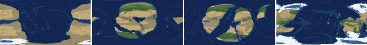
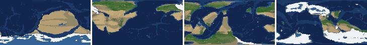
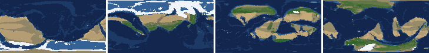
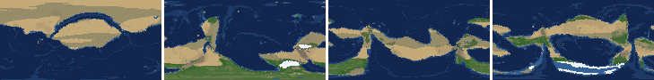
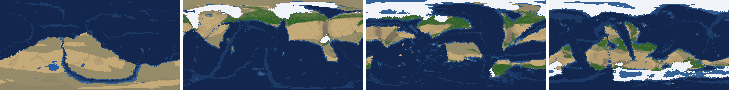
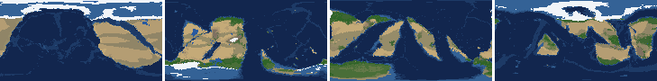
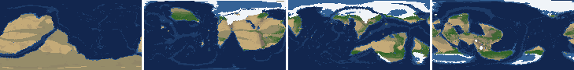
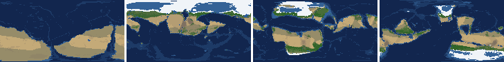

# Health sweep 2026-10-16 14:29

Commit 326e482. 8 runs (default params, `--every 4`) at 8 workers x 1 numba threads; simulations 26.7 min wall. Made by `tools/health.py` (PW-246).

## Runs

| seed | L | Myr | run | sim s | trees / flowering trees from | dT range C | peaks > 9.5 km | giant-lake frames % | crust volume end/start | ice SL < -150 m % | <= 4 plates % |
|---|---|---|---|---|---|---|---|---|---|---|---|
| 1 | 6 | 500 | f3653a | 819 | 132 / 412 | 13.5 | 0 | 14.2 | 0.979 | 11.5 | 0.0 |
| 2 | 6 | 500 | b59d57 | 1026 | 140 / 396 | 19.9 | 0 | 6.2 | 0.967 | 10.6 | 0.0 |
| 11 | 6 | 500 | ef7342 | 932 | 128 / 372 | 18.5 | 0 | 23.0 | 0.941 | 24.8 | 0.0 |
| 21 | 6 | 500 | 518be4 | 629 | 136 / 404 | 11.3 | 0 | 2.7 | 0.98 | 0.0 | 0.0 |
| 3199 | 6 | 500 | 709e65 | 1103 | 132 / 376 | 14.4 | 0 | 7.1 | 0.982 | 0.0 | 0.0 |
| 42 | 6 | 500 | 078c8a | 1346 | 116 / 404 | 13.7 | 0 | 21.2 | 0.949 | 11.5 | 0.0 |
| 77 | 6 | 500 | 5d5d76 | 1600 | 124 / 416 | 12.7 | 0 | 16.8 | 0.971 | 8.0 | 0.0 |
| 505 | 6 | 500 | 664591 | 1076 | 132 / 416 | 8.7 | 0 | 21.2 | 0.968 | 0.9 | 0.0 |

## Medians by seed (after 50 Myr; tree cover after forests, NPP after flowering trees appear)

| seed | L | land_pct | cont_pct | cont_km | plates | ocean_age | speed | sea_level | sea_ice_m | ice_pct | temp | co2 | dry_pct | inland_pct | lake_pct | lake_max_mkm2 | max_elev_km | trees_pct | npp | landmasses | largest_pct |
|---|---|---|---|---|---|---|---|---|---|---|---|---|---|---|---|---|---|---|---|---|---|
| 1 | 6 | 33.2 | 38.7 | 35.2 | 14.0 | 46.5 | 4.9 | 70.8 | -0.9 | 0.2 | 15.8 | -0.3 | 41.8 | 9.2 | 0.5 | 0.2 | 4.8 | 16.2 | 289.3 | 6.0 | 27.1 |
| 2 | 6 | 33.4 | 40.4 | 33.8 | 10.0 | 63.0 | 4.2 | -161.5 | -6.3 | 0.8 | 16.1 | -0.2 | 38.4 | 7.8 | 0.4 | 0.1 | 4.7 | 24.8 | 284.3 | 8.0 | 24.4 |
| 11 | 6 | 30.7 | 41.0 | 33.3 | 10.0 | 53.2 | 4.3 | -105.9 | -26.4 | 5.4 | 12.3 | -0.4 | 36.2 | 8.1 | 0.5 | 0.1 | 5.3 | 22.7 | 320.5 | 8.0 | 24.3 |
| 21 | 6 | 33.3 | 40.1 | 33.7 | 13.0 | 53.9 | 4.2 | 27.2 | -3.3 | 0.4 | 16.3 | -0.5 | 38.3 | 3.9 | 0.3 | 0.1 | 4.9 | 19.1 | 309.2 | 6.0 | 30.9 |
| 3199 | 6 | 31.7 | 40.0 | 34.1 | 11.0 | 60.9 | 4.4 | -151.8 | -24.2 | 3.8 | 13.9 | -0.2 | 40.0 | 6.5 | 0.4 | 0.1 | 5.9 | 16.9 | 296.5 | 8.0 | 21.3 |
| 42 | 6 | 31.1 | 40.6 | 33.1 | 13.0 | 54.5 | 4.4 | -124.4 | -24.2 | 5.3 | 13.4 | -0.2 | 35.3 | 6.2 | 0.5 | 0.1 | 5.1 | 20.9 | 316.8 | 6.0 | 21.6 |
| 77 | 6 | 29.7 | 39.8 | 34.4 | 13.0 | 51.7 | 4.4 | -127.5 | -60.8 | 7.5 | 12.2 | -0.1 | 36.1 | 6.1 | 0.5 | 0.1 | 6.0 | 28.2 | 340.9 | 7.0 | 18.5 |
| 505 | 6 | 30.2 | 40.7 | 33.7 | 13.0 | 55.3 | 4.5 | -191.8 | -68.1 | 7.4 | 13.8 | -0.2 | 36.5 | 8.2 | 0.6 | 0.2 | 6.3 | 21.4 | 274.4 | 7.0 | 22.1 |

Measured on the run's keyframes (no slicing). A keyframe's rivers and lakes are routed on its own terrain (PW-239), so `inland_raw_pct` (every routed end on land, as highlights counts it) and `inland_pct` (ends that are closed lakes, salt pans or real pits) agree but for ends under land ice. Land ice and land shares use cells (near-equal area).

## Envelopes

| metric | low | high | Earth | source |
|---|---|---|---|---|
| land, % of surface (`land_pct`) | 22 | 42 | 29.20 | tests/test_envelopes.py (22-42%); Earth 29.2% |
| continental crust, % of surface (`cont_pct`) | 33 | 50 | 41 | tests/test_envelopes.py (33-50%); Earth ~41% with shelves (Cogley 1984) |
| mean continental crust thickness, km (`cont_km`) | 31 | 40 | 39 | target 35 km (PW-238, continental_thickness); Earth ~39 km (Christensen & Mooney 1995); known thinning to 32-33 km (PW-046) |
| plates (`plates`) | 5 | 30 | 15 | tests/test_envelopes.py (5-30; max_plates 30); Earth 7 major + ~8 minor; <= 4 is the PW-191 collapse |
| mean ocean-floor age, Myr (`ocean_age`) | 25 | 120 | 64 | tests/test_envelopes.py (25-120); Earth ~64 Myr (Mueller et al. 2008); PW-051 |
| mean plate speed, cm/yr (`speed`) | 2 | 9 | 4.50 | tests/test_envelopes.py (2-9 cm/yr); Earth ~4-5 |
| sea level, m (ice + ocean basins) (`sea_level`) | -250 | 300 | 0 | Phanerozoic ~-130 (LGM) .. +250 m (earth.py; Haq & Schutter 2008); -250: PW-240's hard goal |
| sea level from land ice, m (`sea_ice_m`) | -250 | - | 0 | Earth LGM ~-130 m; PW-240 goal -150 m typical / -250 m worst |
| land ice, % of surface (`ice_pct`) | - | 10 | 3.10 | Earth 3.1% now (earth.EARTH_ICE), ~7-8% at the LGM |
| global mean temperature, C (`temp`) | 8 | 30 | 14.50 | Earth 14.5 C; LGM ~8 C (Tierney et al. 2020); Phanerozoic hothouses to ~30 C (Scotese et al. 2021) |
| CO2 index (ln source/sink) (`co2`) | -1.5 | 1.5 | 0.00 | the forcing's clip in earth.py (+-1.5); Earth 0 |
| arid (Koppen B), % of land (`dry_pct`) | 12 | 45 | 30 | tests/test_envelopes.py (12-45%); Earth ~30% (Beck et al. 2018) |
| land draining inland, % of ice-free land (to a closed lake, salt pan or real pit) (`inland_pct`) | 8 | 30 | 18 | Earth ~18% (overview 2.9); L6 known ~9.5-11% (PW-054, PW-243). `inland_raw_pct` (not checked) follows the stored `downstream` to any end, as highlights does; since PW-239 the two agree but for ends under land ice |
| lakes, % of land (`lake_pct`) | 0.2 | 3.0 | 1.80 | Earth ~1.8% of ice-free land (HydroLAKES, Messager et al. 2016); generated L6 worlds 0.5-1% |
| largest lake, million km2 (`lake_max_mkm2`) | - | 1.0 | 0.37 | Caspian 0.37 Mkm2; 1 Mkm2 = the overview's giant lake (2.9) |
| highest peak, km (`max_elev_km`) | - | 9.5 | 8.85 | Everest 8.85 km; PW-172 (spikes above ~9.5 km) |
| tree cover, % of ice-free land (after forests appear) (`trees_pct`) | 10 | 50 | 30 | Earth ~30% potential canopy (forest 55-60 of ~130 Mkm2, overview 2.18) |
| land NPP, g C/m2/yr (after flowering trees appear) (`npp`) | 200 | 700 | 430 | Earth ~56 Pg C/yr over ~130 Mkm2 = ~430; the model on Earth's terrain 50 Pg C/yr, ~385 (overview 2.18). Before flowering trees (plant group 4) stand-ins grow at 70%, so runs sit at ~150-280 |
| landmasses (>= 3 cells) (`landmasses`) | 3 | 80 | - | loose: a lone supercontinent or a shattered archipelago |
| largest landmass, % of surface (`largest_pct`) | 5 | 35 | 16.60 | Afro-Eurasia 16.6%; a Pangaea ~30% (scorecard largest_max) |
| global temperature range over the run, C (`dT_range`, per run) | - | 25 | 25 | Phanerozoic 11-36 C (Scotese et al. 2021) |
| keyframes with a peak above 9.5 km (`peak_frames`, per run) | - | 0 | 0 | PW-172 (L7 seed 3199: 3 of 251) |
| % of keyframes with a lake over 1 Mkm2 (`giant_lake_frames`, per run) | - | 5 | 0 | overview 2.9 (L6: 3 of ~150 frames) |
| continental crust volume, end / start (`volume_ratio`, per run) | 0.9 | 1.1 | 1.0 | scorecard volume_ratio (x1.006) |
| % of keyframes with ice sea level below -150 m (`sea_ice_below_150`, per run) | - | 10 | 0 | PW-240 |
| % of keyframes with <= 4 plates (`low_plates`, per run) | - | 2 | 0 | PW-191 (L7 seed 21: 1%) |

## Top outliers (of 234 spells; severity = excess / band width x (0.2 + share of the run))

| seed | L | metric | Myr | frames | worst | envelope | severity |
|---|---|---|---|---|---|---|---|
| 11 | 6 | giant_lake_frames | run | - | 23.00 | -..5 | 3.6 |
| 42 | 6 | giant_lake_frames | run | - | 21.20 | -..5 | 3.24 |
| 505 | 6 | giant_lake_frames | run | - | 21.20 | -..5 | 3.24 |
| 77 | 6 | giant_lake_frames | run | - | 16.80 | -..5 | 2.36 |
| 1 | 6 | giant_lake_frames | run | - | 14.20 | -..5 | 1.84 |
| 505 | 6 | lake_max_mkm2 | 144-164 | 4 | 8.52 | -..1.0 | 1.742 |
| 505 | 6 | lake_max_mkm2 | 356-404 | 12 | 6.46 | -..1.0 | 1.613 |
| 11 | 6 | sea_ice_below_150 | run | - | 24.80 | -..10 | 1.48 |
| 1 | 6 | lake_max_mkm2 | 468-468 | 1 | 5.88 | -..1.0 | 1.014 |
| 505 | 6 | lake_max_mkm2 | 216-224 | 2 | 5.49 | -..1.0 | 0.969 |
| 1 | 6 | lake_max_mkm2 | 376-412 | 8 | 4.30 | -..1.0 | 0.868 |
| 11 | 6 | lake_max_mkm2 | 68-68 | 1 | 5.03 | -..1.0 | 0.838 |
| 11 | 6 | lake_max_mkm2 | 212-296 | 21 | 3.19 | -..1.0 | 0.802 |
| 42 | 6 | lake_max_mkm2 | 160-212 | 14 | 3.30 | -..1.0 | 0.716 |
| 505 | 6 | lake_max_mkm2 | 260-276 | 4 | 3.27 | -..1.0 | 0.527 |
| 3199 | 6 | giant_lake_frames | run | - | 7.10 | -..5 | 0.42 |
| 11 | 6 | sea_level | 152-300 | 38 | -680.20 | -250..300 | 0.392 |
| 1 | 6 | lake_max_mkm2 | 336-336 | 1 | 2.86 | -..1.0 | 0.388 |
| 3199 | 6 | lake_max_mkm2 | 52-52 | 1 | 2.85 | -..1.0 | 0.385 |
| 2 | 6 | lake_max_mkm2 | 464-476 | 4 | 2.54 | -..1.0 | 0.357 |
| 1 | 6 | lake_max_mkm2 | 348-348 | 1 | 2.62 | -..1.0 | 0.336 |
| 11 | 6 | lake_max_mkm2 | 144-144 | 1 | 2.60 | -..1.0 | 0.333 |
| 505 | 6 | lake_max_mkm2 | 436-436 | 1 | 2.53 | -..1.0 | 0.318 |
| 2 | 6 | ice_pct | 464-500 | 10 | 20.10 | -..10 | 0.282 |
| 11 | 6 | ice_pct | 152-288 | 35 | 15.90 | -..10 | 0.282 |
| 505 | 6 | lake_pct | 160-164 | 2 | 6.64 | 0.2..3.0 | 0.281 |
| 42 | 6 | sea_level | 52-128 | 20 | -672.00 | -250..300 | 0.275 |
| 11 | 6 | lake_max_mkm2 | 156-164 | 3 | 2.22 | -..1.0 | 0.272 |
| 2 | 6 | sea_ice_m | 476-500 | 7 | -491.30 | -250..- | 0.247 |
| 3199 | 6 | lake_max_mkm2 | 432-436 | 2 | 2.13 | -..1.0 | 0.244 |

## Per seed: min / median / max after the 50 Myr spin-up, and spells outside the envelopes

### Seed 1, L6 (run f3653a)

*At 48, 200, 348, 500 Myr: sea by depth, land green by tree cover / tan where arid, shaded by height, ice white, lakes blue.*

| metric | min | median | max | outside (Myr: worst) |
|---|---|---|---|---|
| land_pct | 31.27 | 33.25 | 38.42 |  |
| cont_pct | 37.29 | 38.71 | 43.00 |  |
| cont_km | 32.38 | 35.19 | 36.42 |  |
| plates | 8.00 | 14.00 | 17.00 |  |
| ocean_age | 31.90 | 46.50 | 61.10 |  |
| speed | 2.82 | 4.88 | 7.19 |  |
| sea_level | -380.20 | 70.80 | 206.20 | 460-500: -380.20 |
| sea_ice_m | -236.20 | -0.90 | -0.00 |  |
| ice_pct | 0.00 | 0.20 | 11.50 | 460-500: 11.50 |
| temp | 7.10 | 15.80 | 20.60 | 480-500: 7.10 |
| co2 | -1.08 | -0.29 | 0.43 |  |
| dry_pct | 23.34 | 41.76 | 54.19 | 52-68: 52.00; 148-148: 45.24; 204-332: 54.19 |
| inland_pct | 1.14 | 9.22 | 24.00 | 68-156: 1.14; 180-180: 5.44; 192-200: 7.71; 256-256: 7.47; +6 more |
| lake_pct | 0.04 | 0.51 | 4.10 | 72-136: 0.04; 148-148: 0.18; 252-252: 0.19; 404-404: 3.62; +1 more |
| lake_max_mkm2 | 0.03 | 0.19 | 5.88 | 56-60: 2.07; 236-236: 1.10; 292-292: 1.53; 336-336: 2.86; +4 more |
| max_elev_km | 1.62 | 4.84 | 8.30 |  |
| trees_pct | 11.04 | 16.21 | 34.74 |  |
| npp | 166.10 | 289.30 | 316.70 | 412-428: 166.10 |
| landmasses | 2.00 | 6.00 | 12.00 | 308-308: 2 |
| largest_pct | 9.30 | 27.10 | 34.10 |  |

### Seed 2, L6 (run b59d57)

*At 48, 200, 348, 500 Myr: sea by depth, land green by tree cover / tan where arid, shaded by height, ice white, lakes blue.*

| metric | min | median | max | outside (Myr: worst) |
|---|---|---|---|---|
| land_pct | 30.23 | 33.40 | 35.34 |  |
| cont_pct | 37.67 | 40.39 | 42.39 |  |
| cont_km | 32.64 | 33.84 | 36.35 |  |
| plates | 6.00 | 10.00 | 15.00 |  |
| ocean_age | 31.70 | 63.00 | 91.90 |  |
| speed | 2.96 | 4.24 | 8.56 |  |
| sea_level | -715.80 | -161.50 | 207.20 | 52-76: -620.10; 464-500: -715.80 |
| sea_ice_m | -491.30 | -6.30 | -0.00 | 476-500: -491.30 |
| ice_pct | 0.00 | 0.80 | 20.10 | 52-60: 11.50; 464-500: 20.10 |
| temp | 2.80 | 16.10 | 22.70 | 468-500: 2.80 |
| co2 | -0.99 | -0.21 | 0.55 |  |
| dry_pct | 16.67 | 38.36 | 56.36 | 52-92: 55.53; 136-288: 56.36 |
| inland_pct | 1.91 | 7.80 | 25.10 | 64-68: 7.10; 88-136: 3.06; 192-196: 6.31; 288-460: 1.91 |
| lake_pct | 0.08 | 0.37 | 2.57 | 92-120: 0.08; 136-136: 0.17; 284-284: 0.15; 296-308: 0.11; +5 more |
| lake_max_mkm2 | 0.03 | 0.11 | 2.54 | 88-88: 1.07; 144-144: 1.06; 208-208: 1.10; 464-476: 2.54 |
| max_elev_km | 1.76 | 4.72 | 8.55 |  |
| trees_pct | 9.31 | 24.84 | 38.18 | 232-244: 9.31 |
| npp | 188.90 | 284.30 | 345.00 | 396-400: 188.90 |
| landmasses | 1.00 | 8.00 | 18.00 | 60-60: 2; 152-184: 1 |
| largest_pct | 11.20 | 24.40 | 35.20 | 132-144: 35.20 |

### Seed 11, L6 (run ef7342)

*At 48, 200, 348, 500 Myr: sea by depth, land green by tree cover / tan where arid, shaded by height, ice white, lakes blue.*

| metric | min | median | max | outside (Myr: worst) |
|---|---|---|---|---|
| land_pct | 28.71 | 30.74 | 36.39 |  |
| cont_pct | 39.27 | 41.05 | 42.07 |  |
| cont_km | 32.15 | 33.26 | 34.58 |  |
| plates | 6.00 | 10.00 | 19.00 |  |
| ocean_age | 29.80 | 53.20 | 72.60 |  |
| speed | 3.20 | 4.26 | 7.08 |  |
| sea_level | -680.20 | -105.90 | 245.20 | 52-60: -371.50; 152-300: -680.20 |
| sea_ice_m | -251.40 | -26.40 | -0.00 | 216-216: -251.40 |
| ice_pct | 0.00 | 5.40 | 15.90 | 152-288: 15.90 |
| temp | 1.40 | 12.30 | 19.90 | 148-216: 1.40 |
| co2 | -0.99 | -0.40 | 0.29 |  |
| dry_pct | 26.40 | 36.16 | 61.77 | 52-124: 61.77; 292-324: 51.92; 344-360: 45.97 |
| inland_pct | 1.64 | 8.05 | 23.92 | 52-64: 2.89; 108-136: 3.17; 152-152: 3.58; 320-500: 1.64 |
| lake_pct | 0.03 | 0.52 | 3.17 | 56-136: 0.03; 324-324: 0.19; 340-340: 0.14; 352-372: 0.10 |
| lake_max_mkm2 | 0.01 | 0.15 | 5.03 | 68-68: 5.03; 144-144: 2.60; 156-164: 2.22; 212-296: 3.19 |
| max_elev_km | 1.64 | 5.32 | 8.98 |  |
| trees_pct | 9.66 | 22.66 | 40.58 | 128-128: 9.66 |
| npp | 182.20 | 320.50 | 350.30 | 372-388: 182.20 |
| landmasses | 2.00 | 8.00 | 27.00 | 228-232: 2 |
| largest_pct | 9.60 | 24.30 | 35.90 | 204-244: 35.90 |

### Seed 21, L6 (run 518be4)

*At 48, 200, 348, 500 Myr: sea by depth, land green by tree cover / tan where arid, shaded by height, ice white, lakes blue.*

| metric | min | median | max | outside (Myr: worst) |
|---|---|---|---|---|
| land_pct | 30.68 | 33.26 | 37.69 |  |
| cont_pct | 37.40 | 40.14 | 43.63 |  |
| cont_km | 31.45 | 33.70 | 35.96 |  |
| plates | 8.00 | 13.00 | 17.00 |  |
| ocean_age | 31.40 | 53.90 | 76.70 |  |
| speed | 2.30 | 4.16 | 7.60 |  |
| sea_level | -339.50 | 27.20 | 219.20 | 444-500: -339.50 |
| sea_ice_m | -41.90 | -3.30 | -0.00 |  |
| ice_pct | 0.00 | 0.40 | 5.20 |  |
| temp | 10.50 | 16.30 | 21.80 |  |
| co2 | -1.10 | -0.49 | 0.09 |  |
| dry_pct | 18.79 | 38.33 | 54.39 | 52-80: 54.39; 144-180: 49.96; 500-500: 45.73 |
| inland_pct | 0.70 | 3.89 | 19.18 | 68-140: 0.87; 152-164: 4.81; 228-228: 6.32; 248-500: 0.70 |
| lake_pct | 0.01 | 0.27 | 1.94 | 52-92: 0.01; 104-128: 0.03; 140-144: 0.19; 300-304: 0.15; +6 more |
| lake_max_mkm2 | 0.01 | 0.07 | 1.58 | 96-96: 1.58; 192-192: 1.42; 208-208: 1.23 |
| max_elev_km | 1.92 | 4.87 | 8.27 |  |
| trees_pct | 10.26 | 19.14 | 40.61 |  |
| npp | 226.50 | 309.20 | 384.10 |  |
| landmasses | 2.00 | 6.00 | 13.00 | 320-320: 2 |
| largest_pct | 12.20 | 30.90 | 34.50 |  |

### Seed 3199, L6 (run 709e65)

*At 48, 200, 348, 500 Myr: sea by depth, land green by tree cover / tan where arid, shaded by height, ice white, lakes blue.*

| metric | min | median | max | outside (Myr: worst) |
|---|---|---|---|---|
| land_pct | 28.18 | 31.69 | 38.19 |  |
| cont_pct | 35.35 | 39.96 | 42.29 |  |
| cont_km | 32.73 | 34.09 | 37.82 |  |
| plates | 6.00 | 11.00 | 15.00 |  |
| ocean_age | 34.00 | 60.90 | 73.30 |  |
| speed | 2.53 | 4.44 | 8.23 |  |
| sea_level | -390.60 | -151.80 | 203.40 | 380-416: -319.10; 472-500: -390.60 |
| sea_ice_m | -142.10 | -24.20 | -0.00 |  |
| ice_pct | 0.00 | 3.80 | 10.70 | 388-400: 10.70; 500-500: 10.60 |
| temp | 7.20 | 13.90 | 21.60 | 388-396: 7.20 |
| co2 | -0.63 | -0.22 | 0.15 |  |
| dry_pct | 22.95 | 40.01 | 49.89 | 64-100: 49.89; 128-148: 48.90; 236-240: 45.50 |
| inland_pct | 1.60 | 6.54 | 35.84 | 56-140: 2.03; 156-168: 4.45; 204-212: 35.84; 260-268: 5.74; +1 more |
| lake_pct | 0.01 | 0.41 | 2.23 | 56-140: 0.01; 156-156: 0.17 |
| lake_max_mkm2 | 0.01 | 0.11 | 2.85 | 52-52: 2.85; 144-144: 1.59; 408-420: 1.83; 432-436: 2.13 |
| max_elev_km | 1.37 | 5.89 | 8.60 |  |
| trees_pct | 6.73 | 16.94 | 31.79 | 132-136: 6.73 |
| npp | 247.70 | 296.55 | 321.20 |  |
| landmasses | 2.00 | 8.00 | 17.00 | 52-72: 2 |
| largest_pct | 7.70 | 21.30 | 32.40 |  |

### Seed 42, L6 (run 078c8a)

*At 48, 200, 348, 500 Myr: sea by depth, land green by tree cover / tan where arid, shaded by height, ice white, lakes blue.*

| metric | min | median | max | outside (Myr: worst) |
|---|---|---|---|---|
| land_pct | 26.09 | 31.06 | 34.71 |  |
| cont_pct | 38.49 | 40.61 | 42.59 |  |
| cont_km | 32.39 | 33.11 | 34.81 |  |
| plates | 9.00 | 13.00 | 20.00 |  |
| ocean_age | 33.80 | 54.50 | 79.40 |  |
| speed | 2.32 | 4.39 | 6.94 |  |
| sea_level | -672.00 | -124.40 | 150.70 | 52-128: -672.00; 420-500: -490.80 |
| sea_ice_m | -363.20 | -24.20 | -0.00 | 88-100: -363.20 |
| ice_pct | 0.00 | 5.30 | 16.50 | 56-64: 10.60; 84-144: 16.50; 420-476: 15.00 |
| temp | 6.50 | 13.40 | 20.20 | 440-464: 6.50 |
| co2 | -0.71 | -0.22 | 0.01 |  |
| dry_pct | 20.56 | 35.29 | 46.09 | 52-52: 45.86; 192-208: 46.09; 220-220: 45.15 |
| inland_pct | 0.82 | 6.19 | 24.28 | 60-132: 0.82; 148-156: 5.02; 252-252: 6.54; 264-280: 4.88; +3 more |
| lake_pct | 0.05 | 0.45 | 5.46 | 64-64: 0.05; 76-80: 0.07; 92-96: 0.08; 168-168: 3.00; +6 more |
| lake_max_mkm2 | 0.03 | 0.14 | 3.30 | 108-116: 1.83; 128-128: 1.36; 140-140: 1.48; 160-212: 3.30; +3 more |
| max_elev_km | 1.90 | 5.14 | 8.51 |  |
| trees_pct | 13.97 | 20.87 | 33.01 |  |
| npp | 236.80 | 316.80 | 362.80 |  |
| landmasses | 2.00 | 6.00 | 11.00 | 68-68: 2; 124-128: 2; 236-244: 2 |
| largest_pct | 13.80 | 21.60 | 34.60 |  |

### Seed 77, L6 (run 5d5d76)

*At 48, 200, 348, 500 Myr: sea by depth, land green by tree cover / tan where arid, shaded by height, ice white, lakes blue.*

| metric | min | median | max | outside (Myr: worst) |
|---|---|---|---|---|
| land_pct | 28.65 | 29.72 | 38.08 |  |
| cont_pct | 36.36 | 39.76 | 42.76 |  |
| cont_km | 32.75 | 34.44 | 36.89 |  |
| plates | 9.00 | 13.00 | 15.00 |  |
| ocean_age | 35.20 | 51.70 | 71.50 |  |
| speed | 3.12 | 4.36 | 7.76 |  |
| sea_level | -520.60 | -127.50 | 138.30 | 304-336: -298.30; 432-500: -520.60 |
| sea_ice_m | -208.40 | -60.80 | -0.00 |  |
| ice_pct | 0.00 | 7.50 | 15.30 | 312-348: 11.30; 432-476: 15.30 |
| temp | 4.30 | 12.20 | 17.00 | 132-152: 4.30; 288-296: 7.60; 436-460: 6.30 |
| co2 | -0.95 | -0.07 | 0.25 |  |
| dry_pct | 18.19 | 36.08 | 54.78 | 140-220: 54.78 |
| inland_pct | 1.24 | 6.11 | 22.16 | 68-128: 1.71; 140-156: 4.61; 188-200: 4.81; 216-220: 6.63; +5 more |
| lake_pct | 0.02 | 0.51 | 1.78 | 52-56: 0.08; 76-80: 0.03; 96-120: 0.02; 308-308: 0.19; +1 more |
| lake_max_mkm2 | 0.01 | 0.15 | 1.99 | 68-72: 1.99; 100-100: 1.31; 160-164: 1.29; 236-292: 1.73; +1 more |
| max_elev_km | 1.71 | 6.01 | 9.28 |  |
| trees_pct | 8.20 | 28.20 | 37.42 | 168-176: 8.20 |
| npp | 242.10 | 340.85 | 364.50 |  |
| landmasses | 2.00 | 7.00 | 14.00 | 52-60: 2 |
| largest_pct | 7.90 | 18.50 | 32.90 |  |

### Seed 505, L6 (run 664591)

*At 48, 200, 348, 500 Myr: sea by depth, land green by tree cover / tan where arid, shaded by height, ice white, lakes blue.*

| metric | min | median | max | outside (Myr: worst) |
|---|---|---|---|---|
| land_pct | 28.29 | 30.19 | 38.04 |  |
| cont_pct | 36.80 | 40.70 | 42.73 |  |
| cont_km | 32.43 | 33.69 | 36.64 |  |
| plates | 7.00 | 13.00 | 15.00 |  |
| ocean_age | 33.10 | 55.30 | 63.00 |  |
| speed | 2.96 | 4.47 | 7.95 |  |
| sea_level | -509.90 | -191.80 | 201.70 | 172-304: -509.90; 412-464: -337.30 |
| sea_ice_m | -154.10 | -68.10 | -0.00 |  |
| ice_pct | 0.00 | 7.40 | 12.50 | 176-184: 10.20; 212-264: 12.50 |
| temp | 10.00 | 13.80 | 18.70 |  |
| co2 | -0.86 | -0.21 | 0.23 |  |
| dry_pct | 25.75 | 36.53 | 60.05 | 76-116: 60.05 |
| inland_pct | 1.63 | 8.19 | 23.96 | 56-156: 2.11; 172-172: 6.23; 188-188: 5.82; 220-228: 7.12; +3 more |
| lake_pct | 0.01 | 0.56 | 6.64 | 52-116: 0.01; 144-144: 3.50; 160-164: 6.64; 216-224: 4.92; +4 more |
| lake_max_mkm2 | 0.01 | 0.17 | 8.52 | 112-112: 1.11; 144-164: 8.52; 216-224: 5.49; 260-276: 3.27; +2 more |
| max_elev_km | 1.68 | 6.27 | 8.91 |  |
| trees_pct | 14.16 | 21.38 | 37.84 |  |
| npp | 177.80 | 274.40 | 318.70 | 416-432: 177.80 |
| landmasses | 2.00 | 7.00 | 14.00 | 60-60: 2; 252-252: 2 |
| largest_pct | 12.00 | 22.10 | 34.20 |  |

## Determinism

(not run)
