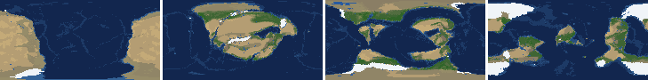
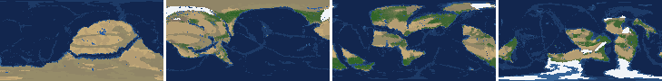
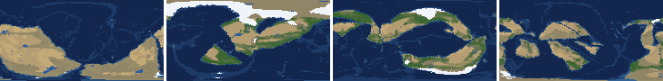
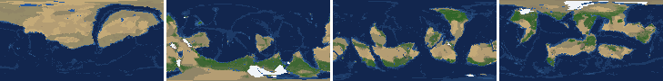
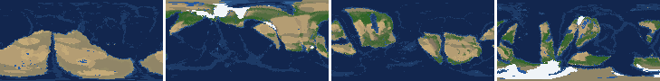
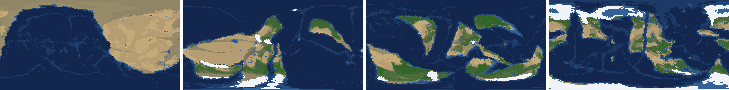
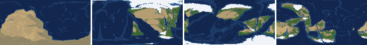
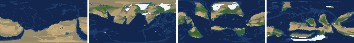

# Health sweep 2026-10-15 19:11

Commit cd00193. 8 runs (default params, `--every 4`) at 8 workers x 1 numba threads; simulations 5.5 min wall. Made by `tools/health.py` (PW-246).

## Runs

| seed | L | Myr | run | sim s | trees / flowering trees from | dT range C | peaks > 9.5 km | giant-lake frames % | crust volume end/start | ice SL < -150 m % | <= 4 plates % |
|---|---|---|---|---|---|---|---|---|---|---|---|
| 1 | 6 | 500 | 525f33 | 320 | 132 / 412 | 12.7 | 0 | 10.6 | 0.894 | 1.8 | 0.0 |
| 2 | 6 | 500 | 2a5046 | 318 | 140 / 396 | 19.2 | 0 | 12.4 | 0.867 | 0.0 | 0.0 |
| 11 | 6 | 500 | 14fc60 | 319 | 128 / 372 | 17.1 | 0 | 7.1 | 0.905 | 1.8 | 0.0 |
| 21 | 6 | 500 | 16abdc | 327 | 136 / 404 | 9.8 | 0 | 13.3 | 0.884 | 0.0 | 0.0 |
| 3199 | 6 | 500 | f38a18 | 321 | 132 / 376 | 10.1 | 0 | 15.0 | 0.898 | 0.0 | 0.0 |
| 42 | 6 | 500 | 979e9c | 316 | 116 / 404 | 10.6 | 0 | 9.7 | 0.878 | 0.0 | 0.0 |
| 77 | 6 | 500 | d20195 | 320 | 124 / 416 | 12.1 | 0 | 18.6 | 0.891 | 23.0 | 0.0 |
| 505 | 6 | 500 | 46e58c | 323 | 132 / 416 | 10.0 | 0 | 7.1 | 0.897 | 0.0 | 0.0 |

## Medians by seed (after 50 Myr; tree cover after forests, NPP after flowering trees appear)

| seed | L | land_pct | cont_pct | cont_km | plates | ocean_age | speed | sea_level | sea_ice_m | ice_pct | temp | co2 | dry_pct | inland_pct | lake_pct | lake_max_mkm2 | max_elev_km | trees_pct | npp | landmasses | largest_pct |
|---|---|---|---|---|---|---|---|---|---|---|---|---|---|---|---|---|---|---|---|---|---|
| 1 | 6 | 31.6 | 38.7 | 35.2 | 13.0 | 37.7 | 6.7 | 47.8 | -11.3 | 0.9 | 15.6 | -0.3 | 43.5 | 11.0 | 1.0 | 0.2 | 6.7 | 23.8 | 306.7 | 4.0 | 24.6 |
| 2 | 6 | 31.9 | 39.6 | 34.6 | 13.0 | 33.8 | 6.8 | 84.5 | -5.1 | 0.6 | 15.4 | -0.2 | 39.1 | 9.2 | 1.0 | 0.2 | 5.2 | 21.8 | 344.3 | 5.0 | 19.3 |
| 11 | 6 | 31.7 | 38.7 | 35.3 | 12.0 | 42.9 | 6.5 | -50.7 | -21.7 | 1.4 | 13.3 | -0.4 | 37.5 | 8.5 | 0.9 | 0.2 | 5.6 | 27.8 | 276.8 | 5.0 | 24.7 |
| 21 | 6 | 31.1 | 39.4 | 35.0 | 13.0 | 38.7 | 6.2 | 5.1 | -5.1 | 0.5 | 16.8 | -0.2 | 35.8 | 9.7 | 0.9 | 0.2 | 5.8 | 26.2 | 346.2 | 7.0 | 23.9 |
| 3199 | 6 | 32.3 | 39.0 | 35.6 | 11.0 | 43.2 | 6.3 | 20.7 | -10.3 | 0.8 | 15.6 | 0.0 | 39.1 | 10.8 | 0.8 | 0.2 | 4.8 | 28.7 | 278.0 | 5.0 | 17.7 |
| 42 | 6 | 32.2 | 39.1 | 34.5 | 11.0 | 42.9 | 5.8 | -8.3 | -15.9 | 1.1 | 14.1 | -0.1 | 36.1 | 7.9 | 0.8 | 0.1 | 5.6 | 26.6 | 379.6 | 6.0 | 17.3 |
| 77 | 6 | 32.6 | 38.3 | 35.6 | 13.0 | 40.7 | 6.6 | -82.3 | -102.6 | 5.0 | 11.7 | -0.2 | 37.3 | 10.3 | 0.9 | 0.2 | 6.4 | 30.1 | 366.6 | 5.0 | 18.3 |
| 505 | 6 | 31.3 | 39.2 | 35.4 | 11.0 | 42.4 | 6.2 | -13.7 | -19.1 | 1.2 | 14.9 | -0.3 | 33.0 | 9.9 | 1.0 | 0.2 | 5.9 | 25.9 | 344.2 | 7.0 | 15.5 |

Measured on the run's keyframes (no slicing). Caveats: a keyframe's lakes and `downstream` come from the terrain before that step's erosion and deposition (PW-239), so `inland_raw_pct` (every routed end on land, as highlights counts it) runs ~2-3x `inland_pct` (ends that are closed lakes, salt pans or real pits on the frame's own elevation); lake shares are the run's lakes during the step. Land ice and land shares use cells (near-equal area).

## Envelopes

| metric | low | high | Earth | source |
|---|---|---|---|---|
| land, % of surface (`land_pct`) | 22 | 42 | 29.20 | tests/test_envelopes.py (22-42%); Earth 29.2% |
| continental crust, % of surface (`cont_pct`) | 33 | 50 | 41 | tests/test_envelopes.py (33-50%); Earth ~41% with shelves (Cogley 1984) |
| mean continental crust thickness, km (`cont_km`) | 31 | 40 | 39 | target 35 km (PW-238, continental_thickness); Earth ~39 km (Christensen & Mooney 1995); known thinning to 32-33 km (PW-046) |
| plates (`plates`) | 5 | 30 | 15 | tests/test_envelopes.py (5-30; max_plates 30); Earth 7 major + ~8 minor; <= 4 is the PW-191 collapse |
| mean ocean-floor age, Myr (`ocean_age`) | 25 | 120 | 64 | tests/test_envelopes.py (25-120); Earth ~64 Myr (Mueller et al. 2008); PW-051 |
| mean plate speed, cm/yr (`speed`) | 2 | 9 | 4.50 | tests/test_envelopes.py (2-9 cm/yr); Earth ~4-5 |
| sea level, m (ice + ocean basins) (`sea_level`) | -250 | 300 | 0 | Phanerozoic ~-130 (LGM) .. +250 m (earth.py; Haq & Schutter 2008); -250: PW-240's hard goal |
| sea level from land ice, m (`sea_ice_m`) | -250 | - | 0 | Earth LGM ~-130 m; PW-240 goal -150 m typical / -250 m worst |
| land ice, % of surface (`ice_pct`) | - | 10 | 3.10 | Earth 3.1% now (earth.EARTH_ICE), ~7-8% at the LGM |
| global mean temperature, C (`temp`) | 8 | 30 | 14.50 | Earth 14.5 C; LGM ~8 C (Tierney et al. 2020); Phanerozoic hothouses to ~30 C (Scotese et al. 2021) |
| CO2 index (ln source/sink) (`co2`) | -1.5 | 1.5 | 0.00 | the forcing's clip in earth.py (+-1.5); Earth 0 |
| arid (Koppen B), % of land (`dry_pct`) | 12 | 45 | 30 | tests/test_envelopes.py (12-45%); Earth ~30% (Beck et al. 2018) |
| land draining inland, % of ice-free land (to a closed lake, salt pan or real pit) (`inland_pct`) | 8 | 30 | 18 | Earth ~18% (overview 2.9); L6 known ~9.5-11% (PW-054, PW-243). `inland_raw_pct` (not checked) follows the stored `downstream` to any end, as highlights does: stale by a step (PW-239) |
| lakes, % of land (`lake_pct`) | 0.2 | 3.0 | 1.80 | Earth ~1.8% of ice-free land (HydroLAKES, Messager et al. 2016); generated L6 worlds 0.5-1% |
| largest lake, million km2 (`lake_max_mkm2`) | - | 1.0 | 0.37 | Caspian 0.37 Mkm2; 1 Mkm2 = the overview's giant lake (2.9) |
| highest peak, km (`max_elev_km`) | - | 9.5 | 8.85 | Everest 8.85 km; PW-172 (spikes above ~9.5 km) |
| tree cover, % of ice-free land (after forests appear) (`trees_pct`) | 10 | 50 | 30 | Earth ~30% potential canopy (forest 55-60 of ~130 Mkm2, overview 2.18) |
| land NPP, g C/m2/yr (after flowering trees appear) (`npp`) | 200 | 700 | 430 | Earth ~56 Pg C/yr over ~130 Mkm2 = ~430; the model on Earth's terrain 50 Pg C/yr, ~385 (overview 2.18). Before flowering trees (plant group 4) stand-ins grow at 70%, so runs sit at ~150-280 |
| landmasses (>= 3 cells) (`landmasses`) | 3 | 80 | - | loose: a lone supercontinent or a shattered archipelago |
| largest landmass, % of surface (`largest_pct`) | 5 | 35 | 16.60 | Afro-Eurasia 16.6%; a Pangaea ~30% (scorecard largest_max) |
| global temperature range over the run, C (`dT_range`, per run) | - | 25 | 25 | Phanerozoic 11-36 C (Scotese et al. 2021) |
| keyframes with a peak above 9.5 km (`peak_frames`, per run) | - | 0 | 0 | PW-172 (L7 seed 3199: 3 of 251) |
| % of keyframes with a lake over 1 Mkm2 (`giant_lake_frames`, per run) | - | 5 | 0 | overview 2.9 (L6: 3 of ~150 frames) |
| continental crust volume, end / start (`volume_ratio`, per run) | 0.9 | 1.1 | 1.0 | scorecard volume_ratio (x1.006) |
| % of keyframes with ice sea level below -150 m (`sea_ice_below_150`, per run) | - | 10 | 0 | PW-240 |
| % of keyframes with <= 4 plates (`low_plates`, per run) | - | 2 | 0 | PW-191 (L7 seed 21: 1%) |

## Top outliers (of 247 spells; severity = excess / band width x (0.2 + share of the run))

| seed | L | metric | Myr | frames | worst | envelope | severity |
|---|---|---|---|---|---|---|---|
| 77 | 6 | giant_lake_frames | run | - | 18.60 | -..5 | 2.72 |
| 3199 | 6 | giant_lake_frames | run | - | 15.00 | -..5 | 2.0 |
| 21 | 6 | giant_lake_frames | run | - | 13.30 | -..5 | 1.66 |
| 2 | 6 | giant_lake_frames | run | - | 12.40 | -..5 | 1.48 |
| 77 | 6 | sea_ice_below_150 | run | - | 23.00 | -..10 | 1.3 |
| 1 | 6 | giant_lake_frames | run | - | 10.60 | -..5 | 1.12 |
| 77 | 6 | lake_max_mkm2 | 236-256 | 5 | 4.97 | -..1.0 | 0.951 |
| 42 | 6 | giant_lake_frames | run | - | 9.70 | -..5 | 0.94 |
| 2 | 6 | lake_max_mkm2 | 304-304 | 1 | 4.84 | -..1.0 | 0.799 |
| 77 | 6 | lake_max_mkm2 | 300-308 | 2 | 3.44 | -..1.0 | 0.526 |
| 3199 | 6 | lake_max_mkm2 | 336-336 | 1 | 3.06 | -..1.0 | 0.429 |
| 21 | 6 | lake_max_mkm2 | 244-244 | 1 | 3.03 | -..1.0 | 0.421 |
| 3199 | 6 | lake_max_mkm2 | 292-292 | 1 | 3.03 | -..1.0 | 0.421 |
| 11 | 6 | giant_lake_frames | run | - | 7.10 | -..5 | 0.42 |
| 505 | 6 | giant_lake_frames | run | - | 7.10 | -..5 | 0.42 |
| 2 | 6 | lake_max_mkm2 | 280-280 | 1 | 2.78 | -..1.0 | 0.37 |
| 42 | 6 | inland_pct | 52-68 | 5 | 61.58 | 8..30 | 0.344 |
| 77 | 6 | lake_max_mkm2 | 192-192 | 1 | 2.65 | -..1.0 | 0.344 |
| 11 | 6 | lake_max_mkm2 | 372-372 | 1 | 2.64 | -..1.0 | 0.341 |
| 505 | 6 | lake_max_mkm2 | 88-92 | 2 | 2.56 | -..1.0 | 0.338 |
| 77 | 6 | lake_max_mkm2 | 204-204 | 1 | 2.59 | -..1.0 | 0.331 |
| 42 | 6 | lake_max_mkm2 | 152-156 | 2 | 2.47 | -..1.0 | 0.316 |
| 21 | 6 | lake_max_mkm2 | 68-76 | 3 | 2.40 | -..1.0 | 0.314 |
| 2 | 6 | lake_max_mkm2 | 408-412 | 2 | 2.32 | -..1.0 | 0.284 |
| 2 | 6 | lake_max_mkm2 | 480-480 | 1 | 2.37 | -..1.0 | 0.284 |
| 2 | 6 | lake_max_mkm2 | 428-432 | 2 | 2.25 | -..1.0 | 0.271 |
| 1 | 6 | dry_pct | 180-308 | 33 | 64.17 | 12..45 | 0.268 |
| 77 | 6 | lake_max_mkm2 | 412-432 | 6 | 2.08 | -..1.0 | 0.267 |
| 21 | 6 | lake_max_mkm2 | 296-312 | 5 | 2.09 | -..1.0 | 0.262 |
| 1 | 6 | dry_pct | 52-100 | 13 | 73.46 | 12..45 | 0.261 |

## Per seed: min / median / max after the 50 Myr spin-up, and spells outside the envelopes

### Seed 1, L6 (run 525f33)

*At 48, 200, 348, 500 Myr: sea by depth, land green by tree cover / tan where arid, shaded by height, ice white, lakes blue.*

| metric | min | median | max | outside (Myr: worst) |
|---|---|---|---|---|
| land_pct | 29.64 | 31.58 | 38.47 |  |
| cont_pct | 36.53 | 38.69 | 42.51 |  |
| cont_km | 34.63 | 35.25 | 37.74 |  |
| plates | 7.00 | 13.00 | 17.00 |  |
| ocean_age | 19.30 | 37.70 | 53.00 | 96-120: 22.70; 300-340: 19.30 |
| speed | 3.06 | 6.70 | 10.92 | 72-124: 10.92; 300-308: 9.11 |
| sea_level | -262.00 | 47.80 | 191.00 | 500-500: -262.00 |
| sea_ice_m | -187.30 | -11.30 | -0.00 |  |
| ice_pct | 0.00 | 0.90 | 7.30 |  |
| temp | 7.10 | 15.60 | 19.80 | 492-500: 7.10 |
| co2 | -1.10 | -0.35 | 0.64 |  |
| dry_pct | 22.40 | 43.54 | 73.46 | 52-100: 73.46; 124-144: 51.06; 180-308: 64.17 |
| inland_pct | 3.44 | 10.97 | 47.10 | 52-68: 47.10; 96-96: 38.76; 136-148: 5.04; 212-220: 43.89; +8 more |
| lake_pct | 0.17 | 0.97 | 3.08 | 52-52: 0.17; 212-212: 3.08 |
| lake_max_mkm2 | 0.05 | 0.20 | 1.89 | 96-96: 1.89; 156-156: 1.01; 212-212: 1.21; 336-340: 1.77; +2 more |
| max_elev_km | 2.03 | 6.67 | 8.47 |  |
| trees_pct | 16.38 | 23.79 | 37.42 |  |
| npp | 200.70 | 306.70 | 333.80 |  |
| landmasses | 1.00 | 4.00 | 9.00 | 52-56: 1; 76-84: 2; 152-164: 2; 176-176: 2; +4 more |
| largest_pct | 10.60 | 24.60 | 38.50 | 52-60: 38.50 |

### Seed 2, L6 (run 2a5046)

*At 48, 200, 348, 500 Myr: sea by depth, land green by tree cover / tan where arid, shaded by height, ice white, lakes blue.*

| metric | min | median | max | outside (Myr: worst) |
|---|---|---|---|---|
| land_pct | 28.39 | 31.87 | 37.70 |  |
| cont_pct | 37.20 | 39.65 | 42.64 |  |
| cont_km | 33.26 | 34.58 | 37.41 |  |
| plates | 8.00 | 13.00 | 16.00 |  |
| ocean_age | 22.00 | 33.80 | 48.60 | 80-104: 22.00 |
| speed | 3.88 | 6.84 | 10.74 | 52-100: 10.74 |
| sea_level | -194.60 | 84.50 | 203.60 |  |
| sea_ice_m | -98.70 | -5.10 | -0.00 |  |
| ice_pct | 0.00 | 0.60 | 6.20 |  |
| temp | 4.00 | 15.40 | 23.20 | 472-500: 4.00 |
| co2 | -0.97 | -0.18 | 0.53 |  |
| dry_pct | 23.97 | 39.07 | 50.75 | 52-64: 50.75; 100-116: 49.11; 208-216: 45.43 |
| inland_pct | 2.36 | 9.20 | 32.02 | 52-52: 32.02; 88-88: 7.28; 104-104: 5.15; 116-128: 2.36; +5 more |
| lake_pct | 0.13 | 0.97 | 4.36 | 120-120: 0.13; 304-304: 4.36 |
| lake_max_mkm2 | 0.03 | 0.20 | 4.84 | 56-60: 1.15; 136-144: 2.02; 264-264: 2.02; 280-280: 2.78; +5 more |
| max_elev_km | 1.74 | 5.24 | 8.65 |  |
| trees_pct | 13.43 | 21.83 | 50.15 | 420-420: 50.15 |
| npp | 254.30 | 344.30 | 396.40 |  |
| landmasses | 1.00 | 5.00 | 11.00 | 52-68: 2; 160-160: 2; 172-184: 1; 196-200: 2; +1 more |
| largest_pct | 10.70 | 19.30 | 34.40 |  |

### Seed 11, L6 (run 14fc60)

*At 48, 200, 348, 500 Myr: sea by depth, land green by tree cover / tan where arid, shaded by height, ice white, lakes blue.*

| metric | min | median | max | outside (Myr: worst) |
|---|---|---|---|---|
| land_pct | 30.87 | 31.74 | 37.83 |  |
| cont_pct | 37.36 | 38.67 | 42.30 |  |
| cont_km | 33.74 | 35.27 | 37.28 |  |
| plates | 8.00 | 12.00 | 19.00 |  |
| ocean_age | 17.10 | 42.90 | 55.90 | 60-108: 17.10 |
| speed | 3.68 | 6.45 | 11.80 | 52-108: 11.80 |
| sea_level | -253.90 | -50.70 | 206.20 | 208-216: -253.90 |
| sea_ice_m | -156.60 | -21.70 | -0.00 |  |
| ice_pct | 0.00 | 1.40 | 7.30 |  |
| temp | 3.10 | 13.30 | 20.20 | 148-148: 7.90; 168-208: 3.10 |
| co2 | -0.78 | -0.37 | 0.34 |  |
| dry_pct | 21.64 | 37.52 | 60.99 | 52-100: 60.99; 292-332: 50.61 |
| inland_pct | 3.08 | 8.52 | 30.72 | 56-56: 30.72; 104-120: 6.13; 132-132: 7.48; 236-236: 6.75; +1 more |
| lake_pct | 0.17 | 0.86 | 3.33 | 80-92: 0.17; 228-228: 3.33 |
| lake_max_mkm2 | 0.04 | 0.21 | 2.64 | 56-60: 1.64; 192-204: 1.48; 228-228: 1.78; 260-260: 1.16; +1 more |
| max_elev_km | 1.74 | 5.56 | 8.07 |  |
| trees_pct | 10.39 | 27.76 | 46.42 |  |
| npp | 235.20 | 276.80 | 403.10 |  |
| landmasses | 2.00 | 5.00 | 13.00 | 232-232: 2 |
| largest_pct | 9.40 | 24.70 | 33.80 |  |

### Seed 21, L6 (run 16abdc)

*At 48, 200, 348, 500 Myr: sea by depth, land green by tree cover / tan where arid, shaded by height, ice white, lakes blue.*

| metric | min | median | max | outside (Myr: worst) |
|---|---|---|---|---|
| land_pct | 30.58 | 31.14 | 37.88 |  |
| cont_pct | 37.65 | 39.38 | 42.61 |  |
| cont_km | 33.01 | 34.95 | 36.50 |  |
| plates | 9.00 | 13.00 | 18.00 |  |
| ocean_age | 19.60 | 38.70 | 47.80 | 72-108: 19.60 |
| speed | 4.61 | 6.22 | 10.03 | 68-104: 10.03 |
| sea_level | -70.20 | 5.10 | 186.10 |  |
| sea_ice_m | -22.00 | -5.10 | -0.00 |  |
| ice_pct | 0.00 | 0.50 | 1.80 |  |
| temp | 12.40 | 16.80 | 22.20 |  |
| co2 | -0.63 | -0.25 | 0.03 |  |
| dry_pct | 26.15 | 35.78 | 55.52 | 52-60: 55.52; 100-100: 45.87; 332-352: 48.51 |
| inland_pct | 3.55 | 9.69 | 29.07 | 112-196: 3.55; 252-256: 6.36; 272-272: 7.35; 348-348: 7.04; +5 more |
| lake_pct | 0.30 | 0.94 | 4.65 | 244-244: 3.37; 296-300: 4.65 |
| lake_max_mkm2 | 0.05 | 0.16 | 3.03 | 68-76: 2.40; 104-108: 2.04; 124-128: 1.81; 244-244: 3.03; +2 more |
| max_elev_km | 1.96 | 5.78 | 8.79 |  |
| trees_pct | 20.95 | 26.23 | 47.79 |  |
| npp | 270.30 | 346.20 | 392.30 |  |
| landmasses | 2.00 | 7.00 | 15.00 | 52-52: 2; 240-240: 2; 300-300: 2 |
| largest_pct | 8.10 | 23.90 | 33.10 |  |

### Seed 3199, L6 (run f38a18)

*At 48, 200, 348, 500 Myr: sea by depth, land green by tree cover / tan where arid, shaded by height, ice white, lakes blue.*

| metric | min | median | max | outside (Myr: worst) |
|---|---|---|---|---|
| land_pct | 30.19 | 32.29 | 37.80 |  |
| cont_pct | 37.54 | 38.97 | 42.88 |  |
| cont_km | 33.69 | 35.56 | 36.51 |  |
| plates | 6.00 | 11.00 | 15.00 |  |
| ocean_age | 22.50 | 43.20 | 54.90 | 88-100: 22.50 |
| speed | 4.44 | 6.28 | 9.43 | 68-88: 9.43 |
| sea_level | -135.30 | 20.70 | 179.80 |  |
| sea_ice_m | -74.60 | -10.30 | -0.00 |  |
| ice_pct | 0.00 | 0.80 | 4.10 |  |
| temp | 10.60 | 15.60 | 20.70 |  |
| co2 | -0.97 | 0.02 | 0.37 |  |
| dry_pct | 19.93 | 39.09 | 52.92 | 52-64: 52.92; 84-108: 50.96; 272-316: 52.42; 380-380: 45.43 |
| inland_pct | 2.08 | 10.79 | 27.52 | 68-80: 5.11; 96-108: 4.69; 128-192: 2.08; 348-348: 5.36; +4 more |
| lake_pct | 0.19 | 0.85 | 3.84 | 68-68: 0.19; 292-292: 3.05; 336-336: 3.84 |
| lake_max_mkm2 | 0.04 | 0.17 | 3.06 | 124-132: 1.82; 256-256: 1.71; 292-292: 3.03; 320-324: 1.59; +4 more |
| max_elev_km | 1.83 | 4.79 | 8.16 |  |
| trees_pct | 16.90 | 28.67 | 41.83 |  |
| npp | 218.10 | 278.05 | 375.70 |  |
| landmasses | 1.00 | 5.00 | 14.00 | 56-56: 2; 68-68: 2; 192-200: 1; 228-240: 1 |
| largest_pct | 7.70 | 17.70 | 33.60 |  |

### Seed 42, L6 (run 979e9c)

*At 48, 200, 348, 500 Myr: sea by depth, land green by tree cover / tan where arid, shaded by height, ice white, lakes blue.*

| metric | min | median | max | outside (Myr: worst) |
|---|---|---|---|---|
| land_pct | 28.21 | 32.18 | 38.62 |  |
| cont_pct | 37.70 | 39.13 | 42.70 |  |
| cont_km | 33.28 | 34.52 | 36.79 |  |
| plates | 5.00 | 11.00 | 18.00 |  |
| ocean_age | 19.80 | 42.90 | 81.40 | 76-116: 19.80 |
| speed | 3.33 | 5.84 | 10.61 | 68-136: 10.61 |
| sea_level | -205.80 | -8.30 | 205.40 |  |
| sea_ice_m | -142.80 | -15.90 | -0.00 |  |
| ice_pct | 0.00 | 1.10 | 8.60 |  |
| temp | 7.80 | 14.10 | 18.40 | 452-452: 7.80 |
| co2 | -1.75 | -0.14 | 0.36 | 164-232: -1.75 |
| dry_pct | 22.45 | 36.13 | 70.76 | 52-88: 70.76; 156-272: 53.35 |
| inland_pct | 2.48 | 7.88 | 61.58 | 52-68: 61.58; 120-132: 4.67; 144-148: 4.93; 240-240: 7.78; +3 more |
| lake_pct | 0.12 | 0.83 | 2.83 | 120-120: 0.12 |
| lake_max_mkm2 | 0.03 | 0.15 | 2.47 | 60-60: 1.57; 116-116: 1.28; 140-140: 1.10; 152-156: 2.47; +3 more |
| max_elev_km | 1.54 | 5.56 | 8.74 |  |
| trees_pct | 14.67 | 26.63 | 39.56 |  |
| npp | 315.50 | 379.60 | 428.40 |  |
| landmasses | 2.00 | 6.00 | 13.00 | 52-52: 2; 72-88: 2; 160-168: 2 |
| largest_pct | 8.60 | 17.30 | 38.60 | 52-60: 38.60 |

### Seed 77, L6 (run d20195)

*At 48, 200, 348, 500 Myr: sea by depth, land green by tree cover / tan where arid, shaded by height, ice white, lakes blue.*

| metric | min | median | max | outside (Myr: worst) |
|---|---|---|---|---|
| land_pct | 28.57 | 32.64 | 38.55 |  |
| cont_pct | 37.08 | 38.32 | 42.52 |  |
| cont_km | 34.12 | 35.63 | 37.33 |  |
| plates | 8.00 | 13.00 | 17.00 |  |
| ocean_age | 23.10 | 40.70 | 56.00 | 108-124: 23.10 |
| speed | 4.90 | 6.57 | 10.55 | 76-132: 10.55 |
| sea_level | -366.90 | -82.30 | 164.40 | 292-352: -366.90 |
| sea_ice_m | -294.50 | -102.60 | -0.00 | 304-344: -294.50 |
| ice_pct | 0.00 | 5.00 | 10.80 | 308-332: 10.80 |
| temp | 5.50 | 11.70 | 17.60 | 136-160: 5.50; 288-288: 7.90 |
| co2 | -0.96 | -0.21 | 0.24 |  |
| dry_pct | 23.70 | 37.32 | 68.24 | 52-92: 68.24; 172-192: 46.46; 248-264: 46.56 |
| inland_pct | 3.11 | 10.33 | 51.06 | 52-76: 51.06; 100-100: 7.07; 124-140: 5.93; 152-152: 6.33; +5 more |
| lake_pct | 0.13 | 0.95 | 4.28 | 136-136: 0.14; 244-256: 4.28; 312-312: 0.13; 412-412: 3.43; +1 more |
| lake_max_mkm2 | 0.03 | 0.20 | 4.97 | 68-68: 1.07; 92-92: 1.16; 108-116: 1.32; 192-192: 2.65; +5 more |
| max_elev_km | 2.04 | 6.37 | 8.99 |  |
| trees_pct | 21.94 | 30.06 | 39.22 |  |
| npp | 242.80 | 366.60 | 391.90 |  |
| landmasses | 1.00 | 5.00 | 11.00 | 52-76: 1; 252-256: 1 |
| largest_pct | 6.40 | 18.30 | 38.60 | 52-60: 38.60 |

### Seed 505, L6 (run 46e58c)

*At 48, 200, 348, 500 Myr: sea by depth, land green by tree cover / tan where arid, shaded by height, ice white, lakes blue.*

| metric | min | median | max | outside (Myr: worst) |
|---|---|---|---|---|
| land_pct | 29.81 | 31.30 | 37.83 |  |
| cont_pct | 36.60 | 39.18 | 42.85 |  |
| cont_km | 33.84 | 35.43 | 38.19 |  |
| plates | 7.00 | 11.00 | 17.00 |  |
| ocean_age | 20.70 | 42.40 | 58.40 | 68-108: 20.70; 300-308: 24.10 |
| speed | 4.02 | 6.24 | 10.34 | 52-108: 10.34 |
| sea_level | -161.40 | -13.70 | 200.60 |  |
| sea_ice_m | -66.90 | -19.10 | -0.00 |  |
| ice_pct | 0.00 | 1.20 | 4.00 |  |
| temp | 9.60 | 14.90 | 19.60 |  |
| co2 | -1.44 | -0.31 | 0.47 |  |
| dry_pct | 22.33 | 33.03 | 51.73 | 52-112: 51.73 |
| inland_pct | 3.01 | 9.93 | 28.11 | 76-76: 5.70; 104-112: 6.68; 124-132: 7.27; 152-152: 7.32; +7 more |
| lake_pct | 0.22 | 1.01 | 4.32 | 344-344: 4.32 |
| lake_max_mkm2 | 0.04 | 0.22 | 2.56 | 60-60: 1.25; 72-72: 1.05; 88-92: 2.56; 164-164: 2.02; +3 more |
| max_elev_km | 1.85 | 5.91 | 8.14 |  |
| trees_pct | 15.78 | 25.90 | 46.60 |  |
| npp | 219.70 | 344.20 | 352.30 |  |
| landmasses | 1.00 | 7.00 | 15.00 | 52-60: 2; 156-184: 1; 224-224: 2 |
| largest_pct | 7.90 | 15.50 | 34.00 |  |

## Determinism

(not run)
