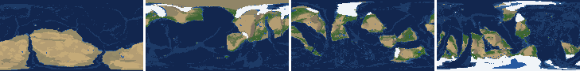
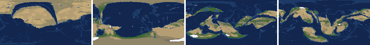

# Health sweep 2026-10-15 20:15

Commit 7c12663. 2 runs (default params, `--every 4`) at 2 workers x 4 numba threads; simulations 17.9 min wall. Made by `tools/health.py` (PW-246).

## Runs

| seed | L | Myr | run | sim s | trees / flowering trees from | dT range C | peaks > 9.5 km | giant-lake frames % | crust volume end/start | ice SL < -150 m % | <= 4 plates % |
|---|---|---|---|---|---|---|---|---|---|---|---|
| 3199 | 7 | 500 | 9366df | 1074 | 132 / 376 | 9.7 | 0 | 15.9 | 0.926 | 0.0 | 0.0 |
| 21 | 7 | 500 | ef2c6a | 1048 | 136 / 404 | 9.3 | 0 | 7.1 | 0.902 | 0.0 | 0.0 |

## Medians by seed (after 50 Myr; tree cover after forests, NPP after flowering trees appear)

| seed | L | land_pct | cont_pct | cont_km | plates | ocean_age | speed | sea_level | sea_ice_m | ice_pct | temp | co2 | dry_pct | inland_pct | lake_pct | lake_max_mkm2 | max_elev_km | trees_pct | npp | landmasses | largest_pct |
|---|---|---|---|---|---|---|---|---|---|---|---|---|---|---|---|---|---|---|---|---|---|
| 3199 | 7 | 29.8 | 36.3 | 37.8 | 16.0 | 31.9 | 7.5 | 4.9 | -49.7 | 3.1 | 14.5 | 0.0 | 40.3 | 19.0 | 1.7 | 0.4 | 7.8 | 24.1 | 333.2 | 11.0 | 16.8 |
| 21 | 7 | 31.6 | 38.3 | 35.8 | 12.0 | 39.5 | 6.4 | -1.9 | -11.3 | 0.8 | 16.5 | -0.3 | 45.8 | 13.5 | 0.9 | 0.2 | 7.2 | 20.9 | 392.9 | 13.0 | 20.0 |

Measured on the run's keyframes (no slicing). Caveats: a keyframe's lakes and `downstream` come from the terrain before that step's erosion and deposition (PW-239), so `inland_raw_pct` (every routed end on land, as highlights counts it) runs ~2-3x `inland_pct` (ends that are closed lakes, salt pans or real pits on the frame's own elevation); lake shares are the run's lakes during the step. Land ice and land shares use cells (near-equal area).

## Envelopes

| metric | low | high | Earth | source |
|---|---|---|---|---|
| land, % of surface (`land_pct`) | 22 | 42 | 29.20 | tests/test_envelopes.py (22-42%); Earth 29.2% |
| continental crust, % of surface (`cont_pct`) | 33 | 50 | 41 | tests/test_envelopes.py (33-50%); Earth ~41% with shelves (Cogley 1984) |
| mean continental crust thickness, km (`cont_km`) | 31 | 40 | 39 | target 35 km (PW-238, continental_thickness); Earth ~39 km (Christensen & Mooney 1995); known thinning to 32-33 km (PW-046) |
| plates (`plates`) | 5 | 30 | 15 | tests/test_envelopes.py (5-30; max_plates 30); Earth 7 major + ~8 minor; <= 4 is the PW-191 collapse |
| mean ocean-floor age, Myr (`ocean_age`) | 25 | 120 | 64 | tests/test_envelopes.py (25-120); Earth ~64 Myr (Mueller et al. 2008); PW-051 |
| mean plate speed, cm/yr (`speed`) | 2 | 9 | 4.50 | tests/test_envelopes.py (2-9 cm/yr); Earth ~4-5 |
| sea level, m (ice + ocean basins) (`sea_level`) | -250 | 300 | 0 | Phanerozoic ~-130 (LGM) .. +250 m (earth.py; Haq & Schutter 2008); -250: PW-240's hard goal |
| sea level from land ice, m (`sea_ice_m`) | -250 | - | 0 | Earth LGM ~-130 m; PW-240 goal -150 m typical / -250 m worst |
| land ice, % of surface (`ice_pct`) | - | 10 | 3.10 | Earth 3.1% now (earth.EARTH_ICE), ~7-8% at the LGM |
| global mean temperature, C (`temp`) | 8 | 30 | 14.50 | Earth 14.5 C; LGM ~8 C (Tierney et al. 2020); Phanerozoic hothouses to ~30 C (Scotese et al. 2021) |
| CO2 index (ln source/sink) (`co2`) | -1.5 | 1.5 | 0.00 | the forcing's clip in earth.py (+-1.5); Earth 0 |
| arid (Koppen B), % of land (`dry_pct`) | 12 | 45 | 30 | tests/test_envelopes.py (12-45%); Earth ~30% (Beck et al. 2018) |
| land draining inland, % of ice-free land (to a closed lake, salt pan or real pit) (`inland_pct`) | 8 | 30 | 18 | Earth ~18% (overview 2.9); L6 known ~9.5-11% (PW-054, PW-243). `inland_raw_pct` (not checked) follows the stored `downstream` to any end, as highlights does: stale by a step (PW-239) |
| lakes, % of land (`lake_pct`) | 0.2 | 3.0 | 1.80 | Earth ~1.8% of ice-free land (HydroLAKES, Messager et al. 2016); generated L6 worlds 0.5-1% |
| largest lake, million km2 (`lake_max_mkm2`) | - | 1.0 | 0.37 | Caspian 0.37 Mkm2; 1 Mkm2 = the overview's giant lake (2.9) |
| highest peak, km (`max_elev_km`) | - | 9.5 | 8.85 | Everest 8.85 km; PW-172 (spikes above ~9.5 km) |
| tree cover, % of ice-free land (after forests appear) (`trees_pct`) | 10 | 50 | 30 | Earth ~30% potential canopy (forest 55-60 of ~130 Mkm2, overview 2.18) |
| land NPP, g C/m2/yr (after flowering trees appear) (`npp`) | 200 | 700 | 430 | Earth ~56 Pg C/yr over ~130 Mkm2 = ~430; the model on Earth's terrain 50 Pg C/yr, ~385 (overview 2.18). Before flowering trees (plant group 4) stand-ins grow at 70%, so runs sit at ~150-280 |
| landmasses (>= 3 cells) (`landmasses`) | 3 | 80 | - | loose: a lone supercontinent or a shattered archipelago |
| largest landmass, % of surface (`largest_pct`) | 5 | 35 | 16.60 | Afro-Eurasia 16.6%; a Pangaea ~30% (scorecard largest_max) |
| global temperature range over the run, C (`dT_range`, per run) | - | 25 | 25 | Phanerozoic 11-36 C (Scotese et al. 2021) |
| keyframes with a peak above 9.5 km (`peak_frames`, per run) | - | 0 | 0 | PW-172 (L7 seed 3199: 3 of 251) |
| % of keyframes with a lake over 1 Mkm2 (`giant_lake_frames`, per run) | - | 5 | 0 | overview 2.9 (L6: 3 of ~150 frames) |
| continental crust volume, end / start (`volume_ratio`, per run) | 0.9 | 1.1 | 1.0 | scorecard volume_ratio (x1.006) |
| % of keyframes with ice sea level below -150 m (`sea_ice_below_150`, per run) | - | 10 | 0 | PW-240 |
| % of keyframes with <= 4 plates (`low_plates`, per run) | - | 2 | 0 | PW-191 (L7 seed 21: 1%) |

## Top outliers (of 42 spells; severity = excess / band width x (0.2 + share of the run))

| seed | L | metric | Myr | frames | worst | envelope | severity |
|---|---|---|---|---|---|---|---|
| 3199 | 7 | giant_lake_frames | run | - | 15.90 | -..5 | 2.18 |
| 3199 | 7 | lake_max_mkm2 | 396-424 | 7 | 3.22 | -..1.0 | 0.567 |
| 3199 | 7 | lake_max_mkm2 | 488-500 | 4 | 3.10 | -..1.0 | 0.486 |
| 21 | 7 | giant_lake_frames | run | - | 7.10 | -..5 | 0.42 |
| 3199 | 7 | dry_pct | 52-164 | 29 | 69.76 | 12..45 | 0.323 |
| 21 | 7 | dry_pct | 52-124 | 19 | 71.42 | 12..45 | 0.281 |
| 3199 | 7 | inland_pct | 248-284 | 9 | 46.29 | 8..30 | 0.201 |
| 3199 | 7 | speed | 52-116 | 17 | 11.40 | 2..9 | 0.115 |
| 21 | 7 | lake_max_mkm2 | 276-300 | 7 | 1.44 | -..1.0 | 0.112 |
| 3199 | 7 | lake_pct | 412-424 | 4 | 4.25 | 0.2..3.0 | 0.104 |
| 21 | 7 | speed | 52-120 | 18 | 10.79 | 2..9 | 0.088 |
| 3199 | 7 | lake_max_mkm2 | 152-152 | 1 | 1.37 | -..1.0 | 0.077 |
| 21 | 7 | dry_pct | 428-500 | 18 | 52.38 | 12..45 | 0.077 |
| 3199 | 7 | inland_pct | 232-236 | 2 | 37.67 | 8..30 | 0.075 |
| 21 | 7 | dry_pct | 236-328 | 23 | 51.04 | 12..45 | 0.07 |
| 21 | 7 | inland_pct | 52-64 | 4 | 36.47 | 8..30 | 0.068 |
| 3199 | 7 | dry_pct | 268-292 | 7 | 53.54 | 12..45 | 0.066 |
| 3199 | 7 | lake_max_mkm2 | 248-248 | 1 | 1.28 | -..1.0 | 0.058 |
| 3199 | 7 | lake_max_mkm2 | 120-124 | 2 | 1.21 | -..1.0 | 0.046 |
| 3199 | 7 | lake_max_mkm2 | 368-368 | 1 | 1.18 | -..1.0 | 0.037 |
| 3199 | 7 | inland_pct | 52-52 | 1 | 32.71 | 8..30 | 0.026 |
| 3199 | 7 | speed | 336-356 | 6 | 9.67 | 2..9 | 0.024 |
| 3199 | 7 | inland_pct | 212-216 | 2 | 32.48 | 8..30 | 0.024 |
| 3199 | 7 | inland_pct | 64-64 | 1 | 32.17 | 8..30 | 0.021 |
| 3199 | 7 | inland_pct | 96-108 | 3 | 5.94 | 8..30 | 0.021 |
| 21 | 7 | ocean_age | 52-100 | 13 | 18.70 | 25..120 | 0.02 |
| 21 | 7 | lake_max_mkm2 | 336-336 | 1 | 1.10 | -..1.0 | 0.02 |
| 3199 | 7 | inland_pct | 500-500 | 1 | 6.31 | 8..30 | 0.016 |
| 21 | 7 | dry_pct | 192-220 | 8 | 46.76 | 12..45 | 0.014 |
| 21 | 7 | inland_pct | 96-96 | 1 | 6.82 | 8..30 | 0.011 |

## Per seed: min / median / max after the 50 Myr spin-up, and spells outside the envelopes

### Seed 3199, L7 (run 9366df)

*At 48, 200, 348, 500 Myr: sea by depth, land green by tree cover / tan where arid, shaded by height, ice white, lakes blue.*

| metric | min | median | max | outside (Myr: worst) |
|---|---|---|---|---|
| land_pct | 28.27 | 29.83 | 38.50 |  |
| cont_pct | 33.95 | 36.26 | 41.21 |  |
| cont_km | 35.81 | 37.81 | 40.10 | 196-208: 40.10; 228-244: 40.05 |
| plates | 9.00 | 16.00 | 23.00 |  |
| ocean_age | 22.90 | 31.90 | 56.30 | 60-108: 22.90; 352-360: 24.30 |
| speed | 4.94 | 7.50 | 11.40 | 52-116: 11.40; 336-356: 9.67 |
| sea_level | -217.70 | 4.90 | 175.50 |  |
| sea_ice_m | -106.70 | -49.70 | -0.00 |  |
| ice_pct | 0.00 | 3.10 | 6.40 |  |
| temp | 10.50 | 14.50 | 20.20 |  |
| co2 | -0.74 | 0.01 | 0.30 |  |
| dry_pct | 18.48 | 40.30 | 69.76 | 52-164: 69.76; 268-292: 53.54; 376-376: 46.63 |
| inland_pct | 5.94 | 18.99 | 46.29 | 52-52: 32.71; 64-64: 32.17; 96-108: 5.94; 212-216: 32.48; +4 more |
| lake_pct | 0.13 | 1.66 | 4.25 | 72-72: 0.13; 180-180: 3.10; 412-424: 4.25; 440-440: 3.01; +1 more |
| lake_max_mkm2 | 0.05 | 0.38 | 3.22 | 120-124: 1.21; 152-152: 1.37; 164-164: 1.03; 236-236: 1.01; +4 more |
| max_elev_km | 2.31 | 7.76 | 9.14 |  |
| trees_pct | 11.88 | 24.07 | 34.70 |  |
| npp | 268.10 | 333.25 | 404.70 |  |
| landmasses | 3.00 | 11.00 | 34.00 |  |
| largest_pct | 6.60 | 16.80 | 32.20 |  |

### Seed 21, L7 (run ef2c6a)

*At 48, 200, 348, 500 Myr: sea by depth, land green by tree cover / tan where arid, shaded by height, ice white, lakes blue.*

| metric | min | median | max | outside (Myr: worst) |
|---|---|---|---|---|
| land_pct | 29.26 | 31.55 | 38.82 |  |
| cont_pct | 37.07 | 38.33 | 41.71 |  |
| cont_km | 34.72 | 35.84 | 37.77 |  |
| plates | 7.00 | 12.00 | 17.00 |  |
| ocean_age | 18.70 | 39.50 | 61.10 | 52-100: 18.70 |
| speed | 2.75 | 6.42 | 10.79 | 52-120: 10.79 |
| sea_level | -191.40 | -1.90 | 190.80 |  |
| sea_ice_m | -29.90 | -11.30 | -0.00 |  |
| ice_pct | 0.00 | 0.80 | 1.70 |  |
| temp | 11.90 | 16.50 | 21.20 |  |
| co2 | -1.20 | -0.31 | 0.12 |  |
| dry_pct | 34.01 | 45.84 | 71.42 | 52-124: 71.42; 192-220: 46.76; 236-328: 51.04; 428-500: 52.38 |
| inland_pct | 6.82 | 13.47 | 36.47 | 52-64: 36.47; 96-96: 6.82 |
| lake_pct | 0.28 | 0.91 | 2.25 |  |
| lake_max_mkm2 | 0.04 | 0.23 | 1.44 | 276-300: 1.44; 336-336: 1.10 |
| max_elev_km | 2.47 | 7.18 | 9.11 |  |
| trees_pct | 11.86 | 20.94 | 46.37 |  |
| npp | 289.10 | 392.90 | 407.70 |  |
| landmasses | 3.00 | 13.00 | 33.00 |  |
| largest_pct | 6.70 | 20.00 | 33.70 |  |

## Determinism

(not run)
