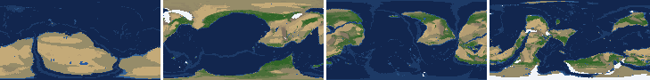

# Health sweep 2026-10-16 06:15

Commit 653f7e9. 1 runs (default params, `--every 4`) at 1 workers x 8 numba threads; simulations 9.9 min wall. Made by `tools/health.py` (PW-246).

## Runs

| seed | L | Myr | run | sim s | trees / flowering trees from | dT range C | peaks > 9.5 km | giant-lake frames % | crust volume end/start | ice SL < -150 m % | <= 4 plates % |
|---|---|---|---|---|---|---|---|---|---|---|---|
| 3199 | 7 | 500 | 4b0de1 | 595 | 132 / 376 | 10.0 | 0 | 10.6 | 0.997 | 0.0 | 0.0 |

## Medians by seed (after 50 Myr; tree cover after forests, NPP after flowering trees appear)

| seed | L | land_pct | cont_pct | cont_km | plates | ocean_age | speed | sea_level | sea_ice_m | ice_pct | temp | co2 | dry_pct | inland_pct | lake_pct | lake_max_mkm2 | max_elev_km | trees_pct | npp | landmasses | largest_pct |
|---|---|---|---|---|---|---|---|---|---|---|---|---|---|---|---|---|---|---|---|---|---|
| 3199 | 7 | 35.0 | 38.3 | 36.1 | 10.0 | 62.4 | 4.6 | -92.3 | -3.6 | 0.6 | 14.1 | -0.5 | 35.8 | 7.8 | 0.7 | 0.2 | 7.1 | 24.4 | 326.9 | 12.0 | 30.2 |

Measured on the run's keyframes (no slicing). A keyframe's rivers and lakes are routed on its own terrain (PW-239), so `inland_raw_pct` (every routed end on land, as highlights counts it) and `inland_pct` (ends that are closed lakes, salt pans or real pits) agree but for ends under land ice. Land ice and land shares use cells (near-equal area).

## Envelopes

| metric | low | high | Earth | source |
|---|---|---|---|---|
| land, % of surface (`land_pct`) | 22 | 42 | 29.20 | tests/test_envelopes.py (22-42%); Earth 29.2% |
| continental crust, % of surface (`cont_pct`) | 33 | 50 | 41 | tests/test_envelopes.py (33-50%); Earth ~41% with shelves (Cogley 1984) |
| mean continental crust thickness, km (`cont_km`) | 31 | 40 | 39 | target 35 km (PW-238, continental_thickness); Earth ~39 km (Christensen & Mooney 1995); known thinning to 32-33 km (PW-046) |
| plates (`plates`) | 5 | 30 | 15 | tests/test_envelopes.py (5-30; max_plates 30); Earth 7 major + ~8 minor; <= 4 is the PW-191 collapse |
| mean ocean-floor age, Myr (`ocean_age`) | 25 | 120 | 64 | tests/test_envelopes.py (25-120); Earth ~64 Myr (Mueller et al. 2008); PW-051 |
| mean plate speed, cm/yr (`speed`) | 2 | 9 | 4.50 | tests/test_envelopes.py (2-9 cm/yr); Earth ~4-5 |
| sea level, m (ice + ocean basins) (`sea_level`) | -250 | 300 | 0 | Phanerozoic ~-130 (LGM) .. +250 m (earth.py; Haq & Schutter 2008); -250: PW-240's hard goal |
| sea level from land ice, m (`sea_ice_m`) | -250 | - | 0 | Earth LGM ~-130 m; PW-240 goal -150 m typical / -250 m worst |
| land ice, % of surface (`ice_pct`) | - | 10 | 3.10 | Earth 3.1% now (earth.EARTH_ICE), ~7-8% at the LGM |
| global mean temperature, C (`temp`) | 8 | 30 | 14.50 | Earth 14.5 C; LGM ~8 C (Tierney et al. 2020); Phanerozoic hothouses to ~30 C (Scotese et al. 2021) |
| CO2 index (ln source/sink) (`co2`) | -1.5 | 1.5 | 0.00 | the forcing's clip in earth.py (+-1.5); Earth 0 |
| arid (Koppen B), % of land (`dry_pct`) | 12 | 45 | 30 | tests/test_envelopes.py (12-45%); Earth ~30% (Beck et al. 2018) |
| land draining inland, % of ice-free land (to a closed lake, salt pan or real pit) (`inland_pct`) | 8 | 30 | 18 | Earth ~18% (overview 2.9); L6 known ~9.5-11% (PW-054, PW-243). `inland_raw_pct` (not checked) follows the stored `downstream` to any end, as highlights does; since PW-239 the two agree but for ends under land ice |
| lakes, % of land (`lake_pct`) | 0.2 | 3.0 | 1.80 | Earth ~1.8% of ice-free land (HydroLAKES, Messager et al. 2016); generated L6 worlds 0.5-1% |
| largest lake, million km2 (`lake_max_mkm2`) | - | 1.0 | 0.37 | Caspian 0.37 Mkm2; 1 Mkm2 = the overview's giant lake (2.9) |
| highest peak, km (`max_elev_km`) | - | 9.5 | 8.85 | Everest 8.85 km; PW-172 (spikes above ~9.5 km) |
| tree cover, % of ice-free land (after forests appear) (`trees_pct`) | 10 | 50 | 30 | Earth ~30% potential canopy (forest 55-60 of ~130 Mkm2, overview 2.18) |
| land NPP, g C/m2/yr (after flowering trees appear) (`npp`) | 200 | 700 | 430 | Earth ~56 Pg C/yr over ~130 Mkm2 = ~430; the model on Earth's terrain 50 Pg C/yr, ~385 (overview 2.18). Before flowering trees (plant group 4) stand-ins grow at 70%, so runs sit at ~150-280 |
| landmasses (>= 3 cells) (`landmasses`) | 3 | 80 | - | loose: a lone supercontinent or a shattered archipelago |
| largest landmass, % of surface (`largest_pct`) | 5 | 35 | 16.60 | Afro-Eurasia 16.6%; a Pangaea ~30% (scorecard largest_max) |
| global temperature range over the run, C (`dT_range`, per run) | - | 25 | 25 | Phanerozoic 11-36 C (Scotese et al. 2021) |
| keyframes with a peak above 9.5 km (`peak_frames`, per run) | - | 0 | 0 | PW-172 (L7 seed 3199: 3 of 251) |
| % of keyframes with a lake over 1 Mkm2 (`giant_lake_frames`, per run) | - | 5 | 0 | overview 2.9 (L6: 3 of ~150 frames) |
| continental crust volume, end / start (`volume_ratio`, per run) | 0.9 | 1.1 | 1.0 | scorecard volume_ratio (x1.006) |
| % of keyframes with ice sea level below -150 m (`sea_ice_below_150`, per run) | - | 10 | 0 | PW-240 |
| % of keyframes with <= 4 plates (`low_plates`, per run) | - | 2 | 0 | PW-191 (L7 seed 21: 1%) |

## Top outliers (of 30 spells; severity = excess / band width x (0.2 + share of the run))

| seed | L | metric | Myr | frames | worst | envelope | severity |
|---|---|---|---|---|---|---|---|
| 3199 | 7 | lake_max_mkm2 | 412-416 | 2 | 6.59 | -..1.0 | 1.207 |
| 3199 | 7 | giant_lake_frames | run | - | 10.60 | -..5 | 1.12 |
| 3199 | 7 | lake_max_mkm2 | 456-460 | 2 | 5.89 | -..1.0 | 1.055 |
| 3199 | 7 | lake_max_mkm2 | 380-380 | 1 | 2.65 | -..1.0 | 0.343 |
| 3199 | 7 | lake_max_mkm2 | 156-160 | 2 | 2.25 | -..1.0 | 0.271 |
| 3199 | 7 | lake_max_mkm2 | 368-368 | 1 | 2.09 | -..1.0 | 0.227 |
| 3199 | 7 | lake_max_mkm2 | 212-212 | 1 | 1.51 | -..1.0 | 0.105 |
| 3199 | 7 | lake_pct | 412-412 | 1 | 4.40 | 0.2..3.0 | 0.104 |
| 3199 | 7 | lake_pct | 456-460 | 2 | 4.04 | 0.2..3.0 | 0.08 |
| 3199 | 7 | sea_level | 240-360 | 31 | -337.50 | -250..300 | 0.071 |
| 3199 | 7 | dry_pct | 52-68 | 5 | 54.81 | 12..45 | 0.071 |
| 3199 | 7 | inland_pct | 88-144 | 14 | 3.03 | 8..30 | 0.07 |
| 3199 | 7 | inland_pct | 464-500 | 10 | 2.73 | 8..30 | 0.067 |
| 3199 | 7 | inland_pct | 376-408 | 7 | 2.63 | 8..30 | 0.062 |
| 3199 | 7 | lake_max_mkm2 | 316-316 | 1 | 1.28 | -..1.0 | 0.059 |
| 3199 | 7 | inland_pct | 300-312 | 4 | 3.55 | 8..30 | 0.047 |
| 3199 | 7 | inland_pct | 420-452 | 8 | 4.77 | 8..30 | 0.039 |
| 3199 | 7 | dry_pct | 100-124 | 7 | 49.80 | 12..45 | 0.037 |
| 3199 | 7 | inland_pct | 164-180 | 4 | 4.72 | 8..30 | 0.035 |
| 3199 | 7 | inland_pct | 272-284 | 4 | 4.91 | 8..30 | 0.033 |
| 3199 | 7 | lake_max_mkm2 | 56-60 | 2 | 1.11 | -..1.0 | 0.024 |
| 3199 | 7 | inland_pct | 324-336 | 3 | 6.28 | 8..30 | 0.017 |
| 3199 | 7 | inland_pct | 348-352 | 2 | 6.39 | 8..30 | 0.016 |
| 3199 | 7 | lake_pct | 88-104 | 4 | 0.05 | 0.2..3.0 | 0.013 |
| 3199 | 7 | inland_pct | 240-240 | 1 | 7.03 | 8..30 | 0.009 |
| 3199 | 7 | inland_pct | 252-252 | 1 | 7.19 | 8..30 | 0.008 |
| 3199 | 7 | inland_pct | 220-220 | 1 | 7.33 | 8..30 | 0.006 |
| 3199 | 7 | lake_pct | 116-124 | 2 | 0.14 | 0.2..3.0 | 0.005 |
| 3199 | 7 | largest_pct | 240-252 | 4 | 35.10 | 5..35 | 0.001 |
| 3199 | 7 | lake_pct | 276-276 | 1 | 0.20 | 0.2..3.0 | 0.0 |

## Per seed: min / median / max after the 50 Myr spin-up, and spells outside the envelopes

### Seed 3199, L7 (run 4b0de1)

*At 48, 200, 348, 500 Myr: sea by depth, land green by tree cover / tan where arid, shaded by height, ice white, lakes blue.*

| metric | min | median | max | outside (Myr: worst) |
|---|---|---|---|---|
| land_pct | 33.36 | 34.97 | 37.94 |  |
| cont_pct | 37.06 | 38.29 | 41.11 |  |
| cont_km | 33.93 | 36.15 | 37.14 |  |
| plates | 5.00 | 10.00 | 18.00 |  |
| ocean_age | 32.80 | 62.40 | 112.60 |  |
| speed | 2.79 | 4.58 | 8.17 |  |
| sea_level | -337.50 | -92.30 | 229.80 | 240-360: -337.50 |
| sea_ice_m | -11.90 | -3.60 | -0.00 |  |
| ice_pct | 0.00 | 0.60 | 2.50 |  |
| temp | 10.80 | 14.10 | 20.80 |  |
| co2 | -1.00 | -0.47 | -0.00 |  |
| dry_pct | 18.48 | 35.79 | 54.81 | 52-68: 54.81; 100-124: 49.80 |
| inland_pct | 2.63 | 7.84 | 23.22 | 88-144: 3.03; 164-180: 4.72; 220-220: 7.33; 240-240: 7.03; +8 more |
| lake_pct | 0.05 | 0.67 | 4.40 | 88-104: 0.05; 116-124: 0.14; 276-276: 0.20; 412-412: 4.40; +1 more |
| lake_max_mkm2 | 0.02 | 0.18 | 6.59 | 56-60: 1.11; 156-160: 2.25; 212-212: 1.51; 316-316: 1.28; +4 more |
| max_elev_km | 2.42 | 7.12 | 9.00 |  |
| trees_pct | 17.55 | 24.35 | 34.99 |  |
| npp | 251.90 | 326.85 | 393.10 |  |
| landmasses | 3.00 | 12.00 | 25.00 |  |
| largest_pct | 13.10 | 30.20 | 35.10 | 240-252: 35.10 |

## Determinism

(not run)
