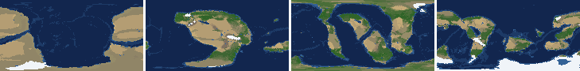
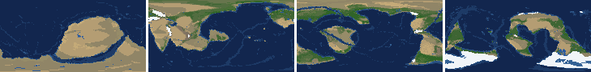
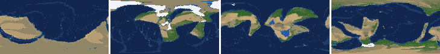
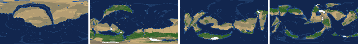
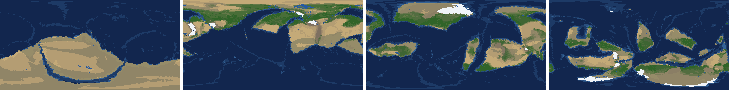
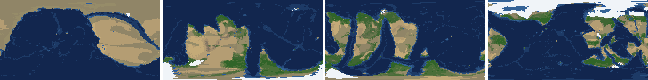
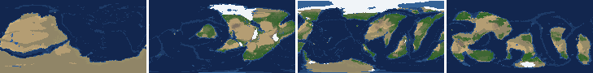
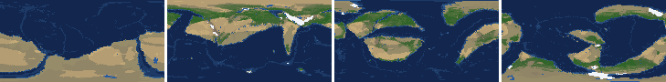

# Health sweep 2026-10-16 05:03

Commit 430d913. 8 runs (default params, `--every 4`) at 8 workers x 1 numba threads; simulations 5.2 min wall. Made by `tools/health.py` (PW-246).

## Runs

| seed | L | Myr | run | sim s | trees / flowering trees from | dT range C | peaks > 9.5 km | giant-lake frames % | crust volume end/start | ice SL < -150 m % | <= 4 plates % |
|---|---|---|---|---|---|---|---|---|---|---|---|
| 1 | 6 | 500 | 2edc5b | 305 | 132 / 412 | 11.9 | 0 | 0.0 | 0.89 | 0.0 | 1.8 |
| 2 | 6 | 500 | 9f097f | 302 | 140 / 396 | 21.8 | 0 | 3.5 | 0.916 | 2.7 | 0.0 |
| 11 | 6 | 500 | 9bca12 | 304 | 128 / 372 | 17.4 | 0 | 15.0 | 0.899 | 0.0 | 0.0 |
| 21 | 6 | 500 | 76603b | 307 | 136 / 404 | 9.0 | 0 | 7.1 | 0.867 | 0.0 | 0.0 |
| 3199 | 6 | 500 | 0e9586 | 303 | 132 / 376 | 10.2 | 0 | 3.5 | 0.891 | 0.0 | 0.0 |
| 42 | 6 | 500 | 3ccff9 | 302 | 116 / 404 | 13.0 | 0 | 8.0 | 0.902 | 0.0 | 0.0 |
| 77 | 6 | 500 | f4ffe5 | 304 | 124 / 416 | 11.3 | 0 | 8.0 | 0.885 | 0.0 | 0.0 |
| 505 | 6 | 500 | 78339b | 308 | 132 / 416 | 8.8 | 0 | 4.4 | 0.912 | 0.0 | 0.0 |

## Medians by seed (after 50 Myr; tree cover after forests, NPP after flowering trees appear)

| seed | L | land_pct | cont_pct | cont_km | plates | ocean_age | speed | sea_level | sea_ice_m | ice_pct | temp | co2 | dry_pct | inland_pct | lake_pct | lake_max_mkm2 | max_elev_km | trees_pct | npp | landmasses | largest_pct |
|---|---|---|---|---|---|---|---|---|---|---|---|---|---|---|---|---|---|---|---|---|---|
| 1 | 6 | 33.5 | 39.3 | 34.7 | 11.0 | 57.1 | 3.9 | -60.0 | -1.4 | 0.3 | 15.7 | -0.4 | 27.1 | 4.0 | 0.4 | 0.1 | 6.1 | 30.0 | 318.8 | 6.0 | 22.3 |
| 2 | 6 | 33.7 | 39.2 | 35.4 | 12.0 | 51.1 | 4.8 | 37.5 | -2.2 | 0.4 | 15.3 | -0.2 | 31.8 | 4.6 | 0.4 | 0.1 | 6.2 | 25.3 | 309.2 | 6.0 | 29.7 |
| 11 | 6 | 33.6 | 40.0 | 35.1 | 12.0 | 54.5 | 4.5 | -5.2 | -1.6 | 0.3 | 13.7 | -0.4 | 30.7 | 4.0 | 0.3 | 0.1 | 5.4 | 25.6 | 328.5 | 6.0 | 21.4 |
| 21 | 6 | 33.4 | 40.9 | 34.2 | 12.0 | 47.7 | 4.3 | 69.1 | -2.0 | 0.4 | 16.5 | -0.4 | 28.3 | 3.1 | 0.3 | 0.1 | 6.5 | 27.1 | 388.8 | 8.0 | 18.0 |
| 3199 | 6 | 33.8 | 40.0 | 35.0 | 11.0 | 49.7 | 4.7 | 49.9 | -3.4 | 0.6 | 15.5 | -0.1 | 33.7 | 3.8 | 0.4 | 0.1 | 5.8 | 24.5 | 371.9 | 6.0 | 19.2 |
| 42 | 6 | 34.2 | 39.9 | 35.2 | 13.0 | 57.1 | 4.6 | -27.8 | -4.7 | 1.0 | 14.9 | -0.1 | 31.0 | 4.5 | 0.4 | 0.1 | 6.1 | 21.0 | 383.7 | 5.0 | 24.3 |
| 77 | 6 | 32.4 | 40.0 | 34.7 | 12.0 | 55.8 | 4.3 | -84.3 | -28.4 | 2.2 | 12.6 | -0.4 | 23.8 | 4.0 | 0.5 | 0.1 | 5.8 | 32.8 | 378.2 | 7.0 | 17.6 |
| 505 | 6 | 33.1 | 38.6 | 35.2 | 12.0 | 49.2 | 4.5 | 63.6 | -2.4 | 0.4 | 15.8 | -0.2 | 32.1 | 5.6 | 0.6 | 0.2 | 5.8 | 26.5 | 314.0 | 6.0 | 20.7 |

Measured on the run's keyframes (no slicing). A keyframe's rivers and lakes are routed on its own terrain (PW-239), so `inland_raw_pct` (every routed end on land, as highlights counts it) and `inland_pct` (ends that are closed lakes, salt pans or real pits) agree but for ends under land ice. Land ice and land shares use cells (near-equal area).

## Envelopes

| metric | low | high | Earth | source |
|---|---|---|---|---|
| land, % of surface (`land_pct`) | 22 | 42 | 29.20 | tests/test_envelopes.py (22-42%); Earth 29.2% |
| continental crust, % of surface (`cont_pct`) | 33 | 50 | 41 | tests/test_envelopes.py (33-50%); Earth ~41% with shelves (Cogley 1984) |
| mean continental crust thickness, km (`cont_km`) | 31 | 40 | 39 | target 35 km (PW-238, continental_thickness); Earth ~39 km (Christensen & Mooney 1995); known thinning to 32-33 km (PW-046) |
| plates (`plates`) | 5 | 30 | 15 | tests/test_envelopes.py (5-30; max_plates 30); Earth 7 major + ~8 minor; <= 4 is the PW-191 collapse |
| mean ocean-floor age, Myr (`ocean_age`) | 25 | 120 | 64 | tests/test_envelopes.py (25-120); Earth ~64 Myr (Mueller et al. 2008); PW-051 |
| mean plate speed, cm/yr (`speed`) | 2 | 9 | 4.50 | tests/test_envelopes.py (2-9 cm/yr); Earth ~4-5 |
| sea level, m (ice + ocean basins) (`sea_level`) | -250 | 300 | 0 | Phanerozoic ~-130 (LGM) .. +250 m (earth.py; Haq & Schutter 2008); -250: PW-240's hard goal |
| sea level from land ice, m (`sea_ice_m`) | -250 | - | 0 | Earth LGM ~-130 m; PW-240 goal -150 m typical / -250 m worst |
| land ice, % of surface (`ice_pct`) | - | 10 | 3.10 | Earth 3.1% now (earth.EARTH_ICE), ~7-8% at the LGM |
| global mean temperature, C (`temp`) | 8 | 30 | 14.50 | Earth 14.5 C; LGM ~8 C (Tierney et al. 2020); Phanerozoic hothouses to ~30 C (Scotese et al. 2021) |
| CO2 index (ln source/sink) (`co2`) | -1.5 | 1.5 | 0.00 | the forcing's clip in earth.py (+-1.5); Earth 0 |
| arid (Koppen B), % of land (`dry_pct`) | 12 | 45 | 30 | tests/test_envelopes.py (12-45%); Earth ~30% (Beck et al. 2018) |
| land draining inland, % of ice-free land (to a closed lake, salt pan or real pit) (`inland_pct`) | 8 | 30 | 18 | Earth ~18% (overview 2.9); L6 known ~9.5-11% (PW-054, PW-243). `inland_raw_pct` (not checked) follows the stored `downstream` to any end, as highlights does; since PW-239 the two agree but for ends under land ice |
| lakes, % of land (`lake_pct`) | 0.2 | 3.0 | 1.80 | Earth ~1.8% of ice-free land (HydroLAKES, Messager et al. 2016); generated L6 worlds 0.5-1% |
| largest lake, million km2 (`lake_max_mkm2`) | - | 1.0 | 0.37 | Caspian 0.37 Mkm2; 1 Mkm2 = the overview's giant lake (2.9) |
| highest peak, km (`max_elev_km`) | - | 9.5 | 8.85 | Everest 8.85 km; PW-172 (spikes above ~9.5 km) |
| tree cover, % of ice-free land (after forests appear) (`trees_pct`) | 10 | 50 | 30 | Earth ~30% potential canopy (forest 55-60 of ~130 Mkm2, overview 2.18) |
| land NPP, g C/m2/yr (after flowering trees appear) (`npp`) | 200 | 700 | 430 | Earth ~56 Pg C/yr over ~130 Mkm2 = ~430; the model on Earth's terrain 50 Pg C/yr, ~385 (overview 2.18). Before flowering trees (plant group 4) stand-ins grow at 70%, so runs sit at ~150-280 |
| landmasses (>= 3 cells) (`landmasses`) | 3 | 80 | - | loose: a lone supercontinent or a shattered archipelago |
| largest landmass, % of surface (`largest_pct`) | 5 | 35 | 16.60 | Afro-Eurasia 16.6%; a Pangaea ~30% (scorecard largest_max) |
| global temperature range over the run, C (`dT_range`, per run) | - | 25 | 25 | Phanerozoic 11-36 C (Scotese et al. 2021) |
| keyframes with a peak above 9.5 km (`peak_frames`, per run) | - | 0 | 0 | PW-172 (L7 seed 3199: 3 of 251) |
| % of keyframes with a lake over 1 Mkm2 (`giant_lake_frames`, per run) | - | 5 | 0 | overview 2.9 (L6: 3 of ~150 frames) |
| continental crust volume, end / start (`volume_ratio`, per run) | 0.9 | 1.1 | 1.0 | scorecard volume_ratio (x1.006) |
| % of keyframes with ice sea level below -150 m (`sea_ice_below_150`, per run) | - | 10 | 0 | PW-240 |
| % of keyframes with <= 4 plates (`low_plates`, per run) | - | 2 | 0 | PW-191 (L7 seed 21: 1%) |

## Top outliers (of 155 spells; severity = excess / band width x (0.2 + share of the run))

| seed | L | metric | Myr | frames | worst | envelope | severity |
|---|---|---|---|---|---|---|---|
| 11 | 6 | giant_lake_frames | run | - | 15.00 | -..5 | 2.0 |
| 11 | 6 | lake_max_mkm2 | 340-360 | 4 | 6.26 | -..1.0 | 1.22 |
| 505 | 6 | lake_max_mkm2 | 464-468 | 2 | 5.85 | -..1.0 | 1.048 |
| 77 | 6 | lake_max_mkm2 | 244-244 | 1 | 5.33 | -..1.0 | 0.9 |
| 11 | 6 | lake_max_mkm2 | 472-472 | 1 | 4.58 | -..1.0 | 0.745 |
| 77 | 6 | lake_max_mkm2 | 436-436 | 1 | 4.12 | -..1.0 | 0.649 |
| 42 | 6 | giant_lake_frames | run | - | 8.00 | -..5 | 0.6 |
| 77 | 6 | giant_lake_frames | run | - | 8.00 | -..5 | 0.6 |
| 77 | 6 | lake_max_mkm2 | 460-464 | 2 | 3.70 | -..1.0 | 0.582 |
| 11 | 6 | lake_max_mkm2 | 148-172 | 5 | 3.00 | -..1.0 | 0.48 |
| 42 | 6 | lake_max_mkm2 | 52-52 | 1 | 3.15 | -..1.0 | 0.447 |
| 42 | 6 | lake_max_mkm2 | 144-152 | 3 | 2.89 | -..1.0 | 0.423 |
| 21 | 6 | giant_lake_frames | run | - | 7.10 | -..5 | 0.42 |
| 42 | 6 | lake_max_mkm2 | 492-496 | 2 | 2.93 | -..1.0 | 0.416 |
| 21 | 6 | inland_pct | 68-500 | 107 | 0.57 | 8..30 | 0.354 |
| 3199 | 6 | lake_max_mkm2 | 52-52 | 1 | 2.43 | -..1.0 | 0.297 |
| 505 | 6 | lake_max_mkm2 | 332-332 | 1 | 2.35 | -..1.0 | 0.281 |
| 11 | 6 | lake_max_mkm2 | 208-232 | 6 | 2.10 | -..1.0 | 0.273 |
| 2 | 6 | lake_max_mkm2 | 488-500 | 4 | 2.06 | -..1.0 | 0.244 |
| 21 | 6 | lake_max_mkm2 | 60-68 | 3 | 2.03 | -..1.0 | 0.231 |
| 42 | 6 | inland_pct | 276-500 | 55 | 0.32 | 8..30 | 0.222 |
| 1 | 6 | inland_pct | 264-500 | 59 | 0.74 | 8..30 | 0.221 |
| 21 | 6 | lake_max_mkm2 | 144-156 | 4 | 1.94 | -..1.0 | 0.219 |
| 42 | 6 | lake_max_mkm2 | 196-196 | 1 | 2.06 | -..1.0 | 0.219 |
| 3199 | 6 | inland_pct | 260-500 | 60 | 0.95 | 8..30 | 0.217 |
| 11 | 6 | lake_pct | 344-388 | 9 | 5.22 | 0.2..3.0 | 0.215 |
| 77 | 6 | lake_max_mkm2 | 124-124 | 1 | 2.00 | -..1.0 | 0.209 |
| 2 | 6 | inland_pct | 272-500 | 58 | 1.24 | 8..30 | 0.203 |
| 77 | 6 | inland_pct | 256-456 | 50 | 0.71 | 8..30 | 0.198 |
| 505 | 6 | lake_max_mkm2 | 212-216 | 2 | 1.88 | -..1.0 | 0.19 |

## Per seed: min / median / max after the 50 Myr spin-up, and spells outside the envelopes

### Seed 1, L6 (run 2edc5b)

*At 48, 200, 348, 500 Myr: sea by depth, land green by tree cover / tan where arid, shaded by height, ice white, lakes blue.*

| metric | min | median | max | outside (Myr: worst) |
|---|---|---|---|---|
| land_pct | 31.50 | 33.47 | 38.84 |  |
| cont_pct | 37.25 | 39.34 | 42.96 |  |
| cont_km | 33.59 | 34.72 | 37.53 |  |
| plates | 4.00 | 11.00 | 16.00 | 196-200: 4 |
| ocean_age | 31.20 | 57.10 | 86.80 |  |
| speed | 1.77 | 3.87 | 7.40 | 192-200: 1.77 |
| sea_level | -328.20 | -60.00 | 207.80 | 480-500: -328.20 |
| sea_ice_m | -72.20 | -1.40 | -0.00 |  |
| ice_pct | 0.00 | 0.30 | 5.00 |  |
| temp | 7.80 | 15.70 | 19.70 | 492-496: 7.80 |
| co2 | -0.97 | -0.40 | 0.04 |  |
| dry_pct | 21.93 | 27.09 | 45.20 | 212-212: 45.20 |
| inland_pct | 0.67 | 4.03 | 14.84 | 64-176: 0.67; 264-500: 0.74 |
| lake_pct | 0.11 | 0.35 | 1.25 | 52-52: 0.16; 64-80: 0.11; 96-96: 0.14; 108-108: 0.13; +1 more |
| lake_max_mkm2 | 0.03 | 0.07 | 0.67 |  |
| max_elev_km | 2.28 | 6.10 | 8.70 |  |
| trees_pct | 17.64 | 30.02 | 42.56 |  |
| npp | 206.50 | 318.80 | 378.00 |  |
| landmasses | 2.00 | 6.00 | 12.00 | 52-52: 2 |
| largest_pct | 13.60 | 22.30 | 32.90 |  |

### Seed 2, L6 (run 9f097f)

*At 48, 200, 348, 500 Myr: sea by depth, land green by tree cover / tan where arid, shaded by height, ice white, lakes blue.*

| metric | min | median | max | outside (Myr: worst) |
|---|---|---|---|---|
| land_pct | 32.95 | 33.71 | 38.53 |  |
| cont_pct | 36.73 | 39.19 | 42.68 |  |
| cont_km | 34.39 | 35.37 | 37.98 |  |
| plates | 9.00 | 12.00 | 14.00 |  |
| ocean_age | 32.60 | 51.10 | 72.10 |  |
| speed | 2.77 | 4.82 | 7.78 |  |
| sea_level | -404.70 | 37.50 | 205.80 | 488-500: -404.70 |
| sea_ice_m | -187.60 | -2.20 | -0.00 |  |
| ice_pct | 0.00 | 0.40 | 8.70 |  |
| temp | 2.00 | 15.30 | 23.80 | 472-500: 2.00 |
| co2 | -1.09 | -0.17 | 0.30 |  |
| dry_pct | 14.49 | 31.76 | 59.31 | 52-68: 51.75; 92-100: 48.56; 224-284: 59.31 |
| inland_pct | 1.24 | 4.57 | 21.74 | 68-188: 1.37; 200-204: 7.79; 220-256: 5.94; 272-500: 1.24 |
| lake_pct | 0.04 | 0.44 | 2.08 | 60-112: 0.04; 124-128: 0.15; 304-304: 0.19 |
| lake_max_mkm2 | 0.01 | 0.11 | 2.06 | 488-500: 2.06 |
| max_elev_km | 1.35 | 6.25 | 8.49 |  |
| trees_pct | 6.81 | 25.28 | 46.46 | 232-284: 6.81 |
| npp | 222.80 | 309.20 | 376.50 |  |
| landmasses | 1.00 | 6.00 | 11.00 | 56-64: 2; 228-268: 1 |
| largest_pct | 12.60 | 29.70 | 34.20 |  |

### Seed 11, L6 (run 9bca12)

*At 48, 200, 348, 500 Myr: sea by depth, land green by tree cover / tan where arid, shaded by height, ice white, lakes blue.*

| metric | min | median | max | outside (Myr: worst) |
|---|---|---|---|---|
| land_pct | 32.88 | 33.62 | 38.55 |  |
| cont_pct | 37.78 | 39.97 | 43.40 |  |
| cont_km | 33.68 | 35.07 | 37.05 |  |
| plates | 9.00 | 12.00 | 18.00 |  |
| ocean_age | 33.40 | 54.50 | 65.10 |  |
| speed | 2.69 | 4.52 | 6.99 |  |
| sea_level | -204.00 | -5.20 | 208.00 |  |
| sea_ice_m | -78.60 | -1.60 | -0.00 |  |
| ice_pct | 0.00 | 0.30 | 5.70 |  |
| temp | 3.90 | 13.70 | 21.30 | 144-148: 7.40; 168-204: 3.90 |
| co2 | -0.94 | -0.36 | -0.00 |  |
| dry_pct | 18.37 | 30.72 | 42.69 |  |
| inland_pct | 0.93 | 4.01 | 18.09 | 72-116: 1.14; 128-192: 2.06; 216-216: 7.33; 236-240: 6.45; +3 more |
| lake_pct | 0.07 | 0.34 | 5.22 | 64-64: 0.16; 80-100: 0.07; 264-272: 0.19; 300-324: 0.12; +4 more |
| lake_max_mkm2 | 0.01 | 0.11 | 6.26 | 148-172: 3.00; 208-232: 2.10; 340-360: 6.26; 440-440: 1.27; +1 more |
| max_elev_km | 1.77 | 5.44 | 8.66 |  |
| trees_pct | 17.06 | 25.59 | 41.67 |  |
| npp | 218.90 | 328.50 | 349.70 |  |
| landmasses | 2.00 | 6.00 | 12.00 | 232-232: 2; 256-256: 2; 332-332: 2 |
| largest_pct | 9.70 | 21.40 | 33.90 |  |

### Seed 21, L6 (run 76603b)

*At 48, 200, 348, 500 Myr: sea by depth, land green by tree cover / tan where arid, shaded by height, ice white, lakes blue.*

| metric | min | median | max | outside (Myr: worst) |
|---|---|---|---|---|
| land_pct | 28.52 | 33.41 | 38.33 |  |
| cont_pct | 39.01 | 40.90 | 43.44 |  |
| cont_km | 31.32 | 34.16 | 36.10 |  |
| plates | 9.00 | 12.00 | 16.00 |  |
| ocean_age | 35.40 | 47.70 | 71.50 |  |
| speed | 2.66 | 4.28 | 6.88 |  |
| sea_level | -151.50 | 69.10 | 184.20 |  |
| sea_ice_m | -6.90 | -2.00 | -0.00 |  |
| ice_pct | 0.00 | 0.40 | 0.90 |  |
| temp | 12.40 | 16.50 | 21.40 |  |
| co2 | -0.72 | -0.37 | 0.16 |  |
| dry_pct | 20.39 | 28.26 | 46.46 | 52-60: 46.46 |
| inland_pct | 0.57 | 3.08 | 20.87 | 68-500: 0.57 |
| lake_pct | 0.07 | 0.31 | 1.57 | 72-104: 0.07; 116-132: 0.10; 208-208: 0.18; 272-272: 0.18; +5 more |
| lake_max_mkm2 | 0.01 | 0.09 | 2.03 | 60-68: 2.03; 144-156: 1.94; 176-176: 1.18 |
| max_elev_km | 2.02 | 6.47 | 8.73 |  |
| trees_pct | 8.56 | 27.07 | 44.57 | 292-308: 8.56 |
| npp | 246.70 | 388.80 | 413.00 |  |
| landmasses | 3.00 | 8.00 | 21.00 |  |
| largest_pct | 9.40 | 18.00 | 33.70 |  |

### Seed 3199, L6 (run 0e9586)

*At 48, 200, 348, 500 Myr: sea by depth, land green by tree cover / tan where arid, shaded by height, ice white, lakes blue.*

| metric | min | median | max | outside (Myr: worst) |
|---|---|---|---|---|
| land_pct | 30.61 | 33.78 | 38.94 |  |
| cont_pct | 37.11 | 39.99 | 42.52 |  |
| cont_km | 33.75 | 35.00 | 38.01 |  |
| plates | 8.00 | 11.00 | 16.00 |  |
| ocean_age | 30.30 | 49.70 | 57.50 |  |
| speed | 2.46 | 4.70 | 7.47 |  |
| sea_level | -56.00 | 49.90 | 228.70 |  |
| sea_ice_m | -6.60 | -3.40 | -0.00 |  |
| ice_pct | 0.00 | 0.60 | 1.30 |  |
| temp | 11.20 | 15.50 | 21.40 |  |
| co2 | -0.64 | -0.15 | 0.23 |  |
| dry_pct | 17.39 | 33.73 | 56.45 | 60-92: 56.45 |
| inland_pct | 0.85 | 3.84 | 19.35 | 72-124: 0.85; 144-176: 3.77; 188-192: 5.96; 220-220: 7.16; +2 more |
| lake_pct | 0.04 | 0.43 | 1.52 | 60-112: 0.04; 284-284: 0.19; 344-344: 0.16; 380-380: 0.20; +1 more |
| lake_max_mkm2 | 0.01 | 0.11 | 2.43 | 52-52: 2.43; 128-128: 1.34; 148-148: 1.11; 264-264: 1.07 |
| max_elev_km | 1.41 | 5.83 | 8.71 |  |
| trees_pct | 14.13 | 24.48 | 36.84 |  |
| npp | 253.70 | 371.90 | 390.20 |  |
| landmasses | 2.00 | 6.00 | 15.00 | 56-64: 2; 264-264: 2 |
| largest_pct | 9.40 | 19.20 | 34.30 |  |

### Seed 42, L6 (run 3ccff9)

*At 48, 200, 348, 500 Myr: sea by depth, land green by tree cover / tan where arid, shaded by height, ice white, lakes blue.*

| metric | min | median | max | outside (Myr: worst) |
|---|---|---|---|---|
| land_pct | 30.80 | 34.19 | 38.60 |  |
| cont_pct | 37.53 | 39.89 | 42.55 |  |
| cont_km | 33.92 | 35.16 | 37.67 |  |
| plates | 9.00 | 13.00 | 18.00 |  |
| ocean_age | 33.50 | 57.10 | 68.40 |  |
| speed | 2.99 | 4.60 | 7.65 |  |
| sea_level | -114.40 | -27.80 | 172.30 |  |
| sea_ice_m | -116.50 | -4.70 | -0.00 |  |
| ice_pct | 0.00 | 1.00 | 7.30 |  |
| temp | 8.20 | 14.90 | 21.20 |  |
| co2 | -0.98 | -0.13 | 0.24 |  |
| dry_pct | 9.89 | 30.99 | 53.17 | 68-68: 45.15; 200-292: 53.17; 444-472: 9.89 |
| inland_pct | 0.32 | 4.50 | 15.53 | 64-144: 0.43; 156-164: 5.06; 184-184: 6.99; 200-200: 7.03; +2 more |
| lake_pct | 0.03 | 0.40 | 2.66 | 56-100: 0.03; 128-128: 0.20; 348-348: 0.18 |
| lake_max_mkm2 | 0.01 | 0.10 | 3.15 | 52-52: 3.15; 144-152: 2.89; 196-196: 2.06; 268-272: 1.31; +1 more |
| max_elev_km | 1.71 | 6.12 | 8.04 |  |
| trees_pct | 13.99 | 21.02 | 37.92 |  |
| npp | 280.40 | 383.70 | 409.80 |  |
| landmasses | 1.00 | 5.00 | 12.00 | 128-136: 2; 232-248: 1 |
| largest_pct | 12.20 | 24.30 | 35.50 | 128-152: 35.50 |

### Seed 77, L6 (run f4ffe5)

*At 48, 200, 348, 500 Myr: sea by depth, land green by tree cover / tan where arid, shaded by height, ice white, lakes blue.*

| metric | min | median | max | outside (Myr: worst) |
|---|---|---|---|---|
| land_pct | 29.92 | 32.44 | 38.80 |  |
| cont_pct | 37.63 | 39.97 | 43.08 |  |
| cont_km | 32.95 | 34.67 | 37.49 |  |
| plates | 6.00 | 12.00 | 16.00 |  |
| ocean_age | 35.60 | 55.80 | 78.80 |  |
| speed | 3.21 | 4.31 | 8.38 |  |
| sea_level | -217.20 | -84.30 | 164.60 |  |
| sea_ice_m | -80.10 | -28.40 | -0.00 |  |
| ice_pct | 0.00 | 2.20 | 5.30 |  |
| temp | 5.60 | 12.60 | 16.90 | 132-152: 5.60 |
| co2 | -1.07 | -0.36 | 0.33 |  |
| dry_pct | 13.97 | 23.80 | 40.84 |  |
| inland_pct | 0.45 | 4.00 | 17.70 | 68-160: 0.45; 172-192: 6.26; 208-208: 7.75; 220-240: 5.57; +2 more |
| lake_pct | 0.05 | 0.54 | 3.73 | 60-60: 0.05; 84-84: 0.12; 100-100: 0.09; 112-120: 0.20; +4 more |
| lake_max_mkm2 | 0.03 | 0.11 | 5.33 | 68-72: 1.52; 92-92: 1.82; 124-124: 2.00; 216-216: 1.81; +3 more |
| max_elev_km | 1.94 | 5.80 | 8.46 |  |
| trees_pct | 24.64 | 32.79 | 38.26 |  |
| npp | 256.40 | 378.20 | 389.40 |  |
| landmasses | 2.00 | 7.00 | 14.00 | 52-64: 2 |
| largest_pct | 8.60 | 17.60 | 31.10 |  |

### Seed 505, L6 (run 78339b)

*At 48, 200, 348, 500 Myr: sea by depth, land green by tree cover / tan where arid, shaded by height, ice white, lakes blue.*

| metric | min | median | max | outside (Myr: worst) |
|---|---|---|---|---|
| land_pct | 31.94 | 33.10 | 38.59 |  |
| cont_pct | 36.40 | 38.62 | 43.81 |  |
| cont_km | 33.63 | 35.16 | 37.78 |  |
| plates | 9.00 | 12.00 | 17.00 |  |
| ocean_age | 33.90 | 49.20 | 55.30 |  |
| speed | 3.13 | 4.47 | 7.89 |  |
| sea_level | -12.90 | 63.60 | 208.30 |  |
| sea_ice_m | -11.60 | -2.40 | -0.00 |  |
| ice_pct | 0.00 | 0.40 | 1.80 |  |
| temp | 11.50 | 15.80 | 20.30 |  |
| co2 | -0.65 | -0.16 | 0.26 |  |
| dry_pct | 15.75 | 32.09 | 47.35 | 284-308: 47.35 |
| inland_pct | 0.64 | 5.59 | 22.20 | 64-176: 0.64; 204-204: 7.02; 308-352: 2.33; 364-364: 4.88; +2 more |
| lake_pct | 0.03 | 0.64 | 4.06 | 64-108: 0.03; 464-464: 4.06 |
| lake_max_mkm2 | 0.01 | 0.19 | 5.85 | 212-216: 1.88; 332-332: 2.35; 464-468: 5.85 |
| max_elev_km | 1.85 | 5.77 | 8.41 |  |
| trees_pct | 21.60 | 26.46 | 39.24 |  |
| npp | 184.10 | 313.95 | 343.50 | 416-432: 184.10 |
| landmasses | 2.00 | 6.00 | 11.00 | 52-52: 2; 160-176: 2; 484-492: 2 |
| largest_pct | 9.20 | 20.70 | 34.30 |  |

## Determinism

(not run)
