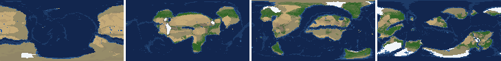
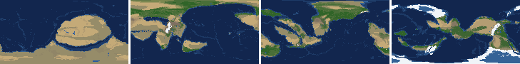
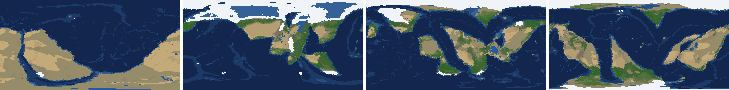
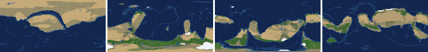
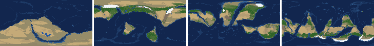
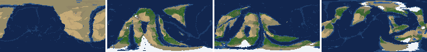
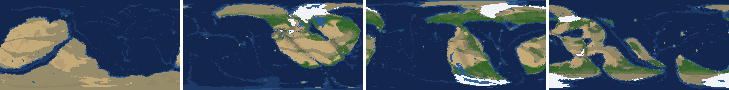
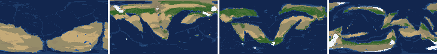

# Health sweep 2026-10-16 05:59

Commit 653f7e9+dirty. 8 runs (default params, `--every 4`) at 8 workers x 1 numba threads; simulations 5.2 min wall. Made by `tools/health.py` (PW-246).

## Runs

| seed | L | Myr | run | sim s | trees / flowering trees from | dT range C | peaks > 9.5 km | giant-lake frames % | crust volume end/start | ice SL < -150 m % | <= 4 plates % |
|---|---|---|---|---|---|---|---|---|---|---|---|
| 1 | 6 | 500 | e27086 | 304 | 132 / 412 | 12.5 | 0 | 12.4 | 0.971 | 0.0 | 0.0 |
| 2 | 6 | 500 | c3a694 | 303 | 140 / 396 | 21.0 | 0 | 4.4 | 0.971 | 0.0 | 0.0 |
| 11 | 6 | 500 | f12105 | 304 | 128 / 372 | 16.0 | 0 | 8.0 | 0.993 | 0.0 | 0.0 |
| 21 | 6 | 500 | b8a573 | 303 | 136 / 404 | 9.5 | 0 | 13.3 | 0.968 | 0.0 | 0.0 |
| 3199 | 6 | 500 | b45238 | 306 | 132 / 376 | 11.1 | 0 | 5.3 | 0.98 | 0.0 | 0.0 |
| 42 | 6 | 500 | cf18e1 | 306 | 116 / 404 | 12.1 | 0 | 3.5 | 0.942 | 0.0 | 0.0 |
| 77 | 6 | 500 | f816a9 | 308 | 124 / 416 | 10.3 | 0 | 22.1 | 0.978 | 0.0 | 0.0 |
| 505 | 6 | 500 | 68c7f5 | 304 | 132 / 416 | 7.1 | 0 | 4.4 | 0.946 | 0.0 | 0.0 |

## Medians by seed (after 50 Myr; tree cover after forests, NPP after flowering trees appear)

| seed | L | land_pct | cont_pct | cont_km | plates | ocean_age | speed | sea_level | sea_ice_m | ice_pct | temp | co2 | dry_pct | inland_pct | lake_pct | lake_max_mkm2 | max_elev_km | trees_pct | npp | landmasses | largest_pct |
|---|---|---|---|---|---|---|---|---|---|---|---|---|---|---|---|---|---|---|---|---|---|
| 1 | 6 | 31.8 | 38.8 | 35.1 | 13.0 | 53.3 | 4.4 | 16.0 | -3.8 | 0.8 | 15.9 | -0.2 | 35.3 | 5.9 | 0.5 | 0.1 | 6.0 | 21.7 | 331.2 | 7.0 | 17.4 |
| 2 | 6 | 32.4 | 40.5 | 33.8 | 12.0 | 47.9 | 4.2 | 72.1 | -0.7 | 0.1 | 15.4 | -0.3 | 28.1 | 4.2 | 0.5 | 0.1 | 5.4 | 24.9 | 341.4 | 8.0 | 14.6 |
| 11 | 6 | 31.1 | 39.5 | 35.1 | 13.0 | 50.6 | 4.5 | 29.0 | -15.2 | 2.8 | 12.5 | -0.5 | 27.1 | 3.9 | 0.6 | 0.1 | 5.7 | 29.9 | 347.8 | 7.0 | 22.2 |
| 21 | 6 | 33.5 | 38.5 | 35.3 | 12.0 | 50.3 | 4.4 | 36.8 | -2.2 | 0.4 | 16.2 | -0.5 | 33.9 | 7.3 | 0.5 | 0.1 | 5.4 | 20.9 | 356.1 | 7.0 | 26.8 |
| 3199 | 6 | 33.0 | 39.6 | 34.2 | 12.0 | 46.2 | 4.6 | 77.8 | -3.6 | 0.7 | 14.9 | -0.2 | 32.8 | 5.4 | 0.4 | 0.1 | 6.1 | 25.9 | 348.1 | 8.0 | 20.6 |
| 42 | 6 | 32.4 | 40.7 | 33.4 | 11.0 | 56.1 | 4.4 | -50.5 | -8.9 | 1.6 | 14.2 | -0.3 | 26.4 | 3.5 | 0.4 | 0.1 | 5.4 | 27.7 | 391.1 | 5.0 | 23.1 |
| 77 | 6 | 33.5 | 39.8 | 34.4 | 11.0 | 52.2 | 4.4 | 8.9 | -9.1 | 1.3 | 12.8 | -0.2 | 31.7 | 5.8 | 0.7 | 0.3 | 4.7 | 28.5 | 307.6 | 7.0 | 23.9 |
| 505 | 6 | 33.8 | 40.1 | 33.8 | 10.0 | 48.4 | 4.4 | 64.7 | -3.5 | 0.5 | 15.2 | -0.2 | 28.3 | 3.1 | 0.4 | 0.1 | 4.5 | 24.3 | 384.1 | 6.0 | 28.4 |

Measured on the run's keyframes (no slicing). A keyframe's rivers and lakes are routed on its own terrain (PW-239), so `inland_raw_pct` (every routed end on land, as highlights counts it) and `inland_pct` (ends that are closed lakes, salt pans or real pits) agree but for ends under land ice. Land ice and land shares use cells (near-equal area).

## Envelopes

| metric | low | high | Earth | source |
|---|---|---|---|---|
| land, % of surface (`land_pct`) | 22 | 42 | 29.20 | tests/test_envelopes.py (22-42%); Earth 29.2% |
| continental crust, % of surface (`cont_pct`) | 33 | 50 | 41 | tests/test_envelopes.py (33-50%); Earth ~41% with shelves (Cogley 1984) |
| mean continental crust thickness, km (`cont_km`) | 31 | 40 | 39 | target 35 km (PW-238, continental_thickness); Earth ~39 km (Christensen & Mooney 1995); known thinning to 32-33 km (PW-046) |
| plates (`plates`) | 5 | 30 | 15 | tests/test_envelopes.py (5-30; max_plates 30); Earth 7 major + ~8 minor; <= 4 is the PW-191 collapse |
| mean ocean-floor age, Myr (`ocean_age`) | 25 | 120 | 64 | tests/test_envelopes.py (25-120); Earth ~64 Myr (Mueller et al. 2008); PW-051 |
| mean plate speed, cm/yr (`speed`) | 2 | 9 | 4.50 | tests/test_envelopes.py (2-9 cm/yr); Earth ~4-5 |
| sea level, m (ice + ocean basins) (`sea_level`) | -250 | 300 | 0 | Phanerozoic ~-130 (LGM) .. +250 m (earth.py; Haq & Schutter 2008); -250: PW-240's hard goal |
| sea level from land ice, m (`sea_ice_m`) | -250 | - | 0 | Earth LGM ~-130 m; PW-240 goal -150 m typical / -250 m worst |
| land ice, % of surface (`ice_pct`) | - | 10 | 3.10 | Earth 3.1% now (earth.EARTH_ICE), ~7-8% at the LGM |
| global mean temperature, C (`temp`) | 8 | 30 | 14.50 | Earth 14.5 C; LGM ~8 C (Tierney et al. 2020); Phanerozoic hothouses to ~30 C (Scotese et al. 2021) |
| CO2 index (ln source/sink) (`co2`) | -1.5 | 1.5 | 0.00 | the forcing's clip in earth.py (+-1.5); Earth 0 |
| arid (Koppen B), % of land (`dry_pct`) | 12 | 45 | 30 | tests/test_envelopes.py (12-45%); Earth ~30% (Beck et al. 2018) |
| land draining inland, % of ice-free land (to a closed lake, salt pan or real pit) (`inland_pct`) | 8 | 30 | 18 | Earth ~18% (overview 2.9); L6 known ~9.5-11% (PW-054, PW-243). `inland_raw_pct` (not checked) follows the stored `downstream` to any end, as highlights does; since PW-239 the two agree but for ends under land ice |
| lakes, % of land (`lake_pct`) | 0.2 | 3.0 | 1.80 | Earth ~1.8% of ice-free land (HydroLAKES, Messager et al. 2016); generated L6 worlds 0.5-1% |
| largest lake, million km2 (`lake_max_mkm2`) | - | 1.0 | 0.37 | Caspian 0.37 Mkm2; 1 Mkm2 = the overview's giant lake (2.9) |
| highest peak, km (`max_elev_km`) | - | 9.5 | 8.85 | Everest 8.85 km; PW-172 (spikes above ~9.5 km) |
| tree cover, % of ice-free land (after forests appear) (`trees_pct`) | 10 | 50 | 30 | Earth ~30% potential canopy (forest 55-60 of ~130 Mkm2, overview 2.18) |
| land NPP, g C/m2/yr (after flowering trees appear) (`npp`) | 200 | 700 | 430 | Earth ~56 Pg C/yr over ~130 Mkm2 = ~430; the model on Earth's terrain 50 Pg C/yr, ~385 (overview 2.18). Before flowering trees (plant group 4) stand-ins grow at 70%, so runs sit at ~150-280 |
| landmasses (>= 3 cells) (`landmasses`) | 3 | 80 | - | loose: a lone supercontinent or a shattered archipelago |
| largest landmass, % of surface (`largest_pct`) | 5 | 35 | 16.60 | Afro-Eurasia 16.6%; a Pangaea ~30% (scorecard largest_max) |
| global temperature range over the run, C (`dT_range`, per run) | - | 25 | 25 | Phanerozoic 11-36 C (Scotese et al. 2021) |
| keyframes with a peak above 9.5 km (`peak_frames`, per run) | - | 0 | 0 | PW-172 (L7 seed 3199: 3 of 251) |
| % of keyframes with a lake over 1 Mkm2 (`giant_lake_frames`, per run) | - | 5 | 0 | overview 2.9 (L6: 3 of ~150 frames) |
| continental crust volume, end / start (`volume_ratio`, per run) | 0.9 | 1.1 | 1.0 | scorecard volume_ratio (x1.006) |
| % of keyframes with ice sea level below -150 m (`sea_ice_below_150`, per run) | - | 10 | 0 | PW-240 |
| % of keyframes with <= 4 plates (`low_plates`, per run) | - | 2 | 0 | PW-191 (L7 seed 21: 1%) |

## Top outliers (of 149 spells; severity = excess / band width x (0.2 + share of the run))

| seed | L | metric | Myr | frames | worst | envelope | severity |
|---|---|---|---|---|---|---|---|
| 77 | 6 | giant_lake_frames | run | - | 22.10 | -..5 | 3.42 |
| 21 | 6 | giant_lake_frames | run | - | 13.30 | -..5 | 1.66 |
| 1 | 6 | giant_lake_frames | run | - | 12.40 | -..5 | 1.48 |
| 21 | 6 | lake_max_mkm2 | 228-236 | 2 | 5.18 | -..1.0 | 0.902 |
| 77 | 6 | lake_max_mkm2 | 292-304 | 3 | 4.53 | -..1.0 | 0.791 |
| 77 | 6 | lake_max_mkm2 | 156-168 | 3 | 3.88 | -..1.0 | 0.646 |
| 505 | 6 | lake_max_mkm2 | 408-408 | 1 | 4.00 | -..1.0 | 0.623 |
| 11 | 6 | giant_lake_frames | run | - | 8.00 | -..5 | 0.6 |
| 77 | 6 | lake_max_mkm2 | 324-332 | 3 | 3.61 | -..1.0 | 0.584 |
| 21 | 6 | lake_max_mkm2 | 160-160 | 1 | 3.57 | -..1.0 | 0.535 |
| 1 | 6 | lake_max_mkm2 | 352-352 | 1 | 3.19 | -..1.0 | 0.455 |
| 3199 | 6 | lake_max_mkm2 | 412-412 | 1 | 3.15 | -..1.0 | 0.447 |
| 1 | 6 | lake_max_mkm2 | 432-436 | 2 | 2.99 | -..1.0 | 0.429 |
| 77 | 6 | lake_max_mkm2 | 344-352 | 3 | 2.90 | -..1.0 | 0.425 |
| 505 | 6 | lake_max_mkm2 | 92-100 | 2 | 2.94 | -..1.0 | 0.419 |
| 11 | 6 | lake_max_mkm2 | 256-256 | 1 | 2.94 | -..1.0 | 0.403 |
| 77 | 6 | lake_max_mkm2 | 464-464 | 1 | 2.90 | -..1.0 | 0.395 |
| 21 | 6 | lake_max_mkm2 | 248-272 | 6 | 2.56 | -..1.0 | 0.388 |
| 1 | 6 | lake_max_mkm2 | 392-416 | 7 | 2.50 | -..1.0 | 0.384 |
| 505 | 6 | inland_pct | 60-500 | 106 | 0.00 | 8..30 | 0.379 |
| 11 | 6 | lake_max_mkm2 | 348-348 | 1 | 2.67 | -..1.0 | 0.346 |
| 77 | 6 | lake_max_mkm2 | 200-216 | 3 | 2.53 | -..1.0 | 0.342 |
| 505 | 6 | lake_max_mkm2 | 68-76 | 2 | 2.58 | -..1.0 | 0.341 |
| 77 | 6 | lake_max_mkm2 | 440-440 | 1 | 2.63 | -..1.0 | 0.338 |
| 11 | 6 | inland_pct | 68-500 | 102 | 0.92 | 8..30 | 0.325 |
| 21 | 6 | lake_max_mkm2 | 68-72 | 2 | 2.49 | -..1.0 | 0.322 |
| 11 | 6 | lake_max_mkm2 | 156-160 | 2 | 2.47 | -..1.0 | 0.316 |
| 42 | 6 | inland_pct | 180-500 | 79 | 0.29 | 8..30 | 0.29 |
| 2 | 6 | lake_max_mkm2 | 460-476 | 4 | 2.17 | -..1.0 | 0.27 |
| 11 | 6 | lake_max_mkm2 | 188-188 | 1 | 2.27 | -..1.0 | 0.263 |

## Per seed: min / median / max after the 50 Myr spin-up, and spells outside the envelopes

### Seed 1, L6 (run e27086)

*At 48, 200, 348, 500 Myr: sea by depth, land green by tree cover / tan where arid, shaded by height, ice white, lakes blue.*

| metric | min | median | max | outside (Myr: worst) |
|---|---|---|---|---|
| land_pct | 30.98 | 31.79 | 38.42 |  |
| cont_pct | 36.40 | 38.75 | 42.68 |  |
| cont_km | 32.91 | 35.09 | 36.85 |  |
| plates | 7.00 | 13.00 | 17.00 |  |
| ocean_age | 32.20 | 53.30 | 73.40 |  |
| speed | 2.79 | 4.37 | 7.18 |  |
| sea_level | -207.90 | 16.00 | 187.70 |  |
| sea_ice_m | -50.00 | -3.80 | -0.00 |  |
| ice_pct | 0.00 | 0.80 | 4.90 |  |
| temp | 8.20 | 15.90 | 20.70 |  |
| co2 | -1.51 | -0.20 | 0.24 | 176-180: -1.51 |
| dry_pct | 12.72 | 35.30 | 46.02 | 60-60: 45.23; 128-132: 45.81; 144-164: 46.02; 176-188: 45.58 |
| inland_pct | 0.18 | 5.90 | 23.60 | 64-108: 0.18; 120-180: 3.28; 192-192: 7.54; 216-216: 7.51; +3 more |
| lake_pct | 0.01 | 0.54 | 2.60 | 56-92: 0.01; 108-108: 0.19; 120-144: 0.04 |
| lake_max_mkm2 | 0.03 | 0.12 | 3.19 | 96-96: 2.15; 112-116: 1.42; 244-244: 1.13; 352-352: 3.19; +2 more |
| max_elev_km | 1.72 | 6.03 | 8.63 |  |
| trees_pct | 7.65 | 21.71 | 49.60 | 132-148: 7.65 |
| npp | 219.60 | 331.20 | 345.80 |  |
| landmasses | 3.00 | 7.00 | 13.00 |  |
| largest_pct | 8.10 | 17.40 | 33.10 |  |

### Seed 2, L6 (run c3a694)

*At 48, 200, 348, 500 Myr: sea by depth, land green by tree cover / tan where arid, shaded by height, ice white, lakes blue.*

| metric | min | median | max | outside (Myr: worst) |
|---|---|---|---|---|
| land_pct | 29.91 | 32.37 | 38.01 |  |
| cont_pct | 37.10 | 40.47 | 42.73 |  |
| cont_km | 32.54 | 33.82 | 36.37 |  |
| plates | 8.00 | 12.00 | 16.00 |  |
| ocean_age | 32.70 | 47.90 | 65.90 |  |
| speed | 2.42 | 4.21 | 7.57 |  |
| sea_level | -236.10 | 72.10 | 204.50 |  |
| sea_ice_m | -68.90 | -0.70 | -0.00 |  |
| ice_pct | 0.00 | 0.10 | 7.80 |  |
| temp | 1.90 | 15.40 | 22.90 | 480-500: 1.90 |
| co2 | -1.19 | -0.29 | 0.22 |  |
| dry_pct | 20.16 | 28.07 | 45.42 | 60-60: 45.42 |
| inland_pct | 1.02 | 4.25 | 24.56 | 68-152: 1.08; 164-164: 3.22; 180-468: 1.02; 480-500: 2.73 |
| lake_pct | 0.11 | 0.46 | 3.10 | 84-92: 0.16; 104-104: 0.11; 260-260: 0.18; 476-476: 3.10 |
| lake_max_mkm2 | 0.03 | 0.14 | 2.17 | 64-64: 1.89; 460-476: 2.17 |
| max_elev_km | 1.53 | 5.42 | 8.34 |  |
| trees_pct | 6.70 | 24.94 | 46.14 | 232-248: 6.70 |
| npp | 207.90 | 341.40 | 382.80 |  |
| landmasses | 2.00 | 8.00 | 16.00 | 52-60: 2 |
| largest_pct | 9.90 | 14.60 | 29.90 |  |

### Seed 11, L6 (run f12105)

*At 48, 200, 348, 500 Myr: sea by depth, land green by tree cover / tan where arid, shaded by height, ice white, lakes blue.*

| metric | min | median | max | outside (Myr: worst) |
|---|---|---|---|---|
| land_pct | 29.26 | 31.15 | 37.63 |  |
| cont_pct | 35.25 | 39.48 | 42.53 |  |
| cont_km | 33.06 | 35.07 | 38.07 |  |
| plates | 7.00 | 13.00 | 18.00 |  |
| ocean_age | 32.30 | 50.60 | 59.90 |  |
| speed | 2.77 | 4.47 | 8.13 |  |
| sea_level | -307.00 | 29.00 | 230.40 | 188-244: -307.00 |
| sea_ice_m | -122.60 | -15.20 | -0.00 |  |
| ice_pct | 0.00 | 2.80 | 11.70 | 180-220: 11.70 |
| temp | 2.70 | 12.50 | 18.70 | 148-148: 7.80; 160-220: 2.70 |
| co2 | -0.86 | -0.52 | 0.07 |  |
| dry_pct | 18.67 | 27.12 | 44.74 |  |
| inland_pct | 0.92 | 3.90 | 16.87 | 68-500: 0.92 |
| lake_pct | 0.01 | 0.61 | 3.40 | 68-84: 0.06; 100-120: 0.01; 256-256: 3.40 |
| lake_max_mkm2 | 0.01 | 0.15 | 2.94 | 156-160: 2.47; 188-188: 2.27; 200-200: 2.18; 256-256: 2.94; +4 more |
| max_elev_km | 1.40 | 5.67 | 8.32 |  |
| trees_pct | 17.48 | 29.95 | 46.28 |  |
| npp | 239.20 | 347.80 | 391.80 |  |
| landmasses | 1.00 | 7.00 | 14.00 | 64-68: 2; 228-256: 1 |
| largest_pct | 9.40 | 22.20 | 32.70 |  |

### Seed 21, L6 (run b8a573)

*At 48, 200, 348, 500 Myr: sea by depth, land green by tree cover / tan where arid, shaded by height, ice white, lakes blue.*

| metric | min | median | max | outside (Myr: worst) |
|---|---|---|---|---|
| land_pct | 31.99 | 33.50 | 37.64 |  |
| cont_pct | 36.97 | 38.50 | 43.39 |  |
| cont_km | 32.31 | 35.31 | 36.50 |  |
| plates | 8.00 | 12.00 | 17.00 |  |
| ocean_age | 35.30 | 50.30 | 69.40 |  |
| speed | 3.05 | 4.37 | 7.67 |  |
| sea_level | -135.50 | 36.80 | 187.80 |  |
| sea_ice_m | -7.30 | -2.20 | -0.00 |  |
| ice_pct | 0.00 | 0.40 | 1.80 |  |
| temp | 11.50 | 16.20 | 21.00 |  |
| co2 | -1.00 | -0.47 | -0.04 |  |
| dry_pct | 19.99 | 33.94 | 48.41 | 60-60: 45.73; 380-412: 48.41 |
| inland_pct | 0.21 | 7.29 | 22.39 | 60-64: 7.17; 80-240: 0.21; 268-268: 6.00; 284-284: 6.62; +4 more |
| lake_pct | 0.02 | 0.53 | 4.04 | 52-60: 0.13; 76-128: 0.02; 140-140: 0.11; 228-236: 4.04; +1 more |
| lake_max_mkm2 | 0.01 | 0.15 | 5.18 | 68-72: 2.49; 160-160: 3.57; 228-236: 5.18; 248-272: 2.56; +4 more |
| max_elev_km | 1.88 | 5.41 | 8.35 |  |
| trees_pct | 15.10 | 20.93 | 27.46 |  |
| npp | 189.10 | 356.10 | 365.50 | 404-408: 189.10; 424-424: 196.60 |
| landmasses | 2.00 | 7.00 | 15.00 | 496-500: 2 |
| largest_pct | 11.30 | 26.80 | 34.70 |  |

### Seed 3199, L6 (run b45238)

*At 48, 200, 348, 500 Myr: sea by depth, land green by tree cover / tan where arid, shaded by height, ice white, lakes blue.*

| metric | min | median | max | outside (Myr: worst) |
|---|---|---|---|---|
| land_pct | 30.95 | 33.01 | 38.35 |  |
| cont_pct | 37.47 | 39.65 | 43.02 |  |
| cont_km | 32.53 | 34.22 | 36.10 |  |
| plates | 7.00 | 12.00 | 16.00 |  |
| ocean_age | 34.10 | 46.20 | 68.00 |  |
| speed | 3.13 | 4.58 | 8.00 |  |
| sea_level | -136.70 | 77.80 | 194.10 |  |
| sea_ice_m | -8.30 | -3.60 | -0.00 |  |
| ice_pct | 0.00 | 0.70 | 1.50 |  |
| temp | 10.40 | 14.90 | 21.50 |  |
| co2 | -0.56 | -0.20 | 0.03 |  |
| dry_pct | 20.16 | 32.77 | 49.15 | 64-84: 49.15; 148-156: 47.08 |
| inland_pct | 0.42 | 5.43 | 16.91 | 52-52: 6.16; 64-204: 0.42; 216-224: 4.48; 252-444: 0.73; +1 more |
| lake_pct | 0.02 | 0.43 | 2.31 | 64-112: 0.02; 128-128: 0.16; 144-152: 0.12; 348-348: 0.18; +1 more |
| lake_max_mkm2 | 0.01 | 0.12 | 3.15 | 212-212: 2.17; 412-412: 3.15; 448-452: 1.26; 480-480: 1.29; +1 more |
| max_elev_km | 1.23 | 6.14 | 8.51 |  |
| trees_pct | 12.73 | 25.93 | 31.28 |  |
| npp | 261.10 | 348.10 | 368.60 |  |
| landmasses | 2.00 | 8.00 | 14.00 | 52-68: 2 |
| largest_pct | 6.60 | 20.60 | 29.70 |  |

### Seed 42, L6 (run cf18e1)

*At 48, 200, 348, 500 Myr: sea by depth, land green by tree cover / tan where arid, shaded by height, ice white, lakes blue.*

| metric | min | median | max | outside (Myr: worst) |
|---|---|---|---|---|
| land_pct | 29.85 | 32.41 | 38.14 |  |
| cont_pct | 38.34 | 40.74 | 43.25 |  |
| cont_km | 31.99 | 33.36 | 35.37 |  |
| plates | 8.00 | 11.00 | 18.00 |  |
| ocean_age | 34.50 | 56.10 | 66.40 |  |
| speed | 2.38 | 4.38 | 7.65 |  |
| sea_level | -149.20 | -50.50 | 176.40 |  |
| sea_ice_m | -38.30 | -8.90 | -0.00 |  |
| ice_pct | 0.00 | 1.60 | 4.30 |  |
| temp | 7.30 | 14.20 | 19.40 | 448-452: 7.30 |
| co2 | -1.31 | -0.29 | 0.02 |  |
| dry_pct | 15.14 | 26.39 | 44.54 |  |
| inland_pct | 0.29 | 3.45 | 21.54 | 68-116: 1.11; 128-156: 2.07; 180-500: 0.29 |
| lake_pct | 0.04 | 0.42 | 2.28 | 52-52: 0.11; 72-104: 0.04 |
| lake_max_mkm2 | 0.01 | 0.10 | 1.96 | 120-132: 1.96 |
| max_elev_km | 1.50 | 5.43 | 7.59 |  |
| trees_pct | 15.08 | 27.71 | 37.51 |  |
| npp | 309.20 | 391.10 | 402.80 |  |
| landmasses | 1.00 | 5.00 | 13.00 | 232-252: 1 |
| largest_pct | 7.30 | 23.10 | 32.70 |  |

### Seed 77, L6 (run f816a9)

*At 48, 200, 348, 500 Myr: sea by depth, land green by tree cover / tan where arid, shaded by height, ice white, lakes blue.*

| metric | min | median | max | outside (Myr: worst) |
|---|---|---|---|---|
| land_pct | 32.07 | 33.48 | 38.01 |  |
| cont_pct | 36.70 | 39.76 | 42.79 |  |
| cont_km | 32.93 | 34.36 | 37.03 |  |
| plates | 7.00 | 11.00 | 15.00 |  |
| ocean_age | 35.30 | 52.20 | 79.50 |  |
| speed | 2.95 | 4.37 | 7.97 |  |
| sea_level | -236.30 | 8.90 | 157.70 |  |
| sea_ice_m | -31.40 | -9.10 | -0.00 |  |
| ice_pct | 0.00 | 1.30 | 2.80 |  |
| temp | 7.50 | 12.80 | 17.80 | 140-148: 7.50 |
| co2 | -1.11 | -0.22 | 0.04 |  |
| dry_pct | 13.35 | 31.69 | 54.32 | 236-268: 54.32 |
| inland_pct | 0.61 | 5.77 | 24.26 | 64-204: 1.37; 216-220: 7.82; 272-296: 4.64; 336-340: 6.07; +1 more |
| lake_pct | 0.02 | 0.66 | 3.41 | 60-60: 0.14; 84-84: 0.07; 104-104: 0.02; 120-124: 0.03; +1 more |
| lake_max_mkm2 | 0.01 | 0.27 | 4.53 | 72-72: 1.52; 92-100: 1.88; 156-168: 3.88; 200-216: 2.53; +8 more |
| max_elev_km | 1.99 | 4.65 | 7.50 |  |
| trees_pct | 17.57 | 28.46 | 36.45 |  |
| npp | 247.00 | 307.60 | 352.00 |  |
| landmasses | 2.00 | 7.00 | 15.00 | 52-60: 2; 280-304: 2 |
| largest_pct | 9.80 | 23.90 | 35.20 | 144-152: 35.20 |

### Seed 505, L6 (run 68c7f5)

*At 48, 200, 348, 500 Myr: sea by depth, land green by tree cover / tan where arid, shaded by height, ice white, lakes blue.*

| metric | min | median | max | outside (Myr: worst) |
|---|---|---|---|---|
| land_pct | 31.14 | 33.81 | 37.81 |  |
| cont_pct | 38.17 | 40.08 | 43.07 |  |
| cont_km | 32.46 | 33.76 | 35.50 |  |
| plates | 7.00 | 10.00 | 18.00 |  |
| ocean_age | 33.10 | 48.40 | 70.60 |  |
| speed | 3.22 | 4.37 | 7.23 |  |
| sea_level | -146.70 | 64.70 | 216.60 |  |
| sea_ice_m | -14.30 | -3.50 | -0.00 |  |
| ice_pct | 0.00 | 0.50 | 2.40 |  |
| temp | 11.70 | 15.20 | 18.80 |  |
| co2 | -0.82 | -0.24 | 0.04 |  |
| dry_pct | 20.22 | 28.26 | 43.04 |  |
| inland_pct | 0.00 | 3.08 | 15.85 | 60-500: 0.00 |
| lake_pct | 0.02 | 0.38 | 2.88 | 60-60: 0.07; 72-132: 0.02; 316-332: 0.13; 356-360: 0.15 |
| lake_max_mkm2 | 0.01 | 0.07 | 4.00 | 68-76: 2.58; 92-100: 2.94; 408-408: 4.00 |
| max_elev_km | 1.65 | 4.48 | 7.84 |  |
| trees_pct | 18.48 | 24.26 | 37.62 |  |
| npp | 173.70 | 384.15 | 423.90 | 420-444: 173.70 |
| landmasses | 2.00 | 6.00 | 14.00 | 56-64: 2; 336-336: 2 |
| largest_pct | 9.70 | 28.40 | 34.50 |  |

## Determinism

(not run)
