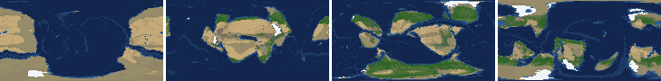
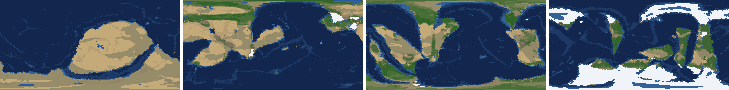
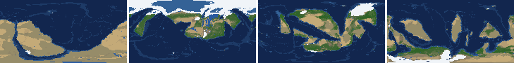
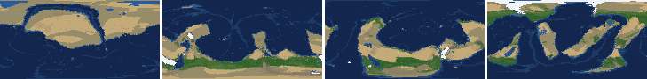
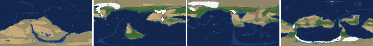
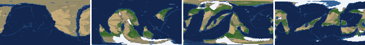
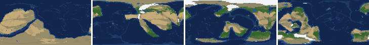
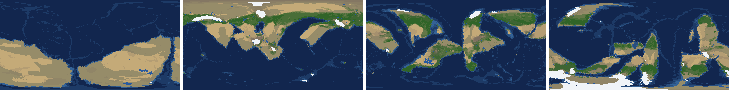

# Health sweep 2026-10-16 05:09

Commit 430d913+dirty. 8 runs (default params, `--every 4`) at 8 workers x 1 numba threads; simulations 4.8 min wall. Made by `tools/health.py` (PW-246).

## Runs

| seed | L | Myr | run | sim s | trees / flowering trees from | dT range C | peaks > 9.5 km | giant-lake frames % | crust volume end/start | ice SL < -150 m % | <= 4 plates % |
|---|---|---|---|---|---|---|---|---|---|---|---|
| 1 | 6 | 500 | 5a487e | 285 | 132 / 412 | 10.9 | 0 | 14.2 | 0.969 | 0.0 | 0.0 |
| 2 | 6 | 500 | 82fc44 | 286 | 140 / 396 | 19.4 | 0 | 6.2 | 0.944 | 4.4 | 0.0 |
| 11 | 6 | 500 | f01b41 | 286 | 128 / 372 | 16.8 | 0 | 17.7 | 0.967 | 0.0 | 0.0 |
| 21 | 6 | 500 | 529bb4 | 285 | 136 / 404 | 9.3 | 0 | 11.5 | 0.973 | 0.0 | 0.0 |
| 3199 | 6 | 500 | d90d97 | 277 | 132 / 376 | 12.4 | 0 | 5.3 | 0.967 | 0.0 | 11.5 |
| 42 | 6 | 500 | 61a5b5 | 289 | 116 / 404 | 13.2 | 0 | 13.3 | 0.956 | 0.0 | 0.0 |
| 77 | 6 | 500 | f9084b | 285 | 124 / 416 | 10.5 | 0 | 9.7 | 0.937 | 0.0 | 0.0 |
| 505 | 6 | 500 | 0009c8 | 287 | 132 / 416 | 8.5 | 0 | 7.1 | 0.963 | 0.0 | 0.0 |

## Medians by seed (after 50 Myr; tree cover after forests, NPP after flowering trees appear)

| seed | L | land_pct | cont_pct | cont_km | plates | ocean_age | speed | sea_level | sea_ice_m | ice_pct | temp | co2 | dry_pct | inland_pct | lake_pct | lake_max_mkm2 | max_elev_km | trees_pct | npp | landmasses | largest_pct |
|---|---|---|---|---|---|---|---|---|---|---|---|---|---|---|---|---|---|---|---|---|---|
| 1 | 6 | 32.5 | 40.1 | 33.6 | 10.0 | 53.0 | 4.5 | 8.1 | -2.0 | 0.4 | 15.9 | -0.1 | 30.4 | 4.6 | 0.5 | 0.1 | 4.5 | 30.3 | 297.1 | 8.0 | 18.2 |
| 2 | 6 | 34.1 | 40.6 | 33.0 | 10.0 | 57.2 | 4.1 | -44.0 | -1.4 | 0.3 | 15.7 | -0.3 | 33.9 | 4.0 | 0.4 | 0.2 | 5.2 | 21.6 | 338.7 | 8.0 | 23.3 |
| 11 | 6 | 32.3 | 39.6 | 34.3 | 10.0 | 61.7 | 4.5 | -89.5 | -17.5 | 2.6 | 12.8 | -0.4 | 27.1 | 3.2 | 0.6 | 0.2 | 6.3 | 30.9 | 366.9 | 6.0 | 26.3 |
| 21 | 6 | 34.5 | 39.9 | 33.9 | 9.0 | 62.3 | 4.5 | -97.0 | -2.4 | 0.5 | 16.5 | -0.3 | 34.1 | 4.2 | 0.4 | 0.1 | 6.8 | 22.4 | 311.7 | 5.0 | 33.2 |
| 3199 | 6 | 33.9 | 39.4 | 34.5 | 11.0 | 58.3 | 4.2 | -64.7 | -8.9 | 1.8 | 13.7 | -0.3 | 29.4 | 4.8 | 0.5 | 0.1 | 5.7 | 25.3 | 348.6 | 6.0 | 29.0 |
| 42 | 6 | 31.8 | 40.5 | 33.4 | 12.0 | 51.1 | 4.6 | -21.0 | -10.1 | 2.0 | 14.0 | -0.2 | 28.2 | 3.4 | 0.6 | 0.1 | 5.4 | 26.3 | 400.5 | 7.0 | 13.8 |
| 77 | 6 | 33.6 | 40.0 | 33.8 | 11.0 | 59.1 | 5.1 | -68.5 | -6.7 | 1.1 | 12.8 | -0.3 | 29.4 | 4.5 | 0.5 | 0.2 | 5.9 | 24.0 | 310.9 | 6.0 | 25.9 |
| 505 | 6 | 33.0 | 40.5 | 33.3 | 11.0 | 56.5 | 4.1 | -26.0 | -2.8 | 0.5 | 14.9 | -0.4 | 25.1 | 3.8 | 0.5 | 0.1 | 6.7 | 30.5 | 352.9 | 8.0 | 19.3 |

Measured on the run's keyframes (no slicing). A keyframe's rivers and lakes are routed on its own terrain (PW-239), so `inland_raw_pct` (every routed end on land, as highlights counts it) and `inland_pct` (ends that are closed lakes, salt pans or real pits) agree but for ends under land ice. Land ice and land shares use cells (near-equal area).

## Envelopes

| metric | low | high | Earth | source |
|---|---|---|---|---|
| land, % of surface (`land_pct`) | 22 | 42 | 29.20 | tests/test_envelopes.py (22-42%); Earth 29.2% |
| continental crust, % of surface (`cont_pct`) | 33 | 50 | 41 | tests/test_envelopes.py (33-50%); Earth ~41% with shelves (Cogley 1984) |
| mean continental crust thickness, km (`cont_km`) | 31 | 40 | 39 | target 35 km (PW-238, continental_thickness); Earth ~39 km (Christensen & Mooney 1995); known thinning to 32-33 km (PW-046) |
| plates (`plates`) | 5 | 30 | 15 | tests/test_envelopes.py (5-30; max_plates 30); Earth 7 major + ~8 minor; <= 4 is the PW-191 collapse |
| mean ocean-floor age, Myr (`ocean_age`) | 25 | 120 | 64 | tests/test_envelopes.py (25-120); Earth ~64 Myr (Mueller et al. 2008); PW-051 |
| mean plate speed, cm/yr (`speed`) | 2 | 9 | 4.50 | tests/test_envelopes.py (2-9 cm/yr); Earth ~4-5 |
| sea level, m (ice + ocean basins) (`sea_level`) | -250 | 300 | 0 | Phanerozoic ~-130 (LGM) .. +250 m (earth.py; Haq & Schutter 2008); -250: PW-240's hard goal |
| sea level from land ice, m (`sea_ice_m`) | -250 | - | 0 | Earth LGM ~-130 m; PW-240 goal -150 m typical / -250 m worst |
| land ice, % of surface (`ice_pct`) | - | 10 | 3.10 | Earth 3.1% now (earth.EARTH_ICE), ~7-8% at the LGM |
| global mean temperature, C (`temp`) | 8 | 30 | 14.50 | Earth 14.5 C; LGM ~8 C (Tierney et al. 2020); Phanerozoic hothouses to ~30 C (Scotese et al. 2021) |
| CO2 index (ln source/sink) (`co2`) | -1.5 | 1.5 | 0.00 | the forcing's clip in earth.py (+-1.5); Earth 0 |
| arid (Koppen B), % of land (`dry_pct`) | 12 | 45 | 30 | tests/test_envelopes.py (12-45%); Earth ~30% (Beck et al. 2018) |
| land draining inland, % of ice-free land (to a closed lake, salt pan or real pit) (`inland_pct`) | 8 | 30 | 18 | Earth ~18% (overview 2.9); L6 known ~9.5-11% (PW-054, PW-243). `inland_raw_pct` (not checked) follows the stored `downstream` to any end, as highlights does; since PW-239 the two agree but for ends under land ice |
| lakes, % of land (`lake_pct`) | 0.2 | 3.0 | 1.80 | Earth ~1.8% of ice-free land (HydroLAKES, Messager et al. 2016); generated L6 worlds 0.5-1% |
| largest lake, million km2 (`lake_max_mkm2`) | - | 1.0 | 0.37 | Caspian 0.37 Mkm2; 1 Mkm2 = the overview's giant lake (2.9) |
| highest peak, km (`max_elev_km`) | - | 9.5 | 8.85 | Everest 8.85 km; PW-172 (spikes above ~9.5 km) |
| tree cover, % of ice-free land (after forests appear) (`trees_pct`) | 10 | 50 | 30 | Earth ~30% potential canopy (forest 55-60 of ~130 Mkm2, overview 2.18) |
| land NPP, g C/m2/yr (after flowering trees appear) (`npp`) | 200 | 700 | 430 | Earth ~56 Pg C/yr over ~130 Mkm2 = ~430; the model on Earth's terrain 50 Pg C/yr, ~385 (overview 2.18). Before flowering trees (plant group 4) stand-ins grow at 70%, so runs sit at ~150-280 |
| landmasses (>= 3 cells) (`landmasses`) | 3 | 80 | - | loose: a lone supercontinent or a shattered archipelago |
| largest landmass, % of surface (`largest_pct`) | 5 | 35 | 16.60 | Afro-Eurasia 16.6%; a Pangaea ~30% (scorecard largest_max) |
| global temperature range over the run, C (`dT_range`, per run) | - | 25 | 25 | Phanerozoic 11-36 C (Scotese et al. 2021) |
| keyframes with a peak above 9.5 km (`peak_frames`, per run) | - | 0 | 0 | PW-172 (L7 seed 3199: 3 of 251) |
| % of keyframes with a lake over 1 Mkm2 (`giant_lake_frames`, per run) | - | 5 | 0 | overview 2.9 (L6: 3 of ~150 frames) |
| continental crust volume, end / start (`volume_ratio`, per run) | 0.9 | 1.1 | 1.0 | scorecard volume_ratio (x1.006) |
| % of keyframes with ice sea level below -150 m (`sea_ice_below_150`, per run) | - | 10 | 0 | PW-240 |
| % of keyframes with <= 4 plates (`low_plates`, per run) | - | 2 | 0 | PW-191 (L7 seed 21: 1%) |

## Top outliers (of 171 spells; severity = excess / band width x (0.2 + share of the run))

| seed | L | metric | Myr | frames | worst | envelope | severity |
|---|---|---|---|---|---|---|---|
| 3199 | 6 | low_plates | run | - | 11.50 | -..2 | 4.75 |
| 11 | 6 | giant_lake_frames | run | - | 17.70 | -..5 | 2.54 |
| 1 | 6 | giant_lake_frames | run | - | 14.20 | -..5 | 1.84 |
| 42 | 6 | giant_lake_frames | run | - | 13.30 | -..5 | 1.66 |
| 21 | 6 | giant_lake_frames | run | - | 11.50 | -..5 | 1.3 |
| 11 | 6 | lake_max_mkm2 | 448-452 | 2 | 5.75 | -..1.0 | 1.026 |
| 3199 | 6 | lake_max_mkm2 | 392-396 | 2 | 5.45 | -..1.0 | 0.961 |
| 77 | 6 | giant_lake_frames | run | - | 9.70 | -..5 | 0.94 |
| 11 | 6 | lake_max_mkm2 | 200-208 | 3 | 4.51 | -..1.0 | 0.785 |
| 21 | 6 | lake_max_mkm2 | 76-76 | 1 | 4.57 | -..1.0 | 0.742 |
| 21 | 6 | lake_max_mkm2 | 52-64 | 4 | 3.87 | -..1.0 | 0.666 |
| 11 | 6 | lake_max_mkm2 | 220-256 | 9 | 3.12 | -..1.0 | 0.577 |
| 505 | 6 | lake_max_mkm2 | 88-92 | 2 | 3.55 | -..1.0 | 0.55 |
| 11 | 6 | lake_max_mkm2 | 340-340 | 1 | 3.36 | -..1.0 | 0.491 |
| 2 | 6 | lake_max_mkm2 | 76-76 | 1 | 3.29 | -..1.0 | 0.476 |
| 21 | 6 | lake_max_mkm2 | 148-156 | 3 | 3.04 | -..1.0 | 0.456 |
| 11 | 6 | lake_max_mkm2 | 68-68 | 1 | 3.12 | -..1.0 | 0.442 |
| 505 | 6 | giant_lake_frames | run | - | 7.10 | -..5 | 0.42 |
| 3199 | 6 | lake_max_mkm2 | 276-276 | 1 | 2.88 | -..1.0 | 0.39 |
| 42 | 6 | lake_max_mkm2 | 100-124 | 5 | 2.52 | -..1.0 | 0.363 |
| 11 | 6 | lake_max_mkm2 | 312-312 | 1 | 2.74 | -..1.0 | 0.362 |
| 2 | 6 | inland_pct | 60-500 | 99 | 0.10 | 8..30 | 0.354 |
| 11 | 6 | lake_max_mkm2 | 324-324 | 1 | 2.65 | -..1.0 | 0.344 |
| 3199 | 6 | lake_max_mkm2 | 492-492 | 1 | 2.59 | -..1.0 | 0.331 |
| 77 | 6 | lake_max_mkm2 | 92-104 | 3 | 2.39 | -..1.0 | 0.311 |
| 1 | 6 | lake_max_mkm2 | 476-488 | 4 | 2.29 | -..1.0 | 0.299 |
| 1 | 6 | lake_max_mkm2 | 500-500 | 1 | 2.43 | -..1.0 | 0.297 |
| 11 | 6 | lake_max_mkm2 | 168-172 | 2 | 2.35 | -..1.0 | 0.292 |
| 42 | 6 | lake_max_mkm2 | 176-180 | 2 | 2.32 | -..1.0 | 0.284 |
| 77 | 6 | lake_max_mkm2 | 60-60 | 1 | 2.27 | -..1.0 | 0.263 |

## Per seed: min / median / max after the 50 Myr spin-up, and spells outside the envelopes

### Seed 1, L6 (run 5a487e)

*At 48, 200, 348, 500 Myr: sea by depth, land green by tree cover / tan where arid, shaded by height, ice white, lakes blue.*

| metric | min | median | max | outside (Myr: worst) |
|---|---|---|---|---|
| land_pct | 31.42 | 32.47 | 38.40 |  |
| cont_pct | 36.76 | 40.15 | 42.56 |  |
| cont_km | 32.91 | 33.60 | 36.23 |  |
| plates | 5.00 | 10.00 | 16.00 |  |
| ocean_age | 32.40 | 53.00 | 72.40 |  |
| speed | 2.13 | 4.55 | 7.22 |  |
| sea_level | -195.90 | 8.10 | 189.80 |  |
| sea_ice_m | -28.90 | -2.00 | -0.00 |  |
| ice_pct | 0.00 | 0.40 | 2.70 |  |
| temp | 9.70 | 15.90 | 20.60 |  |
| co2 | -1.21 | -0.09 | 0.38 |  |
| dry_pct | 12.04 | 30.42 | 48.73 | 60-60: 45.18; 124-124: 45.08; 144-144: 45.06; 192-228: 48.73; +1 more |
| inland_pct | 0.22 | 4.59 | 23.08 | 64-152: 0.22; 168-176: 4.83; 188-188: 7.29; 252-260: 4.42; +1 more |
| lake_pct | 0.03 | 0.46 | 2.19 | 56-56: 0.17; 68-92: 0.03; 112-140: 0.04; 256-256: 0.18 |
| lake_max_mkm2 | 0.01 | 0.10 | 2.43 | 96-108: 1.94; 164-172: 1.79; 312-312: 1.43; 388-392: 1.32; +3 more |
| max_elev_km | 1.45 | 4.55 | 8.50 |  |
| trees_pct | 9.40 | 30.30 | 49.50 | 132-152: 9.40 |
| npp | 216.00 | 297.10 | 329.50 |  |
| landmasses | 3.00 | 8.00 | 18.00 |  |
| largest_pct | 8.50 | 18.20 | 30.50 |  |

### Seed 2, L6 (run 82fc44)

*At 48, 200, 348, 500 Myr: sea by depth, land green by tree cover / tan where arid, shaded by height, ice white, lakes blue.*

| metric | min | median | max | outside (Myr: worst) |
|---|---|---|---|---|
| land_pct | 29.35 | 34.09 | 37.99 |  |
| cont_pct | 37.91 | 40.56 | 42.78 |  |
| cont_km | 32.00 | 33.04 | 35.85 |  |
| plates | 5.00 | 10.00 | 17.00 |  |
| ocean_age | 33.90 | 57.20 | 76.30 |  |
| speed | 2.45 | 4.14 | 7.35 |  |
| sea_level | -425.80 | -44.00 | 180.50 | 484-500: -425.80 |
| sea_ice_m | -269.30 | -1.40 | -0.00 | 500-500: -269.30 |
| ice_pct | 0.00 | 0.30 | 15.00 | 484-500: 15.00 |
| temp | 3.10 | 15.70 | 22.50 | 480-500: 3.10 |
| co2 | -1.06 | -0.29 | 0.34 |  |
| dry_pct | 6.30 | 33.90 | 56.25 | 52-68: 53.85; 200-264: 56.25; 452-500: 6.30 |
| inland_pct | 0.10 | 4.00 | 20.11 | 60-500: 0.10 |
| lake_pct | 0.08 | 0.45 | 2.14 | 64-84: 0.08; 120-120: 0.13; 148-148: 0.18; 268-268: 0.13; +1 more |
| lake_max_mkm2 | 0.01 | 0.20 | 3.29 | 76-76: 3.29; 132-132: 1.12; 196-196: 1.03; 244-244: 1.32; +1 more |
| max_elev_km | 1.11 | 5.17 | 8.61 |  |
| trees_pct | 8.28 | 21.55 | 50.63 | 240-252: 8.28; 276-280: 9.04; 500-500: 50.63 |
| npp | 225.40 | 338.70 | 508.70 |  |
| landmasses | 2.00 | 8.00 | 16.00 | 56-64: 2 |
| largest_pct | 5.60 | 23.30 | 35.10 | 152-152: 35.10 |

### Seed 11, L6 (run f01b41)

*At 48, 200, 348, 500 Myr: sea by depth, land green by tree cover / tan where arid, shaded by height, ice white, lakes blue.*

| metric | min | median | max | outside (Myr: worst) |
|---|---|---|---|---|
| land_pct | 29.52 | 32.29 | 37.68 |  |
| cont_pct | 36.86 | 39.58 | 42.50 |  |
| cont_km | 32.93 | 34.27 | 36.69 |  |
| plates | 6.00 | 10.00 | 18.00 |  |
| ocean_age | 30.60 | 61.70 | 70.00 |  |
| speed | 2.88 | 4.51 | 7.81 |  |
| sea_level | -372.70 | -89.50 | 237.20 | 188-260: -372.70 |
| sea_ice_m | -109.10 | -17.50 | -0.00 |  |
| ice_pct | 0.00 | 2.60 | 11.00 | 188-220: 11.00 |
| temp | 2.50 | 12.80 | 19.30 | 168-220: 2.50 |
| co2 | -0.74 | -0.40 | 0.06 |  |
| dry_pct | 16.45 | 27.15 | 44.75 |  |
| inland_pct | 0.41 | 3.19 | 22.38 | 68-196: 0.41; 212-224: 3.54; 260-500: 0.68 |
| lake_pct | 0.01 | 0.60 | 5.00 | 76-128: 0.01; 200-208: 5.00; 220-220: 4.45; 240-240: 3.15; +2 more |
| lake_max_mkm2 | 0.01 | 0.17 | 5.75 | 68-68: 3.12; 168-172: 2.35; 200-208: 4.51; 220-256: 3.12; +4 more |
| max_elev_km | 1.41 | 6.28 | 8.28 |  |
| trees_pct | 13.00 | 30.87 | 46.90 |  |
| npp | 223.50 | 366.90 | 423.10 |  |
| landmasses | 2.00 | 6.00 | 15.00 | 64-68: 2; 360-360: 2 |
| largest_pct | 10.00 | 26.30 | 33.10 |  |

### Seed 21, L6 (run 529bb4)

*At 48, 200, 348, 500 Myr: sea by depth, land green by tree cover / tan where arid, shaded by height, ice white, lakes blue.*

| metric | min | median | max | outside (Myr: worst) |
|---|---|---|---|---|
| land_pct | 33.37 | 34.54 | 37.53 |  |
| cont_pct | 38.52 | 39.92 | 43.09 |  |
| cont_km | 32.59 | 33.92 | 35.28 |  |
| plates | 7.00 | 9.00 | 12.00 |  |
| ocean_age | 36.10 | 62.30 | 82.70 |  |
| speed | 2.44 | 4.48 | 7.43 |  |
| sea_level | -210.10 | -97.00 | 184.30 |  |
| sea_ice_m | -6.30 | -2.40 | -0.00 |  |
| ice_pct | 0.00 | 0.50 | 1.30 |  |
| temp | 12.60 | 16.50 | 21.90 |  |
| co2 | -1.06 | -0.25 | 0.26 |  |
| dry_pct | 17.29 | 34.11 | 48.48 | 52-60: 48.48; 332-360: 46.88 |
| inland_pct | 0.55 | 4.18 | 21.73 | 68-304: 0.55; 324-500: 1.42 |
| lake_pct | 0.01 | 0.41 | 4.46 | 60-60: 3.26; 72-92: 4.46; 104-116: 0.06; 340-356: 0.14; +3 more |
| lake_max_mkm2 | 0.01 | 0.10 | 4.57 | 52-64: 3.87; 76-76: 4.57; 128-132: 1.62; 148-156: 3.04; +2 more |
| max_elev_km | 1.77 | 6.80 | 8.56 |  |
| trees_pct | 11.36 | 22.38 | 35.46 |  |
| npp | 191.10 | 311.70 | 404.10 | 404-408: 191.10 |
| landmasses | 2.00 | 5.00 | 13.00 | 240-240: 2; 300-312: 2 |
| largest_pct | 12.00 | 33.20 | 34.80 |  |

### Seed 3199, L6 (run d90d97)

*At 48, 200, 348, 500 Myr: sea by depth, land green by tree cover / tan where arid, shaded by height, ice white, lakes blue.*

| metric | min | median | max | outside (Myr: worst) |
|---|---|---|---|---|
| land_pct | 31.29 | 33.89 | 38.33 |  |
| cont_pct | 36.76 | 39.40 | 42.94 |  |
| cont_km | 32.44 | 34.55 | 36.31 |  |
| plates | 3.00 | 11.00 | 15.00 | 188-236: 3 |
| ocean_age | 34.80 | 58.30 | 114.80 |  |
| speed | 2.06 | 4.20 | 7.55 |  |
| sea_level | -358.00 | -64.70 | 195.10 | 216-376: -358.00 |
| sea_ice_m | -16.80 | -8.90 | -0.00 |  |
| ice_pct | 0.00 | 1.80 | 3.20 |  |
| temp | 9.40 | 13.70 | 21.80 |  |
| co2 | -1.30 | -0.34 | 0.10 |  |
| dry_pct | 14.81 | 29.44 | 51.09 | 64-96: 49.28; 416-436: 51.09 |
| inland_pct | 0.48 | 4.80 | 16.08 | 52-160: 0.48; 172-204: 3.20; 220-268: 2.56; 280-420: 2.76; +1 more |
| lake_pct | 0.01 | 0.49 | 3.81 | 52-68: 0.01; 80-100: 0.12; 112-148: 0.05; 396-404: 3.81; +2 more |
| lake_max_mkm2 | 0.01 | 0.11 | 5.45 | 76-76: 1.11; 232-232: 1.15; 276-276: 2.88; 392-396: 5.45; +1 more |
| max_elev_km | 1.36 | 5.72 | 8.89 |  |
| trees_pct | 8.99 | 25.29 | 32.35 | 132-132: 8.99 |
| npp | 202.60 | 348.60 | 441.60 |  |
| landmasses | 1.00 | 6.00 | 13.00 | 60-68: 2; 344-344: 2; 388-400: 1 |
| largest_pct | 9.60 | 29.00 | 34.70 |  |

### Seed 42, L6 (run 61a5b5)

*At 48, 200, 348, 500 Myr: sea by depth, land green by tree cover / tan where arid, shaded by height, ice white, lakes blue.*

| metric | min | median | max | outside (Myr: worst) |
|---|---|---|---|---|
| land_pct | 29.60 | 31.80 | 38.26 |  |
| cont_pct | 37.82 | 40.45 | 42.36 |  |
| cont_km | 32.57 | 33.40 | 35.52 |  |
| plates | 5.00 | 12.00 | 16.00 |  |
| ocean_age | 37.10 | 51.10 | 83.10 |  |
| speed | 2.17 | 4.61 | 7.42 |  |
| sea_level | -272.30 | -21.00 | 157.10 | 216-240: -272.30 |
| sea_ice_m | -68.70 | -10.10 | -0.00 |  |
| ice_pct | 0.00 | 2.00 | 7.30 |  |
| temp | 7.10 | 14.00 | 20.30 | 448-464: 7.10 |
| co2 | -1.34 | -0.21 | -0.00 |  |
| dry_pct | 10.05 | 28.25 | 43.98 | 392-428: 10.05 |
| inland_pct | 0.45 | 3.41 | 20.95 | 60-116: 0.92; 128-128: 3.41; 140-212: 2.61; 224-500: 0.45 |
| lake_pct | 0.07 | 0.58 | 2.23 | 56-56: 0.10; 72-104: 0.07; 324-324: 0.17 |
| lake_max_mkm2 | 0.04 | 0.15 | 2.52 | 64-64: 1.01; 100-124: 2.52; 140-140: 1.17; 176-180: 2.32; +3 more |
| max_elev_km | 1.77 | 5.40 | 8.24 |  |
| trees_pct | 15.74 | 26.34 | 41.43 |  |
| npp | 294.50 | 400.50 | 416.00 |  |
| landmasses | 3.00 | 7.00 | 17.00 |  |
| largest_pct | 9.30 | 13.80 | 31.00 |  |

### Seed 77, L6 (run f9084b)

*At 48, 200, 348, 500 Myr: sea by depth, land green by tree cover / tan where arid, shaded by height, ice white, lakes blue.*

| metric | min | median | max | outside (Myr: worst) |
|---|---|---|---|---|
| land_pct | 31.30 | 33.60 | 38.00 |  |
| cont_pct | 37.15 | 39.98 | 43.34 |  |
| cont_km | 32.48 | 33.84 | 35.69 |  |
| plates | 8.00 | 11.00 | 15.00 |  |
| ocean_age | 34.70 | 59.10 | 84.30 |  |
| speed | 2.65 | 5.14 | 7.03 |  |
| sea_level | -269.30 | -68.50 | 165.30 | 304-328: -269.30 |
| sea_ice_m | -46.60 | -6.70 | -0.00 |  |
| ice_pct | 0.00 | 1.10 | 3.60 |  |
| temp | 7.60 | 12.80 | 18.10 | 140-144: 7.60 |
| co2 | -0.63 | -0.33 | 0.04 |  |
| dry_pct | 21.04 | 29.35 | 51.46 | 184-196: 46.43; 232-276: 51.46 |
| inland_pct | 0.50 | 4.51 | 19.03 | 68-92: 5.27; 108-244: 1.55; 256-464: 0.50; 476-480: 2.66; +1 more |
| lake_pct | 0.10 | 0.46 | 2.68 | 120-124: 0.16; 136-144: 0.10; 392-392: 0.18 |
| lake_max_mkm2 | 0.03 | 0.16 | 2.39 | 60-60: 2.27; 72-80: 2.02; 92-104: 2.39; 148-148: 1.64; +3 more |
| max_elev_km | 1.64 | 5.92 | 8.52 |  |
| trees_pct | 16.41 | 24.04 | 38.33 |  |
| npp | 240.60 | 310.85 | 326.80 |  |
| landmasses | 1.00 | 6.00 | 15.00 | 52-64: 2; 284-308: 1 |
| largest_pct | 11.00 | 25.90 | 34.40 |  |

### Seed 505, L6 (run 0009c8)

*At 48, 200, 348, 500 Myr: sea by depth, land green by tree cover / tan where arid, shaded by height, ice white, lakes blue.*

| metric | min | median | max | outside (Myr: worst) |
|---|---|---|---|---|
| land_pct | 31.34 | 33.04 | 37.82 |  |
| cont_pct | 36.29 | 40.52 | 43.24 |  |
| cont_km | 32.29 | 33.33 | 36.85 |  |
| plates | 8.00 | 11.00 | 16.00 |  |
| ocean_age | 33.90 | 56.50 | 75.50 |  |
| speed | 2.99 | 4.10 | 7.00 |  |
| sea_level | -196.20 | -26.00 | 211.00 |  |
| sea_ice_m | -17.70 | -2.80 | -0.00 |  |
| ice_pct | 0.00 | 0.50 | 2.60 |  |
| temp | 11.20 | 14.90 | 19.70 |  |
| co2 | -0.78 | -0.40 | 0.21 |  |
| dry_pct | 16.64 | 25.06 | 43.01 |  |
| inland_pct | 0.22 | 3.79 | 18.03 | 60-208: 0.22; 232-324: 1.57; 336-500: 1.31 |
| lake_pct | 0.01 | 0.51 | 2.08 | 60-60: 0.01; 76-84: 0.04; 96-120: 0.01 |
| lake_max_mkm2 | 0.01 | 0.09 | 3.55 | 68-72: 2.12; 88-92: 3.55; 304-304: 1.62; 328-332: 1.81; +1 more |
| max_elev_km | 1.73 | 6.72 | 8.28 |  |
| trees_pct | 19.52 | 30.51 | 45.59 |  |
| npp | 176.70 | 352.90 | 387.90 | 420-432: 176.70 |
| landmasses | 2.00 | 8.00 | 14.00 | 56-64: 2 |
| largest_pct | 9.00 | 19.30 | 33.50 |  |

## Determinism

(not run)
