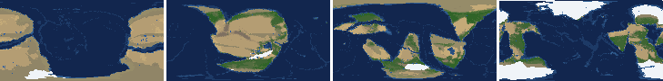
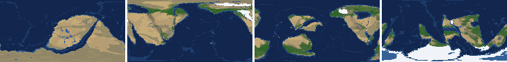
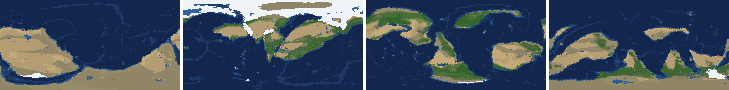
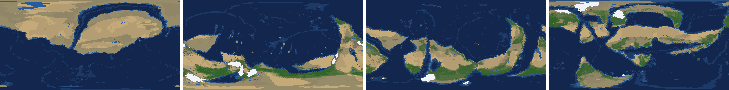
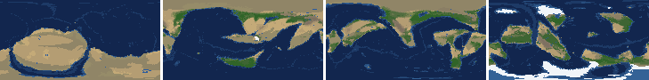
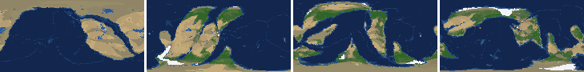
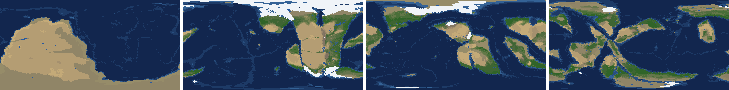
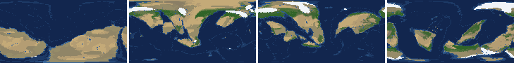

# Health sweep 2026-10-15 19:46

Commit 258e77a. 8 runs (default params, `--every 4`) at 8 workers x 1 numba threads; simulations 6.0 min wall. Made by `tools/health.py` (PW-246).

## Runs

| seed | L | Myr | run | sim s | trees / flowering trees from | dT range C | peaks > 9.5 km | giant-lake frames % | crust volume end/start | ice SL < -150 m % | <= 4 plates % |
|---|---|---|---|---|---|---|---|---|---|---|---|
| 1 | 6 | 500 | 771d9c | 348 | 132 / 412 | 11.4 | 0 | 9.7 | 0.913 | 2.7 | 0.0 |
| 2 | 6 | 500 | 1dc48b | 353 | 140 / 396 | 19.9 | 0 | 2.7 | 0.917 | 6.2 | 0.0 |
| 11 | 6 | 500 | 6ef568 | 351 | 128 / 372 | 17.2 | 0 | 8.8 | 0.893 | 6.2 | 0.0 |
| 21 | 6 | 500 | 32f8a8 | 351 | 136 / 404 | 10.5 | 0 | 15.9 | 0.926 | 0.0 | 0.0 |
| 3199 | 6 | 500 | 6d3dd3 | 348 | 132 / 376 | 11.2 | 0 | 8.8 | 0.879 | 0.0 | 0.0 |
| 42 | 6 | 500 | f2386d | 349 | 116 / 404 | 11.3 | 0 | 5.3 | 0.897 | 0.0 | 0.0 |
| 77 | 6 | 500 | 7a4212 | 356 | 124 / 416 | 9.9 | 0 | 13.3 | 0.885 | 0.0 | 0.0 |
| 505 | 6 | 500 | 0aa2b3 | 355 | 132 / 416 | 8.4 | 0 | 1.8 | 0.905 | 0.0 | 0.0 |

## Medians by seed (after 50 Myr; tree cover after forests, NPP after flowering trees appear)

| seed | L | land_pct | cont_pct | cont_km | plates | ocean_age | speed | sea_level | sea_ice_m | ice_pct | temp | co2 | dry_pct | inland_pct | lake_pct | lake_max_mkm2 | max_elev_km | trees_pct | npp | landmasses | largest_pct |
|---|---|---|---|---|---|---|---|---|---|---|---|---|---|---|---|---|---|---|---|---|---|
| 1 | 6 | 32.6 | 38.8 | 35.9 | 15.0 | 48.3 | 4.6 | 141.7 | -8.9 | 0.7 | 15.4 | -0.2 | 39.8 | 10.8 | 0.8 | 0.2 | 6.2 | 23.9 | 319.4 | 5.0 | 19.7 |
| 2 | 6 | 32.5 | 39.1 | 35.5 | 13.0 | 50.6 | 4.3 | 188.9 | -3.2 | 0.3 | 15.2 | -0.2 | 46.5 | 9.6 | 0.7 | 0.1 | 5.2 | 20.4 | 362.2 | 6.0 | 19.4 |
| 11 | 6 | 32.8 | 39.0 | 35.1 | 15.0 | 47.4 | 4.5 | 141.2 | -6.4 | 0.5 | 13.8 | -0.3 | 36.6 | 10.6 | 0.9 | 0.2 | 5.1 | 29.0 | 241.1 | 7.0 | 23.8 |
| 21 | 6 | 33.1 | 39.9 | 35.1 | 12.0 | 52.1 | 4.3 | 109.9 | -3.5 | 0.3 | 16.4 | -0.3 | 42.1 | 9.1 | 0.8 | 0.2 | 4.9 | 23.1 | 368.6 | 8.0 | 22.0 |
| 3199 | 6 | 32.2 | 39.4 | 34.8 | 11.0 | 55.6 | 4.3 | 34.3 | -2.3 | 0.2 | 15.3 | -0.2 | 29.1 | 8.0 | 0.6 | 0.1 | 6.3 | 27.9 | 326.4 | 7.0 | 15.6 |
| 42 | 6 | 32.6 | 39.3 | 34.8 | 13.0 | 54.7 | 4.5 | 149.8 | -6.8 | 0.6 | 14.8 | -0.3 | 36.9 | 6.5 | 0.6 | 0.1 | 6.1 | 22.8 | 334.9 | 6.0 | 19.3 |
| 77 | 6 | 32.9 | 39.6 | 35.4 | 13.0 | 48.5 | 4.7 | 46.8 | -23.0 | 1.7 | 12.6 | -0.2 | 38.1 | 9.2 | 0.8 | 0.2 | 5.2 | 30.6 | 363.9 | 7.0 | 18.1 |
| 505 | 6 | 32.0 | 39.4 | 34.8 | 13.0 | 46.0 | 4.8 | 179.3 | -18.7 | 1.2 | 15.4 | -0.1 | 37.1 | 8.1 | 0.7 | 0.1 | 4.2 | 23.5 | 341.6 | 8.0 | 17.7 |

Measured on the run's keyframes (no slicing). Caveats: a keyframe's lakes and `downstream` come from the terrain before that step's erosion and deposition (PW-239), so `inland_raw_pct` (every routed end on land, as highlights counts it) runs ~2-3x `inland_pct` (ends that are closed lakes, salt pans or real pits on the frame's own elevation); lake shares are the run's lakes during the step. Land ice and land shares use cells (near-equal area).

## Envelopes

| metric | low | high | Earth | source |
|---|---|---|---|---|
| land, % of surface (`land_pct`) | 22 | 42 | 29.20 | tests/test_envelopes.py (22-42%); Earth 29.2% |
| continental crust, % of surface (`cont_pct`) | 33 | 50 | 41 | tests/test_envelopes.py (33-50%); Earth ~41% with shelves (Cogley 1984) |
| mean continental crust thickness, km (`cont_km`) | 31 | 40 | 39 | target 35 km (PW-238, continental_thickness); Earth ~39 km (Christensen & Mooney 1995); known thinning to 32-33 km (PW-046) |
| plates (`plates`) | 5 | 30 | 15 | tests/test_envelopes.py (5-30; max_plates 30); Earth 7 major + ~8 minor; <= 4 is the PW-191 collapse |
| mean ocean-floor age, Myr (`ocean_age`) | 25 | 120 | 64 | tests/test_envelopes.py (25-120); Earth ~64 Myr (Mueller et al. 2008); PW-051 |
| mean plate speed, cm/yr (`speed`) | 2 | 9 | 4.50 | tests/test_envelopes.py (2-9 cm/yr); Earth ~4-5 |
| sea level, m (ice + ocean basins) (`sea_level`) | -250 | 300 | 0 | Phanerozoic ~-130 (LGM) .. +250 m (earth.py; Haq & Schutter 2008); -250: PW-240's hard goal |
| sea level from land ice, m (`sea_ice_m`) | -250 | - | 0 | Earth LGM ~-130 m; PW-240 goal -150 m typical / -250 m worst |
| land ice, % of surface (`ice_pct`) | - | 10 | 3.10 | Earth 3.1% now (earth.EARTH_ICE), ~7-8% at the LGM |
| global mean temperature, C (`temp`) | 8 | 30 | 14.50 | Earth 14.5 C; LGM ~8 C (Tierney et al. 2020); Phanerozoic hothouses to ~30 C (Scotese et al. 2021) |
| CO2 index (ln source/sink) (`co2`) | -1.5 | 1.5 | 0.00 | the forcing's clip in earth.py (+-1.5); Earth 0 |
| arid (Koppen B), % of land (`dry_pct`) | 12 | 45 | 30 | tests/test_envelopes.py (12-45%); Earth ~30% (Beck et al. 2018) |
| land draining inland, % of ice-free land (to a closed lake, salt pan or real pit) (`inland_pct`) | 8 | 30 | 18 | Earth ~18% (overview 2.9); L6 known ~9.5-11% (PW-054, PW-243). `inland_raw_pct` (not checked) follows the stored `downstream` to any end, as highlights does: stale by a step (PW-239) |
| lakes, % of land (`lake_pct`) | 0.2 | 3.0 | 1.80 | Earth ~1.8% of ice-free land (HydroLAKES, Messager et al. 2016); generated L6 worlds 0.5-1% |
| largest lake, million km2 (`lake_max_mkm2`) | - | 1.0 | 0.37 | Caspian 0.37 Mkm2; 1 Mkm2 = the overview's giant lake (2.9) |
| highest peak, km (`max_elev_km`) | - | 9.5 | 8.85 | Everest 8.85 km; PW-172 (spikes above ~9.5 km) |
| tree cover, % of ice-free land (after forests appear) (`trees_pct`) | 10 | 50 | 30 | Earth ~30% potential canopy (forest 55-60 of ~130 Mkm2, overview 2.18) |
| land NPP, g C/m2/yr (after flowering trees appear) (`npp`) | 200 | 700 | 430 | Earth ~56 Pg C/yr over ~130 Mkm2 = ~430; the model on Earth's terrain 50 Pg C/yr, ~385 (overview 2.18). Before flowering trees (plant group 4) stand-ins grow at 70%, so runs sit at ~150-280 |
| landmasses (>= 3 cells) (`landmasses`) | 3 | 80 | - | loose: a lone supercontinent or a shattered archipelago |
| largest landmass, % of surface (`largest_pct`) | 5 | 35 | 16.60 | Afro-Eurasia 16.6%; a Pangaea ~30% (scorecard largest_max) |
| global temperature range over the run, C (`dT_range`, per run) | - | 25 | 25 | Phanerozoic 11-36 C (Scotese et al. 2021) |
| keyframes with a peak above 9.5 km (`peak_frames`, per run) | - | 0 | 0 | PW-172 (L7 seed 3199: 3 of 251) |
| % of keyframes with a lake over 1 Mkm2 (`giant_lake_frames`, per run) | - | 5 | 0 | overview 2.9 (L6: 3 of ~150 frames) |
| continental crust volume, end / start (`volume_ratio`, per run) | 0.9 | 1.1 | 1.0 | scorecard volume_ratio (x1.006) |
| % of keyframes with ice sea level below -150 m (`sea_ice_below_150`, per run) | - | 10 | 0 | PW-240 |
| % of keyframes with <= 4 plates (`low_plates`, per run) | - | 2 | 0 | PW-191 (L7 seed 21: 1%) |

## Top outliers (of 174 spells; severity = excess / band width x (0.2 + share of the run))

| seed | L | metric | Myr | frames | worst | envelope | severity |
|---|---|---|---|---|---|---|---|
| 21 | 6 | giant_lake_frames | run | - | 15.90 | -..5 | 2.18 |
| 77 | 6 | giant_lake_frames | run | - | 13.30 | -..5 | 1.66 |
| 1 | 6 | giant_lake_frames | run | - | 9.70 | -..5 | 0.94 |
| 11 | 6 | giant_lake_frames | run | - | 8.80 | -..5 | 0.76 |
| 3199 | 6 | giant_lake_frames | run | - | 8.80 | -..5 | 0.76 |
| 1 | 6 | lake_max_mkm2 | 204-224 | 4 | 3.96 | -..1.0 | 0.686 |
| 77 | 6 | lake_max_mkm2 | 156-164 | 3 | 2.89 | -..1.0 | 0.423 |
| 11 | 6 | lake_max_mkm2 | 216-216 | 1 | 3.03 | -..1.0 | 0.421 |
| 21 | 6 | lake_max_mkm2 | 208-228 | 6 | 2.59 | -..1.0 | 0.394 |
| 21 | 6 | lake_max_mkm2 | 148-152 | 2 | 2.53 | -..1.0 | 0.33 |
| 3199 | 6 | lake_max_mkm2 | 256-280 | 7 | 2.29 | -..1.0 | 0.33 |
| 42 | 6 | lake_max_mkm2 | 112-112 | 1 | 2.52 | -..1.0 | 0.315 |
| 21 | 6 | lake_max_mkm2 | 108-108 | 1 | 2.49 | -..1.0 | 0.31 |
| 1 | 6 | lake_max_mkm2 | 248-256 | 2 | 2.38 | -..1.0 | 0.297 |
| 11 | 6 | lake_max_mkm2 | 404-412 | 2 | 2.30 | -..1.0 | 0.281 |
| 2 | 6 | dry_pct | 128-340 | 54 | 58.45 | 12..45 | 0.256 |
| 21 | 6 | lake_max_mkm2 | 288-288 | 1 | 2.23 | -..1.0 | 0.256 |
| 77 | 6 | lake_max_mkm2 | 232-244 | 3 | 2.03 | -..1.0 | 0.231 |
| 1 | 6 | dry_pct | 124-300 | 45 | 58.47 | 12..45 | 0.227 |
| 11 | 6 | lake_max_mkm2 | 496-496 | 1 | 1.98 | -..1.0 | 0.204 |
| 21 | 6 | lake_max_mkm2 | 300-300 | 1 | 1.97 | -..1.0 | 0.201 |
| 77 | 6 | lake_max_mkm2 | 256-260 | 2 | 1.93 | -..1.0 | 0.201 |
| 3199 | 6 | dry_pct | 52-124 | 19 | 63.22 | 12..45 | 0.194 |
| 21 | 6 | lake_max_mkm2 | 52-60 | 3 | 1.76 | -..1.0 | 0.169 |
| 3199 | 6 | inland_pct | 308-500 | 46 | 1.56 | 8..30 | 0.165 |
| 42 | 6 | inland_pct | 304-500 | 50 | 2.11 | 8..30 | 0.16 |
| 77 | 6 | lake_max_mkm2 | 272-272 | 1 | 1.73 | -..1.0 | 0.152 |
| 11 | 6 | lake_max_mkm2 | 484-484 | 1 | 1.69 | -..1.0 | 0.144 |
| 11 | 6 | lake_max_mkm2 | 148-148 | 1 | 1.68 | -..1.0 | 0.142 |
| 42 | 6 | lake_max_mkm2 | 276-276 | 1 | 1.66 | -..1.0 | 0.136 |

## Per seed: min / median / max after the 50 Myr spin-up, and spells outside the envelopes

### Seed 1, L6 (run 771d9c)

*At 48, 200, 348, 500 Myr: sea by depth, land green by tree cover / tan where arid, shaded by height, ice white, lakes blue.*

| metric | min | median | max | outside (Myr: worst) |
|---|---|---|---|---|
| land_pct | 31.23 | 32.59 | 38.32 |  |
| cont_pct | 37.64 | 38.77 | 42.10 |  |
| cont_km | 35.10 | 35.93 | 38.05 |  |
| plates | 5.00 | 15.00 | 18.00 |  |
| ocean_age | 31.00 | 48.30 | 72.60 |  |
| speed | 2.83 | 4.56 | 7.81 |  |
| sea_level | -250.70 | 141.70 | 222.30 | 500-500: -250.70 |
| sea_ice_m | -241.40 | -8.90 | -0.00 |  |
| ice_pct | 0.00 | 0.70 | 9.00 |  |
| temp | 8.50 | 15.40 | 19.90 |  |
| co2 | -1.09 | -0.24 | 0.15 |  |
| dry_pct | 21.04 | 39.82 | 58.47 | 52-68: 53.47; 124-300: 58.47 |
| inland_pct | 2.14 | 10.83 | 30.49 | 64-64: 30.49; 84-116: 2.14; 316-332: 6.52; 344-360: 5.25; +2 more |
| lake_pct | 0.16 | 0.82 | 3.50 | 84-84: 0.19; 120-120: 0.16; 140-140: 0.19; 224-224: 3.50; +1 more |
| lake_max_mkm2 | 0.03 | 0.17 | 3.96 | 56-56: 1.12; 96-96: 1.07; 144-144: 1.49; 204-224: 3.96; +3 more |
| max_elev_km | 2.20 | 6.22 | 7.61 |  |
| trees_pct | 12.46 | 23.88 | 43.78 |  |
| npp | 209.80 | 319.40 | 392.10 |  |
| landmasses | 1.00 | 5.00 | 12.00 | 52-52: 2; 132-164: 2; 200-216: 1 |
| largest_pct | 9.40 | 19.70 | 36.00 | 124-156: 36.00 |

### Seed 2, L6 (run 1dc48b)

*At 48, 200, 348, 500 Myr: sea by depth, land green by tree cover / tan where arid, shaded by height, ice white, lakes blue.*

| metric | min | median | max | outside (Myr: worst) |
|---|---|---|---|---|
| land_pct | 29.76 | 32.47 | 37.98 |  |
| cont_pct | 37.04 | 39.07 | 42.62 |  |
| cont_km | 34.40 | 35.49 | 38.49 |  |
| plates | 9.00 | 13.00 | 18.00 |  |
| ocean_age | 33.20 | 50.60 | 69.40 |  |
| speed | 3.00 | 4.33 | 8.07 |  |
| sea_level | -95.80 | 188.90 | 233.90 |  |
| sea_ice_m | -200.20 | -3.20 | -0.00 |  |
| ice_pct | 0.00 | 0.30 | 8.80 |  |
| temp | 3.70 | 15.20 | 23.60 | 476-500: 3.70 |
| co2 | -0.94 | -0.22 | 0.50 |  |
| dry_pct | 23.89 | 46.49 | 58.45 | 52-112: 53.22; 128-340: 58.45 |
| inland_pct | 3.13 | 9.56 | 30.39 | 92-124: 5.21; 188-188: 30.39; 308-376: 3.51; 404-500: 3.13 |
| lake_pct | 0.13 | 0.66 | 2.38 | 68-68: 0.13 |
| lake_max_mkm2 | 0.03 | 0.14 | 1.18 | 56-56: 1.07; 84-84: 1.18; 216-216: 1.15 |
| max_elev_km | 1.87 | 5.20 | 7.88 |  |
| trees_pct | 5.60 | 20.36 | 44.92 | 224-252: 5.60; 276-284: 8.42 |
| npp | 230.30 | 362.20 | 435.20 |  |
| landmasses | 2.00 | 6.00 | 13.00 | 52-68: 2; 196-200: 2; 224-240: 2 |
| largest_pct | 9.90 | 19.40 | 33.90 |  |

### Seed 11, L6 (run 6ef568)

*At 48, 200, 348, 500 Myr: sea by depth, land green by tree cover / tan where arid, shaded by height, ice white, lakes blue.*

| metric | min | median | max | outside (Myr: worst) |
|---|---|---|---|---|
| land_pct | 31.81 | 32.75 | 37.79 |  |
| cont_pct | 37.94 | 38.95 | 43.54 |  |
| cont_km | 33.94 | 35.10 | 37.35 |  |
| plates | 10.00 | 15.00 | 19.00 |  |
| ocean_age | 33.50 | 47.40 | 78.80 |  |
| speed | 2.87 | 4.47 | 7.20 |  |
| sea_level | -98.40 | 141.20 | 220.20 |  |
| sea_ice_m | -198.30 | -6.40 | -0.00 |  |
| ice_pct | 0.00 | 0.50 | 9.10 |  |
| temp | 3.30 | 13.80 | 20.50 | 168-204: 3.30 |
| co2 | -0.64 | -0.34 | 0.08 |  |
| dry_pct | 26.86 | 36.62 | 57.88 | 52-108: 57.88 |
| inland_pct | 2.55 | 10.63 | 33.89 | 60-60: 33.89; 72-72: 6.39; 100-108: 7.17; 120-160: 2.55; +7 more |
| lake_pct | 0.14 | 0.88 | 3.20 | 92-92: 0.14; 216-216: 3.20 |
| lake_max_mkm2 | 0.03 | 0.24 | 3.03 | 64-64: 1.51; 112-112: 1.51; 148-148: 1.68; 216-216: 3.03; +5 more |
| max_elev_km | 1.78 | 5.07 | 7.26 |  |
| trees_pct | 16.62 | 28.98 | 38.73 |  |
| npp | 207.00 | 241.10 | 342.20 |  |
| landmasses | 2.00 | 7.00 | 16.00 | 216-232: 2; 252-264: 2 |
| largest_pct | 11.80 | 23.80 | 34.30 |  |

### Seed 21, L6 (run 32f8a8)

*At 48, 200, 348, 500 Myr: sea by depth, land green by tree cover / tan where arid, shaded by height, ice white, lakes blue.*

| metric | min | median | max | outside (Myr: worst) |
|---|---|---|---|---|
| land_pct | 32.11 | 33.11 | 37.90 |  |
| cont_pct | 36.61 | 39.89 | 43.63 |  |
| cont_km | 32.97 | 35.13 | 38.13 |  |
| plates | 9.00 | 12.00 | 15.00 |  |
| ocean_age | 36.20 | 52.10 | 62.40 |  |
| speed | 2.92 | 4.31 | 7.14 |  |
| sea_level | 18.30 | 109.90 | 202.70 |  |
| sea_ice_m | -18.30 | -3.50 | -0.00 |  |
| ice_pct | 0.00 | 0.30 | 1.50 |  |
| temp | 12.10 | 16.40 | 22.60 |  |
| co2 | -0.53 | -0.27 | -0.03 |  |
| dry_pct | 22.14 | 42.11 | 58.07 | 52-116: 58.07; 168-188: 47.87; 244-256: 47.86; 284-292: 47.90; +1 more |
| inland_pct | 2.05 | 9.13 | 35.90 | 80-96: 3.57; 112-160: 3.28; 216-228: 35.90; 292-296: 6.01; +1 more |
| lake_pct | 0.14 | 0.82 | 3.37 | 80-80: 0.14; 92-96: 0.14; 112-112: 0.19; 212-216: 3.26; +1 more |
| lake_max_mkm2 | 0.04 | 0.20 | 2.59 | 52-60: 1.76; 108-108: 2.49; 148-152: 2.53; 208-228: 2.59; +5 more |
| max_elev_km | 1.55 | 4.91 | 8.27 |  |
| trees_pct | 11.82 | 23.14 | 40.96 |  |
| npp | 227.30 | 368.60 | 408.30 |  |
| landmasses | 2.00 | 8.00 | 15.00 | 60-64: 2; 300-300: 2 |
| largest_pct | 13.00 | 22.00 | 33.30 |  |

### Seed 3199, L6 (run 6d3dd3)

*At 48, 200, 348, 500 Myr: sea by depth, land green by tree cover / tan where arid, shaded by height, ice white, lakes blue.*

| metric | min | median | max | outside (Myr: worst) |
|---|---|---|---|---|
| land_pct | 30.42 | 32.17 | 38.67 |  |
| cont_pct | 38.08 | 39.41 | 43.31 |  |
| cont_km | 33.49 | 34.78 | 36.18 |  |
| plates | 6.00 | 11.00 | 15.00 |  |
| ocean_age | 36.90 | 55.60 | 86.90 |  |
| speed | 2.63 | 4.27 | 6.97 |  |
| sea_level | -267.90 | 34.30 | 187.00 | 500-500: -267.90 |
| sea_ice_m | -80.00 | -2.30 | -0.00 |  |
| ice_pct | 0.00 | 0.20 | 5.10 |  |
| temp | 9.50 | 15.30 | 20.70 |  |
| co2 | -0.53 | -0.22 | 0.08 |  |
| dry_pct | 20.44 | 29.14 | 63.22 | 52-124: 63.22 |
| inland_pct | 1.56 | 7.98 | 26.01 | 64-72: 6.34; 100-100: 5.14; 112-116: 4.59; 168-168: 7.56; +2 more |
| lake_pct | 0.04 | 0.63 | 2.19 | 64-76: 0.14; 92-100: 0.04; 116-116: 0.16; 136-136: 0.18 |
| lake_max_mkm2 | 0.01 | 0.15 | 2.29 | 52-52: 1.05; 164-164: 1.42; 256-280: 2.29; 304-304: 1.33 |
| max_elev_km | 1.37 | 6.28 | 7.74 |  |
| trees_pct | 10.17 | 27.85 | 40.53 |  |
| npp | 260.30 | 326.35 | 386.30 |  |
| landmasses | 2.00 | 7.00 | 17.00 | 56-64: 2 |
| largest_pct | 11.40 | 15.60 | 33.00 |  |

### Seed 42, L6 (run f2386d)

*At 48, 200, 348, 500 Myr: sea by depth, land green by tree cover / tan where arid, shaded by height, ice white, lakes blue.*

| metric | min | median | max | outside (Myr: worst) |
|---|---|---|---|---|
| land_pct | 30.18 | 32.65 | 38.17 |  |
| cont_pct | 38.15 | 39.27 | 42.74 |  |
| cont_km | 34.22 | 34.82 | 36.94 |  |
| plates | 10.00 | 13.00 | 18.00 |  |
| ocean_age | 33.70 | 54.70 | 65.90 |  |
| speed | 3.10 | 4.50 | 6.87 |  |
| sea_level | 10.90 | 149.80 | 231.70 |  |
| sea_ice_m | -81.40 | -6.80 | -0.00 |  |
| ice_pct | 0.00 | 0.60 | 4.30 |  |
| temp | 8.80 | 14.80 | 20.10 |  |
| co2 | -0.68 | -0.32 | 0.16 |  |
| dry_pct | 25.39 | 36.92 | 52.24 | 52-72: 50.43; 192-248: 52.24 |
| inland_pct | 2.11 | 6.55 | 26.44 | 76-100: 3.53; 116-128: 5.78; 260-260: 7.24; 304-500: 2.11 |
| lake_pct | 0.26 | 0.64 | 2.08 |  |
| lake_max_mkm2 | 0.03 | 0.15 | 2.52 | 52-52: 1.12; 84-84: 1.22; 112-112: 2.52; 232-232: 1.03; +2 more |
| max_elev_km | 1.50 | 6.12 | 8.44 |  |
| trees_pct | 15.13 | 22.82 | 36.65 |  |
| npp | 273.00 | 334.90 | 353.10 |  |
| landmasses | 1.00 | 6.00 | 10.00 | 468-472: 1 |
| largest_pct | 8.70 | 19.30 | 33.90 |  |

### Seed 77, L6 (run 7a4212)

*At 48, 200, 348, 500 Myr: sea by depth, land green by tree cover / tan where arid, shaded by height, ice white, lakes blue.*

| metric | min | median | max | outside (Myr: worst) |
|---|---|---|---|---|
| land_pct | 29.74 | 32.92 | 38.98 |  |
| cont_pct | 37.19 | 39.56 | 43.42 |  |
| cont_km | 33.06 | 35.35 | 37.72 |  |
| plates | 6.00 | 13.00 | 19.00 |  |
| ocean_age | 30.20 | 48.50 | 59.10 |  |
| speed | 3.45 | 4.67 | 7.68 |  |
| sea_level | -105.00 | 46.80 | 194.90 |  |
| sea_ice_m | -118.30 | -23.00 | -0.00 |  |
| ice_pct | 0.00 | 1.70 | 5.80 |  |
| temp | 7.50 | 12.60 | 17.40 | 144-148: 7.50 |
| co2 | -0.70 | -0.24 | 0.19 |  |
| dry_pct | 18.86 | 38.13 | 58.77 | 52-88: 58.77; 252-252: 46.46 |
| inland_pct | 2.22 | 9.23 | 28.65 | 112-148: 5.35; 168-168: 7.43; 308-308: 4.91; 320-336: 3.74; +2 more |
| lake_pct | 0.22 | 0.76 | 3.24 | 272-272: 3.24 |
| lake_max_mkm2 | 0.03 | 0.16 | 2.89 | 56-56: 1.23; 156-164: 2.89; 232-244: 2.03; 256-260: 1.93; +5 more |
| max_elev_km | 2.05 | 5.17 | 8.16 |  |
| trees_pct | 18.86 | 30.60 | 36.01 |  |
| npp | 293.70 | 363.85 | 381.20 |  |
| landmasses | 1.00 | 7.00 | 15.00 | 52-76: 1 |
| largest_pct | 7.10 | 18.10 | 39.00 | 52-60: 39.00 |

### Seed 505, L6 (run 0aa2b3)

*At 48, 200, 348, 500 Myr: sea by depth, land green by tree cover / tan where arid, shaded by height, ice white, lakes blue.*

| metric | min | median | max | outside (Myr: worst) |
|---|---|---|---|---|
| land_pct | 30.50 | 32.05 | 38.15 |  |
| cont_pct | 36.76 | 39.36 | 43.98 |  |
| cont_km | 33.66 | 34.83 | 37.49 |  |
| plates | 6.00 | 13.00 | 17.00 |  |
| ocean_age | 34.20 | 46.00 | 74.50 |  |
| speed | 2.02 | 4.79 | 7.25 |  |
| sea_level | 3.70 | 179.30 | 230.60 |  |
| sea_ice_m | -49.20 | -18.70 | -0.00 |  |
| ice_pct | 0.00 | 1.20 | 3.00 |  |
| temp | 10.70 | 15.40 | 19.10 |  |
| co2 | -1.02 | -0.13 | 0.26 |  |
| dry_pct | 26.05 | 37.09 | 50.86 | 52-60: 50.86; 84-112: 50.64 |
| inland_pct | 2.00 | 8.05 | 31.88 | 52-52: 31.88; 68-92: 5.00; 108-156: 2.49; 172-172: 5.54; +7 more |
| lake_pct | 0.13 | 0.73 | 2.11 | 88-88: 0.19; 108-112: 0.13; 136-140: 0.20 |
| lake_max_mkm2 | 0.04 | 0.12 | 1.43 | 96-96: 1.10; 188-188: 1.43 |
| max_elev_km | 1.23 | 4.21 | 7.06 |  |
| trees_pct | 16.62 | 23.49 | 41.38 |  |
| npp | 186.10 | 341.60 | 394.10 | 424-432: 186.10 |
| landmasses | 2.00 | 8.00 | 16.00 | 60-60: 2 |
| largest_pct | 8.00 | 17.70 | 33.40 |  |

## Determinism

(not run)
