# Health sweep 2026-10-15 16:58

Commit 6926583. 11 runs (default params, `--every 4`) at 11 workers x 2 numba threads; simulations 50.7 min wall; machine load (1-min average) 6-63, median 11: ~45-63 in the first 15 min while other agents ran ~14 cores of their own beside the 11 workers (~1.2 cores each), ~8-15 once only the 3 L7 runs were left. Made by `tools/health.py` (PW-246).

## Findings (hand-written after the run; inbox drafts `draft-health-*`)

- **Integration check passes:** all 12 runs finished on Python 3.14 / BLAS 1 / 11 worker processes; the
  determinism re-run is bit-identical; `uv run pytest` 223 passed. L7 seed 3199 (run 6114bd) reproduces
  the coordinator's earlier a1d3b9 to the numbers (peaks 944/964/968 Myr, max 10.6 km; lowest sea level
  -288 m at 480 Myr).
- **On target:** land 31-32% (Earth 29), continental crust 39-40% of the surface at ~34-36 km, plate
  speeds 5-7 cm/yr, ocean age medians 37-47 Myr (PW-051 likely closable), global temperature medians
  13-16 C, arid share 28-34% at L6.
- **Cold eras (PW-240):** L6 seed 11 reaches -384 m of ice sea level and 1 C at 180-190 Myr, when its
  supercontinent falls to 4 plates and the CO2 index to -1.2; seeds 2, 77, 3199 dip to -205..-231 m
  (3-9% of keyframes below -150 m). All three L7 seeds stay above -140 m.
- **Peaks (PW-172):** 3-4 keyframes per L7 run above 9.5 km (max 10.6), mostly one-frame single cells on
  80 km crust next to ~1 km land.
- **Run-frame lakes and rivers are stale (PW-239):** the "giant lakes" (2-7 Mkm2 salt lakes in 3-15% of
  L6 keyframes) are absent from a sliced world at the same moment (aad3b9 @ 88 Myr: largest 0.09 Mkm2),
  and the stored `downstream` puts 22-27% of land inland (L6; 39% at L7) where real hollows give 7-11%
  (L6) and 17-18% (L7, PW-243's level gap). So `lake_max_mkm2`, `giant_lake_frames` and `lake_pct`
  outliers here are mostly that artefact.
- **Level dependence:** L7 is ~10 points more arid than L6 for the same seed (38-42% vs 28-30%) with
  ~8 points less tree cover (new draft).
- **Crust volume (PW-046):** every run ends 3-8% below its starting continental volume.
- **Other:** slicing exactly at a checkpoint time (cde55b @ 600 Myr) fails the replay check on 2 cells
  (new draft); NPP is ~150-280 g C/m2/yr until flowering trees appear (~700-800 Myr), then 330-380
  (Earth ~430, the model on Earth ~385), by design of the plant-group stand-ins, so the NPP envelope
  starts with plant group 4; the arid share runs 50-74% in the first ~100-250 Myr on every seed (the
  starting supercontinent before forests).

## Runs

| seed | L | Myr | run | sim s | trees / flowering trees from | dT range C | peaks > 9.5 km | giant-lake frames % | crust volume end/start | ice SL < -150 m % | <= 4 plates % |
|---|---|---|---|---|---|---|---|---|---|---|---|
| 3199 | 7 | 1000 | 6114bd | 2965 | 252 / 744 | 11.7 | 3 | 4.2 | 0.933 | 0.0 | 0.0 |
| 21 | 7 | 1000 | 550a5a | 3028 | 224 / 768 | 14.0 | 4 | 7.6 | 0.95 | 0.0 | 0.0 |
| 11 | 7 | 1000 | 9068cb | 3038 | 224 / 684 | 15.2 | 3 | 9.7 | 0.958 | 0.0 | 0.0 |
| 1 | 6 | 1000 | cde55b | 661 | 208 / 740 | 11.4 | 0 | 14.3 | 0.936 | 0.0 | 0.0 |
| 2 | 6 | 1000 | ce9950 | 661 | 228 / 732 | 19.7 | 1 | 13.9 | 0.955 | 8.8 | 0.0 |
| 11 | 6 | 1000 | c3c76b | 659 | 224 / 684 | 19.5 | 0 | 15.5 | 0.918 | 7.1 | 2.5 |
| 21 | 6 | 1000 | 65e4c7 | 650 | 224 / 768 | 13.1 | 1 | 10.1 | 0.974 | 0.0 | 5.9 |
| 3199 | 6 | 1000 | b8b494 | 660 | 252 / 744 | 12.5 | 1 | 7.6 | 0.925 | 7.1 | 0.0 |
| 42 | 6 | 1000 | aad3b9 | 659 | 212 / 812 | 13.4 | 0 | 14.7 | 0.934 | 0.0 | 0.0 |
| 77 | 6 | 1000 | a7bbfe | 653 | 240 / 788 | 16.0 | 0 | 3.4 | 0.925 | 5.9 | 0.0 |
| 505 | 6 | 1000 | 04b655 | 655 | 248 / 764 | 8.7 | 0 | 6.7 | 0.935 | 1.3 | 0.0 |

## Medians by seed (after 50 Myr; tree cover after forests, NPP after flowering trees appear)

| seed | L | land_pct | cont_pct | cont_km | plates | ocean_age | speed | sea_level | sea_ice_m | ice_pct | temp | co2 | dry_pct | inland_pct | lake_pct | lake_max_mkm2 | max_elev_km | trees_pct | npp | landmasses | largest_pct |
|---|---|---|---|---|---|---|---|---|---|---|---|---|---|---|---|---|---|---|---|---|---|
| 3199 | 7 | 32.2 | 39.0 | 34.9 | 11.0 | 46.2 | 6.2 | -33.5 | -14.1 | 0.9 | 14.7 | -0.2 | 37.6 | 17.0 | 1.4 | 0.3 | 7.1 | 25.0 | 360.7 | 13.0 | 18.9 |
| 21 | 7 | 32.3 | 38.8 | 35.9 | 14.0 | 39.3 | 6.7 | -40.0 | -17.2 | 1.3 | 16.1 | -0.1 | 41.5 | 17.8 | 1.6 | 0.3 | 7.8 | 22.5 | 351.0 | 14.0 | 22.4 |
| 11 | 7 | 32.3 | 38.9 | 35.7 | 13.0 | 37.0 | 6.6 | -22.8 | -17.3 | 1.0 | 16.2 | -0.2 | 39.7 | 17.2 | 1.4 | 0.3 | 8.0 | 21.2 | 332.9 | 14.0 | 17.1 |
| 1 | 6 | 31.0 | 40.2 | 34.0 | 11.0 | 42.1 | 5.6 | -38.6 | -15.9 | 1.1 | 14.6 | -0.3 | 29.4 | 9.3 | 1.1 | 0.2 | 6.4 | 32.0 | 365.8 | 8.0 | 14.1 |
| 2 | 6 | 31.1 | 39.4 | 34.8 | 12.0 | 42.2 | 6.3 | -50.4 | -48.8 | 3.0 | 13.1 | -0.1 | 31.9 | 10.8 | 1.3 | 0.3 | 6.5 | 37.0 | 370.2 | 9.0 | 16.1 |
| 11 | 6 | 31.1 | 39.5 | 34.1 | 12.0 | 44.8 | 5.8 | -16.6 | -14.2 | 1.1 | 15.8 | -0.3 | 29.7 | 9.1 | 1.1 | 0.2 | 6.2 | 28.6 | 352.3 | 7.0 | 17.3 |
| 21 | 6 | 31.5 | 40.0 | 33.9 | 9.5 | 47.4 | 5.5 | -52.4 | -15.6 | 1.3 | 16.1 | -0.2 | 29.6 | 7.2 | 1.0 | 0.2 | 7.0 | 29.2 | 376.9 | 6.0 | 24.9 |
| 3199 | 6 | 31.0 | 39.6 | 34.2 | 11.0 | 44.3 | 5.5 | -28.5 | -17.4 | 1.3 | 14.7 | -0.1 | 27.9 | 7.5 | 1.0 | 0.2 | 6.4 | 33.6 | 377.8 | 8.0 | 15.1 |
| 42 | 6 | 30.8 | 40.0 | 34.1 | 12.0 | 43.2 | 5.7 | -40.9 | -16.9 | 1.3 | 14.6 | -0.2 | 33.5 | 8.2 | 1.1 | 0.3 | 6.0 | 33.5 | 359.1 | 7.0 | 16.6 |
| 77 | 6 | 30.9 | 40.0 | 34.9 | 11.0 | 45.5 | 5.7 | -46.4 | -56.9 | 3.2 | 13.3 | -0.3 | 33.1 | 8.3 | 0.9 | 0.2 | 6.7 | 32.6 | 363.1 | 8.0 | 19.4 |
| 505 | 6 | 30.9 | 39.8 | 34.0 | 10.0 | 45.9 | 5.3 | -26.0 | -22.0 | 1.4 | 15.0 | -0.2 | 28.5 | 6.9 | 1.0 | 0.2 | 6.2 | 32.9 | 376.4 | 8.0 | 15.9 |

Measured on the run's keyframes (no slicing). Caveats: a keyframe's lakes and `downstream` come from the terrain before that step's erosion and deposition (PW-239), so `inland_raw_pct` (every routed end on land, as highlights counts it) runs ~2-3x `inland_pct` (ends that are closed lakes, salt pans or real pits on the frame's own elevation); lake shares are the run's lakes during the step. Land ice and land shares use cells (near-equal area).

## Envelopes

| metric | low | high | Earth | source |
|---|---|---|---|---|
| land, % of surface (`land_pct`) | 22 | 42 | 29.20 | tests/test_envelopes.py (22-42%); Earth 29.2% |
| continental crust, % of surface (`cont_pct`) | 33 | 50 | 41 | tests/test_envelopes.py (33-50%); Earth ~41% with shelves (Cogley 1984) |
| mean continental crust thickness, km (`cont_km`) | 31 | 40 | 39 | target 35 km (PW-238, continental_thickness); Earth ~39 km (Christensen & Mooney 1995); known thinning to 32-33 km (PW-046) |
| plates (`plates`) | 5 | 30 | 15 | tests/test_envelopes.py (5-30; max_plates 30); Earth 7 major + ~8 minor; <= 4 is the PW-191 collapse |
| mean ocean-floor age, Myr (`ocean_age`) | 25 | 120 | 64 | tests/test_envelopes.py (25-120); Earth ~64 Myr (Mueller et al. 2008); PW-051 |
| mean plate speed, cm/yr (`speed`) | 2 | 9 | 4.50 | tests/test_envelopes.py (2-9 cm/yr); Earth ~4-5 |
| sea level, m (ice + ocean basins) (`sea_level`) | -250 | 300 | 0 | Phanerozoic ~-130 (LGM) .. +250 m (earth.py; Haq & Schutter 2008); -250: PW-240's hard goal |
| sea level from land ice, m (`sea_ice_m`) | -250 | - | 0 | Earth LGM ~-130 m; PW-240 goal -150 m typical / -250 m worst |
| land ice, % of surface (`ice_pct`) | - | 10 | 3.10 | Earth 3.1% now (earth.EARTH_ICE), ~7-8% at the LGM |
| global mean temperature, C (`temp`) | 8 | 30 | 14.50 | Earth 14.5 C; LGM ~8 C (Tierney et al. 2020); Phanerozoic hothouses to ~30 C (Scotese et al. 2021) |
| CO2 index (ln source/sink) (`co2`) | -1.5 | 1.5 | 0.00 | the forcing's clip in earth.py (+-1.5); Earth 0 |
| arid (Koppen B), % of land (`dry_pct`) | 12 | 45 | 30 | tests/test_envelopes.py (12-45%); Earth ~30% (Beck et al. 2018) |
| land draining inland, % of ice-free land (to a closed lake, salt pan or real pit) (`inland_pct`) | 8 | 30 | 18 | Earth ~18% (overview 2.9); L6 known ~9.5-11% (PW-054, PW-243). `inland_raw_pct` (not checked) follows the stored `downstream` to any end, as highlights does: stale by a step (PW-239) |
| lakes, % of land (`lake_pct`) | 0.2 | 3.0 | 1.80 | Earth ~1.8% of ice-free land (HydroLAKES, Messager et al. 2016); generated L6 worlds 0.5-1% |
| largest lake, million km2 (`lake_max_mkm2`) | - | 1.0 | 0.37 | Caspian 0.37 Mkm2; 1 Mkm2 = the overview's giant lake (2.9) |
| highest peak, km (`max_elev_km`) | - | 9.5 | 8.85 | Everest 8.85 km; PW-172 (spikes above ~9.5 km) |
| tree cover, % of ice-free land (after forests appear) (`trees_pct`) | 10 | 50 | 30 | Earth ~30% potential canopy (forest 55-60 of ~130 Mkm2, overview 2.18) |
| land NPP, g C/m2/yr (after flowering trees appear) (`npp`) | 200 | 700 | 430 | Earth ~56 Pg C/yr over ~130 Mkm2 = ~430; the model on Earth's terrain 50 Pg C/yr, ~385 (overview 2.18). Before flowering trees (plant group 4) stand-ins grow at 70%, so runs sit at ~150-280 |
| landmasses (>= 3 cells) (`landmasses`) | 3 | 80 | - | loose: a lone supercontinent or a shattered archipelago |
| largest landmass, % of surface (`largest_pct`) | 5 | 35 | 16.60 | Afro-Eurasia 16.6%; a Pangaea ~30% (scorecard largest_max) |
| global temperature range over the run, C (`dT_range`, per run) | - | 25 | 25 | Phanerozoic 11-36 C (Scotese et al. 2021) |
| keyframes with a peak above 9.5 km (`peak_frames`, per run) | - | 0 | 0 | PW-172 (L7 seed 3199: 3 of 251) |
| % of keyframes with a lake over 1 Mkm2 (`giant_lake_frames`, per run) | - | 5 | 0 | overview 2.9 (L6: 3 of ~150 frames) |
| continental crust volume, end / start (`volume_ratio`, per run) | 0.9 | 1.1 | 1.0 | scorecard volume_ratio (x1.006) |
| % of keyframes with ice sea level below -150 m (`sea_ice_below_150`, per run) | - | 10 | 0 | PW-240 |
| % of keyframes with <= 4 plates (`low_plates`, per run) | - | 2 | 0 | PW-191 (L7 seed 21: 1%) |

## Top outliers (of 479 spells; severity = excess / band width x (0.2 + share of the run))

| seed | L | metric | Myr | frames | worst | envelope | severity |
|---|---|---|---|---|---|---|---|
| 21 | 7 | peak_frames | run | - | 4 | -..0 | 4.0 |
| 3199 | 7 | peak_frames | run | - | 3 | -..0 | 3.0 |
| 11 | 7 | peak_frames | run | - | 3 | -..0 | 3.0 |
| 11 | 6 | giant_lake_frames | run | - | 15.50 | -..5 | 2.1 |
| 21 | 6 | low_plates | run | - | 5.90 | -..2 | 1.95 |
| 42 | 6 | giant_lake_frames | run | - | 14.70 | -..5 | 1.94 |
| 1 | 6 | giant_lake_frames | run | - | 14.30 | -..5 | 1.86 |
| 2 | 6 | giant_lake_frames | run | - | 13.90 | -..5 | 1.78 |
| 42 | 6 | lake_max_mkm2 | 88-92 | 2 | 7.31 | -..1.0 | 1.312 |
| 42 | 6 | lake_max_mkm2 | 368-368 | 1 | 6.38 | -..1.0 | 1.096 |
| 3199 | 6 | lake_max_mkm2 | 132-152 | 6 | 5.79 | -..1.0 | 1.073 |
| 42 | 6 | lake_max_mkm2 | 292-292 | 1 | 6.03 | -..1.0 | 1.025 |
| 21 | 6 | giant_lake_frames | run | - | 10.10 | -..5 | 1.02 |
| 2 | 6 | peak_frames | run | - | 1 | -..0 | 1.0 |
| 21 | 6 | peak_frames | run | - | 1 | -..0 | 1.0 |
| 3199 | 6 | peak_frames | run | - | 1 | -..0 | 1.0 |
| 11 | 7 | giant_lake_frames | run | - | 9.70 | -..5 | 0.94 |
| 3199 | 6 | lake_max_mkm2 | 900-904 | 2 | 4.62 | -..1.0 | 0.753 |
| 21 | 7 | lake_max_mkm2 | 396-400 | 2 | 4.47 | -..1.0 | 0.722 |
| 42 | 6 | lake_max_mkm2 | 160-164 | 2 | 4.12 | -..1.0 | 0.649 |
| 2 | 6 | lake_max_mkm2 | 308-316 | 3 | 3.77 | -..1.0 | 0.588 |
| 42 | 6 | lake_max_mkm2 | 176-192 | 4 | 3.69 | -..1.0 | 0.58 |
| 1 | 6 | lake_max_mkm2 | 332-368 | 8 | 3.41 | -..1.0 | 0.559 |
| 21 | 7 | giant_lake_frames | run | - | 7.60 | -..5 | 0.52 |
| 3199 | 6 | giant_lake_frames | run | - | 7.60 | -..5 | 0.52 |
| 505 | 6 | lake_max_mkm2 | 76-76 | 1 | 3.35 | -..1.0 | 0.479 |
| 42 | 6 | lake_max_mkm2 | 724-728 | 2 | 3.05 | -..1.0 | 0.427 |
| 21 | 6 | lake_max_mkm2 | 880-880 | 1 | 3.08 | -..1.0 | 0.423 |
| 77 | 6 | lake_max_mkm2 | 164-164 | 1 | 3.05 | -..1.0 | 0.418 |
| 1 | 6 | lake_max_mkm2 | 300-320 | 6 | 2.85 | -..1.0 | 0.415 |

## Per seed: min / median / max after the 50 Myr spin-up, and spells outside the envelopes

### Seed 3199, L7 (run 6114bd)

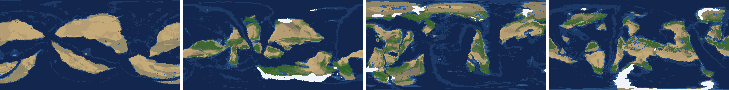

*At 100, 400, 700, 1000 Myr: sea by depth, land green by tree cover / tan where arid, shaded by height, ice white, lakes blue.*

| metric | min | median | max | outside (Myr: worst) |
|---|---|---|---|---|
| land_pct | 29.88 | 32.20 | 38.62 |  |
| cont_pct | 36.66 | 38.97 | 43.02 |  |
| cont_km | 32.42 | 34.90 | 36.70 |  |
| plates | 5.00 | 11.00 | 17.00 |  |
| ocean_age | 24.10 | 46.20 | 70.20 | 332-348: 24.10 |
| speed | 2.90 | 6.20 | 9.87 | 68-108: 9.87; 324-348: 9.26; 576-584: 9.41 |
| sea_level | -287.80 | -33.55 | 157.60 | 472-508: -287.80 |
| sea_ice_m | -108.40 | -14.05 | -0.00 |  |
| ice_pct | 0.00 | 0.90 | 5.40 |  |
| temp | 9.40 | 14.70 | 21.10 |  |
| co2 | -1.22 | -0.23 | 0.34 |  |
| dry_pct | 25.38 | 37.58 | 68.47 | 52-144: 68.47; 324-392: 60.40; 852-868: 45.53 |
| inland_pct | 5.56 | 16.99 | 42.83 | 52-68: 42.83; 372-372: 7.26; 384-384: 7.63; 400-408: 7.58; +3 more |
| lake_pct | 0.35 | 1.45 | 3.15 | 688-688: 3.15; 976-976: 3.00 |
| lake_max_mkm2 | 0.02 | 0.29 | 1.67 | 124-124: 1.46; 376-376: 1.11; 524-528: 1.67; 776-788: 1.58; +2 more |
| max_elev_km | 2.40 | 7.06 | 10.62 | 944-944: 10.62; 964-968: 9.71 |
| trees_pct | 12.47 | 25.02 | 37.24 |  |
| npp | 227.20 | 360.70 | 488.50 |  |
| landmasses | 2.00 | 13.00 | 27.00 | 52-64: 2 |
| largest_pct | 5.60 | 18.90 | 32.40 |  |

### Seed 21, L7 (run 550a5a)

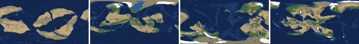

*At 100, 400, 700, 1000 Myr: sea by depth, land green by tree cover / tan where arid, shaded by height, ice white, lakes blue.*

| metric | min | median | max | outside (Myr: worst) |
|---|---|---|---|---|
| land_pct | 29.89 | 32.32 | 38.84 |  |
| cont_pct | 35.66 | 38.75 | 42.11 |  |
| cont_km | 33.80 | 35.89 | 38.17 |  |
| plates | 7.00 | 14.00 | 20.00 |  |
| ocean_age | 17.90 | 39.30 | 62.10 | 52-104: 20.50; 256-336: 17.90 |
| speed | 2.28 | 6.71 | 10.66 | 52-116: 10.66; 276-304: 9.98; 572-592: 9.70 |
| sea_level | -176.00 | -39.95 | 183.70 |  |
| sea_ice_m | -125.40 | -17.20 | -0.00 |  |
| ice_pct | 0.00 | 1.30 | 6.10 |  |
| temp | 9.20 | 16.15 | 23.20 |  |
| co2 | -1.11 | -0.13 | 0.59 |  |
| dry_pct | 28.07 | 41.49 | 72.05 | 52-144: 72.05; 244-320: 51.35; 404-496: 51.61; 592-592: 47.54; +1 more |
| inland_pct | 7.99 | 17.77 | 36.63 | 52-72: 36.63; 268-268: 35.20; 768-768: 7.99 |
| lake_pct | 0.47 | 1.64 | 4.11 | 204-204: 3.05; 228-228: 3.20; 396-400: 4.11; 432-432: 3.40 |
| lake_max_mkm2 | 0.04 | 0.27 | 4.47 | 188-188: 1.27; 216-220: 1.38; 328-328: 1.01; 356-364: 1.38; +8 more |
| max_elev_km | 2.63 | 7.83 | 10.53 | 148-148: 10.53; 640-640: 10.35; 800-800: 10.14; 880-880: 9.57 |
| trees_pct | 13.32 | 22.52 | 41.72 |  |
| npp | 236.60 | 351.00 | 431.00 |  |
| landmasses | 2.00 | 14.00 | 25.00 | 60-64: 2 |
| largest_pct | 7.00 | 22.40 | 33.30 |  |

### Seed 11, L7 (run 9068cb)

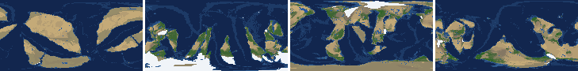

*At 100, 400, 700, 1000 Myr: sea by depth, land green by tree cover / tan where arid, shaded by height, ice white, lakes blue.*

| metric | min | median | max | outside (Myr: worst) |
|---|---|---|---|---|
| land_pct | 27.72 | 32.29 | 38.85 |  |
| cont_pct | 36.05 | 38.86 | 42.03 |  |
| cont_km | 34.44 | 35.71 | 36.98 |  |
| plates | 8.00 | 13.00 | 23.00 |  |
| ocean_age | 23.70 | 36.95 | 59.60 | 272-324: 23.70 |
| speed | 3.63 | 6.60 | 10.59 | 56-108: 10.12; 260-280: 9.63; 296-316: 9.59; 888-916: 10.59 |
| sea_level | -143.70 | -22.75 | 167.80 |  |
| sea_ice_m | -137.10 | -17.30 | -0.00 |  |
| ice_pct | 0.00 | 1.00 | 6.60 |  |
| temp | 5.40 | 16.20 | 20.60 | 168-188: 5.40 |
| co2 | -0.86 | -0.15 | 0.55 |  |
| dry_pct | 20.11 | 39.66 | 70.31 | 52-132: 70.31; 224-312: 54.65; 484-552: 49.39; 928-1000: 52.19 |
| inland_pct | 3.84 | 17.21 | 43.83 | 52-64: 43.83; 144-144: 30.24; 156-168: 32.72; 196-196: 32.99; +4 more |
| lake_pct | 0.51 | 1.45 | 3.88 | 480-488: 3.71; 672-720: 3.88; 744-748: 3.14 |
| lake_max_mkm2 | 0.05 | 0.25 | 1.85 | 120-120: 1.44; 148-164: 1.73; 292-292: 1.01; 364-364: 1.62; +4 more |
| max_elev_km | 2.14 | 7.99 | 9.95 | 436-436: 9.68; 512-512: 9.81; 640-640: 9.95 |
| trees_pct | 13.21 | 21.21 | 44.24 |  |
| npp | 219.00 | 332.85 | 386.80 |  |
| landmasses | 3.00 | 14.00 | 25.00 |  |
| largest_pct | 8.20 | 17.15 | 34.10 |  |

### Seed 1, L6 (run cde55b)

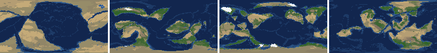

*At 100, 400, 700, 1000 Myr: sea by depth, land green by tree cover / tan where arid, shaded by height, ice white, lakes blue.*

| metric | min | median | max | outside (Myr: worst) |
|---|---|---|---|---|
| land_pct | 29.24 | 30.99 | 38.49 |  |
| cont_pct | 35.02 | 40.21 | 43.32 |  |
| cont_km | 32.17 | 34.03 | 39.45 |  |
| plates | 5.00 | 11.00 | 17.00 |  |
| ocean_age | 23.80 | 42.10 | 86.40 | 96-108: 23.80 |
| speed | 1.71 | 5.56 | 10.97 | 68-120: 10.97; 908-928: 1.71 |
| sea_level | -230.90 | -38.60 | 191.20 |  |
| sea_ice_m | -96.10 | -15.95 | -0.00 |  |
| ice_pct | 0.00 | 1.10 | 5.00 |  |
| temp | 8.70 | 14.60 | 20.10 |  |
| co2 | -1.07 | -0.28 | 0.39 |  |
| dry_pct | 10.18 | 29.38 | 73.65 | 52-92: 73.65; 156-156: 45.27; 176-192: 48.07; 212-260: 47.87; +1 more |
| inland_pct | 1.76 | 9.29 | 33.60 | 64-64: 31.99; 96-96: 7.11; 132-132: 6.97; 172-172: 6.98; +12 more |
| lake_pct | 0.23 | 1.05 | 4.61 | 64-64: 4.08; 200-200: 3.15; 256-256: 3.62; 308-308: 3.21; +4 more |
| lake_max_mkm2 | 0.04 | 0.19 | 3.41 | 64-64: 2.70; 80-80: 1.23; 136-140: 1.12; 200-200: 1.71; +8 more |
| max_elev_km | 2.05 | 6.36 | 8.59 |  |
| trees_pct | 16.58 | 32.04 | 48.82 |  |
| npp | 259.20 | 365.75 | 411.30 |  |
| landmasses | 1.00 | 8.00 | 22.00 | 52-88: 1; 128-164: 2; 180-196: 2; 208-208: 2; +1 more |
| largest_pct | 7.30 | 14.10 | 38.50 | 52-64: 38.50 |

### Seed 2, L6 (run ce9950)

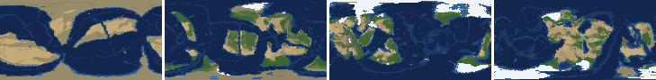

*At 100, 400, 700, 1000 Myr: sea by depth, land green by tree cover / tan where arid, shaded by height, ice white, lakes blue.*

| metric | min | median | max | outside (Myr: worst) |
|---|---|---|---|---|
| land_pct | 28.29 | 31.12 | 37.65 |  |
| cont_pct | 35.69 | 39.36 | 43.23 |  |
| cont_km | 32.80 | 34.79 | 38.37 |  |
| plates | 8.00 | 12.00 | 17.00 |  |
| ocean_age | 22.40 | 42.25 | 58.70 | 80-104: 22.40; 292-312: 23.70 |
| speed | 3.43 | 6.35 | 10.79 | 52-104: 10.79 |
| sea_level | -287.60 | -50.35 | 203.10 | 600-628: -287.60; 652-660: -255.60; 968-968: -250.60 |
| sea_ice_m | -222.90 | -48.80 | -0.00 |  |
| ice_pct | 0.00 | 3.00 | 10.20 | 612-620: 10.20; 652-656: 10.10 |
| temp | 3.50 | 13.10 | 23.20 | 468-536: 3.50; 592-616: 6.00; 644-668: 7.10; 752-756: 6.90 |
| co2 | -0.89 | -0.15 | 0.35 |  |
| dry_pct | 20.52 | 31.90 | 59.78 | 52-64: 50.59; 104-116: 47.53; 144-288: 59.78 |
| inland_pct | 3.83 | 10.85 | 39.62 | 60-60: 33.32; 80-112: 3.83; 128-132: 5.45; 144-144: 6.51; +9 more |
| lake_pct | 0.18 | 1.32 | 4.24 | 112-112: 0.18; 212-220: 3.60; 240-240: 3.58; 312-312: 3.91; +3 more |
| lake_max_mkm2 | 0.04 | 0.29 | 3.77 | 56-64: 1.54; 76-76: 1.01; 136-136: 2.25; 184-184: 1.28; +12 more |
| max_elev_km | 1.58 | 6.54 | 10.19 | 668-668: 10.19 |
| trees_pct | 10.75 | 36.95 | 49.00 |  |
| npp | 244.20 | 370.25 | 397.50 |  |
| landmasses | 2.00 | 9.00 | 17.00 | 56-68: 2; 160-168: 2; 212-212: 2; 224-236: 2; +2 more |
| largest_pct | 7.20 | 16.10 | 34.80 |  |

### Seed 11, L6 (run c3c76b)

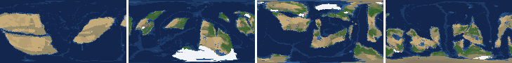

*At 100, 400, 700, 1000 Myr: sea by depth, land green by tree cover / tan where arid, shaded by height, ice white, lakes blue.*

| metric | min | median | max | outside (Myr: worst) |
|---|---|---|---|---|
| land_pct | 28.54 | 31.09 | 37.79 |  |
| cont_pct | 37.25 | 39.53 | 43.91 |  |
| cont_km | 31.80 | 34.14 | 36.64 |  |
| plates | 4.00 | 12.00 | 18.00 | 164-168: 4; 180-192: 4 |
| ocean_age | 19.00 | 44.85 | 67.70 | 60-104: 19.00 |
| speed | 2.58 | 5.85 | 10.65 | 56-112: 10.65 |
| sea_level | -548.40 | -16.65 | 201.80 | 172-236: -548.40 |
| sea_ice_m | -384.50 | -14.20 | -0.00 | 176-224: -384.50 |
| ice_pct | 0.00 | 1.10 | 13.10 | 176-220: 13.10 |
| temp | 1.00 | 15.80 | 20.50 | 160-224: 1.00 |
| co2 | -1.21 | -0.26 | 0.47 |  |
| dry_pct | 17.83 | 29.73 | 67.45 | 52-132: 67.45 |
| inland_pct | 1.48 | 9.09 | 33.27 | 56-56: 33.27; 112-112: 7.51; 124-124: 6.91; 136-172: 1.48; +14 more |
| lake_pct | 0.19 | 1.10 | 3.32 | 116-124: 0.19; 892-892: 3.32 |
| lake_max_mkm2 | 0.03 | 0.22 | 2.98 | 56-72: 2.13; 176-176: 1.25; 196-196: 1.71; 224-224: 1.02; +14 more |
| max_elev_km | 1.80 | 6.15 | 8.80 |  |
| trees_pct | 18.68 | 28.61 | 41.37 |  |
| npp | 223.70 | 352.30 | 426.20 |  |
| landmasses | 2.00 | 7.00 | 14.00 | 68-92: 2; 328-328: 2 |
| largest_pct | 6.40 | 17.30 | 33.10 |  |

### Seed 21, L6 (run 65e4c7)

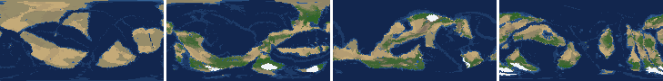

*At 100, 400, 700, 1000 Myr: sea by depth, land green by tree cover / tan where arid, shaded by height, ice white, lakes blue.*

| metric | min | median | max | outside (Myr: worst) |
|---|---|---|---|---|
| land_pct | 26.53 | 31.46 | 37.89 |  |
| cont_pct | 35.85 | 40.03 | 44.30 |  |
| cont_km | 32.77 | 33.92 | 36.11 |  |
| plates | 3.00 | 9.50 | 14.00 | 636-640: 4; 664-668: 4; 680-716: 3 |
| ocean_age | 20.50 | 47.40 | 80.80 | 72-104: 20.50 |
| speed | 2.56 | 5.54 | 9.82 | 64-112: 9.82 |
| sea_level | -228.70 | -52.40 | 182.70 |  |
| sea_ice_m | -131.10 | -15.60 | -0.00 |  |
| ice_pct | 0.00 | 1.30 | 6.40 |  |
| temp | 9.00 | 16.10 | 22.10 |  |
| co2 | -0.64 | -0.17 | 0.29 |  |
| dry_pct | 22.30 | 29.62 | 55.62 | 52-64: 55.62; 628-684: 51.47 |
| inland_pct | 1.48 | 7.18 | 32.95 | 56-56: 32.95; 116-172: 1.48; 204-248: 4.76; 260-392: 2.07; +9 more |
| lake_pct | 0.31 | 0.96 | 3.66 | 816-816: 3.18; 880-880: 3.66 |
| lake_max_mkm2 | 0.03 | 0.17 | 3.08 | 68-92: 2.02; 104-120: 2.83; 132-144: 2.07; 428-428: 1.31; +8 more |
| max_elev_km | 1.99 | 6.96 | 9.65 | 792-792: 9.65 |
| trees_pct | 14.63 | 29.18 | 47.80 |  |
| npp | 226.00 | 376.90 | 452.30 |  |
| landmasses | 1.00 | 6.00 | 14.00 | 52-60: 2; 208-208: 2; 248-256: 2; 268-268: 2; +4 more |
| largest_pct | 9.90 | 24.95 | 31.90 |  |

### Seed 3199, L6 (run b8b494)

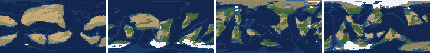

*At 100, 400, 700, 1000 Myr: sea by depth, land green by tree cover / tan where arid, shaded by height, ice white, lakes blue.*

| metric | min | median | max | outside (Myr: worst) |
|---|---|---|---|---|
| land_pct | 28.43 | 30.97 | 38.09 |  |
| cont_pct | 37.58 | 39.64 | 43.44 |  |
| cont_km | 32.05 | 34.16 | 36.88 |  |
| plates | 7.00 | 11.00 | 17.00 |  |
| ocean_age | 19.90 | 44.30 | 68.50 | 260-304: 19.90 |
| speed | 2.78 | 5.53 | 9.89 | 76-104: 9.89 |
| sea_level | -334.20 | -28.55 | 175.80 | 428-508: -334.20 |
| sea_ice_m | -204.90 | -17.40 | -0.00 |  |
| ice_pct | 0.00 | 1.30 | 8.50 |  |
| temp | 9.50 | 14.70 | 22.00 |  |
| co2 | -0.92 | -0.12 | 0.36 |  |
| dry_pct | 16.22 | 27.93 | 62.83 | 52-128: 62.83; 316-352: 48.91 |
| inland_pct | 1.03 | 7.49 | 23.77 | 68-76: 6.14; 88-88: 7.11; 116-132: 4.54; 236-244: 6.00; +10 more |
| lake_pct | 0.15 | 0.96 | 3.87 | 64-76: 0.15; 88-88: 0.18; 100-104: 0.17; 140-140: 3.87; +3 more |
| lake_max_mkm2 | 0.03 | 0.17 | 5.79 | 52-52: 1.29; 132-152: 5.79; 248-248: 2.06; 356-356: 1.46; +3 more |
| max_elev_km | 1.32 | 6.41 | 9.68 | 180-180: 9.68 |
| trees_pct | 19.10 | 33.64 | 44.35 |  |
| npp | 221.00 | 377.80 | 411.50 |  |
| landmasses | 2.00 | 8.00 | 18.00 | 52-60: 2; 276-276: 2 |
| largest_pct | 7.40 | 15.05 | 31.50 |  |

### Seed 42, L6 (run aad3b9)

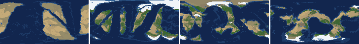

*At 100, 400, 700, 1000 Myr: sea by depth, land green by tree cover / tan where arid, shaded by height, ice white, lakes blue.*

| metric | min | median | max | outside (Myr: worst) |
|---|---|---|---|---|
| land_pct | 29.07 | 30.84 | 38.69 |  |
| cont_pct | 35.64 | 39.95 | 42.69 |  |
| cont_km | 32.51 | 34.06 | 38.20 |  |
| plates | 6.00 | 12.00 | 19.00 |  |
| ocean_age | 18.90 | 43.25 | 67.40 | 80-116: 18.90 |
| speed | 3.06 | 5.74 | 10.92 | 68-132: 10.92 |
| sea_level | -260.80 | -40.85 | 208.10 | 860-864: -260.80 |
| sea_ice_m | -127.80 | -16.95 | -0.00 |  |
| ice_pct | 0.00 | 1.30 | 6.10 |  |
| temp | 7.30 | 14.60 | 20.70 | 448-452: 7.30 |
| co2 | -1.01 | -0.24 | 0.36 |  |
| dry_pct | 16.96 | 33.51 | 70.79 | 52-124: 70.79; 168-176: 46.55; 188-300: 56.83 |
| inland_pct | 2.71 | 8.16 | 33.54 | 64-64: 33.54; 92-116: 6.26; 152-152: 7.81; 168-168: 5.40; +11 more |
| lake_pct | 0.18 | 1.13 | 5.66 | 56-56: 0.18; 88-92: 5.66; 160-160: 3.49; 292-292: 4.79; +4 more |
| lake_max_mkm2 | 0.04 | 0.26 | 7.31 | 64-76: 1.87; 88-92: 7.31; 104-112: 2.99; 128-128: 2.47; +18 more |
| max_elev_km | 1.87 | 6.02 | 8.85 |  |
| trees_pct | 12.97 | 33.50 | 48.69 |  |
| npp | 307.80 | 359.15 | 372.70 |  |
| landmasses | 2.00 | 7.00 | 14.00 | 52-88: 2; 216-228: 2; 244-252: 2 |
| largest_pct | 8.10 | 16.60 | 38.70 | 52-60: 38.70; 152-156: 35.40 |

### Seed 77, L6 (run a7bbfe)

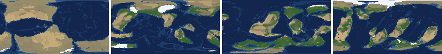

*At 100, 400, 700, 1000 Myr: sea by depth, land green by tree cover / tan where arid, shaded by height, ice white, lakes blue.*

| metric | min | median | max | outside (Myr: worst) |
|---|---|---|---|---|
| land_pct | 28.59 | 30.88 | 38.54 |  |
| cont_pct | 35.01 | 39.96 | 42.63 |  |
| cont_km | 32.42 | 34.91 | 39.52 |  |
| plates | 6.00 | 11.00 | 16.00 |  |
| ocean_age | 24.70 | 45.55 | 64.20 | 120-120: 24.70 |
| speed | 3.57 | 5.72 | 11.77 | 84-136: 11.77 |
| sea_level | -279.70 | -46.40 | 162.10 | 188-216: -278.80; 448-472: -279.70; 520-528: -264.80 |
| sea_ice_m | -231.20 | -56.85 | -0.00 |  |
| ice_pct | 0.00 | 3.25 | 8.90 |  |
| temp | 6.10 | 13.30 | 22.10 | 140-160: 6.10; 440-444: 7.20; 520-528: 7.00 |
| co2 | -2.05 | -0.27 | 0.46 | 164-188: -2.05 |
| dry_pct | 19.52 | 33.05 | 68.38 | 52-92: 68.38; 160-260: 53.90 |
| inland_pct | 1.40 | 8.29 | 37.15 | 56-56: 37.15; 96-120: 2.14; 144-144: 7.11; 188-188: 31.54; +15 more |
| lake_pct | 0.12 | 0.94 | 2.93 | 60-60: 0.15; 76-76: 0.17; 108-108: 0.19; 132-136: 0.12 |
| lake_max_mkm2 | 0.01 | 0.16 | 3.05 | 164-164: 3.05; 204-204: 1.08; 248-248: 1.06; 268-268: 1.05; +3 more |
| max_elev_km | 1.75 | 6.75 | 8.79 |  |
| trees_pct | 18.90 | 32.64 | 43.51 |  |
| npp | 222.40 | 363.05 | 390.30 |  |
| landmasses | 1.00 | 8.00 | 18.00 | 52-76: 1; 120-120: 2; 252-252: 2; 280-308: 1 |
| largest_pct | 6.50 | 19.40 | 38.60 | 52-64: 38.60 |

### Seed 505, L6 (run 04b655)

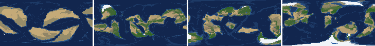

*At 100, 400, 700, 1000 Myr: sea by depth, land green by tree cover / tan where arid, shaded by height, ice white, lakes blue.*

| metric | min | median | max | outside (Myr: worst) |
|---|---|---|---|---|
| land_pct | 26.70 | 30.91 | 37.85 |  |
| cont_pct | 37.41 | 39.75 | 44.03 |  |
| cont_km | 31.73 | 33.96 | 37.17 |  |
| plates | 6.00 | 10.00 | 16.00 |  |
| ocean_age | 19.40 | 45.90 | 71.80 | 68-104: 19.40 |
| speed | 3.65 | 5.30 | 10.32 | 52-104: 10.32 |
| sea_level | -267.50 | -26.00 | 202.40 | 508-528: -267.50 |
| sea_ice_m | -154.20 | -22.00 | -0.00 |  |
| ice_pct | 0.00 | 1.45 | 7.70 |  |
| temp | 10.90 | 15.00 | 19.60 |  |
| co2 | -0.87 | -0.22 | 0.44 |  |
| dry_pct | 17.66 | 28.48 | 52.99 | 52-60: 51.92; 88-112: 52.99 |
| inland_pct | 2.22 | 6.87 | 32.31 | 52-52: 32.31; 92-136: 4.30; 160-160: 7.47; 232-232: 7.14; +4 more |
| lake_pct | 0.24 | 0.98 | 4.69 | 76-76: 3.05; 172-172: 4.69 |
| lake_max_mkm2 | 0.03 | 0.22 | 3.35 | 60-64: 1.52; 76-76: 3.35; 88-88: 2.88; 128-128: 1.23; +10 more |
| max_elev_km | 1.97 | 6.17 | 8.42 |  |
| trees_pct | 19.54 | 32.88 | 45.39 |  |
| npp | 235.80 | 376.40 | 410.50 |  |
| landmasses | 1.00 | 8.00 | 19.00 | 52-60: 2; 632-640: 1 |
| largest_pct | 6.60 | 15.90 | 31.70 |  |

## Determinism

Seed 1 L6 re-run to 100 Myr (run aaee71) against the sweep's run cde55b: 26 keyframes x 43 layers, **bit-identical** (layer hashes and frame stats).
