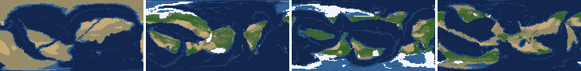
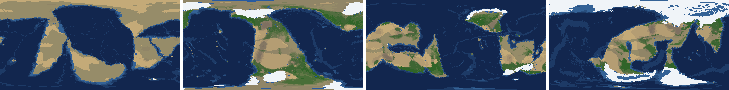
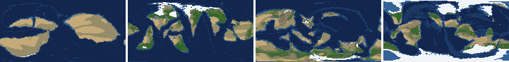
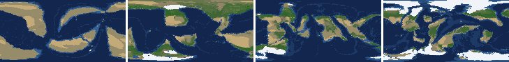
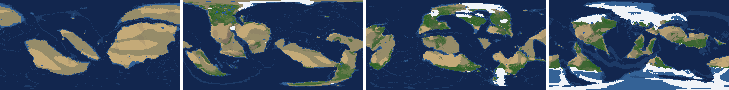
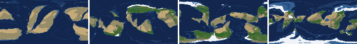
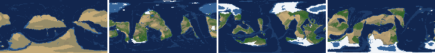
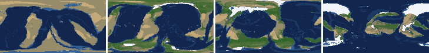

# Health check of the v1 8-planet batch, 2026-10-21 (PW-548, PW-202)

Measured on the batch's **existing** runs (no new simulation): `tools/health.py --manifest` on a hand-made manifest of the eight 1 Gyr runs (251 keyframes each, default params, `--every 4`). The tables further down are the tool's own output for these runs (its "seed" column is the run's random seed, see the key below). `tools/scorecard.py` was not run: it simulates the Earth climate and fresh seeds, so it can't measure existing runs. `tools/earth_check.py` checks the Earth world's climate, not these planets, so it was not relevant either. The numbers are from run keyframes (no slicing) on the code the runs were made with; the worlds are slices of the same runs at the times below.

## Key: planet, run, world

| planet | level | run | random seed | world (slice time) | zooms |
|---|---|---|---|---|---|
| L6 #1 | 6 | 9b685e | 932349 | dad91b (860 Myr + 236 kyr) | 6b59d2 362382 930fa1 66bd4e |
| L6 #2 | 6 | 0ecb0d | 934004 | 607540 (692 Myr + 294 kyr) | 54e8f2 bbd7e0 74f955 739e70 |
| L6 #3 | 6 | 865ea0 | 139851 | d14b89 (892 Myr + 300 kyr) | 5d0b74 2ac78f 343051 59e62e |
| L6 #4 | 6 | 3ff3f3 | 992242 | c00ebf (552 Myr + 300 kyr) | 360551 2d3bd6 1a7056 61b371 |
| L7 #1 | 7 | 1112ef | 469253 | 1144ce (712 Myr + 284 kyr) | 72857c 214990 bea8db 478ca0 |
| L7 #2 | 7 | 6a0029 | 496949 | 91448a (788 Myr + 192 kyr) | 106461 29250c 4270da 7379a5 |
| L7 #3 | 7 | 396621 | 110406 | 3e0b0a (672 Myr + 236 kyr) | fa7d30 37a60b 6bbe33 f0251b |
| L7 #4 | 7 | f9e085 | 684800 | 31926a (748 Myr + 236 kyr) | 439e2a cb1665 3b232b a009c1 |

## Verdict

The batch does not meet the ~70% seed pass bar when judged strictly. Of the six per-run checks (temperature range, peaks above 9.5 km, giant-lake frames, crust volume, ice sea level below -150 m, plate collapse), **all 8 runs fail giant-lake frames** (9.7-20.6% of keyframes against a 5% bar) and **all 8 fail ice sea level** (11.3-40.3% of keyframes below -150 m against 10%); L7 #1 adds one peak frame, L7 #2 adds plate-collapse frames (3.4% against 2%). Crust volume (0.967-1.039) and temperature range (11.6-19.6 C) pass everywhere. Most of what is outside the envelopes is already on the board (giant lakes PW-300/430, closed basins PW-054, cold-era sea level PW-434); two things are new (drafts below).

### Per-planet headline numbers at the slice time of its world
(Run keyframe nearest the world's time. Envelope misses are marked **bold**.)

| planet | land % | sea level m (ice part) | ice % | temp C | arid % of land | inland % | lakes % of land | largest lake Mkm2 | trees % | NPP | landmasses | largest % | plates |
|---|---|---|---|---|---|---|---|---|---|---|---|---|---|
| L6 #1 dad91b | 31.1 | **-361.5** (-159.5) | 9.2 | 11.3 | 20.7 | 12.6 | 2.14 | **1.88** | 40.4 | 374 | 9 | 27.3 | 8 |
| L6 #2 607540 | 35.0 | +29.4 (-11.7) | 1.0 | 12.8 | 36.8 | **6.3** | 0.52 | 0.27 | 21.7 | **178** | 8 | 31.2 | 10 |
| L6 #3 d14b89 | 32.7 | -181.9 (-56.8) | 2.9 | 13.0 | 25.4 | **5.3** | 0.61 | 0.57 | 23.2 | 352 | 10 | 18.7 | 10 |
| L6 #4 c00ebf | 31.4 | **-369.0** (-107.1) | 6.5 | 8.5 | 16.0 | 8.2 | 2.12 | **2.12** | 49.0 | (before flowering trees) | 8 | 21.9 | 8 |
| L7 #1 1144ce | 34.6 | +154.1 (-33.2) | 2.6 | 14.0 | 23.5 | 8.2 | 1.74 | **1.02** | 28.7 | (before flowering trees) | 17 | 15.1 | 13 |
| L7 #2 91448a | 30.6 | **-287.1** (-108.3) | 9.7 | 10.8 | 15.3 | **2.0** | 0.39 | 0.06 | 41.3 | 318 | 16 | 28.6 | 12 |
| L7 #3 3e0b0a | 32.8 | **-268.9** (-172.7) | 9.9 | 10.7 | 19.8 | **4.0** | 0.69 | 0.26 | 43.1 | (before flowering trees) | 17 | 21.0 | 10 |
| L7 #4 31926a | 35.1 | -45.1 (-12.8) | 1.4 | 16.5 | 22.7 | **2.7** | 0.43 | 0.04 | 33.8 | (before flowering trees) | 14 | 33.6 | 9 |

(The NPP column is blank where the world was sliced before flowering trees; the tool gates NPP and tree-cover checks on the plant groups.) Land %, continental crust %, crust thickness, plate count, ocean age, plate speed and peak height are inside their envelopes at every slice time.

### Share of keyframes (after the 50 Myr spin-up) outside each envelope, per run (%)

| planet | sea level | ice % | inland % | lakes % | largest lake | other |
|---|---|---|---|---|---|---|
| L6 #1 | 34 | 24 | 72 | 17 | 21 | trees 8, temp 5 |
| L6 #2 | 36 | 24 | 74 | 12 | 10 | ice sea level 15, NPP 27, largest landmass 8 |
| L6 #3 | 32 | 7 | 89 | 16 | 10 | NPP 17, arid 7 |
| L6 #4 | 33 | 2 | 92 | 13 | 10 | temp 7, NPP 15, trees 6 |
| L7 #1 | 33 | 19 | 78 | 11 | 16 | arid 6, sea-level-from-ice 6 |
| L7 #2 | 45 | 21 | 81 | 15 | 18 | plates <= 4 in 3.4% of frames, largest 7 |
| L7 #3 | 48 | 29 | 83 | 13 | 16 | ice sea level 26, temp 13, arid 10 |
| L7 #4 | 26 | 12 | 80 | 17 | 19 | largest landmass 26, ice sea level 4 |

## What looks wrong

1. **Sea level runs far below the envelope in every run.** The total sea level (ice plus ocean-basin term) has a median of -65 to -240 m but falls to -520..-1055 m at its lowest and ends the 1 Gyr at **-370 to -600 m in 7 of 8 runs** (only L6 #1 ends at +47 m). 26-48% of each run's frames are outside the -250..+300 m band (almost all of it below). The ice part alone is less extreme (the run-level `sea_ice_below_150` check fails in 6 of 8, up to 40%). Four of the eight worlds were sliced at a moment when sea level was already below -250 m (L6 #1 -361, L6 #4 -369, L7 #2 -287, L7 #3 -269), so those worlds show a land bridge/shelf-exposed planet, and their coasts and zoom shorelines sit on far more exposed shelf than any "sea level" world should. The existing ticket PW-434 (cold eras deepen after PW-366) is the same problem (its worst -368..-609 m is the same order as this batch's ends); this batch adds that the total sea level, not just the ice part, is deep at the end of 7 of 8 runs. Draft filed (below) with the evidence, plus one for the slice-time choice.
2. **Giant lakes persist.** 9.7-20.6% of keyframes carry a lake over 1 Mkm2 (bar 5%); largest 5.4-12.9 Mkm2 (L7 #4 reaches 12.9 Mkm2 at 568-596 Myr, 35 times the Caspian); two worlds (L6 #1 1.88, L6 #4 2.12 Mkm2) were sliced with such a lake. This is PW-300 / PW-430's territory (giant closed lakes), so these are more cases for it; the draft below adds the batch numbers.
3. **Too little inland drainage.** 72-92% of keyframes are under the 8% inland bar; at slice time 5 of 8 are under (2.0-6.3%). Known: PW-054.
4. **Plate collapse in L7 #2:** 3.4% of keyframes have <= 4 plates (bar 2%), and the run ends with 9 plates. Isolated; one seed in eight is inside the 70% bar's tolerance, but the PW-191 mechanism may still be live. Not filed separately.
5. **One peak over 9.5 km in L7 #1** (1 frame of 251; the PW-172 clamp is not meant to allow it). Cosmetic at one frame; noted only.
6. **NPP below 200 in L6 #2/#3/#4 for 15-27% of frames**, i.e. mostly the years right after flowering trees appear. Expected from the stand-in growth rule noted in the envelope table; not a new problem.

Fine: determinism not re-run (no simulations were started); crust volume ratio 0.967-1.039 everywhere; temperature range 11.6-19.6 C; plate speed, ocean age, continental crust % and thickness all inside their envelopes.

## Seed pass rate against the ~70% bar

Counting a run as passing when it fails none of the per-run checks, 0 of 8 pass (giant lakes and ice sea level fail everywhere). Counting only the checks that are not already tracked as open problems (temperature range, peaks, crust volume, plate collapse), 6 of 8 pass (75%; L7 #1 has a peak frame and L7 #2 plate-collapse frames). The batch is a representative sample of the known giant-lake, sea-level and closed-basin problems rather than a sign of a new regression; none of the eight planets is an outlier against the others on the measures that matter (all land %, crust % and plate counts are in band).

---

(The rest of this file is `tools/health.py`'s generated report for the eight runs; regenerate with `PLANET_DATA=<main checkout> uv run python tools/health.py --manifest docs/review/health/2026-10-21-batch/sweep.json --out docs/review/health/2026-10-21-batch`, which overwrites this hand-written top part.)

# Health sweep 2026-10-21 00:00

Commit existing batch runs (no new simulations). 8 runs (default params, `--every 4`) at 0 workers x 0 numba threads; simulations 0.0 min wall. Made by `tools/health.py` (PW-246).

## Runs

| seed | L | Myr | run | sim s | trees / flowering trees from | dT range C | peaks > 9.5 km | giant-lake frames % | crust volume end/start | ice SL < -150 m % | <= 4 plates % |
|---|---|---|---|---|---|---|---|---|---|---|---|
| 932349 | 6 | 1000 | 9b685e | 996 | 208 / 712 | 15.2 | 0 | 20.6 | 0.972 | 26.1 | 0.0 |
| 934004 | 6 | 1000 | 0ecb0d | 1193 | 228 / 676 | 14.1 | 0 | 9.7 | 1.039 | 36.1 | 0.0 |
| 139851 | 6 | 1000 | 865ea0 | 1045 | 236 / 772 | 14.5 | 0 | 10.1 | 0.975 | 11.3 | 0.0 |
| 992242 | 6 | 1000 | 3ff3f3 | 1088 | 244 / 760 | 17.5 | 0 | 10.1 | 0.99 | 13.9 | 0.0 |
| 469253 | 7 | 1000 | 1112ef | 11594 | 200 / 752 | 11.6 | 1 | 15.5 | 1.013 | 18.1 | 0.0 |
| 496949 | 7 | 1000 | 6a0029 | 11127 | 240 / 772 | 14.4 | 0 | 17.6 | 1.002 | 24.4 | 3.4 |
| 110406 | 7 | 1000 | 396621 | 12579 | 232 / 740 | 18.6 | 0 | 16.0 | 1.013 | 40.3 | 0.0 |
| 684800 | 7 | 1000 | f9e085 | 10644 | 232 / 824 | 19.6 | 0 | 18.9 | 0.967 | 12.2 | 0.0 |

## Medians by seed (after 50 Myr; tree cover after forests, NPP after flowering trees appear)

| seed | L | land_pct | cont_pct | cont_km | plates | ocean_age | speed | sea_level | sea_ice_m | ice_pct | temp | co2 | dry_pct | inland_pct | lake_pct | lake_max_mkm2 | max_elev_km | trees_pct | npp | landmasses | largest_pct |
|---|---|---|---|---|---|---|---|---|---|---|---|---|---|---|---|---|---|---|---|---|---|
| 932349 | 6 | 32.4 | 41.3 | 33.8 | 11.0 | 66.3 | 4.1 | -208.1 | -45.5 | 3.2 | 11.5 | -0.2 | 27.5 | 4.5 | 0.4 | 0.1 | 5.4 | 31.8 | 371.8 | 7.0 | 27.6 |
| 934004 | 6 | 32.7 | 41.0 | 34.6 | 11.0 | 53.9 | 4.3 | -124.7 | -54.7 | 4.9 | 11.9 | -0.5 | 28.7 | 5.4 | 0.5 | 0.1 | 6.2 | 28.4 | 317.6 | 8.0 | 30.0 |
| 139851 | 6 | 32.5 | 40.7 | 33.4 | 11.0 | 59.9 | 4.0 | -147.1 | -48.8 | 3.6 | 13.8 | -0.4 | 20.5 | 3.0 | 0.5 | 0.1 | 6.1 | 27.5 | 334.8 | 8.0 | 20.5 |
| 992242 | 6 | 32.9 | 41.2 | 33.4 | 10.0 | 63.1 | 3.8 | -93.6 | -26.1 | 2.2 | 14.9 | -0.4 | 23.7 | 2.9 | 0.4 | 0.1 | 5.9 | 28.4 | 338.5 | 7.0 | 22.2 |
| 469253 | 7 | 33.4 | 39.8 | 35.0 | 13.5 | 55.5 | 4.1 | -66.3 | -70.8 | 5.5 | 13.5 | -0.2 | 21.4 | 5.1 | 0.6 | 0.2 | 8.3 | 33.0 | 344.0 | 18.0 | 17.1 |
| 496949 | 7 | 33.5 | 40.3 | 34.9 | 11.0 | 60.0 | 4.0 | -242.0 | -58.2 | 5.5 | 13.5 | -0.2 | 21.8 | 3.7 | 0.5 | 0.2 | 8.4 | 33.1 | 369.6 | 14.0 | 26.4 |
| 110406 | 7 | 34.8 | 40.5 | 34.6 | 11.0 | 59.2 | 4.2 | -220.6 | -76.3 | 6.0 | 12.7 | -0.8 | 20.5 | 4.8 | 0.6 | 0.2 | 8.5 | 30.5 | 359.8 | 17.0 | 23.9 |
| 684800 | 7 | 34.7 | 40.0 | 34.4 | 10.0 | 61.5 | 4.1 | -121.5 | -34.3 | 2.6 | 13.4 | -0.2 | 20.7 | 3.0 | 0.6 | 0.2 | 8.4 | 33.4 | 373.9 | 13.0 | 33.2 |

Measured on the run's keyframes (no slicing). A keyframe's rivers and lakes are routed on its own terrain (PW-239), so `inland_raw_pct` (every routed end on land, as highlights counts it) and `inland_pct` (ends that are closed lakes, salt pans or real pits) agree but for ends under land ice. Land ice and land shares use cells (near-equal area).

## Envelopes

| metric | low | high | Earth | source |
|---|---|---|---|---|
| land, % of surface (`land_pct`) | 22 | 42 | 29.20 | tests/test_envelopes.py (22-42%); Earth 29.2% |
| continental crust, % of surface (`cont_pct`) | 33 | 50 | 41 | tests/test_envelopes.py (33-50%); Earth ~41% with shelves (Cogley 1984) |
| mean continental crust thickness, km (`cont_km`) | 31 | 40 | 39 | target 35 km (PW-238, continental_thickness); Earth ~39 km (Christensen & Mooney 1995); known thinning to 32-33 km (PW-046) |
| plates (`plates`) | 5 | 30 | 15 | tests/test_envelopes.py (5-30; max_plates 30); Earth 7 major + ~8 minor; <= 4 is the PW-191 collapse |
| mean ocean-floor age, Myr (`ocean_age`) | 25 | 120 | 64 | tests/test_envelopes.py (25-120); Earth ~64 Myr (Mueller et al. 2008); PW-051 |
| mean plate speed, cm/yr (`speed`) | 2 | 9 | 4.50 | tests/test_envelopes.py (2-9 cm/yr); Earth ~4-5 |
| sea level, m (ice + ocean basins) (`sea_level`) | -250 | 300 | 0 | Phanerozoic ~-130 (LGM) .. +250 m (earth.py; Haq & Schutter 2008); -250: PW-240's hard goal |
| sea level from land ice, m (`sea_ice_m`) | -250 | - | 0 | Earth LGM ~-130 m; PW-240 goal -150 m typical / -250 m worst |
| land ice, % of surface (`ice_pct`) | - | 10 | 3.10 | Earth 3.1% now (earth.EARTH_ICE), ~7-8% at the LGM |
| global mean temperature, C (`temp`) | 8 | 30 | 14.50 | Earth 14.5 C; LGM ~8 C (Tierney et al. 2020); Phanerozoic hothouses to ~30 C (Scotese et al. 2021) |
| CO2 index (ln(source/sink) / WEATHER_CO2) (`co2`) | -3.0 | 3.0 | 0.00 | the forcing's clip in earth.py (+-CO2_MAX = 3); Earth 0 |
| arid (Koppen B), % of land (`dry_pct`) | 12 | 45 | 30 | tests/test_envelopes.py (12-45%); Earth ~30% (Beck et al. 2018) |
| land draining inland, % of ice-free land (to a closed lake, salt pan or real pit) (`inland_pct`) | 8 | 30 | 18 | Earth ~18% (overview 2.9); L6 known ~9.5-11% (PW-054, PW-243). `inland_raw_pct` (not checked) follows the stored `downstream` to any end, as highlights does; since PW-239 the two agree but for ends under land ice |
| lakes, % of land (`lake_pct`) | 0.2 | 3.0 | 1.80 | Earth ~1.8% of ice-free land (HydroLAKES, Messager et al. 2016); generated L6 worlds 0.5-1% |
| largest lake, million km2 (`lake_max_mkm2`) | - | 1.0 | 0.37 | Caspian 0.37 Mkm2; 1 Mkm2 = the overview's giant lake (2.9) |
| highest peak, km (`max_elev_km`) | - | 9.5 | 8.85 | Everest 8.85 km; PW-172 (spikes above ~9.5 km) |
| tree cover, % of ice-free land (after forests appear) (`trees_pct`) | 10 | 50 | 30 | Earth ~30% potential canopy (forest 55-60 of ~130 Mkm2, overview 2.18) |
| land NPP, g C/m2/yr (after flowering trees appear) (`npp`) | 200 | 700 | 430 | Earth ~56 Pg C/yr over ~130 Mkm2 = ~430; the model on Earth's terrain 50 Pg C/yr, ~385 (overview 2.18). Before flowering trees (plant group 4) stand-ins grow at 70%, so runs sit at ~150-280 |
| landmasses (>= 3 cells) (`landmasses`) | 3 | 80 | - | loose: a lone supercontinent or a shattered archipelago |
| largest landmass, % of surface (`largest_pct`) | 5 | 35 | 16.60 | Afro-Eurasia 16.6%; a Pangaea ~30% (scorecard largest_max) |
| global temperature range over the run, C (`dT_range`, per run) | - | 25 | 25 | Phanerozoic 11-36 C (Scotese et al. 2021) |
| keyframes with a peak above 9.5 km (`peak_frames`, per run) | - | 0 | 0 | PW-172 (L7 seed 3199: 3 of 251) |
| % of keyframes with a lake over 1 Mkm2 (`giant_lake_frames`, per run) | - | 5 | 0 | overview 2.9 (L6: 3 of ~150 frames) |
| continental crust volume, end / start (`volume_ratio`, per run) | 0.9 | 1.1 | 1.0 | scorecard volume_ratio (x1.006) |
| % of keyframes with ice sea level below -150 m (`sea_ice_below_150`, per run) | - | 10 | 0 | PW-240 |
| % of keyframes with <= 4 plates (`low_plates`, per run) | - | 2 | 0 | PW-191 (L7 seed 21: 1%) |

## Top outliers (of 361 spells; severity = excess / band width x (0.2 + share of the run))

| seed | L | metric | Myr | frames | worst | envelope | severity |
|---|---|---|---|---|---|---|---|
| 932349 | 6 | giant_lake_frames | run | - | 20.60 | -..5 | 3.12 |
| 110406 | 7 | sea_ice_below_150 | run | - | 40.30 | -..10 | 3.03 |
| 684800 | 7 | lake_max_mkm2 | 920-996 | 19 | 11.24 | -..1.0 | 2.825 |
| 684800 | 7 | giant_lake_frames | run | - | 18.90 | -..5 | 2.78 |
| 684800 | 7 | lake_max_mkm2 | 568-596 | 5 | 12.90 | -..1.0 | 2.617 |
| 934004 | 6 | sea_ice_below_150 | run | - | 36.10 | -..10 | 2.61 |
| 496949 | 7 | giant_lake_frames | run | - | 17.60 | -..5 | 2.52 |
| 110406 | 7 | giant_lake_frames | run | - | 16.00 | -..5 | 2.2 |
| 496949 | 7 | lake_max_mkm2 | 320-372 | 14 | 9.33 | -..1.0 | 2.131 |
| 469253 | 7 | giant_lake_frames | run | - | 15.50 | -..5 | 2.1 |
| 469253 | 7 | lake_max_mkm2 | 360-360 | 1 | 10.93 | -..1.0 | 2.026 |
| 684800 | 7 | lake_max_mkm2 | 608-608 | 1 | 10.62 | -..1.0 | 1.963 |
| 496949 | 7 | lake_max_mkm2 | 268-268 | 1 | 10.45 | -..1.0 | 1.927 |
| 932349 | 6 | sea_ice_below_150 | run | - | 26.10 | -..10 | 1.61 |
| 496949 | 7 | sea_ice_below_150 | run | - | 24.40 | -..10 | 1.44 |
| 110406 | 7 | lake_max_mkm2 | 476-532 | 15 | 5.77 | -..1.0 | 1.24 |
| 139851 | 6 | lake_max_mkm2 | 160-216 | 13 | 5.84 | -..1.0 | 1.219 |
| 934004 | 6 | lake_max_mkm2 | 244-252 | 2 | 6.30 | -..1.0 | 1.102 |
| 139851 | 6 | giant_lake_frames | run | - | 10.10 | -..5 | 1.02 |
| 992242 | 6 | giant_lake_frames | run | - | 10.10 | -..5 | 1.02 |
| 469253 | 7 | peak_frames | run | - | 1 | -..0 | 1.0 |
| 934004 | 6 | lake_max_mkm2 | 192-228 | 9 | 5.19 | -..1.0 | 0.989 |
| 992242 | 6 | lake_max_mkm2 | 140-140 | 1 | 5.82 | -..1.0 | 0.982 |
| 684800 | 7 | lake_max_mkm2 | 244-268 | 7 | 5.14 | -..1.0 | 0.944 |
| 992242 | 6 | lake_max_mkm2 | 372-372 | 1 | 5.62 | -..1.0 | 0.942 |
| 934004 | 6 | giant_lake_frames | run | - | 9.70 | -..5 | 0.94 |
| 932349 | 6 | lake_max_mkm2 | 392-392 | 1 | 5.37 | -..1.0 | 0.891 |
| 496949 | 7 | lake_max_mkm2 | 172-192 | 6 | 4.97 | -..1.0 | 0.89 |
| 110406 | 7 | sea_ice_m | 172-324 | 39 | -863.70 | -250..- | 0.872 |
| 110406 | 7 | lake_max_mkm2 | 156-156 | 1 | 5.12 | -..1.0 | 0.841 |

## Per seed: min / median / max after the 50 Myr spin-up, and spells outside the envelopes

### Seed 932349, L6 (run 9b685e)

*At 100, 400, 700, 1000 Myr: sea by depth, land green by tree cover / tan where arid, shaded by height, ice white, lakes blue.*

| metric | min | median | max | outside (Myr: worst) |
|---|---|---|---|---|
| land_pct | 27.66 | 32.36 | 38.33 |  |
| cont_pct | 36.30 | 41.30 | 43.99 |  |
| cont_km | 31.22 | 33.83 | 37.23 |  |
| plates | 5.00 | 11.00 | 17.00 |  |
| ocean_age | 33.50 | 66.30 | 80.60 |  |
| speed | 2.25 | 4.06 | 7.62 |  |
| sea_level | -642.80 | -208.10 | 177.40 | 168-228: -532.70; 536-552: -264.70; 628-864: -642.80 |
| sea_ice_m | -254.20 | -45.55 | -0.00 | 764-764: -254.20 |
| ice_pct | 0.00 | 3.20 | 14.20 | 168-220: 14.20; 672-792: 13.30; 804-844: 11.00 |
| temp | 6.30 | 11.50 | 21.50 | 168-172: 7.10; 400-412: 6.30; 632-632: 7.70; 672-680: 7.70; +1 more |
| co2 | -1.45 | -0.16 | 1.39 |  |
| dry_pct | 13.71 | 27.47 | 48.33 | 52-60: 48.33 |
| inland_pct | 0.56 | 4.52 | 27.39 | 52-164: 0.69; 192-196: 4.81; 216-232: 3.45; 244-308: 2.15; +4 more |
| lake_pct | 0.00 | 0.43 | 4.21 | 52-116: 0.00; 168-168: 3.34; 180-188: 4.21; 312-312: 3.11; +8 more |
| lake_max_mkm2 | 0.00 | 0.11 | 5.37 | 160-168: 2.68; 180-188: 3.27; 312-320: 4.01; 336-336: 1.67; +10 more |
| max_elev_km | 1.56 | 5.38 | 9.03 |  |
| trees_pct | 19.66 | 31.84 | 58.46 | 676-724: 58.46; 740-744: 50.63 |
| npp | 222.80 | 371.80 | 435.60 |  |
| landmasses | 2.00 | 7.00 | 15.00 | 176-176: 2; 196-196: 2 |
| largest_pct | 9.30 | 27.60 | 35.00 |  |

### Seed 934004, L6 (run 0ecb0d)

*At 100, 400, 700, 1000 Myr: sea by depth, land green by tree cover / tan where arid, shaded by height, ice white, lakes blue.*

| metric | min | median | max | outside (Myr: worst) |
|---|---|---|---|---|
| land_pct | 28.84 | 32.70 | 37.70 |  |
| cont_pct | 33.36 | 40.98 | 44.44 |  |
| cont_km | 32.87 | 34.62 | 39.48 |  |
| plates | 6.00 | 11.00 | 16.00 |  |
| ocean_age | 31.10 | 53.90 | 78.40 |  |
| speed | 2.22 | 4.30 | 7.81 |  |
| sea_level | -770.50 | -124.70 | 204.00 | 432-568: -770.50; 764-884: -420.70; 924-1000: -468.00 |
| sea_ice_m | -667.70 | -54.70 | -0.00 | 436-560: -667.70; 832-836: -254.60; 996-1000: -294.00 |
| ice_pct | 0.00 | 4.90 | 19.40 | 436-556: 19.40; 800-892: 12.30; 992-1000: 11.20 |
| temp | 7.00 | 11.95 | 21.10 | 492-496: 7.00; 556-568: 7.40 |
| co2 | -1.50 | -0.49 | 0.70 |  |
| dry_pct | 10.28 | 28.66 | 44.54 | 500-520: 10.28 |
| inland_pct | 0.50 | 5.38 | 33.31 | 52-188: 0.50; 232-236: 6.67; 252-252: 33.31; 312-312: 7.06; +7 more |
| lake_pct | 0.01 | 0.50 | 6.19 | 52-100: 0.01; 112-124: 0.10; 196-196: 3.15; 212-228: 4.37; +7 more |
| lake_max_mkm2 | 0.01 | 0.11 | 6.30 | 56-56: 2.03; 192-228: 5.19; 244-252: 6.30; 320-320: 1.06; +6 more |
| max_elev_km | 1.82 | 6.24 | 8.51 |  |
| trees_pct | 19.19 | 28.37 | 49.79 |  |
| npp | 165.50 | 317.55 | 402.50 | 676-764: 165.50 |
| landmasses | 1.00 | 8.00 | 20.00 | 932-940: 1 |
| largest_pct | 10.30 | 30.00 | 38.10 | 932-1000: 38.10 |

### Seed 139851, L6 (run 865ea0)

*At 100, 400, 700, 1000 Myr: sea by depth, land green by tree cover / tan where arid, shaded by height, ice white, lakes blue.*

| metric | min | median | max | outside (Myr: worst) |
|---|---|---|---|---|
| land_pct | 29.22 | 32.52 | 38.00 |  |
| cont_pct | 37.07 | 40.72 | 43.63 |  |
| cont_km | 31.29 | 33.38 | 36.80 |  |
| plates | 5.00 | 11.00 | 18.00 |  |
| ocean_age | 39.70 | 59.90 | 86.20 |  |
| speed | 1.07 | 4.04 | 7.67 | 900-928: 1.07 |
| sea_level | -660.90 | -147.05 | 138.70 | 180-224: -625.20; 632-688: -402.50; 736-804: -290.70; 836-872: -483.40; +1 more |
| sea_ice_m | -268.80 | -48.75 | -0.00 | 972-988: -268.80 |
| ice_pct | 0.00 | 3.60 | 13.60 | 188-216: 13.60; 972-1000: 11.80 |
| temp | 7.60 | 13.80 | 22.10 | 920-928: 7.60 |
| co2 | -1.75 | -0.43 | 0.88 |  |
| dry_pct | 10.82 | 20.50 | 52.23 | 84-104: 52.23; 720-760: 10.82 |
| inland_pct | 0.18 | 2.96 | 25.60 | 60-64: 3.52; 76-148: 0.51; 220-1000: 0.18 |
| lake_pct | 0.01 | 0.46 | 5.11 | 52-64: 0.03; 80-132: 0.01; 192-216: 5.11; 328-328: 0.19; +7 more |
| lake_max_mkm2 | 0.01 | 0.10 | 5.84 | 72-76: 2.85; 160-216: 5.84; 268-268: 4.05; 412-416: 1.49; +4 more |
| max_elev_km | 1.41 | 6.13 | 9.09 |  |
| trees_pct | 13.40 | 27.53 | 49.25 |  |
| npp | 172.80 | 334.80 | 411.60 | 772-792: 172.80; 812-824: 181.90 |
| landmasses | 2.00 | 8.00 | 16.00 | 60-64: 2; 220-220: 2 |
| largest_pct | 7.80 | 20.50 | 34.50 |  |

### Seed 992242, L6 (run 3ff3f3)

*At 100, 400, 700, 1000 Myr: sea by depth, land green by tree cover / tan where arid, shaded by height, ice white, lakes blue.*

| metric | min | median | max | outside (Myr: worst) |
|---|---|---|---|---|
| land_pct | 30.95 | 32.94 | 38.08 |  |
| cont_pct | 36.88 | 41.19 | 43.67 |  |
| cont_km | 31.70 | 33.35 | 36.53 |  |
| plates | 5.00 | 10.00 | 14.00 |  |
| ocean_age | 32.30 | 63.10 | 89.80 |  |
| speed | 1.90 | 3.79 | 7.22 | 736-736: 1.90 |
| sea_level | -541.10 | -93.60 | 200.00 | 448-592: -541.10; 612-660: -272.30; 892-1000: -510.10 |
| sea_ice_m | -239.70 | -26.05 | -0.00 |  |
| ice_pct | 0.00 | 2.25 | 11.00 | 476-492: 11.00 |
| temp | 4.70 | 14.95 | 22.20 | 472-532: 4.70 |
| co2 | -1.43 | -0.44 | 0.99 |  |
| dry_pct | 12.66 | 23.68 | 44.68 |  |
| inland_pct | 0.42 | 2.91 | 11.97 | 52-256: 0.74; 268-328: 2.54; 348-464: 1.49; 496-1000: 0.42 |
| lake_pct | 0.01 | 0.42 | 4.09 | 52-72: 0.06; 88-140: 3.71; 156-160: 0.17; 372-372: 4.09; +4 more |
| lake_max_mkm2 | 0.01 | 0.09 | 5.82 | 92-92: 2.03; 140-140: 5.82; 320-320: 2.33; 332-352: 3.92; +4 more |
| max_elev_km | 1.47 | 5.88 | 8.43 |  |
| trees_pct | 14.42 | 28.42 | 53.36 | 512-532: 53.36; 556-572: 51.48 |
| npp | 155.40 | 338.50 | 408.50 | 760-796: 155.40 |
| landmasses | 2.00 | 7.00 | 15.00 | 56-64: 2; 308-308: 2; 492-492: 2 |
| largest_pct | 10.90 | 22.20 | 33.10 |  |

### Seed 469253, L7 (run 1112ef)

*At 100, 400, 700, 1000 Myr: sea by depth, land green by tree cover / tan where arid, shaded by height, ice white, lakes blue.*

| metric | min | median | max | outside (Myr: worst) |
|---|---|---|---|---|
| land_pct | 30.77 | 33.36 | 38.70 |  |
| cont_pct | 36.03 | 39.79 | 42.14 |  |
| cont_km | 33.66 | 34.95 | 37.80 |  |
| plates | 6.00 | 13.50 | 21.00 |  |
| ocean_age | 34.50 | 55.55 | 73.20 |  |
| speed | 2.38 | 4.06 | 7.50 |  |
| sea_level | -518.30 | -66.30 | 206.90 | 468-604: -518.30; 828-1000: -418.50 |
| sea_ice_m | -288.40 | -70.80 | -0.00 | 524-576: -288.40 |
| ice_pct | 0.00 | 5.50 | 13.70 | 532-580: 11.10; 872-1000: 13.70 |
| temp | 8.50 | 13.50 | 20.10 |  |
| co2 | -1.70 | -0.23 | 1.24 |  |
| dry_pct | 9.16 | 21.44 | 42.51 | 444-492: 9.16; 628-628: 11.79 |
| inland_pct | 0.77 | 5.14 | 28.78 | 52-192: 1.24; 212-220: 6.48; 236-288: 3.65; 300-304: 2.67; +7 more |
| lake_pct | 0.06 | 0.58 | 8.67 | 52-60: 0.07; 72-112: 0.06; 124-140: 0.06; 208-208: 3.32; +4 more |
| lake_max_mkm2 | 0.01 | 0.16 | 10.93 | 192-192: 1.06; 204-208: 2.34; 292-308: 2.75; 344-344: 1.92; +8 more |
| max_elev_km | 3.64 | 8.26 | 9.68 | 336-336: 9.68 |
| trees_pct | 12.28 | 33.03 | 48.13 |  |
| npp | 238.40 | 344.00 | 390.50 |  |
| landmasses | 6.00 | 18.00 | 45.00 |  |
| largest_pct | 8.50 | 17.15 | 36.40 | 148-172: 36.40 |

### Seed 496949, L7 (run 6a0029)

*At 100, 400, 700, 1000 Myr: sea by depth, land green by tree cover / tan where arid, shaded by height, ice white, lakes blue.*

| metric | min | median | max | outside (Myr: worst) |
|---|---|---|---|---|
| land_pct | 29.49 | 33.46 | 37.99 |  |
| cont_pct | 36.81 | 40.29 | 42.37 |  |
| cont_km | 33.16 | 34.85 | 36.91 |  |
| plates | 4.00 | 11.00 | 16.00 | 176-204: 4 |
| ocean_age | 35.40 | 60.00 | 81.50 |  |
| speed | 2.21 | 3.97 | 8.10 |  |
| sea_level | -718.00 | -242.00 | 200.60 | 180-268: -718.00; 452-488: -308.20; 568-592: -255.60; 736-1000: -542.80 |
| sea_ice_m | -434.20 | -58.20 | -0.00 | 204-220: -390.10; 244-260: -434.20 |
| ice_pct | 0.00 | 5.50 | 14.40 | 192-264: 12.70; 740-780: 14.40; 804-880: 11.50 |
| temp | 6.50 | 13.50 | 20.90 | 812-812: 7.90; 824-824: 7.40; 848-860: 6.50 |
| co2 | -2.71 | -0.24 | 0.77 |  |
| dry_pct | 8.62 | 21.81 | 42.07 | 732-768: 8.62 |
| inland_pct | 0.75 | 3.74 | 29.68 | 60-164: 0.75; 196-292: 2.84; 304-304: 7.17; 376-552: 1.83; +3 more |
| lake_pct | 0.02 | 0.54 | 7.23 | 60-108: 0.02; 120-124: 0.11; 180-192: 5.55; 268-268: 7.23; +2 more |
| lake_max_mkm2 | 0.01 | 0.18 | 10.45 | 160-160: 2.51; 172-192: 4.97; 268-268: 10.45; 320-372: 9.33; +8 more |
| max_elev_km | 2.77 | 8.39 | 9.24 |  |
| trees_pct | 24.98 | 33.08 | 63.03 | 740-768: 63.03 |
| npp | 301.60 | 369.60 | 417.90 |  |
| landmasses | 3.00 | 14.00 | 34.00 |  |
| largest_pct | 10.60 | 26.35 | 37.00 | 536-552: 35.40; 564-592: 35.60; 844-864: 37.00 |

### Seed 110406, L7 (run 396621)

*At 100, 400, 700, 1000 Myr: sea by depth, land green by tree cover / tan where arid, shaded by height, ice white, lakes blue.*

| metric | min | median | max | outside (Myr: worst) |
|---|---|---|---|---|
| land_pct | 28.79 | 34.84 | 38.89 |  |
| cont_pct | 35.79 | 40.50 | 42.53 |  |
| cont_km | 33.37 | 34.62 | 37.51 |  |
| plates | 5.00 | 11.00 | 16.00 |  |
| ocean_age | 31.00 | 59.20 | 107.40 |  |
| speed | 2.09 | 4.24 | 7.36 |  |
| sea_level | -1054.80 | -220.60 | 226.10 | 168-356: -1054.80; 672-896: -500.30; 964-1000: -421.40 |
| sea_ice_m | -863.70 | -76.35 | -0.00 | 172-324: -863.70; 716-776: -346.90; 792-816: -298.90 |
| ice_pct | 0.00 | 6.00 | 22.80 | 168-332: 22.80; 676-684: 10.80; 716-780: 13.30; 792-820: 11.20 |
| temp | 3.60 | 12.70 | 22.20 | 208-248: 6.00; 264-324: 3.60; 364-380: 6.40 |
| co2 | -2.02 | -0.76 | 0.63 |  |
| dry_pct | 7.06 | 20.51 | 55.11 | 52-64: 55.11; 164-248: 7.06 |
| inland_pct | 0.22 | 4.79 | 28.22 | 72-204: 0.22; 224-276: 2.95; 296-328: 3.65; 348-412: 2.85; +3 more |
| lake_pct | 0.01 | 0.63 | 5.84 | 56-136: 0.01; 156-156: 3.45; 356-356: 3.69; 464-464: 3.80; +2 more |
| lake_max_mkm2 | 0.01 | 0.21 | 5.77 | 52-52: 3.03; 144-144: 1.56; 156-156: 5.12; 252-252: 1.86; +10 more |
| max_elev_km | 2.65 | 8.50 | 9.49 |  |
| trees_pct | 17.50 | 30.48 | 56.65 | 724-736: 56.03; 748-776: 56.65 |
| npp | 218.60 | 359.80 | 404.00 |  |
| landmasses | 6.00 | 17.00 | 35.00 |  |
| largest_pct | 8.50 | 23.95 | 36.60 | 776-804: 36.60 |

### Seed 684800, L7 (run f9e085)

*At 100, 400, 700, 1000 Myr: sea by depth, land green by tree cover / tan where arid, shaded by height, ice white, lakes blue.*

| metric | min | median | max | outside (Myr: worst) |
|---|---|---|---|---|
| land_pct | 28.67 | 34.67 | 38.72 |  |
| cont_pct | 36.84 | 39.95 | 41.69 |  |
| cont_km | 33.20 | 34.37 | 36.61 |  |
| plates | 7.00 | 10.00 | 16.00 |  |
| ocean_age | 29.00 | 61.45 | 83.50 |  |
| speed | 1.71 | 4.12 | 7.79 | 996-996: 1.71 |
| sea_level | -796.00 | -121.55 | 238.70 | 216-284: -542.00; 588-624: -271.10; 800-892: -796.00; 968-1000: -464.00 |
| sea_ice_m | -524.60 | -34.30 | -0.00 | 816-852: -524.60 |
| ice_pct | 0.00 | 2.60 | 16.90 | 220-224: 10.20; 240-272: 11.60; 816-872: 16.90; 984-992: 10.40 |
| temp | 3.20 | 13.40 | 22.80 | 920-920: 7.90; 960-992: 3.20 |
| co2 | -1.16 | -0.17 | 1.20 |  |
| dry_pct | 10.94 | 20.70 | 44.29 | 888-904: 10.94; 972-988: 11.47 |
| inland_pct | 0.41 | 2.99 | 40.96 | 56-172: 0.41; 184-184: 4.91; 240-264: 40.96; 276-560: 0.86; +3 more |
| lake_pct | 0.05 | 0.60 | 7.90 | 56-68: 0.05; 88-88: 0.20; 244-264: 5.75; 504-504: 0.14; +7 more |
| lake_max_mkm2 | 0.02 | 0.17 | 12.90 | 196-208: 1.82; 244-268: 5.14; 428-428: 1.49; 484-484: 2.11; +8 more |
| max_elev_km | 2.69 | 8.37 | 9.41 |  |
| trees_pct | 18.59 | 33.38 | 54.82 | 824-868: 54.82 |
| npp | 302.10 | 373.90 | 416.00 |  |
| landmasses | 4.00 | 13.00 | 25.00 |  |
| largest_pct | 13.80 | 33.25 | 37.70 | 264-264: 35.10; 424-664: 37.70 |

## Determinism

(not run)
