# Health sweep 2026-10-23 00:00

Commit 4032a41. 11 runs (default params, `--every 4`) at 12 workers x 2 numba threads; simulations 112.4 min wall. Made by `tools/health.py` (PW-246).

## Runs

| seed | L | Myr | run | sim s | trees / flowering trees from | dT range C | peaks > 9.5 km | giant-lake frames % | crust volume end/start | ice SL < -150 m % | <= 4 plates % | ice bar old | ice bar new (ice-v2-criteria.md) | icehouse % |
|---|---|---|---|---|---|---|---|---|---|---|---|---|---|---|
| 3199 | 7 | 1000 | bb441c | 6680 | 252 / 744 | 9.2 | 0 | 14.2 | 0.984 | 41.5 | 0.6 | ok | F: icehouse 95% of the time, outside 5-70%; an icehouse lasts 376 > 300 Myr | 94.9 |
| 21 | 7 | 1000 | 3895fd | 6742 | 224 / 768 | 14.3 | 0 | 15.3 | 1.005 | 25.6 | 3.4 | ok | F: deep era 840-1000 Myr lasts 164 > 150 | 42.6 |
| 11 | 7 | 1000 | 4484fa | 6710 | 224 / 684 | 11.8 | 0 | 31.8 | 1.017 | 25.0 | 0.0 | F | F: icehouse 81% of the time, outside 5-70% | 81.2 |
| 1 | 6 | 1000 | 9991dc | 1038 | 208 / 740 | 13.0 | 0 | 5.1 | 0.967 | 17.0 | 0.0 | ok | ok | 42.0 |
| 2 | 6 | 1000 | 7f72a1 | 988 | 228 / 732 | 17.0 | 0 | 5.1 | 0.939 | 24.4 | 0.0 | ok | ok | 35.8 |
| 11 | 6 | 1000 | cffa08 | 1204 | 224 / 684 | 14.3 | 0 | 11.9 | 0.96 | 36.9 | 9.1 | F | F: icehouse 79% of the time, outside 5-70%; an icehouse lasts 484 > 300 Myr | 79.0 |
| 21 | 6 | 1000 | 6d103d | 1008 | 224 / 768 | 13.0 | 0 | 5.1 | 0.987 | 0.0 | 0.0 | ok | ok | 14.2 |
| 3199 | 6 | 1000 | c3f753 | 982 | 252 / 744 | 12.0 | 0 | 8.5 | 0.975 | 0.0 | 0.0 | ok | ok | 15.9 |
| 42 | 6 | 1000 | fdb15d | 1095 | 212 / 812 | 11.5 | 0 | 6.2 | 0.951 | 0.0 | 0.0 | ok | ok | 17.0 |
| 77 | 6 | 1000 | d03a97 | 1118 | 240 / 788 | 16.3 | 0 | 6.2 | 0.989 | 43.8 | 0.0 | ok | F: deep era 440-632 Myr lasts 196 > 150; icehouse 80% of the time, outside 5-70%; an icehouse lasts 320 > 300 Myr | 80.1 |
| 505 | 6 | 1000 | 88c976 | 1092 | 248 / 764 | 9.4 | 0 | 4.5 | 0.977 | 4.0 | 0.0 | ok | F: an icehouse lasts 308 > 300 Myr | 68.8 |

## Medians by seed (after 300 Myr; tree cover after forests, NPP after flowering trees appear)

| seed | L | land_pct | cont_pct | cont_km | plates | ocean_age | speed | sea_level | sea_ice_m | sea_tect_m | ice_pct | temp | co2 | dry_pct | inland_pct | lake_pct | lake_max_mkm2 | max_elev_km | trees_pct | npp | landmasses | largest_pct |
|---|---|---|---|---|---|---|---|---|---|---|---|---|---|---|---|---|---|---|---|---|---|---|
| 3199 | 7 | 34.3 | 39.7 | 35.2 | 12.0 | 58.8 | 4.2 | -124.1 | -127.0 | 35.2 | 4.2 | 14.1 | 0.2 | 25.2 | 6.3 | 0.6 | 0.2 | 8.3 | 32.4 | 313.5 | 15.0 | 18.1 |
| 21 | 7 | 34.6 | 39.1 | 35.3 | 9.0 | 61.8 | 3.7 | -34.2 | -15.4 | 2.8 | 1.6 | 16.3 | 0.1 | 20.7 | 3.7 | 0.6 | 0.2 | 8.2 | 29.5 | 334.8 | 13.0 | 18.9 |
| 11 | 7 | 34.4 | 40.3 | 34.8 | 14.0 | 53.8 | 4.0 | -16.8 | -85.7 | 89.0 | 4.0 | 14.3 | -0.7 | 20.7 | 5.0 | 0.7 | 0.4 | 8.3 | 30.6 | 340.8 | 14.0 | 17.8 |
| 1 | 6 | 33.3 | 41.5 | 33.2 | 11.5 | 60.5 | 3.8 | 10.6 | -14.7 | 23.9 | 1.1 | 15.6 | 0.1 | 21.4 | 3.2 | 0.4 | 0.1 | 5.9 | 33.5 | 363.2 | 9.0 | 19.6 |
| 2 | 6 | 33.6 | 42.4 | 31.8 | 11.0 | 67.0 | 3.8 | -94.2 | -10.4 | -31.1 | 0.9 | 15.4 | 0.7 | 20.3 | 3.1 | 0.3 | 0.1 | 5.2 | 36.1 | 375.1 | 10.0 | 16.3 |
| 11 | 6 | 33.2 | 41.5 | 32.5 | 7.0 | 78.0 | 3.4 | -283.1 | -106.1 | -165.2 | 5.2 | 13.2 | -0.7 | 20.7 | 4.6 | 0.6 | 0.1 | 6.4 | 31.2 | 288.9 | 11.0 | 20.1 |
| 21 | 6 | 33.1 | 41.5 | 32.6 | 11.0 | 66.8 | 3.6 | -47.2 | -6.6 | -44.8 | 0.5 | 17.9 | 0.5 | 20.0 | 2.5 | 0.4 | 0.1 | 6.0 | 31.7 | 371.0 | 12.0 | 12.5 |
| 3199 | 6 | 33.1 | 41.1 | 32.9 | 11.0 | 62.5 | 4.0 | 0.7 | -4.5 | 4.4 | 0.3 | 16.1 | 0.3 | 20.7 | 3.7 | 0.4 | 0.1 | 4.7 | 30.4 | 364.4 | 8.0 | 24.4 |
| 42 | 6 | 32.9 | 41.4 | 33.0 | 12.0 | 58.8 | 3.9 | 10.9 | -9.4 | 28.2 | 0.6 | 17.5 | 0.6 | 20.5 | 2.4 | 0.4 | 0.1 | 6.0 | 33.5 | 362.2 | 11.0 | 22.0 |
| 77 | 6 | 33.5 | 40.5 | 34.0 | 12.0 | 56.0 | 4.5 | -7.8 | -84.2 | 67.5 | 3.4 | 13.6 | -0.2 | 24.8 | 4.7 | 0.5 | 0.1 | 5.6 | 28.6 | 344.8 | 9.0 | 22.1 |
| 505 | 6 | 32.4 | 42.2 | 32.7 | 12.0 | 61.5 | 3.9 | -52.9 | -29.7 | 43.4 | 1.7 | 13.9 | -0.3 | 26.8 | 3.8 | 0.4 | 0.1 | 5.4 | 28.7 | 355.0 | 7.0 | 27.5 |

Measured on the run's keyframes (no slicing). A keyframe's rivers and lakes are routed on its own terrain (PW-239), so `inland_raw_pct` (every routed end on land, as highlights counts it) and `inland_pct` (ends that are closed lakes, salt pans or real pits) agree but for ends under land ice. Land ice and land shares use cells (near-equal area).

## Envelopes

| metric | low | high | Earth | source |
|---|---|---|---|---|
| land, % of surface (`land_pct`) | 22 | 42 | 29.20 | tests/test_envelopes.py (22-42%); Earth 29.2% |
| continental crust, % of surface (`cont_pct`) | 33 | 50 | 41 | tests/test_envelopes.py (33-50%); Earth ~41% with shelves (Cogley 1984) |
| mean continental crust thickness, km (`cont_km`) | 31 | 40 | 39 | target 35 km (PW-238, continental_thickness); Earth ~39 km (Christensen & Mooney 1995); known thinning to 32-33 km (PW-046) |
| plates (`plates`) | 5 | 30 | 15 | tests/test_envelopes.py (5-30; max_plates 30); Earth 7 major + ~8 minor; <= 4 is the PW-191 collapse |
| mean ocean-floor age, Myr (`ocean_age`) | 25 | 120 | 64 | tests/test_envelopes.py (25-120); Earth ~64 Myr (Mueller et al. 2008); PW-051 |
| mean plate speed, cm/yr (`speed`) | 2 | 9 | 4.50 | tests/test_envelopes.py (2-9 cm/yr); Earth ~4-5 |
| sea level, m (ice + ocean basins) (`sea_level`) | -250 | 300 | 0 | Phanerozoic ~-130 (LGM) .. +250 m (earth.py; Haq & Schutter 2008); -250: PW-240's hard goal |
| sea level from land ice, m (`sea_ice_m`) | -250 | - | 0 | Earth LGM ~-130 m; PW-240 goal -150 m typical / -250 m worst |
| sea level from the ocean basins, m (the other part of sea_level) (`sea_tect_m`) | -250 | 300 | 0 | PW-293/549: the floor's mean depth against the start's; Phanerozoic ~-100..+250 m without the ice (Haq & Schutter 2008; Mueller et al. 2008) |
| land ice, % of surface (`ice_pct`) | - | 10 | 3.10 | Earth 3.1% now (earth.EARTH_ICE), ~7-8% at the LGM |
| global mean temperature, C (`temp`) | 8 | 30 | 14.50 | Earth 14.5 C; LGM ~8 C (Tierney et al. 2020); Phanerozoic hothouses to ~30 C (Scotese et al. 2021) |
| CO2 index (ln of the CO2 stock against the reference balance) (`co2`) | -6.0 | 6.0 | 0.00 | where the forcing levels off in earth.py (+-CO2_MAX = 6 e-folds); Earth 0 |
| arid (Koppen B), % of land (`dry_pct`) | 12 | 45 | 30 | tests/test_envelopes.py (12-45%); Earth ~30% (Beck et al. 2018) |
| land draining inland, % of ice-free land (to a closed lake, salt pan or real pit) (`inland_pct`) | 8 | 30 | 18 | Earth ~18% (overview 2.9); L6 known ~9.5-11% (PW-054, PW-243). `inland_raw_pct` (not checked) follows the stored `downstream` to any end, as highlights does; since PW-239 the two agree but for ends under land ice |
| lakes, % of land (`lake_pct`) | 0.2 | 3.0 | 1.80 | Earth ~1.8% of ice-free land (HydroLAKES, Messager et al. 2016); generated L6 worlds 0.5-1% |
| largest lake, million km2 (`lake_max_mkm2`) | - | 1.0 | 0.37 | Caspian 0.37 Mkm2; 1 Mkm2 = the overview's giant lake (2.9) |
| highest peak, km (`max_elev_km`) | - | 9.5 | 8.85 | Everest 8.85 km; PW-172 (spikes above ~9.5 km) |
| tree cover, % of ice-free land (after forests appear) (`trees_pct`) | 10 | 50 | 30 | Earth ~30% potential canopy (forest 55-60 of ~130 Mkm2, overview 2.18) |
| land NPP, g C/m2/yr (after flowering trees appear) (`npp`) | 200 | 700 | 430 | Earth ~56 Pg C/yr over ~130 Mkm2 = ~430; the model on Earth's terrain 50 Pg C/yr, ~385 (overview 2.18). Before flowering trees (plant group 4) stand-ins grow at 70%, so runs sit at ~150-280 |
| landmasses (>= 3 cells) (`landmasses`) | 3 | 80 | - | loose: a lone supercontinent or a shattered archipelago |
| largest landmass, % of surface (`largest_pct`) | 5 | 35 | 16.60 | Afro-Eurasia 16.6%; a Pangaea ~30% (scorecard largest_max) |
| global temperature range over the run, C (`dT_range`, per run) | - | 25 | 25 | Phanerozoic 11-36 C (Scotese et al. 2021) |
| keyframes with a peak above 9.5 km (`peak_frames`, per run) | - | 0 | 0 | PW-172 (L7 seed 3199: 3 of 251) |
| % of keyframes with a lake over 1 Mkm2 (`giant_lake_frames`, per run) | - | 5 | 0 | overview 2.9 (L6: 3 of ~150 frames) |
| continental crust volume, end / start (`volume_ratio`, per run) | 0.9 | 1.1 | 1.0 | scorecard volume_ratio (x1.006) |
| % of keyframes with ice sea level below -150 m (`sea_ice_below_150`, per run) | - | 10 | 0 | PW-240 |
| % of keyframes with <= 4 plates (`low_plates`, per run) | - | 2 | 0 | PW-191 (L7 seed 21: 1%) |

## Top outliers (of 319 spells; severity = excess / band width x (0.2 + share of the run))

| seed | L | metric | Myr | frames | worst | envelope | severity |
|---|---|---|---|---|---|---|---|
| 11 | 7 | giant_lake_frames | run | - | 31.80 | -..5 | 5.36 |
| 11 | 6 | low_plates | run | - | 9.10 | -..2 | 3.55 |
| 77 | 6 | sea_ice_below_150 | run | - | 43.80 | -..10 | 3.38 |
| 77 | 6 | lake_max_mkm2 | 852-852 | 1 | 17.25 | -..1.0 | 3.314 |
| 11 | 6 | lake_max_mkm2 | 444-448 | 2 | 16.57 | -..1.0 | 3.239 |
| 3199 | 7 | sea_ice_below_150 | run | - | 41.50 | -..10 | 3.15 |
| 11 | 6 | sea_ice_below_150 | run | - | 36.90 | -..10 | 2.69 |
| 21 | 7 | giant_lake_frames | run | - | 15.30 | -..5 | 2.06 |
| 3199 | 7 | giant_lake_frames | run | - | 14.20 | -..5 | 1.84 |
| 11 | 7 | lake_max_mkm2 | 860-920 | 15 | 7.12 | -..1.0 | 1.59 |
| 21 | 7 | sea_ice_below_150 | run | - | 25.60 | -..10 | 1.56 |
| 11 | 7 | sea_ice_below_150 | run | - | 25.00 | -..10 | 1.5 |
| 2 | 6 | sea_ice_below_150 | run | - | 24.40 | -..10 | 1.44 |
| 11 | 6 | giant_lake_frames | run | - | 11.90 | -..5 | 1.38 |
| 11 | 7 | lake_max_mkm2 | 528-532 | 2 | 7.19 | -..1.0 | 1.288 |
| 11 | 7 | lake_max_mkm2 | 704-784 | 20 | 5.61 | -..1.0 | 1.288 |
| 42 | 6 | lake_max_mkm2 | 988-1000 | 3 | 6.53 | -..1.0 | 1.171 |
| 42 | 6 | lake_max_mkm2 | 320-340 | 4 | 6.39 | -..1.0 | 1.163 |
| 3199 | 6 | lake_max_mkm2 | 500-524 | 6 | 6.15 | -..1.0 | 1.153 |
| 1 | 6 | lake_max_mkm2 | 332-332 | 1 | 5.92 | -..1.0 | 1.003 |
| 1 | 6 | lake_max_mkm2 | 680-700 | 5 | 5.44 | -..1.0 | 0.977 |
| 2 | 6 | lake_max_mkm2 | 364-368 | 2 | 4.96 | -..1.0 | 0.823 |
| 21 | 7 | lake_max_mkm2 | 320-344 | 5 | 4.40 | -..1.0 | 0.748 |
| 42 | 6 | lake_max_mkm2 | 796-800 | 2 | 4.51 | -..1.0 | 0.73 |
| 21 | 7 | low_plates | run | - | 3.40 | -..2 | 0.7 |
| 1 | 6 | sea_ice_below_150 | run | - | 17.00 | -..10 | 0.7 |
| 3199 | 6 | giant_lake_frames | run | - | 8.50 | -..5 | 0.7 |
| 11 | 7 | lake_max_mkm2 | 372-388 | 5 | 3.97 | -..1.0 | 0.653 |
| 11 | 7 | lake_max_mkm2 | 964-972 | 2 | 3.77 | -..1.0 | 0.577 |
| 3199 | 6 | lake_max_mkm2 | 736-736 | 1 | 3.80 | -..1.0 | 0.571 |

## Per seed: min / median / max after the 300 Myr spin-up, and spells outside the envelopes

### Seed 3199, L7 (run bb441c)

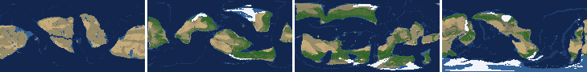

*At 100, 400, 700, 1000 Myr: sea by depth, land green by tree cover / tan where arid, shaded by height, ice white, lakes blue.*

| metric | min | median | max | outside (Myr: worst) |
|---|---|---|---|---|
| land_pct | 32.36 | 34.34 | 36.01 |  |
| cont_pct | 37.65 | 39.66 | 41.78 |  |
| cont_km | 33.75 | 35.20 | 36.04 |  |
| plates | 4.00 | 12.00 | 19.00 | 868-868: 4 |
| ocean_age | 38.90 | 58.75 | 91.90 |  |
| speed | 2.23 | 4.24 | 5.50 |  |
| sea_level | -541.00 | -124.10 | 196.70 | 484-552: -395.20; 784-932: -541.00; 944-944: -251.20 |
| sea_ice_m | -348.50 | -127.05 | -6.90 | 504-580: -348.50; 776-880: -348.10 |
| sea_tect_m | -243.70 | 35.20 | 223.30 |  |
| ice_pct | 0.60 | 4.15 | 11.60 | 520-544: 10.50; 816-876: 11.60 |
| temp | 9.80 | 14.15 | 19.00 |  |
| co2 | -1.26 | 0.21 | 1.22 |  |
| dry_pct | 11.00 | 25.23 | 38.05 | 728-740: 11.00 |
| inland_pct | 0.75 | 6.30 | 16.39 | 324-404: 3.11; 420-432: 4.51; 480-776: 0.75; 788-812: 3.35; +6 more |
| lake_pct | 0.20 | 0.62 | 3.35 | 972-972: 3.35 |
| lake_max_mkm2 | 0.02 | 0.23 | 2.80 | 348-348: 1.05; 412-416: 2.74; 440-472: 1.89; 628-628: 1.06; +6 more |
| max_elev_km | 3.88 | 8.34 | 9.45 |  |
| trees_pct | 13.99 | 32.45 | 50.56 | 736-744: 50.56 |
| npp | 229.20 | 313.50 | 365.50 |  |
| landmasses | 4.00 | 15.00 | 35.00 |  |
| largest_pct | 8.60 | 18.05 | 36.10 | 784-892: 36.10 |

### Seed 21, L7 (run 3895fd)

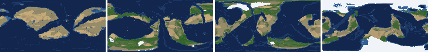

*At 100, 400, 700, 1000 Myr: sea by depth, land green by tree cover / tan where arid, shaded by height, ice white, lakes blue.*

| metric | min | median | max | outside (Myr: worst) |
|---|---|---|---|---|
| land_pct | 32.26 | 34.56 | 36.21 |  |
| cont_pct | 37.92 | 39.15 | 42.37 |  |
| cont_km | 33.21 | 35.30 | 36.05 |  |
| plates | 4.00 | 9.00 | 13.00 | 896-896: 4; 908-924: 4 |
| ocean_age | 39.80 | 61.85 | 121.40 | 996-1000: 121.40 |
| speed | 1.19 | 3.71 | 5.41 | 908-924: 1.41; 940-968: 1.19 |
| sea_level | -676.20 | -34.20 | 193.30 | 736-736: -255.10; 760-768: -294.10; 884-1000: -676.20 |
| sea_ice_m | -420.80 | -15.45 | -0.50 | 904-1000: -420.80 |
| sea_tect_m | -318.10 | 2.80 | 193.90 | 932-1000: -318.10 |
| ice_pct | 0.10 | 1.55 | 14.50 | 900-1000: 14.50 |
| temp | 8.20 | 16.30 | 22.50 |  |
| co2 | -2.21 | 0.05 | 1.20 |  |
| dry_pct | 15.01 | 20.73 | 40.19 |  |
| inland_pct | 1.10 | 3.72 | 17.21 | 300-316: 5.06; 332-332: 6.83; 348-352: 7.50; 364-364: 6.99; +3 more |
| lake_pct | 0.14 | 0.56 | 3.09 | 324-324: 3.09; 516-516: 0.17; 920-968: 0.15; 984-988: 0.14 |
| lake_max_mkm2 | 0.01 | 0.17 | 4.40 | 304-304: 1.55; 320-344: 4.40; 356-360: 1.55; 424-424: 1.25; +6 more |
| max_elev_km | 3.92 | 8.25 | 9.10 |  |
| trees_pct | 17.36 | 29.48 | 53.22 | 756-772: 53.22 |
| npp | 206.10 | 334.80 | 409.00 |  |
| landmasses | 5.00 | 13.00 | 26.00 |  |
| largest_pct | 9.50 | 18.90 | 36.90 | 900-952: 36.90 |

### Seed 11, L7 (run 4484fa)

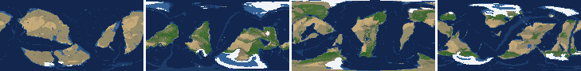

*At 100, 400, 700, 1000 Myr: sea by depth, land green by tree cover / tan where arid, shaded by height, ice white, lakes blue.*

| metric | min | median | max | outside (Myr: worst) |
|---|---|---|---|---|
| land_pct | 31.21 | 34.44 | 36.72 |  |
| cont_pct | 37.09 | 40.35 | 42.69 |  |
| cont_km | 33.37 | 34.78 | 36.87 |  |
| plates | 8.00 | 14.00 | 18.00 |  |
| ocean_age | 35.10 | 53.85 | 71.20 |  |
| speed | 2.41 | 3.97 | 5.47 |  |
| sea_level | -332.00 | -16.75 | 234.80 | 792-828: -332.00; 1000-1000: -250.30 |
| sea_ice_m | -297.40 | -85.65 | -7.30 | 792-824: -297.40 |
| sea_tect_m | -93.10 | 89.05 | 256.70 |  |
| ice_pct | 0.90 | 4.05 | 9.90 |  |
| temp | 9.10 | 14.30 | 20.90 |  |
| co2 | -1.74 | -0.68 | 0.66 |  |
| dry_pct | 13.73 | 20.75 | 46.83 | 308-316: 46.83 |
| inland_pct | 1.36 | 5.05 | 19.19 | 300-300: 6.21; 332-388: 2.85; 400-412: 6.10; 424-464: 1.69; +5 more |
| lake_pct | 0.20 | 0.74 | 5.91 | 528-532: 5.28; 604-604: 0.20; 704-716: 3.91; 736-736: 3.29; +3 more |
| lake_max_mkm2 | 0.02 | 0.37 | 7.19 | 340-340: 2.45; 372-388: 3.97; 424-424: 1.75; 468-476: 2.52; +9 more |
| max_elev_km | 4.23 | 8.25 | 9.02 |  |
| trees_pct | 15.44 | 30.63 | 41.62 |  |
| npp | 155.80 | 340.75 | 405.90 | 692-708: 155.80 |
| landmasses | 6.00 | 14.00 | 31.00 |  |
| largest_pct | 9.60 | 17.75 | 30.30 |  |

### Seed 1, L6 (run 9991dc)

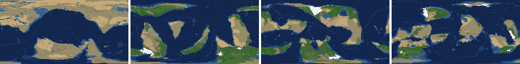

*At 100, 400, 700, 1000 Myr: sea by depth, land green by tree cover / tan where arid, shaded by height, ice white, lakes blue.*

| metric | min | median | max | outside (Myr: worst) |
|---|---|---|---|---|
| land_pct | 29.06 | 33.27 | 35.15 |  |
| cont_pct | 38.58 | 41.47 | 43.00 |  |
| cont_km | 31.67 | 33.23 | 35.31 |  |
| plates | 6.00 | 11.50 | 16.00 |  |
| ocean_age | 41.50 | 60.55 | 93.40 |  |
| speed | 1.43 | 3.81 | 5.68 | 812-820: 1.43 |
| sea_level | -407.30 | 10.55 | 199.10 | 780-944: -407.30 |
| sea_ice_m | -267.10 | -14.70 | -3.70 | 912-928: -267.10 |
| sea_tect_m | -203.30 | 23.85 | 208.70 |  |
| ice_pct | 0.30 | 1.10 | 7.90 |  |
| temp | 8.50 | 15.65 | 21.50 |  |
| co2 | -1.72 | 0.13 | 1.28 |  |
| dry_pct | 14.89 | 21.37 | 34.68 |  |
| inland_pct | 0.11 | 3.17 | 13.93 | 300-680: 0.86; 700-700: 7.80; 720-752: 4.16; 772-1000: 0.11 |
| lake_pct | 0.11 | 0.39 | 4.17 | 332-332: 4.17; 680-684: 3.54; 788-808: 0.12; 828-832: 0.11; +1 more |
| lake_max_mkm2 | 0.01 | 0.07 | 5.92 | 332-332: 5.92; 392-392: 2.99; 412-412: 3.06; 668-668: 1.23; +1 more |
| max_elev_km | 4.36 | 5.93 | 8.56 |  |
| trees_pct | 19.50 | 33.53 | 50.55 | 772-788: 50.55 |
| npp | 209.70 | 363.20 | 442.70 |  |
| landmasses | 2.00 | 9.00 | 18.00 | 316-332: 2; 360-360: 2 |
| largest_pct | 11.30 | 19.65 | 28.20 |  |

### Seed 2, L6 (run 7f72a1)

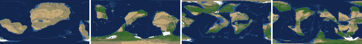

*At 100, 400, 700, 1000 Myr: sea by depth, land green by tree cover / tan where arid, shaded by height, ice white, lakes blue.*

| metric | min | median | max | outside (Myr: worst) |
|---|---|---|---|---|
| land_pct | 29.69 | 33.58 | 35.48 |  |
| cont_pct | 39.16 | 42.41 | 44.31 |  |
| cont_km | 30.30 | 31.84 | 34.38 | 648-664: 30.88; 860-1000: 30.30 |
| plates | 7.00 | 11.00 | 16.00 |  |
| ocean_age | 45.30 | 67.05 | 81.70 |  |
| speed | 2.63 | 3.77 | 5.07 |  |
| sea_level | -449.20 | -94.25 | 172.90 | 484-552: -449.20; 604-672: -384.00 |
| sea_ice_m | -398.70 | -10.35 | -1.20 | 484-552: -398.70; 612-668: -302.60 |
| sea_tect_m | -152.90 | -31.10 | 174.20 |  |
| ice_pct | 0.10 | 0.85 | 9.80 |  |
| temp | 4.80 | 15.45 | 21.80 | 480-504: 4.80 |
| co2 | -0.67 | 0.71 | 1.62 |  |
| dry_pct | 11.34 | 20.27 | 35.60 | 636-652: 11.34 |
| inland_pct | 0.39 | 3.05 | 14.15 | 308-396: 4.17; 412-1000: 0.39 |
| lake_pct | 0.12 | 0.35 | 3.04 | 332-332: 0.17; 368-368: 3.04; 424-432: 0.17; 444-456: 0.15; +9 more |
| lake_max_mkm2 | 0.01 | 0.07 | 4.96 | 300-300: 1.69; 336-336: 2.25; 352-352: 2.14; 364-368: 4.96; +3 more |
| max_elev_km | 3.47 | 5.19 | 8.51 |  |
| trees_pct | 20.91 | 36.12 | 54.73 | 488-544: 53.78; 628-672: 54.73; 752-772: 52.20 |
| npp | 213.30 | 375.15 | 401.20 |  |
| landmasses | 4.00 | 10.00 | 17.00 |  |
| largest_pct | 10.80 | 16.30 | 25.60 |  |

### Seed 11, L6 (run cffa08)

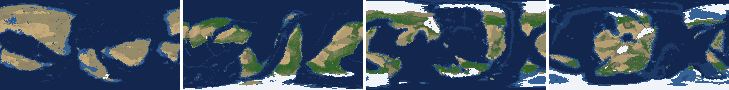

*At 100, 400, 700, 1000 Myr: sea by depth, land green by tree cover / tan where arid, shaded by height, ice white, lakes blue.*

| metric | min | median | max | outside (Myr: worst) |
|---|---|---|---|---|
| land_pct | 29.42 | 33.20 | 34.60 |  |
| cont_pct | 38.96 | 41.45 | 42.33 |  |
| cont_km | 31.47 | 32.53 | 34.82 |  |
| plates | 4.00 | 7.00 | 11.00 | 696-720: 4; 752-776: 4; 928-936: 4 |
| ocean_age | 45.00 | 78.05 | 153.40 | 904-1000: 153.40 |
| speed | 1.53 | 3.40 | 5.78 | 740-768: 1.62; 920-936: 1.53; 1000-1000: 1.98 |
| sea_level | -744.70 | -283.10 | 134.70 | 552-672: -649.60; 692-856: -517.90; 868-1000: -744.70 |
| sea_ice_m | -453.50 | -106.10 | -2.10 | 556-620: -453.50; 928-1000: -405.70 |
| sea_tect_m | -357.20 | -165.25 | 137.90 | 728-844: -339.40; 900-1000: -357.20 |
| ice_pct | 0.10 | 5.25 | 14.40 | 560-620: 14.40; 928-988: 13.20 |
| temp | 6.30 | 13.25 | 20.60 | 932-940: 6.30 |
| co2 | -3.11 | -0.65 | -0.01 |  |
| dry_pct | 10.54 | 20.70 | 37.48 | 560-588: 10.54 |
| inland_pct | 0.37 | 4.55 | 26.24 | 304-316: 5.91; 360-440: 3.64; 452-864: 0.37; 884-912: 3.38; +3 more |
| lake_pct | 0.19 | 0.55 | 10.61 | 444-448: 10.61; 584-584: 0.19 |
| lake_max_mkm2 | 0.03 | 0.14 | 16.57 | 444-448: 16.57; 536-536: 1.44; 652-656: 1.11; 796-796: 2.80; +5 more |
| max_elev_km | 4.17 | 6.42 | 9.08 |  |
| trees_pct | 20.77 | 31.25 | 49.74 |  |
| npp | 182.90 | 288.95 | 352.40 | 688-704: 182.90 |
| landmasses | 3.00 | 11.00 | 17.00 |  |
| largest_pct | 10.00 | 20.05 | 31.40 |  |

### Seed 21, L6 (run 6d103d)

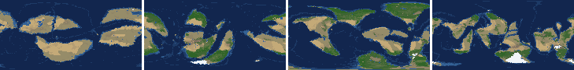

*At 100, 400, 700, 1000 Myr: sea by depth, land green by tree cover / tan where arid, shaded by height, ice white, lakes blue.*

| metric | min | median | max | outside (Myr: worst) |
|---|---|---|---|---|
| land_pct | 31.21 | 33.11 | 35.21 |  |
| cont_pct | 38.95 | 41.48 | 42.80 |  |
| cont_km | 31.75 | 32.62 | 34.87 |  |
| plates | 8.00 | 11.00 | 14.00 |  |
| ocean_age | 49.70 | 66.80 | 91.30 |  |
| speed | 2.01 | 3.62 | 5.39 |  |
| sea_level | -309.70 | -47.20 | 96.00 | 844-880: -309.70 |
| sea_ice_m | -112.20 | -6.60 | -0.00 |  |
| sea_tect_m | -197.50 | -44.75 | 99.80 |  |
| ice_pct | 0.00 | 0.50 | 5.40 |  |
| temp | 12.50 | 17.90 | 25.50 |  |
| co2 | -0.69 | 0.53 | 2.11 |  |
| dry_pct | 11.69 | 20.05 | 34.37 | 924-928: 11.69 |
| inland_pct | 0.42 | 2.46 | 11.49 | 300-364: 0.54; 404-1000: 0.42 |
| lake_pct | 0.11 | 0.37 | 1.80 | 364-364: 0.12; 424-428: 0.18; 604-608: 0.16; 620-668: 0.13; +2 more |
| lake_max_mkm2 | 0.01 | 0.10 | 2.04 | 304-304: 1.25; 468-468: 1.44; 692-692: 1.02; 768-768: 2.04; +3 more |
| max_elev_km | 4.09 | 5.96 | 8.59 |  |
| trees_pct | 16.67 | 31.72 | 47.97 |  |
| npp | 226.80 | 371.00 | 438.40 |  |
| landmasses | 4.00 | 12.00 | 22.00 |  |
| largest_pct | 6.70 | 12.50 | 35.10 | 304-304: 35.10 |

### Seed 3199, L6 (run c3f753)

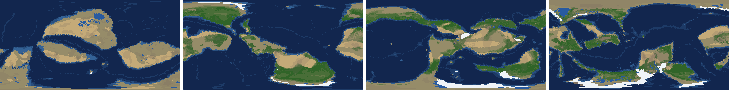

*At 100, 400, 700, 1000 Myr: sea by depth, land green by tree cover / tan where arid, shaded by height, ice white, lakes blue.*

| metric | min | median | max | outside (Myr: worst) |
|---|---|---|---|---|
| land_pct | 30.95 | 33.10 | 35.08 |  |
| cont_pct | 39.22 | 41.06 | 43.70 |  |
| cont_km | 31.60 | 32.91 | 34.64 |  |
| plates | 7.00 | 11.00 | 15.00 |  |
| ocean_age | 42.30 | 62.45 | 85.00 |  |
| speed | 1.91 | 4.04 | 5.44 | 500-508: 1.91 |
| sea_level | -229.20 | 0.65 | 196.50 |  |
| sea_ice_m | -79.40 | -4.55 | -0.00 |  |
| sea_tect_m | -195.50 | 4.40 | 201.10 |  |
| ice_pct | 0.00 | 0.30 | 3.60 |  |
| temp | 10.00 | 16.10 | 22.00 |  |
| co2 | -0.85 | 0.34 | 1.90 |  |
| dry_pct | 13.15 | 20.71 | 47.27 | 616-636: 47.27 |
| inland_pct | 0.47 | 3.74 | 14.32 | 300-608: 1.68; 628-628: 7.75; 644-984: 0.47; 996-1000: 1.12 |
| lake_pct | 0.11 | 0.41 | 4.54 | 312-320: 0.15; 332-340: 0.14; 352-356: 0.17; 384-384: 0.13; +6 more |
| lake_max_mkm2 | 0.01 | 0.12 | 6.15 | 416-420: 1.56; 500-524: 6.15; 736-736: 3.80; 752-752: 3.08; +3 more |
| max_elev_km | 2.81 | 4.74 | 8.41 |  |
| trees_pct | 20.11 | 30.44 | 49.99 |  |
| npp | 245.70 | 364.40 | 430.20 |  |
| landmasses | 3.00 | 8.00 | 23.00 |  |
| largest_pct | 9.30 | 24.35 | 33.30 |  |

### Seed 42, L6 (run fdb15d)

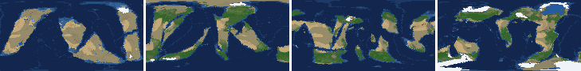

*At 100, 400, 700, 1000 Myr: sea by depth, land green by tree cover / tan where arid, shaded by height, ice white, lakes blue.*

| metric | min | median | max | outside (Myr: worst) |
|---|---|---|---|---|
| land_pct | 31.31 | 32.86 | 34.57 |  |
| cont_pct | 38.98 | 41.39 | 42.72 |  |
| cont_km | 31.82 | 32.96 | 34.91 |  |
| plates | 8.00 | 12.00 | 15.00 |  |
| ocean_age | 41.20 | 58.80 | 79.40 |  |
| speed | 2.15 | 3.90 | 5.44 |  |
| sea_level | -256.40 | 10.90 | 169.80 | 496-500: -256.40 |
| sea_ice_m | -147.50 | -9.45 | -0.00 |  |
| sea_tect_m | -155.70 | 28.20 | 175.10 |  |
| ice_pct | 0.00 | 0.60 | 6.30 |  |
| temp | 10.80 | 17.50 | 22.30 |  |
| co2 | -0.38 | 0.65 | 1.64 |  |
| dry_pct | 14.32 | 20.51 | 30.77 |  |
| inland_pct | 0.54 | 2.35 | 13.64 | 300-984: 0.54; 996-1000: 1.03 |
| lake_pct | 0.11 | 0.42 | 4.58 | 328-340: 4.13; 576-576: 0.18; 596-596: 0.11; 648-648: 0.19; +6 more |
| lake_max_mkm2 | 0.03 | 0.10 | 6.53 | 320-340: 6.39; 796-800: 4.51; 908-908: 1.01; 936-936: 1.89; +1 more |
| max_elev_km | 3.28 | 5.95 | 8.10 |  |
| trees_pct | 23.38 | 33.50 | 45.93 |  |
| npp | 277.60 | 362.20 | 399.30 |  |
| landmasses | 4.00 | 11.00 | 19.00 |  |
| largest_pct | 11.70 | 22.00 | 32.50 |  |

### Seed 77, L6 (run d03a97)

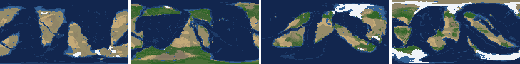

*At 100, 400, 700, 1000 Myr: sea by depth, land green by tree cover / tan where arid, shaded by height, ice white, lakes blue.*

| metric | min | median | max | outside (Myr: worst) |
|---|---|---|---|---|
| land_pct | 30.70 | 33.47 | 35.68 |  |
| cont_pct | 38.68 | 40.50 | 44.16 |  |
| cont_km | 31.95 | 33.99 | 35.39 |  |
| plates | 5.00 | 12.00 | 17.00 |  |
| ocean_age | 37.10 | 55.95 | 87.10 |  |
| speed | 2.27 | 4.47 | 6.45 |  |
| sea_level | -527.40 | -7.80 | 223.60 | 456-632: -527.40; 844-924: -367.40 |
| sea_ice_m | -344.00 | -84.15 | -0.40 | 444-576: -344.00; 612-628: -274.60 |
| sea_tect_m | -218.00 | 67.45 | 224.00 |  |
| ice_pct | 0.00 | 3.40 | 10.80 | 452-464: 10.70; 492-544: 10.80 |
| temp | 3.80 | 13.55 | 20.10 | 508-544: 3.80; 892-892: 7.90 |
| co2 | -2.72 | -0.23 | 1.50 |  |
| dry_pct | 12.72 | 24.79 | 33.48 |  |
| inland_pct | 0.94 | 4.73 | 17.93 | 300-320: 2.38; 344-544: 1.22; 556-600: 4.13; 612-612: 6.21; +2 more |
| lake_pct | 0.18 | 0.55 | 10.10 | 708-708: 0.18; 852-852: 10.10 |
| lake_max_mkm2 | 0.03 | 0.14 | 17.25 | 300-304: 1.61; 328-344: 1.51; 616-616: 1.11; 808-816: 2.10; +2 more |
| max_elev_km | 3.99 | 5.62 | 8.76 |  |
| trees_pct | 15.82 | 28.64 | 47.41 |  |
| npp | 133.70 | 344.75 | 408.20 | 788-788: 133.70 |
| landmasses | 2.00 | 9.00 | 20.00 | 568-584: 2 |
| largest_pct | 9.90 | 22.15 | 36.50 | 592-592: 35.20; 836-896: 36.50 |

### Seed 505, L6 (run 88c976)

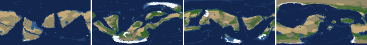

*At 100, 400, 700, 1000 Myr: sea by depth, land green by tree cover / tan where arid, shaded by height, ice white, lakes blue.*

| metric | min | median | max | outside (Myr: worst) |
|---|---|---|---|---|
| land_pct | 28.90 | 32.41 | 37.61 |  |
| cont_pct | 36.46 | 42.22 | 43.96 |  |
| cont_km | 31.36 | 32.72 | 36.99 |  |
| plates | 6.00 | 12.00 | 17.00 |  |
| ocean_age | 42.00 | 61.50 | 102.90 |  |
| speed | 1.46 | 3.93 | 6.30 | 764-768: 1.46 |
| sea_level | -300.10 | -52.85 | 175.10 | 764-856: -300.10 |
| sea_ice_m | -174.10 | -29.70 | -0.00 |  |
| sea_tect_m | -278.90 | 43.35 | 202.20 | 788-856: -278.90 |
| ice_pct | 0.00 | 1.70 | 7.70 |  |
| temp | 9.30 | 13.90 | 18.70 |  |
| co2 | -2.54 | -0.27 | 0.97 |  |
| dry_pct | 14.01 | 26.78 | 37.35 |  |
| inland_pct | 0.67 | 3.80 | 12.83 | 300-728: 0.67; 740-892: 0.87; 904-984: 2.44; 996-996: 5.13 |
| lake_pct | 0.07 | 0.43 | 1.95 | 668-668: 0.17; 696-696: 0.13; 712-712: 0.15; 724-724: 0.18; +6 more |
| lake_max_mkm2 | 0.01 | 0.14 | 2.54 | 452-456: 1.53; 660-660: 1.06; 736-744: 2.54; 760-760: 2.03; +1 more |
| max_elev_km | 3.76 | 5.42 | 8.25 |  |
| trees_pct | 10.91 | 28.73 | 44.35 |  |
| npp | 208.90 | 355.05 | 404.20 |  |
| landmasses | 3.00 | 7.00 | 13.00 |  |
| largest_pct | 15.40 | 27.50 | 36.80 | 780-872: 36.40; 884-888: 35.90; 940-984: 36.80 |

## Determinism

Seed 1 L6 re-run to 100 Myr (run c8e5de) against the sweep's run 9991dc: 26 keyframes x 44 layers, **bit-identical** (layer hashes and frame stats).
