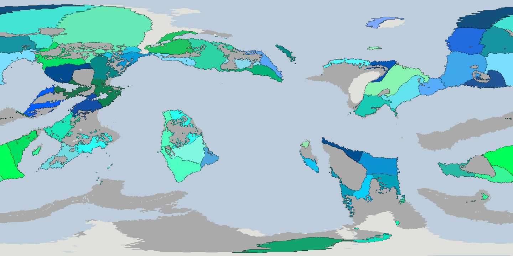
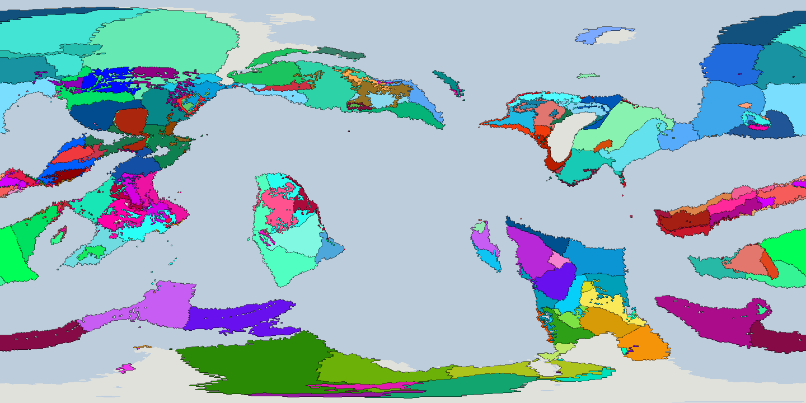
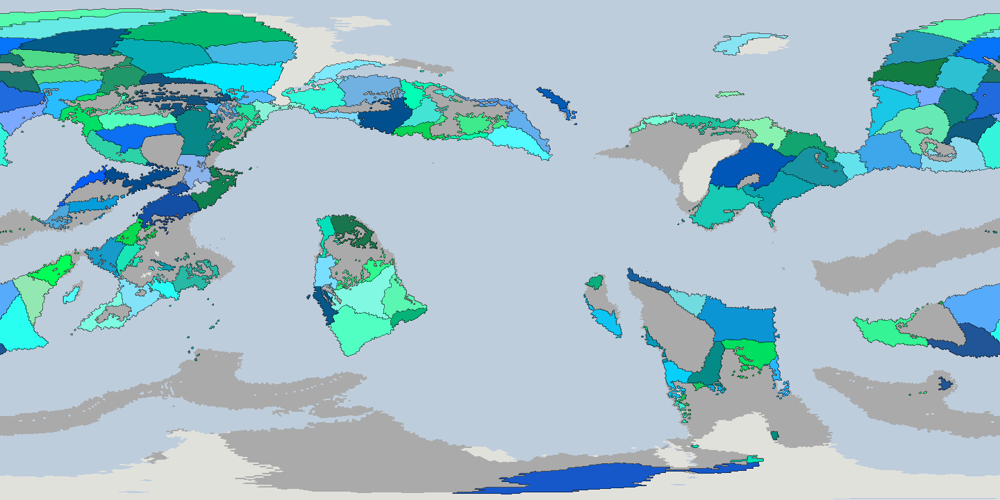
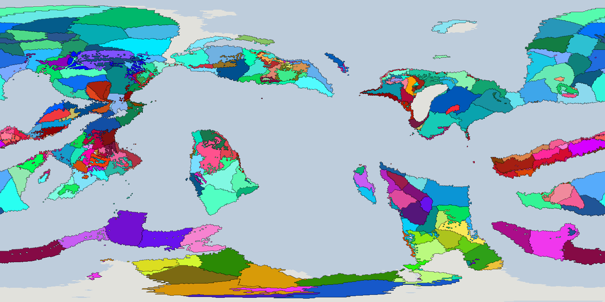
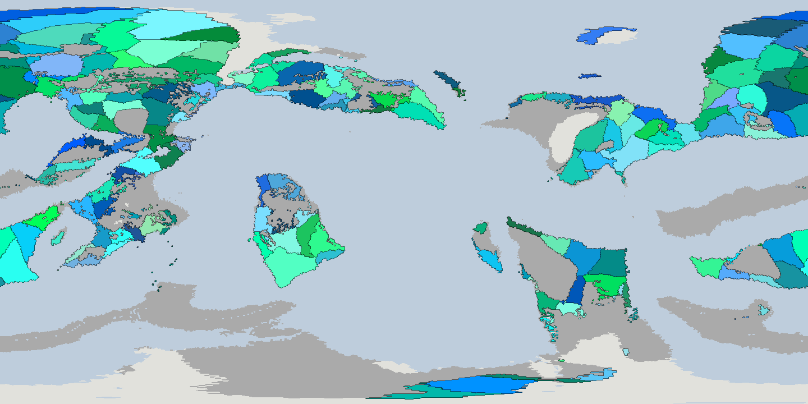
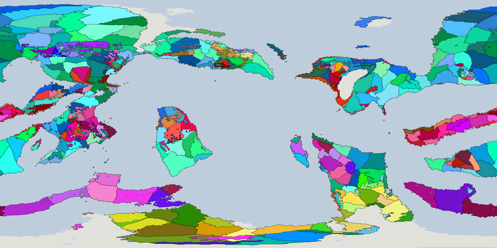
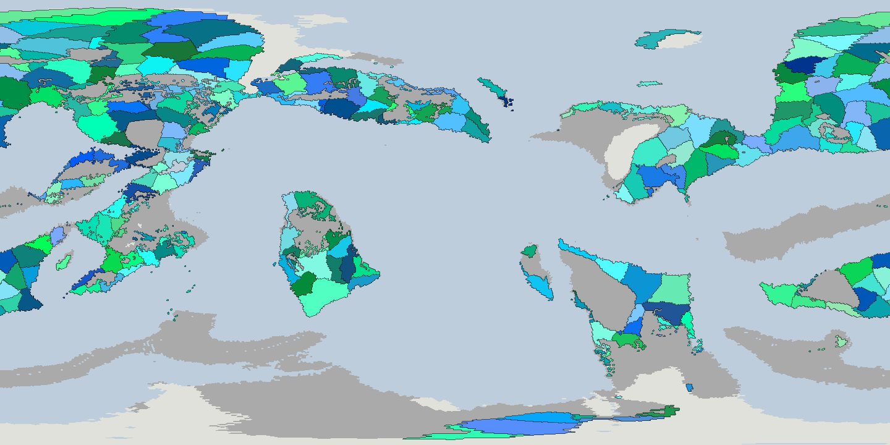
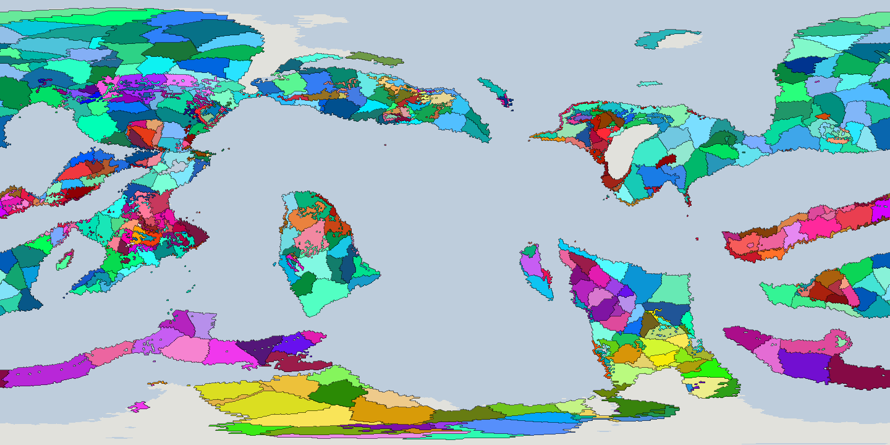
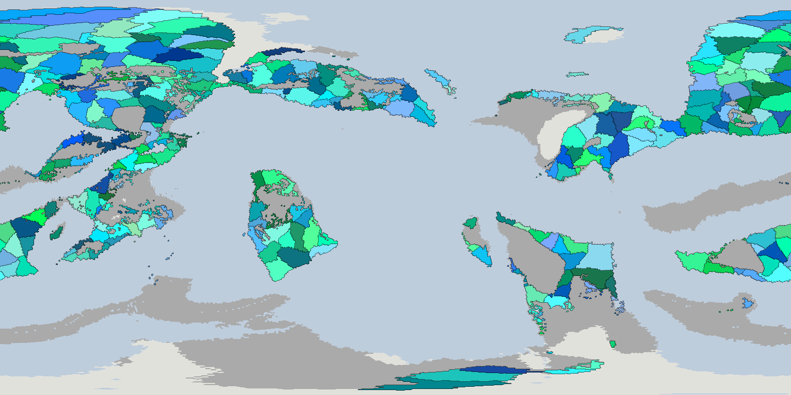
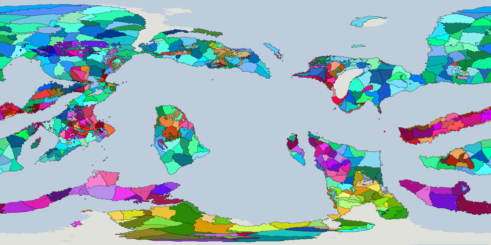

# Deme scale examples: 1x to 5x the human demes on b69f51 (PW-1015, 2026-10-29)

**In plain words.** At the current setting (1x, 55 human demes) the median human deme is 1.8 million km², about
Mongolia (1.56 million km²), and the biggest are 5 to 7 million km². At 2x (112) the median is 0.85 million km², a bit
more than Turkey (0.78 million). At 3x (166) it is 0.55 million, about France (0.55 million). At 4x (229) it is 0.45
million, a little under Spain (0.51 million). At 5x (281) it is 0.38 million, about Japan (0.38 million). The model does
fracture the mountains: highland demes are about half the size of lowland ones from 2x up (a third at 1x). It does not
keep open steppe whole: dry-country demes are only 15 to 25% smaller than ordinary lowland ones from 2x up,
so a plain still splits into many demes. Islands are small at every scale, because the sea-gap rule, not the
split distance, cuts them. So the owner's expectation holds for mountains and islands, and only weakly for steppe.

How to read the maps: equirectangular, from the run's own cell lat/lon. Each deme is a shade of its people's colour
(the demes pass's own colours), with a thin dark line between demes. In the **humans** maps, the other peoples' land is
grey; pale grey-white is land nobody leads, blue-grey is sea. Present day (frame 0 ago).

## Settings
Run b69f51 (L7, 60 km cells, ~3,100 km² a cell), demes pass only, nothing else rerun. The split distance and the
fuse distance are in easy km (a km of coast or easy lowland; open lowland ~1.3, desert and mountains 2 to 3).

| scale | split / fuse (easy km) | living human demes | median area (km²) | range (km²) | all living demes |
|---|---|---|---|---|---|
| 1x (current) | 7,000 / 4,000 | 55 | 1,806,000 | 90,000 to 7,241,000 | 184 |
| 2x | 4,300 / 2,450 | 112 (2.0x) | 853,000 | 9,000 to 3,549,000 | 309 |
| 3x | 3,400 / 1,950 | 166 (3.0x) | 548,000 | 6,000 to 2,584,000 | 421 |
| 4x | 2,850 / 1,630 | 229 (4.2x) | 453,000 | 3,000 to 1,852,000 | 558 |
| 5x | 2,500 / 1,430 | 281 (5.1x) | 381,000 | 3,000 to 1,678,000 | 665 |

Area is the cells a deme leads today (cells x 3,113 km²). A few living demes hold no cell of their own people's lead
(minorities in someone else's land): 0, 1, 3, 3 and 11 of them at 1x to 5x, left out of the median and range. The
smallest ones at 4x and 5x are single-cell remnants.

## Where it fractures
Terrain class of each human deme (its mean elevation and rain today): island (on a landmass under 3 million km²),
highland (mean over 1,000 m), dry (under 500 mm/yr), otherwise lowland. Cells: number of demes, median area in
thousand km².

| scale | lowland | dry | highland | island |
|---|---|---|---|---|
| 1x | 39, 2,090 | 7, 1,230 | 4, 650 | 5, 260 |
| 2x | 76, 1,000 | 18, 840 | 11, 550 | 6, 230 |
| 3x | 106, 630 | 29, 540 | 22, 350 | 6, 230 |
| 4x | 150, 510 | 37, 390 | 33, 280 | 6, 230 |
| 5x | 182, 430 | 44, 360 | 37, 240 | 7, 220 |

The densest 30 degree boxes (demes per million km² of human-led land, box centres given as lat, lon) are mostly the same
ones from 3x to 5x, all on the big continent (49N 173W, 130 million km²):
- **(-15, -135):** 2.1 per million km² at 3x, 3.0 at 4x, 3.3 at 5x;
- **(45, -45):** 2.2 at 3x, 2.5 at 4x, 2.9 at 5x;
- **(45, -135) or (45, -105):** 1.6 at 3x (-135), 2.7 at 4x (-105), 2.8 at 5x (-135).
On the maps these are the broken west-coast and island-chain country, not the interior.

At 1x and 2x the order differs a little (1x: (45, -45) first at 1.0, then (15, -105) and (-15, -165), all below 1.0).
The largest single demes stay in the open south of each continent. They shrink with the setting: 7.2, 6.0 and 4.8
million km² at 1x (one of them wraps the dateline, centre about 67N 108W); 3.5 at 2x (20S 174E, south of the big
continent); 2.6 at 3x (28S 52W, south of the continent at 12S 51W); 1.85 at 4x (the same one); 1.7 at 5x (28S 92E, the
south-pole continent at 61S 72E, north-east). The 5x second and third are 1.4 (43N 177E) and 1.1 (54N 178W) million
km² on the big continent.

## Notes
- Rerun: `derive(run_dir, split_km=..., fuse_km=...)` in `planet/lineages/demes.py` (the defaults stay 7,000 / 4,000;
  a test checks that). Nothing was written to any store: the numbers come from a scratch copy of the run's `run.json`
  with symlinks to the layers.
- Cross-check on 3097e3 at the same five settings (a run where humans are few): 17, 34, 45, 71, 89 living human demes
  (1x, ~2x, 2.6x, 4.2x, 5.2x) and 191, 313, 406, 539, 648 living demes of all peoples. Same shape, no maps made.
- The count rises a little faster than the area per deme falls: 5x the demes is 4.7x smaller median area. Deaths
  and fusions over 300 kyr were not re-counted here (PW-1015 has them for 3,500 / 2,000: 381 demes died out).
- Terrain classes use the deme's present-day mean, so they describe where the cut happened, not why. Slope and
  rivers are not separated out.
