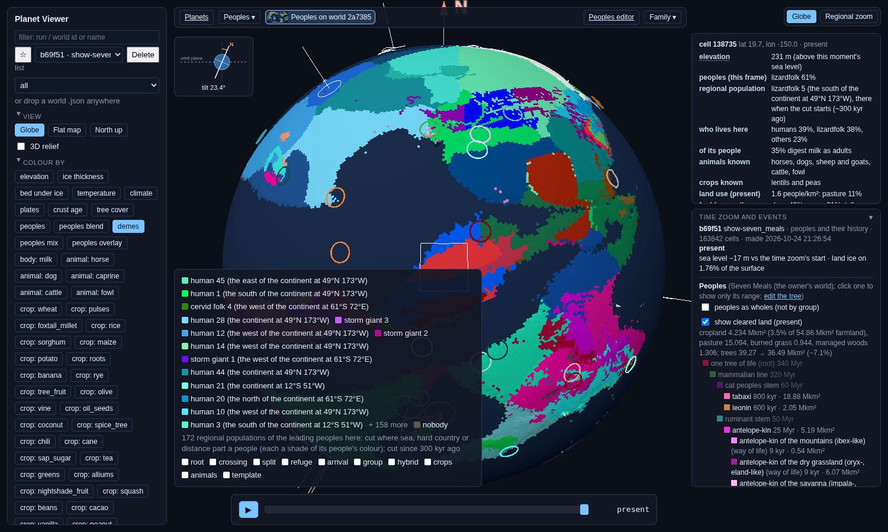
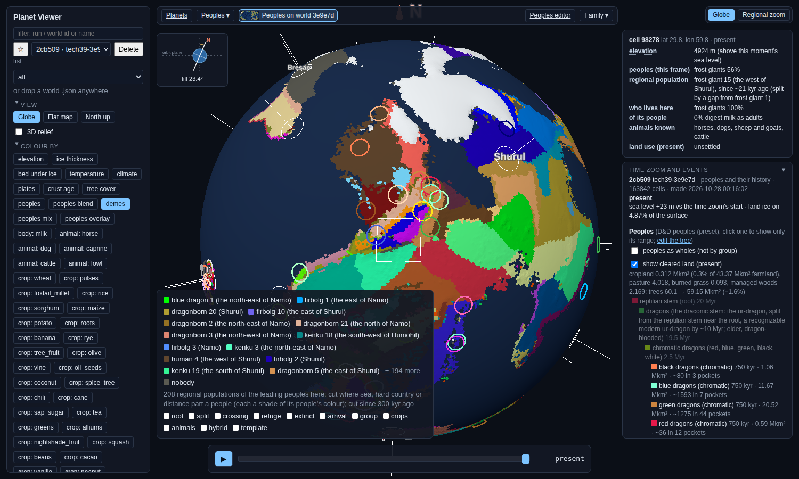
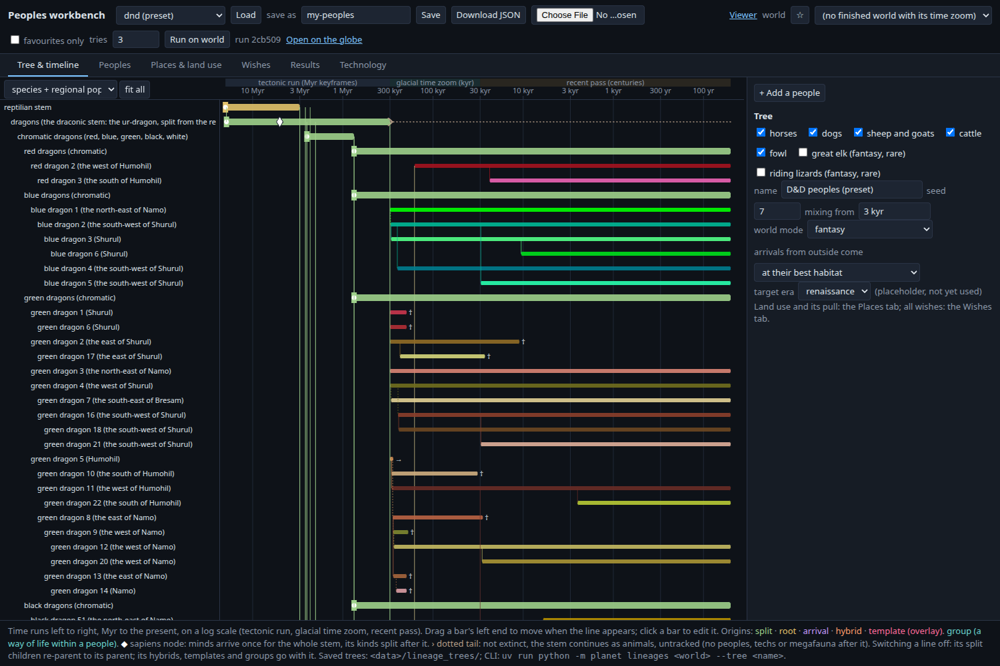

# Demes v0: regional populations and their dated tree (PW-981, fun lane 46, 2026-10-29)

## In plain words
Until now a people was one blob over its whole range: humans on three continents counted as one community. The new
demes pass reads a finished peoples run and cuts each people's land, frame by frame, into regional populations
("demes"). It cuts wherever open sea, hard country (mountains, desert, deep forest, ice) or sheer distance separate
them. It then follows those populations through time: when one splits off, when two fuse, when one dies out, and which
ones touch (of the same people or of others). The result is a dated family tree of regional populations inside each
people, plus a contact record per pair. It is the seed for "the grain-belt humans" as a culture, and later for
languages. Nothing here is linguistic. Demes are only placed and dated.

A first follow-up (same day) removed most of the noise: a split or fusion along a gap now counts only once it has held
for 4 frames, and the pass works on each people's own cells, so it is 2.5-4.5 times faster. Both are described below.

How to see it:
- **Globe:** open a peoples run and pick the colour layer **demes**. Each deme is a shade of its people's colour. The
  legend lists this frame's largest demes. The hover card gains a "regional population" row: its name, since when, and
  what it came from. Scrub time to watch them split and spread.
- **Workbench:** Tree & timeline, view **species + regional populations**. It needs a run opened in the workbench
  (`lineages.html?run=<id>`, or Results). Each people row gets its demes beneath it: a bar from birth to end, a branch
  from its parent deme (dashed: founded over the sea), † died out, → fused. Hover a bar for the dates. Only demes that
  ever held 150 cells, or are alive now, are drawn.
- **CLI:** `uv run python -m planet demes RUN` adds or redoes the demes of a stored run in place. A new peoples run gets
  them automatically (`output.save`, after the fuels). The pass writes `runs/<id>/demes.json`, `layers/demes.bin` and
  `meta.demes`, and adds a section to run.txt.

## How it cuts (planet/lineages/demes.py)
- **Occupied cells, per frame and people:**
  - the cell's leading people by ground (`peoples_whole`);
  - its leading people by heads (`mix_lead`);
  - its second people by heads, if that people has at least 10% (`mix_second`).
- **Travel cost:**
  - Land uses `crossing.corridor`, the history's own contact value, computed from each frame's land, rain, trees and
    ice and the world's rivers. A cell costs (0.8 / corridor)^0.5 "easy km" per km: 1 on a coast, ~1.3 on open
    lowland, ~2 to 2.3 in desert or mountains, at most 3.
  - Sea up to 150 km wide is crossed at 2 easy km per km, so the people on both shores stay one population. A wider
    gap separates them.
  - A strip of other peoples' land up to 120 km wide (two cells at L7) is bridged the same way, so a minority's corridor
    through a range does not cut it in two (NECK_KM).
- **Founder chains:**
  - Cells keep the deme they had in the frame before.
  - Newly settled cells take the deme that is cheapest to reach.
  - Land that no path reaches (a long crossing) becomes a new deme if it has at least 40 cells. Its parent is the
    nearest deme of the same people.
  - A new people's first demes take as parent the deme of their tree parent on (or nearest) those cells.
- **Splits:**
  - **Gap:** when a deme's land falls into pieces and stays in pieces for 4 frames (PERSIST), the largest piece keeps
    the id. Every other piece of 40 or more cells becomes a new deme. It is dated when the gap opened (the event also
    records when it was confirmed) and keeps the date its land was settled. If the pieces rejoin within 4 frames,
    nothing is recorded.
  - **Distance:** a deme whose travel-cost diameter passes 7,000 easy km is cut in two between the ends of that
    diameter. The half with the older cells keeps the id.
- **Fusions:** two touching demes of one people fuse when their diameters together come to less than 4,000 easy km,
  and have stayed so for 4 frames (dated when they first could). The older one keeps its id.
- **Window:** the frames of the last 300 kyr (the glacial zoom and the recent pass; the deep keyframes are Myr apart).
  On b69f51 that is 129 frames: 4 kyr apart back to ~30 kyr, then 0.5 kyr. So 4 frames is 16 kyr in the glacial zoom
  and 2 kyr in the recent pass.
- **Work per people:** each people is cut on a small graph of its own cells, the sea within 150 km and the necks within
  120 km. Diameters are kept while a deme's cells stand still, and measured again with one sweep (not two) from its
  last far end when they move.

### Why 4 frames
Before the change, on b69f51, 276 of the 459 pieces split off along a gap fused back later. Counted by how many frames
each lived before fusing back: 38 lived 0 frames, 55 one, 23 two, 25 three. From four frames on the count is flat (8, 9,
8, 8, 7, 6 per frame, then 89 at ten or more). So half of all fuse-backs happen within 3 frames, and after that the
chance of fusing back no longer depends on age: that flat tail is real coming and going, the first 3 frames are the
flicker. With PERSIST = 4 no piece fuses back within 5 frames of its split (34 do later, 22 of them after ten frames or
more).

## Before and after the follow-up (b69f51)
| | v0 | now |
|---|---|---|
| demes, all / alive | 809 / 201 | 399 / 184 |
| events | 1,315 | 519 |
| gap splits / fusions | 459 / 389 | 102 / 68 |
| gap events of 60+ cells | 494 | 114 |
| of these, sea, ice or corridor changing in the gap | 48 (10%) | 12 (11%) |
| human demes, all / alive | 76 / 60 | 58 / 55 |
| leonin / orc / goliath demes | 62 / 90 / 57 | 28 / 25 / 16 |
| time, demes.derive | 71-91 s | 20-33 s |

Times across the four test runs (`planet demes`, one core, on a machine at load 70-110 of 48 threads): b69f51 33 s,
ac4c06 26 s, 2cb509 30 s, 3097e3 27 s (v0: 71, 112, 132, 134 s). A quieter moment gave b69f51 20 s.

## Worked example 1: humans on the owner's world (run b69f51, world 2a7385, "Seven Meals")
**Arising and the chain.** Humans appear 200 kyr ago as 18 demes at once, one for each separate piece of the human
stem's land. Each takes its parent from the stem's own demes: human 1 comes from human line 10, human 2 from human
line 30, and so on.

On the southern continent (61°S 72°E), human 2 then breaks up by distance into a chain:
- human 20 and human 23 bud off at 200 kyr, and human 25 buds off human 20;
- human 36 buds off human 23 at 100 kyr, and human 50 at 11.5 kyr;
- human 42 buds off human 2 at 27.5 kyr and fuses back into it (the fusion began at 24.5 kyr and was confirmed at
  23 kyr);
- human 55 splits off human 2 along a gap 4 kyr ago (its land first settled 27.5 kyr ago), and human 58 buds off it at
  the present.

Today 55 human demes are alive out of 58. Their present sizes run from 82 to 2,862 cells.

**A sea crossing.** The history logs "humans sail across the sea to the large island at 53°N 22°E (241 km of open sea)"
44 kyr ago. Demes founds a new population there, human 39, 40 kyr ago, with human 17 on the facing coast as its
parent. By the present it holds the island, 113 cells. Human 39 is its own population because 241 km of open sea is
more than the 150 km that keeps two shores one population.

## Worked example 2: a late boat diaspora (run 2cb509, world 3e9e7d, named landmasses)
For 195 kyr, humans here are one deme, human 1, which arose from archaic human 1 on Rejonor. Then the boat era cuts them
up quickly:
- **human 2** is founded over the sea on Namo 5.0 kyr ago (158 cells at first, 1,439 today);
- **human 4** splits off along a gap on the west of Shurul 4.0 kyr ago. Its land was first settled 4.5 kyr ago, by the
  canoe hops that kept it part of human 1 at first. Human 5 (Vetom) and human 6 (Tigobrus) split off the same way at
  the same time;
- **human 3** is founded on the south-west of Shurul 2.5 kyr ago, and **human 7** on Humohil 2.0 kyr ago;
- on Namo, human 8 is founded over the sea from human 2 at 1.5 kyr, and human 9 from human 8 at 0.5 kyr.

Human 1's own homeland breaks off last: human 10 splits off along a gap on Rejonor 2.0 kyr ago (its land settled
200 kyr ago), and the id stays with human 1's largest piece, now on Bresam. Thirteen human demes are alive at the
present, against 55 on b69f51. On this world humans stayed home until boats, and the tree shows it.

## What looks right
- Real barriers cut peoples. Sea gaps wider than a strait separate demes, and a strait does not. The dated crossings
  line up with the history's own crossing log within a frame or two (b69f51's island: 44 kyr in the log, 40 kyr in
  demes).
- The founder chains read as stories: "founded over the sea from human 17", "split off along a gap (its land settled
  27.5 kyr ago)". The ancestry goes up into the authored tree (human 1 from human line 10).
- The worlds differ the way their histories differ: 55 human demes on b69f51's big shared continent, 13 on 3e9e7d's
  late diaspora.
- The tree no longer flickers: no split-off piece fuses back within 5 frames, and the small peoples' trees shrank to a
  third (orcs 90 to 25 demes).
- The contact series per deme pair gives "who these humans touched". On b69f51, human 23 has bordered cervid folk 3 for
  200 kyr, and they share 307 cells today.

## What doesn't (yet)
- **Most gaps are neighbours, not the sea.** The gap splits that remain last, but only 11% of those of 60+ cells
  (b69f51) have the sea, ice or a corridor changing in the gap; 18% on 2cb509. On b69f51, of the other 102, another
  people holds the gap in 90. A wedge of newcomers is a fair way for a population to part, but the tree does not say so
  (draft `draft-demes-gap-cause`: name each gap's cause). A wider neck (240 km) cuts the count to 70 but not the share.
- **Land bridges do not show on b69f51.** Its sea hardly moves in 300 kyr: land runs from 58,454 to 59,338 cells, and
  only 947 cells ever change. No fusion there has land emerging in its gap. On 2cb509, whose sea does move (7,929
  cells change), three splits come from a gap drowning, for example brass dragon 2 on Shurul parting from brass dragon
  1 on Namo at 276 kyr. Still no fusion over newly emerged land. Bridge stories need ranges that follow the sea
  (PW-902).
- **Peoples that rarely lead are underseen.** Measured at the present, where full presence is stored: of the cells
  where a people (its groups counted in) has at least 12% presence, demes sees it in 69% on b69f51 (63-73% on ac4c06,
  2cb509 and 3097e3). For many peoples it is far less:

  | people on b69f51 | seen |
  |---|---|
  | orcs | 9% (1,226 of 14,131 cells) |
  | tortles | 3% |
  | deep folk | 3% |
  | leonin | 22% |
  | dragonborn | 37% |
  | aarakocra | 38% |
  | dwarves | 43% (66 of 155) |
  | humans | 100% |

  On 2cb509, leonin and aarakocra are at 4%. Their demes are cut from the few cells they lead. The cheap fix is one
  per-frame bit-flag layer of which peoples are present (draft `draft-demes-full-presence-frames`). It is not done
  here: it touches the history's frame store.
- **Scale is a taste call.** On b69f51, 14,000 / 7,000 / 3,500 easy km give ~20 / ~55 / ~155 human demes (draft
  `draft-demes-scale`, needs-decision).
- **Cost.** 20-33 s per L7 peoples run. Cutting per people helped less than hoped, because together the peoples' cells
  add up to 1.3-1.45 times all the land each frame (draft `draft-demes-speed-floor`).
- **Colours.** Neighbouring demes of one people differ only by shade. With 55 human demes, two touching ones can look
  alike. The hover card names them.
- **Names.** A deme is named for where it is now (or at its peak, if gone). Human 1 on 2cb509 began on Rejonor but is
  named "the south of Bresam", because its largest piece moved there. Landmass names carry the landmass's own centre
  ("the east of the continent at 49°N 173°W" is the east of that continent, not a deme at that point).
- **Arrival dates.** The globe layer shows the leading people's deme only. On 2cb509, human 2 holds 158 cells of
  Namo 5 kyr ago, while the history's crossing log names humans' first arrival on Namo at 1.3-1.5 kyr. The log is kept per
  line (humans and each of their groups), and demes reads the whole people, groups counted in, but why the two
  disagree by ~3.5 kyr is not checked yet.
