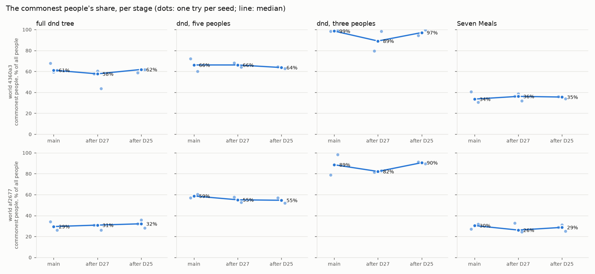
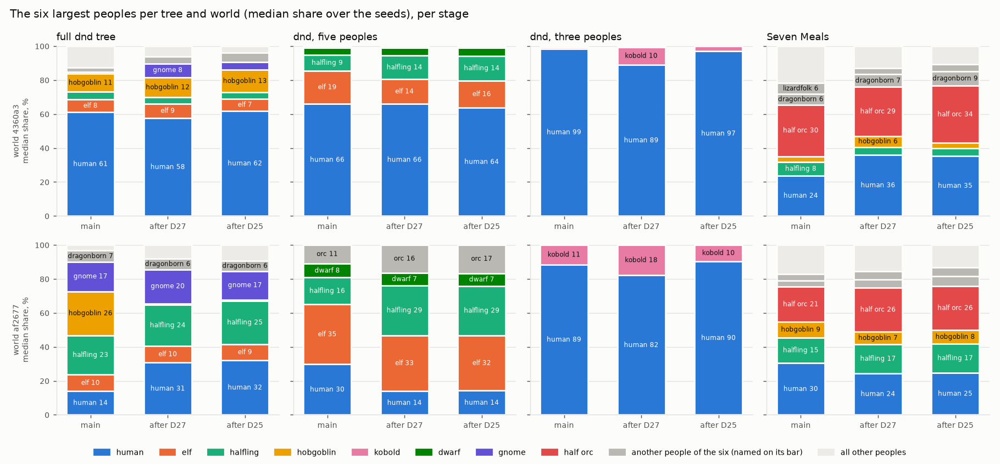
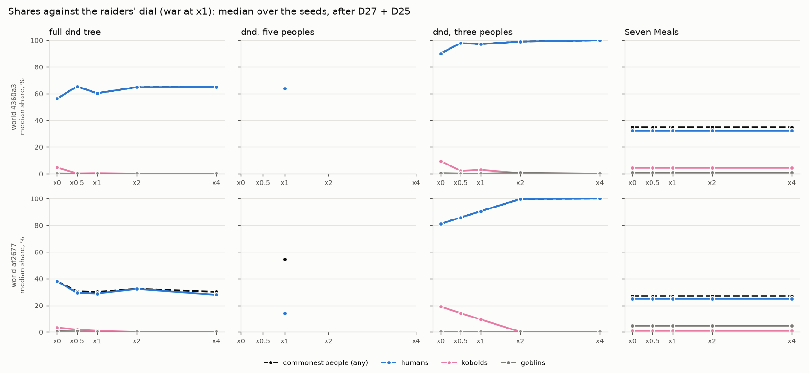
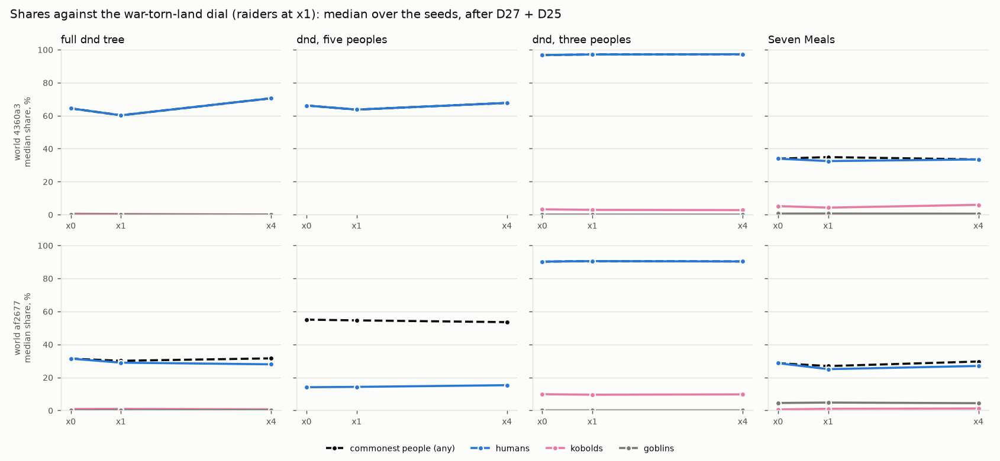
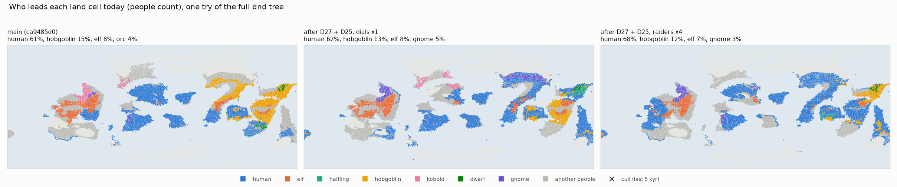

# Peoples: founding spread (D27), the brakes (D25), enemies hunting (D26 B)

Lane 97, 2026-10-31. Branch `worktree-agent-af9c700717f03913c`, from main ca9485d0. Three commits, one per ruling: D27 793ff89d, D25
7ad0cd31, D26 B 3101e69c. Every number here comes from the lane 77 stress suite (`tools/peoples_robust.py`, 86 tries a stage on worlds
4360a3 and af2677, arm now) or from the dial sweep below, run on this branch's code; none is from memory.

## In plain words

- **D27, a new people starts at three places, not one.** The places are spread over one landmass, at most one long walk (800 km) from
  the first. It did what you hoped for most of the problems. The tries where one people held more than 85% of everyone fell from 4
  to 1. Humans are no longer one of the peoples flagged as brittle (their share swinging tenfold from try to try). In the full dnd tree
  that list fell from 12 peoples to 8. In the three-people tree, kobolds now reach 10-18% (median) instead of 1-11%. It did not fix the
  five-people try where humans end at 1-3%: that comes from where the humans happen to be born on that world.
- **Denning peoples (my call, your option C).** Kobolds and goblins now live in thin dens (a quarter of their density) away from
  mountains and hills, instead of hardly at all. Kept, because it is what let the kobolds of the three-people tree survive.
- **D25, the brakes.** All four are built: war-torn land, raid losses on hostile borders, in-fighting and culling wars. Each has a
  dial in the viewer ("how hard the raiders are kept down", "how warlike the peoples are"). They work as described, but they shift
  the balance the other way from what D27 achieved. At the default strength:
  - kobolds and goblins lose about a third of their land, and almost all of that loss is in-fighting, because they are nearly always
    hemmed in;
  - other peoples lose 0-5% to war, the humans almost nothing;
  - the land the raiders lose goes mostly to the humans. In the three-people tree, all 4 tries are above 85% humans again (they were 1
    of 4 after D27). In the full tree the kobolds fall from 3-5% to 0.3-1.7%.
  Other settings of the raiders' dial: at x4 the kobolds and goblins die out; at x0.5 the three-people tree is still above 85% humans.
- **D26 B, enemies hunting.** Built as story only. Where two peoples the tree names as old enemies share a border, the map shows a
  "hunt" event now and then. In one full dnd try that was 24 hunts in the last 5,000 years, between pairs such as orcs and dwarves or
  goblins and humans. Nobody's numbers change.
- **The question for you** (last section): how big should the commonest people be? None of the brakes touch the humans, so none of them
  can bring the humans' share down. The charts show where it stands now and how the dials move it.

## The stages, on the stress suite

`main` is ca9485d0. `after D27` adds the founding spread and thin dens. `after D25` adds the brakes at x1, and it also stands for
after D26 B, because the hunts change no numbers: one try rerun on the final code gave the same shares to the hundredth of a percent.
The tables give the median share in %, with the range over the seeds in brackets: 3 seeds (7, 10, 13) for dnd and Seven Meals, 2
(7, 10) for dnd3 and dnd5. "Commonest" is the median share of the largest people. "Non-human-led landmasses" counts landmasses of
1+ Mkm² whose leading people is not human, against all of them. "Runs failing" counts tries that break an invariant: one people
above 85% in a tree of three or more, or an authored people lost.

### main (ca9485d0)

| tree | world | human | kobold | goblin | elf | dwarf | hobgoblin | commonest | non-human-led landmasses | runs failing |
|---|---|---|---|---|---|---|---|---|---|---|
| dnd | 4360a3 | 61 (59-68) | 2.4 (1.2-4.1) | 0.15 (0.12-0.21) | 7.6 (6.2-8.7) | 1.1 (0.74-1.2) | 11 (7.8-15) | 61 | 2 of 9 | 0 |
| dnd | af2677 | 14 (14-29) | 3.2 (2-4.1) | 0.22 (0.2-0.39) | 9.7 (8.2-11) | 1.8 (1.5-3.9) | 26 (0.15-34) | 29 | 5 of 6 | 0 |
| dnd3 | 4360a3 | 99 (98-99) | 0.89 (0.42-1.4) | 0.6 (0.47-0.73) | | | | 99 | 0 of 10 | 2 |
| dnd3 | af2677 | 89 (79-98) | 11 (1.8-21) | 0.013 (0.011-0.016) | | | | 89 | 0 of 5.5 | 1 |
| dnd5 | 4360a3 | 66 (60-72) | | | 19 (19-20) | 4.2 (2.8-5.7) | | 66 | 3 of 10 | 0 |
| dnd5 | af2677 | 30 (2.6-57) | | | 35 (10-60) | 8.1 (0.88-15) | | 59 | 3.5 of 6 | 0 |
| Seven Meals | 4360a3 | 24 (12-40) | 5.6 (1.5-5.7) | 1.3 (0.88-3.3) | 0.23 (0.093-0.34) | 0.2 (0.14-0.25) | 3.5 (2.3-4.6) | 34 | 5 of 10 | 0 |
| Seven Meals | af2677 | 30 (27-32) | 0.45 (0.43-0.66) | 4.2 (3.4-4.5) | 0.75 (0.41-0.81) | 0.21 (0.1-0.96) | 9.3 (6.1-14) | 30 | 4 of 6 | 1 |

Invariant fails, 4 of 86: dnd3 three times (humans 98-99%), and Seven Meals s13@af2677, where the half-orcs were lost.
Brittle in dnd, 12: human 16.8x, hobgoblin 232x, gnome 10.5x, dragonborn 12.3x, halfling 659x, dwarf 10.1x, kenku 27.4x, leonin 65.8x,
lizardfolk 13x, goblin 26.7x, bugbear 52.6x, firbolg 26.6x. Brittle in Seven Meals, 4: half-orc 2,080x, gnome 11.8x, bugbear 15.5x,
goliath 19.2x.

### After D27 (793ff89d)

| tree | world | human | kobold | goblin | elf | dwarf | hobgoblin | commonest | non-human-led landmasses | runs failing |
|---|---|---|---|---|---|---|---|---|---|---|
| dnd | 4360a3 | 58 (44-60) | 3 (2.4-4) | 0.082 (0.072-0.44) | 8.6 (6.9-11) | 1 (0.77-1.1) | 12 (10-18) | 58 | 3 of 10 | 0 |
| dnd | af2677 | 31 (23-31) | 5.4 (1.8-5.8) | 1 (0.37-1.2) | 9.7 (9-13) | 2.3 (1.4-4.7) | 0.56 (0.13-7.3) | 31 | 4 of 6 | 0 |
| dnd3 | 4360a3 | 89 (80-98) | 10 (1.2-20) | 0.55 (0.4-0.7) | | | | 89 | 0.5 of 9 | 1 |
| dnd3 | af2677 | 82 (82-83) | 18 (17-18) | 0.0082 (0.0075-0.0088) | | | | 82 | 1 of 6 | 0 |
| dnd5 | 4360a3 | 66 (64-68) | | | 14 (13-16) | 4.6 (4.6-4.7) | | 66 | 1 of 10 | 0 |
| dnd5 | af2677 | 14 (1.3-27) | | | 33 (13-53) | 7.4 (1.2-14) | | 55 | 4.5 of 6 | 0 |
| Seven Meals | 4360a3 | 36 (32-39) | 1.3 (0.24-10) | 0.69 (0.56-0.88) | 0.38 (0.32-0.5) | 0.12 (0.1-0.17) | 6.5 (0.72-6.7) | 36 | 5 of 9 | 0 |
| Seven Meals | af2677 | 24 (15-33) | 0.47 (0.078-0.64) | 2.4 (1.8-6.6) | 0.63 (0.0075-0.79) | 0.18 (0.16-0.38) | 7.3 (6.3-8) | 26 | 4 of 6 | 0 |

Invariant fails, 1 of 86: dnd3-s7@4360a3 (humans 98%).
Brittle in dnd, 8: gnome 15.6x, hobgoblin 156x, kenku 14.9x, leonin 154x, tabaxi 41.4x, goblin 92.9x, bugbear 42.6x, firbolg 26x.
Brittle in Seven Meals, 4: halfling 559x, kobold 41.9x, gnome 10.2x, elf 78.6x.

**What D27 fixed, and what it did not:**
- **dnd3 at 98-99% human: mostly fixed.** Fails fell from 3 to 1, and kobolds went from 0.9% and 11% to 10% and 18%.
- **Brittleness: better in dnd.** Humans, dragonborn, halflings, dwarves and lizardfolk dropped off the list; tabaxi joined it. Seven
  Meals swapped one set of brittle peoples for another.
- **The dnd5 try with humans at 2.6%: not fixed.** It is now at 1.3% (af2677, seed 7). In a screen, five sites over 1.5 jump lengths
  put it at 20%, but lost the kobolds' rescue in dnd3. The cause is a draw on where the humans are born on that world, not the jump
  rule, so I kept the filled-people jump as it is (PW-1217 A). Option B is close to the existing JUMP_HEMMED test, which already
  blocks a jump while there is room next door.
- **Choices screened** (one try per seed, seeds 7 and 10, both worlds):
  - 3 sites against 5 sites over 1.5 jumps;
  - one jump against half a jump. At L6, half a jump founds at one site, because the sites must clear each other's founding blobs, so
    it is the same as main.
  - Thin dens on top of the spread. The kobolds of dnd3 went from 1-2% to 17-20% in two of four tries, and stayed at 2-5% in the full
    tree. Lane 83b's worry, that thin dens would contest open country with everyone, did not show.

### After D25 (7ad0cd31), brakes at x1 (also after D26 B, 3101e69c)

| tree | world | human | kobold | goblin | elf | dwarf | hobgoblin | commonest | non-human-led landmasses | runs failing |
|---|---|---|---|---|---|---|---|---|---|---|
| dnd | 4360a3 | 62 (59-62) | 0.3 (0.079-0.77) | 0.072 (0.065-0.078) | 7.3 (6.7-7.7) | 0.85 (0.69-1.2) | 13 (5.8-15) | 62 | 2 of 10 | 0 |
| dnd | af2677 | 32 (26-36) | 1.7 (0.13-1.9) | 0.066 (0.037-0.27) | 9.5 (8.8-13) | 2.4 (1.4-5) | 0.55 (0.13-7.5) | 32 | 5 of 6 | 0 |
| dnd3 | 4360a3 | 97 (94-100) | 2.9 (0.17-5.6) | 0.02 (0.018-0.023) | | | | 97 | 0 of 9.5 | 2 |
| dnd3 | af2677 | 90 (90-91) | 9.5 (8.7-10) | 0.0054 (0.0037-0.007) | | | | 90 | 1 of 6 | 2 |
| dnd5 | 4360a3 | 64 (63-64) | | | 16 (16-17) | 4.9 (4.8-4.9) | | 64 | 1.5 of 10 | 0 |
| dnd5 | af2677 | 14 (1.4-27) | | | 32 (13-52) | 7.4 (1.2-14) | | 55 | 4.5 of 6 | 0 |
| Seven Meals | 4360a3 | 35 (29-36) | 0.98 (0.21-8.3) | 0.73 (0.58-0.86) | 0.34 (0.32-0.43) | 0.13 (0.1-0.17) | 3 (0.76-4.8) | 35 | 6 of 10 | 0 |
| Seven Meals | af2677 | 25 (5.5-25) | 0.47 (0.07-1.5) | 2.7 (1.8-6.9) | 0.67 (0.0076-0.84) | 0.19 (0.17-0.35) | 8 (7.6-10) | 29 | 5 of 6 | 0 |

Invariant fails, 4 of 86: all four dnd3 tries, with humans at 90-100%.
Brittle in dnd, 9: halfling 13.7x, hobgoblin 151x, kobold 174x, kenku 12.5x, tabaxi 48x, leonin 179x, bugbear 34.7x, goblin 30.4x,
firbolg 28.9x. Brittle in Seven Meals, 3: halfling 37.8x, kobold 38.8x, elf 84.1x.

**How much each brake takes.** These are the shares of habitat lost, people-weighted over each people's land, median (range) over the
base and subset tries:

| people | war-torn land | raids | in-fighting | culls |
|---|---|---|---|---|
| kobold | 0% (0-0) | 1% (0-18) | 36% (35-45) | 2% (one try) |
| goblin | 1% (0-3) | 4% (0-26) | 35% (33-45) | - |
| elf | 3% (1-5) | - | - | - |
| dwarf | 1% | - | - | - |
| hobgoblin, halfling | 1% (0-5) | - | - | - |
| human, orc, half-orc, bugbear | 0% (0-2) | - | - | - |

There were 216 cull events over the suite's base and subset tries.

The authored trees show the same shift. These are the top people's median shares, after D27 and then after D25:
- goblin_world: humans 37% → 50%;
- native_fey: 45% → 55%;
- the full dnd tree over the whole suite: 37% → 47%.

Goblins fall under 0.1% in the five_peoples, late_humans, menagerie and native_fey trees. Seven Meals hardly moves, because its
kobolds and goblins have normal survival, so the raider brakes do not apply to them.

**Why the brakes raise the commonest share.**
- In-fighting does nearly all the work. A kobold or goblin people almost never has free good country next door, so its hemmed-in
  share sits near 1. In-fighting then costs it about a third of its land everywhere: a near-flat cut, not one that grows with its
  crowding.
- The humans live in states by the late eras and lose nothing to war-torn land, so they take the room the raiders lose.
- In dnd3 the raiders are the humans' only counterweight, which is why that tree goes back above 85%.

The judgements and options are in inbox draft `draft-peoples-brakes-sizes-and-the-leader.md`.

### D26 B: the hunts

On one full dnd try (seed 7, world 4360a3, final code) the hunts logged 595 events over the 300 kyr history: 24 in the last 5 kyr,
94 in the last 30 kyr. The busiest pairs were lizardfolk and tortles (147), dwarves and orcs (113), aarakocra and lizardfolk (75),
aarakocra and kenku (57), orcs and tabaxi (50), and goblins and humans (45). The shares came out the same as the D25 try to the
hundredth of a percent.

The rate (0.5 a kyr per enemy pair with a shared border, HUNT_PER_KYR) is a judgement made for the story. If the event list feels
crowded, that is the number to turn down.

## Charts

All charts are drawn from the suite results by `charts.py` beside this file. Each people keeps one colour in every panel; peoples
outside the first eight colours are grey and named on their bar.

- `commonest-by-stage.png`: the commonest people's share per tree and world, by stage. The dots are tries, the line is the median.
- `top6-by-stage.png`: the six largest peoples' median shares per tree and world, by stage.
- `sweep-raiders.png` and `sweep-war.png`: the commonest people's, the humans', the kobolds' and the goblins' median shares against
  each dial, after D27 and D25. Seeds 7 and 10, base and subset families; x1 is the suite above.
- `map-dnd-s7-4360a3.png`: who leads each land cell today in one full dnd try (seed 7, world 4360a3). The panels are main, after D25 at
  x1, and after D25 with the raiders at x4. It is a plain map plot of the same numbers the viewer's peoples layer shows, not a viewer
  screenshot.

### The dial sweep

Base and subset families, seeds 7 and 10, both worlds, after D27 + D25. x1 is the suite above (dnd there also has seed 13). Median
share in %, worlds 4360a3 / af2677.

| raiders | war | dnd: humans | dnd: kobolds | dnd: goblins | dnd3: humans | dnd3: kobolds | tries failing |
|---|---|---|---|---|---|---|---|
| x0 | x1 | 56 / 38 | 4.6 / 3.4 | 0.21 / 0.61 | 90 / 81 | 9.4 / 19 | 1 of 12 (dnd3, humans 99%) |
| x0.5 | x1 | 65 / 29 | 0.19 / 1.8 | 0.057 / 0.45 | 98 / 86 | 2.1 / 14 | 4 of 12 (all dnd3, 85-99%) |
| x1 | x1 | 62 / 32 | 0.3 / 1.7 | 0.072 / 0.066 | 97 / 90 | 2.9 / 9.5 | 4 of 86 (all dnd3) |
| x2 | x1 | 65 / 32 | 0.02 / 0.071 | 0.0093 / 0.043 | 99 / 100 | 0.33 / 0.14 | 4 of 12 (all dnd3) |
| x4 | x1 | 65 / 28 | 0.055 / 0.018 | 0 / 0.004 | 100 / 100 | 0 / 0 | 7 of 12: goblins die out in 3 of 4 dnd tries, kobolds and goblins in every dnd3 try |
| x1 | x0 | 64 / 31 | 0.61 / 0.89 | 0.048 / 0.15 | 97 / 90 | 3.2 / 9.8 | 4 of 16 (all dnd3) |
| x1 | x4 | 71 / 28 | 0.066 / 0.65 | 0.031 / 0.2 | 97 / 90 | 2.8 / 9.7 | 4 of 16 (all dnd3) |

What the sweep says:
- **The raiders' dial is a one-way lever on the humans.** Any setting above x0 puts the three-people tree back above 85% humans.
- **At x4 the raiders die out**, although the brakes' floor (5% of habitat) was meant to stop any brake ending a people. A floor on
  K does not hold a people whose growth on that 5% is below its losses. If x4 stays on the dial, the floor needs to hold numbers, not
  habitat (inbox draft).
- **War-torn land barely moves anything.** At x4 the humans on 4360a3 go up (64 to 71%), because war takes land from the tribal elves
  and hobgoblins, not from the humans, who live in states.
- **Seven Meals does not answer to the raiders' dial at all.** Its kobolds and goblins have normal survival.
- **dnd5 has no raiders.** The five-peoples panels of the raiders chart have only the x1 point.

## The question for you: what would you like the commonest share to be?

Today, in the full dnd tree, the humans are about 60% of all people on world 4360a3 and about 30% on af2677. With only humans,
kobolds and goblins they are 90% or more. The only rule we check is "nobody above 85% in a tree of three or more", which says nothing
about the ordinary cases. Some ways to put it:
- A. The largest people should usually be under half, and never over 70% when there are five or more peoples.
- B. Humans can be most of the world. You only want the other peoples to keep real countries, each above some share of land.
- C. It depends on the tree. A human-centred tree may be 60-70% human; an even tree should stay under 40%.
- D. Something else.

Whatever you pick becomes a suite check. If the answer is "lower than today", the lever is a brake on the leader: crowding war for any
dense people, which is PW-1172's war deaths. The raider brakes cannot lower it; they only raise it. Inbox draft:
`draft-peoples-commonest-share-target.md`.

## Sources

- Scerri, E. M. L. et al. 2018. Did our species evolve in subdivided populations across Africa, and why does it matter? *Trends in
  Ecology & Evolution* 33:582-594.
- Ragsdale, A. P. et al. 2023. A weakly structured stem for human origins in Africa. *Nature* 617:755-763.
- Gurven, M. and Kaplan, H. 2007. Longevity among hunter-gatherers. *Population and Development Review* 33:321-365 (lane 85's reading:
  violent and accidental deaths are 4-69% of all deaths, average 19%).
- Chagnon, N. 1968, *Yanomamö: The Fierce People* (village fission). Carneiro, R. 1970. A theory of the origin of the state.
  *Science* 169:733-738 (circumscription). These give the mechanism behind in-fighting only, not its size.
- Lane 82's violent-death table: medians of Our World in Data's compilation of Keeley 1996, Gat 2006, Bowles 2009 and others
  (docs/review/peoples-counterpressures/design.md).

## Inbox drafts

- `draft-peoples-founding-spread-judgements.md` (needs-decision, lean A: keep D27 and thin dens as built).
- `draft-peoples-brakes-sizes-and-the-leader.md` (needs-decision: brake sizes; in-fighting saturates; the leader is never braked).
- `draft-peoples-commonest-share-target.md` (owner question: the commonest share).
- `draft-war-land-term-built-rest-of-war-open.md` (PW-1172's war deaths, troubles and refugees still to build).
- `draft-disease-resist-needs-the-plague.md` (dwarves' 0.75 is read by nothing until the plague events exist).

## Handoff

Done: all three rulings committed, the suite at each stage, the dial sweep, the charts and the maps. Main (with lane 98's inland pits, PW-1229) was merged in
after the suites, at 518726ef; the stage numbers above are from before that merge. A full suite on the merged code is under "After
merging main" below. Scratch results (suite and sweep
folders) were in the lane's tmpfs scratchpad and are deleted. To redo:
`uv run python tools/peoples_robust.py run --out DIR --arms now --jobs 12 --threads 1`, adding
`--meta '{"raiders": R, "war": W}' --trees dnd,dnd3,seven_meals --family base,subset --seeds 7,10` for a sweep arm. Then run
`uv run --with matplotlib python docs/review/peoples-brakes/charts.py STAGES.json`.
