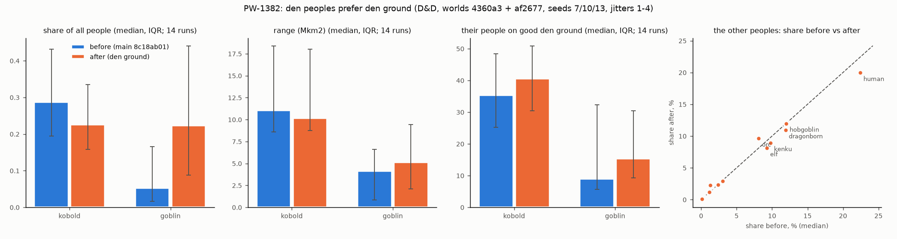

# Den peoples follow the rock (PW-1382), round 1

Lane 143, 2026-11-03. Baseline = main 8c18ab01 (plus the new `den` good, which nothing in the baseline model reads, and the
`den_ground` measure only); after = this branch. Both are the same 14 runs of `tools/peoples_robust.py` (D&D preset, families base +
jitter, worlds 4360a3 and af2677, seeds 7/10/13, jitters 1-4), the end of the history (~1500 AD).

## In plain words

Kobolds, goblins and troglodytes (the `denning` trait) used to live at full density on mountains, hills and badlands and at a quarter
of it everywhere else (lane 97). Now their density follows the **den ground**: a 0-1 map per cell of how many caves, rock shelters
and diggable ground the world's geology gives (limestone karst, lava plains, soft volcanic tuff, cliffs of hard bedded rock, sea
cliffs, thick loess, deep soft soil). On the best den ground a den people lives at its full density; where there is none it keeps
**half** (never zero, never a range limit), as Daniel ruled on 11-02 ("let appropriate races prefer them, but not rely on them.
Goblins can live all over! Kobolds too"). Where they can live (their habitat) does not read the den ground at all.

**What it did** (the same 14 D&D runs, main 8c18ab01 against this branch, medians; ):

- **Both den kinds still live widely, a little more on den ground.** Kobolds: range 11.1 to 10.2 Mkm2 (per run within about a quarter
  both ways, the smallest 2.1 to 2.2), the share of their people on good den ground 35% to 41%. Goblins: range 4.2 to 5.1 Mkm2
  (one run lost a third, 2.4 to 1.6; of the four 4360a3 runs where goblins had been cornered in under 1 Mkm2, three now hold 1.9-4.5 and one stays at 0.7),
  their people on good den ground 9% to 15%. No den kind shrank to a few refuges; both are alive in 14 of 14 runs, as before.
- **Shares:** kobolds 0.29% to 0.22% of all people, goblins 0.05% to 0.22%. Kobolds fell because they keep to the mountains, which
  the old rule counted as full den country everywhere; now crystalline and metamorphic mountains count as fair den ground (rock
  shelters, no caves: 0.4 x relief, x0.7 density), and only hard bedded rock, carbonate, basalt, tuff and loess count in full.
  Goblins rose because their rainforests are not broken country (they were at x0.25 on 90% of their people) and now keep at least
  x0.5. Den ground in the wet tropics is still thin on these worlds (deep red clays, little carbonate: PW-130).
- **The other peoples move only by the history's own chaos.** Per run, a non-den people's share changes by a median -0.4% of
  itself (10-90%: -28% to +27%: any change to one people reshuffles who wins which contest); pooled over the 14 runs: humans
  23.9% to 22.3%, hobgoblins 15.8 to 15.5, dragonborn 11.3 to 10.8, kenku 9.2 to 8.7, elves 9.1 to 8.7, orcs 8.9 to 9.4, dwarves
  4.1 to 4.5, leonin 3.4 to 5.1, halflings 3.1 to 4.1, the rest within half a point. Total people median 936 to 945 million. No
  people extinct before or after (troglodytes die out at 60 kyr by authoring, both times). Nothing the change touches reads those
  peoples, so the pooled moves are the reshuffle, not a mechanism (no noise-floor rerun was made: the before/after differ only in
  the den peoples' density factor).

## Step 1: what the world already has (scope)

Read from a finished world's layers (`land._layers`, present-day, as every other land good the ladder reads):

| field | layer | used for | why |
|---|---|---|---|
| exposed rock | `surface_rock` (surface.ROCKS: limestone, dolomite, evaporite, sandstone, quartzite, flood basalt, hotspot basalt, tuff, coal measures, shale, granite...) | karst, gypsum karst, lava tubes, tuff, which rock makes shelter cliffs | the rock decides the cave type |
| landform class | `landform` (landform.py: karst, caprock, escarpment, lava plateau, hotspot...) | karst (wet carbonate), cliffs by definition (caprock, escarpment), lava | already the geology's own classification (PW-007, PW-012) |
| relief | elevation, rise to the steepest neighbour (m per km, as the `hills` good) | rock shelters need a cliff to cut | the old "broken country" rule read the same relief |
| sea cliffs | the `cliff` good (coast forms) | sea caves | |
| loess | `loess` (m, soils.py) | dug dwellings | the yaodong case |
| soil | `soil_depth`, `soil_texture`, `soil_drainage`, `permafrost` | burrows in deep soft dry soil | |

Not used: `strata_top` (the same as `surface_rock` on these worlds to within a point), the resource layers (ore says nothing about
caves), `sediment_cover`. The world has no cave or lava-tube layer of its own; zooms synthesise karst detail (PW-012) but the
history runs on the globe.

**A gap found on the way (PW-130, already open):** exposed carbonate is ~1% of land on both suite worlds (limestone 1.4% / 0.8%,
dolomite 0%, the karst landform 0.02% / 0.15%), against 15.2% of Earth's ice-free land (Goldscheider et al. 2020). So karst
contributes little here; most good den ground comes from relief on hard sedimentary rock, tuff and loess. The field is robust to
that (it takes the best of several den kinds), and gets karst for free when PW-130 lands.

## Step 2: where caves and shelters really are (sources read in this lane)

- **Karst.** Goldscheider, Chen, Auler, Bakalowicz, Broda, Drew et al. 2020, "Global distribution of carbonate rocks and karst water
  resources", *Hydrogeology Journal* 28:1661-1677 (the WOKAM map; KIT open-access PDF): "15.2% of the global ice-free continental
  surface is characterized by the presence of karstifiable carbonate rock"; "31.1% of all surface exposures of carbonate rocks
  occur in plains, 28.1% in hills and 40.8% in mountains"; "About 34.2% of all carbonate rocks occur in arid climates"; "1.18
  billion people (16.5% of the global population) live on karst"; "it is safe to assume that all carbonate rocks are karstified
  unless proven otherwise"; and "karstification also occurs in evaporite rocks such as gypsum". So carbonate counts in any climate
  and on flat land too (CARBONATE 0.8; the wet karst landform 1.0), gypsum less (0.5).
- **Lava tubes.** US National Park Service, "Basaltic Lava Flows" (nps.gov/subjects/volcanoes): "Lava tubes are usually only found
  in pāhoehoe flows", the basaltic flows of shield volcanoes such as Hawai'i, with long tube caves at Lava Beds and El Malpais. So
  basalt plains and shields (flood basalt, hotspot basalt, the lava-plateau and hotspot landforms) score 0.7; arc andesite does not.
  (The USGS Mauna Ulu paper on tube formation returned 403; not cited.)
- **Rock shelters.** Knoll 2003, "Origin of sandstone rock shelters on the southern Cumberland Plateau in the vicinity of Sewanee,
  Tennessee", GSA South-Central/Southeastern joint meeting abstract: shelters in the Warren Point Sandstone form by "preferential
  erosion of intercalated layers of shale or coal at a cliff base with subsequent roof collapse", by streams undercutting cliffs, and
  by erosion of poorly cemented sandstone at a cliff base; in the Sewanee Conglomerate "primarily by the action of ground water".
  Aboriginal Heritage Tasmania, "Aboriginal rockshelters": a rockshelter is "a cave, overhang or rock arch", "usually in areas of
  limestone, dolerite and sandstone". So a shelter needs a cliff (relief) in hard bedded or jointed rock: sandstone, quartzite,
  carbonate, basalt and coal measures score 0.8 x relief, the caprock and escarpment landforms 0.8. Crystalline and soft rock with
  relief score 0.4 / 0.2 x relief (a judgement: no source read gives shelter rates by rock).
- **Carved soft rock.** Wikipedia, "Cappadocia": people "carved out houses, churches and monasteries from the soft rocks of volcanic
  deposits" (ignimbrites), and dug underground cities. Tuff scores 0.8.
- **Dug ground.** Wikipedia, "Yaodong": farmers "use loess's features (wall stability) to dig"; "between 30 and 40 million people in
  northern China still lived in yaodongs" in the early 2000s, on the Loess Plateau (Gansu, Shaanxi, Shanxi, Henan, Ningxia). Thick
  loess scores up to 0.8 (from 0.5 m, full at 3 m); deep, well-drained loam/silt/clay soil out of permafrost up to 0.3 (a judgement:
  burrows, not cave systems).
- Not found: any global share of land with rock shelters, or the share of land with lava tubes. The weights are judgements inside
  the sources' ordering (cave systems > single shelters > dug burrows), not fitted to anything.

## Step 3: the build

- `planet/lineages/dens.py::fitness`: the den ground per cell, the **best** of the parts above (a cell offers dens if it has any
  kind), 0 off land and under ice. It becomes the `den` land good (`land.GOODS`, area-like, geology so valid in the ice ages too).
- `planet/lineages/ladder.py::den_thin`: a line's density factor, `1 - den x (1 - fit)`; the `denning` trait's `den` is now **0.5**
  (was 0.75). x1 on the best den ground, x0.5 on none. Set once in `Ladder.__init__` from the goods (was `history.model.run` from
  the broken-country tags).
- Removed: the broken-country rule (`params.DEN_THIN` and the old lane 83 habitat cut in `habitat.capacity` that it switched off).
  The habitat of a den people is now a plain people's everywhere, as the ruling asks (no range limit).
- On the suite worlds 17.8% of land (median of the 14 runs' worlds) is good den ground (>= 0.5), mean den ground 0.29; the old
  broken country covered 37.0%.
- Viewer: the land goods are not a viewer layer, so no layer was added (inbox draft `den-ground-viewer-layer`).

## Step 4: measured

Before = main 8c18ab01, after = this branch, both the same 14 D&D runs; medians over the runs. "Good den ground" = den ground >=
0.5 (17.8% of the land, median over the runs' worlds); "broken" = mountain, hills or breaks (the old rule's den country, 37.0% of
the land). b = before, a = after.

| people | share b | a | range Mkm2 b | a | range on good den ground b | a | people on good den ground b | a | people on broken b | a | alive b | a |
|---|---|---|---|---|---|---|---|---|---|---|---|---|
| kobold | 0.3% | 0.2% | 11.08 | 10.18 | 24% | 24% | 35% | 41% | 97% | 87% | 14/14 | 14/14 |
| goblin | 0.1% | 0.2% | 4.16 | 5.14 | 6% | 9% | 9% | 15% | 10% | 2% | 14/14 | 14/14 |
| human | 22.4% | 20.0% | 38.63 | 37.62 | 19% | 19% | 24% | 24% | 29% | 28% | 14/14 | 14/14 |
| hobgoblin | 12.0% | 12.0% | 21.19 | 21.23 | 15% | 14% | 16% | 16% | 24% | 23% | 14/14 | 14/14 |
| dragonborn | 11.9% | 10.9% | 25.92 | 26.67 | 22% | 22% | 21% | 21% | 34% | 31% | 14/14 | 14/14 |
| orc | 8.1% | 9.6% | 15.83 | 15.58 | 24% | 23% | 22% | 19% | 40% | 42% | 14/14 | 14/14 |
| kenku | 9.8% | 8.9% | 20.51 | 20.06 | 4% | 3% | 4% | 3% | 15% | 15% | 14/14 | 14/14 |
| elf | 9.3% | 8.1% | 21.22 | 20.82 | 4% | 4% | 5% | 5% | 25% | 23% | 14/14 | 14/14 |
| gnome | 3.1% | 2.9% | 10.52 | 11.09 | 15% | 15% | 20% | 20% | 28% | 25% | 14/14 | 14/14 |
| dwarf | 2.4% | 2.3% | 3.56 | 3.21 | 24% | 28% | 30% | 31% | 93% | 95% | 14/14 | 14/14 |
| halfling | 1.3% | 2.3% | 2.43 | 3.48 | 18% | 19% | 21% | 21% | 20% | 20% | 14/14 | 14/14 |
| leonin | 1.4% | 2.1% | 12.86 | 13.39 | 21% | 21% | 20% | 20% | 30% | 29% | 14/14 | 14/14 |
| bugbear | 1.1% | 1.2% | 6.42 | 6.31 | 8% | 10% | 9% | 8% | 31% | 36% | 14/14 | 14/14 |
| goliath | 0.3% | 0.3% | 1.56 | 2.33 | 25% | 22% | 31% | 29% | 93% | 96% | 14/14 | 14/14 |
| tabaxi | 0.4% | 0.3% | 6.34 | 4.15 | 13% | 12% | 19% | 24% | 10% | 8% | 14/14 | 14/14 |
| firbolg | 0.3% | 0.3% | 1.70 | 1.84 | 12% | 7% | 10% | 9% | 44% | 44% | 14/14 | 14/14 |
| drow | 0.2% | 0.3% | 0.52 | 0.54 | 2% | 2% | 1% | 1% | 100% | 100% | 14/14 | 14/14 |
| triton | 0.1% | 0.1% | 3.44 | 3.63 | 45% | 47% | 41% | 43% | 37% | 35% | 14/14 | 14/14 |
| aarakocra | 0.1% | 0.1% | 12.13 | 13.65 | 29% | 27% | 53% | 50% | 78% | 73% | 14/14 | 14/14 |
| lizardfolk | 0.1% | 0.1% | 16.18 | 16.08 | 11% | 10% | 21% | 20% | 9% | 9% | 14/14 | 14/14 |
| tortle | 0.1% | 0.1% | 2.93 | 3.19 | 43% | 44% | 42% | 43% | 26% | 28% | 14/14 | 14/14 |
| sea_elf | 0.0% | 0.0% | 1.19 | 1.14 | 56% | 51% | 52% | 50% | 49% | 53% | 14/14 | 14/14 |

Observations (no ticket needed):
- Range barely follows density here: the contest reads fit, not density (overview, "since the contest reads fit and not density"),
  so the den ground mostly moves head counts and where the people are thickest, which is what the ruling asked. The goblin ranges
  that grew are runs where goblins had been held to under 1 Mkm2 (a stronger people at x0.5 instead of x0.25 holds more ground
  through the brakes and growth that do read numbers).
- Dwarves (93-95% of people on broken country) and goliaths are not den peoples and do not read the den ground; their small moves
  are the reshuffle.
- Den ground is the best of its parts, so the field is never all-zero on any tree or world with rock and soil, and on a world with
  none of it every den people simply sits at x0.5: no clamp, nothing fitted to these worlds.

## Tests

- New `tests/test_lineages.py::test_den_peoples_prefer_den_ground_but_live_on_poor_ground` (replaces the broken-country test): a
  den people's habitat equals a plain people's; dens.fitness scores karst 1, bare shale plain 0, crystalline relief 0.4, thick loess
  0.8; on a world where half the cells have no den ground the den people's density there is exactly half its density on the best
  ground, never zero; a non-den people's factor is 1 everywhere.
- Full suite at the end: 955 passed, 2 skipped (`pytest -n 10`, 14.5 min). Golden hashes unchanged (they do not run the peoples).

## How it was run

- Baseline: `git archive` of main 8c18ab01 in scratch, plus `dens.py`, the `den` good in `land.py` (read by nothing in that model)
  and this branch's `tools/peoples_robust.py` (the `den_ground` measure). `PLANET_DATA` a scratch root whose `worlds/` links each
  shared world file but keeps its own `goods/` cache (nothing written into the shared worlds/). `--arms now --family base,jitter
  --trees dnd --jobs 6 --threads 2`, ~7 min a run. After: this branch, same command and seeds.
- `docs/review/peoples/dens/dens_compare.py BEFORE AFTER --png dens.png` prints the tables and draws the chart. Scratch outputs
  deleted after; the numbers are here.
